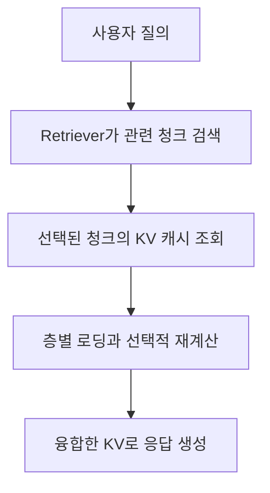

---
categories:
- paper-review
- with-gpt
date: '2024-10-31'
tags:
- Machine Learning
title: CacheBlend Fast Large Language Model Serving for RAG with Cached Knowledge
  Fusion
lastmod: '2026-10-25T00:54:46+09:00'
description: CacheBlend는 검색된 청크의 KV 캐시를 일부 재계산해 융합한다. 토큰 선택, 로딩 파이프라인, Prompt Cache와의
  차이 및 실험 조건을 원문과 대조한다.
---

논문: [CacheBlend: Fast Large Language Model Serving for RAG with Cached Knowledge Fusion](https://arxiv.org/abs/2405.16444v3)

> 2026-10-25 원문 재검토: 아래 설명은 2025년 개정된 v3를 기준으로 한다. 기존 GPT 대화에서 검색 단계와 KV 융합 단계를 혼동한 부분, 근거 없는 TF-IDF/BERT 기반 로딩 설명과 품질 보장 표현을 수정했다.

## 어떤 문제를 해결하는가

RAG가 검색한 문서 청크 A와 B를 한 프롬프트에 넣는다고 하자. A와 B를 각각 독립적으로 처리해 저장한 KV 캐시를 이어 붙이면, B의 표현에는 앞선 A를 읽은 영향이 빠져 있다. 위치 정보를 맞추는 것만으로 이 차이를 복구할 수는 없다.

CacheBlend는 **검색된 청크의 캐시를 재사용하되, 일부 토큰의 KV를 현재 문맥에 맞게 재계산**한다. 여기서 논문이 부르는 cross-attention은 서로 다른 청크 사이의 causal self-attention이다. 별도의 encoder-decoder cross-attention 모듈을 도입하는 것은 아니다. [§3–4](https://arxiv.org/html/2405.16444v3#S3)

| 방식 | 재사용하는 상태 | 앞선 청크가 바뀌었을 때 |
| --- | --- | --- |
| Prefix caching | 동일한 전체 접두사의 KV | 접두사가 정확히 일치하는 범위에서 재사용 가능 |
| Full KV reuse | 독립적으로 계산한 각 청크의 KV | 위치를 보정해도 청크 사이 문맥 영향은 빠짐 |
| CacheBlend | 각 청크의 KV와 일부 재계산한 KV | 선택한 토큰을 갱신해 문맥 차이를 줄임 |

일반적인 prefix caching은 동일한 접두사와 모델·실행 조건에서 full prefill의 계산을 재사용한다. 반면 독립 청크의 캐시를 융합하는 CacheBlend는 근사 방식이며, 모든 입력에서 같은 출력이나 무손실 품질을 보장하지 않는다.

## 검색과 KV 융합은 어떻게 연결되는가

관련 청크를 선택하는 일은 앞단의 retriever가 맡는다. CacheBlend의 loading controller는 선택된 청크의 캐시 존재 여부와 저장 위치를 확인하고 로딩·재계산을 조율한다. 캐시 관리자는 텍스트 해시로 캐시를 찾는다. 논문은 이 구성요소가 TF-IDF나 BERT로 질의 키워드를 추출해 KV를 우선순위별로 검색한다고 설명하지 않는다. [§5.2, §6](https://arxiv.org/html/2405.16444v3#S5.SS2)

예를 들어 retriever가 A와 B를 골랐다면, CacheBlend는 A와 B의 KV를 어떻게 빠르게 융합할지 결정한다. 질의와 덜 관련된 C를 검색 결과에서 제외하는 정책은 별도의 검색 정책이다.

## 어떤 토큰을 다시 계산하는가

논문은 full prefill의 KV와 독립적으로 저장한 KV 사이의 차이가 큰 토큰을 HKVD(high KV deviation) 토큰이라고 부른다. 그렇다고 매 층에서 모든 토큰을 full prefill한 뒤 정답 KV와 비교하면 비용 절감의 목적을 잃는다.

실제 설계는 인접한 층에서 편차가 큰 토큰이 비슷하다는 관찰을 활용한다. 초기 층에서 후보를 평가하고, 뒤의 층에서는 앞선 후보의 KV를 재계산해 저장된 KV와의 편차를 비교하면서 후보를 점진적으로 좁힌다. 모든 층에서 전체 토큰의 정확한 편차를 미리 아는 방식은 아니다. [§4.3, Figure 9; 구현의 check_flag와 HKVD_indices는 §6](https://arxiv.org/html/2405.16444v3#S4.SS3)

선택된 토큰을 처리하는 한 층의 흐름은 다음과 같다.

1. 선택한 토큰의 입력으로 Q·K·V를 계산한다.
2. 선택하지 않은 토큰의 K·V는 저장된 캐시에서 가져와 결합한다.
3. 선택한 토큰의 Q가 causal mask 아래에서 전체 가용 K·V에 attention하도록 계산한다.
4. 계산한 출력을 다음 층으로 넘긴다.

즉, 재계산하지 않는 토큰을 attention의 참조 대상에서도 제거하는 것은 아니다. 논문은 토큰의 약 10–20%를 재계산하는 설정에서 품질을 유지할 수 있음을 실험했지만, 적절한 비율은 입력·모델·품질 목표에 따라 확인해야 한다. [§4.2–4.3](https://arxiv.org/html/2405.16444v3#S4.SS2)

## 로딩과 재계산의 시간을 겹친다

한 층을 재계산하는 동안 다음 층의 KV를 GPU로 옮긴다. 이상적으로 두 단계가 충분히 겹치면 층당 정상 상태 시간은 다음처럼 생각할 수 있다. 이 식은 병목을 설명하기 위한 근사이며 실측 TTFT 식이 아니다.

$$
T_{\mathrm{layer}} \approx \max(T_{\mathrm{load}}, T_{\mathrm{recompute}}).
$$

파이프라인을 채우고 비우는 시간, 동기화와 기타 연산은 추가된다. 재계산 시간이 로딩보다 길면 추가 연산을 전부 숨길 수 없다. 논문 §5는 4K 문맥의 Llama-7B 예시에서 층당 재계산 3ms와 SSD 로딩 16ms를 비교하고, Llama-70B에서는 7ms와 4ms를 비교한다. 따라서 “SSD에서 읽어도 항상 추가 지연이 없다”는 결론은 성립하지 않는다. [§5](https://arxiv.org/html/2405.16444v3#S5)

## 성능 수치는 어떤 조건에서 나왔는가

| 항목 | 논문 v3의 보고와 조건 |
| --- | --- |
| 모델 | Mistral-7B, Yi-34B, Llama-70B; 뒤의 두 모델은 8-bit 모델 양자화 적용 |
| 하드웨어 | RAM 128GB, A40 GPU 2개, NVMe SSD 1TB; 모델에 따라 GPU 1개 또는 2개 사용 |
| 태스크 | 2WikiMQA, Musique, SAMSum, MultiNews의 QA·요약 평가 |
| TTFT | full KV recompute 대비 2.2–3.3배 가속 |
| 처리량 | 초록에서 full KV recompute 대비 2.8–5배 향상 보고 |
| 품질 | §7은 full recompute 및 prefix caching 대비 0.01–0.03의 점수 하락도 명시 |

이 수치는 **논문의 모델·데이터·캐시 재사용 조건에서 측정한 결과**다. §7.1의 처리량용 확장 데이터는 초기 캐시가 비어 있는 첫 1,000개 질의를 결과에서 제외한다. 신규 문서가 많아 캐시 적중률이 낮은 운영 환경에 같은 배수를 그대로 적용하면 안 된다. [초록, §7–7.1](https://arxiv.org/html/2405.16444v3#S7)

## Prompt Cache와의 차이와 적용 한계

[Prompt Cache](https://arxiv.org/html/2311.04934v2)는 PML 스키마에 모듈별 위치 ID를 지정해 재사용한다. “접두사에 있는 모듈만 재사용한다”는 설명은 부정확하다. 다만 독립적으로 인코딩한 모듈 사이의 문맥 영향이 빠질 수 있고, 원문은 이를 보완하는 scaffolding도 설명한다. CacheBlend는 현재 조합된 입력에서 일부 토큰을 다시 계산해 그 차이를 줄인다는 점이 다르다.

개인적으로는 여러 문서를 함께 읽어야 하는 RAG에서, 청크 캐시 재사용의 속도와 문맥 결합의 품질 사이를 조절한다는 점이 흥미롭다. 적용 시에는 캐시 적중률, 저장 장치 대역폭, 재계산 비율별 답변 품질, cold-start를 포함한 TTFT를 함께 측정하고 싶다. 이것은 적용에 대한 의견이며 논문이 보장한 운영 결과는 아니다.
