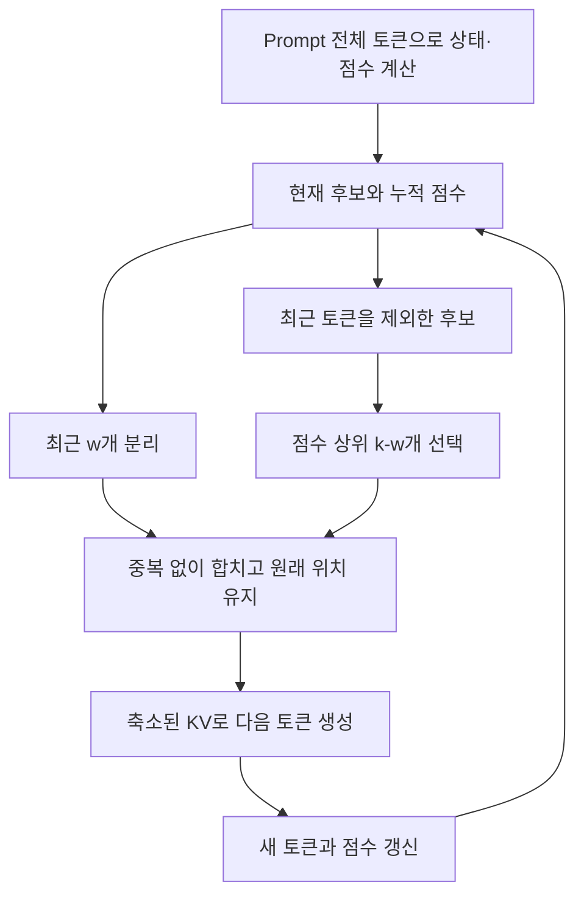

---
categories:
- paper-review
- with-gpt
date: '2024-10-31'
tags:
- Machine Learning
- Hardware Architecture
- Natural Language Processing
title: Keyformer KV Cache Reduction through Key Tokens Selection for Efficient Generative
  Inference
lastmod: '2026-10-25T01:45:34+09:00'
description: Keyformer의 고정 KV 예산, 최근 윈도우를 제외한 핵심 토큰 선택, Gumbel 점수 누적과 온도, 위치 보존 및
  배치별 성능 조건을 원문으로 검토한다.
---

논문: [Keyformer: KV Cache reduction through key tokens selection for Efficient Generative Inference](https://arxiv.org/abs/2403.09054v1)

> 2026-10-25 원문 재검토: v1을 기준으로 기존 GPT 대화의 온도·캐시 예산 설명과 예제 코드를 수정했다. 아래 코드는 선택 규칙만 설명하는 실행 가능한 예시이며 전체 LLM 구현이나 논문 실험의 재현은 아니다.

## 핵심 토큰과 최근 토큰을 함께 남긴다

Keyformer는 decoder의 KV 캐시에 **점수가 높은 과거 토큰과 최근 토큰**을 남기고 나머지를 제거한다. 최근 문맥만 남기면 오래된 중요 정보를 잃고, 누적 점수만으로 고르면 최근 문맥을 잃을 수 있으므로 두 종류를 결합한다.

캐시의 전체 토큰 예산을 $k$, 최근 윈도우를 $w$라고 하면 나머지 $k-w$개를 핵심 토큰으로 선택한다. 핵심 토큰 후보에서는 최근 $w$개를 제외해야 한다. 같은 토큰을 두 집합에서 중복으로 골라 실제 보관 개수가 예산보다 작아지면 원문의 선택 규칙과 달라진다. [§2.3, §3.4, Algorithm 1](https://arxiv.org/html/2403.09054v1#S3.SS4)

[Quest](https://arxiv.org/abs/2406.10774v1)가 전체 KV를 보관하고 이번 단계에서 읽을 페이지만 고르는 것과도 다르다. Keyformer에서 제거한 KV는 뒤의 단계가 참조할 캐시에 남아 있지 않다. 따라서 앞으로 중요해질 정보까지 항상 보존한다고 보장할 수는 없다.

## 점수 함수는 무엇을 누적하는가

토큰을 버리면 softmax의 분모가 달라지고, 남은 토큰에 할당되는 점수 분포도 바뀐다. 논문은 단순 누적 attention 점수의 한계를 논의한 뒤, **Q·K 내적의 정규화 전 logits에 Gumbel 조정을 더한 점수**를 제안한다. 단어의 의미를 보고 “fox”나 “dog”를 키워드로 지정하는 방식이 아니다. [§2.3.2–3.3](https://arxiv.org/html/2403.09054v1#S3.SS3)

현재 참조할 수 있는 토큰 집합을 $C_t$라 하고, 토큰 $i$의 logit을 $x_{t,i}$, Gumbel 조정값을 $\zeta_{t,i}$라고 쓰면 점수 누적을 다음처럼 나타낼 수 있다. 아래의 시간 첨자는 단계를 구분하기 위한 표기이며 noise의 재샘플링 정책까지 지정하는 것은 아니다.

$$
p_{t,i}=\frac{\exp((x_{t,i}+\zeta_{t,i})/\tau_t)}
{\sum_{j\in C_t}\exp((x_{t,j}+\zeta_{t,j})/\tau_t)},
\qquad f_i\leftarrow f_i+p_{t,i}.
$$

이 식은 **캐시 선택용 점수 함수**다. 별도의 학습된 attention 층을 하나 더 쌓는 “attention on attention” 구조라고 설명하면 오해하기 쉽다. 누적값은 유지된 토큰의 선택에 사용되며, 모든 토큰의 의미적 중요도나 향후 기여를 정확히 안다는 뜻은 아니다. [§3.3–3.4, Eq. 7, Algorithm 1](https://arxiv.org/html/2403.09054v1#S3.SS3)

## 온도는 분포를 바꾸고 예산은 k가 정한다

논문은 prompt 단계의 온도를 1로 두고, 생성 단계에서 2를 향해 증가시키는 설정을 사용한다. 온도가 높아지면 같은 조정 logit들 사이의 점수 분포가 더 완만해진다. <strong>캐시에 남길 토큰 수는 여전히 $k$</strong>이므로 온도가 직접 압축률을 바꾸는 것은 아니다. [§3.3.1–3.4](https://arxiv.org/html/2403.09054v1#S3.SS3)

특히 조정 logit이 고정돼 있고 양의 온도만 바꾸면, 한 단계 안에서의 점수 순서는 바뀌지 않는다. 하지만 각 단계의 점수를 누적할 때 더해지는 크기가 달라지므로 최종 누적 점수와 선택 결과에는 영향을 줄 수 있다. 온도와 토큰 수를 같은 제어 변수로 취급하면 안 된다.

고정된 $k$에서 $w$를 늘리면 최근 토큰 비중이 커지고 핵심 토큰에 쓸 수 있는 $k-w$는 줄어든다. 전체 캐시 크기 자체가 늘어나는 것은 아니다. 반면 $k$를 늘리는 것은 저장 예산을 늘리는 변경이다.

## 한 단계의 선택을 코드로 확인하기

아래는 이미 누적 점수가 계산됐다고 가정한 **선택 부분만의 예시**다. Token ID는 실제 tokenizer 출력이 아닌 설명용 위치 번호이며, 점수는 임의로 정했다. 전체 attention·점수 계산·층별 처리·KV 텐서 압축은 구현하지 않는다.

```python
def select_cache(token_ids, scores, k, w):
    # token_ids는 과거부터 현재 순서의 고유한 위치 ID다.
    if k < 1 or not 0 <= w <= k:
        raise ValueError("require k >= 1 and 0 <= w <= k")
    if len(set(token_ids)) != len(token_ids):
        raise ValueError("token IDs must be unique")

    recent = token_ids[-w:] if w else []
    older = token_ids[:-w] if w else token_ids
    budget = min(k, len(token_ids))
    key_count = budget - len(recent)
    # sorted는 동점이면 입력의 순서를 유지한다.
    key_tokens = sorted(older, key=lambda i: scores[i], reverse=True)[:key_count]
    keep = set(key_tokens) | set(recent)
    # 위치 번호를 재부여하지 않고 원래 순서로 반환한다.
    return [i for i in token_ids if i in keep]


ids = [0, 1, 2, 3, 4]
scores = {0: 0.40, 1: 0.20, 2: 0.10, 3: 0.05, 4: 0.25}
print(select_cache(ids, scores, k=3, w=1))  # [0, 1, 4]
```

최근 토큰은 ID 4다. 핵심 토큰은 ID 4를 제외한 후보에서 점수가 높은 ID 0·1을 선택한다. 만약 전체에서 상위 2개를 고르면 ID 0·4가 나오고, 최근 토큰 ID 4와 합쳐도 두 개만 남는다. 이 중복을 피하는 것이 원문의 `f_theta[:-w]` 선택 범위가 뜻하는 바다. 코드의 `w=0` 처리는 Python의 `[:-0]`가 빈 목록이 되는 특수한 경우도 구분한다.

새 토큰을 추가한 뒤에는 현재 보유한 토큰과 새 토큰에서 다음 캐시를 고른다. 이 작은 함수는 이미 제거한 ID를 다시 복구하지 않는다. 토큰이 $k$개보다 적으면 존재하는 토큰만 남기며, 실제 구현의 일시적 버퍼까지 항상 정확히 $k$칸이라는 뜻은 아니다.



## 위치를 다시 번호 매기면 다른 방법이 된다

캐시를 압축하더라도 남긴 토큰의 원래 위치 정보를 유지해야 한다. 원문은 이 차이를 실험으로 비교한다. 아래는 CNN/DailyMail의 MPT-7B 결과 일부이며 캐시를 60% 남긴 설정이다.

| Table 3 설정 | ROUGE-2 |
| --- | --- |
| Full Attention | 17.6329 |
| 원문 표의 Full 99% 목표선 | 17.4565 |
| Keyformer, 원래 위치·Per-Layer 점수 | 17.5976 |
| Keyformer, 새 위치·Per-Layer 점수 | 16.9092 |
| Keyformer, 원래 위치·Shared 점수 | 17.3732 |

위치 유지와 점수 공유 여부는 모두 결과에 영향을 준다. 이 표의 “99%”는 **Full Attention 점수 대비 유지율**에 대한 기준이며, 모든 답변이 절대 정확도 99% 이상이라는 뜻이 아니다. 또한 여기서의 60%는 **남긴 캐시 비율**이며 60%를 제거했다는 뜻이 아니다. [§4.4.1–4.4.2, Table 3](https://arxiv.org/html/2403.09054v1#S4.SS4)

## 2.1배 지연 개선과 2.4배 처리량의 조건

평가에는 GPT-J·Cerebras-GPT·MPT 계열 모델과 CNN/DailyMail·GovReport 요약, SODA 대화, few-shot 과제가 포함된다. 원문은 beam size 4와 NVIDIA A100 80GB 환경을 설명한다. MPT-7B는 모델이며, 별개의 벤치마크 이름이 아니다. [§4](https://arxiv.org/html/2403.09054v1#S4)

Table 1의 MPT-7B, 입력 4,096 + 생성 4,096토큰 결과를 보면 다음과 같다. Full은 원래 캐시, H₂O는 캐시 90%, Keyformer는 캐시 50% 조건이다.

| 배치 | Full Attention | H₂O | Keyformer |
| --- | --- | --- | --- |
| BS=1 | 8.3 tokens/s | 14.1 tokens/s | 17.0 tokens/s |
| BS=2 | OOM | OOM | 19.85 tokens/s |

같은 배치의 처리량 비율은 $17.0/8.3\approx2.05$배이고, Keyformer의 BS=2를 Full의 BS=1과 비교하면 $19.85/8.3\approx2.39$배다. **2.4배는 더 큰 배치가 가능한 조건의 처리량 개선**이며 같은 요청의 지연이 그만큼 줄었다는 뜻이 아니다. 논문의 2.1배 지연 개선도 §4.2의 synthetic prompt·생성 길이 조합과 비교 조건에서 보고한 결과다. [§4.2, Figure 9, Table 1](https://arxiv.org/html/2403.09054v1#S4.SS2)

50% KV 예산은 KV payload를 줄이지만, 가중치와 실행 버퍼·점수 상태까지 포함한 전체 VRAM이 항상 절반이 되는 것은 아니다. Prompt 전체 상태를 처리하는 단계와 이후 축소된 캐시로 생성하는 단계도 구분해야 한다.

## 품질 손실이 없는가

원문은 여러 요약 설정에서 목표 점수를 유지한 결과를 보여주지만, 모든 모델·과제에서 무손실이라는 보장은 아니다. 예를 들어 Table 2의 MPT-7B 0-shot 결과에서 COPA는 Full 80.0에서 Keyformer 76.0, Winogrande는 68.7에서 64.1로 낮아진다. [§4.3, Table 2](https://arxiv.org/html/2403.09054v1#S4.SS3)

평가하지 않은 T5 등에 대한 구체적인 실패를 논문의 결과처럼 제시할 근거도 없다. 실제 적용에서는 모델·태스크·남길 비율·최근 윈도우·출력 길이를 정하고 품질을 측정해야 한다.

개인적으로는 최근 문맥과 누적 중요도를 함께 이용해 캐시를 줄이는 방식이 흥미롭다. 다만 한 번 제거한 정보가 뒤에서 필요해질 수 있다는 한계는 남는다. 요약의 ROUGE뿐 아니라 사실 보존, 지시 준수와 긴 출력에서의 실패도 별도로 확인하고 싶다. 이는 리뷰어의 적용 제안이며 원문이 검증한 운영 결과는 아니다.
