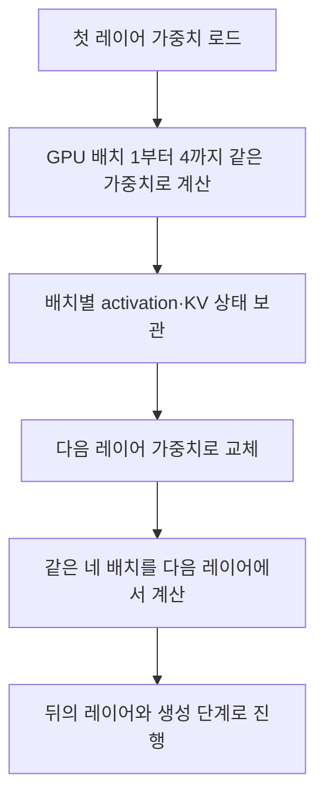

---
categories:
- paper-review
- with-gpt
date: '2024-11-01'
tags:
- Machine Learning
- Performance
title: FlexGen High-Throughput Generative Inference of Large Language Models with
  a Single GPU
lastmod: '2026-10-25T10:14:06+09:00'
description: FlexGen의 GPU 배치 간 가중치 재사용, 처리량 중심 정책 탐색, CPU attention과 4-bit 압축의 제약
  및 단일 GPU 실험 조건을 원문으로 검토한다.
---

논문: [FlexGen: High-Throughput Generative Inference of Large Language Models with a Single GPU](https://arxiv.org/abs/2303.06865v2)

> 2026-10-25 원문 재검토: 2023년 개정된 v2를 기준으로 기존 GPT 대화의 block scheduling·최적화 목표·시스템 비교를 수정했다. 아래 작은 계산 예시는 논문 실측과 구분한다.

## 대화 한 건의 응답 속도보다 대량 작업의 처리량

FlexGen은 GPU 메모리가 작은 환경에서 큰 LLM을 실행하기 위해 GPU·CPU·디스크의 메모리를 함께 활용한다. 목표는 응답 지연에 덜 민감한 벤치마킹·정보 추출·대량 문서 처리에서 **많은 요청을 묶어 처리량을 높이는 것**이다. “단일 GPU”가 시스템 전체에 16GB 메모리만 쓴다는 뜻은 아니다. [§1, §4](https://arxiv.org/html/2303.06865v2#S1)

논문의 generation throughput은 생성한 토큰 수를 **prefill과 decode를 합친 총 시간**으로 나눈 값이다. 유효 배치 $B$, 요청당 생성 길이 $n$, 배치 전체 처리 시간 $T$에 대해 다음과 같다.

$$
\operatorname{throughput}=\frac{Bn}{T}.
$$

그러므로 배치 전체에서 초당 1토큰을 생성했다는 결과를, 개별 사용자가 초당 1토큰을 받는 대화 서비스의 지연으로 읽으면 안 된다. TTFT나 토큰 간 지연을 직접 뜻하는 값도 아니다. [§3](https://arxiv.org/html/2303.06865v2#S3)

## Block은 여러 GPU 배치에 걸친 가중치 재사용 단위다

모델의 모든 레이어를 GPU에 상주시킬 수 없다고 하자. 한 GPU 배치를 먼저 끝내는 순서라면 같은 레이어 가중치를 다음 배치를 위해 다시 로드해야 한다. FlexGen은 **같은 레이어를 여러 GPU 배치에 적용한 뒤 다음 레이어로 이동**해 가중치 로딩을 분담한다.

GPU 배치 크기를 $g$, 한 block에 포함한 GPU 배치 수를 $m$이라고 쓰면 유효 배치, 즉 block size는 $B=gm$이다. 원문의 block size는 단순히 “함께 올리는 레이어 수”가 아니다. [§4.2, Figure 3, Algorithm 1](https://arxiv.org/html/2303.06865v2#S4.SS2)

예를 들어 **설명용 가정**으로 3개 레이어의 가중치가 각각 2GB이고, GPU 배치 4개를 처리한다고 하자. 가중치가 계속 상주할 수 없고 다른 재사용도 없다고 가정하면, 배치마다 3개 레이어를 다시 읽는 순서는 가중치 전송이 $4\times3\times2=24$GB다. 같은 레이어를 네 배치에 적용하며 재사용하면 $3\times2=6$GB다.

이는 한 생성 단계의 **가중치 전송만** 세는 예시다. Activation·KV의 저장과 로딩, 연산, 동기화 비용이 남으므로 실제 실행 시간이 4배 빨라진다는 증명은 아니다. FlexGen은 다음 레이어 가중치 로드, 다른 배치의 activation·KV 이동, 현재 배치의 계산을 겹친다. [§4.2](https://arxiv.org/html/2303.06865v2#S4.SS2)

## 정책 탐색이 최소화하는 것은 무엇인가

정책은 유효 배치·GPU 배치 크기와, 가중치·activation·KV 각각의 GPU·CPU·디스크 배치 비율을 포함한다. 가중치 비율을 $w_g,w_c,w_d$라고 하면 합은 1이고, 다른 두 종류의 텐서도 같은 제약을 가진다. 각 장치의 최고 메모리 사용량도 용량 이하여야 한다.

FlexGen은 배치 크기 후보들을 먼저 열거하고, 고정된 후보에서 텐서 배치 비율을 선형 계획법으로 찾는다. 비교 목적은 단순한 $T$ 최소화가 아니라 **$T/B$ 최소화**다. 생성 길이가 고정돼 있으면 처리량 최대화와 같은 방향이다. [§4.3, Eq. 1](https://arxiv.org/html/2303.06865v2#S4.SS3)

| 설명용 정책 | 유효 배치 B | 전체 처리 시간 T | 요청당 32토큰일 때 처리량 |
| --- | --- | --- | --- |
| A | 8 | 4초 | 64 tokens/s |
| B | 32 | 8초 | 128 tokens/s |

이 임의의 예시에서는 B가 전체 완료까지 더 오래 걸리지만, 같은 시간 동안 더 많은 요청의 토큰을 처리한다. 따라서 “총 시간이 가장 짧은 정책”과 “처리량이 가장 높은 정책”은 다를 수 있다.

원문의 비용 모델은 다음과 같이 prefill과 이후 decode 시간을 추정한다.

$$
T\approx lT_{\mathrm{pre}}+l(n-1)T_{\mathrm{gen}}.
$$

$l$은 레이어 수다. 겹침을 이상적으로 가정해 전송·연산 시간 중 최대값으로 단계 비용을 모델링한다. 정책 비율은 연속값으로 완화해 풀며, 실제 텐서 분할과 메모리 단편화는 완벽히 반영하지 못한다. 자동 탐색 결과가 OOM을 내거나 수동 조정으로 더 좋아지는 경우도 원문이 명시한다. “자동화가 전혀 없다”거나 “전역 최적 정책이 항상 보장된다”는 양쪽 설명을 피해야 한다. [§4.3, Appendix A.3](https://arxiv.org/html/2303.06865v2#S4.SS3)

## CPU는 저장소 역할만 하는가

KV가 CPU 메모리에 있다면, GPU로 큰 KV 전체를 옮기는 대신 **일부 attention 계산을 CPU에 위임**하는 선택도 있다. 이때는 더 작은 activation을 이동하는 것으로 전송을 줄일 수 있다. 그러나 CPU 계산 속도와 전송량의 균형을 비용 모델로 판단해야 한다. [§4.2의 Computation delegation](https://arxiv.org/html/2303.06865v2#S4.SS2)

이 선택을 4-bit 압축과 무조건 동시에 사용한다고 설명하면 안 된다. 논문은 미세한 그룹 단위 양자화의 CPU 압축·해제 비용이 크기 때문에, **양자화를 켤 때 CPU delegation을 끈다**고 명시한다. CPU 메모리를 저장소로 쓰지 않는다는 뜻은 아니다. [§5](https://arxiv.org/html/2303.06865v2#S5)

## 4-bit 압축은 정수 연산 가속과 같은가

FlexGen의 양자화 목적은 주로 저장량과 I/O 절감이다. 가중치와 KV를 4-bit 정수로 저장하되, **계산 전에 FP16으로 복원**한다. 가중치는 output-channel 방향, KV는 hidden 방향으로 64개 원소씩 그룹화하는 비대칭 양자화를 사용한다. 따라서 모델 전체가 INT4 행렬곱으로 실행된다는 설명은 맞지 않는다. [§5](https://arxiv.org/html/2303.06865v2#S5)

한 그룹의 최솟값 $a$와 최댓값 $b$가 다를 때 4-bit 코드를 다음처럼 계산한다.

$$
q=\operatorname{round}\left(\frac{x-a}{b-a}\times15\right),
\qquad \hat{x}=a+\frac{q}{15}(b-a).
$$

복원값이 원래 값과 정확히 같다는 보장은 없으며, 상수 그룹은 별도 처리가 필요하다. 또한 16비트 payload를 4비트로 바꾸는 이상적 비율과 그룹별 메타데이터·버퍼를 포함한 실제 메모리 절감률을 구분해야 한다.

원문의 품질 결과도 특정 모델·태스크의 관찰이다. Table 5의 일부를 보면 다음과 같다. 4-bit는 가중치와 KV 양쪽의 압축을 뜻한다.

| 모델·지표 | FP16 | 4-bit |
| --- | --- | --- |
| OPT-30B, Lambada accuracy | 0.725 | 0.724 |
| OPT-175B, Lambada accuracy | 0.758 | 0.756 |
| OPT-175B, WikiText perplexity | 10.82 | 10.94 |

Accuracy와 perplexity는 서로 다른 지표이며, 이 결과가 모든 모델·긴 출력·과제에서 무손실이라는 뜻은 아니다. [§6.2, Table 5](https://arxiv.org/html/2303.06865v2#S6.SS2)

## 단일 GPU 성능 수치의 조건

주요 장비는 **T4 16GB GPU, CPU RAM 208GB, NVMe SSD 1.5TB**다. 평가 모델은 OPT-6.7B부터 175B이며, 기본 처리량 실험은 입력 512 또는 1,024토큰·생성 32토큰이다. 이 하드웨어 구성에 디스크가 있더라도, 압축 정책에 따라 CPU에 텐서가 들어가 디스크 swapping을 피하는 경우가 있다. [§6, Table 1](https://arxiv.org/html/2303.06865v2#S6)

아래는 입력 512·생성 32토큰, OPT-175B의 Table 2 generation throughput이다. Prefill 시간도 분모에 포함된다.

| 시스템 | tokens/s |
| --- | --- |
| Hugging Face Accelerate | 0.01 |
| DeepSpeed ZeRO-Inference | 0.01 |
| FlexGen, 압축 없음 | 0.69 |
| FlexGen, 4-bit 압축 | 1.12 |

압축된 FlexGen의 이 결과는 **유효 배치 144개** 조건이다. “16GB GPU 한 장에 175B 모델 전체를 상주시킨다”거나 “개별 요청이 낮은 지연으로 동작한다”는 결과가 아니다. 처리량은 장치 간 전송·배치 선택·대기 시간의 조건과 함께 읽어야 한다. [§6.1, Table 2](https://arxiv.org/html/2303.06865v2#S6.SS1)

또한 원문은 **처리량 측정에는 dummy weights, 정확도 평가에는 실제 가중치**를 사용하며, 일부 느린 시스템은 적은 토큰을 생성한 뒤 최종 처리량을 외삽했다고 설명한다. 이 측정 범위를 생략하면 실제 서비스 전체를 동일하게 검증했다고 오해하기 쉽다. [§6의 Workload](https://arxiv.org/html/2303.06865v2#S6)

압축도 항상 더 빠른 것은 아니다. 같은 Table 2에서 OPT-6.7B·입력 1,024토큰은 비압축 13.72 tokens/s, 압축 13.18 tokens/s다. CPU 메모리에 더 많이 넣는 이득과 압축·복원 비용의 균형이 조건마다 다르다.

## DeepSpeed 비교와 적용 한계

이 논문이 직접 비교한 오프로딩 시스템은 **DeepSpeed ZeRO-Inference와 Hugging Face Accelerate**다. 기존 글처럼 이를 ZeRO-Offload의 학습용 상태 분할 설명과 섞거나, DeepSpeed 전체가 단일 GPU를 지원하지 않는다·양자화를 하지 않는다·실시간 처리에 최적이라고 단정하면 안 된다. 원문은 당시 비교 설정에서 baseline 양자화를 켜지 않은 이유를 설명한다. [§6의 Baseline](https://arxiv.org/html/2303.06865v2#S6)

개인적으로는 큰 가중치의 로딩 비용을 여러 요청에 나누어 부담시키는 접근이 흥미롭다. 다만 실제 적용에서는 GPU만이 아니라 CPU RAM·SSD·전송 대역폭을 함께 확보하고, 처리량 목표와 허용 지연을 별도로 정해야 한다. 정책 탐색과 양자화의 비용, 모델별 품질도 다시 측정하고 싶다. 이는 리뷰어의 적용 제안이며 원문이 모든 환경에서 보장한 결과는 아니다.
