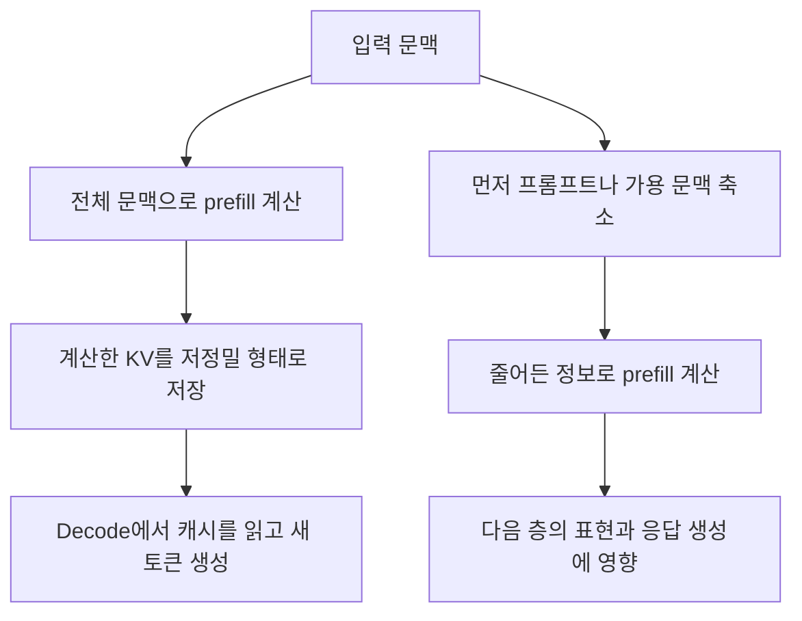

---
categories:
- paper-review
- with-gpt
date: '2024-11-01'
tags:
- Natural Language Processing
title: KV Cache Compression, But What Must We Give in Return? A Comprehensive Benchmark
  of Long Context Capable Approaches
lastmod: '2026-10-25T01:06:00+09:00'
description: KV 캐시 압축 벤치마크의 prefill·decode 구분, 실제 품질 점수와 압축률, 양자화 메타데이터 비용 및 장문 생성에
  대한 한계를 원문으로 검토한다.
---

논문: [KV Cache Compression, But What Must We Give in Return? A Comprehensive Benchmark of Long Context Capable Approaches](https://arxiv.org/abs/2407.01527v1)

> 2026-10-25 원문 재검토: v1을 기준으로 기존 GPT 대화의 prefill·decode 설명과 근거 없는 정확도·속도 수치를 수정했다. 아래의 설명용 계산은 논문의 실측 결과와 구분한다.

## 새로운 압축 알고리즘보다 비교 기준을 제공하는 논문

이 논문은 KV 양자화 하나를 새로 제안하는 연구가 아니다. 양자화, 토큰 제거, 프롬프트 압축, 선형 시간 모델과 하이브리드 모델을 비교해 **무엇을 줄이는 대신 어떤 장문 처리 능력을 잃는지** 평가한 벤치마크다.

평가는 11개 방법·65개 설정, 7개 과제 범주를 다룬다. 단일 문서 QA, 다중 문서 QA, 요약, few-shot 학습, 합성 과제, 코드 완성과 needle-in-a-haystack 검색이 포함된다. 요약에만 치우친 실험이라는 기존 설명은 맞지 않는다. 다만 저자들은 주로 **긴 입력과 짧은 출력**을 평가했으며 장문 생성은 한계로 남겼다고 명시한다. [§3.1, §5–6](https://arxiv.org/html/2407.01527v1#S3.SS1)

## 같은 메모리 절감이라도 바꾸는 대상이 다르다

| 접근 | 바꾸는 대상 | 이 벤치마크에서 읽을 때의 주의점 |
| --- | --- | --- |
| KV 양자화: KIVI, FlexGen | 캐시 값의 비트 수 | 토큰을 모두 남겨도 값의 오차가 생긴다. 캐시는 길이에 비례해 증가한다. |
| 토큰 제거: H₂O, StreamingLLM, InfLLM | 보관하거나 참조하는 토큰의 KV | 언제 토큰을 제거하는지에 따라 prefill의 표현도 달라진다. |
| 프롬프트 압축: LLMLingua | 모델에 넣는 텍스트 | prefill 전에 정보를 제거하므로 필요한 사실 자체가 사라질 수 있다. |
| 선형 시간·하이브리드 모델 | 정보를 유지하는 모델 구조 | 다른 사전학습 데이터·모델 크기의 영향도 함께 섞인다. |

예를 들어 7자리 passkey를 찾아야 하는 과제에서, 양자화는 해당 토큰의 KV를 근사값으로 남길 수 있지만 토큰·프롬프트 제거는 그 정보에 접근할 기회를 없앨 수 있다. 반대로 최근 문맥이 특히 중요한 코드 완성에서는 일부 토큰 제거 방식이 좋은 결과를 보였다. 이것은 과제별 관찰이며 모든 코드 생성에 대한 보장은 아니다. [§2, §3.3 OB ❷](https://arxiv.org/html/2407.01527v1#S3.SS3)

## 핵심 구분은 압축을 언제 적용하느냐

논문 §2.2는 **평가에 사용한 KV 양자화 방식에서 prefill 계산에 양자화된 KV 캐시를 사용하지 않는다**고 명시한다. Prefill 동안 정보를 압축해 다음 층의 표현을 바꾸는 것과, full prefill로 계산한 KV를 decode에서 저정밀도로 참조하는 것은 다르다.

위 도식은 단계의 차이를 설명하기 위한 개념도다. 특정 구현에서 압축 버퍼를 언제 할당하거나 저장하는지까지 나타내지는 않는다.

이 벤치마크의 KIVI·FlexGen·H₂O는 prefill 계산을 압축하지 않는 쪽이고, StreamingLLM·InfLLM·LLMLingua는 prefill 중 또는 그 전에 문맥을 제한하는 쪽으로 비교된다. 저자들은 전자가 여러 긴 입력 과제에서 품질을 더 잘 유지한다고 관찰한다. 따라서 기존 글처럼 KV 양자화의 품질 손실을 일괄적으로 “prefill 표현이 압축되어 손상되기 때문”이라고 설명하면 평가 설정을 거꾸로 이해하게 된다. [§2.2–2.3, §3.3 OB ❶](https://arxiv.org/html/2407.01527v1#S2.SS2)

그렇다고 KV 양자화가 항상 무손실인 것은 아니다. Decode가 근사된 K·V를 읽으면서 이후 출력이 달라질 수 있다. 또한 이 관찰을 평가하지 않은 모든 양자화 구현이나 긴 출력 작업까지 일반화하면 안 된다.

## 실제 점수와 압축률을 함께 읽기

아래는 Table 2의 **Meta-Llama-3-8B-Instruct** 결과 일부다. `LB Avg.`는 서로 다른 LongBench 지표를 평균한 점수이며, 단일한 분류 정확도가 아니다. `Needle`은 별도의 7자리 passkey 검색 평가 결과다.

| 방법 | KV 압축률 | LB Avg. | Code | Needle |
| --- | --- | --- | --- | --- |
| Baseline | 1.00× | 45.2 | 54.1 | 100.0 |
| KIVI-2bit | 5.05× | 44.4 | 48.8 | 100.0 |
| KIVI-4bit | 3.11× | 45.3 | 54.7 | 100.0 |
| FlexGen-4bit | 3.20× | 43.9 | 52.6 | 100.0 |
| H₂O-4x | 4.00× | 44.0 | 53.0 | 100.0 |
| InfLLM-4x | 4.00× | 40.2 | 56.4 | 42.0 |
| StreamingLLM-4x | 4.00× | 35.5 | 51.1 | 25.0 |
| LLMLingua-4x | 4.00× | 30.7 | 32.4 | 8.3 |

KIVI-2bit의 LB Avg. 차이는 45.2에서 44.4로 **0.8점 하락**이다. 반면 Code는 5.3점 하락한다. 이를 모든 과제의 “정확도 손실 약 1–2%”로 요약할 수는 없다. FlexGen-4bit도 LB Avg.가 1.3점 낮아지는 것이지, 모든 입력의 정확도가 일정 비율로 떨어진다는 뜻은 아니다. [Table 2](https://arxiv.org/html/2407.01527v1#S3.T2)

Needle 100.0 역시 해당 실험의 성공률이다. 저자들은 더 어려운 64자리 passkey 실험도 별도로 제시하며, 같은 Llama-3와 KIVI-2bit의 결과가 91.3%로 달라짐을 보인다. 하나의 검색 과제에서 만점을 받았다고 모든 장문 정보 검색이 해결된 것은 아니다. [Appendix D, Figure 20](https://arxiv.org/html/2407.01527v1#A4)

## 16비트에서 4비트면 실제 메모리도 정확히 75% 줄어드는가

16비트 payload만 4비트 payload로 바꾸면 이상적인 비율은 4배이며 75% 감소다. 그러나 실제 캐시에는 그룹별 scale·offset과 고정밀도로 유지하는 구간 등이 추가될 수 있다. 논문 Table 2의 FlexGen-4bit는 4.00×가 아닌 **3.20×**, KIVI-4bit는 3.11×로 보고된다. KIVI처럼 고정밀 residual 구간이 있는 방법의 압축률은 입력 10K토큰을 기준으로 계산했다. 실험의 group size는 32, KIVI residual length는 128이다. [Table 2, §3.2, Appendix B.3](https://arxiv.org/html/2407.01527v1#A2)

메타데이터가 왜 중요한지 작은 **설명용 예시**로 계산해 보자. 이는 실제 FlexGen·KIVI의 전체 저장 형식을 재현한 것이 아니다. 32개 값의 원래 FP16 payload는 64바이트다. 여기에 4비트 payload 16바이트와 FP16 scale·offset 각각 2바이트를 저장한다고 가정하면 총 20바이트가 된다.

$$
R = \frac{32\times 2}{32\times 4/8 + 2 + 2}
= \frac{64}{20} = 3.2.
$$

이 예시의 절감률은 75%가 아니라 68.75%다. 원래 캐시가 1GB라고 가정해 단순 비례시키면 약 0.3125GB이며, “무조건 250MB”라고 단정할 수 없다. 정렬·별도 버퍼·residual 구간·모델 가중치까지 더하면 실제 VRAM 변화는 또 달라진다.

일반적인 B-bit affine 양자화도 그룹을 정한 뒤 scale을 계산해야 한다. 다음은 상수가 아닌 값들로 이루어진 한 그룹의 설명용 식이다. $a$는 그룹 최솟값을 값의 단위로 적은 offset이며, 정수 코드 공간에서 정의하는 zero-point와 구분한다.

$$
s = \frac{\max X-a}{2^B-1},\qquad
q = \operatorname{clip}\!\left(\operatorname{round}\!\left(\frac{X-a}{s}\right),0,2^B-1\right),\qquad
\hat X = qs+a.
$$

예를 들어 $B=4$, $X=[0,0.7,1.4,3]$이면 $a=0$, $s=0.2$다. 최근접 반올림에서 3.5를 위로 올린다고 정하면 코드는 $[0,4,7,15]$, 복원값은 $[0,0.8,1.4,3]$이며 최대 절대 오차는 0.1이다. 상수 그룹은 $s=0$이 되는 경우를 별도로 처리해야 한다. 이 toy 예시만으로 특정 모델의 정확도를 예측할 수는 없다. [일반 양자화 개요: §2.2](https://arxiv.org/html/2407.01527v1#S2.SS2)

## 메모리 절감과 속도 향상은 같은 결론이 아니다

논문은 서로 다른 방법의 커널 최적화 수준과 FlashAttention 호환성이 달라, 효율을 공정하게 비교하기 어렵다고 설명한다. 캐시가 작아지면 전송량을 줄일 여지는 있지만 양자화·역양자화와 데이터 배치 비용도 생긴다. **이 벤치마크의 결과로 일반적인 20–30% 속도 향상을 주장할 근거는 없다.** [§4의 real-world efficiency 논의](https://arxiv.org/html/2407.01527v1#S4)

또한 압축률은 캐시 저장량의 비율이며 전체 모델 FLOPs나 TTFT의 감소율이 아니다. Full prefill을 유지하는 접근이 decode 메모리를 줄였다고 해서 prefill의 최고 메모리 사용량이나 계산 시간도 같은 비율로 줄었다고 볼 수 없다.

## 적용 조건과 한계

실험 설정을 읽을 때는 다음 경계를 함께 봐야 한다. [§3.2, §6, Appendix B](https://arxiv.org/html/2407.01527v1#S6)

- 모델은 10B 미만이며, 서로 다른 아키텍처의 사전학습 조건도 같지 않다. 점수 차이를 구조의 우열만으로 해석할 수 없다.
- LongBench baseline의 최대 입력은 Llama-3가 7,500토큰, Mistral·LongChat이 31,500토큰이다. 초과 입력의 절단 방식과 prefill-time 압축 방법에 대한 예외도 원문에 명시돼 있다.
- Needle 입력 길이는 512–20,480 **단어**이며 토큰 수가 아니다. 모델별 tokenizer에 따라 토큰 수가 달라진다. Llama-3의 needle 실험은 기본 8K 설정을 그대로 쓴 것이 아니라 RoPE의 theta를 32배로 확장한다.
- 주로 긴 입력·짧은 출력을 평가한다. 장편 생성이나 장기간 다중 턴 대화에서의 품질·캐시 오차 누적은 별도로 검증해야 한다.

개인적으로는 이 논문의 장점이 특정 압축 방식을 무조건 추천하는 데 있지 않다고 본다. 어떤 단계의 정보를 줄였는지, 같은 압축률에서 어떤 과제의 점수가 달라지는지부터 살펴보게 한다. 실제 서비스에 적용한다면 품질뿐 아니라 prefill의 최고 메모리, decode 메모리, TTFT와 토큰 간 지연을 따로 측정하고 싶다. 이는 적용에 대한 의견이며 논문이 보고한 운영 결과는 아니다.
