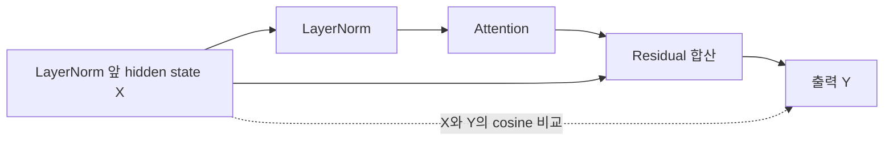

---
categories:
- paper-review
- with-gpt
date: '2024-11-01'
tags:
- Machine Learning
- Natural Language Processing
title: What Matters in Transformers? Not All Attention is Needed
slug: what-matters-in-transformers-not-all-attention-is-needed-fusion
lastmod: '2026-10-25T01:27:50+09:00'
description: Attention Drop의 residual 기반 중요도, Joint Drop, 캘리브레이션 실험과 일반화의 경계를 원문으로
  검토하고 제거 비율·품질·속도를 구분한다.
---

논문: [What Matters in Transformers? Not All Attention is Needed](https://arxiv.org/abs/2406.15786v1)

> 2026-10-25 원문 재검토: v1을 기준으로 기존 GPT 대화의 중요도 계산과 일반화 주장을 수정했다. 제목에 잘못 붙은 “Fusion”을 제거했으며 기존 게시글 주소는 유지한다.

## Attention을 모두 없애자는 주장은 아니다

이 논문은 학습이 끝난 Transformer에서 어떤 모듈을 제거할 수 있는지 비교한다. 전체 block을 제거하는 **Block Drop**, attention 또는 MLP를 따로 제거하는 **Layer Drop**, 두 종류를 함께 고려하는 **Joint Layer Drop**이 대상이다.

핵심 가설은 모듈을 통과하기 전후의 hidden state가 비슷하면 그 모듈의 변환 기여가 작을 수 있다는 것이다. 저자들은 여러 모델에서 attention 일부를 제거해도 평가 점수를 비교적 잘 유지하는 구간을 관찰한다. 그렇다고 attention 자체가 불필요하거나, 높은 cosine similarity가 무손실 제거를 보장한다는 뜻은 아니다. [§3–4](https://arxiv.org/html/2406.15786v1#S3)

## 무엇의 입력과 출력을 비교하는가

논문의 중요도 점수는 다음과 같다. 낮은 점수를 가진 모듈이 제거 후보가 된다.

$$
S = 1-\operatorname{Cosine}(X,Y).
$$

Layer Drop에서 중요한 것은 **residual connection을 포함한 출력**을 비교한다는 점이다. Attention을 예로 들면 $X$는 해당 LayerNorm 앞의 hidden state이고, $Y$는 attention 결과를 residual에 더한 뒤의 상태다.

$$
Y_A = X_A + \operatorname{Attention}(\operatorname{LayerNorm}(X_A)),
\qquad S_A = 1-\operatorname{Cosine}(X_A,Y_A).
$$

MLP도 같은 구조로 측정한다. 제거할 때는 해당 attention 또는 MLP와 연결된 LayerNorm을 함께 제거하고 residual 경로를 남긴다. Attention 연산의 순수 출력만 꺼내 $X$와 비교하는 것은 이 점수와 다르다. [§3.3, Eqs. 3–6, Figure 1](https://arxiv.org/html/2406.15786v1#S3.SS3)

이 도식은 attention sublayer 하나의 측정 경계를 나타낸다. 이 단위를 drop하면 입력 $X$가 해당 residual 구간을 그대로 통과한다. MLP나 block 전체를 제거하는 것과는 범위가 다르다.

### 작은 벡터로 확인하는 설명용 예시

논문 실험이 아닌 2차원 예시로 $X=(1,0)$, attention 쪽의 추가 출력이 $(0,0.1)$이라고 하자. Residual을 더한 출력은 $Y=(1,0.1)$이다.

$$
S = 1-\frac{1}{\sqrt{1.01}} \approx 0.004963.
$$

반면 $X$와 추가 출력 $(0,0.1)$만 비교하면 cosine은 0이므로 점수는 1이 된다. 측정 경계만 바꿔도 중요도 해석이 완전히 달라진다.

이 지표에도 한계가 있다. 예를 들어 $X=(1,0)$과 $Y=(10,0)$은 방향이 같아 점수가 0이지만 벡터 크기는 크게 달라졌다. Cosine 기반 점수는 방향의 유사성을 보는 proxy이며, 제거 후 모델의 의미나 답변이 같다는 수학적 증명이 아니다.

## Joint Drop은 두 점수를 더하는 방식인가

저자들은 캘리브레이션 데이터로 모듈별 점수를 **한 번 계산한 뒤** 제거하는 one-shot 방식을 사용한다. 요청이 들어올 때마다 cosine을 계산해 동적으로 레이어를 선택하는 방법은 아니다. [§3.3, Appendix B의 One-Shot 실험](https://arxiv.org/html/2406.15786v1#A2)

Joint Layer Drop은 attention 점수 목록과 MLP 점수 목록을 합쳐, 낮은 점수의 모듈을 제거 대상으로 선택한다. 같은 block의 두 점수를 더해 block 하나의 점수로 만드는 방식과 구분해야 한다.

$$
\mathcal{S} = [S_A^1,\ldots,S_A^L,S_M^1,\ldots,S_M^L].
$$

예를 들어 attention 점수가 0.01·0.03이고 MLP 점수가 0.02·0.20인 설명용 예시에서는, 낮은 두 점수의 후보는 첫 attention과 첫 MLP다. “Joint”라는 이름이 매번 같은 block의 attention·MLP를 함께 제거한다는 뜻은 아니다. 실제 논문의 선택 절차는 Algorithm 1을 참고하면 된다. [§3.3, Algorithm 1; §4.2](https://arxiv.org/html/2406.15786v1#S3.SS3)

## 캘리브레이션 데이터가 달라지면 어떨까

기본 설정은 **C4 validation에서 256개 샘플, 길이 2,048토큰**으로 점수를 계산한다. 이는 평가 과제의 정답으로 모델을 다시 학습하는 과정이 아니다. [Appendix A](https://arxiv.org/html/2406.15786v1#A1)

저자들은 샘플 수를 4–1,024개로 바꾸고 C4·CodeAlpaca-20k·MathInstruct·LIMA 등으로 데이터 종류를 바꾸어 중요도를 비교한다. 점수에는 일부 차이가 있지만 제거할 모듈이 대체로 비슷하다는 결과를 보고한다. 이것은 캘리브레이션 선택에 민감하지 않을 수 있다는 **실험적 근거**다. [§4.2, Figures 7–8; Appendix B, Figures 11–12](https://arxiv.org/html/2406.15786v1#S4.SS2)

다만 이 결과가 모든 입력 분포에서의 안전한 제거를 보장하지는 않는다. 반대로 “캘리브레이션을 썼으므로 오버피팅이 발생한다”고 단정할 근거도 아니다. 원문의 관찰과 추가 검증이 필요한 조건을 구분해야 한다.

처음 이 글을 읽을 때 가졌던 분포 변화에 대한 의문은 여전히 유효한 적용 질문이라고 생각한다. 내가 실제로 도입한다면 서비스의 언어·도메인·긴 문맥·출력 형식별로 제거 전후의 품질을 비교하고 싶다. 이는 리뷰어의 검증 제안이며 논문에서 입증한 운영 결과는 아니다.

## 모델 크기와 제거 범위에 따라 품질이 다르다

Table 3의 Llama-3 결과를 보면 같은 “attention 절반 제거”도 모델에 따라 다르다. 아래 Avg.는 **HellaSwag·MMLU·OBQA·WinoGrande 네 과제의 평균**이며, Table 1의 더 넓은 평가 평균과 그대로 비교하면 안 된다.

| 모델 | 설정 | 제거한 attention 수 | Table 3 Avg. |
| --- | --- | --- | --- |
| Llama-3-8B | Baseline | 0 | 67.6 |
| Llama-3-8B | Attn-8 | 8 | 67.4 |
| Llama-3-8B | Attn-16 | 16 / 32개, 절반 | 55.4 |
| Llama-3-70B | Baseline | 0 | 75.1 |
| Llama-3-70B | Attn-32 | 32 | 75.2 |
| Llama-3-70B | Attn-40 | 40 / 80개, 절반 | 73.3 |

70B의 절반 제거 결과도 평균이 정확히 같은 것은 아니며, 8B에서는 12.2점 낮아진다. 논문의 “comparable performance”를 모델·제거 비율·과제와 분리해 무손실 보장으로 읽으면 안 된다. [Table 3](https://arxiv.org/html/2406.15786v1#S4.T3)

특화된 능력에도 예외가 있다. Appendix B의 GSM8K 실험은 MetaMath-7B-V1.0에서 attention 제거에 더 민감한 결과를 보고한다. 출력 사례에서는 계산 결과를 얻더라도 평가에 필요한 `####` 형식을 지키지 못하는 경우를 보여준다. 평균 점수뿐 아니라 과제별 실패와 출력 형식도 확인해야 한다. [Appendix B, Figure 9, Table 6](https://arxiv.org/html/2406.15786v1#A2)

## 레이어 제거 비율과 메모리·속도는 같은 비율이 아니다

Table 1에서 Mistral-7B의 attention 8개 제거는 평균 70.3에서 69.8, 보고된 메모리 14.0GB에서 13.2GB, 속도 1.17배다. 같은 수의 MLP 제거는 평균 53.4와 속도 1.09배로 보고된다. 저자들은 §4.1의 효율 비교를 입력 길이 512–4,096, 단일 NVIDIA A100에서 측정한 평균 비용으로 설명한다. 배치·출력 길이와 실제 서비스 구성까지 바뀐 상황에 이 배수를 그대로 적용할 수는 없다. [Table 1, §4.1](https://arxiv.org/html/2406.15786v1#S4.SS1)

Attention을 제거하면 해당 층의 KV 캐시도 필요 없어진다. 모든 attention 층의 캐시 형식·head 구성이 같다고 가정하면, $L$개 중 $a$개를 제거했을 때 KV payload는 원래의 $(L-a)/L$로 줄어든다. 이 식은 **KV payload에 대한 설명용 비율**이다. 남은 MLP와 embedding·가중치·활성화·실행 버퍼를 포함한 전체 VRAM이 같은 비율로 줄어든다는 뜻은 아니다.

## 논문이 남긴 한계

저자들은 적용한 모델 범위를 넘어 Vision Transformer와 vision-language 모델로 검증을 넓힐 필요가 있다고 설명한다. 또한 학습 후 제거에 집중했으며, 제거 뒤 재학습으로 품질을 회복하는 연구는 수행하지 않았다고 명시한다. [§6](https://arxiv.org/html/2406.15786v1#S6)

이 연구가 주는 흥미로운 시사점은 attention과 MLP를 항상 같은 개수로 유지해야 하는지 다시 묻게 한다는 것이다. 실제 압축에서는 유사도 순위만으로 판단을 끝내지 않고, 선택한 모듈을 제거한 뒤 목표 과제의 품질·KV 캐시·실제 지연을 함께 검증하는 편이 적절하다고 본다.
