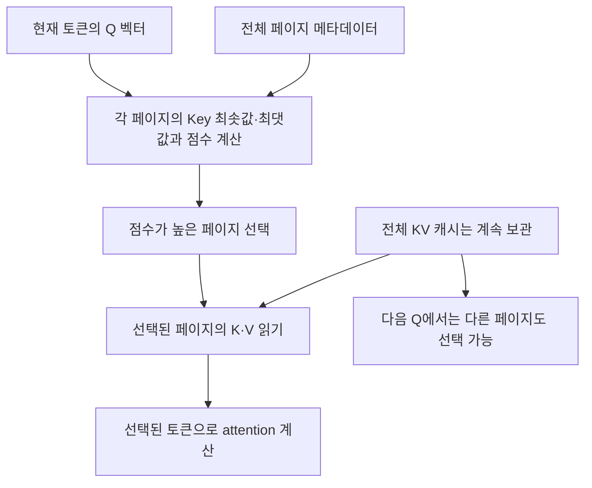

---
categories:
- paper-review
- with-gpt
date: '2024-11-01'
tags:
- Natural Language Processing
- Machine Learning
title: Quest Query-Aware Sparsity for Efficient Long-Context LLM Inference
lastmod: '2026-10-25T01:36:52+09:00'
description: Quest의 전체 KV 보존과 선택적 읽기, Query-Key 상한 점수, 페이지·토큰 예산, 전송량 계산과 decode 성능의
  측정 범위를 원문으로 검토한다.
---

논문: [Quest: Query-Aware Sparsity for Efficient Long-Context LLM Inference](https://arxiv.org/abs/2406.10774v1)

> 2026-10-25 원문 재검토: v1을 기준으로 기존 GPT 대화의 캐시 보존·읽기 구분과 페이지 크기 권장 주장을 수정했다. 아래 계산 예시는 논문의 실측 결과와 구분한다.

## 캐시를 버리지 않고 현재 필요한 부분을 읽는다

긴 문맥에서 decode의 attention은 많은 K·V를 읽어야 한다. 과거에 덜 중요했던 토큰을 영구적으로 제거하면, 뒤에서 그 정보를 묻는 토큰이 나왔을 때 다시 참조할 수 없다.

Quest는 **전체 KV 캐시를 보존**하고, 현재 query 벡터에 맞춰 읽을 페이지를 고른다. 선택되지 않은 페이지는 이번 attention의 읽기·계산 대상에서 빠질 뿐, 다음 단계에서 다시 선택될 수 있다. 이를 “일시적인 eviction”이라고 부르면 저장 공간에서의 삭제와 혼동하기 쉽다. 핵심 절감 대상은 **매 단계의 KV 메모리 전송량**이며 전체 KV 저장량이 아니다. [§2.2, §3.3–3.5](https://arxiv.org/html/2406.10774v1#S2.SS2)

여기서 query는 사용자가 입력한 질문 문장의 키워드가 아니라, 현재 토큰에서 attention이 계산한 **Q 벡터**다. 페이지 선택은 Q와 Key의 관계로 추정하고, Value는 선택된 토큰의 attention 출력을 계산할 때 사용한다. Query–Value의 상관관계를 직접 계산해 페이지를 고르는 방식은 아니다.

## 페이지 점수는 정확한 attention 확률이 아니다

페이지 $p$에 들어 있는 Key의 각 채널에 대해 최솟값 $m_{p,i}$와 최댓값 $M_{p,i}$를 저장한다. 새 Key가 들어오면 이 메타데이터를 갱신한다. 현재 query가 $q$일 때 페이지 점수는 다음과 같다.

$$
U(p,q)=\sum_i\max(q_i m_{p,i},q_i M_{p,i}).
$$

$q_i$가 음수면 작은 Key 값과의 곱이 더 클 수 있으므로 최솟값과 최댓값이 모두 필요하다. 페이지 안의 어떤 Key $k$에 대해서도 다음 관계가 성립한다.

$$
q^\top k \leq U(p,q).
$$

즉, **softmax 이전 Q·K 내적의 상한**을 이용하는 휴리스틱이다. 공통된 양의 scaling을 적용해도 페이지 순위는 같지만, 이 점수 자체가 정규화된 attention 확률인 것은 아니다. 서로 다른 채널의 극값은 서로 다른 토큰에서 나올 수 있으므로 실제 최대 내적보다 느슨한 상한이 될 수 있다. [§3.4, Algorithm 1](https://arxiv.org/html/2406.10774v1#S3.SS4)

### 부호와 상한을 확인하는 설명용 예시

논문의 실험이 아닌 작은 입력을 사용하자. $q=(1,0.5,-0.2)$이고 페이지 A의 두 Key가 다음과 같다고 가정한다.

- $k_1=(-0.5,-0.1,-0.3)$
- $k_2=(0.7,1.2,0.9)$

채널별 극값으로 계산한 점수는 다음과 같다.

$$
U(A,q)=0.7+0.6+0.06=1.36.
$$

실제 내적은 각각 $-0.49$와 $1.12$다. 세 번째 채널에서는 음수 query 때문에 최솟값 $-0.3$을 쓰지만, 그 Key가 다른 두 채널의 최댓값도 동시에 가지지는 않는다.

페이지 B에 $k_3=(1.2,0,0)$ 하나만 있다면 점수와 실제 내적은 모두 $1.2$다. 상한 순위로는 A가 B보다 높지만, 실제 최대 내적은 B가 더 크다. 따라서 상한을 기준으로 Top-K 페이지를 고른다고 실제 attention의 정확한 Top-K 토큰을 항상 찾는 것은 아니다. 선택한 페이지 안에서는 실제 K·V로 attention을 계산하되, 제외한 토큰의 기여가 빠지는 근사다.

## 페이지 수와 토큰 예산을 구분한다

페이지당 토큰 수를 $S$, 선택하는 페이지 수를 $K$라고 하면 선택된 토큰 예산은 완전히 찬 페이지 기준으로 $B=KS$다. **페이지 128개**와 **토큰 예산 128개**는 다르다. 예를 들어 $S=16$, $K=128$이면 예산은 2,048토큰이다. [§3.4](https://arxiv.org/html/2406.10774v1#S3.SS4)

논문은 설정한 예산 아래에서 현재 Q마다 페이지를 동적으로 선택한다. 이는 예산 자체를 자동으로 조정한다는 뜻은 아니다. 예산 조정 정책을 추가하는 것은 별도의 설계 문제다.

또한 저자들은 희소성이 낮은 **처음 두 attention 층은 full attention으로 유지**하고, Quest와 비교 방법을 뒤의 층에만 적용한다. 예산을 전체 모델의 모든 층에 대한 저장 용량 제한으로 해석하면 안 된다. [§3.4, §4.1](https://arxiv.org/html/2406.10774v1#S4.SS1)

## 읽는 바이트는 어떻게 줄어드는가

논문 §3.5의 단순 모델에서 전체 토큰 수를 $L$, Key 하나 또는 Value 하나의 크기를 $M$바이트라고 하자. 전체 KV를 한 번 읽으면 $2ML$바이트다. Quest는 전체 페이지의 min/max Key 메타데이터와 선택한 페이지의 실제 K·V를 읽는다.

$$
\begin{aligned}
D_{\mathrm{metadata}} &\approx 2M L/S,\\
D_{\mathrm{selected}} &\approx 2MKS,\\
\frac{D_{\mathrm{Quest}}}{D_{\mathrm{full}}}
&\approx \frac{1}{S}+\frac{KS}{L}
=\frac{1}{S}+\frac{B}{L}.
\end{aligned}
$$

이는 **메모리 전송량의 근사**이며, Top-K·정렬·실행 버퍼 등 전체 비용이나 전체 VRAM 절감률이 아니다. $K$나 $B$가 고정이어도 메타데이터를 읽는 비용은 문맥 길이에 따라 증가한다. 선택된 페이지의 attention 커널 시간이 대체로 일정하다는 결과를 Quest 전체의 비용이 상수라는 뜻으로 읽으면 안 된다. [§3.5, §4.3.1](https://arxiv.org/html/2406.10774v1#S3.SS5)

단위를 명시한 **설명용 예시**로 $L=65{,}536$, $S=16$, $K=256$을 쓰면 $B=4{,}096$토큰이고 비율은 $1/16+1/16=1/8$이다. 이 단순 모델에서 KV 읽기량은 약 8배 줄어든다. v1 §3.5의 예문에는 “4K pages”라고 적혀 있지만, 이 조건에서 위 식의 8배를 얻으려면 **4K토큰, 즉 256페이지**여야 한다. 4K페이지를 선택하는 것으로 그대로 옮겨 적으면 페이지와 토큰 단위가 맞지 않는다.

### 페이지 크기 16이 항상 최적인가

페이지가 커지면 메타데이터 비용은 줄어든다. 하지만 $K$를 고정하면 선택된 토큰 수 $KS$와 실제 읽기량은 늘어난다. $B$를 고정할 때는 선택의 해상도가 달라진다. 두 비교 조건을 섞어 “큰 페이지는 항상 빠르다”고 단정할 수 없다.

원문은 criticality estimation을 여러 페이지 크기에서 측정하고, approximate attention 커널 비교에 페이지 크기 16을 사용한다. 이것을 모든 모델·태스크에서 정확도와 속도가 최적임을 검증한 권장값으로 확대할 근거는 없다. [§4.3.1, Figure 8](https://arxiv.org/html/2406.10774v1#S4.SS3.SSS1)

## 품질 평가는 어떤 조건에서 이루어졌는가

평가 모델은 LongChat-v1.5-7b-32k와 Yarn-Llama-2-7b-128k이며, PG19·passkey 검색·LongBench 여섯 데이터셋을 사용한다. Table 1의 Quest 결과 일부는 다음과 같다. 예산은 **토큰 수**이며 전체 KV의 보관 개수가 아니다.

| Passkey 입력과 모델 | 토큰 예산 | Table 1 성공률 |
| --- | --- | --- |
| 10K, LongChat | 32 | 65% |
| 10K, LongChat | 64 | 99% |
| 100K, Yarn-Llama-2 | 256 | 88% |
| 100K, Yarn-Llama-2 | 1,024 | 96% |
| 100K, Yarn-Llama-2 | 2,048 | 100% |

입력 문맥은 full cache로 prefill하고, 질문·지시를 토큰별로 넣어 decode를 모사한다. 100K passkey와 LongBench의 H₂O 비교에서는 FlashAttention 사용을 위해 문맥 prefill 중 과거 attention 점수를 모으지 않고 decode에서 수집을 시작한 설정도 명시한다. 다른 구현·설정의 모든 H₂O 결과에 같은 비교를 일반화하면 안 된다. [§4.1–4.2, Table 1](https://arxiv.org/html/2406.10774v1#S4.SS2)

## 커널 7.03배와 decode 2.23배는 다른 측정이다

| 범위 | 원문에서 보고한 조건과 결과 |
| --- | --- |
| Self-attention | Llama2-7B 구성, RTX 4090·CUDA 12.2, 32K 문맥·2,048토큰 예산에서 FlashInfer 대비 7.03배 |
| 모델 전체 decode 단계 | Ada 6000, single batch, 32K 문맥·2,048토큰 예산에서 FP16 가중치 1.74배, 4-bit 가중치 2.23배 |

원문의 end-to-end는 **decode에서 토큰 하나를 생성하는 평균 지연** 비교이며 sampling은 측정에서 제외한다. Prefill·TTFT·전체 요청 완료 시간을 포함한 모든 서비스가 2.23배 빨라진다는 뜻은 아니다. 4-bit라는 조건도 가중치 양자화이며 Quest가 KV를 자동으로 4-bit 저장한다는 뜻은 아니다. [§4.3, Figures 9–10](https://arxiv.org/html/2406.10774v1#S4.SS3)

또한 Figure 11의 다른 희소화 방법과의 지연 비교는, 그 방법들의 커널 구현을 직접 실행한 동일 조건 측정이 아니라 필요한 토큰 예산에 FlashInfer 지연을 대응시킨 정성적 분석을 포함한다. 원문은 Quest는 실제 연산자 비용을 포함하지만 비교 대상의 일부 추가 비용은 제외했다고 밝힌다. [§4.3.3](https://arxiv.org/html/2406.10774v1#S4.SS3.SSS3)

## 적용 관점의 한계

개인적으로는 과거에 덜 중요했던 정보도 나중에 다시 읽을 수 있도록 보존한다는 점이 흥미롭다. 다만 저장 공간 부족을 해결할 KV eviction 기법을 찾는 상황과, KV 읽기 대역폭이 병목인 상황은 구분해야 한다.

현재 Q와 Key 범위만으로 만든 점수는 근사이며, Value의 크기나 전체 출력 오차를 직접 제한하지 않는다. 페이지 예산·문맥 길이·모델과 질문 특성에 따라 품질을 다시 측정해야 한다. 실제 도입 시에는 전체 KV와 메타데이터 저장량, 페이지 선택 비용, decode 지연과 태스크별 품질을 함께 확인하고 싶다. 이는 리뷰어의 적용 제안이며 논문이 모든 운영 환경에서 보장한 결과는 아니다.
