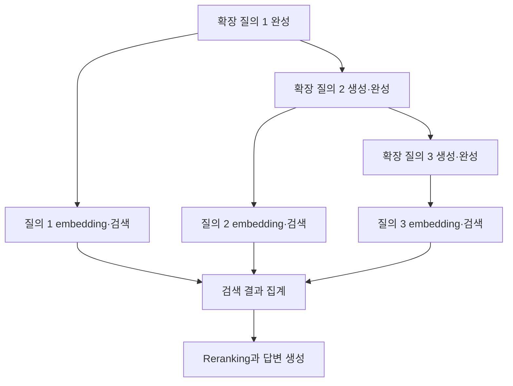

---
categories:
- paper-review
- with-gpt
date: '2024-11-01'
tags:
- Distributed Computing
- Networking
title: Teola Towards End-to-End Optimization of LLM-based Applications
lastmod: '2026-10-25T10:36:03+09:00'
description: Teola의 primitive 그래프, causal prefix prefill과 구조화된 partial decoding, topology-aware
  batching 및 vLLM을 공유하는 실제 비교 조건을 원문으로 검토한다.
---

논문: [Teola: Towards End-to-End Optimization of LLM-based Applications](https://arxiv.org/abs/2407.00326v1)

> 2026-10-25 원문 재검토: v1을 기준으로 기존 GPT 대화의 partial decoding·prefilling 설명과 vLLM 비교를 수정했다. 아래 시간 계산은 설명용 예시이며 논문 실험 결과와 구분한다.

## LLM 엔진 바깥의 대기 시간도 줄일 수 있을까

RAG 요청 하나에는 문서 분할·embedding·데이터베이스 검색·reranking·LLM 생성 같은 작업이 이어진다. LLM의 토큰 생성만 빨라져도, 앞단의 작업을 기다리거나 독립적인 모듈을 불필요하게 직렬 실행하면 전체 응답 시간은 길 수 있다.

Teola는 모듈을 더 작은 **primitive**로 나누고, 실제 데이터 의존성을 그래프로 드러내 애플리케이션 전체를 스케줄링한다. 원문의 primitive는 임의로 쪼갠 GPU 연산이나 독립 생성 가능한 토큰 하나하나를 뜻하지 않는다. Embedding·검색 같은 엔진 작업과, LLM 호출의 prefill·decode처럼 나눌 수 있는 동작을 표현하는 그래프 노드다. [§2.2, §4.1, Table 1](https://arxiv.org/html/2407.00326v1#S4.SS1)

## 모듈 그래프에서 실행 그래프까지

개발자는 엔진, 엔진의 입력 크기별 지연 profile, 모듈 간 실행 순서를 가진 workflow template을 등록한다. 요청이 들어오면 입력과 설정에 맞춰 primitive 그래프인 **p-graph**를 만들고, 최적화한 **e-graph**를 실행한다. 모든 요청이 동일한 구체적 그래프를 그대로 쓰는 것은 아니다. [§3–4](https://arxiv.org/html/2407.00326v1#S3)

| 최적화 pass | 원문에서 하는 일 |
| --- | --- |
| Dependency pruning | 모듈의 실행 순서에서 물려받은 간선 중 실제 데이터 의존성이 없는 것을 제거 |
| Stage decomposition | batchable 작업의 큰 입력을 엔진 profile에 따라 sub-micro-batch 단계로 나누어 후속 작업과 pipeline 구성 |
| LLM prefilling split | 준비된 causal prefix를 먼저 계산하고 남은 prompt가 준비되면 이어서 prefill |
| LLM decoding pipelining | splittable 출력의 완성된 조각을 후속 작업에 일찍 전달 |

최적화는 규칙 기반이다. 실행 순서를 마음대로 바꾸는 것이 아니라 데이터 의존성을 유지하면서 겹칠 수 있는 동작을 찾는다. Stage decomposition도 모든 입력을 최대한 작게 나누는 전략이 아니며, 원문은 엔진의 최대 효율 batch size를 기준으로 분할을 제한한다. [§4.2, Algorithm 1](https://arxiv.org/html/2407.00326v1#S4.SS2)

## Partial Prefilling: 준비된 아무 문장이나 먼저 계산하는가

아직 검색 결과가 없어도 최종 prompt의 **앞부분**이 정해져 있다면 그 prefix의 KV를 먼저 계산할 수 있다. 예를 들어 최종 prompt가 `[지시문, 질문, 검색 문맥]` 순서라면 지시문·질문을 먼저 처리하고 검색 문맥이 준비된 뒤 이어서 처리할 수 있다.

다만 원문은 causal attention의 의존성을 지켜야 한다고 명시한다. 최종 prompt의 중간이나 뒷부분을 임의로 먼저 계산해도 된다는 뜻은 아니며, 이 최적화를 위해 prompt의 의미 있는 순서를 바꿔도 결과가 같다는 보장도 아니다.

Table 1의 **Full Prefilling**은 partial prefill 다음의 **남은 부분**을 처리하는 primitive다. 이미 계산한 prefix까지 반드시 처음부터 모두 재계산한다는 뜻으로 읽으면 안 된다. [§4.1–4.2, Table 1의 Partial/Full Prefilling](https://arxiv.org/html/2407.00326v1#S4.SS2)

## Partial Decoding: 무엇이 서로 겹쳐 실행되는가

원문의 예시는 query expansion이 질의 세 개를 만들어내는 상황이다. 첫 번째 확장 질의가 완성되면 embedding과 검색을 시작하고, LLM은 두 번째·세 번째 질의를 계속 생성한다.

이 개념도에서 같은 LLM 호출의 생성 순서인 P1→P2→P3는 여전히 의존한다. **병렬화되는 것은 후속 처리와 남은 생성의 실행**이며, autoregressive한 토큰들을 서로 독립적으로 동시에 생성하는 것이 아니다.

이 최적화에는 LLM 호출을 **splittable**로 표시하고, 출력의 독립적인 완성 조각을 추출할 수 있어야 한다. 원문은 parser가 JSON 같은 점진적 구조화 출력을 감시해 완성된 부분을 후속 primitive로 보낸다고 설명한다. 임의의 미완성 문장이나 일부 토큰을 어떤 후속 작업에도 넘길 수 있다는 일반적인 streaming 보장은 아니다. [§4.2의 Pass 4, Figure 6](https://arxiv.org/html/2407.00326v1#S4.SS2)

## 작은 시간 예시로 보는 병렬화의 효과

원문 실험이 아닌 **설명용 가정**으로 다음 시간이 든다고 하자. 문서 indexing은 800ms, query expansion은 600ms, 준비된 prefix의 prefill은 250ms다. 이 세 작업은 서로 독립이고, 나머지 prefill 150ms와 최종 decode 400ms는 선행 작업 완료를 기다린다고 가정한다.

모두 직렬로 실행하면 다음 시간이 든다.

$$
T_{\mathrm{serial}}=800+600+250+150+400=2200\;\mathrm{ms}.
$$

앞의 세 작업을 자원 충돌 없이 겹칠 수 있으면 다음과 같다.

$$
T_{\mathrm{overlap}}=\max(800,600,250)+150+400=1350\;\mathrm{ms}.
$$

이 가정의 가속은 약 1.63배다. 실제로는 같은 LLM 엔진을 공유하거나 통신·queueing 비용이 생기면 완전히 겹칠 수 없다. 이 예시는 논문의 최대 2.09배를 재현한 것이 아니라 **개별 연산을 빠르게 하지 않고도 전체 지연이 줄 수 있는 이유**를 보여준다.

## Topology-aware batching이 보는 정보

상위 graph scheduler는 선행 의존성이 충족된 primitive를 해당 엔진으로 보낸다. 하위 engine scheduler는 같은 엔진을 쓰는 요청을 모아 처리한다. 여기서 primitive 한 개가 여러 실제 엔진 요청을 포함할 수 있다는 관계를 유지하는 것이 중요하다. [§5.1–5.2](https://arxiv.org/html/2407.00326v1#S5)

Teola는 출력 노드에서 거꾸로 계산한 topology depth를 사용한다. 같은 query의 후보에서는 depth가 높은 primitive를 우선하고, query별 bucket은 가장 이른 도착 시간을 기준으로 정렬해 batch를 구성한다. 단순 FIFO와 달리, 지금 처리해도 후속 작업이 다른 부모를 기다려야 하는 요청보다 그래프를 진전시킬 수 있는 요청을 우선하려는 방식이다. [Algorithm 2](https://arxiv.org/html/2407.00326v1#S5.SS2)

이 depth는 실제 실행 시간을 정확히 반영한 critical-path 예측이 아니다. 원문도 실행 지연의 불확실성 때문에 정확한 critical path를 식별하지 못할 수 있다고 설명한다. 따라서 topology-aware batching은 **휴리스틱**이며 모든 작업에서 최적의 batch나 최소 지연을 보장하지 않는다.

## vLLM과의 관계와 실제 baseline

Teola의 prototype은 **vLLM을 LLM 실행 엔진으로 사용**하며, Partial Prefilling·Full Prefilling을 지원하도록 수정한다. Ray는 분산 실행, LlamaIndex는 전처리, PostgreSQL·pgvector는 벡터 저장·검색에 사용한다. 따라서 Teola와 vLLM을 같은 역할의 대체재로만 비교하면 설계의 차이를 놓친다. [§6](https://arxiv.org/html/2407.00326v1#S6)

논문이 비교하는 것은 같은 엔진들을 사용하는 다음 오케스트레이션·스케줄링 조합이다.

- **LlamaDist**: 저자들이 Ray로 구현한 분산 LlamaIndex 방식의 모듈 체인.
- **LlamaDistPC**: 독립 모듈 병렬화와 prefix cache reuse를 추가한 LlamaDist.
- 각 baseline의 **PO**: invocation별 요청 묶음의 지연을 중시하는 스케줄링.
- 각 baseline의 **TO**: 미리 조정한 최대 batch/token size로 처리량을 중시하는 dynamic batching.

Teola의 이득은 이 baseline들과의 비교 결과다. “원래 vLLM보다 모든 추론이 2.09배 빠르다”거나, 현재의 모든 vLLM 버전·기능을 비교한 결과라는 뜻은 아니다. [§7의 Baseline](https://arxiv.org/html/2407.00326v1#S7)

## 성능 수치는 어떤 환경에서 나왔는가

LLM 인스턴스 하나당 llama-2-7B는 RTX 3090 24GB 한 장, llama-2-13B는 두 장, llama-30B는 A800 80GB 두 장에 배치한다. 서버 간 네트워크는 100Gbps이며 모델은 half precision이다. 평가에서는 각 LLM에 인스턴스 두 개, 각 non-LLM 엔진에 인스턴스 한 개를 두고 비교 방식 간 자원 배치를 맞춘다. [§7](https://arxiv.org/html/2407.00326v1#S7)

| 애플리케이션 | §7.1에서 보고한 최대 개선 |
| --- | --- |
| 검색 엔진을 결합한 생성 | 최대 1.79배 |
| Naive RAG 문서 QA | 낮은 요청률 최대 1.62배, 높은 요청률 최대 1.46배 |
| Advanced RAG 문서 QA | 낮은 요청률 최대 2.09배, 높은 요청률 최대 1.68배 |

이는 WebQuestions·HotpotQA 및 Finqabench·TruthfulQA에서 구성한 workload와 논문의 배치·검색·합성 설정에 대한 **end-to-end latency** 결과다. 최대값을 모든 요청·모델의 고정 배수로 해석하거나, 처리량·정확도 향상과 동일시하면 안 된다. [§7–7.1, Figure 8](https://arxiv.org/html/2407.00326v1#S7.SS1)

## 남아 있는 한계

원문은 reflection·반복 검색·agent가 정하는 workflow처럼 실행 전에 전체 그래프를 알기 어려운 동적 패턴을 한계로 든다. Condition primitive를 제공하는 것과, 임의의 동적 loop를 미리 최적화할 수 있다는 것은 다르다. 엔진 측의 세분화 동작과 batching 지원을 위해 추가 구현이 필요하다는 결합도 문제도 명시한다. [§8](https://arxiv.org/html/2407.00326v1#S8)

개인적으로는 LLM의 continuous batching을 더 잘하는 것과, 여러 엔진을 오가는 한 요청의 경로를 더 잘 실행하는 것이 서로 다른 최적화 축이라는 점이 흥미롭다. 실제 적용한다면 분리 가능한 출력 단위와 causal prefix를 먼저 확인하고, 엔진 공유·queueing을 포함한 전체 지연을 측정하고 싶다. 이는 리뷰어의 적용 의견이며 원문이 검증한 운영 결과는 아니다.
