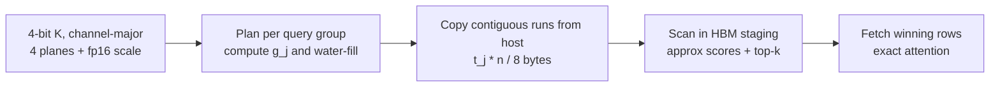

[Paper](https://arxiv.org/abs/2609.17652)
## Fathom: Accelerating 1M-Token Decoding by 1.67x with Query-Adaptive Depth Scanning

## TL;DR

When agent sessions stretch to 1M tokens and dozens of sessions reside concurrently, the KV cache and the index used to rank it must live in host memory, making the top-k scan at every decode step bound by PCIe bytes (source: §1). Fathom stores the 4-bit K cache as channel-major bit-planes so that reading the leading $t$ planes yields an exact $t$-bit quantization, and each query partitions its bit budget across channels via reverse water-filling based on per-channel importance $g_j$ (source: §3.2, §3.3). On Qwen3-8B at 1M tokens with batch size 1, it is 1.67x faster in GPU time than a 136-bit scan, 2.50x faster than landmarks, and 3.12x faster than thumbnails, while achieving 1.1–5.3x lower attention error with 18% fewer bytes than SparQ r=16 at matched GPU time (source: Tab. 1, Tab. 2, Tab. 5). However, it provides no speedup when the index resides in HBM (source: §7).

## Key Idea

The core hypothesis can be summarized in a single sentence:

**The authors hypothesize that by storing keys in channel-major bit-planes and allocating variable read depths per channel via per-query reverse water-filling, one can overcome the byte bottleneck of fixed-depth scans and achieve lower error with fewer bytes in the same GPU time (source: §1, §3).**

The most important and original contributions fall into three categories (source: §1):

1. **A new data structure: the bit-plane K store.** 4-bit K codes are stacked in channel-major order as four 64-bit words per block (source: §3.2). Reading the first $t$ words yields an exact $t$-bit mid-rise quantization without requiring a separate low-precision copy (source: §3.2). This represents a new architectural component.
2. **Application of a new theoretical insight: per-channel variable-depth water-filling.** Observing that the expected squared score error of channel $j$ is proportional to $g_j 4^{-t_j}$, they solve for the optimal integer depth in closed form as $\text{clip}(\text{round}(\log_4(g_j/\theta)),0,4)$ and find $\theta$ via 30 steps of log-bisection (source: §3.3). This is not a new training technique, but an inference-path application of a theoretical insight.
3. **New systems measurement and analysis: separating the offload vs. HBM regimes.** They measure 1.37x GPU time reduction at 256k tokens and 1.67x at 1M tokens for host-resident indices, and explain via an integer-ops-to-bytes analysis why HBM-resident indices become compute-bound and see no speedup (source: §5.1, §7). This constitutes a novel application of existing methodology and a measurement contribution.

From the authors' perspective, the argument for superiority is clear (source: §1, §3.3). The value of the first bit differs from that of the fourth bit. The first bit of an important channel carries far more weight than the first bit of a minor channel, while the fourth bit of an important channel may matter less than the first bit of a minor channel. Reading all channels to the same depth is therefore wasteful; bits should be allocated in order of marginal value. Using variance-weighted importance $g_j = \sum_h (q_j^{(h)})^2 \text{Var}(k_j)$ and assigning graded depths distinguishes this approach from SparQ's all-or-nothing selection of the top-$r$ channels by $|q|$ (source: §3.3).

## Background: The Problem They Solved

The state of the art at the time of publication is as follows (source: §1, §2).

Long-context decoding is inherently bandwidth-bound because each token reads the model weights once and the entire KV cache once per layer. Offloading makes reading the cache the dominant term. GQA and 2–4 bit KV quantization shrink the cache, while top-k sparse attention reduces the read volume. Yet before scores are known, all $n$ keys must still be scanned using a cheap representation to rank them (source: §1).

The Qwen3-8B example illustrates this split. It has 36 layers, 8 KV heads, 128 channels per head, and 4 query heads per KV head (source: §1). At 32k tokens, reading the full bf16 KV cache takes 4.8 GB per step, whereas the union of $k=512$ top-k winners is at most 2048 rows, costing around 200 MB per step regardless of context length. In contrast, Loki, Double Sparsity, and SparQ r=32 scans read 136 bits per token—amounting to 160 MB per step across 288 layer-head pairs at 32k tokens, and scaling linearly to 5.1 GB at 1M tokens (source: §1).

There are two levers to pull (source: §1, §2). One is scoring fewer items, which encompasses pages, blocks, and landmarks. Quest scores 16-token pages using per-channel min-max keys, while ShadowKV scores 8-token chunks using mean keys (source: §2). The other lever is reading fewer bits per key.

The critical limitation lies in the latter. Existing per-token scans fix the bit depth in advance (source: §1). Loki reads $r$ principal component coordinates, Double Sparsity reads $c$ offline-selected channels at 4 bits, SparQ reads the top-$r$ channels per query at full depth, and thumbnails read all channels at 2 bits. Every channel touched is read to the exact same depth (source: §1). This is the exact research gap the paper addresses: there was no method to determine read depth per query and per channel.

The evaluation protocol is also unified. The first 4 tokens and last 32 tokens are always kept, while the remaining $k-36$ tokens are selected per query head as the top-scoring set under each method, and accuracy is measured against exact attention output over the selected set (source: §2). SparQ's unselected mass redistribution is not applied to any method (source: §2).

## The New Approach: Fathom

### Cost Model

For $N$ concurrent decoding sequences, context length $n$ tokens per sequence, scan budget $b$ bits per token per KV head per layer, $H$ KV heads, $L$ layers, $G$ query heads per group, union winning rows $k_{\cup} \le Gk$, and full K+V row size $R$ bytes, a single step reads (source: §3.1):

$$
\text{bytes} \approx W + N L H \left(\frac{b}{8} n + k_{\cup} R\right)
$$

where $W$ is the weight bytes read once per step (source: §3.1). The scan term scales with total resident tokens $Nn$, whereas the row term scales only with $N$. When $b n/8$ dominates, reducing $b$ directly reduces latency—which is precisely the long-context multi-session regime (source: §3.1).

### Bit-Plane K Cache

Keys are quantized once to 4 bits using a uniform symmetric code per channel, with one fp16 scale per 64-token block (source: §3.2). For block $\beta$ and channel $j$, with block maximum $a_{\beta,j} = \max_{i \in \beta} |k_{i,j}|$ and cell width $s_{\beta,j}=a_{\beta,j}/8$, the code is (source: §3.2):

$$
c_{i,j} = \text{clip}(\lfloor k_{i,j}/s_{\beta,j} \rfloor, -8, 7)+8 \in [0,16)
$$

Here, code 8 represents 0, and the most significant bit is the sign bit.

Bit $p$ (where 0 is the MSB) across the 64 codes in a block is packed into a single 64-bit word $P_{\beta,j,p}$ (source: §3.2). Because the layout is channel-major, $P_{\cdot,j,0 \dots t-1}$ is contiguous across the sequence. Reading the leading $t$ planes gives $c^{(t)} = c \gg (4-t)$, and its dequantized value $(c^{(t)}+0.5-2^{t-1}) a_{\beta,j}/2^{t-1}$ matches a $t$-bit mid-rise quantization on $[-a_{\beta,j}, a_{\beta,j})$ exactly. At $t=4$, this reduces to $(c-8+0.5)s_{\beta,j}$ (source: §3.2). Kept as a separate index, this takes 68 bytes per token per KV head, which is 2–4x the storage cost of Double Sparsity's 17 bytes or a 32-byte landmark. It trades higher storage bytes for fewer bytes read per query (source: §3.2, §7).

Compatibility depends on the quantization family (source: §3.2). Quantization after a fixed rotation works provided it is a variance-concentrating KLT; random rotations like TurboQuant leave nothing to water-fill and are unsuitable. KIVI-style uniform integer codes and INT8 are directly compatible, whereas non-uniform codes lose the exact prefix property. KVQuant's lookup tables, pre-RoPE quantization, and outlier isolation are not implemented; FP8 would require empirical marginal gains in place of $4^{-t}$, and codebook vector quantization lacks a per-channel depth concept (source: §3.2).

### Per-Query Read Depth

For a query group $\{q^{(h)}\}_h$ sharing a KV head, the variance of channel $j$'s score contribution across keys is proportional to (source: §3.3):

$$
g_j = \sum_h (q_j^{(h)})^2 \text{Var}(k_j)
$$

where $\text{Var}(k_j)$ is measured once on calibration keys. Reading $t$ planes corresponds to $2^{t}$-cell uniform quantization of width $\Delta = 2a_{\beta,j}/2^{t}$, whose cell-midpoint error variance is $\Delta^2/12 = a_{\beta,j}^2/(3 \cdot 4^{t})$. Each additional plane divides the error variance by 4 (source: §3.3). Using $a_{\beta,j}^2$ as a proxy for $\text{Var}(k_j)$, the expected squared score error of channel $j$ is proportional to $g_j 4^{-t_j}$, and minimizing the sum $\sum_j g_j 4^{-t_j}$ subject to $\sum_j t_j \le B$ is reverse water-filling (source: §3.3). The integer solution for a common water level $\theta$ takes the closed form given in the Key Idea section, and 30 steps of log-bisection find the smallest $\theta$ satisfying the budget (source: §3.3). Channels with $t_j=0$ are skipped entirely, and the rest are active channels. At an average read budget of 48 code bits, 30–34 out of 128 channels are touched at 1–4 planes each (source: §3.3, Tab. 21). The plan is shared across the $G$ heads in the group so that K bytes are read only once (source: §3.3).

Two layer-budget policies are considered (source: §3.4). A flat budget uses the same $B$ across all layers, requiring no calibration and having no context-length dependency. A greedy per-layer plan shifts bits on calibration text toward layers with the largest error reduction per bit, assigning $B_{\ell} \in \{24,\dots,128\}$ for a target average of 48 or 64 bits. On Qwen3 at 16k, this cuts error at 48 average bits roughly in half, but the gain diminishes at 32k; on Qwen2.5-7B and Llama-3.1-8B, it degrades error by up to 1.7x and 2.1x, and applying a 16k plan at 32k performs worse than flat. The recommended default is flat (source: §3.4, §6, Tab. 10, Tab. 14).

The basis rule is decided once per model (source: §3.5). For Qwen3-family models with QK-norm, raw channels work best and KLT rotation increases error. For Llama-3.1-8B, Qwen2.5-7B, and Qwen2.5-7B-1M without QK-norm, KLT rotation lowers error at the same bit budget. The rotated variant stores the planes of $(k-\mu)V$ and uses $g_j = \sum_h ((q^{(h)}V)_j)^2 \lambda_j$ without truncation (source: §3.5).

Reading from the host-resident store is handled by gathering contiguous runs (source: §3.6). Treating the entire sequence as a single channel-major block makes the leading $t_j$ planes of channel $j$ a contiguous run of $t_j n/8$ bytes. A gather kernel copies one run and scale per active channel into a staging buffer, and the scan runs in HBM. The run list has a fixed size of 1 slot per channel with length 0 for inactive channels, avoiding host synchronization (source: §3.6). All baselines in the offload experiments are given this exact same transport (source: §3.6).

## How It Works: A Concrete Walkthrough

For graduate-level readers, we walk step-by-step through the paper's 6-key toy example (source: Appx. A). The inputs are a key matrix $K \in \mathbb{R}^{6 \times 4}$, channel variances $\text{Var}=[1.222, 0.755, 0.127, 0.001]$, query head A $(3,1,2,0.1)$, and query head B $(1,2,-1,0.2)$. The exact top-2 scores are $\{t_0,t_3\}$ for A and $\{t_5,t_0\}$ for B, where B's decision between $t_0$ and $t_3$ hinges on channel 2, in which $t_3$ has value 0.4 and $t_0$ has value -0.2 (source: Appx. A).

**Step 1: Compute importance.** Substituting into the formula for $g_j$ gives $g_0=(9+1)\times 1.222=12.22$, $g_1=(1+4)\times 0.755=3.77$, $g_2=(4+1)\times 0.127=0.63$, and $g_3=(0.01+0.04)\times 0.001 \approx 0$ (source: Appx. A). All key terms are defined immediately: $g_j$ is the query-weighted score variance contribution, $t_j$ is the read depth in planes for channel $j$, $B$ is the code bit budget, and $\theta$ is the water level.

**Step 2: Find the water level.** With budget $B=8$ bits and bracket $[0.001,10]$, we test log-midpoints (geometric means). At $\theta=0.1$, the depths are $(3,3,1,0)$ summing to 7 bits (under budget); at $\theta=0.01$, the depths are $(4,4,3,0)$ summing to 11 bits (over budget). Repeating this for 30 bisection steps converges to $\theta=0.079$, yielding depths $(4,3,1,0)$ which use all 8 bits (source: Appx. A).

**Step 3: What 1 plane means.** For channel 2, the block maximum is $a_2=0.5$, cell width is $s=0.0625$, and the 4-bit codes are $(4,12,9,14,0,3)$. The first plane is the sign bit, which decodes alone to -0.25 for $t_0,t_4,t_5$ and +0.25 for $t_1,t_2,t_3$, recovering the relative ordering of the true values $-0.2,0.3,0.1,0.4,-0.5,-0.3$ using just 1 bit—putting $t_3$ above $t_0$ (source: Appx. A).

**Step 4: Verdict.** At depths $(4,3,1,0)$, B's approximate scores are $(2.84,0.24,-2.01,2.49,-0.61,3.36)$, matching the ordering of the exact scores $(2.81,0.40,-2.19,2.20,-0.69,3.39)$ to correctly select $\{t_5,t_0\}$, while A also correctly selects $\{t_0,t_3\}$ (source: Appx. A). At the same 8-bit budget, Loki r=2, Double Sparsity c=2, and SparQ r=2 group rules all read only channels 0 and 1, misranking B as $\{t_5,t_3\}$, while a 2-bit thumbnail gets both heads wrong. At $B=6$ bits with depths $(3,2,1,0)$, Fathom also misranks B, illustrating a failure budget (source: Appx. A, Fig. 4).

### Secret Weapon: Uniform Depth vs. Water-Filling

If we isolate a single core component, it is per-channel variable depth. Removing it and replacing it with a uniform 2 planes across all channels yields the 2-bit thumbnail at 288 bits per token (source: §6). Across scales, the difference is as follows (source: Tab. 14, Tab. 15, §6):

| Setting | Uniform 2-bit (288 bits) Error | Water-Filling Bits at Matched Error | Savings Factor |
|---|---|---:|---:|
| Qwen3-8B 16k, $k=256$ | 0.0028 | ~74 bits | ~3.9x |
| Qwen3-8B 32k, $k=512$ | 0.0102 | ~56–74 bits range | ~3.9–5.1x |
| Qwen2.5-7B-1M 128k, $k=2048$ | 0.0001 | ~148 bits | ~1.9x |

Across all 7 settings, thumbnail error is matched at 28–148 bits (source: §6). The mechanism is straightforward: uniform depth spends bits on channels that barely contribute to the query score. Water-filling turns off channels with small $g_j$ by setting $t_j=0$ and concentrates 3–4 planes on the most important channels. Because scan compute requires 1 multiply-add per active channel, token, and head, reducing bits does not proportionally reduce multiply-adds; in the PCIe regime, bytes dictate time so this translates into speedups, whereas in the HBM regime, the remaining compute eliminates the gain (source: §7).

## Performance Validation: Key Results

Evaluation spans three tiers of metrics: decode step GPU time (ms) and wall-clock time (ms), scan volume (bits per token), and attention output relative $L_2$ error (source: §4, §5). The benchmarks cover fidelity across 7 model-context configurations, 32k and 128k RULER-style synthetic retrieval and tracking tasks, and step-level agreement on real coding agent sessions (source: §4, §5).

The primary evidence of success emphasized by the authors is host-memory decoding, the target regime (source: §5.1). With synthetic KV on Qwen3-8B, $k=512$, and batch size 1, the scan fraction grows with context length and the time ratio approaches the byte ratio (source: Fig. 2, Tab. 2). At 1M tokens, Fathom reading 56 bits reduces GPU time by 1.67x vs. a 32-channel scan (136 bits), 2.50x vs. landmarks (256 bits), and 3.12x vs. thumbnails (288 bits). In wall-clock time, the speedups are 1.38x, 2.07x, and 2.59x (source: Tab. 2). SparQ r=16 at 68 bits transfers 22% more scan bytes and takes 1.05x the GPU time. Fathom at a 40-bit average code budget (~47 total bits) reads 31% fewer bytes and is 1.11x faster than SparQ r=16 (source: Tab. 2, Tab. 4). At 256k tokens, the shared row fetch of 167–216 MB per step is a larger fraction, yielding a 1.37x speedup; with real prefill at 128k, it is 1.26x vs. 32-channel and 1.00x vs. SparQ r=16 (source: Tab. 3, §5.1). At batch size 2, speedups are 1.44x at 256k and 1.63x at 512k (source: §5.1).

A breakdown of the 1M-token step shows where the savings come from (source: Tab. 4). All scans move across the link at roughly 26 GB/s, so transfer time equals bytes divided by link speed. For Fathom 48, transfer is 78 ms, kernel is 21 ms, top-k is 35 ms, row fetch is 15 ms, GEMM is 10 ms, and other is 19 ms, totaling 99 ms for the scan and 177 ms for the full step. A 32-channel scan spends 197 ms on transfer and 296 ms per step. Shared non-scan costs account for 33% of Fathom's step time and 20% of the 32-channel scan's step time (source: Tab. 4).

The matched GPU-time comparison is the second highlight (source: §5.2, Tab. 5). SparQ r=16 (68 bits) and Fathom (56 bits) run in essentially the same time—1.05x at 1M and 1.00x with real 128k prefill. At this matched time, Fathom reads 18% fewer bytes and achieves 1.1–5.3x lower error across all 7 configurations under the better plan, and lower error in 6 of 7 configurations using the flat default alone (source: Tab. 5). The largest gap is 5.3x on Qwen2.5-7B-1M at 128k with $k=2048$ (the selection ratio that matters for downstream tasks), while the smallest gap is a near-tie with flat on Qwen3-8B at 32k (source: Tab. 5). Even at the 40-bit average budget (~47 bits), Fathom achieves lower error in 6 of 7 settings while running faster (source: §5.2).

Byte savings at matched error is the third highlight (source: §5.3, Tab. 6, Fig. 3). Fathom matches Double Sparsity's 136-bit error using 46–74 bits, a 1.8–2.9x reduction. It matches SparQ r=32 (136 bits) using 38–92 bits. Loki at 136 bits is matched at 56–75 bits in the 4 settings where it is not rank-limited, while collapsing on Qwen3 (source: §5.3, §6).

The effect of the selection ratio is an important caveat (source: §5.4, Tab. 16, Fig. 6). At 128k, $k=128$ corresponds to a 0.1% selection ratio; compared to 1.6% selection, fixed-depth scan errors jump by 5–6x, Fathom jumps by 15x, and even a full 4-bit scan jumps by more. The error advantage over SparQ r=16 narrows from 4.4x at 1.6% selection to 1.6x at 0.1% selection. Savings diminish with smaller selection ratios rather than longer contexts, a phenomenon common to all approximate scans (source: §5.4).

Downstream quality bifurcates across benchmarks (source: §5.5, §5.6). On RULER-style tasks, within a standard error of ~0.014 at 32k (40 samples) and ~0.034 at 128k (20 samples), all per-token scans tie the exact top-k oracle within 0.008 at 32k and 0.025 at 128k. Fathom at 56 bits and 74 bits also ties. Block landmarks lose 0.043 at 32k and 0.130 at 128k (source: Tab. 7, Fig. 7). On real OpenHands trajectories (80k–100k token sessions), the methods separate. At a 2% budget ($k=2048$) across 20 sessions, Fathom at 56 bits reaches 0.67 word-level agreement with exact top-k steps, compared to 0.49 for SparQ r=16 and 0.47 for landmarks—a paired difference of $+0.18 \pm 0.05$ (source: Tab. 9, §5.6). At a 0.5% budget ($k=512$) across 40 sessions, the most accurate baseline, SparQ r=32 (136 bits), scores 0.60 and Fathom at 92 bits also scores 0.60—a paired difference of $-0.00 \pm 0.04$ while reading 32% fewer bytes (source: Tab. 8, §5.6).

System implementation resources are detailed separately (source: Appx. E, §7). The hardware consists of an A100-SXM4-80GB with a PCIe 4.0 host link, 2 TB host RAM, and 16 vCPUs; the software stack uses PyTorch 2.8, Triton 3.4, Transformers 4.56.1, and CUDA 12.8. Only Llama-3.1-8B activations were captured on an L4 (source: Appx. E). Throughput is directly reflected by the step latency tables above. For the HBM-resident Triton scan kernel on Qwen3-8B (batch $4 \times 8$ KV heads, $k=512$, averaged over 5 layers), at 32k tokens Fathom 48-bit takes 0.140 ms (75 GB/s), 32-channel takes 0.102 ms (175 GB/s), and full 4-bit takes 0.330 ms (217 GB/s); at 128k tokens, they take 0.415 ms (102 GB/s), 0.291 ms (245 GB/s), and 1.010 ms (282 GB/s), respectively (source: Tab. 17, Fig. 9). PCIe gather achieves 25.1–26.2 GB/s for 4 KB to 512 KB runs at optimal block sizes, matching a single `cudaMemcpyAsync` (21.6–25.9 GB/s) with no loss even at a 4x stride. Per-run copy calls achieve only 0.4 GB/s at 4 KB (~11 us per call) (source: §7, Fig. 10). Memory footprint as a separate index is 68 bytes per token per KV head, corresponding to a 5.1 GB label cache for a 1M-token Qwen3-8B sequence vs. 9.7 GB for landmarks (source: §5.1, §7). Total compute costs in FLOPs or Petaflop-days are not reported.

In a critical comparison, Fathom's strongest point is the head-to-head against SparQ r=16 at matched GPU time: it simultaneously hits the trifecta of equal time, 18% fewer bytes, and lower error across 6–7 configurations (source: Tab. 5). Its weakest points are also explicitly stated. On Qwen3-8B at 32k, flat 56-bit Fathom ties SparQ r=16 (0.0081 vs. 0.0080), and SparQ r=32 (136 bits) is more accurate in 3 settings at the cost of 1.67x GPU time. Reading 74–92 bits with Fathom reaches that accuracy, yielding a 1.4x byte saving at 74 bits (source: §5.2, Tab. 14). In wall-clock time at 1M tokens, SparQ r=16 is 7% faster because of host overhead in the research harness (48 ms vs. 24 ms) rather than transfer or kernel execution (source: §5.2, §6). When HBM-resident, all per-token scans cluster around 45–48 ms per step at 128k, and Fathom is not the fastest (source: Tab. 3, Fig. 8). Loki's collapse on Qwen3 is a rank issue rather than a quantization issue; it fails to recover even with fp16 coordinates and only recovers at r=64 (source: §6, Tab. 20). Strengthening SparQ by taking the union of per-query-head selections lowers its error but increases bytes by 2.1–3x, putting the r=16 variant at 148–200 bits—worse than Fathom at 146 bits across all settings (source: §6, Tab. 18).

## Our Perspective: Strengths, Limitations, and Why This Work Matters

A major strength is the honesty of its regime framing (source: §5.1, §7, §8). Right from the start, the paper states that it speeds up offloaded decoding and does not speed up HBM-resident decoding. Byte accounting is unified as code bits plus 16 bits of fp16 scale per 64 tokens per channel, matching the exact bytes transferred by the timing harness (source: §4). All baselines are given the exact same contiguous gather transport, making the comparison strictly about bytes (source: §3.6). The authors also transparently note that the landmark baseline is a host-resident re-implementation of a setup neither ShadowKV nor Quest originally used, and that CPU-retrieval methods like RetroInfer and MagicPIG are not compared (source: §2, §8).

Explicit limitations are also numerous (source: §8). Timings beyond 128k use synthetic KV contents, and because the Triton kernels are prototypes with Python launch overheads absent in fused production implementations, GPU time is used as the primary metric. Per-layer plans must be calibrated at the deployment context length; channel statistics are calibrated offline, and while in-domain agent statistics shift agreement by up to $+0.07$, this remains within 1.5 standard errors. Fidelity is evaluated on a single held-out window per setting, and RULER standard errors are several percentage points, meaning fine distinctions among per-token scans are not established there. Offload tables focus on batch size 1 with a single batch-2 check, arguing multi-session motivation from index size calculations. The 128k instruct models are prompted without chat templates, lowering absolute scores. SparQ's group-shared top-k and mean-value redistribution are not evaluated (source: §8).

There are three potential limitations to consider. First, savings are sensitive to the selection ratio: at 0.1% selection, the advantage narrows substantially and is only partially recovered by a rotated store (source: §5.4, Tab. 16). Second, there is a trade-off between memory/compute and bandwidth: read bytes drop, but storage requires 68 bytes per token per head, and bit extraction adds 1–2 integer ops per bit—a 4x per-bit compute cost compared to a nibble scan. With an A100 providing ~5 integer ops per byte (similar on H100 SXM, and ~25 ops per byte on L4), being compute-bound in HBM on A100 applies across current datacenter GPUs, and by Amdahl's law, step-level gains shrink whenever the scan is a small fraction of the step (source: §7). Third, generalization requires care: channel statistics across domains, basis selection depending on QK-norm, and the length dependency of per-layer plans all require re-verification for each deployment (source: §3.4, §3.5, Appx. D).

Even so, this work matters because it targets the exact bottleneck of the agent era. When multiple coding or browsing agents holding hundreds of thousands of tokens for hours reside on a single server, the KV cache cannot fit alongside the model weights (source: §1). While fetching the winning rows stays fixed at ~200 MB per step, scanning diverges to 5.1 GB at 1M tokens. Subdividing the intelligence of what to read down to the individual bit—achieving higher accuracy in the same time—is highly practical. In particular, the separation of 0.67 vs. 0.49 on real agent steps at a 2% budget demonstrates a tangible quality difference that synthetic retrieval ties fail to capture (source: §5.6).

## What's Next?: The Road Ahead

The future work left by the authors is explicit (source: §8). Scaling the agent evaluation beyond the 40 sessions completed out of 100 planned at $k=512$ and the 20 sessions at $k=2048$, as well as measuring end-to-end task success including test execution, remains open. A calibration-free variant that computes the mean, eigenbasis, and eigenvalues directly from the session's own keys is reported to take less than 1 ms at 100k tokens, making online adaptation a natural next step (source: Appx. D). Using the 4-bit channel-major K cache as the serving stack's primary K cache—reconstructing winning keys from all 4 planes instead of keeping a separate index—is unimplemented, with the cost of single-token reconstruction remaining an open challenge (source: §7). Closing the wall-clock-to-GPU-time ratio gap by eliminating Python launch overhead via fused kernels also remains (source: §6).

Four alternative directions appear promising. First is deployment-length-adaptive layer budgeting: interpolating plans across context lengths or dynamically adjusting the global budget per query (source: §3.4). Second is pipelining the scan, top-k, and row fetch stages: because the paper's chunked pipeline saw no gain due to link saturation and kernel contention, stream separation and lighter-weight kernels must come first (source: §6). Third is extending variable depth to FP8, non-uniform codes, and residual VQ stages by replacing the $4^{-t}$ rule with empirical marginal gains whenever prefixes exhibit monotonic magnitude or stage-wise refinement (source: §3.2). Fourth is a hybrid of block-landmark and token-precision scanning: given the sharp separation between block and token methods on RULER, a two-stage approach that prunes candidates at the block level under tight budgets and refines them with token-level bit-planes could shore up the weakness at the 0.1% selection ratio (source: §5.5, §5.6).
<!-- verbatim-tables -->

## Tables from the paper

> Tables converted mechanically from the arXiv e-print LaTeX source. The numbers are the paper's own and did not pass through a model.

**Table 1. Measured results by regime on an A100 (Qwen3-8B, $k=512$). GPU time per decode step; the 136-bit scans are Double Sparsity, Loki and SparQ $r=32$.**

| regime | what binds | Fathom (56-bit read unless noted) |
|---|---|---|
| KV rows and index in host memory, 1M tokens | PCIe bytes | **1.67$\times$** faster than the 136-bit scans, **2.50$\times$** than landmarks; the same GPU time as SparQ $r=16$ at 56 bits (ratio 1.05) and **1.11$\times$** faster at 47 bits, at lower error |
| same, 128k tokens, real prefill | PCIe bytes | **1.26$\times$** faster than the 136-bit scans; SparQ $r=16$ takes 1.00$\times$ its GPU time |
| real coding-agent sessions, 100k tokens, $k=2048$ | scan fidelity | step agreement with exact top-$k$ **0.67**, SparQ $r=16$ 0.49, landmarks 0.47 |
| real coding-agent sessions, 100k tokens, $k=512$ | scan fidelity | **0.60** at 92 bits, equal to SparQ $r=32$'s 0.60 at 136 bits |
| rows in host memory, index in HBM | the shared row fetch | not faster; all per-token scans land at 45--48 ms |
| everything in HBM | arithmetic per scanned bit | not faster; the scan kernel is $1.4\times$ slower than a nibble scan |
