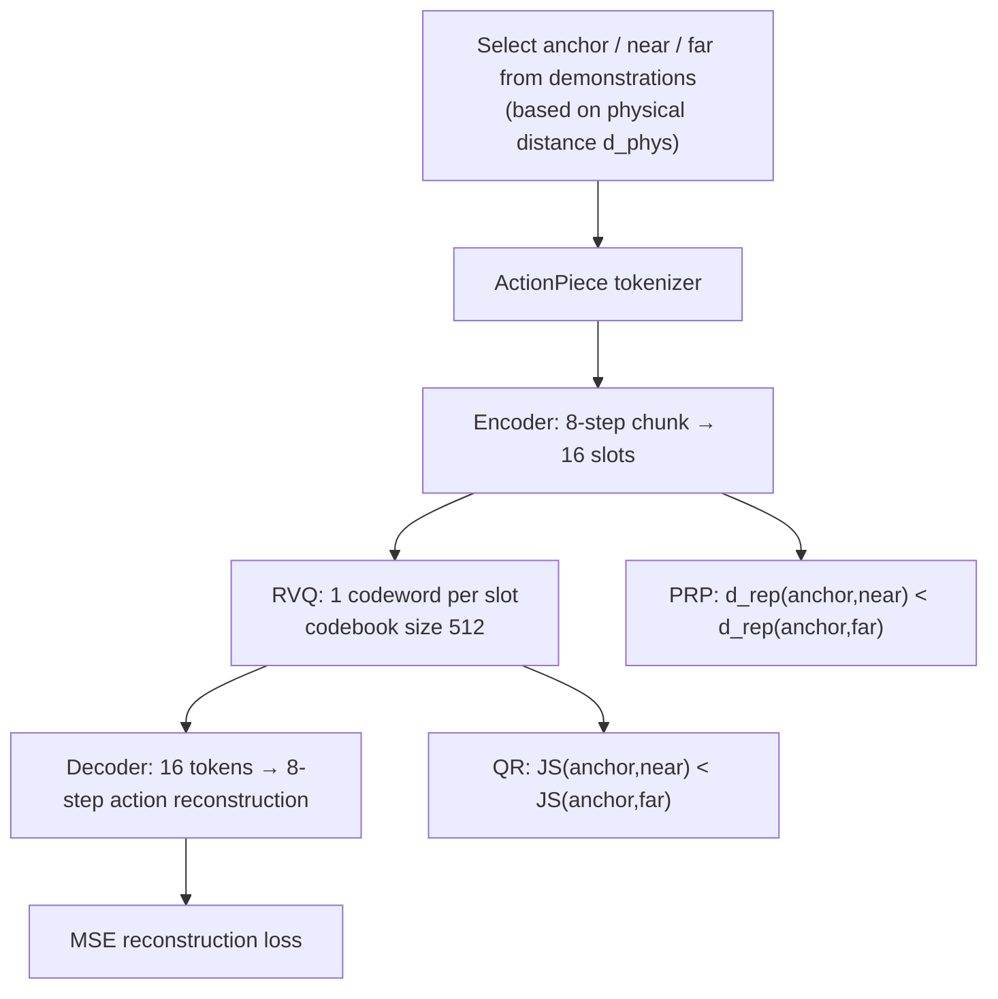

[Paper](https://arxiv.org/abs/2609.18487)
## ActionPiece: Rethinking Action Tokenization Beyond Reconstruction Error, via Physical Ranking

> **TL;DR** — In autoregressive VLA (vision-language-action) models, the action tokenizer is the key interface that compresses continuous robot commands into discrete tokens and then reconstructs predicted tokens back into executable commands. Existing tokenizers only reduce pointwise reconstruction error such as MSE; they do not check whether the "fine adjustments" between demonstrations survive compression. This paper newly defines **PRC (Physical Rank Consistency)**, which measures **the degree to which the ranking of physical distances is preserved** in the reconstructed action space, and proposes **ActionPiece**, which supervises representation learning and quantization jointly to preserve that relation. Under the same Qwen3-VL-4B policy training setup, it achieves state-of-the-art results of **94.8%** on LIBERO and **68.8%** on unseen LIBERO-Plus (source: Abstract, Table 1).

---

## Key Idea

The action tokenizer simultaneously determines the "prediction target" for policy learning and the "decoder" at execution time (source: §1). Prior work improved compression efficiency through coordinate discretization (RT-2, OpenVLA), frequency-domain compression (FAST), and learned vector quantization (FASTer, OAT, ActionCodec, X-Tokenizer) (source: §2.2), but did not sufficiently address the fact that **compression itself changes the actions the robot ultimately executes** (source: §1).

ActionPiece's core insight boils down to three points.

1. **MSE only reduces the error of individual actions**; it does not coordinate the "direction" of reconstruction error across demonstrations (source: §3.1).
2. After compression, similar actions cluster around a representative motion, but the adjustments needed for different contexts can be **weakened, distorted, or inverted** (source: §1, §3.1).
3. Therefore, in addition to pointwise accuracy, one must evaluate **preservation of the ranking of physical distances (PRC)** and directly supervise that ranking itself as a training objective.

The authors call this perspective "relational fidelity," and to achieve it they apply rank supervision to both the representation learning stage and the codeword assignment stage (source: §1, Fig. 1).

---

## Background: The Problem They Solved

### The "adjustments" the tokenizer silently erases

Across demonstrations of the same task, repeated motions appear with subtle differences. For example, in "pick up the red can and put it in the box," the grasp position varies slightly depending on object position, robot state, and execution stage (source: §3.1). In tasks requiring precise alignment, grasping, and contact, these small differences determine success or failure (source: §1, §3.1).

The tokenizer compresses these demonstrations into a discrete representation of finite capacity and then reconstructs them back into executable commands. This lossy compression inevitably produces reconstruction error $e_i = \hat x_i - x_i$. The reconstructed difference between two demonstration chunks $x_i$, $x_j$ decomposes as follows (source: Eq. 1):

$$
\hat x_j - \hat x_i = (x_j - x_i) + (e_j - e_i)
$$

The first term is the "action change" that actually exists in the demonstrations, and the second is the "extra change" that tokenization inserts. The problem is that MSE only reduces the magnitude of this second term and **does not control its direction**. As a result, the extra term can attenuate or amplify the original difference and can even **flip its direction** (source: §3.1).

Crucially, this distortion does not disappear even when the policy predicts the tokens "exactly." Even if the VLA correctly reproduces the token sequence encoding a demonstration action, the decoder will still execute the "reconstructed version" of that action (source: §1, §3.1).

### The landscape of existing approaches

The authors organize existing action interfaces into three branches (source: §2.1).

- **Discrete autoregressive**: RT-2/OpenVLA discretize coordinates into bins, and FAST compresses action chunks into short token sequences. The advantage is that they can reuse the next-token prediction objective of a pretrained VLM as is (source: §2.1).
- **Continuous prediction**: OpenVLA-OFT ($\ell_1$ regression) and the RDT/$\pi_0$/GR00T family (diffusion, flow matching) directly predict real-valued action chunks (source: §2.1).
- **Hybrid**: $\pi_{0.5}$, HybridVLA, Fast-in-Slow, etc. mix discrete supervision with continuous execution (source: §2.1).

Among the learned vector quantization family are FASTer (residual vector quantization + structural patching), OAT (nested dropout + coarse-to-fine alignment), ActionCodec (token budget, alignment, residual grammar), and X-Tokenizer (semantic supervision from a vision-language teacher) (source: §2.2). All of these focused on **compression, ordering, and multimodal alignment**, but none had a mechanism to measure or supervise "how compression changes the relations between demonstrations" (source: §2.2).

---

## New Approach: ActionPiece

### PRC: Looking at "distance ranking," not "distance values"

The authors evaluate relation preservation through the **relative ordering of physical distances**. First they define the physical distance $d_{\text{phys}}$. This expresses the difference between two end-effector commands $a=(p, R, g)$ (position, rotation, gripper) as a weighted sum of normalized components (source: §4.2, Eq. 5):

$$
\delta_{\text{phys}}(a, a') = \alpha_p \left\|\frac{p - p'}{s_p}\right\|_2^2 + \alpha_R \left(\frac{d_{\text{SO(3)}}(R, R')}{s_R}\right)^2 + \alpha_g\,|g - g'|^2
$$

The rotation distance is measured as the shortest geodesic angle on $\mathrm{SO}(3)$ (source: Eq. 4):

$$
d_{\text{SO(3)}}(R, R') = \left\|\mathrm{Log}(R^\top R')^{\vee}\right\|_2
$$

The scales $s_p, s_R$ are fit to the training actions, and the group weights $\alpha_p, \alpha_R, \alpha_g$ are fixed within an embodiment (source: §4.2). The chunk-level distance averages the per-timestep distances.

Based on this distance, **PRC@k** measures, for each anchor $A_i$, how well the distance ranking to the $k$ nearest neighbors $N_i^k$ in the original action space agrees with the ranking to the same neighbors of the reconstruction $\hat A_i$, using the Spearman correlation $\rho_S$ ($k=32$) (source: §3.2, Eq. 2):

$$
\text{PRC@}k = \frac{1}{N}\sum_{i=1}^{N} \rho_S\Big(\big[d_{\text{phys}}(A_i, A_j)\big]_{j\in N_i^k},\ \big[d_{\text{phys}}(\hat A_i, \hat A_j)\big]_{j\in N_i^k}\Big)
$$

The key design choice is that **the ranking is measured in the decoded action space**. This lets tokenizers be compared on the same physical basis regardless of token vocabulary, sequence length, or decoder architecture (source: §3.2). In short, MSE handles the fidelity of individual reconstructions, and PRC handles preservation of the physical distance ranking.

### Two physical rank losses

ActionPiece consists of a shallow Transformer encoder/decoder and residual vector quantization (RVQ). An action chunk $A\in\mathbb{R}^{H\times D}$ with $H$ steps is turned by the encoder $E_\phi$ into $S$ latent slots, and an RVQ of depth $Q$ and codebook size $K$ represents each slot as a sum of $Q$ codewords $q_s = \sum_{r=1}^{Q} e^{(r)}[z_s^{(r)}]$ (source: §4.1, Eq. 3). The total number of tokens is $T = SQ$. The decoder $D_\omega$ reconstructs the entire chunk at once from these $T$ tokens.

In addition to the reconstruction loss, the authors add two rank supervisions.

**① PRP (Physical Rank Preservation)** — After LayerNorm and unit $\ell_2$ normalization of the encoder features $\bar h_{i,s}$ and the selected codeword features $\bar e_{i,s}$ respectively, the slot-mean squared distances $d^2_{\text{enc}}$, $d^2_{\text{quant}}$ are computed and mixed $0.25:0.75$ to form the representation distance (source: §4.3, Eq. 6–7):

$$
d^2_{\text{rep}}(i,j) = 0.25\, d^2_{\text{enc}}(i,j) + 0.75\, d^2_{\text{quant}}(i,j)
$$

Then, for each anchor, the remaining actions in the batch are sorted by physical distance, and the near action at the 5th percentile ($q_{0.05}$) is selected as the positive (near) $j_i^+$, while the far action at the 95th percentile ($q_{0.95}$) is selected as the negative (far) $j_i^-$ (source: §4.3, Appx. B.3). The ranking loss imposes the near–far order (source: Eq. 8):

$$
\mathcal{L}_{\text{rank}} = \frac{1}{B}\sum_i \mathrm{softplus}\big(D_{ij_i^+} - D_{ij_i^-} + m_r\big),\quad m_r = 0.1
$$

**② QR (Quantization Regularization)** — Rather than the representation distance, it imposes the same order on the mean Jensen–Shannon divergence between the codeword assignment probability distributions $\pi_{i,s}$ of each slot (source: §4.4, Eq. 9–10):

$$
\mathcal{L}_{\text{quant}} = \frac{1}{B}\sum_i \mathrm{softplus}\big(d_{\text{JS}}(i, j_i^+) - d_{\text{JS}}(i, j_i^-) + m_q\big),\quad m_q = 0.1
$$

The two losses target two different stages of compression. PRP aligns **the geometry of learned features** to the physical order, and QR aligns **the assignment into the discrete vocabulary** (source: §4.4). The overall objective is as follows (source: §4.5, Eq. 12):

$$
\mathcal{L}_{\text{tok}} = \mathcal{L}_{\text{MSE}} + \lambda_{vq}\mathcal{L}_{\text{commit}} + \lambda_r \mathcal{L}_{\text{rank}} + \lambda_q \mathcal{L}_{\text{quant}}
$$

The weights are $\lambda_{vq}=0.25$ and $\lambda_r=\lambda_q=6.25\times10^{-4}$ (source: §4.5, Table 6). After training, the tokenizer is frozen; the encoder and quantizer supply the policy's discrete targets, and the frozen decoder turns predicted tokens back into execution chunks. The VLA is trained only with standard next-token prediction $\mathcal{L}_{\text{VLA}} = -\sum_t \log p_\theta(z_t | I, \ell, z_{\lt t})$ (source: §4.5, Eq. 13).

---

## How It Works: A Concrete Example

To aid understanding, let us give an **illustrative example** (we note that this is not an actual experimental result from the paper).

Suppose we have three action chunks in the "pick up the red can and put it in the box" task.

| Chunk | Gripper x position | Role |
|---|---:|---|
| Anchor $A$ | $x=0.00$ m | Reference motion |
| Near $n$ | $x=+0.01$ m | Context-dependent fine adjustment |
| Far $f$ | $x=+0.10$ m | An entirely different grasp position |

The original physical distances are $d_{\text{phys}}(A,n)=0.01$ (small) and $d_{\text{phys}}(A,f)=0.10$ (large), so the ranking is $n < f$. This ranking must be preserved for the meaning of "fine adjustment" to survive.

Suppose that a tokenizer trained with MSE alone reconstructs them, yielding distances as follows (illustrative numbers).

| Reconstruction comparison | Original $d_{\text{phys}}$ | After reconstruction $d_{\text{phys}}$ | Ranking |
|---|---:|---:|---|
| $\hat A$ vs $\hat n$ | 0.01 | 0.08 | — |
| $\hat A$ vs $\hat f$ | 0.10 | 0.05 | — |

After reconstruction, $d(\hat A,\hat f) < d(\hat A,\hat n)$, so the **ranking is flipped**. The individual reconstruction errors were small, but the direction of those errors collapsed the boundary between "fine adjustment" and "entirely different motion" (source: consistent with the interpretation of Eq. 1 in §3.1). ActionPiece's PRP and QR enforce this $n < f$ ranking in both the representation distance and the codeword assignment, training so that the ranking is preserved after reconstruction.

The quantitative evidence the paper presents is the correlation analysis in Fig. 2. Across 55 tokenizer-benchmark evaluations, PRC showed a Spearman correlation of $\rho_S = 0.681$ with policy success, while reconstruction fidelity (MSE ranking) showed $\rho_S = 0.544$ (source: Fig. 2, §5.2). In other words, **"how well the distance ranking is preserved" is more strongly associated with downstream success than "how similar the distance values are"**, which is the empirical basis for this design.

---

## Performance Validation: Key Results

### Summary of experimental setup

Four benchmarks cover three kinds of action data sources and different generalization conditions (source: §5.1).

- **LIBERO**: In-distribution baseline. Simulated teleoperation demonstrations (20 Hz sampling).
- **LIBERO-Plus**: Evaluates a LIBERO-trained policy under 7 kinds of unseen perturbations (camera, robot, language, lighting, background, noise, layout).
- **SimplerEnv**: Real-to-sim transfer of a WidowX policy trained on BridgeData V2 real-robot demonstrations (5 Hz).
- **VLA-Arena**: Train on L0 (keyboard teleoperation, 10 Hz) and evaluate on L0–L2.

The tokenizer is trained with AdamW, lr $1\times10^{-4}$, batch 128, for 100K steps, and the policy is trained with the StarVLA protocol on 8×NVIDIA RTX PRO 6000 GPUs using AdamW (lr $1\times10^{-5}$, cosine schedule) + DeepSpeed ZeRO-2 (source: §5.1). In all comparisons, the backbone, prompt, optimizer, batch, training budget, 8-step prediction/execution horizon, seed, and evaluation protocol are held fixed (source: §5.1).

### Matched comparison: LIBERO / LIBERO-Plus

Table 1 compares results while changing only the action tokenizer on the same Qwen3-VL-4B policy (source: Table 1).

| Tokenizer | LIBERO (overall) | LIBERO-Plus (overall) |
|---|---:|---:|
| OAT | 86.1 | 60.7 |
| Standard RVQ | 90.9 | 60.4 |
| FASTerVQ* | 91.3 | 62.6 |
| FAST | 92.1 | 64.3 |
| ActionCodec | 93.7 | 64.2 |
| **ActionPiece (Ours)** | **94.8** | **68.8** |

ActionPiece leads the strongest baseline (ActionCodec 93.7%) by **+1.1p** on LIBERO and the strongest baseline (64.3%) by **+4.5p** on unseen LIBERO-Plus (source: §5.3, Table 1). It ranks first in 6 of the 7 perturbation categories of LIBERO-Plus, supporting the claim that preserving adjustments at the execution stage is more advantageous when going outside the training distribution (source: §5.3).

### Transfer evaluation: SimplerEnv / VLA-Arena

On SimplerEnv (WidowX), ActionPiece achieved **71.9% on average**, the best among the 15 compared models. It placed first on block stacking (58.3%), which requires precise placement, and was also strong on spoon (83.3%) and branch (91.7%) (source: §5.4, Table 2). This shows that physical relation supervision is also effective for tokenizers trained on real robot actions.

On VLA-Arena, the L0/L1/L2 success rates were **82.2% / 42.7% / 29.5%**, with a 33-cell equal-weighted average of **51.5%**, the best among the compared models (source: §5.4, Table 3). Despite training only on L0, it led the L1 and L2 averages by **+7.0p and +5.0p** respectively, and showed an advantage in L2 performance on static obstacles, dynamic obstacles, and unseen objects (source: §5.4).

### Component ablation: The role of the two losses

Table 4 and Table 5 decompose the effect by removing each of the two physical rank losses (source: §5.5, Table 4–5).

| Variant | MSE($\times10^4$, ↓) | PRC(↑) | LIBERO(↑) | LIBERO-Plus(↑) |
|---|---:|---:|---:|---:|
| Standard RVQ | 4.06 | 0.902 | 90.9 | 60.4 |
| + PRP | 3.63 | 0.947 | 93.8 | 65.4 |
| + QR | 3.92 | 0.916 | 92.9 | 62.4 |
| **ActionPiece (PRP + QR)** | **3.32** | **0.953** | **94.8** | **68.8** |

Three observations emerge. First, PRP contributes more individually (+PRP gives +5.0p on LIBERO-Plus). Second, adding QR raises LIBERO-Plus by a further **+3.4p**, so the two losses are complementary. Third, improvements in policy success move together with improvements in PRC (0.902→0.953) (source: §5.5). In particular, on camera perturbation, PRP alone jumps from 35.5% to 45.1% when combined, and the combination beats the individual losses in 6 perturbation categories (source: §5.5).

Appendix A also provides comparisons with alternative objectives. SIGReg, Neighborhood (pulling nearby actions together), and Temporal (matching temporal changes) can also raise policy success, but Neighborhood actually lowers PRC (0.889). ActionPiece simultaneously achieves **the lowest MSE, the highest PRC, and the highest success rate on both benchmarks** among them (source: Appx. A, Table 5).

---

## Our Perspective: Strengths, Limitations, and Why This Work Matters

### Strengths

1. **The problem definition is sharp.** The fact that "the tokenizer changes the executed action" has long been known in robotics, but this work elevates it into a measurable framework called "relational fidelity." PRC is a clear contribution in that it lets tokenizers with different vocabularies, sequences, and decoders be compared on **a single common physical basis** (source: §3.2).
2. **The placement of supervision is convincing.** The design that supervises the representation distance (PRP) and the codeword probabilities (QR) separately corresponds to the two stages of compression, "feature learning" and "discrete assignment," and is conceptually clean and justified by ablations (source: §4.4, §5.5).
3. **The experiments are rigorous.** In the matched comparison, everything from backbone and data to prompt, budget, and seed is held fixed, and the coverage spans in-distribution (LIBERO), out-of-distribution (LIBERO-Plus), real-to-sim (SimplerEnv), and difficulty generalization (VLA-Arena) (source: §5.1).

### Limitations

We first cover the limitations **the authors acknowledge or reveal**.

- For RVQ depth, $Q=1$ and $Q=2$ give similar downstream performance, so $Q=1$ was chosen as the final configuration. This means the depth benefit of residual quantization is limited on this task (source: Appx. B.2).
- The group weights $\alpha_p,\alpha_R,\alpha_g$ of the physical distance and the scales are fixed within an embodiment, and their specific values are not reported in the paper (source: §4.2, "not reported in the original").
- Behind the overall advantage, there is per-task variance. For example, there are cases where it is not first, such as "place carrot on plate" (54.2%) on SimplerEnv or some categories on VLA-Arena (source: Table 2, Table 3).

The potential limitations **inferred from a reviewer's perspective** are as follows.

- $\lambda_r=\lambda_q=6.25\times10^{-4}$ is a very small value, yet there is no sensitivity analysis for these weights (source: Table 6). The balance between losses may be sensitive to the data distribution.
- The effect on results of PRC's hyperparameters ($k=32$, Spearman correlation) and the near/far percentiles (5%, 95%) was not ablated (source: §3.2, Appx. B.3).
- Table 1 compares tokenizers, whereas Tables 2 and 3 compare against **full policies** such as $\pi_0$, $\pi_{0.5}$, and GR00T. There is no comparable apple-to-apple point of comparison that directly bridges these two kinds of comparisons with different conditions (source: Table 1 vs Table 2–3).
- Although SimplerEnv trained on real-robot demonstrations is real-to-sim, **physical real-robot deployment performance is not reported** (source: §5.4).
- Total computation (FLOPs/PF-days) and energy cost are not reported ("not reported in the original").

### Why this work matters

As long as VLA keeps the framework of "predicting discrete tokens," the tokenizer is the bottleneck that sets the policy's ceiling. ActionPiece redefines this bottleneck from the perspective of "preserving relations between actions" rather than "reconstructing individual actions," and showed that this perspective actually yields gains in out-of-distribution generalization (source: §5.3, §6). The result that merely fixing the tokenizer yields a +4.5p (LIBERO-Plus) improvement in transfer performance under the same policy suggests that "representation design" is still an underexplored lever in robotics foundation models.

---

## What's Next?: The Road Ahead

The paper does not list explicit future research directions, but one can propose paths that naturally follow from the results and limitations.

1. **Revisiting multi-stage RVQ ($Q>1$).** It is worth checking whether the current result that $Q=1$ and $Q=2$ are similar still holds once physical rank supervision is added (source: Appx. B.2).
2. **Generalizing the physical distance weights.** Learning $\alpha_p,\alpha_R,\alpha_g$ adaptively from the task or data, rather than fixing them per embodiment, is key to extending this method to various robot morphologies (source: §4.2).
3. **Making PRC a standard diagnostic metric.** PRC can be used as an independent quality metric for choosing a tokenizer. If reporting PRC alongside MSE when selecting a tokenizer becomes standard practice, the impact of this paper could exceed that of ActionPiece itself (source: the correlation analysis in Fig. 2).
4. **Combining with continuous and diffusion policies.** PRP/QR is supervision for discrete tokenizers, but the principle of "preserving the direction of adjustments between demonstrations" is a general principle transplantable to flow/diffusion policies of the $\pi_0$ family and to hybrid designs (source: connected to the hybrid discussion in §2.1).

---

### Key Numbers (per the global rules)

- **Tokenizer configuration**: chunk length $H=8$, output tokens $T=16$, latent slots $S=16$, RVQ depth $Q=1$, codebook $K=512$ (source: Table 6)
- **Physical distance**: normalized weighted sum of translation + $\mathrm{SO}(3)$ geodesic rotation + gripper (source: Eq. 5)
- **Rank loss**: near (5th percentile)/far (95th percentile), margins $m_r=m_q=0.1$, softplus (source: Eq. 8, Eq. 10)
- **Loss weights**: $\lambda_{vq}=0.25$, $\lambda_r=\lambda_q=6.25\times10^{-4}$ (source: Table 6)
- **Policy**: Qwen3-VL-4B, 8×RTX PRO 6000, DeepSpeed ZeRO-2 (source: §5.1)
- **Performance**: LIBERO 94.8% · LIBERO-Plus 68.8% · SimplerEnv 71.9% · VLA-Arena L0–L2 51.5% (source: Table 1–3)
- **PRC**: Standard RVQ 0.902 → ActionPiece 0.953 (source: Table 5)
- **Compute/energy/cost**: not reported in the original

<!-- verbatim-tables -->

## Tables from the paper

> Tables converted mechanically from the arXiv e-print LaTeX source. The numbers are the paper's own and did not pass through a model.

**Table 1. **Matched action-tokenizer comparison on LIBERO and LIBERO-Plus.** All policies use the same Qwen3-VL-4B backbone, training data, prompt, vision--language co-training procedure, global batch size 128, an 8-step prediction and execution horizon, and maximum policy-training budget. LIBERO-Plus is evaluated out of distribution: no LIBERO-Plus demonstrations are used for policy training. FASTerVQ$^*$ denotes our implementation following the published method. Best results are bold.**

| **Tokenizer** | **LIBERO** Spatial | **LIBERO** Object | **LIBERO** Goal | **LIBERO** Long | **LIBERO** Overall | **LIBERO-Plus** Camera | **LIBERO-Plus** Robot | **LIBERO-Plus** Language | **LIBERO-Plus** Light | **LIBERO-Plus** Bkg. | **LIBERO-Plus** Noise | **LIBERO-Plus** Layout | **LIBERO-Plus** Overall |
|---|---|---|---|---|---|---|---|---|---|---|---|---|---|
| ActionCodec | 93.4 | **99.0** | 92.4 | 89.8 | 93.7 | 33.3 | 38.8 | 80.8 | 88.4 | 90.2 | **58.0** | 75.9 | 64.2 |
| OAT | 85.6 | 96.2 | 87.2 | 75.2 | 86.1 | 32.2 | 47.8 | 79.5 | 82.8 | 82.7 | 46.4 | 67.4 | 60.7 |
| FASTerVQ$^*$ | 91.8 | 95.6 | 90.5 | 87.4 | 91.3 | 39.0 | 42.3 | 74.5 | 85.8 | 84.9 | 56.6 | 69.0 | 62.6 |
| FAST | 94.7 | 98.0 | 93.1 | 82.6 | 92.1 | 33.8 | 47.1 | 80.0 | 89.6 | 88.4 | 51.3 | 75.9 | 64.3 |
| Standard RVQ | 91.8 | 98.2 | 91.6 | 82.0 | 90.9 | 31.5 | 43.9 | 75.3 | 86.0 | 88.0 | 42.5 | 72.9 | 60.4 |
| **ActionPiece\xspace (Ours)** | **96.2** | **99.0** | **93.4** | **90.6** | **94.8** | **45.1** | **49.6** | **82.2** | **91.9** | **91.4** | 57.6 | **78.0** | **68.8** |

**Table 2. **SimplerEnv WidowX results.** We follow the official SimplerEnv evaluation protocol . All values are success rates (%). Best and second-best averages are bold and underlined, respectively.**

| **Method** | **Put Spoon** on Towel | **Put Carrot** on Plate | **Stack Block** on Block | **Put Eggplant** in Basket | **Avg.** |
|---|---|---|---|---|---|
| RT-1-X | 0.0 | 4.2 | 0.0 | 0.0 | 1.1 |
| Octo-Base | 0.0 | 12.5 | 15.8 | 41.7 | 17.5 |
| Octo-Small | 0.0 | 8.2 | 41.7 | 56.7 | 26.7 |
| OpenVLA-OFT | 34.2 | 30.0 | 30.0 | 72.5 | 41.8 |
| RoboVLM | 50.0 | 37.5 | 0.0 | 83.3 | 42.7 |
| Magma | 37.5 | 29.2 | 20.8 | 91.7 | 44.8 |
| CogACT | 71.7 | 50.8 | 15.0 | 67.5 | 51.3 |
| SpatialVLA | 20.8 | 20.8 | 25.0 | 70.8 | 34.4 |
| TraceVLA | 12.5 | 16.6 | 16.6 | 65.0 | 27.7 |
| VideoVLA | 75.0 | 20.8 | 45.8 | 70.8 | 53.1 |
| $\pi_0$ | 29.2 | 62.5 | 29.2 | 91.6 | 53.1 |
| $\pi_{0.5}$ | 49.3 | 64.7 | 44.7 | 69.7 | 57.1 |
| Isaac-GR00T-N1.6-Bridge | 64.5 | 65.5 | 5.5 | 93.0 | 57.1 |
| LangForce | 89.6 | 63.8 | 33.3 | 79.2 | 66.5 |
| ActionCodec-BAR | 71.7 | 64.2 | 55.0 | 70.0 | 65.2 |
| **ActionPiece\xspace (Ours)** | 83.3 | 54.2 | 58.3 | 91.7 | **71.9** |

**Table 3. **VLA-Arena results** . SR is success rate (%); CC is cumulative cost (lower is better). Avg equally weights the 11 suites. For each task and difficulty level, the highest SR across the six models is bold, including ties; the same rule applies to Avg. CC values are not bold. Baselines include $\pi_{0.5}$ , GR00T-N1.6 , Evo-Depth , and Motus . Qwen-GR00T denotes Qwen3-VL with the GR00T N1 action head .**

| **Task** | **Metric** | $\pi_{0.5}$ L0 | $\pi_{0.5}$ L1 | $\pi_{0.5}$ L2 | GR00T-N1.6 L0 | GR00T-N1.6 L1 | GR00T-N1.6 L2 | Qwen-GR00T L0 | Qwen-GR00T L1 | Qwen-GR00T L2 | Evo-Depth L0 | Evo-Depth L1 | Evo-Depth L2 | Motus L0 | Motus L1 | Motus L2 | **ActionPiece\xspace** L0 | **ActionPiece\xspace** L1 | **ActionPiece\xspace** L2 |
|---|---|---|---|---|---|---|---|---|---|---|---|---|---|---|---|---|---|---|---|
| **Safety** |  |  |  |  |  |  |  |  |  |  |  |  |  |  |  |  |  |  |  |
| Static obstacles | SR $\uparrow$ | 90.0 | 62.0 | 40.0 | 72.0 | 30.0 | 14.0 | **91.0** | 18.0 | 5.0 | 88.0 | 66.0 | 48.0 | 64.0 | 67.0 | 41.0 | **91.0** | **83.0** | **57.0** |
|  | CC $\downarrow$ | 0.0 | 33.3 | 76.6 | 0.0 | 11.2 | 38.4 | 0.0 | 9.1 | 29.6 | 0.0 | 8.7 | 14.9 | 0.0 | 72.0 | 124.3 | 0.0 | 14.5 | 30.3 |
| Cautious grasp | SR $\uparrow$ | 50.0 | 14.0 | 0.0 | 16.0 | 2.0 | 0.0 | 77.0 | 8.0 | 2.0 | **78.0** | 24.0 | 0.0 | 62.0 | **25.0** | **11.0** | 77.0 | 18.0 | 1.0 |
|  | CC $\downarrow$ | 5.0 | 5.5 | 1.2 | 9.6 | 41.2 | 10.4 | 2.4 | 98.2 | 11.1 | 0.0 | 11.4 | 26.3 | 3.9 | 91.0 | 9.8 | 1.1 | 19.3 | 12.4 |
| Hazard avoidance | SR $\uparrow$ | 58.0 | 30.0 | 36.0 | 64.0 | 4.0 | 10.0 | 67.0 | 15.0 | 19.0 | 40.0 | 0.0 | 14.0 | 65.0 | **34.0** | 21.0 | **68.0** | 22.0 | **46.0** |
|  | CC $\downarrow$ | 7.1 | 15.0 | 14.5 | 6.1 | 20.2 | 17.9 | 7.0 | 19.3 | 19.5 | 7.4 | 25.9 | 7.9 | 15.6 | 40.2 | 51.3 | 0.7 | 4.0 | 1.7 |
| State preservation | SR $\uparrow$ | 58.0 | 56.0 | 54.0 | 66.0 | 50.0 | 38.0 | 86.0 | 56.0 | 47.0 | 88.0 | 66.0 | 56.0 | 63.0 | 63.0 | **72.0** | **94.0** | **80.0** | 64.0 |
|  | CC $\downarrow$ | 0.0 | 5.6 | 20.8 | 0.0 | 5.0 | 10.4 | 0.0 | 5.6 | 15.7 | 0.0 | 2.3 | 5.1 | 0.0 | 6.3 | 16.0 | 0.0 | 6.9 | 25.3 |
| Dynamic obstacles | SR $\uparrow$ | 50.0 | 44.0 | 22.0 | 74.0 | 50.0 | 2.0 | 81.0 | 56.0 | 3.0 | **82.0** | 60.0 | 6.0 | 58.0 | 33.0 | 11.0 | **82.0** | **76.0** | **27.0** |
|  | CC $\downarrow$ | 2.4 | 8.8 | 5.7 | 5.7 | 7.3 | 56.8 | 6.0 | 8.3 | 2.7 | 0.0 | 3.4 | 12.7 | 6.5 | 47.9 | 7.2 | 4.6 | 21.2 | 31.0 |
| **Distractor** |  |  |  |  |  |  |  |  |  |  |  |  |  |  |  |  |  |  |  |
| Static distractors | SR $\uparrow$ | 88.0 | 16.0 | 16.0 | 46.0 | **32.0** | 6.0 | 91.0 | 6.0 | 2.0 | **94.0** | 20.0 | **24.0** | 69.0 | 19.0 | 13.0 | 92.0 | 21.0 | 22.0 |
| Dynamic distractors | SR $\uparrow$ | 80.0 | 66.0 | **54.0** | 70.0 | **72.0** | 18.0 | **92.0** | 49.0 | 25.0 | 86.0 | 60.0 | 32.0 | 77.0 | 51.0 | 26.0 | 90.0 | 63.0 | 43.0 |
| **Extrapolation** |  |  |  |  |  |  |  |  |  |  |  |  |  |  |  |  |  |  |  |
| Prep. combinations | SR $\uparrow$ | 62.0 | **24.0** | **6.0** | 48.0 | 0.0 | 0.0 | 51.0 | 1.0 | 0.0 | 66.0 | 0.0 | 0.0 | 41.0 | 7.0 | 1.0 | **69.0** | 15.0 | 0.0 |
| Task workflows | SR $\uparrow$ | 38.0 | 20.0 | **22.0** | 42.0 | 0.0 | 0.0 | 51.0 | 3.0 | 9.0 | 32.0 | 0.0 | 0.0 | 38.0 | 25.0 | 14.0 | **64.0** | **33.0** | 21.0 |
| Unseen objects | SR $\uparrow$ | 48.0 | 60.0 | 20.0 | 26.0 | 18.0 | 16.0 | 63.0 | 46.0 | 26.0 | **78.0** | 52.0 | 4.0 | 63.0 | **65.0** | 19.0 | **78.0** | 59.0 | **43.0** |
| **Long Horizon** |  |  |  |  |  |  |  |  |  |  |  |  |  |  |  |  |  |  |  |
| Long horizon | SR $\uparrow$ | 85.0 | 0.0 | 0.0 | 29.0 | 2.0 | 0.0 | 96.0 | 0.0 | 0.0 | 93.0 | 0.0 | 0.0 | 61.0 | **4.0** | **1.0** | **99.0** | 0.0 | 0.0 |
| **Avg** | SR $\uparrow$ | 64.3 | 35.6 | 24.5 | 50.3 | 23.6 | 9.5 | 76.9 | 23.5 | 12.5 | 75.0 | 31.6 | 16.7 | 60.1 | 35.7 | 20.9 | **82.2** | **42.7** | **29.5** |

**Table 4. **Component ablation on LIBERO and LIBERO-Plus.** Starting from standard RVQ, we add physical rank preservation (PRP), quantization regularization (QR), or both. Success rates are reported in percent. Best results are bold.**

| **Variant** | **LIBERO** Spatial | **LIBERO** Object | **LIBERO** Goal | **LIBERO** Long | **LIBERO** Overall | **LIBERO-Plus** Camera | **LIBERO-Plus** Robot | **LIBERO-Plus** Language | **LIBERO-Plus** Light | **LIBERO-Plus** Bkg. | **LIBERO-Plus** Noise | **LIBERO-Plus** Layout | **LIBERO-Plus** Overall |
|---|---|---|---|---|---|---|---|---|---|---|---|---|---|
| Standard RVQ | 91.8 | 98.2 | 91.6 | 82.0 | 90.9 | 31.5 | 43.9 | 75.3 | 86.0 | 88.0 | 42.5 | 72.9 | 60.4 |
| + PRP | **96.2** | 97.4 | 93.0 | 88.4 | 93.8 | 35.5 | 45.6 | **83.0** | 85.9 | 90.3 | 55.1 | 77.1 | 65.4 |
| + QR | 95.4 | 97.2 | 91.2 | 87.8 | 92.9 | 33.0 | 38.8 | 77.7 | 90.8 | 89.7 | 50.2 | 74.3 | 62.4 |
| **ActionPiece\xspace (both)** | **96.2** | **99.0** | **93.4** | **90.6** | **94.8** | **45.1** | **49.6** | 82.2 | **91.9** | **91.4** | **57.6** | **78.0** | **68.8** |

**Table 5. **Training-objective variants of standard RVQ.** Each ``+'' row adds only the named objective to standard RVQ. PRP and QR denote physical rank preservation and quantization regularization. Policies use Qwen3-VL-4B with 30K training steps. Success rates are in percent; MSE is scaled by $10^4$. Best values are bold, determined before rounding.**

| Variant | MSE $\downarrow$ | PRC $\uparrow$ | LIBERO Overall $\uparrow$ | LIBERO-Plus Overall $\uparrow$ |
|---|---|---|---|---|
| Standard RVQ | 4.06 | 0.902 | 90.9 | 60.4 |
| + SIGReg | 3.77 | 0.950 | 93.3 | 66.5 |
| + Neighborhood | 5.09 | 0.889 | 94.3 | 63.5 |
| + Temporal | 3.83 | 0.924 | 94.8 | 66.1 |
| + PRP | 3.63 | 0.947 | 93.8 | 65.4 |
| + QR | 3.92 | 0.916 | 92.9 | 62.4 |
| **ActionPiece (PRP + QR)** | **3.32** | **0.953** | **94.8** | **68.8** |

**Table 6. **ActionPiece configuration and objective weights.****

| Setting | Value |
|---|---|
| Action chunk length $H$ | 8 |
| Output tokens $T$ | 16 |
| Latent slots $S$ | 16 |
| RVQ levels $Q$ | 1 |
| Codebook size $K$ | 512 |
| Reconstruction MSE weight | 1 |
| Commitment weight $\lambda_{\mathrm{vq}}$ | 0.25 |
| PRP weight $\lambda_r$ | $6.25\times10^{-4}$ |
| QR weight $\lambda_q$ | $6.25\times10^{-4}$ |
