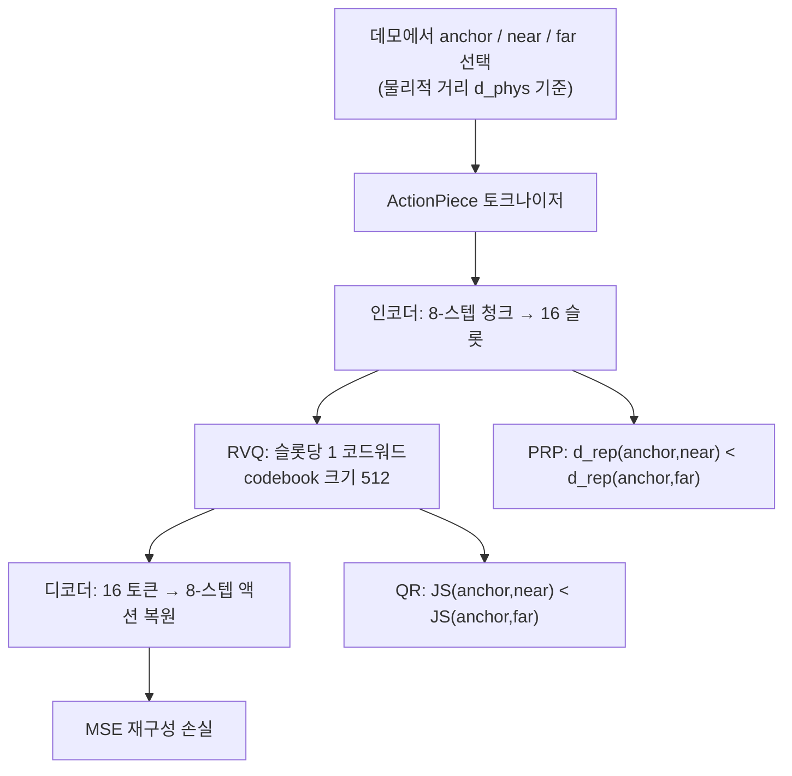

[논문 링크](https://arxiv.org/abs/2609.18487)
## ActionPiece: 재구성 오차 너머, 물리적 순위로 액션 토크나이제이션을 다시 생각하다

> **TL;DR** — 자율회귀(autoregressive) VLA(vision-language-action) 모델에서 액션 토크나이저는 연속적인 로봇 명령을 이산 토큰으로 압축하고, 예측된 토큰을 다시 실행 가능한 명령으로 복원하는 핵심 인터페이스다. 기존 토크나이저는 MSE 같은 점별(pointwise) 재구성 오차만 줄일 뿐, 데모 사이의 "미세한 조정(adjustment)"이 압축 후에도 보존되는지는 보지 못했다. 이 논문은 복원된 액션 공간에서 **물리적 거리의 순위가 보존되는 정도**를 측정하는 **PRC(Physical Rank Consistency)** 를 새로 정의하고, 표현 학습과 양자화를 함께 감독해 그 관계를 보존하는 **ActionPiece** 를 제안한다. 동일한 Qwen3-VL-4B 정책 학습 환경에서 LIBERO **94.8%** , 미학습 LIBERO-Plus **68.8%** 로 최고 성능을 달성했다 (근거: Abstract, Table 1).

---

## 핵심 아이디어

액션 토크나이저는 정책 학습의 "예측 타깃"과 실행 시의 "복원기(decoder)"를 동시에 결정한다 (근거: §1). 기존 연구는 좌표 이산화(RT-2, OpenVLA), 주파수 도메인 압축(FAST), 학습된 벡터 양자화(FASTer, OAT, ActionCodec, X-Tokenizer)로 압축 효율을 높였지만 (근거: §2.2), **압축이 로봇이 최종 실행하는 동작 자체를 바꾼다**는 점은 충분히 다루지 못했다 (근거: §1).

ActionPiece의 핵심 통찰은 세 가지로 압축된다.

1. **MSE는 개별 액션의 오차만 줄일 뿐**, 여러 데모에 걸친 재구성 오차의 "방향"을 조율하지 않는다 (근거: §3.1).
2. 압축 후 비슷한 액션은 대표 동작 주위로 모이지만, 서로 다른 문맥에 필요한 조정은 **약화·왜곡·역전**될 수 있다 (근거: §1, §3.1).
3. 따라서 점별 정확도에 더해 **물리적 거리의 순위 보존(PRC)** 을 평가하고, 이 순위 자체를 학습 목표로 직접 감독해야 한다.

저자들은 이 관점을 "관계적 충실도(relational fidelity)"라고 부르며, 이를 위해 표현 학습 단계와 코드워드 할당 단계에 각각 순위 감독을 걸어준다 (근거: §1, Fig. 1).

---

## 배경: 그들이 해결한 문제

### 토크나이저가 조용히 지워버리는 "조정"

같은 태스크의 여러 데모에는 반복되는 동작이 미세한 차이를 갖고 등장한다. 예컨대 "빨간 캔을 집어 상자에 넣기"에서 물체 위치, 로봇 상태, 실행 단계에 따라 그립 위치가 조금씩 달라진다 (근거: §3.1). 정밀한 정렬·파지·접촉이 필요한 작업에서는 이 작은 차이가 실행 성패를 가른다 (근거: §1, §3.1).

토크나이저는 이 데모들을 유한한 용량의 이산 표현으로 압축했다가 다시 실행 명령으로 복원한다. 이 손실 압축은 필연적으로 재구성 오차 $e_i = \hat x_i - x_i$ 를 만든다. 두 데모 청크 $x_i$, $x_j$ 의 복원된 차이는 다음처럼 분해된다 (근거: Eq. 1):

$$
\hat x_j - \hat x_i = (x_j - x_i) + (e_j - e_i)
$$

첫 항은 데모에 실제로 존재하는 "액션 변화"이고, 두 번째 항은 토크나이제이션이 끼워 넣은 "추가 변화"다. 문제는 MSE가 이 두 번째 항의 크기만 줄일 뿐 **방향을 제어하지 않는다**는 점이다. 결과적으로 추가 항은 원래 차이를 감쇠시키거나 증폭시키고, 심지어 **방향을 뒤집을 수도** 있다 (근거: §3.1).

결정적으로, 이 왜곡은 정책이 토큰을 "정확히" 예측해도 사라지지 않는다. VLA가 데모 액션을 인코딩한 토큰 시퀀스를 올바르게 맞히더라도, 디코더는 어차피 그 액션의 "복원 버전"을 실행하기 때문이다 (근거: §1, §3.1).

### 기존 접근의 지형

저자들은 기존 액션 인터페이스를 세 갈래로 정리한다 (근거: §2.1).

- **이산 자율회귀**: RT-2·OpenVLA는 좌표를 bin으로 이산화하고, FAST는 액션 청크를 짧은 토큰 시퀀스로 압축한다. 사전학습 VLM의 next-token 예측 목표를 그대로 재사용할 수 있다는 장점이 있다 (근거: §2.1).
- **연속 예측**: OpenVLA-OFT($\ell_1$ 회귀), RDT·$\pi_0$·GR00T 계열(확산·플로우 매칭)은 실수값 액션 청크를 직접 예측한다 (근거: §2.1).
- **하이브리드**: $\pi_{0.5}$, HybridVLA, Fast-in-Slow 등은 이산 감독과 연속 실행을 섞는다 (근거: §2.1).

학습된 벡터 양자화 계열 중에서도 FASTer(잔차 벡터 양자화 + 구조적 패칭), OAT(중첩 드롭아웃 + coarse-to-fine 정렬), ActionCodec(토큰 예산·정렬·잔차 문법), X-Tokenizer(시각-언어 교사로부터 의미 감독) 등이 있다 (근거: §2.2). 이들은 모두 **압축·순서·다중모달 정렬**에 집중했지만, "압축이 데모 간 관계를 어떻게 바꾸는지"를 측정하거나 감독하는 장치는 없었다 (근거: §2.2).

---

## 새로운 접근법: ActionPiece

### PRC: "거리 값"이 아니라 "거리 순위"를 본다

저자들은 관계 보존을 **물리적 거리의 상대적 순서**로 평가한다. 먼저 물리적 거리 $d_{\text{phys}}$ 를 정의한다. 이는 두 엔드이펙터 명령 $a=(p, R, g)$ (위치·회전·그리퍼) 사이의 차이를 정규화된 성분의 가중합으로 표현한다 (근거: §4.2, Eq. 5):

$$
\delta_{\text{phys}}(a, a') = \alpha_p \left\|\frac{p - p'}{s_p}\right\|_2^2 + \alpha_R \left(\frac{d_{\text{SO(3)}}(R, R')}{s_R}\right)^2 + \alpha_g\,|g - g'|^2
$$

회전 거리는 $\mathrm{SO}(3)$ 상의 최단 측지각으로 잰다 (근거: Eq. 4):

$$
d_{\text{SO(3)}}(R, R') = \left\|\mathrm{Log}(R^\top R')^{\vee}\right\|_2
$$

스케일 $s_p, s_R$ 은 학습 액션에 맞춰 피팅되고, 그룹 가중치 $\alpha_p, \alpha_R, \alpha_g$ 는 embodiment(로봇 형태) 내에서 고정된다 (근거: §4.2). 청크 단위 거리는 각 시간 스텝의 거리를 평균한다.

이 거리를 바탕으로 **PRC@k** 는 각 앵커 $A_i$ 에 대해, 원본 액션 공간에서의 $k$ 최근접 이웃 $N_i^k$ 와 복원 후 $\hat A_i$ 의 같은 이웃들에 대한 거리 순위가 얼마나 일치하는지를 Spearman 상관 $\rho_S$ 로 측정한다 ($k=32$) (근거: §3.2, Eq. 2):

$$
\text{PRC@}k = \frac{1}{N}\sum_{i=1}^{N} \rho_S\Big(\big[d_{\text{phys}}(A_i, A_j)\big]_{j\in N_i^k},\ \big[d_{\text{phys}}(\hat A_i, \hat A_j)\big]_{j\in N_i^k}\Big)
$$

핵심 설계는 **복원된(decoded) 액션 공간에서 순위를 잰다**는 점이다. 이렇게 하면 토큰 어휘·시퀀스 길이·디코더 구조가 달라도 같은 물리적 기준으로 토크나이저를 비교할 수 있다 (근거: §3.2). 요컨대 MSE는 개별 재구성의 충실도, PRC는 물리적 거리 순위의 보존을 각각 담당한다.

### 두 개의 물리적 순위 손실

ActionPiece는 얕은 Transformer 인코더/디코더와 잔차 벡터 양자화(RVQ)로 구성된다. $H$ 스텝의 액션 청크 $A\in\mathbb{R}^{H\times D}$ 는 인코더 $E_\phi$ 가 $S$ 개의 잠재 슬롯으로 만들고, 깊이 $Q$·코드북 크기 $K$ 의 RVQ가 각 슬롯을 $Q$ 개 코드워드의 합 $q_s = \sum_{r=1}^{Q} e^{(r)}[z_s^{(r)}]$ 로 표현한다 (근거: §4.1, Eq. 3). 전체 토큰 수는 $T = SQ$ 다. 디코더 $D_\omega$ 는 이 $T$ 개 토큰으로부터 전체 청크를 한 번에 복원한다.

재구성 손실에 더해, 저자들은 두 개의 순위 감독을 추가한다.

**① PRP (Physical Rank Preservation)** — 인코더 특징 $\bar h_{i,s}$ 와 선택된 코드워드 특징 $\bar e_{i,s}$ 를 각각 LayerNorm + 단위 $\ell_2$ 정규화한 뒤, 슬롯 평균 제곱 거리 $d^2_{\text{enc}}$, $d^2_{\text{quant}}$ 를 계산하고 이를 $0.25:0.75$ 로 섞어 표현 거리를 만든다 (근거: §4.3, Eq. 6–7):

$$
d^2_{\text{rep}}(i,j) = 0.25\, d^2_{\text{enc}}(i,j) + 0.75\, d^2_{\text{quant}}(i,j)
$$

이후 각 앵커에 대해 배치 내 나머지 액션을 물리적 거리로 정렬하고, 5분위수($q_{0.05}$)의 가까운 액션을 양성(near) $j_i^+$ , 95분위수($q_{0.95}$)의 먼 액션을 음성(far) $j_i^-$ 로 선택한다 (근거: §4.3, Appx. B.3). 랭크 손실은 near–far 순서를 부과한다 (근거: Eq. 8):

$$
\mathcal{L}_{\text{rank}} = \frac{1}{B}\sum_i \mathrm{softplus}\big(D_{ij_i^+} - D_{ij_i^-} + m_r\big),\quad m_r = 0.1
$$

**② QR (Quantization Regularization)** — 표현 거리가 아니라, 각 슬롯의 코드워드 할당 확률 분포 $\pi_{i,s}$ 간 평균 Jensen–Shannon 발산에 같은 순서를 부과한다 (근거: §4.4, Eq. 9–10):

$$
\mathcal{L}_{\text{quant}} = \frac{1}{B}\sum_i \mathrm{softplus}\big(d_{\text{JS}}(i, j_i^+) - d_{\text{JS}}(i, j_i^-) + m_q\big),\quad m_q = 0.1
$$

두 손실은 압축의 서로 다른 두 단계를 공략한다. PRP는 **학습된 특징의 기하**를, QR은 **이산 어휘로의 할당**을 물리적 순서에 맞춘다 (근거: §4.4). 전체 목표는 다음과 같다 (근거: §4.5, Eq. 12):

$$
\mathcal{L}_{\text{tok}} = \mathcal{L}_{\text{MSE}} + \lambda_{vq}\mathcal{L}_{\text{commit}} + \lambda_r \mathcal{L}_{\text{rank}} + \lambda_q \mathcal{L}_{\text{quant}}
$$

가중치는 $\lambda_{vq}=0.25$, $\lambda_r=\lambda_q=6.25\times10^{-4}$ 이다 (근거: §4.5, Table 6). 학습 후 토크나이저는 고정(frozen)되고, 인코더·양자화기는 정책의 이산 타깃을 공급하고 고정된 디코더는 예측 토큰을 실행 청크로 되돌린다. VLA는 표준 next-token 예측 $\mathcal{L}_{\text{VLA}} = -\sum_t \log p_\theta(z_t | I, \ell, z_{\lt t})$ 로만 학습된다 (근거: §4.5, Eq. 13).

---

## 작동 원리: 구체적인 예시로 살펴보기

이해를 돕기 위해 **설명용 예시**를 하나 들어보자 (논문의 실제 실험 결과가 아님을 밝힌다).

"빨간 캔을 상자에 넣기" 태스크에서 세 개의 액션 청크가 있다고 하자.

| 청크 | 그리퍼 x 위치 | 역할 |
|---|---:|---|
| Anchor $A$ | $x=0.00$ m | 기준 동작 |
| Near $n$ | $x=+0.01$ m | 문맥에 따른 미세 조정 |
| Far $f$ | $x=+0.10$ m | 전혀 다른 잡기 위치 |

원본 물리적 거리는 $d_{\text{phys}}(A,n)=0.01$ (작음), $d_{\text{phys}}(A,f)=0.10$ (큼)이므로 순위는 $n < f$ 이다. 이 순위가 유지되어야 "미세 조정"이라는 의미가 살아있다.

MSE만으로 학습된 토크나이저가 복원한 뒤 거리가 다음과 같이 나왔다고 가정하자 (설명용 수치).

| 복원 비교 | 원본 $d_{\text{phys}}$ | 복원 후 $d_{\text{phys}}$ | 순위 |
|---|---:|---:|---|
| $\hat A$ vs $\hat n$ | 0.01 | 0.08 | — |
| $\hat A$ vs $\hat f$ | 0.10 | 0.05 | — |

복원 후에는 $d(\hat A,\hat f) < d(\hat A,\hat n)$ 이 되어 **순위가 뒤집혔다**. 개별 재구성 오차는 작았지만, 그 오차들의 방향이 "미세 조정"과 "전혀 다른 동작"의 경계를 무너뜨린 것이다 (근거: §3.1의 Eq. 1 해석과 일치). ActionPiece의 PRP·QR은 이 $n < f$ 순위를 표현 거리와 코드워드 할당 양쪽에서 강제해, 복원 후에도 순위가 보존되도록 학습한다.

논문이 제시하는 정량 근거는 Fig. 2의 상관 분석이다. 55개 토크나이저-벤치마크 평가에서 PRC는 정책 성공과 Spearman 상관 $\rho_S = 0.681$ 을, 재구성 충실도(MSE 순위)는 $\rho_S = 0.544$ 을 보였다 (근거: Fig. 2, §5.2). 즉 **"거리 값이 얼마나 비슷한가"보다 "거리 순위가 얼마나 보존되는가"가 하류 성공과 더 강하게 연관**된다는 것이 이 설계의 실증적 근거다.

---

## 성능 검증: 주요 결과

### 실험 설정 요약

네 벤치마크가 세 종류의 액션 데이터 소스와 서로 다른 일반화 조건을 커버한다 (근거: §5.1).

- **LIBERO**: 분포 내(in-distribution) 기준. 시뮬레이션 텔레오퍼레이션 데모 (20 Hz 샘플링).
- **LIBERO-Plus**: LIBERO 학습 정책을 7종의 미학습 섭동(카메라·로봇·언어·조명·배경·노이즈·레이아웃)으로 평가.
- **SimplerEnv**: BridgeData V2 실로봇 데모(5 Hz)로 학습한 WidowX 정책의 real-to-sim 전이.
- **VLA-Arena**: L0(키보드 텔레오퍼레이션, 10 Hz)로 학습하고 L0–L2로 평가.

토크나이저는 AdamW, lr $1\times10^{-4}$, 배치 128, 100K 스텝으로 학습하고, 정책은 StarVLA 프로토콜로 8×NVIDIA RTX PRO 6000 GPU에서 AdamW(lr $1\times10^{-5}$, 코사인 스케줄) + DeepSpeed ZeRO-2로 학습한다 (근거: §5.1). 모든 비교에서 백본·프롬프트·옵티마이저·배치·학습 예산·8-스텝 예측/실행 호라이즌·시드·평가 프로토콜이 고정된다 (근거: §5.1).

### 매칭 비교: LIBERO / LIBERO-Plus

Table 1은 동일한 Qwen3-VL-4B 정책 위에서 액션 토크나이저만 바꿔가며 비교한 결과다 (근거: Table 1).

| 토크나이저 | LIBERO (전체) | LIBERO-Plus (전체) |
|---|---:|---:|
| OAT | 86.1 | 60.7 |
| Standard RVQ | 90.9 | 60.4 |
| FASTerVQ* | 91.3 | 62.6 |
| FAST | 92.1 | 64.3 |
| ActionCodec | 93.7 | 64.2 |
| **ActionPiece (Ours)** | **94.8** | **68.8** |

ActionPiece는 LIBERO에서 최강 베이스라인(ActionCodec 93.7%) 대비 **+1.1p**, 미학습 LIBERO-Plus에서는 최강 베이스라인(64.3%) 대비 **+4.5p** 앞선다 (근거: §5.3, Table 1). LIBERO-Plus의 7개 섭동 범주 중 6개에서 1위를 기록했고, 이는 "실행 단계에서의 조정 보존"이 학습 분포 밖으로 나갔을 때 더 유리하다는 주장을 뒷받침한다 (근거: §5.3).

### 전이 평가: SimplerEnv / VLA-Arena

SimplerEnv(WidowX)에서 ActionPiece는 **평균 71.9%** 로 비교된 15개 모델 중 최고를 기록했다. 정밀한 배치가 필요한 블록 쌓기(58.3%)에서 1위를 차지했고, 숟가락(83.3%)·가지(91.7%)에서도 강세를 보였다 (근거: §5.4, Table 2). 이는 실제 로봇 액션으로 학습한 토크나이저에도 물리적 관계 감독이 유효함을 보여준다.

VLA-Arena에서는 L0/L1/L2 성공률이 **82.2% / 42.7% / 29.5%** , 33-셀 등가중 평균 **51.5%** 로 비교 모델 중 최고였다 (근거: §5.4, Table 3). L0로만 학습했음에도 L1·L2 평균에서 각각 **+7.0p, +5.0p** 앞섰고, 정적 장애물·동적 장애물·미학습 객체의 L2 성능에서 우위를 보였다 (근거: §5.4).

### 컴포넌트 어블레이션: 두 손실의 역할

Table 4와 Table 5는 두 물리적 순위 손실을 하나씩 떼어내며 효과를 분해한다 (근거: §5.5, Table 4–5).

| 변형 | MSE($\times10^4$, ↓) | PRC(↑) | LIBERO(↑) | LIBERO-Plus(↑) |
|---|---:|---:|---:|---:|
| Standard RVQ | 4.06 | 0.902 | 90.9 | 60.4 |
| + PRP | 3.63 | 0.947 | 93.8 | 65.4 |
| + QR | 3.92 | 0.916 | 92.9 | 62.4 |
| **ActionPiece (PRP + QR)** | **3.32** | **0.953** | **94.8** | **68.8** |

세 가지 관찰이 나온다. 첫째, PRP가 개별 기여가 더 크다(+PRP가 LIBERO-Plus에서 +5.0p). 둘째, QR을 더하면 LIBERO-Plus가 추가로 **+3.4p** 상승하며, 두 손실은 상호보완적이다. 셋째, 정책 성공의 개선이 PRC 개선(0.902→0.953)과 함께 움직인다 (근거: §5.5). 특히 카메라 섭동에서 PRP 단독 35.5%가 결합 시 45.1%로 뛰는 등, 6개 섭동 범주에서 결합이 단독보다 낫다 (근거: §5.5).

부록 A는 대안 목표와의 비교도 제공한다. SIGReg, Neighborhood(가까운 액션끼리 끌어당김), Temporal(시간 변화 매칭) 등은 정책 성공을 올리기도 하지만, Neighborhood는 PRC를 오히려 낮춘다(0.889). ActionPiece는 이들 중 **가장 낮은 MSE, 가장 높은 PRC, 두 벤치마크에서 가장 높은 성공률**을 동시에 달성한다 (근거: Appx. A, Table 5).

---

## 우리의 관점: 강점, 한계, 그리고 이 연구가 중요한 이유

### 강점

1. **문제 정의가 예리하다.** "토크나이저가 실행 동작을 바꾼다"는 사실은 로보틱스에서 오래 알고 있던 것이지만, 이를 "관계적 충실도"라는 측정 가능한 프레임으로 끌어올렸다. PRC는 어휘·시퀀스·디코더가 다른 토크나이저를 **하나의 공통 물리 기준**으로 비교할 수 있게 해준다는 점에서 기여가 분명하다 (근거: §3.2).
2. **감독의 위치가 설득력 있다.** 표현 거리(PRP)와 코드워드 확률(QR)을 나눠 감독하는 설계는 압축의 "특징 학습"과 "이산 할당"이라는 두 단계에 각각 대응해, 개념적으로 깔끔하고 어블레이션으로도 정당화된다 (근거: §4.4, §5.5).
3. **실험의 엄밀성이 높다.** 매칭 비교에서 백본·데이터·프롬프트·예산·시드까지 고정하고, 분포 내(LIBERO)·분포 밖(LIBERO-Plus)·실-투-심(SimplerEnv)·난이도 일반화(VLA-Arena)를 폭넓게 커버했다 (근거: §5.1).

### 한계

**저자가 인정하거나 드러낸 한계**부터 정리한다.

- RVQ 깊이는 $Q=1$ 과 $Q=2$ 가 하류 성능이 비슷해 최종 구성으로 $Q=1$ 을 택했다. 잔차 양자화의 깊이 이점이 이 과제에서는 제한적이라는 뜻이다 (근거: Appx. B.2).
- 물리적 거리의 그룹 가중치 $\alpha_p,\alpha_R,\alpha_g$ 와 스케일은 embodiment 내에서 고정되고, 그 구체적 값은 논문에 보고되지 않았다 (근거: §4.2, "원문 미보고").
- 종합 우위 뒤에는 태스크별 편차가 존재한다. 예컨대 SimplerEnv의 "당근 접시 위에 놓기"(54.2%)나 VLA-Arena의 일부 카테고리에서 1위가 아닌 경우가 있다 (근거: Table 2, Table 3).

**리뷰어 관점에서 추론되는 잠재적 한계**는 다음과 같다.

- $\lambda_r=\lambda_q=6.25\times10^{-4}$ 은 매우 작은 값인데, 이 가중치에 대한 민감도 분석이 없다 (근거: Table 6). 손실 간 균형이 데이터 분포에 민감할 가능성이 있다.
- PRC의 하이퍼파라미터($k=32$, Spearman 상관)와 near/far 분위수(5%·95%)의 선택이 결과에 미치는 영향이 어블레이션되지 않았다 (근거: §3.2, Appx. B.3).
- Table 1은 토크나이저 간 비교인 반면, Table 2·3은 $\pi_0$, $\pi_{0.5}$, GR00T 등 **전체 정책**과의 비교다. 조건이 다른 두 종류의 비교를 직접 잇는 대등한(apple-to-apple) 비교 지점은 없다 (근거: Table 1 vs Table 2–3).
- 실로봇 데모로 학습한 SimplerEnv가 real-to-sim이기는 하지만, **물리적 실로봇 배포(deployment) 성능은 보고되지 않았다** (근거: §5.4).
- 총 연산량(FLOPs/PF-days)이나 에너지 비용은 보고되지 않았다 ("원문 미보고").

### 이 연구가 중요한 이유

VLA가 "이산 토큰을 예측한다"는 프레임을 유지하는 한, 토크나이저는 정책의 상한을 정하는 병목이다. ActionPiece는 이 병목을 "개별 액션 복원"이 아니라 "액션 간 관계 보존"의 관점에서 재정의했고, 그 관점이 분포 밖 일반화에서 실제로 이득으로 이어짐을 보였다 (근거: §5.3, §6). 토크나이저를 고치는 것만으로 동일 정책에서 +4.5p(LIBERO-Plus)의 전이 성능 향상을 얻는다는 결과는, 로보틱스 파운데이션 모델에서 "표현 설계"가 아직 충분히 개척되지 않은 지렛대임을 시사한다.

---

## 다음 단계는?: 앞으로의 길

논문은 명시적인 향후 연구 방향을 나열하지는 않지만, 결과와 한계에서 자연스럽게 이어지는 경로를 제안할 수 있다.

1. **다단계 RVQ($Q>1$)의 재검토.** 현재 $Q=1$ 과 $Q=2$ 가 비슷하다는 결과가, 물리적 순위 감독이 더해진 상태에서도 유지되는지 확인할 가치가 있다 (근거: Appx. B.2).
2. **물리 거리 가중치의 일반화.** $\alpha_p,\alpha_R,\alpha_g$ 를 embodiment별로 고정하지 않고, 태스크나 데이터에 적응적으로 학습하는 방향은 이 방법을 다양한 로봇 형태로 확장하는 관건이 된다 (근거: §4.2).
3. **PRC를 표준 진단 지표로.** PRC는 토크나이저를 고르는 독립적 품질 지표로 쓸 수 있다. 토크나이저 선택 단계에서 MSE와 함께 PRC를 보고하는 관행이 정착된다면, 이 논문의 영향은 ActionPiece 자체보다 커질 수 있다 (근거: Fig. 2의 상관 분석).
4. **연속·확산 정책과의 결합.** PRP/QR은 이산 토크나이저에 대한 감독이지만, "데모 간 조정의 방향을 보존한다"는 원리는 $\pi_0$ 계열의 흐름·확산 정책이나 하이브리드 설계에도 이식 가능한 일반 원칙이다 (근거: §2.1의 하이브리드 논의와 연결).

---

### 글로벌 규칙에 따른 요약 수치 (Key Numbers)

- **토크나이저 구성**: 청크 길이 $H=8$, 출력 토큰 $T=16$, 잠재 슬롯 $S=16$, RVQ 깊이 $Q=1$, 코드북 $K=512$ (근거: Table 6)
- **물리 거리**: 평행이동 + $\mathrm{SO}(3)$ 측지 회전 + 그리퍼의 정규화 가중합 (근거: Eq. 5)
- **순위 손실**: near(5분위)·far(95분위), 마진 $m_r=m_q=0.1$, softplus (근거: Eq. 8, Eq. 10)
- **손실 가중치**: $\lambda_{vq}=0.25$, $\lambda_r=\lambda_q=6.25\times10^{-4}$ (근거: Table 6)
- **정책**: Qwen3-VL-4B, 8×RTX PRO 6000, DeepSpeed ZeRO-2 (근거: §5.1)
- **성능**: LIBERO 94.8% · LIBERO-Plus 68.8% · SimplerEnv 71.9% · VLA-Arena L0–L2 51.5% (근거: Table 1–3)
- **PRC**: Standard RVQ 0.902 → ActionPiece 0.953 (근거: Table 5)
- **연산량/에너지/비용**: 원문 미보고

<!-- verbatim-tables -->

## 논문 원문의 표

> arXiv e-print 의 LaTeX 원본에서 기계적으로 옮긴 표입니다. 숫자는 논문의 값이며 모델을 거치지 않았습니다.

**표 1. **Matched action-tokenizer comparison on LIBERO and LIBERO-Plus.** All policies use the same Qwen3-VL-4B backbone, training data, prompt, vision--language co-training procedure, global batch size 128, an 8-step prediction and execution horizon, and maximum policy-training budget. LIBERO-Plus is evaluated out of distribution: no LIBERO-Plus demonstrations are used for policy training. FASTerVQ$^*$ denotes our implementation following the published method. Best results are bold.**

| **Tokenizer** | **LIBERO** Spatial | **LIBERO** Object | **LIBERO** Goal | **LIBERO** Long | **LIBERO** Overall | **LIBERO-Plus** Camera | **LIBERO-Plus** Robot | **LIBERO-Plus** Language | **LIBERO-Plus** Light | **LIBERO-Plus** Bkg. | **LIBERO-Plus** Noise | **LIBERO-Plus** Layout | **LIBERO-Plus** Overall |
|---|---|---|---|---|---|---|---|---|---|---|---|---|---|
| ActionCodec | 93.4 | **99.0** | 92.4 | 89.8 | 93.7 | 33.3 | 38.8 | 80.8 | 88.4 | 90.2 | **58.0** | 75.9 | 64.2 |
| OAT | 85.6 | 96.2 | 87.2 | 75.2 | 86.1 | 32.2 | 47.8 | 79.5 | 82.8 | 82.7 | 46.4 | 67.4 | 60.7 |
| FASTerVQ$^*$ | 91.8 | 95.6 | 90.5 | 87.4 | 91.3 | 39.0 | 42.3 | 74.5 | 85.8 | 84.9 | 56.6 | 69.0 | 62.6 |
| FAST | 94.7 | 98.0 | 93.1 | 82.6 | 92.1 | 33.8 | 47.1 | 80.0 | 89.6 | 88.4 | 51.3 | 75.9 | 64.3 |
| Standard RVQ | 91.8 | 98.2 | 91.6 | 82.0 | 90.9 | 31.5 | 43.9 | 75.3 | 86.0 | 88.0 | 42.5 | 72.9 | 60.4 |
| **ActionPiece\xspace (Ours)** | **96.2** | **99.0** | **93.4** | **90.6** | **94.8** | **45.1** | **49.6** | **82.2** | **91.9** | **91.4** | 57.6 | **78.0** | **68.8** |

**표 2. **SimplerEnv WidowX results.** We follow the official SimplerEnv evaluation protocol . All values are success rates (%). Best and second-best averages are bold and underlined, respectively.**

| **Method** | **Put Spoon** on Towel | **Put Carrot** on Plate | **Stack Block** on Block | **Put Eggplant** in Basket | **Avg.** |
|---|---|---|---|---|---|
| RT-1-X | 0.0 | 4.2 | 0.0 | 0.0 | 1.1 |
| Octo-Base | 0.0 | 12.5 | 15.8 | 41.7 | 17.5 |
| Octo-Small | 0.0 | 8.2 | 41.7 | 56.7 | 26.7 |
| OpenVLA-OFT | 34.2 | 30.0 | 30.0 | 72.5 | 41.8 |
| RoboVLM | 50.0 | 37.5 | 0.0 | 83.3 | 42.7 |
| Magma | 37.5 | 29.2 | 20.8 | 91.7 | 44.8 |
| CogACT | 71.7 | 50.8 | 15.0 | 67.5 | 51.3 |
| SpatialVLA | 20.8 | 20.8 | 25.0 | 70.8 | 34.4 |
| TraceVLA | 12.5 | 16.6 | 16.6 | 65.0 | 27.7 |
| VideoVLA | 75.0 | 20.8 | 45.8 | 70.8 | 53.1 |
| $\pi_0$ | 29.2 | 62.5 | 29.2 | 91.6 | 53.1 |
| $\pi_{0.5}$ | 49.3 | 64.7 | 44.7 | 69.7 | 57.1 |
| Isaac-GR00T-N1.6-Bridge | 64.5 | 65.5 | 5.5 | 93.0 | 57.1 |
| LangForce | 89.6 | 63.8 | 33.3 | 79.2 | 66.5 |
| ActionCodec-BAR | 71.7 | 64.2 | 55.0 | 70.0 | 65.2 |
| **ActionPiece\xspace (Ours)** | 83.3 | 54.2 | 58.3 | 91.7 | **71.9** |

**표 3. **VLA-Arena results** . SR is success rate (%); CC is cumulative cost (lower is better). Avg equally weights the 11 suites. For each task and difficulty level, the highest SR across the six models is bold, including ties; the same rule applies to Avg. CC values are not bold. Baselines include $\pi_{0.5}$ , GR00T-N1.6 , Evo-Depth , and Motus . Qwen-GR00T denotes Qwen3-VL with the GR00T N1 action head .**

| **Task** | **Metric** | $\pi_{0.5}$ L0 | $\pi_{0.5}$ L1 | $\pi_{0.5}$ L2 | GR00T-N1.6 L0 | GR00T-N1.6 L1 | GR00T-N1.6 L2 | Qwen-GR00T L0 | Qwen-GR00T L1 | Qwen-GR00T L2 | Evo-Depth L0 | Evo-Depth L1 | Evo-Depth L2 | Motus L0 | Motus L1 | Motus L2 | **ActionPiece\xspace** L0 | **ActionPiece\xspace** L1 | **ActionPiece\xspace** L2 |
|---|---|---|---|---|---|---|---|---|---|---|---|---|---|---|---|---|---|---|---|
| **Safety** |  |  |  |  |  |  |  |  |  |  |  |  |  |  |  |  |  |  |  |
| Static obstacles | SR $\uparrow$ | 90.0 | 62.0 | 40.0 | 72.0 | 30.0 | 14.0 | **91.0** | 18.0 | 5.0 | 88.0 | 66.0 | 48.0 | 64.0 | 67.0 | 41.0 | **91.0** | **83.0** | **57.0** |
|  | CC $\downarrow$ | 0.0 | 33.3 | 76.6 | 0.0 | 11.2 | 38.4 | 0.0 | 9.1 | 29.6 | 0.0 | 8.7 | 14.9 | 0.0 | 72.0 | 124.3 | 0.0 | 14.5 | 30.3 |
| Cautious grasp | SR $\uparrow$ | 50.0 | 14.0 | 0.0 | 16.0 | 2.0 | 0.0 | 77.0 | 8.0 | 2.0 | **78.0** | 24.0 | 0.0 | 62.0 | **25.0** | **11.0** | 77.0 | 18.0 | 1.0 |
|  | CC $\downarrow$ | 5.0 | 5.5 | 1.2 | 9.6 | 41.2 | 10.4 | 2.4 | 98.2 | 11.1 | 0.0 | 11.4 | 26.3 | 3.9 | 91.0 | 9.8 | 1.1 | 19.3 | 12.4 |
| Hazard avoidance | SR $\uparrow$ | 58.0 | 30.0 | 36.0 | 64.0 | 4.0 | 10.0 | 67.0 | 15.0 | 19.0 | 40.0 | 0.0 | 14.0 | 65.0 | **34.0** | 21.0 | **68.0** | 22.0 | **46.0** |
|  | CC $\downarrow$ | 7.1 | 15.0 | 14.5 | 6.1 | 20.2 | 17.9 | 7.0 | 19.3 | 19.5 | 7.4 | 25.9 | 7.9 | 15.6 | 40.2 | 51.3 | 0.7 | 4.0 | 1.7 |
| State preservation | SR $\uparrow$ | 58.0 | 56.0 | 54.0 | 66.0 | 50.0 | 38.0 | 86.0 | 56.0 | 47.0 | 88.0 | 66.0 | 56.0 | 63.0 | 63.0 | **72.0** | **94.0** | **80.0** | 64.0 |
|  | CC $\downarrow$ | 0.0 | 5.6 | 20.8 | 0.0 | 5.0 | 10.4 | 0.0 | 5.6 | 15.7 | 0.0 | 2.3 | 5.1 | 0.0 | 6.3 | 16.0 | 0.0 | 6.9 | 25.3 |
| Dynamic obstacles | SR $\uparrow$ | 50.0 | 44.0 | 22.0 | 74.0 | 50.0 | 2.0 | 81.0 | 56.0 | 3.0 | **82.0** | 60.0 | 6.0 | 58.0 | 33.0 | 11.0 | **82.0** | **76.0** | **27.0** |
|  | CC $\downarrow$ | 2.4 | 8.8 | 5.7 | 5.7 | 7.3 | 56.8 | 6.0 | 8.3 | 2.7 | 0.0 | 3.4 | 12.7 | 6.5 | 47.9 | 7.2 | 4.6 | 21.2 | 31.0 |
| **Distractor** |  |  |  |  |  |  |  |  |  |  |  |  |  |  |  |  |  |  |  |
| Static distractors | SR $\uparrow$ | 88.0 | 16.0 | 16.0 | 46.0 | **32.0** | 6.0 | 91.0 | 6.0 | 2.0 | **94.0** | 20.0 | **24.0** | 69.0 | 19.0 | 13.0 | 92.0 | 21.0 | 22.0 |
| Dynamic distractors | SR $\uparrow$ | 80.0 | 66.0 | **54.0** | 70.0 | **72.0** | 18.0 | **92.0** | 49.0 | 25.0 | 86.0 | 60.0 | 32.0 | 77.0 | 51.0 | 26.0 | 90.0 | 63.0 | 43.0 |
| **Extrapolation** |  |  |  |  |  |  |  |  |  |  |  |  |  |  |  |  |  |  |  |
| Prep. combinations | SR $\uparrow$ | 62.0 | **24.0** | **6.0** | 48.0 | 0.0 | 0.0 | 51.0 | 1.0 | 0.0 | 66.0 | 0.0 | 0.0 | 41.0 | 7.0 | 1.0 | **69.0** | 15.0 | 0.0 |
| Task workflows | SR $\uparrow$ | 38.0 | 20.0 | **22.0** | 42.0 | 0.0 | 0.0 | 51.0 | 3.0 | 9.0 | 32.0 | 0.0 | 0.0 | 38.0 | 25.0 | 14.0 | **64.0** | **33.0** | 21.0 |
| Unseen objects | SR $\uparrow$ | 48.0 | 60.0 | 20.0 | 26.0 | 18.0 | 16.0 | 63.0 | 46.0 | 26.0 | **78.0** | 52.0 | 4.0 | 63.0 | **65.0** | 19.0 | **78.0** | 59.0 | **43.0** |
| **Long Horizon** |  |  |  |  |  |  |  |  |  |  |  |  |  |  |  |  |  |  |  |
| Long horizon | SR $\uparrow$ | 85.0 | 0.0 | 0.0 | 29.0 | 2.0 | 0.0 | 96.0 | 0.0 | 0.0 | 93.0 | 0.0 | 0.0 | 61.0 | **4.0** | **1.0** | **99.0** | 0.0 | 0.0 |
| **Avg** | SR $\uparrow$ | 64.3 | 35.6 | 24.5 | 50.3 | 23.6 | 9.5 | 76.9 | 23.5 | 12.5 | 75.0 | 31.6 | 16.7 | 60.1 | 35.7 | 20.9 | **82.2** | **42.7** | **29.5** |

**표 4. **Component ablation on LIBERO and LIBERO-Plus.** Starting from standard RVQ, we add physical rank preservation (PRP), quantization regularization (QR), or both. Success rates are reported in percent. Best results are bold.**

| **Variant** | **LIBERO** Spatial | **LIBERO** Object | **LIBERO** Goal | **LIBERO** Long | **LIBERO** Overall | **LIBERO-Plus** Camera | **LIBERO-Plus** Robot | **LIBERO-Plus** Language | **LIBERO-Plus** Light | **LIBERO-Plus** Bkg. | **LIBERO-Plus** Noise | **LIBERO-Plus** Layout | **LIBERO-Plus** Overall |
|---|---|---|---|---|---|---|---|---|---|---|---|---|---|
| Standard RVQ | 91.8 | 98.2 | 91.6 | 82.0 | 90.9 | 31.5 | 43.9 | 75.3 | 86.0 | 88.0 | 42.5 | 72.9 | 60.4 |
| + PRP | **96.2** | 97.4 | 93.0 | 88.4 | 93.8 | 35.5 | 45.6 | **83.0** | 85.9 | 90.3 | 55.1 | 77.1 | 65.4 |
| + QR | 95.4 | 97.2 | 91.2 | 87.8 | 92.9 | 33.0 | 38.8 | 77.7 | 90.8 | 89.7 | 50.2 | 74.3 | 62.4 |
| **ActionPiece\xspace (both)** | **96.2** | **99.0** | **93.4** | **90.6** | **94.8** | **45.1** | **49.6** | 82.2 | **91.9** | **91.4** | **57.6** | **78.0** | **68.8** |

**표 5. **Training-objective variants of standard RVQ.** Each ``+'' row adds only the named objective to standard RVQ. PRP and QR denote physical rank preservation and quantization regularization. Policies use Qwen3-VL-4B with 30K training steps. Success rates are in percent; MSE is scaled by $10^4$. Best values are bold, determined before rounding.**

| Variant | MSE $\downarrow$ | PRC $\uparrow$ | LIBERO Overall $\uparrow$ | LIBERO-Plus Overall $\uparrow$ |
|---|---|---|---|---|
| Standard RVQ | 4.06 | 0.902 | 90.9 | 60.4 |
| + SIGReg | 3.77 | 0.950 | 93.3 | 66.5 |
| + Neighborhood | 5.09 | 0.889 | 94.3 | 63.5 |
| + Temporal | 3.83 | 0.924 | 94.8 | 66.1 |
| + PRP | 3.63 | 0.947 | 93.8 | 65.4 |
| + QR | 3.92 | 0.916 | 92.9 | 62.4 |
| **ActionPiece (PRP + QR)** | **3.32** | **0.953** | **94.8** | **68.8** |

**표 6. **ActionPiece configuration and objective weights.****

| Setting | Value |
|---|---|
| Action chunk length $H$ | 8 |
| Output tokens $T$ | 16 |
| Latent slots $S$ | 16 |
| RVQ levels $Q$ | 1 |
| Codebook size $K$ | 512 |
| Reconstruction MSE weight | 1 |
| Commitment weight $\lambda_{\mathrm{vq}}$ | 0.25 |
| PRP weight $\lambda_r$ | $6.25\times10^{-4}$ |
| QR weight $\lambda_q$ | $6.25\times10^{-4}$ |
