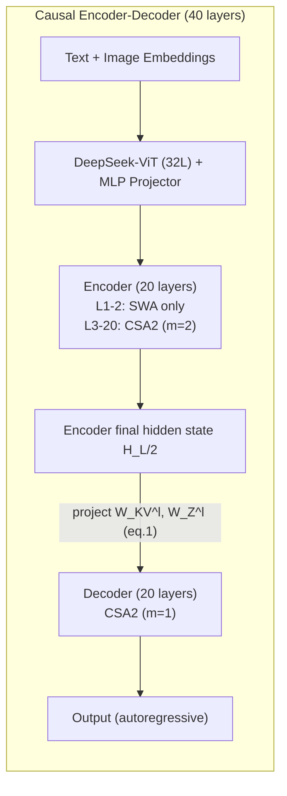
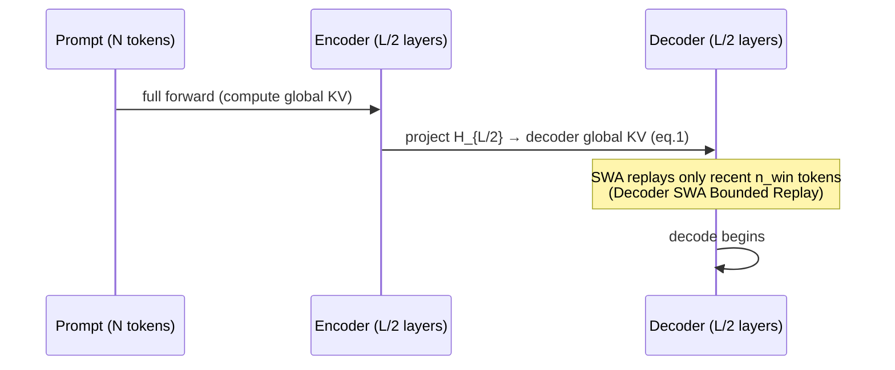

[Paper](https://arxiv.org/abs/2609.19969)
## DeepSeek-V4.1-Flash: A Multimodal MoE That Cuts the KV Cache to 1/4 While Raising Performance Further

**TL;DR.** **DeepSeek-V4.1-Flash**, released by DeepSeek-AI, is a multimodal MoE with a 552B backbone that supports up to a 1M token context. It combines **Causal Encoder-Decoder (CED)**, **Compressed Sparse Attention 2 (CSA2)**, **FP4 KV cache**, and **SWA Bounded Replay** to cut the global KV cache to **890 bytes per token** (about **1/4** of the predecessor DeepSeek-V4-Flash) and the persistent KV cache to about **1/8** (source: Abstract, §6). Even so, it stands shoulder to shoulder with closed frontier models on agent benchmarks, including DeepSWE v1.1 **74.2%** and Terminal-Bench 2.1 **90.6%** (source: Table 3, §5.3.2).

## Key Idea

The central hypothesis of this paper can be summarized as follows. **The authors hypothesize that by using [a CED structure that projects the decoder's global KV from the encoder output + CSA2's cross-layer KV/index reuse + FP4 cache precision + SWA Bounded Replay], they can overcome [the compute, storage, and bandwidth bottlenecks of long-context serving] and achieve [better performance with 1/4–1/8 of the predecessor's KV cache].**

The key point is that it "does not tighten just one axis but tightens three axes at once." The KV cache cost shrinks as the **product** of (1) **entry size** (the axis that reduces KV heads/dimensions, as in GQA·MLA), (2) **sequence dimension** (the axis that compresses $m$ tokens into a single entry, as in CSA·HCA), and (3) **layer dimension** (cross-layer cache reuse) (source: §2.3). Prior work touched only some of these axes — IndexCache reused Top-K indices, YOIO shared routing, and HySparse reused the KV of dense layers, but none covered all three axes (source: §2.3). What sets DeepSeek-V4.1-Flash apart is that it exploits all three axes **simultaneously**, and further combines them with **FP4 precision** and a **deployment strategy (SWA Bounded Replay)** to push compression to its limit.

## Background: The Problem They Solved

With the spread of long-running agents, model workloads are increasingly becoming **input-heavy**. This simultaneously explodes three costs (source: Abstract, §1):

- **Compute**: prefill is expensive. As an agent repeats tool calls, cache misses become more frequent, and each time a new prompt must be prefilled again (source: §2.2).
- **Storage**: global KV pressures HBM capacity, and persistent KV pressures SSD/host memory capacity (source: §1).
- **Bandwidth**: cache migration and loading become bottlenecks on I/O and interconnect bandwidth (source: §1).

DeepSeek-V4 already greatly reduced compute cost with a combination of global attention (full context) + local Sliding-Window Attention (SWA). But the problem was that "storage" remained. SWA's KV is bounded by the window size, but **the global KV keeps growing in proportion to the sequence length**, so for sufficiently long sequences the global KV comes to occupy most of the runtime KV footprint (source: §1). In other words, compute was solved, and now **storage and data movement have emerged as the new bottleneck**. The authors frame this as "KV cache management has become a foundational capability for deployment" (source: §1).

**The state of SOTA at this point** can be summarized as follows. Long-context compute was largely resolved by sparse attention (DeepSeek-AI 2025, 2026b), but on the persistent storage, reuse, and transfer side, HBM/SSD capacity and bandwidth were still the limiting factors (source: §1, §3.2.1). And the comparison targets at the time of publication are open frontier models such as Kimi-K3 and GLM-5.3, and closed models such as Opus-5 and GPT-5.6 (source: Table 3).

## New Approach: CED + CSA2 + SWA Bounded Replay

Let's look at the overall architecture first. The language backbone has 40 causal Transformer layers, with **the bottom 20 as a causal encoder and the top 20 as a decoder**. The first 2 layers use only SWA, and the rest use CSA2. On top of this are attached a vision encoder (DeepSeek-ViT), Engram (conditional memory), and DSpark (speculative decoding for inference acceleration) (source: §2.1, Fig. 3).

How this architecture addresses each of the three core costs is the essence of this paper.

### 1) CED: Halving Prefill

CED extends the idea of YOCO. In a traditional Transformer, every layer builds its KV from its own hidden state. In CED, **the decoder's global KV is built not from its own hidden state but from the last encoder layer's hidden state $H_{L/2}$ via per-layer projection weights $W_{KV}^{l}$** (source: §2.2, eq. 1):

$$C_l = H_{L/2} W_{KV}^{l},\quad Z_l = H_{L/2} W_{Z}^{l},\quad l > \frac{L}{2}$$

Therefore, at prefill time, running only the bottom half ($L/2$) yields the top half's global KV almost for free. SWA is left as-is per layer, in order to preserve the computational depth of local KV generation. As a result, when the sequence length $N \gg n_{win}$, the prefill complexity is halved from $O(NL)$ to $O(NL/2 + n_{win}\times L/2) \approx O(NL/2)$ (source: §2.2).

**Effect**: active parameters are split into **8B** at prefill and **16B** at decode. This is an advantageous structure for input-heavy agent workloads (source: Abstract, §2.1).

### 2) CSA2: Tightening Even the Layer Dimension

CSA2 is a sparse attention that simplifies and extends DeepSeek-V4's CSA, statically assigning one of three modes to each layer (source: §2.3.1, Fig. 4). What they have in common is that every mode **directly computes its own query and SWA KV**. The difference lies in **where** the global main KV, indexer K, and Top-K indices **come from**:

| Mode | Main KV | Indexer K | Top-K indices | Work performed |
|---|---|---|---|---|
| **Full** | Compute directly | Project from main KV | Generate anew | Full path (indexer + sparse attention) |
| **Reindex** | Reuse previous layer | Reuse | Rescore with own indexer Q → new selection | Recompute indexer only |
| **Reuse** | Reuse previous layer | (unnecessary) | Reuse as-is | Sparse attention only (no indexer) |

Two simplifications were added. CSA used **overlap** between adjacent compressed entries and **absolute positional embeddings** at compression ratio $m$, but CSA2 removed these, and indexer K is likewise obtained by **projecting the main KV** instead of a separate compression path. This simplifies the implementation and improves training efficiency (source: §2.3).

They also introduced a **Hierarchical Sparse Indexer** exclusively for the decoder. By having a deep indexer share the candidate pool selected by a shallow indexer, the per-query scoring cost of the deep indexer is changed from "linear in context length" to "constant." The first Full layer scans everything to create a candidate pool of 2,048 blocks × 8 positions = up to 16,384 candidates, and subsequent Reindex layers pick 512 within that pool (source: §2.3.2, §4.2.1, Fig. 5). This restriction is introduced at post-training time so that **training and inference use the same retrieval domain** (source: §2.3.2).

### 3) FP4 main KV + SWA Bounded Replay: Tightening Storage

- **FP4 KV cache**: main KV was lowered from FP8 to FP4 (E2M1, one E4M3 scale per 16 channels), cutting storage to **nearly half**. The accuracy loss is reported to be "marginal" (source: §2.4.4). SWA KV is kept at FP8 because of quantization sensitivity (source: §2.4.4).
- **SWA Bounded Replay**: SWA KV is not persistently stored on SSD; instead, when needed, **only the most recent $n_{win}$ (=128) tokens are replayed** to approximately reconstruct it. Exact reconstruction requires a full forward pass over $L\times n_{win}$ tokens, but experiments confirmed that this "approximation" causes almost no performance degradation (source: §1, §3.2.2). This newly establishes a storage-compute trade-off.

Decomposing how these three axes multiply to produce the final numbers (source: §3.2.1, §2.4.4):

| Target | Reduction factor | Mechanism |
|---|---|---|
| Global KV (HBM) | **about 1/4** | CSA2 cross-layer reuse (~1/2) × FP4 cache (~1/2) → **890 bytes per token** |
| Persistent KV (SSD/host) | **about 1/8** | SWA KV removal (~1/2) × global KV compression (1/4) |

The authors also describe this as reductions of 437× (vs. V1) and 4× (vs. V4-Flash) (source: Fig. 1b).

### Auxiliary Extensions: Single-Pass mHC, Engram, DSpark

- **Single-Pass mHC**: the previous mHC's 3-kernel implementation was fused into a single kernel (Mega-mHC), cutting activation memory traffic by **half**. The key trick is to **shift** the input mixing coefficients by one block to remove the dependency (source: §2.4.1, eq. 6). The performance degradation is "negligible" (source: §2.4.1).
- **Engram**: a conditional memory module that separates memorization from computation, splitting 196B parameters across two modules (layers 1, 14). It stores N-gram orders {2,3,4}, 8 hash heads, and per-head tables of about 16M entries in FP8 (source: §2.4.2).
- **DSpark**: speculative decoding with semi-autoregressive drafting + confidence-scheduled verification. It is trained separately with the backbone frozen, and is also trained together during post-training (source: §2.4.3).

## How It Works: A Concrete Example

**Let's understand CSA2's three modes with a toy example.** *(This is an illustrative example, not an experimental result from the paper.)*

Suppose 6 layers form one group. The paper's actual layout divides the encoder's 18 layers into 3 groups of 6, with **only the first layer of each group as Full and the remaining 5 as Reuse** (source: §4.2.1). The 20 decoder layers are divided into 5 groups of 4, with only the first group as Full+3Reuse and the remaining 4 groups as Reindex+3Reuse (source: §4.2.1).

Suppose the context has 8 tokens $[t_1,\dots,t_8]$, and for simplicity "select Top-2" (in reality Top-512, source: §4.2.1).

- **Layer 1 (Full)**: build the main KV for all 8 tokens, and the indexer scores them to pick Top-2 (e.g., $t_3, t_7$). This KV and index are stored as "the most recent Full result."
- **Layer 2 (Reuse)**: build only its own query, and perform only sparse attention using Layer 1's main KV + Top-2 ($t_3,t_7$) as-is. Since the indexer is not run at all, both compute and cache are saved.
- **Layer 3 (Reuse)**: likewise reused.

Here layers 2 and 3 **do not store the main KV redundantly**, so the cache shrinks. Conversely, in Reindex mode (the decoder's remaining groups), Layer 2 reuses the KV but **rescoring with its own indexer Q** can change the Top-2 to $t_2,t_5$ — that is, it becomes possible to "have each layer differ in which tokens it attends to while sharing storage" (source: §2.3.1).

**Let's also sketch CED's prefill flow** briefly (source: §2.2):

Because the decoder's global KV comes from the encoder's last hidden state, prefill essentially **ends at the encoder**. What remains is the decoder's SWA KV, and even this is handled by "replaying only the most recent $n_{win}$ tokens" (source: §2.2, §3.2.2). So, as Fig. 2 shows, **even when the single-token decode FLOPs grows from a 4K to a 1M context (256×), it increases by only 1/4** — a markedly flatter curve than DeepSeek-V4-Flash (source: Fig. 2).

## Performance Validation: Main Results

**Base model (Table 1).** DeepSeek-V4.1-Flash-Base (552B, active 8B/16B) achieves performance equal to or better than its predecessor V4-Pro-Base (1.6T, active 49B) with **1/3 the total parameters and 1/4 the active parameters** (source: §4.3.2, Table 1). It leads on MMLU-Pro **74.1** (vs Pro 73.5), HumanEval **79.4** (vs 76.8), GSM8K **93.0** (vs 92.6), BigCodeBench **60.6** (vs 59.2), and reports a **5–10% improvement** on held-out evaluation (source: §1, Table 1). That said, there are items where it lags Pro, such as LongBench-V2 (45.2 vs 51.5) and SimpleQA (42.3 vs 55.2), so "excellent relative to its compactness" is more accurate than "dominant across all fields" (source: Table 1).

**Post-training (Table 3).** Agent performance stands out in particular:

| Benchmark | V4.1-Flash | Best competitor | Notes |
|---|---:|---:|---|
| Codeforces (Rating) | **3471** | V4-Pro 3348 | Its own best |
| MathArena Apex | **65.6%** | Kimi-K3 65.6% | Tied for 1st |
| GPQA Diamond | 90.9% | GPT-5.6 94.1% | Improved over V4-Flash 89.9% |
| DeepSWE v1.1 | **74.2%** | Opus-5 74.0% | +19.8pt over V4-Flash 54.4% |
| Terminal-Bench 2.1 | **90.6%** | Opus-5 89.1% | 1st |
| Automation-Bench | **54.8%** | Opus-5 50.3% | 1st |
| Terminal-Bench 3.0 | 30.0% | Opus-5 43.3% | Gap exists |
| Terminal-Bench 4.0 | 31.2% | Opus-5 51.8% | Gap exists |

(All numbers sourced from Table 3, §5.3.2. The DeepSWE +19.8pt is calculated from 54.4→74.2.)

The key point is **DeepSWE v1.1 74.2%**, a jump of +19.8pt from the predecessor's 54.4%, edging out Opus-5 (74.0%), and also beating the strongest closed model on **Terminal-Bench 2.1 90.6%**, **Automation-Bench 54.8%**, and **Agents' Last Exam 31.8%** (source: §5.3.2). In cybersecurity it also set open-source SOTA on CyberGym at **88.1%** (source: §5.3.2).

**Reasoning Effort knob.** Interestingly, this is a training technique that controls the amount of reasoning with a scalar $b\in\{1,\dots,100\}$. In RL, the token-length penalty coefficient is decreased exponentially with effort as $k(b)=k_0\exp(-(b-b_{min})/\tau)$, allowing longer thinking at higher effort (source: §5.1.4, eq. 10). As a result, raising effort from 25→100 increases the average Pass@1 over 8 reasoning benchmarks from **67.1%→76.3%**, DeepSWE from **66.0%→74.2%**, and Terminal-Bench 2.1 from **82.4%→90.6%**, but uses about **2.5×** more tokens (source: §5.3.2, Fig. 9). The gains are concentrated in the front, so the 60–80 range recovers the accuracy of the maximum setting with less than half the tokens (source: §5.3.2). The production API exposes three tiers: max=100, high=75, low=50 (source: Table 2).

**Multi-agent (Fig. 10).** Superior at all deadlines versus single-agent. ProgramBench Almost@1 goes from multi 13.59% (@1h)→30.04% (@8h peak) vs single 12.79%→20.39%, and FrontierSWE v2 Mean@5 goes from multi 13.50%→32.90% (@20h) vs single 10.50%→28.20% (source: §5.3.5).

## Our View: Strengths, Limitations, and Why This Research Matters

**Strengths.** (1) The biggest contribution is that it was the first to complete the **triple-product structure** of compression in one model. It tightens the three axes of layer, sequence, and entry size simultaneously, and bundles precision (FP4) and deployment (SWA Bounded Replay) into that as well (source: §2.3). (2) SWA Bounded Replay, which "gives up storage and buys it back with compute," is a practical insight — starting from the observation that SWA KV's access pattern does not fit the long-term retention policy of a persistent cache, it turns a catastrophic miss into "a cheap and elegant degradation" (source: §3.2.1). (3) The **asymmetric activation** of prefill 8B / decode 16B is a design that meshes precisely with the input-heavy agent era (source: §2.2).

**Limitations.** Let's distinguish the limitations the authors explicitly acknowledge from potential limitations from a reviewer's perspective.

*Limitations acknowledged by the authors* (source: §6):
- CSA2's selection error and SWA Bounded Replay's approximate state reconstruction can cause performance degradation on **untested extreme inputs**. A finite test suite cannot cover all boundary conditions.
- A **science-oriented agent** (requiring specialized domain knowledge, such as Terminal-Bench 4.0) still has a gap versus gigantic models.
- Due to benchmark saturation, one should not mistake "similar score = equivalent capability," and there is still a difference from the frontier on the hardest reasoning and edge cases.

*Potential limitations the reviewer reads out*:
- **Long-term dependency of approximate reconstruction**: SWA Bounded Replay relies on the assumption of "replaying only the most recent $n_{win}$ tokens." The possibility that the state becomes inaccurate at the cache resumption boundary was mentioned by the authors, but long-term empirical evidence on whether this error accumulates over long multi-turn sessions is still lacking (source: §3.2.2, §6).
- **Imbalance in performance**: in the base model, SimpleQA, LongBench-V2, MGSM, etc. lag V4-Pro (source: Table 1). "Excellent relative to its compactness" and "absolute superiority" should be read as distinct.
- **Asymmetry in reproducibility/openness**: checkpoints were released (Abstract), but most evaluations are based on in-house harnesses, in-house scaffolds, and in-house data pipelines (§4.3.2, §5.1.1), making it difficult for outsiders to reproduce under identical conditions.

**Why this research matters.** Ultimately, the message of this paper is that "intelligence and efficiency are not separate things." If a small footprint of 8B–16B active parameters can handle most of the daily tasks of closed frontier models (the authors claim **over 95%**) (source: §1), the cost barrier for long-term agent deployment drops substantially. More than the simple number of cutting the KV cache to 1/4, the shift in perspective — **"reformulating storage, compute, and bandwidth as a single optimization problem"** — carries greater implications for follow-up research.

## What's Next?: The Road Ahead

The directions the authors propose are (1) **simultaneous scaling** of architecture, pretraining, and post-training, (2) **model-harness co-design**, and (3) **expanding stress tests** of the boundary conditions of sparse retrieval and SWA state reconstruction (source: §6).

Reasonable next steps a reviewer might add here:

- **Quantifying CSA2's selection error**: characterizing exactly which input distributions make sparse attention's selection error fatal, using metrics such as recall@K, would yield an operational guide for "when it is safe to use this model."
- **Sub-FP4 precision**: since main KV has been lowered to FP4, the next step is analyzing the causes of SWA KV's sensitivity (currently kept at FP8 for sensitivity reasons) and selectively applying low precision to it (source: §2.4.4).
- **Generalizing the Hierarchical Sparse Indexer**: the candidate pool is used only in the decoder (§2.3.2), and the upper bound (performance) and lower bound (cost) trade-off of extending it to the encoder as well is an interesting research topic.

Ultimately, this model is a new reference point for the goal of "long context, cheaply but intelligently." The number 890 bytes/token has become another bar for the next generation to break.

<!-- verbatim-tables -->

## Tables from the paper

> Tables converted mechanically from the arXiv e-print LaTeX source. The numbers are the paper's own and did not pass through a model.

**Table 1. Comparison among DeepSeek-V4-Flash-Base, DeepSeek-V4-Pro-Base, and DeepSeek-V4.1-Flash-Base. All models are evaluated in our internal framework and share the same evaluation setting. Scores with a gap not exceeding 0.3 are considered to be at the same level. The highest score in each row is in **bold font**, and the second is underlined.**

|  | **Benchmark (Metric)** | **# Shots** | **DeepSeek-V4-Flash** | **DeepSeek-V4-Pro** | **DeepSeek-V4.1-Flash** |
|---|---|---|---|---|---|
|  |  |  | **Base** | **Base** | **Base** |
|  | Architecture | - | MoE | MoE | MoE |
|  | # Activated Params | - | 13B | 49B | 8B/16B |
|  | # Backbone Params | - | 284B | 1.6T | 552B |
| World Knowl. | AGIEval (EM) | 3-5-shot | 83.9 | **84.4** | 83.4 |
|  | MMLU-Pro (EM) | 5-shot | 68.3 | 73.5 | **74.1** |
|  | C-Eval (EM) | 5-shot | 92.1 | **93.1** | 92.1 |
|  | MultiLoKo (LLM-Judge) | 5-shot | 42.6 | **50.9** | 45.5 |
|  | Simple-QA verified (EM) | 25-shot | 30.1 | **55.2** | 42.3 |
|  | SuperGPQA (EM) | 5-shot | 46.5 | **53.9** | 53.1 |
| Lang. & Reas. | BBH (EM) | 3-shot | 86.9 | **87.5** | 86.1 |
|  | BBEH (EM) | 1-shot | 25.4 | **29.8** | 27.2 |
|  | DROP (F1) | 1-shot | **88.6** | **88.7** | 87.9 |
|  | HellaSwag (EM) | 0-shot | 85.7 | **88.0** | 87.2 |
| Code & Math | BigCodeBench (Pass@1) | 3-shot | 56.8 | 59.2 | **60.6** |
|  | HumanEval (Pass@1) | 0-shot | 69.5 | 76.8 | **79.4** |
|  | GSM8K (EM) | 8-shot | 90.8 | 92.6 | **93.0** |
|  | MATH (EM) | 4-shot | 57.4 | **64.5** | 61.1 |
|  | MGSM (EM) | 8-shot | **85.7** | 84.4 | 80.2 |
| Long Context | LongBench-V2 (EM) | 1-shot | 44.7 | **51.5** | 45.2 |
| Multimodal | MMMU-Pro (EM) | 4-shot | - | - | 56.5 |
|  | CVBench (EM) | 4-shot | - | - | 77.9 |
|  | DocVQA (LLM-Judge) | 4-shot | - | - | 95.6 |
|  | RefCOCO-avg (Acc@0.5) | 0-shot | - | - | 86.0 |

**Table 2. Mapping between the public API reasoning-effort tiers and the underlying scalar effort values $b$.**

| API tier | Effort value $b$ |
|---|---|
| `max` | 100 |
| `high` | 75 |
| `low` | 50 |

**Table 3. Comparison between DeepSeek-V4.1-Flash with closed/open source models. $\dag$ denotes text-only subset of HLE. The best results are highlighted in bold; the second-best results are underlined.**

|  | **Benchmark (Metric)** | **Opus-5** | **GPT-5.6 Sol** | **K3** | **GLM-5.3** | **DS-V4-Pro** | **DS-V4-Flash** | **DS-V4.1-Flash** |
|---|---|---|---|---|---|---|---|---|
|  |  | **Max** | **Max** | **Max** | **Max** | **Max** | **Max** | **Max** |
| 90Reasoning | GPQA Diamond (Pass@1) | 93.4 | **94.1** | 92.9 | 88.1 | 92.4 | 89.9 | 90.9 |
|  | HLE (Pass@1) | **56.3** | 44.5 | 43.5 | 42.0$^\dag$ | 42.7$^\dag$ | 37.8$^\dag$ | 36.8 (39.1$^\dag$) |
|  | Codeforces (Rating) | - | - | - | - | 3348 | 3289 | **3471** |
|  | MathArena Apex (Pass@1) | - | - | **65.6** | - | 65.3 | 58.6 | **65.6** |
| 90Agentic | Terminal-Bench 2.1 (Pass@1) | 89.1 | 88.8 | 88.3 | 88.2 | 87.9 | 82.7 | **90.6** |
|  | Terminal-Bench 3.0 (Pass@1) | **43.3** | 34.4 | 17.7 | 28.3 | 11.8 | 7.6 | 30.0 |
|  | Terminal-Bench 4.0 (Pass@1) | **51.8** | 39.9 | 12.6 | 37.9 | 12.4 | 7.0 | 31.2 |
|  | DeepSWE v1.1 (Resolved) | 74.0 | 73.0 | 67.5 | 66.9 | 62.7 | 54.4 | **74.2** |
|  | ProgramBench (Almost@1) | **37.0** | 23.0 | 17.5 | 19.0 | 15.5 | - | 20.3 |
|  | NL2Repo-Bench (Score) | **75.3** | 56.8 | 58.0 | 58.0 | 61.5 | 54.2 | 65.4 |
|  | CyberGym (Pass@1) | - | 84.5 | 80.0 | 84.5 | 83.3 | 76.7 | **88.1** |
|  | SEC-Bench Pro (Pass@1) | - | **74.3** | - | - | 56.4 | 30.9 | 62.8 |
|  | ExploitGym (Pass@1) | 22.1 | **33.7** | - | 15.0 | 5.4 | 1.8 | 15.3 |
|  | HLE w/ tools (Pass@1) | 63.6 | - | 59.8 | 62.5 | 60.0 | 51.5 | **63.9** |
|  | Automation-Bench (Pass@1) | 50.3 | 45.8 | 46.7 | 48.8 | 43.2 | 37.7 | **54.8** |
|  | Agents' Last Exam (Pass@1) | 28.6 | 26.7 | 27.6 | 28.5 | 25.7 | 25.2 | **31.8** |
|  | Chartography w/ tools (Pass@1) | **84.0** | 79.9 | 68.1 | - | - | - | 78.9 |
|  | BabyVision w/ tools (Pass@1) | **94.1** | 88.9 | 85.7 | - | - | - | 89.6 |
|  | ZeroBench-main w/ tools (Pass@5) | 52.0 | **53.0** | 41.0 | - | - | - | 49.0 |

**Table 4. Performance across agent scaffolds at Max reasoning effort.**

| **Benchmark (Metric)** | **Claude Code** | **Codex** | **OpenCode** | **Pi** | **mini-SWE** | **DeepSeek Harness** **Minimal** | **DeepSeek Harness** **Standard** | **DeepSeek Harness** **PTC** |
|---|---|---|---|---|---|---|---|---|
| DeepSWE v1.1 (Resolved) | 69.8 | 65.6 | 65.5 | 66.2 | 74.2 | 72.6 | 70.5 | 67.6 |
| Terminal-Bench v2.1 (Pass@1) | 88.0 | 84.1 | 85.0 | 86.1 | 90.3 | 90.6 | 85.8 | 85.8 |

**Table 5. Performance across Claude Code versions at Max reasoning effort.**

| **Benchmark (Metric)** | **v2.1.105** | **v2.1.238** | **v2.1.251** | **v2.1.259** | **Average** |
|---|---|---|---|---|---|
| DeepSWE v1.1 (Resolved) | 68.4 | 68.7 | 69.8 | 68.6 | 68.9 |
| Terminal-Bench v2.1 (Pass@1) | 87.3 | 88.4 | 88.0 | 87.6 | 87.8 |
