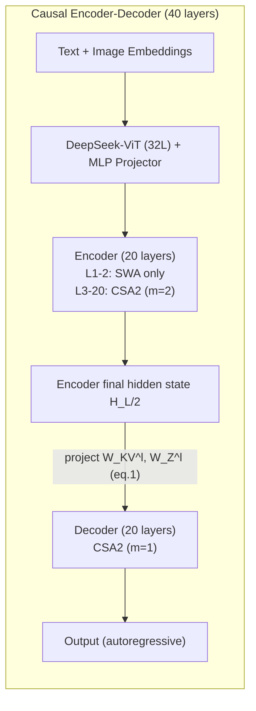
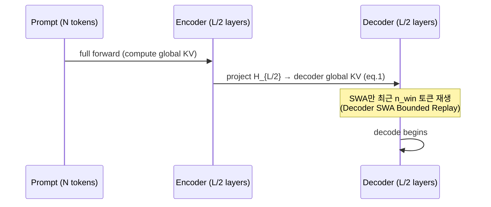

[논문 링크](https://arxiv.org/abs/2609.19969)
## DeepSeek-V4.1-Flash: KV 캐시를 1/4로 줄이면서 성능은 더 끌어올린 멀티모달 MoE

**한 줄 요약 (TL;DR).** DeepSeek-AI가 공개한 **DeepSeek-V4.1-Flash** 는 552B 백본 파라미터의 멀티모달 MoE로, 최대 1M 토큰 컨텍스트를 지원한다. **Causal Encoder-Decoder(CED)** , **Compressed Sparse Attention 2(CSA2)** , **FP4 KV 캐시**, **SWA Bounded Replay** 를 조합해 글로벌 KV 캐시를 **토큰당 890바이트**(전작 DeepSeek-V4-Flash의 **약 1/4**), 영속(persistent) KV 캐시를 **약 1/8** 로 줄였다 (근거: Abstract, §6). 그럼에도 DeepSWE v1.1 **74.2%**, Terminal-Bench 2.1 **90.6%** 등 에이전트 벤치마크에서 폐쇄형 프런티어 모델과 어깨를 나란히 한다 (근거: Table 3, §5.3.2).

## 핵심 아이디어

이 논문의 중심 가설은 이렇게 요약할 수 있다. **저자들은 [디코더의 글로벌 KV를 인코더 출력에서 투영하는 CED 구조 + CSA2의 계층 간 KV/인덱스 재사용 + FP4 캐시 정밀도 + SWA Bounded Replay]를 사용함으로써 [긴 컨텍스트 서빙의 연산·저장·대역폭 병목]을 극복해 [전작 대비 1/4~1/8의 KV 캐시로 더 나은 성능]을 달성할 수 있다고 가정한다.**

핵심은 "한 축만 조이는 게 아니라 세 축을 동시에 조인다"는 점이다. KV 캐시 비용은 (1) **엔트리 크기**(GQA·MLA처럼 KV 헤드/차원을 줄이는 축), (2) **시퀀스 차원**(CSA·HCA처럼 $m$개 토큰을 1개 엔트리로 압축하는 축), (3) **레이어 차원**(계층 간 캐시 재사용)의 **곱** 으로 줄어든다 (근거: §2.3). 기존 연구는 이 중 일부 축만 건드렸다 — IndexCache는 Top-K 인덱스 재사용, YOIO는 라우팅 공유, HySparse는 dense 레이어 KV 재사용에 그쳤고, 어떤 것도 세 축을 모두 덮지 못했다 (근거: §2.3). DeepSeek-V4.1-Flash의 차별점은 이 세 축을 **동시에** 활용하고, 거기에 **FP4 정밀도** 와 **배포 전략(SWA Bounded Replay)** 까지 결합해 압축의 한계를 밀어붙인 것이다.

## 배경: 그들이 해결한 문제

장기(長期) 에이전트의 확산으로 모델 워크로드는 점점 **입력 중심(input-heavy)** 이 되어간다. 이는 세 가지 비용을 동시에 폭발시킨다 (근거: Abstract, §1):

- **연산**: prefill이 비싸다. 에이전트가 도구 호출을 반복할수록 캐시 미스가 잦아지고, 그때마다 새 프롬프트를 다시 prefill해야 한다 (근거: §2.2).
- **저장**: 글로벌 KV는 HBM 용량을, 영속 KV는 SSD/호스트 메모리 용량을 압박한다 (근거: §1).
- **대역폭**: 캐시 마이그레이션과 로딩이 I/O·인터커넥트 대역폭에 병목이 된다 (근거: §1).

DeepSeek-V4는 이미 글로벌 어텐션(전체 컨텍스트) + 로컬 Sliding-Window Attention(SWA) 조합으로 연산 비용을 크게 줄였다. 그러나 문제는 "저장"이 남았다는 점이다. SWA의 KV는 윈도우 크기로 유계(bounded)되지만, **글로벌 KV는 시퀀스 길이에 비례해** 계속 커지므로, 충분히 긴 시퀀스에서는 글로벌 KV가 런타임 KV 풋프린트의 대부분을 차지하게 된다 (근거: §1). 즉, 연산은 해결됐는데 이제 **저장과 데이터 이동이 새 병목** 으로 부상한 것이다. 저자들은 이를 "KV 캐시 관리가 배포의 기초 역량이 되었다"고 정리한다 (근거: §1).

**이 시점의 SOTA 상태** 를 정리하면 다음과 같다. 긴 컨텍스트 연산은 sparse attention으로 상당 부분 해소됐지만(DeepSeek-AI 2025, 2026b), 영속 저장·재사용·전송 측면에서는 여전히 HBM/SSD 용량과 대역폭이 발목을 잡는 상황이었다 (근거: §1, §3.2.1). 그리고 이 논문 출판 시점의 비교 대상은 Kimi-K3, GLM-5.3 같은 오픈소스 프런티어와 Opus-5, GPT-5.6 같은 폐쇄형 모델이다 (근거: Table 3).

## 새로운 접근법: CED + CSA2 + SWA Bounded Replay

전체 구조를 먼저 보자. 언어 백본은 40개 causal Transformer 레이어로, **아래 20개는 causal encoder, 위 20개는 decoder** 다. 첫 2개 레이어는 SWA만 쓰고, 나머지는 CSA2를 쓴다. 여기에 vision encoder(DeepSeek-ViT)와 Engram(조건부 메모리), DSpark(추론 가속용 스페큘레이티브 디코딩)가 붙는다 (근거: §2.1, Fig. 3).

이 아키텍처가 세 가지 핵심 비용을 각각 어떻게 잡는지가 이 논문의 본질이다.

### 1) CED: prefill을 절반으로

CED는 YOCO의 아이디어를 확장한 것이다. 전통적 Transformer는 모든 레이어가 자기 hidden state에서 KV를 만든다. CED에서는 **decoder의 글로벌 KV가 자기 hidden state가 아니라 마지막 인코더 레이어의 hidden state $H_{L/2}$에서 레이어별 투영 가중치 $W_{KV}^{l}$ 로 만들어진다** (근거: §2.2, eq. 1):

$$C_l = H_{L/2} W_{KV}^{l},\quad Z_l = H_{L/2} W_{Z}^{l},\quad l > \frac{L}{2}$$

따라서 prefill 때 아래 절반($L/2$)만 돌리고도 위쪽 절반의 글로벌 KV를 거의 공짜로 얻을 수 있다. SWA는 레이어별로 그대로 두는데, 이는 로컬 KV 생성의 연산 깊이를 유지하기 위해서다. 결과적으로 시퀀스 길이 $N \gg n_{win}$일 때 prefill 복잡도가 $O(NL)$에서 $O(NL/2 + n_{win}\times L/2) \approx O(NL/2)$ 로 절반이 된다 (근거: §2.2).

**효과**: prefill 시 활성 파라미터가 **8B**, decode 시 **16B** 로 분리된다. 입력이 많은 에이전트 워크로드에서 유리한 구조다 (근거: Abstract, §2.1).

### 2) CSA2: 레이어 차원까지 조인다

CSA2는 DeepSeek-V4의 CSA를 단순화·확장한 sparse attention으로, 각 레이어에 세 가지 모드 중 하나를 정적으로 배정한다 (근거: §2.3.1, Fig. 4). 공통점은 모든 모드가 자기만의 **query와 SWA KV는 직접 계산** 한다는 점이다. 차이는 글로벌 main KV, indexer K, Top-K 인덱스를 **어디서 얻어오는가** 다:

| 모드 | Main KV | Indexer K | Top-K 인덱스 | 수행 작업 |
|---|---|---|---|---|
| **Full** | 직접 계산 | main KV에서 투영 | 새로 생성 | 전체 경로 (indexer + sparse attention) |
| **Reindex** | 이전 레이어 재사용 | 재사용 | 자체 indexer Q로 재스코어 → 새 선택 | indexer만 다시 계산 |
| **Reuse** | 이전 레이어 재사용 | (불필요) | 그대로 재사용 | sparse attention만 (indexer 없음) |

여기에 두 가지 단순화를 더했다. CSA는 압축비 $m$에서 인접 압축 엔트리 간 **겹침(overlap)** 과 **절대 위치 임베딩** 을 썼는데, CSA2는 이를 제거했고, indexer K도 별도 압축 경로 대신 **main KV를 투영해** 얻는다. 구현이 단순해지고 학습 효율이 올라간다 (근거: §2.3).

그리고 디코더 전용으로 **Hierarchical Sparse Indexer** 를 도입했다. 얕은 indexer가 뽑은 후보 풀을 깊은 indexer가 공유함으로써, 깊은 indexer의 쿼리당 스코어링 비용을 "컨텍스트 길이에 선형"에서 "상수"로 바꾼다. 첫 Full 레이어가 전체를 스캔해 2,048개 블록 × 8포지션 = 최대 16,384개 후보 풀을 만들고, 이후 Reindex 레이어는 그 풀 안에서만 512개를 고른다 (근거: §2.3.2, §4.2.1, Fig. 5). 이 제한은 post-training 시점에 도입되어 **학습과 추론이 동일한 검색 도메인** 을 쓰도록 훈련된다 (근거: §2.3.2).

### 3) FP4 main KV + SWA Bounded Replay: 저장을 조인다

- **FP4 KV 캐시**: main KV를 FP8에서 FP4(E2M1, 16채널당 E4M3 스케일 1개)로 낮춰 저장을 **거의 절반** 으로 줄였다. 정확도 손실은 "marginal"하다고 보고한다 (근거: §2.4.4). SWA KV는 양자화 민감도 때문에 FP8로 유지한다 (근거: §2.4.4).
- **SWA Bounded Replay**: SWA KV를 SSD에 영속 저장하지 않고, 필요 시 **최근 $n_{win}$(=128)개 토큰만 재생(replay)** 해 근사 복원한다. 정확한 복원은 $L\times n_{win}$ 토큰의 full forward pass가 필요한데, 이 "근사"가 성능 저하가 거의 없다는 것을 실험으로 확인했다 (근거: §1, §3.2.2). 이로써 저장-연산 트레이드오프를 새로 정립했다.

이 세 축이 어떻게 곱해져서 최종 수치가 나오는지 분해하면 (근거: §3.2.1, §2.4.4):

| 대상 | 축소 요인 | 메커니즘 |
|---|---|---|
| 글로벌 KV (HBM) | **약 1/4** | CSA2 계층 간 재사용(~1/2) × FP4 캐시(~1/2) → **토큰당 890바이트** |
| 영속 KV (SSD/호스트) | **약 1/8** | SWA KV 제거(~1/2) × 글로벌 KV 압축(1/4) |

저자들은 이를 437배(V1 대비), 4배(V4-Flash 대비) 축소라고도 표현한다 (근거: Fig. 1b).

### 보조 확장: Single-Pass mHC, Engram, DSpark

- **Single-Pass mHC**: 기존 mHC의 3-커널 구현을 1-커널(Mega-mHC)로 융합해 활성화 메모리 트래픽을 **절반** 으로 줄였다. 핵심 트릭은 입력 믹싱 계수를 한 블록 **밀어서(shift)** 의존성을 제거하는 것 (근거: §2.4.1, eq. 6). 성능 저하는 "negligible" (근거: §2.4.1).
- **Engram**: memorization을 연산에서 분리하는 조건부 메모리 모듈로, 196B 파라미터를 두 모듈(레이어 1, 14)에 나눠 배치. N-gram 차수 {2,3,4}, 8개 해시 헤드, 헤드당 약 16M 엔트리 테이블을 FP8로 저장한다 (근거: §2.4.2).
- **DSpark**: semi-autoregressive drafting + confidence-scheduled verification의 스페큘레이티브 디코딩. 백본 고정 상태로 별도 학습하며 post-training에서도 함께 훈련된다 (근거: §2.4.3).

## 작동 원리: 구체적인 예시로 살펴보기

**CSA2의 세 모드를 toy 예시로** 이해해 보자. *(설명용 예시로, 논문 실험 결과가 아니다.)*

6개 레이어가 한 그룹이라고 가정하자. 논문의 실제 배치는 인코더 18개 레이어를 6개씩 3그룹으로 나눠 **각 그룹의 첫 레이어만 Full, 나머지 5개는 Reuse** 로 둔다 (근거: §4.2.1). 디코더 20개는 4개씩 5그룹으로, 첫 그룹만 Full+3Reuse, 나머지 4그룹은 Reindex+3Reuse다 (근거: §4.2.1).

컨텍스트에 8개 토큰 $[t_1,\dots,t_8]$이 있고, 간단히 "Top-2를 선택한다"고 하자 (실제로는 Top-512, 근거: §4.2.1).

- **Layer 1 (Full)**: 8개 토큰 전체에 대해 main KV를 만들고, indexer가 스코어링해 Top-2(예: $t_3, t_7$)를 뽑는다. 이 KV와 인덱스가 "가장 최근의 Full 결과"로 저장된다.
- **Layer 2 (Reuse)**: 자신의 query만 만들고, Layer 1이 만든 main KV + Top-2($t_3,t_7$)를 그대로 써서 sparse attention만 수행한다. indexer를 아예 실행하지 않으니 연산도 캐시도 아낀다.
- **Layer 3 (Reuse)**: 동일하게 재사용.

여기서 레이어 2, 3은 main KV를 **중복 저장하지 않으므로** 캐시가 준다. 반대로 Reindex 모드(디코더의 나머지 그룹)라면, Layer 2는 KV는 재사용하되 **자기 indexer Q로 재스코어** 해 Top-2가 $t_2,t_5$로 바뀔 수 있다 — 즉 "어느 토큰을 볼지는 레이어마다 달라지되, 저장은 공유"가 가능해진다 (근거: §2.3.1).

**CED의 prefill 흐름** 도 간단히 그려보면 (근거: §2.2):

디코더의 글로벌 KV가 인코더 마지막 hidden state에서 나오기 때문에, prefill은 사실상 **인코더에서 끝난다**. 남은 건 디코더의 SWA KV인데, 이마저도 "최근 $n_{win}$ 토큰만 재생"으로 해결한다 (근거: §2.2, §3.2.2). 그래서 Fig. 2가 보여주듯 **단일 토큰 decode FLOPs가 컨텍스트 4K→1M(256배)로 늘려도 1/4 증가에 그친다** — DeepSeek-V4-Flash에 비해 현저히 평평한 곡선이다 (근거: Fig. 2).

## 성능 검증: 주요 결과

**베이스 모델 (Table 1).** DeepSeek-V4.1-Flash-Base(552B, 활성 8B/16B)는 전작 V4-Pro-Base(1.6T, 활성 49B)와 비교해 **1/3 총 파라미터·1/4 활성 파라미터** 로 동등 이상의 성능을 낸다 (근거: §4.3.2, Table 1). MMLU-Pro **74.1**(vs Pro 73.5), HumanEval **79.4**(vs 76.8), GSM8K **93.0**(vs 92.6), BigCodeBench **60.6**(vs 59.2) 등에서 앞서고, held-out 평가에서 **5~10% 개선** 을 보고한다 (근거: §1, Table 1). 다만 LongBench-V2(45.2 vs 51.5), SimpleQA(42.3 vs 55.2)처럼 Pro에 뒤지는 항목도 있어 "전 분야 압도"라기보다 "컴팩트함 대비 우수"가 정확하다 (근거: Table 1).

**Post-training (Table 3).** 에이전트 성능이 특히 두드러진다:

| 벤치마크 | V4.1-Flash | 최고 경쟁자 | 비고 |
|---|---:|---:|---|
| Codeforces (Rating) | **3471** | V4-Pro 3348 | 자체 최고 |
| MathArena Apex | **65.6%** | Kimi-K3 65.6% | 동률 1위 |
| GPQA Diamond | 90.9% | GPT-5.6 94.1% | V4-Flash 89.9% 대비 개선 |
| DeepSWE v1.1 | **74.2%** | Opus-5 74.0% | V4-Flash 54.4% 대비 +19.8pt |
| Terminal-Bench 2.1 | **90.6%** | Opus-5 89.1% | 1위 |
| Automation-Bench | **54.8%** | Opus-5 50.3% | 1위 |
| Terminal-Bench 3.0 | 30.0% | Opus-5 43.3% | 격차 존재 |
| Terminal-Bench 4.0 | 31.2% | Opus-5 51.8% | 격차 존재 |

(수치는 모두 Table 3, §5.3.2 근거. DeepSWE +19.8pt는 54.4→74.2에서 계산.)

핵심은 **DeepSWE v1.1 74.2%** 로, 전작 54.4%에서 무려 +19.8pt 점프하며 Opus-5(74.0%)를 근소하게 앞섰다는 점, 그리고 **Terminal-Bench 2.1 90.6%**, **Automation-Bench 54.8%**, **Agents' Last Exam 31.8%** 에서 폐쇄형 최강을 제쳤다는 점이다 (근거: §5.3.2). 사이버 보안에서도 CyberGym **88.1%** 로 오픈소스 SOTA를 찍었다 (근거: §5.3.2).

**Reasoning Effort 노브.** 흥미로운 건 스칼라 $b\in\{1,\dots,100\}$로 추론량을 제어하는 훈련 기법이다. RL에서 토큰 길이 페널티 계수를 $k(b)=k_0\exp(-(b-b_{min})/\tau)$처럼 effort에 따라 지수 감소시켜, effort가 높을수록 긴 사고를 허용한다 (근거: §5.1.4, eq. 10). 그 결과 effort 25→100으로 올리면 8개 추론 벤치 평균 Pass@1이 **67.1%→76.3%**, DeepSWE **66.0%→74.2%**, Terminal-Bench 2.1 **82.4%→90.6%** 로 오르되, 토큰은 약 **2.5배** 더 쓴다 (근거: §5.3.2, Fig. 9). 수익이 앞쪽에 몰려 있어, 60~80 구간이 최대 설정의 정확도를 절반 이하 토큰으로 회복한다 (근거: §5.3.2). 프로덕션 API는 max=100, high=75, low=50 세 티어로 노출된다 (근거: Table 2).

**멀티 에이전트 (Fig. 10).** 싱글 대비 모든 마감시한에서 우위. ProgramBench Almost@1이 멀티 13.59%(@1h)→30.04%(@8h 피크) vs 싱글 12.79%→20.39%, FrontierSWE v2 Mean@5가 멀티 13.50%→32.90%(@20h) vs 싱글 10.50%→28.20% (근거: §5.3.5).

## 우리의 관점: 강점, 한계, 그리고 이 연구가 중요한 이유

**강점.** (1) 압축의 **삼중 곱 구조** 를 처음으로 한 모델에 완결했다는 점이 가장 큰 기여다. 계층·시퀀스·엔트리 크기 세 축을 동시에 조이고, 거기에 정밀도(FP4)와 배포(SWA Bounded Replay)까지 묶었다 (근거: §2.3). (2) "저장을 포기하고 연산으로 되사는" SWA Bounded Replay는 실용적 통찰이다 — SWA KV는 접근 패턴이 영속 캐시의 장기 보존 정책과 안 맞는다는 관찰에서 출발해, catastrophic miss를 "싸고 우아한 저하"로 바꿨다 (근거: §3.2.1). (3) prefill 8B/decode 16B의 **비대칭 활성화** 는 입력이 무거운 에이전트 시대에 정확히 맞물린 설계다 (근거: §2.2).

**한계.** 저자들이 명시적으로 인정한 한계와, 리뷰어 관점의 잠재적 한계를 구분해 보자.

*저자가 인정한 한계* (근거: §6):
- CSA2의 선택 오류(selection error)와 SWA Bounded Replay의 근사 상태 복원이 **검증되지 않은 극단 입력** 에서 성능 저하를 일으킬 수 있다. 유한한 테스트 스위트로는 모든 경계 조건을 덮을 수 없다.
- **과학 지향 에이전트**(Terminal-Bench 4.0 등 전문 도메인 지식 요구)에서 거대 모델과의 격차가 남아 있다.
- 벤치마크 포화로 "비슷한 점수 = 동등한 능력"으로 오인해서는 안 되며, 최난도 추론과 엣지 케이스에서는 프런티어와 여전히 차이가 있다.

*리뷰어가 읽어낸 잠재적 한계*:
- **근사 복원의 장기 의존성**: SWA Bounded Replay는 "최근 $n_{win}$ 토큰만 재생"이라는 가정에 의존한다. 캐시 재개 경계(resumption boundary)에서 상태가 부정확해질 가능성은 저자도 언급했지만, 긴 다중 턴 세션에서 이 오차가 누적될지에 대한 장기 실증은 아직 부족하다 (근거: §3.2.2, §6).
- **성능의 불균형**: 베이스 모델에서 SimpleQA, LongBench-V2, MGSM 등이 V4-Pro에 뒤진다 (근거: Table 1). "컴팩트함 대비 우수"와 "절대적 우위"는 구분해서 읽어야 한다.
- **재현성/개방성의 비대칭**: 체크포인트는 공개했지만(Abstract), 대부분의 평가가 자체 하네스·자체 스캐폴드·자체 데이터 파이프라인 기반이라(§4.3.2, §5.1.1), 외부에서 동일 조건 재현은 어렵다.

**이 연구가 중요한 이유.** 결국 이 논문의 메시지는 "지능과 효율은 별개가 아니다"다. 활성 8B~16B라는 작은 풋프린트로 폐쇄형 프런티어의 일상 작업 대부분(저자 주장 **95% 이상**)을 처리할 수 있다면 (근거: §1), 에이전트의 장기 배포 비용 장벽이 실질적으로 낮아진다. KV 캐시를 1/4로 줄였다는 단순 수치보다, **"저장·연산·대역폭을 하나의 최적화 문제로 재구성했다"** 는 관점 전환이 후속 연구에 더 큰 함의를 준다.

## 다음 단계는?: 앞으로의 길

저자가 제시한 방향은 (1) 아키텍처·사전학습·post-training의 **동시 스케일링**, (2) **모델-하네스 공동 설계(co-design)**, (3) 스파스 검색·SWA 상태 복원의 경계 조건에 대한 **스트레스 테스트 확장** 이다 (근거: §6).

여기에 리뷰어로서 덧붙일 만한 합리적 다음 단계:

- **CSA2 선택 오류의 정량화**: sparse attention의 선택 오류가 정확히 어떤 입력 분포에서 치명적인지, recall@K 같은 지표로 특성화하면 "언제 이 모델을 써도 안전한가"에 대한 운영 가이드가 나온다.
- **FP4 이하 정밀도**: main KV를 FP4까지 내렸으니, 다음은 SWA KV(현재 FP8 유지, 민감도 이유)의 민감도 원인 분석과 선택적 저정밀 적용이다 (근거: §2.4.4).
- **Hierarchical Sparse Indexer의 일반화**: 후보 풀을 디코더에만 쓰는데(§2.3.2), 인코더까지 확장했을 때의 상한(성능)과 하한(비용) 트레이드오프가 흥미로운 연구 주제다.

궁극적으로 이 모델은 "긴 컨텍스트를 싸게, 그러나 똑똑하게"라는 목표의 새 기준점이다. 890바이트/토큰이라는 숫자는 다음 세대가 깨야 할 또 하나의 바가 되었다.

<!-- verbatim-tables -->

## 논문 원문의 표

> arXiv e-print 의 LaTeX 원본에서 기계적으로 옮긴 표입니다. 숫자는 논문의 값이며 모델을 거치지 않았습니다.

**표 1. Comparison among DeepSeek-V4-Flash-Base, DeepSeek-V4-Pro-Base, and DeepSeek-V4.1-Flash-Base. All models are evaluated in our internal framework and share the same evaluation setting. Scores with a gap not exceeding 0.3 are considered to be at the same level. The highest score in each row is in **bold font**, and the second is underlined.**

|  | **Benchmark (Metric)** | **# Shots** | **DeepSeek-V4-Flash** | **DeepSeek-V4-Pro** | **DeepSeek-V4.1-Flash** |
|---|---|---|---|---|---|
|  |  |  | **Base** | **Base** | **Base** |
|  | Architecture | - | MoE | MoE | MoE |
|  | # Activated Params | - | 13B | 49B | 8B/16B |
|  | # Backbone Params | - | 284B | 1.6T | 552B |
| World Knowl. | AGIEval (EM) | 3-5-shot | 83.9 | **84.4** | 83.4 |
|  | MMLU-Pro (EM) | 5-shot | 68.3 | 73.5 | **74.1** |
|  | C-Eval (EM) | 5-shot | 92.1 | **93.1** | 92.1 |
|  | MultiLoKo (LLM-Judge) | 5-shot | 42.6 | **50.9** | 45.5 |
|  | Simple-QA verified (EM) | 25-shot | 30.1 | **55.2** | 42.3 |
|  | SuperGPQA (EM) | 5-shot | 46.5 | **53.9** | 53.1 |
| Lang. & Reas. | BBH (EM) | 3-shot | 86.9 | **87.5** | 86.1 |
|  | BBEH (EM) | 1-shot | 25.4 | **29.8** | 27.2 |
|  | DROP (F1) | 1-shot | **88.6** | **88.7** | 87.9 |
|  | HellaSwag (EM) | 0-shot | 85.7 | **88.0** | 87.2 |
| Code & Math | BigCodeBench (Pass@1) | 3-shot | 56.8 | 59.2 | **60.6** |
|  | HumanEval (Pass@1) | 0-shot | 69.5 | 76.8 | **79.4** |
|  | GSM8K (EM) | 8-shot | 90.8 | 92.6 | **93.0** |
|  | MATH (EM) | 4-shot | 57.4 | **64.5** | 61.1 |
|  | MGSM (EM) | 8-shot | **85.7** | 84.4 | 80.2 |
| Long Context | LongBench-V2 (EM) | 1-shot | 44.7 | **51.5** | 45.2 |
| Multimodal | MMMU-Pro (EM) | 4-shot | - | - | 56.5 |
|  | CVBench (EM) | 4-shot | - | - | 77.9 |
|  | DocVQA (LLM-Judge) | 4-shot | - | - | 95.6 |
|  | RefCOCO-avg (Acc@0.5) | 0-shot | - | - | 86.0 |

**표 2. Mapping between the public API reasoning-effort tiers and the underlying scalar effort values $b$.**

| API tier | Effort value $b$ |
|---|---|
| `max` | 100 |
| `high` | 75 |
| `low` | 50 |

**표 3. Comparison between DeepSeek-V4.1-Flash with closed/open source models. $\dag$ denotes text-only subset of HLE. The best results are highlighted in bold; the second-best results are underlined.**

|  | **Benchmark (Metric)** | **Opus-5** | **GPT-5.6 Sol** | **K3** | **GLM-5.3** | **DS-V4-Pro** | **DS-V4-Flash** | **DS-V4.1-Flash** |
|---|---|---|---|---|---|---|---|---|
|  |  | **Max** | **Max** | **Max** | **Max** | **Max** | **Max** | **Max** |
| 90Reasoning | GPQA Diamond (Pass@1) | 93.4 | **94.1** | 92.9 | 88.1 | 92.4 | 89.9 | 90.9 |
|  | HLE (Pass@1) | **56.3** | 44.5 | 43.5 | 42.0$^\dag$ | 42.7$^\dag$ | 37.8$^\dag$ | 36.8 (39.1$^\dag$) |
|  | Codeforces (Rating) | - | - | - | - | 3348 | 3289 | **3471** |
|  | MathArena Apex (Pass@1) | - | - | **65.6** | - | 65.3 | 58.6 | **65.6** |
| 90Agentic | Terminal-Bench 2.1 (Pass@1) | 89.1 | 88.8 | 88.3 | 88.2 | 87.9 | 82.7 | **90.6** |
|  | Terminal-Bench 3.0 (Pass@1) | **43.3** | 34.4 | 17.7 | 28.3 | 11.8 | 7.6 | 30.0 |
|  | Terminal-Bench 4.0 (Pass@1) | **51.8** | 39.9 | 12.6 | 37.9 | 12.4 | 7.0 | 31.2 |
|  | DeepSWE v1.1 (Resolved) | 74.0 | 73.0 | 67.5 | 66.9 | 62.7 | 54.4 | **74.2** |
|  | ProgramBench (Almost@1) | **37.0** | 23.0 | 17.5 | 19.0 | 15.5 | - | 20.3 |
|  | NL2Repo-Bench (Score) | **75.3** | 56.8 | 58.0 | 58.0 | 61.5 | 54.2 | 65.4 |
|  | CyberGym (Pass@1) | - | 84.5 | 80.0 | 84.5 | 83.3 | 76.7 | **88.1** |
|  | SEC-Bench Pro (Pass@1) | - | **74.3** | - | - | 56.4 | 30.9 | 62.8 |
|  | ExploitGym (Pass@1) | 22.1 | **33.7** | - | 15.0 | 5.4 | 1.8 | 15.3 |
|  | HLE w/ tools (Pass@1) | 63.6 | - | 59.8 | 62.5 | 60.0 | 51.5 | **63.9** |
|  | Automation-Bench (Pass@1) | 50.3 | 45.8 | 46.7 | 48.8 | 43.2 | 37.7 | **54.8** |
|  | Agents' Last Exam (Pass@1) | 28.6 | 26.7 | 27.6 | 28.5 | 25.7 | 25.2 | **31.8** |
|  | Chartography w/ tools (Pass@1) | **84.0** | 79.9 | 68.1 | - | - | - | 78.9 |
|  | BabyVision w/ tools (Pass@1) | **94.1** | 88.9 | 85.7 | - | - | - | 89.6 |
|  | ZeroBench-main w/ tools (Pass@5) | 52.0 | **53.0** | 41.0 | - | - | - | 49.0 |

**표 4. Performance across agent scaffolds at Max reasoning effort.**

| **Benchmark (Metric)** | **Claude Code** | **Codex** | **OpenCode** | **Pi** | **mini-SWE** | **DeepSeek Harness** **Minimal** | **DeepSeek Harness** **Standard** | **DeepSeek Harness** **PTC** |
|---|---|---|---|---|---|---|---|---|
| DeepSWE v1.1 (Resolved) | 69.8 | 65.6 | 65.5 | 66.2 | 74.2 | 72.6 | 70.5 | 67.6 |
| Terminal-Bench v2.1 (Pass@1) | 88.0 | 84.1 | 85.0 | 86.1 | 90.3 | 90.6 | 85.8 | 85.8 |

**표 5. Performance across Claude Code versions at Max reasoning effort.**

| **Benchmark (Metric)** | **v2.1.105** | **v2.1.238** | **v2.1.251** | **v2.1.259** | **Average** |
|---|---|---|---|---|---|
| DeepSWE v1.1 (Resolved) | 68.4 | 68.7 | 69.8 | 68.6 | 68.9 |
| Terminal-Bench v2.1 (Pass@1) | 87.3 | 88.4 | 88.0 | 87.6 | 87.8 |
