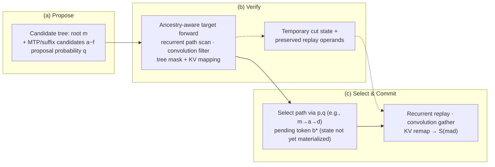

[Paper](https://arxiv.org/abs/2609.23900v1)
## LumoTree: Path-Parallel Speculative Verification for Hybrid Language Models

> **TL;DR** — Tree speculative decoding in hybrid models that mix Gated DeltaNet with full attention requires three things to line up on the **same "accepted path"**: the recurrent state, the convolution history, and the attention KV cache. LumoTree coordinates verification and commit through a single shared tree descriptor, and implements this with a path-parallel scan plus native replay. On an NVIDIA DGX Spark (GB10), it verifies a 27-candidate tree at a cost comparable to a chain stack, and records **+7.7%–+11.8%** decode throughput over chain MTP. The authors themselves make clear, however, that it does not speed up task completion.

## Key Numbers

| Item | Value |
|---|---|
| Target model | Qwen3.8-27B (mixed NVFP4/FP8 weights, BF16 execution, FP32 recurrent state) |
| Architecture | Hybrid of 48 Gated DeltaNet layers + 16 full-attention layers |
| Drafter | 1-layer BF16 MTP from the same checkpoint (no separate EAGLE weights) |
| Tree geometry | 27 drafts + root, padded to 32 rows, max depth 11 (5 MTP passes + suffix expansion) |
| Context | 131,072 tokens | Hardware | Single DGX Spark (GB10) |
| Decode rate (replay) | LumoTree **28.13** tok/s vs MTP-5 **26.12** (first corpus, +7.7%) |
| Decode rate (disjoint corpus) | LumoTree **30.76** vs MTP-5 **27.52** (+11.8%), autoregressive **10.54** |
| GDN component latency | verify 12.90 + publish 4.49 = **17.69** ms (native path 32.41 ms) |
| Named buffers | LumoTree **132.5** MiB vs native baseline **5,040** MiB |

> Vocabulary size, exact parameter count, total FLOPs, and cost (`$`/token)/energy metrics are **not reported in the paper** — the goal of this paper is not model training but validation of a serving system, so it does not address these numbers.

## Core Idea

The sampling guarantee of speculative decoding rests on the assumption that "the verifier supplies exactly the intended target distribution." In recurrent-hybrid models, however, upholding that assumption is not just a matter of an attention mask. Each candidate token must **inherit its parent's state**, and the next serving iteration must **continue exactly from the state of the path just selected** (source: §I).

LumoTree's core design choices are the following three (source: §I, §III).

1. **Shared tree descriptor** — Candidate token IDs, parent indices, depth/position, attention visibility, and the logical-node↔physical-slot mapping live in a single structure, so that drafting, verification, and commit all read the same logical topology.
2. **Path-parallel verification + native replay** — Branches are verified in temporary state, and only the selected path is **replayed** into the native running state. This fundamentally blocks the error of "producing plausible logits while publishing the wrong state for the next iteration."
3. **Agreement across three state surfaces** — The recurrent matrix, the convolution history, and the attention KV must all describe the same materialized prefix $m$: $\mathcal{S}(m)=\bigl(R(m),C(m),K(m)\bigr)$ (source: §III).

The authors state flatly that "an exact attention mask cannot fix a wrong recurrent parent." The problem is where and how to align these three states, and this paper solves that "boundary" in the implementation (source: §III).

## Background: Why "Tree Verification" Is Hard in Hybrid Models

In tree verification for an ordinary transformer, it suffices to control each candidate's visible keys with a mask. In Gated DeltaNet, however, the state is **sequentially cumulative**. In one GDN head, the state matrix $R\in\mathbb{R}^{d_v\times d_k}$ is updated at each node $i$ as follows (source: §III):

$$
R'_i = \alpha_i R_{\pi(i)}, \qquad \delta_i = \beta_i\bigl(v_i - R'_i k_i\bigr),
$$

$$
R_i = R'_i + \delta_i k_i^{\top}, \qquad o_i = R_i q_i.
$$

Here $\alpha_i$ is the decay, $\beta_i$ is the write strength, and $\pi(i)$ is the **parent node**. The key point is that $R'_i$ is the decayed **parent state $R_{\pi(i)}$**, not "the node immediately preceding in the packing buffer." In other words, the previous node in the packed buffer need not be $\pi(i)$. The convolution likewise requires path ancestors rather than adjacent packed rows, and attention visibility must select the same logical prefix and lineage (source: §III).

Each branch of the tree must therefore be computed independently "from its parent's state," and the state of the accepted path must be handed back exactly for the next iteration. Several prior works address this point (source: §II, Tab. related):

| Method | Verification work | Continuation state |
|---|---|---|
| Weaver | Ancestor-masked triangular solve | Short selected-path recurrence |
| SpecLA | Resident state tiles; parallel chains | Buffered factors; later fused update |
| Bole | Finite-Neumann correction solve | Compact factors; state reconstruction |
| TreeWY | Triangular solve in fused kernel | Prior-path reconstruction with next verify |
| ReplaySSM | Corrected inputs; cached transitions | Deferred state update |
| OneLA | Shared-base projections across beams | Compact per-beam transition records |
| **LumoTree** | Resident state tiles; parallel paths | **Native replay; coordinated conv + KV publication** |

As the table shows, many works solve "tree verification" and "reconstruction of the accepted state" separately, but none aligns verification across all **three surfaces** — recurrent, convolution, and attention — onto a single accepted path, let alone validates the numerical agreement. SpecLA is closest in state-tile reuse and path scheduling, but whereas SpecLA buffers accepted factors and applies them later in a fused update, LumoTree **replays the recorded operands immediately through the native GDN update** and publishes the convolution and KV together (source: §IV, §II).

## New Approach: LumoTree

LumoTree is a system that "runs paths in parallel, reuses state tiles across updates within each path, and coordinates the accepted continuation state across recurrent, convolution, and attention state" (source: Abstract). The structure falls into three stages (source: Alg. 1).

1. **Verify** — Map the candidate tree to physical slots, positions, and ancestor masks, and obtain target probabilities $p$ via path-local GDN, convolution, and attention computation. Preserve candidate hidden states, rounded replay operands, convolution history, and temporary KV.
2. **Select** — Using $p$ and $q$, choose the accepted materialized path $A$ and the pending token $b^*$.
3. **Publish** — Apply the same path $A$ to all three components: GDN replays the recorded operands, convolution gathers the history, and KV is remapped via the logical→physical slot map. The hidden row for the next drafter input is selected as well.

Verification and commit here share the **same descriptor**. This "system boundary" matters because a verifier can produce plausible candidate logits while publishing the wrong state for the next iteration (source: §I).

The implementation moves along two main axes.

- **Path-parallel scan** (§IV): Decompose the tree into groups of dependent paths. The first path starts from the request's pre-tree state and exports the cut state that downstream paths need. The second level evaluates independent branch paths in parallel from that cut state. Each GPU program owns one (path, head, value tile) and **keeps the entire key dimension in the working tile**, so sequential updates reuse that tile throughout the path loop — it does not reload the full recurrent state per node (source: §IV, Alg. 2).
- **Native replay** (§IV): Replay starts from the pre-tree running state, applies the accepted path's nodes in order through the native GDN update, and publishes the result into the request's native running row. This approach pays an **explicit accepted-path update cost** to return each iteration to the native state representation (source: §IV, Alg. 2).

Five integration optimizations are layered on top (source: §V, Tab. optimization-map):

| Constraint | LumoTree change | What must agree |
|---|---|---|
| Host-side path-list construction | Device-selected paths drive captured native replay, convolution, KV, and drafter selection | All consumers select the same prefix |
| Logical lineage ≠ physical KV placement | Spine-contiguous slots + coordinated writes/masks/remap | Logical query order, physical slots, and native destination agree |
| Per-node convolution history | Static ancestry gather + fused ordered tap | Tap order, cast boundary, padding, layer ID |
| Separate argmax/top-k | One logits tensor + fused selection | Tie convention, candidate order, duplicate handling |
| Repeated KV staging | Grouped query + split-K tree attention | Tree visibility and slot mapping across partitions |

The third column carries the real weight of this paper. By specifying which invariant each optimization must not break, it elevates **numerical and logical consistency** to a design constraint rather than settling for kernel speedups.

## How It Works: A Concrete Example

Let us walk through the full pipeline following the paper's figure (Fig. 1).



> **Illustrative example** — The following is a toy example to show the principle, not an experiment from the paper.

Consider a very small tree. There is a root $m$ (an already materialized prefix), its child candidates $a$ and $b$, and $a$'s children $d$ and $c$. Let the spine (main path) be $m\to a\to d$.

```
          m (root, pre-tree state R0)
         / \
        a   b
       / \
      d   c
```

**The key trap**: suppose the tokens are packed into the physical buffer in the order $m, a, b, d, c$. The parent of $d$ is $a$, not the immediately preceding $b$ in the buffer. A naive sequential scan would wrongly use $b$'s state as $d$'s parent (source: §III "A previous node in the packed buffer need not be π(i)").

LumoTree handles it as follows:

| Stage | What it does | State source |
|---|---|---|
| 1. Path-group decomposition | Spine ($m\to a\to d$) first; $b$ and $c$ as downstream branches | — |
| 2. Path-parallel scan | Scan the spine from $R_0$, saving the cut state after $a$; scan $b$ from the $R_0$ cut and $c$ from the $a$ cut in parallel | Parent's cut state (shared) |
| 3. Target forward complete | Output of each node $o_i = R_i q_i$ → logits $p$ | Working tile (key dimension retained) |
| 4. Sampling | Select path via $p,q$ (assume the spine $m\to a\to d$ is selected here) | — |
| 5. Replay | Re-apply $a$'s operands, then $d$'s operands from $R_0$ through the native GDN update | Recorded operands (explored paths only) |
| 6. Publish | Recurrent into the running row, gather convolution history, remap KV | Logical→physical slot map |

`b` and `c` were computed during verification but not selected, so their state remains only as temporary cut state and is never written to the permanent state. The pending token $b^*$ (the newly sampled correction/bonus token) has its state created only in the **next target forward** (source: §III, §IV).

Separating these two states (temporary cut state vs. permanent running row) is the heart of LumoTree's storage/recomputation trade-off. Exporting cut states lets downstream paths reuse them, and replaying only the accepted path keeps the permanent state in its native representation (source: §IV).

## Performance Validation: Main Results

The evaluation splits three ways: (1) a real coding-agent workload, (2) replay of recorded requests, and (3) numerical and sampling consistency checks. The hardware is a single DGX Spark (GB10) and the target is Qwen3.8-27B (source: §VI).

**1) Recorded request replay — decode rate.** On the first 43-request corpus, LumoTree reaches **28.13** pooled tok/s and 5-token native MTP reaches **26.12** tok/s, i.e. **+7.7%**. Pure autoregressive manages only 10.54 tok/s (source: §VII, §X). On a separately fixed disjoint corpus, it is **30.76** vs **27.52** tok/s, i.e. **+11.8%**, with every individual LumoTree run ahead of every MTP-5 run (source: §VII, Tab. disjoint-replay).

| Configuration | Runs | Tokens/s (first corpus) |
|---|---:|---:|
| vLLM autoregressive | 1 | 10.54 |
| vLLM MTP, 5 tokens | 3 | 26.12 |
| **LumoTree** | 3 | **28.13** |
| SGLang EAGLE, 7/8 | 3 | 29.69 |

The authors are clear about the limits of this comparison, however: the pooled difference from SGLang EAGLE (chain speculation, top-$k$=1) is **within 5%, and the sign flips between the two corpora**. That is, "LumoTree verifies a **27-candidate tree** at roughly the speed of a chain stack," not that tree verification is **faster** than a chain (source: §VIII, §X).

**2) Component latency and memory.** In standalone GDN component measurements (median in graph mode), LumoTree takes verify 12.90 + publish 4.49 = **17.69 ms**, far ahead of the 32.41 ms native path baseline and the 55.02 ms PyTorch sequential baseline (source: §VII, Tab. mechanism-times). Named buffers come to **132.5 MiB**, roughly 1/38 of the native baseline's 5,040 MiB (source: §VII, Tab. mechanism-memory-error). Much of this saving comes from the 96 MiB cut-state buffer being reused across layers, with actual logical exports amounting to only 15 MiB per layer (source: §VII).

> Note: TreeWY (11.01 ms) and Weaver (3.45 ms) are faster in this table, but the authors emphasize that "these timings are observations under different numerical policies and do not establish equal accuracy" (source: §VII, Tab. mechanism-times).

**3) Numerical and sampling consistency.** This is where LumoTree stands alone. Finite-precision **agreement** between the verifier and the native path is **a separate requirement, not an assumption** (source: §I). The results:

- GDN component: the published recurrent state is **bitwise identical to the native chain**, and BF16 outputs match bitwise in 3,004/3,072 cells on calibration and 3,018/3,072 on held-out (source: §VII, Tab. gdn-component).
- Full-model continuation: all 126 cycles **satisfy the frozen numerical envelope (2× bound)**, and all 10 injected faults are detected. Greedy tokens agree in 121/126 cycles (the remaining 5 are within logit-tie tolerance) (source: §VII, Tab. fullmodel-agreement).
- Sampler audit: in 200,000 × 6-step Monte Carlo walks, no deviation beyond the top-$k$ tie convention, and all 5 fault types are detected in at least one step (source: §VII, Tab. sampling-faults).

**4) Coding-agent workload — a cautious reversal.** Running 10 Astropy tasks once each across three serving arms (LumoTree / MTP-5 / SGLang EAGLE), LumoTree solves **5/10 at 26.12 tok/s in 190.8 min**; MTP-5 solves **6/10 at 27.17 tok/s in 99.5 min**; SGLang solves 5/10 at 29.89 tok/s in 103.0 min (source: §VII, Tab. agent-study). That is, **on the live agent LumoTree produced more tokens (258,889 vs 134,643) and took longer, yet solved fewer tasks** (source: §VII).

This is what makes the paper stand out. Most systems papers would lead with "it was +7.7% faster in replay," but LumoTree explicitly points out that "a change in decode rate is not an acceleration of task completion" (source: §I, §VIII). The two results measure different things: decode rate is **token production**, task completion is **useful completed work**.

## Our Perspective: Strengths, Limitations, and Why This Work Matters

**Strengths.**

The biggest strength is **honesty and verification methodology**. It treats numerical consistency as an "empirical question" (source: §II), separates finite-precision agreement between verifier and native path into its own requirement (source: §I), and validates it with a frozen error envelope plus fault injection (source: §VII). Asking "does it produce the same distribution?" before claiming "it is faster" is especially valuable in a field like speculative decoding, where sampling correctness is everything.

On the design side, the **single abstraction of a "shared descriptor"** is impressive. By tying recurrent, convolution, attention, and drafter inputs into one logical topology, it fundamentally blocks the accident where "a layout optimization quietly changes the keys/values a branch reads" (source: §III). On memory, the dramatic saving of 132.5 MiB vs 5,040 MiB is the combined result of two design choices: cut-state reuse and accepted-path replay (source: §VII).

**Limitations (those acknowledged by the authors + reviewer's inferences).**

The limitations the authors explicitly acknowledge are fairly broad (source: §IX):

- **Numerical scope**: The full-model comparison establishes not bitwise equality but "within 2× the native relative error + greedy tolerance." The MTP drafter state is excluded from verification, and the 18 schedules do not cover all path combinations.
- **Performance/task scope**: One attempt per task, 10 tasks, no plain-decoding control. Statistical significance, SGLang equivalence, and generalization to general workloads are not established.
- **Unvalidated areas**: Batch sizes above 1, the full cache admission/eviction lifecycle, and full distribution preservation are outside the results.

From a reviewer's standpoint, an additional point is that **the question "is it actually faster?" remains open**. The gain over a chain is within 5% and flips sign, and a tree drafter (a genuine tree proposal that chain verification cannot handle) has not yet been evaluated (source: §VIII, §X). Nor is it explicitly measured where the explicit update cost paid by accepted-path replay cancels out the tree's parallelism benefit. Operationally, the system fits cases where one wants "tree verification at chain-level cost" in a coding-agent environment with **long contexts + a single sequence + repeated requests**, but behavior with larger batches or with a drafter that genuinely exploits the tree remains unvalidated.

**Why it matters.**

As recurrent-hybrid (and SSM-family) models enter real serving, the conventional wisdom that "tree verification only needs an attention mask" is collapsing. LumoTree provides a **reference point** for this transition: it shows how to coordinate verification and commit when state spans three surfaces, and how to prove that consistency. The next generation of hybrid serving systems will find it hard to bypass this paper's "shared descriptor" and "frozen error envelope" verification approach.

## Next Steps: The Road Ahead

The open problem the authors explicitly leave is the **tree drafter**. The goal so far was to verify tree proposals that chain verification cannot handle, and the natural next step is to add "a drafter that genuinely exploits the tree" (source: §VIII, §X). Given the limitations, reasonable follow-up directions are:

- **Scaling to batch > 1**: Current verification assumes a single active sequence. How cut-state pools and KV slot maps should be shared and isolated across multiple requests is the next obstacle (source: §IX).
- **A complete proof of distribution equivalence**: Current evidence is finite Monte Carlo non-rejection and captured-row audits. Work remains to quantify the distribution difference caused by the top-$k$ tie convention and ignoring min-$p$ (source: §IX).
- **Threshold analysis of accepted-path replay cost**: Characterizing the break-even point between the update cost paid by replay and the benefit of tree parallelism as a function of tree size and depth would clarify the conditions under which this design applies (reviewer's suggestion).

This paper is closer to the achievement of "properly proving that we made it faster" than to "we made it faster." And the manner of that proof — splitting state across three surfaces and validating consistency at that boundary with a frozen envelope and fault injection — will likely be the contribution that lasts longest in hybrid serving research.


<!-- verbatim-tables -->

## Tables from the paper

> Tables converted mechanically from the arXiv e-print LaTeX source. The numbers are the paper's own and did not pass through a model.

**Table 1. Recurrent verification and continuation policies. These mechanism comparisons do not rank the systems by performance.**

| Method | Verification work | Continuation state |
|---|---|---|
| Weaver | Ancestor-masked triangular solve | Short selected-path recurrence |
| SpecLA | Resident state tiles; parallel chains | Buffered factors; later fused update |
| Bole | Finite-Neumann correction solve | Compact factors; state reconstruction |
| TreeWY | Triangular solve in fused kernel | Prior-path reconstruction with next verify |
| ReplaySSM | Corrected inputs; cached transitions | Deferred state update |
| OneLA | Shared-base projections across beams | Compact per-beam transition records |
| LumoTree | Resident state tiles; parallel paths | Native replay; coordinated convolution and KV publication |

**Table 2. Concrete implementation changes around the path verifier. The third column identifies the coordination or numerical constraint that makes each change nontrivial. Workload rates measure their combined execution.**

| Starting work or constraint | LumoTree change | What must remain consistent |
|---|---|---|
| Host path-list construction between acceptance and publication | Device-selected path feeds captured native replay, convolution, KV and drafter selection | All consumers select the same materialized prefix; pending and padded tokens do not advance state |
| Logical ancestry does not determine physical KV placement | Spine-contiguous slots with coordinated writes, mask columns and accepted-path remap | Logical query order, physical source slots and native destination positions agree |
| Per-node convolution histories and repeated layer preparation | Static ancestry gathers, fused ordered taps and per-layer operand buffers | Tap order, cast boundaries, history padding and layer identity |
| Separate score preparation and argmax/top-k operations | One shared logits tensor and fused selection into graph buffers | Both reference tie conventions, candidate order and duplicate behavior |
| Repeated KV staging and limited decode parallelism | Grouped query heads and split-K in the patched tree-attention kernel | Tree visibility and slot mapping across partitions; characterized reduction error |

**Table 3. Ten-task coding-agent study, one attempt per task and arm. Minutes sum agent durations, including tools but excluding server startup and evaluation. Decode rates use server-counter differences in Eq. .**

| Arm | Resolved | Requests | Tokens/s | Minutes |
|---|---|---|---|---|
| LumoTree | 5/10 | 248 | 26.12 | 190.8 |
| Native MTP-5 | 6/10 | 224 | 27.17 | 99.5 |
| SGLang EAGLE | 5/10 | 210 | 29.89 | 103.0 |

**Table 4. Sampled replay of 43 recorded requests, capped at 1,024 output tokens. Rates pool matched token and time totals across all runs. Ranges describe individual run rates, not confidence intervals. SGLang receives the same input token IDs but uses a different stack and streaming endpoint.**

| Configuration | Runs | Tokens/s | Run range |
|---|---|---|---|
| vLLM autoregressive | 1 | 10.54 | --- |
| vLLM MTP, 1 token | 1 | 15.37 | --- |
| vLLM MTP, 3 tokens | 1 | 22.06 | --- |
| vLLM MTP, 5 tokens | 3 | 26.12 | 26.04--26.23 |
| vLLM MTP, 7 tokens | 1 | 25.72 | --- |
| LumoTree | 3 | 28.13 | 27.40--28.78 |
| SGLang EAGLE, 7/8 | 3 | 29.69 | 28.91--30.90 |

**Table 5. Exploratory replay variants. Each run contains all 43 requests. These measurements do not establish isolated optimization effects.**

| Disabled optimization | Runs | Tokens/s | Run range |
|---|---|---|---|
| Grouped split-K tree attention | 3 | 26.82 | 26.67--27.11 |
| Fused draft top-$k$ selection | 1 | 29.40 | --- |
| Precomputed tap-operand preparation | 1 | 29.02 | --- |

**Table 6. Mean execution spans of exploratory replay variants, in milliseconds. Each phase pools its own duration and timer count. Deployed uses two instrumented runs; stock attention three; other variants one.**

| Configuration | Target | Draft | Dispatch | Step |
|---|---|---|---|---|
| Deployed | 112.14 | 49.84 | 20.81 | 189.35 |
| Stock attention | 126.78 | 49.94 | 21.13 | 204.44 |
| Fused selection off | 112.32 | 50.57 | 21.08 | 190.38 |
| Operand preparation off | 111.85 | 49.85 | 20.75 | 188.97 |

**Table 7. Disjoint 43-request replay. Rates pool matched totals; ranges are individual run rates. Request messages are shared, but SGLang uses a different chat serialization.**

| Configuration | Runs | Tokens/s | Run range |
|---|---|---|---|
| LumoTree | 3 | 30.76 | 30.38--31.14 |
| vLLM MTP, 5 tokens | 3 | 27.52 | 27.41--27.71 |
| SGLang EAGLE, 7/8 | 1 | 30.24 | --- |

**Table 8. Exploratory drafting-pass variants on the first 43-request corpus. The deployed row pools two runs; each variant has one. GPU drafting and step wall durations use their own timer counts.**

| Policy | Tokens/s | Accepted drafts/event | Draft ms | Step ms |
|---|---|---|---|---|
| Five passes | 28.69 | 4.45 | 49.84 | 189.35 |
| Three passes | 28.94 | 3.97 | 32.01 | 171.27 |
| Conditional three/five | 27.05 | 4.09 | 47.71 | 187.55 |
