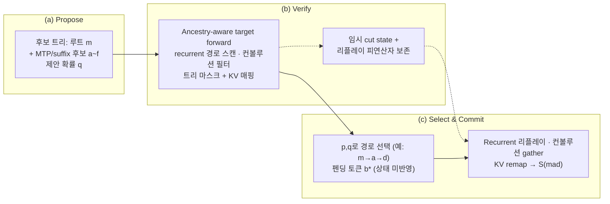

[논문 링크](https://arxiv.org/abs/2609.23900v1)
## LumoTree: Path-Parallel Speculative Verification for Hybrid Language Models

> **TL;DR** — Gated DeltaNet과 full-attention을 섞은 하이브리드 모델에서 트리 스페큘레이티브 디코딩을 하려면, recurrent 상태·컨볼루션 히스토리·어텐션 KV 캐시 세 가지가 **모두 같은 "수용된 경로"** 로 맞아떨어져야 한다. LumoTree는 하나의 공유 트리 디스크립터로 검증과 커밋을 조율하고, 경로-병렬 스캔 + 네이티브 리플레이로 이를 구현한다. NVIDIA DGX Spark(GB10)에서 27-후보 트리를 체인 스택과 맞먹는 비용으로 검증하고, 체인 MTP 대비 **+7.7%~+11.8%** 의 디코드율을 기록한다. 다만 태스크 완료 속도 향상은 없었다는 점을 저자는 스스로 명확히 밝힌다.

## Key Numbers

| 항목 | 값 |
|---|---|
| 타깃 모델 | Qwen3.8-27B (혼합 NVFP4/FP8 가중치, BF16 실행, recurrent 상태는 FP32) |
| 아키텍처 | Gated DeltaNet 48층 + full-attention 16층 하이브리드 |
| 드래프터 | 동일 체크포인트의 1층 BF16 MTP (별도 EAGLE 가중치 없음) |
| 트리 지오메트리 | 27 draft + root, 32행으로 패딩, 최대 깊이 11 (MTP 5 pass + suffix 확장) |
| 컨텍스트 | 131,072 tokens | 하드웨어 | 단일 DGX Spark(GB10) |
| 디코드율 (replay) | LumoTree **28.13** tok/s vs MTP-5 **26.12** (첫 코퍼스, +7.7%) |
| 디코드율 (분리 코퍼스) | LumoTree **30.76** vs MTP-5 **27.52** (+11.8%), autoregressive **10.54** |
| GDN 컴포넌트 레이턴시 | verify 12.90 + publish 4.49 = **17.69** ms (native path 32.41 ms) |
| 명명 버퍼 | LumoTree **132.5** MiB vs native baseline **5,040** MiB |

> 어휘 크기, 정확한 파라미터 수, 총 FLOPs, 비용(`$`/token)·에너지 지표는 **원문 미보고** — 이 논문은 모델 학습이 아니라 서빙 시스템 검증이 목적이라 이런 수치를 다루지 않는다.

## 핵심 아이디어

스페큘레이티브 디코딩의 표본 추출 보장은 "검증기가 의도된 타깃 확률을 정확히 공급한다"는 가정 위에 선다. 그런데 recurrent-hybrid 모델에서 이 가정을 지키는 일은 단순히 어텐션 마스크 하나로 끝나지 않는다. 각 후보 토큰은 **부모의 상태를 물려받아야** 하고, 다음 서빙 이터레이션은 **방금 선택된 경로의 상태를 정확히 이어받아야** 한다 (근거: §I).

LumoTree의 핵심 설계 선택은 다음 세 가지다 (근거: §I, §III).

1. **공유 트리 디스크립터** — 후보 토큰 ID, 부모 인덱스, 깊이·위치, 어텐션 가시성, 논리 노드↔물리 슬롯 매핑을 하나의 구조체에 담아 드래프팅·검증·커밋 전 단계가 같은 논리 토폴로지를 읽게 한다.
2. **경로-병렬 검증 + 네이티브 리플레이** — 브랜치는 임시 상태(temporary state)에서 검증하고, 선택된 경로만 네이티브 러닝 상태로 **리플레이** 한다. 이로써 "그럴듯한 로짓을 내놓고도 다음 이터레이션에 엉뚱한 상태를 퍼블리시"하는 오류를 원천 차단한다.
3. **세 상태 표면의 일치** — recurrent 행렬, 컨볼루션 히스토리, 어텐션 KV 세 가지가 같은 물질화된 프리픽스 $m$ 을 기술해야 한다: $\mathcal{S}(m)=\bigl(R(m),C(m),K(m)\bigr)$ (근거: §III).

저자는 "정확한 어텐션 마스크가 틀린 recurrent 부모를 고쳐줄 수 없다"고 못박는다. 문제는 이 세 상태를 어디서 어떻게 맞출 것인가이며, 이 논문은 그 "경계(boundary)"를 구현으로 해결한다 (근거: §III).

## 배경: 하이브리드 모델에서 "트리 검증"이 어려운 이유

일반 트랜스포머의 트리 검증에서는 각 후보의 가시 키를 마스크로 제어하기만 하면 된다. 하지만 Gated DeltaNet은 상태가 **순차 누적형** 이다. 하나의 GDN 헤드에서 상태 행렬 $R\in\mathbb{R}^{d_v\times d_k}$ 는 각 노드 $i$ 에서 다음과 같이 갱신된다 (근거: §III):

$$
R'_i = \alpha_i R_{\pi(i)}, \qquad \delta_i = \beta_i\bigl(v_i - R'_i k_i\bigr),
$$

$$
R_i = R'_i + \delta_i k_i^{\top}, \qquad o_i = R_i q_i.
$$

여기서 $\alpha_i$ 는 감쇠(decay), $\beta_i$ 는 쓰기 강도(write strength), $\pi(i)$ 는 **부모 노드** 다. 핵심은 $R'_i$ 가 "패킹 버퍼에서 바로 앞 노드"가 아니라 **부모 상태 $R_{\pi(i)}$** 를 감쇠시킨 값이라는 점이다. 즉 팩 버퍼상 이전 노드가 $\pi(i)$ 일 필요가 없다. 컨볼루션도 인접한 패킹 행이 아니라 경로상 선조를 요구하고, 어텐션 가시성도 같은 논리 프리픽스와 계보를 골라야 한다 (근거: §III).

따라서 트리의 각 브랜치를 "부모의 상태에서부터" 독립적으로 계산해야 하며, 수용된 경로의 상태를 다음 이터레이션에 정확히 되돌려줘야 한다. 이 지점을 다룬 선행 연구는 이미 여럿이다 (근거: §II, Tab. related):

| Method | Verification work | Continuation state |
|---|---|---|
| Weaver | Ancestor-masked triangular solve | Short selected-path recurrence |
| SpecLA | Resident state tiles; parallel chains | Buffered factors; later fused update |
| Bole | Finite-Neumann correction solve | Compact factors; state reconstruction |
| TreeWY | Triangular solve in fused kernel | Prior-path reconstruction with next verify |
| ReplaySSM | Corrected inputs; cached transitions | Deferred state update |
| OneLA | Shared-base projections across beams | Compact per-beam transition records |
| **LumoTree** | Resident state tiles; parallel paths | **Native replay; coordinated conv + KV publication** |

이 표가 보여주듯, "트리 검증"과 "수용 상태의 재구성"을 각각 푼 연구는 많지만, 검증을 리커런트·컨볼루션·어텐션 **세 표면** 에 걸쳐 하나의 수용 경로로 일치시키고 그 수치적 일치까지 검증한 연구는 없다. SpecLA가 상태 타일 재사용과 경로 스케줄링에서 가장 가깝지만, SpecLA는 수용 팩터를 버퍼링했다가 나중에 fused update로 적용하는 반면, LumoTree는 **기록된 피연산자를 네이티브 GDN 업데이트로 즉시 리플레이** 하고 컨볼루션·KV까지 함께 퍼블리시한다 (근거: §IV, §II).

## 새로운 접근법: LumoTree

LumoTree는 "경로를 병렬로 실행하고, 각 경로 내부에서 상태 타일을 업데이트마다 재사용하며, 수용된 연속 상태를 recurrent·컨볼루션·어텐션 상태에 걸쳐 조율"하는 시스템이다 (근거: Abstract). 구조는 세 단계로 나뉜다 (근거: Alg. 1).

1. **검증(Verify)** — 후보 트리를 물리 슬롯·위치·선조 마스크로 매핑하고, 경로-로컬 GDN·컨볼루션·어텐션 계산으로 타깃 확률 $p$ 를 얻는다. 후보 은닉 상태, 반올림된 리플레이 피연산자, 컨볼루션 히스토리, 임시 KV를 보존한다.
2. **선택(Select)** — $p$ 와 $q$ 로 수용된 물질화 경로 $A$ 와 펜딩 토큰 $b^*$ 를 고른다.
3. **퍼블리시(Publish)** — 같은 경로 $A$ 를 세 컴포넌트에 반영한다: GDN은 기록 피연산자를 리플레이, 컨볼루션은 히스토리를 gather, KV는 논리→물리 슬롯 맵으로 remap. 다음 드래프터 입력용 은닉 행도 선택한다.

여기서 검증과 커밋은 **같은 디스크립터** 를 공유한다. 이 "시스템 경계"가 중요한 이유는, 검증기가 그럴듯한 후보 로짓을 내놓으면서도 다음 이터레이션을 위해 엉뚱한 상태를 퍼블리시할 수 있기 때문이다 (근거: §I).

구현은 크게 두 축으로 움직인다.

- **경로-병렬 스캔** (§IV): 트리를 의존 경로 그룹으로 분해한다. 첫 경로는 요청의 프리-트리 상태에서 시작해 하류 경로가 필요한 cut state를 내보낸다. 두 번째 레벨은 그 cut state에서 독립 브랜치 경로를 병렬 평가한다. 각 GPU 프로그램은 (경로, 헤드, value tile) 하나를 맡아 **key 차원 전체를 작업 타일에 유지**하며, 순차 업데이트가 이 타일을 경로 루프 내내 재사용한다 — 노드마다 전체 recurrent 상태를 다시 로드하지 않는다 (근거: §IV, Alg. 2).
- **네이티브 리플레이** (§IV): 리플레이는 프리-트리 러닝 상태에서 시작해 수용 경로의 노드들을 순서대로 네이티브 GDN 업데이트에 적용하고, 결과를 요청의 네이티브 러닝 행에 퍼블리시한다. 이 방식은 매 이터레이션을 네이티브 상태 표현으로 되돌리기 위해 **명시적인 수용 경로 업데이트 비용**을 지불한다 (근거: §IV, Alg. 2).

여기에 다섯 가지 통합 최적화가 붙는다 (근거: §V, Tab. optimization-map):

| 제약 | LumoTree 변경 | 반드시 일치해야 하는 것 |
|---|---|---|
| 호스트 경로-리스트 구성 | 디바이스 선택 경로가 captured native replay·컨볼루션·KV·드래프터 선택을 구동 | 모든 소비자가 같은 프리픽스를 선택 |
| 논리 계보 ≠ 물리 KV 배치 | Spine-연속 슬롯 + 조율된 쓰기/마스크/remap | 논리 쿼리 순서·물리 슬롯·네이티브 목적지 일치 |
| 노드별 컨볼루션 히스토리 | 정적 ancestry gather + fused ordered tap | tap 순서·cast 경계·패딩·레이어 ID |
| 분리된 argmax/top-k | 하나의 logits 텐서 + fused 선택 | tie 규약·후보 순서·중복 처리 |
| 반복 KV staging | Grouped query + split-K tree attention | 파티션 간 트리 가시성·슬롯 매핑 |

이 표의 세 번째 열이 이 논문의 진짜 무게다. 각 최적화가 "어떤 불변식을 깨뜨리면 안 되는지"를 명시함으로써, 단순한 커널 스피드업을 넘어 **수치적·논리적 정합성** 을 설계 제약으로 끌어올린다.

## 작동 원리: 구체적 예시로 살펴보기

원문 도식(Fig. 1)을 따라 전체 파이프라인을 보자.



> **설명용 예시** — 아래는 논문 실험이 아니라 원리를 보이기 위한 toy 예시다.

아주 작은 트리를 가정하자. 루트 $m$ (이미 물질화된 프리픽스), 그 자식 후보 $a$, $b$, 그리고 $a$ 의 자식 $d$, $c$ 가 있다. spine(주 경로)은 $m\to a\to d$ 라 하자.

```
          m (루트, 프리-트리 상태 R0)
         / \
        a   b
       / \
      d   c
```

**핵심 함정**: 물리 버퍼에 토큰이 $m, a, b, d, c$ 순으로 패킹되어 있다고 하자. $d$ 의 부모는 $a$ 지, 버퍼상 바로 앞의 $b$ 가 아니다. 순진한 순차 스캔은 $b$ 의 상태를 $d$ 의 부모로 잘못 쓰게 된다 (근거: §III "A previous node in the packed buffer need not be π(i)").

LumoTree는 이렇게 푼다:

| 단계 | 무엇을 하는가 | 상태 출처 |
|---|---|---|
| 1. 경로 그룹 분해 | spine($m\to a\to d$)을 먼저, $b$·$c$ 는 하류 브랜치로 | — |
| 2. 경로-병렬 스캔 | spine을 $R_0$ 에서 스캔하며 $a$ 이후 cut state 저장; $b$ 는 $R_0$ cut, $c$ 는 $a$ cut에서 병렬 스캔 | 부모의 cut state (공유) |
| 3. 타깃 forward 완료 | 각 노드 출력 $o_i = R_i q_i$ → 로짓 $p$ | 작업 타일 (key 차원 유지) |
| 4. 샘플링 | $p,q$ 로 경로 선택 (여기서는 spine $m\to a\to d$ 선택 가정) | — |
| 5. 리플레이 | $R_0$ 에서 $a$ 의 피연산자, 이어 $d$ 의 피연산자를 네이티브 GDN 업데이트로 재적용 | 기록된 피연산자 (탐색된 경로만) |
| 6. 퍼블리시 | recurrent를 러닝 행에, 컨볼루션 히스토리를 gather, KV를 remap | 논리→물리 슬롯 맵 |

`b` 와 `c` 는 검증에서는 계산됐지만 선택되지 않았으므로, 그 상태는 임시 cut state로만 남고 영구 상태에 쓰이지 않는다. 펜딩 토큰 $b^*$ (새로 샘플링된 보정/보너스 토큰)는 **다음 타깃 forward에서야** 상태가 만들어진다 (근거: §III, §IV).

이 두 상태(임시 cut state vs 영구 러닝 행)를 분리한 것이 LumoTree의 저장·재계산 트레이드오프의 핵심이다. cut state를 내보내면 하류 경로가 재사용할 수 있고, 수용 경로만 리플레이하면 영구 상태를 네이티브 표현으로 유지할 수 있다 (근거: §IV).

## 성능 검증: 주요 결과

평가는 세 갈래로 나뉜다: (1) 실제 코딩 에이전트 워크로드, (2) 기록 요청 재생(replay), (3) 수치·샘플링 정합성 검증. 하드웨어는 단일 DGX Spark(GB10), 타깃은 Qwen3.8-27B다 (근거: §VI).

**1) 기록 요청 재생 — 디코드율.** 첫 43-요청 코퍼스에서 LumoTree는 **28.13** pooled tok/s, 5-토큰 네이티브 MTP는 **26.12** tok/s로 **+7.7%** 다. 순수 autoregressive는 10.54 tok/s에 그친다 (근거: §VII, §X). 별도로 고정한 분리 코퍼스에서는 **30.76** vs **27.52** tok/s로 **+11.8%**, 모든 개별 LumoTree 실행이 모든 MTP-5 실행을 앞선다 (근거: §VII, Tab. disjoint-replay).

| Configuration | Runs | Tokens/s (첫 코퍼스) |
|---|---:|---:|
| vLLM autoregressive | 1 | 10.54 |
| vLLM MTP, 5 tokens | 3 | 26.12 |
| **LumoTree** | 3 | **28.13** |
| SGLang EAGLE, 7/8 | 3 | 29.69 |

다만 저자는 이 비교의 한계를 분명히 한다: SGLang EAGLE(체인 스페큘레이션, top-$k$=1)과의 pooled 차이는 **5% 이내이고 두 코퍼스 사이에서 부호가 뒤집힌다**. 즉 "LumoTree는 체인 스택과 맞먹는 속도로 **27-후보 트리** 를 검증한다"는 것이지, 트리 검증이 체인보다 **빠르다**는 주장이 아니다 (근거: §VIII, §X).

**2) 컴포넌트 레이턴시와 메모리.** GDN 컴포넌트 단독 측정(그래프 모드 중앙값)에서 LumoTree는 verify 12.90 + publish 4.49 = **17.69 ms** 로, native path baseline의 32.41 ms, PyTorch 순차 baseline의 55.02 ms를 크게 앞선다 (근거: §VII, Tab. mechanism-times). 명명 버퍼는 **132.5 MiB** 로 native baseline의 5,040 MiB 대비 약 38분의 1이다 (근거: §VII, Tab. mechanism-memory-error). 이 절약의 상당 부분은 96 MiB cut-state 버퍼가 레이어 간 재사용되고, 실제 논리 export는 레이어당 15 MiB에 불과하기 때문이다 (근거: §VII).

> 주의: TreeWY(11.01 ms), Weaver(3.45 ms)가 이 표에서 더 빠르지만, 저자는 "이 시점 타이밍은 상이한 수치 정책 아래의 관찰이며 정확도 동등성을 확립하지 않는다"고 못박는다 (근거: §VII, Tab. mechanism-times).

**3) 수치·샘플링 정합성.** 여기가 LumoTree의 독보적인 부분이다. 검증기와 네이티브 경로의 유한 정밀도 **일치는 가정이 아니라 별도 요구사항** 이다 (근거: §I). 결과는:

- GDN 컴포넌트: 퍼블리시된 recurrent 상태는 **네이티브 체인과 bitwise 동일**, BF16 출력은 calibration 3,004/3,072, held-out 3,018/3,072 셀에서 bitwise 일치 (근거: §VII, Tab. gdn-component).
- 풀 모델 연속: 126 사이클 모두에서 **동결된 수치 봉투(2배 한계)를 만족** 하고, 주입된 10개 결함을 전부 탐지. greedy 토큰은 121/126 사이클에서 일치(나머지 5건은 logit tie 허용범위 내) (근거: §VII, Tab. fullmodel-agreement).
- 샘플러 감사: 200,000회 × 6 스텝의 몬테카를로 워크에서 top-$k$ tie 규약을 넘는 이탈 없음, 5종 결함 모두 최소 1스텝에서 탐지 (근거: §VII, Tab. sampling-faults).

**4) 코딩 에이전트 워크로드 — 신중한 반전.** 10개 Astropy 태스크를 세 서빙 암(LumoTree / MTP-5 / SGLang EAGLE)으로 각 1회씩 실행한 결과, LumoTree는 **5/10 해결, 26.12 tok/s, 190.8분**; MTP-5는 **6/10 해결, 27.17 tok/s, 99.5분**; SGLang은 5/10 해결, 29.89 tok/s, 103.0분이다 (근거: §VII, Tab. agent-study). 즉 **라이브 에이전트에서 LumoTree가 더 많은 토큰(258,889 vs 134,643)을 뽑고 더 오래 걸리면서도 해결 태스크는 더 적었다** (근거: §VII).

이 대목이 이 논문을 돋보이게 만든다. 대부분의 시스템 논문이라면 "replay에서 +7.7% 빨랐다"는 숫자만 내세웠을 텐데, LumoTree는 "디코드율 변화가 태스크 완료 가속이 아니다"를 명시적으로 짚는다 (근거: §I, §VIII). 두 결과는 다른 것을 잰다: 디코드율은 **토큰 생산**, 태스크 완료는 **유용한 완료된 작업** 이다.

## 우리의 관점: 강점, 한계, 이 연구가 중요한 이유

**강점.**

가장 큰 강점은 **정직성과 검증 방법론** 이다. 수치 정합성을 "실증적 질문"으로 두고 (근거: §II), 검증기·네이티브 경로의 유한 정밀도 일치를 별도 요구사항으로 분리하며 (근거: §I), 동결된 오차 봉투 + 결함 주입으로 이를 검증한다 (근거: §VII). "더 빠르다"고 주장하기 전에 "같은 분포를 만드는가"를 먼저 묻는 태도는, 스페큘레이티브 디코딩처럼 표본 추출 정확성이 생명인 분야에서 특히 가치 있다.

설계적으로는 **"공유 디스크립터"라는 단일 추상화** 가 인상적이다. recurrent·컨볼루션·어텐션·드래프터 입력까지 한 논리 토폴로지로 묶음으로써, "레이아웃 최적화가 조용히 branch가 읽는 키/값을 바꾸는" 사고를 원천 차단한다 (근거: §III). 메모리에서도 132.5 MiB vs 5,040 MiB라는 극적인 절약은 cut-state 재사용과 수용 경로 리플레이라는 두 설계 선택이 함께 만든 결과다 (근거: §VII).

**한계 (저자가 인정한 것 + 리뷰어의 추론).**

저자가 명시적으로 인정한 한계는 꽤 광범위하다 (근거: §IX):

- **수치 범위**: 풀 모델 비교는 bitwise 동등이 아니라 "네이티브 상대 오차의 2배 이내 + greedy 허용범위"를 확립할 뿐이다. MTP 드래프터 상태는 검증 대상에서 빠져 있고, 18개 스케줄이 모든 경로 조합을 다루지 않는다.
- **성능·태스크 범위**: 태스크별 1회 시도, 10개 태스크, plain-decoding 대조군 없음. 통계적 유의성·SGLang 동등성·범용 워크로드 일반화는 확립되지 않았다.
- **미검증 영역**: 배치 크기 1 초과, 캐시 admission/eviction 전체 수명주기, 완전한 분포 보존은 결과 밖이다.

리뷰어 관점에서 추가로 짚을 점은 **"실제로 더 빠르냐"는 질문이 여전히 열려 있다**는 것이다. 체인 대비 이득이 5% 이내에서 부호가 뒤집히고, 트리 드래프터(chain 검증이 감당 못 하는 진짜 트리 제안)는 아직 평가되지 않았다 (근거: §VIII, §X). 또한 수용 경로 리플레이가 지불하는 명시적 업데이트 비용이 트리의 병렬성 이득을 상쇄하는 임계점이 어디인지도 명시적으로 측정되지 않았다. 운영 관점에서 이 시스템은 **긴 컨텍스트 + 단일 시퀀스 + 반복 요청** 이 많은 코딩 에이전트 환경에서 "체인급 비용으로 트리 검증을 쓰고 싶은" 경우에 적합하지만, 배치가 커지거나 드래프터가 트리를 진짜 활용하는 상황에서의 동작은 아직 검증되지 않았다.

**왜 중요한가.**

recurrent-hybrid(및 SSM 계열) 모델이 실제 서빙에 들어오면서, "어텐션 마스크만으로 되는 트리 검증"이라는 기존 상식이 무너지고 있다. LumoTree는 이 전환기의 **기준점(reference point)** 을 제공한다: 상태가 세 표면에 걸쳐 있을 때 검증과 커밋을 어떻게 조율하고, 그 정합성을 어떻게 증명하는지를 보여준다. 다음 세대의 하이브리드 서빙 시스템이 이 논문의 "공유 디스크립터"와 "동결 오차 봉투" 검증 방식을 우회하기는 어려울 것이다.

## 다음 단계: 앞으로의 길

저자가 명시적으로 남긴 열린 문제는 **트리 드래프터** 다. 지금은 체인 검증이 감당 못 하는 트리 제안을 검증하는 것이 목표였고, 그 다음 자연스러운 단계는 "트리를 진짜로 활용하는 드래프터"를 얹는 것이다 (근거: §VIII, §X). 한계에 비추어 합리적인 후속 방향을 정리하면:

- **배치 > 1 확장**: 현재 검증은 단일 능동 시퀀스 기준이다. 다중 요청에서 cut-state 풀과 KV 슬롯 맵이 어떻게 공유·격리되어야 하는지가 다음 장애물이다 (근거: §IX).
- **분포 동등성의 완전 증명**: 현재는 유한 몬테카를로 비기각(non-rejection)과 캡처 행 감사다. top-$k$ tie 규약과 min-$p$ 무시가 야기하는 분포 차이를 정량화하는 작업이 남는다 (근거: §IX).
- **수용 경로 리플레이 비용의 임계 분석**: 리플레이가 지불하는 업데이트 비용 대비 트리 병렬성이 주는 이득의 손익분기점을 트리 크기·깊이의 함수로 특성화하면, 이 설계의 적용 조건이 더 명확해진다 (리뷰어 제안).

이 논문은 "더 빠르게 만들었다"는 성취보다 "더 빠르게 **만들었음을 제대로 증명했다**"는 성취에 가깝다. 그리고 그 증명의 방식 — 상태를 세 표면으로 나누고, 그 경계에서의 정합성을 동결된 봉투와 결함 주입으로 검증하는 — 이 앞으로의 하이브리드 서빙 연구에 가장 오래 남을 기여일 것이다.


<!-- verbatim-tables -->

## 논문 원문의 표

> arXiv e-print 의 LaTeX 원본에서 기계적으로 옮긴 표입니다. 숫자는 논문의 값이며 모델을 거치지 않았습니다.

**표 1. Recurrent verification and continuation policies. These mechanism comparisons do not rank the systems by performance.**

| Method | Verification work | Continuation state |
|---|---|---|
| Weaver | Ancestor-masked triangular solve | Short selected-path recurrence |
| SpecLA | Resident state tiles; parallel chains | Buffered factors; later fused update |
| Bole | Finite-Neumann correction solve | Compact factors; state reconstruction |
| TreeWY | Triangular solve in fused kernel | Prior-path reconstruction with next verify |
| ReplaySSM | Corrected inputs; cached transitions | Deferred state update |
| OneLA | Shared-base projections across beams | Compact per-beam transition records |
| LumoTree | Resident state tiles; parallel paths | Native replay; coordinated convolution and KV publication |

**표 2. Concrete implementation changes around the path verifier. The third column identifies the coordination or numerical constraint that makes each change nontrivial. Workload rates measure their combined execution.**

| Starting work or constraint | LumoTree change | What must remain consistent |
|---|---|---|
| Host path-list construction between acceptance and publication | Device-selected path feeds captured native replay, convolution, KV and drafter selection | All consumers select the same materialized prefix; pending and padded tokens do not advance state |
| Logical ancestry does not determine physical KV placement | Spine-contiguous slots with coordinated writes, mask columns and accepted-path remap | Logical query order, physical source slots and native destination positions agree |
| Per-node convolution histories and repeated layer preparation | Static ancestry gathers, fused ordered taps and per-layer operand buffers | Tap order, cast boundaries, history padding and layer identity |
| Separate score preparation and argmax/top-k operations | One shared logits tensor and fused selection into graph buffers | Both reference tie conventions, candidate order and duplicate behavior |
| Repeated KV staging and limited decode parallelism | Grouped query heads and split-K in the patched tree-attention kernel | Tree visibility and slot mapping across partitions; characterized reduction error |

**표 3. Ten-task coding-agent study, one attempt per task and arm. Minutes sum agent durations, including tools but excluding server startup and evaluation. Decode rates use server-counter differences in Eq. .**

| Arm | Resolved | Requests | Tokens/s | Minutes |
|---|---|---|---|---|
| LumoTree | 5/10 | 248 | 26.12 | 190.8 |
| Native MTP-5 | 6/10 | 224 | 27.17 | 99.5 |
| SGLang EAGLE | 5/10 | 210 | 29.89 | 103.0 |

**표 4. Sampled replay of 43 recorded requests, capped at 1,024 output tokens. Rates pool matched token and time totals across all runs. Ranges describe individual run rates, not confidence intervals. SGLang receives the same input token IDs but uses a different stack and streaming endpoint.**

| Configuration | Runs | Tokens/s | Run range |
|---|---|---|---|
| vLLM autoregressive | 1 | 10.54 | --- |
| vLLM MTP, 1 token | 1 | 15.37 | --- |
| vLLM MTP, 3 tokens | 1 | 22.06 | --- |
| vLLM MTP, 5 tokens | 3 | 26.12 | 26.04--26.23 |
| vLLM MTP, 7 tokens | 1 | 25.72 | --- |
| LumoTree | 3 | 28.13 | 27.40--28.78 |
| SGLang EAGLE, 7/8 | 3 | 29.69 | 28.91--30.90 |

**표 5. Exploratory replay variants. Each run contains all 43 requests. These measurements do not establish isolated optimization effects.**

| Disabled optimization | Runs | Tokens/s | Run range |
|---|---|---|---|
| Grouped split-K tree attention | 3 | 26.82 | 26.67--27.11 |
| Fused draft top-$k$ selection | 1 | 29.40 | --- |
| Precomputed tap-operand preparation | 1 | 29.02 | --- |

**표 6. Mean execution spans of exploratory replay variants, in milliseconds. Each phase pools its own duration and timer count. Deployed uses two instrumented runs; stock attention three; other variants one.**

| Configuration | Target | Draft | Dispatch | Step |
|---|---|---|---|---|
| Deployed | 112.14 | 49.84 | 20.81 | 189.35 |
| Stock attention | 126.78 | 49.94 | 21.13 | 204.44 |
| Fused selection off | 112.32 | 50.57 | 21.08 | 190.38 |
| Operand preparation off | 111.85 | 49.85 | 20.75 | 188.97 |

**표 7. Disjoint 43-request replay. Rates pool matched totals; ranges are individual run rates. Request messages are shared, but SGLang uses a different chat serialization.**

| Configuration | Runs | Tokens/s | Run range |
|---|---|---|---|
| LumoTree | 3 | 30.76 | 30.38--31.14 |
| vLLM MTP, 5 tokens | 3 | 27.52 | 27.41--27.71 |
| SGLang EAGLE, 7/8 | 1 | 30.24 | --- |

**표 8. Exploratory drafting-pass variants on the first 43-request corpus. The deployed row pools two runs; each variant has one. GPU drafting and step wall durations use their own timer counts.**

| Policy | Tokens/s | Accepted drafts/event | Draft ms | Step ms |
|---|---|---|---|---|
| Five passes | 28.69 | 4.45 | 49.84 | 189.35 |
| Three passes | 28.94 | 3.97 | 32.01 | 171.27 |
| Conditional three/five | 27.05 | 4.09 | 47.71 | 187.55 |
