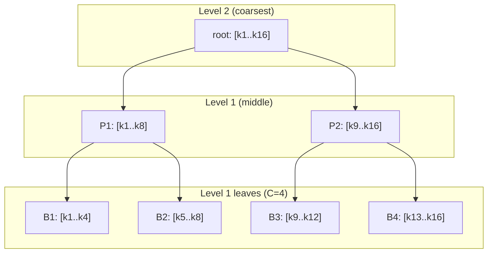

[Paper](https://arxiv.org/abs/2609.31093v1)
## PISA: Pyramid Top-$K$ Selection Lowers the Cost of Block-Sparse Attention to $O(N\log N)$

> **TL;DR** — Block-sparse attention makes attention computation linear, but block selection still costs quadratic time. PISA solves this by layering keys into a pyramid via average pooling and narrowing candidates at each level with LogSumExp (LSE) scores. Prefill selection cost drops to $O(N\log N)$ and decode to $O(\log N)$, delivering up to $9.95\times$ speedup in selection latency over existing BSA at 256K tokens.

---

## Key Idea

PISA (**Py**ram**i**d **S**parse **A**ttention) redesigns **Top-$K$ block selection**, the bottleneck among the two stages of block-sparse attention. Existing block-sparse attention (BSA) scores every query–block pair and then picks the top $K$; this stage alone costs $O(N^2/C)$ (source: §1). PISA stratifies key blocks via average pooling to **narrow candidates at a coarse level and expand only the selected candidates to a finer level** (source: §3.2). Because the number of candidates evaluated at each level is bounded, selection costs $O(\log N)$ per query and total prefill drops to $O(N\log N)$ (source: §3.4, Table 1).

There are three core design choices. **① Pyramid hierarchy**: keys are aggregated bottom-up with block size $C=64$ and branching factor $g=2$. **② LSE scoring**: instead of approximating candidate blocks with a simple mean or mean+variance, it scores them with the exact LSE, $\log\sum\exp(\cdot)$. **③ Hardware-aware kernels**: hierarchical routing and LSE scoring are fused into a single Triton kernel; training/prefill use a two-stage kernel and decode uses a one-stage kernel (source: §3.3, Algorithm 1).

---

## Background: The Problem They Solved

The cost of self-attention grows quadratically with sequence length $N$, blocking scaling to long contexts (source: §1). Block-sparse attention sidesteps this by restricting each query to a selected subset of key blocks rather than all keys. Grouping into blocks enables tiled kernels, which is efficient (source: §1).

Block-sparse attention splits into two stages (source: §3.1):

1. **Top-$K$ block selection** — each query decides which key blocks to attend to
2. **Attention computation over the selected blocks** — using the original keys/values

The problem lies in stage 1, not stage 2. Because each query attends to at most $KC$ keys, attention computation is linear in the sequence, but **the selection stage still requires every query to scan every key block**, leaving it at $O(N^2/C)$ (source: §1, §3.1). In other words, this paper identifies selection as the real bottleneck in long-context modeling—the research gap it targets.

The authors clearly position their work here. Existing hierarchical methods such as HiP are training-free, while trainable methods such as NSA and HiLS still have $O(N^2)$ prefill complexity. PISA is the only method that is trainable while achieving both $O(N\log N)$ prefill and $O(\log N)$ decode (source: Table 1, §2).

---

## New Approach: PISA (Pyramid Sparse Attention)

### 3.1 Building the Key-Block Pyramid

The key-block hierarchy is built **fine-to-coarse** (source: §3.2). Level $0$ consists of singleton blocks of the original keys, level $1$ consists of leaf blocks of size $C=64$, and each subsequent level is formed by concatenating $g=2$ adjacent child blocks. The summary vector $\bar{k}_i^{(\ell)}$ of each block is computed recursively by **average pooling** over its child summaries:

$$
\bar{k}_i^{(\ell+1)} = \frac{1}{|\operatorname{Ch}_\ell(i)|} \sum_{r\in\operatorname{Ch}_\ell(i)} \bar{k}_r^{(\ell)}
$$

where $\operatorname{Ch}_\ell(i)$ is the set of child indices of block $i$ at level $\ell$ (source: §3.2, Eq. mean_pyramid). Because this is downsampling, the number of levels is $L=O(\log N)$ (source: §3.4).

### 3.2 Selection from Coarse to Fine Levels

Selection starts at the coarsest level $L$ and descends to leaf level $1$ (source: §3.2). At each level $\ell$:

1. Compute LSE scores $\mathbf{s}_t^{(\ell)}$ for the candidate set $\mathcal{A}_t^{(\ell)}$
2. Keep only the top-$K$ blocks $\mathcal{I}_t^{(\ell)}$
3. Form the candidate set $\mathcal{A}_t^{(\ell-1)}$ for the next level from the children of the selected blocks

Since each selected block has at most $g$ children, the number of candidates at the next level is bounded by $gK$ (source: §3.2, Eq. candidate_bound). This is the key to reducing quadratic cost to log-linear.

### 3.3 LSE Scoring: Why LSE Instead of a Simple Mean

The score of candidate block $K_i^{(\ell)}$ is defined as the **exact LogSumExp** over its child summaries (source: §3.2):

$$
s_{t,i}^{(\ell)} = \log\sum_{r\in\operatorname{Ch}_{\ell-1}(i)} \exp\!\left(\frac{q_t^\top \bar{k}_r^{(\ell-1)}}{\sqrt{d}}\right)
$$

The authors justify this choice with a Taylor expansion. For the mean $\bar{z}$ and variance $\operatorname{Var}(z)$ of $z_1,\dots,z_m$, the LSE expands as follows (source: §4.4, Appendix A):

$$
\log\sum_{j=1}^{m}e^{z_j} = \log m + \bar z + \tfrac12\operatorname{Var}(z) + \text{higher-order terms}
$$

In other words, the two variants the authors compare are truncated versions of this expansion (source: §4.4):

- **PISA-1**: first-order approximation → uses only the mean $\bar{z}$
- **PISA-2**: second-order approximation → uses $\bar{z} + \tfrac12\operatorname{Var}(z)$
- **PISA (this method)**: no truncation; uses the full LSE

According to the Jensen-inequality analysis in Appendix A, scoring an intermediate block by the LSE of its child means is always closer to the original-key LSE than the mean of child means (PISA-1) (source: Appendix A).

### 3.4 Hardware-Aware Kernels

PISA lets query heads within a GQA group share the same key blocks, and handles training/prefill and decode with different kernels (source: §3.3, Algorithm 1):

- **Training/prefill — two-stage kernel**: stage 1 performs hierarchical selection at intermediate levels, and stage 2 scores the original key blocks. In stage 2, queries are grouped into tiles ($Q_{\mathrm{tile}}=4$) so that multiple queries reuse the same key blocks, reducing IO. With $G_Q=16$ and $C=64$, $G_Q + C/Q_{\mathrm{tile}} = 32 < 64 = C$, so leaf-level IO is lower than with a single stage (source: §3.4).
- **Decode — one-stage kernel**: decode has only one query, so there is no cross-query reuse; to avoid the overhead of launching multiple kernels, it processes all the way to $\ell=1$ in a single kernel. It caches the average pyramid and updates only the current leaf average and the ancestor path for each new token (source: §3.3, Appendix B).

Throughout the process, **the query–key score matrix is never materialized**, which is a strength in terms of memory traffic (source: §1).

---

## How It Works: A Concrete Example

> The following is an **illustrative example** for intuition; the numbers are scaled down and unrelated to the paper's actual experimental settings ($C=64$, $K=8/32$, $g=2$).

Suppose there are keys $k_1,\dots,k_{16}$, block size $C=4$, and branching factor $g=2$. The pyramid has three levels.

With a block budget of $K=1$, selection proceeds as follows (source: §3.2, Eq. hierarchical_topk).

| Step | Level | Candidate set $\mathcal{A}$ | Scored | Result |
|---|---|---|---|---|
| Initialization | 2 | `{root}` | (skipped since candidates ≤ K) | root kept |
| Expansion | 2→1 | `{P1, P2}` | Score P1 and P2 by the LSE of their child summaries | P1 selected |
| Expansion | 1→leaf | `{B1, B2}` | Score B1 and B2 by the exact LSE of the original keys | B1 selected |
| Attention | — | `{B1}` | — | Attend only to keys $k_1..k_4$ |

The key point is that **at each level, only the candidates that survived the previous level are scored, not the entire set**. As we descend, the number of blocks doubles, but the number of blocks scored is fixed at at most $gK$ (source: §3.2). Therefore, even as the sequence grows and the number of levels increases to $O(\log N)$, the number of scores computed per query stays at $O(\log N)$.

An important nuance is that **intermediate levels use the LSE of summaries, while the leaf level uses the LSE of the original keys**. Scoring an intermediate block against all original keys would itself be quadratic, so it approximates with summaries and reads the original keys exactly only at the final leaves (source: §3.2, Appendix A).

---

## Performance Validation: Main Results

Experiments train decoder-only backbones at three scales—418M, 1.47B, and 2.67B—from scratch on 100B tokens @ 4K, then continue pretraining (CPT) on 10B tokens @ 16K. Sparse methods share block size $C=64$, with block budgets of $K=8$ for pretraining and $K=32$ for CPT (source: §4.1).

### 5.1 Language Modeling and Downstream Performance

After training from scratch (100B @ 4K), PISA is **on par with BSA, NSA, and HiLS in language modeling and commonsense reasoning**, and its **average accuracy on six containment (retrieval) tasks is the highest among sparse methods at all three scales** (source: §4.2, Table 2). However, Full Attention still has a higher average (source: §4.2).

| Scale | PISA loss ↓ | BSA loss ↓ | Containment avg (PISA) | Containment avg (BSA) |
|---|---:|---:|---:|---:|
| 418M | 2.5630 | 2.5684 | **41.77** | 38.18 |
| 1.47B | 2.3162 | 2.3179 | **49.83** | 48.54 |
| 2.67B | 2.2151 | 2.2184 | **52.14** | 51.13 |

> Lower loss and higher accuracy are better. Numbers excerpted from Table 2 (§4.2).

These results support the claim that "hierarchical selection reduces computational complexity while preserving the blocks needed for downstream modeling" (source: §1, §4.2).

### 5.2 Long-Context Retrieval (RULER)

After CPT (16K), the 2.67B model was evaluated on RULER's four needle-in-a-haystack task groups. PISA led with an average accuracy of **62.80**, ahead of BSA (54.99) and NSA (61.07); the PISA-2 variant was best among sparse methods at 62.92 (source: Table 3, §4.3).

In particular, PISA showed the best accuracy among sparse methods on **multi-key** (1K/2K) and **multi-value** (1K/2K/4K), but at longer lengths of 8K/16K, NSA led on single-key and multi-key tasks (source: Table 3). In other words, PISA's strength is concentrated in specific tasks and lengths rather than across the entire long-context regime.

### 5.3 Block Selection Quality (Oracle Diagnosis)

All selectors were replayed with the queries and keys from a Full-Attention checkpoint to measure how well they match the actual full-attention mass (source: §4.4, Appendix D). For $K=8$:

| Selector | Recall@8 ↑ | Captured mass ↑ | Attention mass ratio ↑ |
|---|---:|---:|---:|
| BSA | 85.91 | 85.67 | 98.42 |
| PISA-1 (mean) | 84.75 | 85.50 | 98.22 |
| PISA-2 (mean+variance) | 88.24 | 86.13 | 99.02 |
| **PISA (LSE)** | **90.95** | **86.47** | **99.46** |

PISA is best on all three metrics, and the selected blocks recover 99.46% of the mass contained in the full-attention reference (source: §4.4, Appendix D). This is direct evidence that LSE scoring produces more accurate Top-$K$ selection. Interestingly, PISA-1 (simple mean) is even lower than BSA, showing that "score accuracy" translates into actual performance differences.

### 5.4 Selection Latency (Kernel Microbenchmark)

Prefill block-selection latency was measured from 4K to 256K (source: §4.5, Table 6/Appendix B). The most important insight here is that **BSA is faster at short lengths**.

| $N$ | BSA (ms) | PISA Q4 (ms) | BSA speed vs. PISA |
|---:|---:|---:|---:|
| 4K | **0.167** | 0.701 | BSA $4.2\times$ faster |
| 16K | **1.461** | 1.581 | BSA faster |
| 32K | 5.099 | **3.185** | PISA faster |
| 64K | 19.144 | **6.704** | PISA $2.86\times$ |
| 128K | 76.682 | **14.452** | PISA $5.31\times$ |
| 256K | 312.956 | **31.441** | PISA $9.95\times$ |

> Numbers excerpted from Appendix B (Table, kernel_grouped_benchmark) and the text in §4.5. Batch 1, 32 query heads, 2 KV heads, $d=64$, $C=64$, $K=8$, $g=2$, BF16.

This crossover summarizes the paper's core message. PISA's advantage is **asymptotic**. Because of constant overhead (hierarchy construction, multi-stage expansion), BSA leads at 16K and below, but as length grows, BSA's $O(N^2)$ selection becomes exponentially slower, while PISA's $O(N\log N)$ grows gently (source: §4.5).

---

## Our Perspective: Strengths, Limitations, and Why This Work Matters

### Strengths

The biggest contribution is **reframing the problem precisely**. Whereas prior block-sparse literature focused on the quadratic cost of attention computation, PISA points out that "the selection stage itself remains a bottleneck at $O(N^2/C)$" and attacks that bottleneck directly (source: §1). The second strength is **the justification for LSE scoring**. It does not merely use LSE; it provides theoretical support via a Taylor expansion and Jensen's inequality for why it is superior to mean and mean+variance approximations (source: §4.4, Appendix A). The third is **engineering honesty**. The authors explain the split into a two-stage training/prefill kernel and a one-stage decode kernel via an inequality on leaf-level Q/K IO cost, and they do not hide the fact that BSA is faster at short lengths (source: §3.4, §4.5).

### Limitations: What the Authors Acknowledge

The authors explicitly acknowledge that **model scale and pretraining data budget were limited by compute constraints**, and note that this may affect performance and relative gains over baselines (source: Appendix E, Limitations). In practice, experiments stop at a 2.67B model and 100B tokens, leaving open whether the gains hold for production LLMs at tens to hundreds of billions of parameters.

### Limitations: A Reviewer's Reasoning

Several points warrant caution.

1. **Constant overhead and the crossover point**. PISA is slower than BSA at 16K and below (source: §4.5). Which is better in real serving contexts (typically 4K–128K) is sensitive to the crossover location, and this crossover depends on hardware and kernel implementation.
2. **Size of the performance advantage**. It is "on par" in language modeling and commonsense reasoning; clear advantages are concentrated in containment average (best among sparse) and selection-quality metrics (source: §4.2). Even in long-context RULER, NSA leads on certain 8K/16K tasks (source: Table 3). In other words, it is an advantage under specific conditions, not across the board.
3. **Approximation in GQA group scoring**. The authors themselves note that summing query-head LSEs and averaging full-attention mass can yield different rankings (source: Appendix A, gqa_objective). This is a source of theoretical mismatch.
4. **Pyramid cache cost**. Decode caches the average pyramid and doubles the buffer each time length doubles, with total copy cost $O((N/C)d\log N)$ (source: Appendix B). The average remains $O(\log N)$, but the fact that this cache occupies VRAM separately from the KV cache must be considered in inference-time memory accounting.

### Why This Work Matters

Ultimately, PISA is progress that lowers the complexity of the "selection stage of sparse attention" by one level. Among trainable methods, it achieves both $O(N\log N)$ prefill and $O(\log N)$ decode, and that complexity is implemented in real kernels and validated with a $9.95\times$ speedup at 256K (source: Table 1, §4.5)—meaningfully pushing the bottleneck of long-context modeling further back.

---

## What's Next?: The Road Ahead

The authors do not explicitly propose future directions, but given the limitations, reasonable next steps are as follows.

1. **Scale validation**: most urgent is to verify whether the gains and quality loss of $O(N\log N)$ selection hold at 7B+ and multi-trillion-token scale (source: connected to the limitations discussion in Appendix E).
2. **Move the crossover earlier**: kernel optimization to reduce the constant overhead (hierarchy construction, multi-stage expansion) in the 4K–16K range where PISA is slower than BSA, bringing the advantage in practical contexts forward.
3. **Inference-serving integration**: follow-up work quantifying the VRAM overhead of the decode pyramid cache and the feasibility of combining it with PagedAttention-style systems.
4. **Extending the scoring theory**: since LSE was shown superior to mean and mean+variance approximations, explore more accurate aggregation rules that resolve the mismatch in GQA group scoring (source: Appendix A).

In short, PISA is a clean study showing that making selection cheaper is exactly what makes long context more practical. The next step is to verify whether this log-linear selection keeps its promise at production-scale LLMs and in serving systems.

<!-- verbatim-tables -->

## Tables from the paper

> Tables converted mechanically from the arXiv e-print LaTeX source. The numbers are the paper's own and did not pass through a model.

**Table 1. Training settings and computational complexity of selected sparse attention methods. $N$ denotes the sequence length. Complexities include selection and attention computation. $\checkmark$ denotes trainable, and $\times$ denotes a training-free method. For LLSA , which is designed for diffusion models, the listed cost is per attention pass rather than autoregressive prefill.**

| Method | Trainable | Prefill complexity | Decode complexity |
|---|---|---|---|
| HiP | $\times$ | $O(N\log N)$ | $O(\log N)$ |
| HISA | $\times$ | $O(N^2)$ | $O(N)$ |
| MoBA | $\checkmark$ | $O(N^2)$ | $O(N)$ |
| NSA | $\checkmark$ | $O(N^2)$ | $O(N)$ |
| HiLS | $\checkmark$ | $O(N^2)$ | $O(N)$ |
| LLSA | $\checkmark$ | $O(N\log N)$ | --- |
| BSA\xspace | $\checkmark$ | $O(N^2)$ | $O(N)$ |
| **PISA\xspace** (ours) | $\checkmark$ | $O(N\log N)$ | $O(\log N)$ |

**Table 2. Language modeling and downstream evaluation after 100B tokens of pretraining at 4K. Baselines include NSA and HiLS . Loss is the final training loss, and accuracies are reported as percentages. Gray columns show group averages; boldface marks the best sparse loss and group averages at each scale.**

| Method | Params | Loss$\downarrow$ | Perplexity Wiki.ppl$\downarrow$ | Perplexity LMB.ppl$\downarrow$ | Perplexity Avgppl$\downarrow$ | Multiple-choice BoolQacc$\uparrow$ | Multiple-choice PIQAacc$\uparrow$ | Multiple-choice Hella.acc-n$\uparrow$ | Multiple-choice Wino.acc$\uparrow$ | Multiple-choice ARC-eacc$\uparrow$ | Multiple-choice ARC-cacc-n$\uparrow$ | Multiple-choice OBQAacc-n$\uparrow$ | Multiple-choice SIQAacc$\uparrow$ | Multiple-choice Avgacc$\uparrow$ | Containment SWDEacc$\uparrow$ | Containment SQuADacc$\uparrow$ | Containment FDAacc$\uparrow$ | Containment TQAacc$\uparrow$ | Containment NQacc$\uparrow$ | Containment DROPacc$\uparrow$ | Containment Avgacc$\uparrow$ |
|---|---|---|---|---|---|---|---|---|---|---|---|---|---|---|---|---|---|---|---|---|---|
| *From-scratch training, 418M* |  |  |  |  |  |  |  |  |  |  |  |  |  |  |  |  |  |  |  |  |  |
| Full attention | 418M | 2.5557 | 20.40 | 25.60 | 23.00 | 53.64 | 68.93 | 47.57 | 55.01 | 64.35 | 32.00 | 32.40 | 39.00 | 49.11 | 66.16 | 40.95 | 60.25 | 56.64 | 24.33 | 22.57 | 45.15 |
| NSA | 420M | 2.5727 | 21.46 | 26.13 | 23.80 | 60.43 | 68.82 | 47.04 | 53.51 | 63.97 | 31.48 | 33.80 | 40.38 | 49.93 | 48.51 | 38.40 | 41.11 | 55.33 | 22.84 | 18.59 | 37.46 |
| HiLS | 423M | **2.5596** | 20.83 | 26.67 | 23.75 | 58.99 | 70.67 | 47.28 | 54.14 | 65.11 | 31.48 | 35.00 | 40.69 | 50.42 | 52.03 | 39.01 | 53.27 | 55.98 | 23.09 | 21.37 | 40.79 |
| BSA\xspace | 418M | 2.5684 | 21.47 | 25.02 | 23.25 | 57.92 | 69.59 | 47.65 | 53.35 | 65.32 | 29.78 | 34.60 | 38.79 | 49.63 | 52.30 | 40.48 | 37.57 | 53.97 | 23.34 | 21.42 | 38.18 |
| PISA-1\xspace | 418M | 2.5683 | 21.53 | 24.94 | 23.23 | 55.38 | 68.72 | 47.85 | 54.46 | 64.23 | 31.91 | 33.00 | 39.30 | 49.36 | 52.30 | 39.11 | 45.64 | 55.39 | 21.79 | 21.18 | 39.24 |
| PISA-2\xspace | 418M | 2.5663 | 21.31 | 24.78 | 23.04 | 53.12 | 69.26 | 47.32 | 55.01 | 65.66 | 30.29 | 37.60 | 39.66 | 49.74 | 53.11 | 39.21 | 54.45 | 54.92 | 23.95 | 20.17 | 40.97 |
| PISA\xspace | 418M | 2.5630 | 21.17 | 24.91 | **23.04** | 58.41 | 69.80 | 47.52 | 55.25 | 65.19 | 32.51 | 36.00 | 39.51 | **50.52** | 57.07 | 38.81 | 54.81 | 56.16 | 23.79 | 19.98 | **41.77** |
| *From-scratch training, 1.47B* |  |  |  |  |  |  |  |  |  |  |  |  |  |  |  |  |  |  |  |  |  |
| Full attention | 1.47B | 2.3155 | 15.33 | 13.31 | 14.32 | 56.33 | 73.39 | 58.37 | 58.56 | 71.89 | 38.48 | 40.80 | 42.48 | 55.04 | 75.97 | 43.80 | 74.68 | 63.86 | 30.54 | 23.91 | 52.13 |
| NSA | 1.47B | 2.3142 | 15.70 | 11.93 | **13.82** | 62.60 | 74.05 | 58.98 | 60.14 | 73.82 | 38.65 | 42.40 | 41.91 | **56.57** | 68.68 | 42.29 | 59.71 | 62.74 | 28.25 | 22.14 | 47.30 |
| HiLS | 1.48B | **2.3084** | 15.42 | 12.72 | 14.07 | 60.31 | 73.99 | 58.79 | 59.27 | 73.32 | 39.76 | 39.60 | 41.61 | 55.83 | 68.50 | 44.77 | 65.06 | 63.15 | 27.78 | 21.99 | 48.54 |
| BSA\xspace | 1.47B | 2.3179 | 15.63 | 12.95 | 14.29 | 58.26 | 74.54 | 59.30 | 59.59 | 72.35 | 37.97 | 41.60 | 41.04 | 55.58 | 68.32 | 43.10 | 64.88 | 63.09 | 27.65 | 24.20 | 48.54 |
| PISA-1\xspace | 1.47B | 2.3215 | 15.77 | 13.38 | 14.58 | 60.95 | 73.72 | 58.46 | 58.72 | 72.60 | 39.08 | 40.20 | 41.10 | 55.60 | 67.96 | 43.90 | 56.53 | 63.51 | 29.27 | 23.24 | 47.40 |
| PISA-2\xspace | 1.47B | 2.3168 | 15.59 | 12.90 | 14.24 | 62.97 | 73.39 | 58.84 | 57.06 | 71.25 | 38.23 | 39.20 | 40.48 | 55.18 | 69.67 | 45.04 | 67.42 | 63.03 | 29.24 | 24.34 | 49.79 |
| PISA\xspace | 1.47B | 2.3162 | 15.58 | 13.27 | 14.43 | 62.94 | 73.83 | 58.91 | 58.33 | 72.14 | 40.19 | 40.00 | 41.35 | 55.96 | 71.83 | 43.93 | 69.24 | 63.27 | 29.17 | 21.56 | **49.83** |
| *From-scratch training, 2.67B* |  |  |  |  |  |  |  |  |  |  |  |  |  |  |  |  |  |  |  |  |  |
| Full attention | 2.67B | 2.2209 | 13.74 | 10.81 | 12.28 | 64.50 | 74.86 | 62.37 | 62.12 | 74.92 | 43.77 | 42.00 | 41.30 | 58.23 | 77.23 | 46.01 | 75.23 | 64.75 | 30.92 | 23.91 | 53.01 |
| NSA | 2.68B | 2.2098 | 13.76 | 9.89 | **11.83** | 62.91 | 74.86 | 63.38 | 61.88 | 75.21 | 43.94 | 42.80 | 42.73 | 58.46 | 74.35 | 45.54 | 61.07 | 66.05 | 30.73 | 23.48 | 50.20 |
| HiLS | 2.70B | **2.2047** | 13.67 | 10.19 | 11.93 | 62.20 | 74.92 | 63.41 | 60.06 | 76.09 | 43.60 | 42.20 | 42.53 | 58.13 | 70.75 | 45.17 | 73.41 | 66.29 | 30.85 | 23.24 | 51.62 |
| BSA\xspace | 2.67B | 2.2184 | 13.87 | 10.34 | 12.11 | 64.92 | 74.76 | 63.42 | 61.48 | 76.14 | 41.81 | 42.60 | 43.71 | **58.61** | 72.46 | 45.64 | 67.24 | 66.53 | 30.16 | 24.72 | 51.13 |
| PISA-1\xspace | 2.67B | 2.2179 | 13.96 | 10.36 | 12.16 | 62.75 | 74.37 | 63.24 | 62.12 | 76.09 | 41.98 | 42.00 | 42.58 | 58.14 | 70.66 | 44.81 | 68.06 | 64.87 | 30.73 | 26.11 | 50.87 |
| PISA-2\xspace | 2.67B | 2.2152 | 13.88 | 10.30 | 12.09 | 62.08 | 74.81 | 63.29 | 60.62 | 76.18 | 42.75 | 42.00 | 42.94 | 58.08 | 72.01 | 46.62 | 72.87 | 65.70 | 30.98 | 24.10 | 52.05 |
| PISA\xspace | 2.67B | 2.2151 | 13.83 | 10.36 | 12.10 | 61.25 | 75.19 | 63.23 | 60.85 | 75.51 | 43.94 | 42.20 | 42.63 | 58.10 | 75.07 | 45.95 | 69.78 | 65.58 | 31.42 | 25.06 | **52.14** |

**Table 3. RULER needle-in-a-haystack results after 10B tokens of continued pretraining at 16K for the 2.67B models. Sparse methods use $C=64$ and $K=32$. Scores are accuracies in percent. The gray Avg column averages scores over the four task families at 1K, 2K, 4K, 8K, and 16K, before rounding. Boldface marks the best sparse result in each column.**

| Size | Method | `niah_single` 1K | `niah_single` 2K | `niah_single` 4K | `niah_single` 8K | `niah_single` 16K | `niah_multikey` 1K | `niah_multikey` 2K | `niah_multikey` 4K | `niah_multikey` 8K | `niah_multikey` 16K | `niah_multiquery` 1K | `niah_multiquery` 2K | `niah_multiquery` 4K | `niah_multiquery` 8K | `niah_multiquery` 16K | `niah_multivalue` 1K | `niah_multivalue` 2K | `niah_multivalue` 4K | `niah_multivalue` 8K | `niah_multivalue` 16K | Avg $\uparrow$ |
|---|---|---|---|---|---|---|---|---|---|---|---|---|---|---|---|---|---|---|---|---|---|---|
| 2.67B | Full Attention | 99.67 | 99.60 | 99.47 | 99.13 | 98.80 | 43.33 | 38.40 | 34.67 | 28.00 | 23.13 | 85.60 | 72.45 | 50.05 | 51.55 | 34.85 | 90.15 | 84.55 | 77.05 | 57.10 | 57.20 | 66.24 |
|  | NSA | **99.93** | 99.53 | **99.33** | **97.47** | **91.67** | 57.47 | 52.00 | **40.67** | **18.00** | **15.20** | 72.60 | 79.85 | 32.65 | 50.10 | 24.20 | 83.80 | 69.55 | 59.85 | 48.65 | **28.90** | 61.07 |
|  | BSA\xspace | 99.20 | 98.40 | 93.60 | 85.33 | 59.67 | 37.33 | 32.20 | 20.87 | 13.40 | 7.13 | 80.75 | 69.85 | 66.85 | 37.90 | 15.10 | 83.80 | 75.15 | 63.45 | 38.15 | 21.70 | 54.99 |
|  | PISA-1\xspace | 99.87 | **99.73** | 97.33 | 81.87 | 60.27 | 66.80 | **53.40** | 39.40 | 12.60 | 9.93 | **93.40** | **89.90** | 73.75 | 38.50 | 21.70 | 83.30 | 82.95 | **70.50** | 38.15 | 20.45 | 61.69 |
|  | PISA-2\xspace | 99.47 | 99.33 | 99.00 | 90.00 | 72.40 | 51.13 | 40.00 | 27.20 | 13.13 | 9.33 | 91.45 | 86.95 | 77.85 | **59.55** | **25.20** | 89.60 | 81.25 | 69.60 | **52.55** | 23.30 | **62.92** |
|  | PISA\xspace | 99.07 | 94.60 | 96.33 | 91.47 | 71.27 | **68.20** | 52.33 | 32.47 | 13.53 | 10.00 | 88.65 | 85.35 | **79.00** | 48.50 | 20.85 | **93.40** | **87.10** | 58.60 | 43.95 | 21.30 | 62.80 |

**Table 4. From-scratch training configuration.**

| Field | 418M | 1.47B | 2.67B |
|---|---|---|---|
| Layers | 24 | 24 | 32 |
| Model dimension | 1024 | 2048 | 2560 |
| MLP dimension | 2816 | 5632 | 6912 |
| Query heads / KV heads | 32 / 2 | 32 / 2 | 32 / 2 |
| Head dimension | 64 | 128 | 128 |
| Sequence length | 4096 | 4096 | 4096 |
| Per-device batch / accumulation | 8 / 2 | 4 / 2 | 4 / 2 |
| Training steps / warm-up | 100K / 1K | 100K / 1K | 100K / 1K |
| Training budget (B tokens) | 100 | 100 | 100 |
| Peak LR | $3\times10^{-4}$ | $3\times10^{-4}$ | $3\times10^{-4}$ |
| Seed | 42 | 42 | 42 |
| Optimizer | AdamW, $\beta=(0.9,0.95)$, $\epsilon=10^{-8}$, weight decay $0.1$ |  |  |
| LR schedule | 1K linear warm-up; 90K plateau; 9K square-root decay to $0.1\times$ peak |  |  |
| Gradient clipping | global norm $1.0$ |  |  |
| FSDP precision | bfloat16 parameters, FP32 reductions |  |  |

**Table 5. Training loss and downstream performance for the 1.47B and 2.67B models after 10B tokens of continued pretraining at 16K. Sparse methods, including NSA , use $C=64$ and $K=32$. Loss is the final training loss. Gray columns show group averages; the containment average covers SWDE, SQuAD Completion, and FDA. The block budget does not apply to Full Attention.**

| Method | Params | $K$ | Loss$\downarrow$ | Perplexity Wiki.ppl$\downarrow$ | Perplexity LMB.ppl$\downarrow$ | Perplexity Avgppl$\downarrow$ | Multiple-choice BoolQacc$\uparrow$ | Multiple-choice PIQAacc$\uparrow$ | Multiple-choice Hella.acc-n$\uparrow$ | Multiple-choice Wino.acc$\uparrow$ | Multiple-choice ARC-eacc$\uparrow$ | Multiple-choice ARC-cacc-n$\uparrow$ | Multiple-choice OBQAacc-n$\uparrow$ | Multiple-choice SIQAacc$\uparrow$ | Multiple-choice Avgacc$\uparrow$ | Containment SWDEacc$\uparrow$ | Containment SQuADacc$\uparrow$ | Containment FDAacc$\uparrow$ | Containment Avgacc$\uparrow$ |
|---|---|---|---|---|---|---|---|---|---|---|---|---|---|---|---|---|---|---|---|
| *10B CPT, 1.47B* |  |  |  |  |  |  |  |  |  |  |  |  |  |  |  |  |  |  |  |
| Full Attention | 1.47B | -- | 1.6993 | 13.33 | 10.04 | 11.69 | 51.65 | 73.99 | 58.28 | 57.85 | 71.55 | 38.05 | 41.00 | 40.28 | 54.08 | 76.87 | 46.68 | 75.14 | 66.23 |
| NSA | 1.47B | 32 | 1.6990 | 13.42 | 9.67 | 11.55 | 63.82 | 73.61 | 58.47 | 59.67 | 72.47 | 37.97 | 42.60 | 40.23 | 56.11 | 74.44 | 44.84 | 72.23 | 63.84 |
| BSA\xspace | 1.47B | 32 | 1.7039 | 13.36 | 9.92 | 11.64 | 56.45 | 74.32 | 58.64 | 59.35 | 71.51 | 37.37 | 40.00 | 40.84 | 54.81 | 76.06 | 44.54 | 79.04 | 66.55 |
| PISA-1\xspace | 1.47B | 32 | 1.7042 | 13.45 | 9.95 | 11.70 | 59.57 | 73.39 | 58.32 | 58.88 | 71.04 | 37.20 | 40.00 | 40.17 | 54.82 | 74.44 | 44.27 | 71.05 | 63.25 |
| PISA-2\xspace | 1.47B | 32 | 1.7007 | 13.38 | 9.81 | 11.59 | 63.39 | 73.39 | 58.77 | 57.06 | 70.71 | 38.31 | 40.60 | 39.76 | 55.25 | 72.19 | 46.45 | 73.32 | 63.99 |
| PISA\xspace | 1.47B | 32 | 1.7010 | 13.37 | 9.99 | 11.68 | 61.59 | 74.32 | 58.38 | 57.93 | 71.30 | 39.93 | 41.40 | 40.99 | 55.73 | 74.89 | 45.41 | 75.68 | 65.33 |
| *10B CPT, 2.67B* |  |  |  |  |  |  |  |  |  |  |  |  |  |  |  |  |  |  |  |
| Full Attention | 2.67B | -- | 1.6312 | 11.96 | 8.12 | 10.04 | 64.98 | 75.19 | 62.71 | 61.25 | 74.54 | 42.49 | 41.80 | 40.28 | 57.91 | 77.23 | 48.19 | 75.41 | 66.94 |
| NSA | 2.68B | 32 | 1.6243 | 11.77 | 7.70 | 9.73 | 65.90 | 75.03 | 63.31 | 60.46 | 73.57 | 41.98 | 42.00 | 41.56 | 57.98 | 79.84 | 48.83 | 75.68 | 68.12 |
| BSA\xspace | 2.67B | 32 | 1.6324 | 11.91 | 7.99 | 9.95 | 63.39 | 75.19 | 63.20 | 61.48 | 74.07 | 40.10 | 42.60 | 40.48 | 57.56 | 77.68 | 47.65 | 79.13 | 68.15 |
| PISA-1\xspace | 2.67B | 32 | 1.6331 | 11.96 | 8.03 | 10.00 | 63.61 | 74.97 | 63.31 | 61.96 | 74.49 | 41.30 | 42.40 | 41.30 | 57.92 | 77.68 | 48.39 | 73.96 | 66.68 |
| PISA-2\xspace | 2.67B | 32 | 1.6302 | 11.90 | 7.91 | 9.91 | 57.19 | 75.03 | 62.91 | 61.01 | 75.21 | 42.92 | 43.20 | 40.07 | 57.19 | 75.61 | 48.76 | 80.85 | 68.41 |
| PISA\xspace | 2.67B | 32 | 1.6297 | 11.88 | 7.95 | 9.91 | 59.45 | 75.73 | 63.31 | 61.64 | 73.91 | 43.94 | 41.20 | 40.17 | 57.42 | 77.50 | 49.10 | 72.60 | 66.40 |
