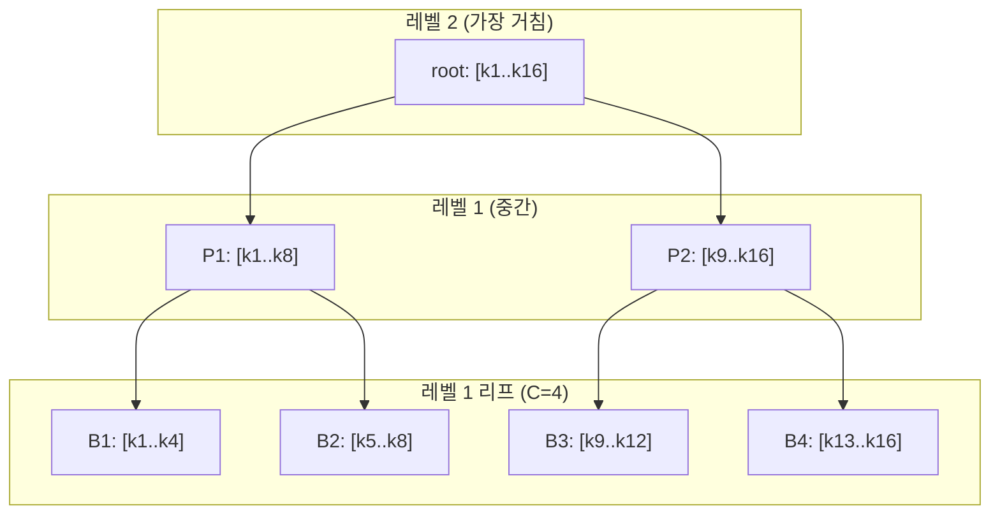

[논문 링크](https://arxiv.org/abs/2609.31093v1)
## PISA: 피라미드 Top-$K$ 선택으로 블록 스파스 어텐션의 비용을 $O(N\log N)$으로 낮추다

> **TL;DR** — 블록 스파스 어텐션에서 '어텐션 계산'은 선형이지만 '블록 선택'이 여전히 이차 비용이라는 문제를, 키(key)를 평균 풀링으로 피라미드 계층화하고 각 레벨에서 LogSumExp(LSE) 점수로 후보를 좁혀가는 방식으로 해결한다. 프리필(prefill) 선택 비용이 $O(N\log N)$, 디코드(decode)는 $O(\log N)$로 떨어지며, 256K 토큰에서 기존 BSA 대비 최대 $9.95\times$의 선택 지연 속도 향상을 보인다.

---

## 핵심 아이디어

PISA(**Py**ram**i**d **S**parse **A**ttention)는 블록 스파스 어텐션의 두 단계 중 병목이던 **Top-$K$ 블록 선택**을 재설계한다. 기존 블록 스파스 어텐션(BSA)은 모든 쿼리–블록 쌍을 점수화한 뒤 상위 $K$개를 고르는데, 이 단계만으로도 $O(N^2/C)$의 비용이 든다(근거: §1). PISA는 키 블록을 평균 풀링으로 계층화해 **거친(coarse) 레벨에서 후보를 좁히고, 선택된 후보만 더 미세한(fine) 레벨로 확장**한다(근거: §3.2). 각 레벨에서 평가하는 후보 수가 유계(bounded)이므로, 쿼리당 선택 비용이 $O(\log N)$이 되고 전체 프리필은 $O(N\log N)$으로 떨어진다(근거: §3.4, Table 1).

핵심 설계는 세 가지다. **① 피라미드 계층**: 블록 크기 $C=64$, 분기 계수 $g=2$로 키를 상향 집계한다. **② LSE 점수**: 후보 블록을 단순 평균이나 평균+분산으로 근사하는 대신 $\log\sum\exp(\cdot)$의 정확한 LSE로 점수화한다. **③ 하드웨어 인지 커널**: Triton으로 계층 라우팅과 LSE 점수를 단일 커널에 융합하고, 학습/프리필은 2단계 커널, 디코드는 1단계 커널을 쓴다(근거: §3.3, Algorithm 1).

---

## 배경: 그들이 해결한 문제

셀프 어텐션의 비용은 시퀀스 길이 $N$에 대해 이차로 증가해, 긴 문맥으로의 확장을 가로막는다(근거: §1). 블록 스파스 어텐션은 쿼리가 전체 키가 아니라 선택된 일부 키 블록만 보도록 제한해 이 문제를 우회한다. 블록 단위로 묶으면 타일(tiled) 커널을 쓸 수 있어 효율적이다(근거: §1).

블록 스파스 어텐션은 크게 두 단계로 나뉜다(근거: §3.1):

1. **Top-$K$ 블록 선택** — 각 쿼리가 어떤 키 블록을 볼지 결정
2. **선택된 블록 위의 어텐션 계산** — 원본 키/밸류를 사용

문제는 2단계가 아니라 1단계에 있다. 쿼리가 최대 $KC$개 키만 보기 때문에 어텐션 계산은 시퀀스에 대해 선형이지만, **선택 단계는 여전히 모든 쿼리가 모든 키 블록을 훑어야** 하므로 $O(N^2/C)$로 남는다(근거: §1, §3.1). 즉 선택이 장문맥 모델링의 실제 병목이라는 것이 이 논문이 지목한 연구 공백이다.

저자들은 이 지점에서 자신들의 위치를 명확히 한다. HiP 같은 기존 계층적 방법은 학습이 불가능하고(training-free), NSA·HiLS 같은 학습 가능한 방법들은 여전히 프리필 복잡도가 $O(N^2)$다. 학습 가능하면서 프리필 $O(N\log N)$·디코드 $O(\log N)$를 동시에 달성하는 것은 PISA가 유일하다(근거: Table 1, §2).

---

## 새로운 접근법: PISA (Pyramid Sparse Attention)

### 3.1 키 블록의 피라미드 구성

키 블록 계층은 **미세 → 거친(fine-to-coarse)** 방향으로 구성된다(근거: §3.2). 레벨 $0$은 원본 키의 싱글턴 블록이고, 레벨 $1$은 블록 크기 $C=64$의 리프 블록, 이후 각 레벨은 인접한 $g=2$개의 하위 블록을 이어붙여 형성한다. 각 블록의 요약(summary) 벡터 $\bar{k}_i^{(\ell)}$는 하위 요약들의 **평균 풀링**으로 재귀적으로 계산된다:

$$
\bar{k}_i^{(\ell+1)} = \frac{1}{|\operatorname{Ch}_\ell(i)|} \sum_{r\in\operatorname{Ch}_\ell(i)} \bar{k}_r^{(\ell)}
$$

여기서 $\operatorname{Ch}_\ell(i)$는 레벨 $\ell$ 블록 $i$의 자식 인덱스 집합이다(근거: §3.2, Eq. mean_pyramid). 다운샘플링이므로 레벨 수는 $L=O(\log N)$이다(근거: §3.4).

### 3.2 거친 레벨에서 미세 레벨로의 선택

선택은 가장 거친 레벨 $L$에서 시작해 리프 레벨 $1$로 내려간다(근거: §3.2). 각 레벨 $\ell$에서:

1. 후보 집합 $\mathcal{A}_t^{(\ell)}$에 대해 LSE 점수 $\mathbf{s}_t^{(\ell)}$를 계산
2. 상위 $K$개 블록 $\mathcal{I}_t^{(\ell)}$만 유지
3. 선택된 블록의 자식들로 다음 레벨의 후보 집합 $\mathcal{A}_t^{(\ell-1)}$을 구성

각 선택 블록은 최대 $g$개의 자식만 가지므로, 다음 레벨의 후보 수는 최대 $gK$로 유계된다(근거: §3.2, Eq. candidate_bound). 이것이 이차 비용을 로그-선형으로 떨어뜨리는 핵심이다.

### 3.3 LSE 점수: 왜 단순 평균이 아니라 LSE인가

후보 블록 $K_i^{(\ell)}$의 점수는 자식 요약들에 대한 **정확한 LogSumExp**로 정의된다(근거: §3.2):

$$
s_{t,i}^{(\ell)} = \log\sum_{r\in\operatorname{Ch}_{\ell-1}(i)} \exp\!\left(\frac{q_t^\top \bar{k}_r^{(\ell-1)}}{\sqrt{d}}\right)
$$

이 선택의 이유를 저자는 Taylor 전개로 설명한다. LSE는 $z_1,\dots,z_m$의 평균 $\bar{z}$, 분산 $\operatorname{Var}(z)$에 대해 다음으로 전개된다(근거: §4.4, Appendix A):

$$
\log\sum_{j=1}^{m}e^{z_j} = \log m + \bar z + \tfrac12\operatorname{Var}(z) + \text{고차항}
$$

즉 저자들이 비교한 두 변형은 이 전개의 절단 버전이다(근거: §4.4):

- **PISA-1**: 1차 근사 → 평균 $\bar{z}$만 사용
- **PISA-2**: 2차 근사 → $\bar{z} + \tfrac12\operatorname{Var}(z)$ 사용
- **PISA (본 방법)**: 전개를 자르지 않고 전체 LSE 사용

Appendix A의 Jensen 부등식 분석에 따르면, 중간 블록을 자식 평균들의 LSE로 점수화하는 것은 자식 평균의 평균(PISA-1)보다 원본 키 LSE에 항상 더 가깝다(근거: Appendix A).

### 3.4 하드웨어 인지 커널

PISA는 GQA 그룹 내 쿼리 헤드가 같은 키 블록을 공유하도록 하며, 학습/프리필과 디코드를 다른 커널로 처리한다(근거: §3.3, Algorithm 1):

- **학습/프리필 — 2단계 커널**: 1단계에서 중간 레벨의 계층 선택을 수행하고, 2단계에서 원본 키 블록을 점수화한다. 2단계에서는 같은 키 블록을 여러 쿼리가 재사용하도록 쿼리를 타일($Q_{\mathrm{tile}}=4$)로 묶어 IO를 줄인다. $G_Q=16$, $C=64$일 때 $G_Q + C/Q_{\mathrm{tile}} = 32 < 64 = C$이므로 단일 단계보다 리프 레벨 IO가 낮다(근거: §3.4).
- **디코드 — 1단계 커널**: 디코드는 쿼리가 하나뿐이라 교차 쿼리 재사용이 없으므로, 여러 커널을 띄우는 오버헤드를 피하기 위해 $\ell=1$까지 한 커널에서 처리한다. 평균 피라미드를 캐시하고 새 토큰에 대해 현재 리프 평균과 조상 경로만 갱신한다(근거: §3.3, Appendix B).

전 과정에서 **쿼리–키 점수 행렬을 구체화(materialize)하지 않는다**는 점이 메모리 트래픽 측면의 강점이다(근거: §1).

---

## 작동 원리: 구체적인 예시로 살펴보기

> 아래는 이해를 돕기 위한 **설명용 예시**로, 논문의 실제 실험 세팅($C=64$, $K=8/32$, $g=2$)과는 무관한 축소된 숫자다.

키 $k_1,\dots,k_{16}$이 있고 블록 크기 $C=4$, 분기 계수 $g=2$라고 하자. 피라미드는 세 레벨로 쌓인다.

블록 예산 $K=1$이라면 선택은 아래와 같이 진행된다(근거: §3.2, Eq. hierarchical_topk).

| 단계 | 레벨 | 후보 집합 $\mathcal{A}$ | 점수화 대상 | 결과 |
|---|---|---|---|---|
| 초기화 | 2 | `{root}` | (후보 ≤ K라 점수 생략) | root 유지 |
| 확장 | 2→1 | `{P1, P2}` | P1, P2를 자식 요약의 LSE로 점수 | P1 선택 |
| 확장 | 1→리프 | `{B1, B2}` | B1, B2를 원본 키의 정확한 LSE로 점수 | B1 선택 |
| 어텐션 | — | `{B1}` | — | 키 $k_1..k_4$에만 어텐션 |

핵심은 **각 레벨에서 '전체'가 아니라 '이전 레벨에서 살아남은 후보'만 점수화**한다는 점이다. 레벨이 내려갈수록 블록 수는 두 배로 늘지만, 점수화 대상은 최대 $gK$개로 고정된다(근거: §3.2). 이 때문에 시퀀스가 길어져 레벨이 $O(\log N)$개 늘어나도, 쿼리당 점수화 횟수는 $O(\log N)$에 머문다.

중요한 뉘앙스는 **중간 레벨은 '요약의 LSE', 리프 레벨은 '원본 키의 LSE'**라는 점이다. 중간 블록을 원본 키 전체로 점수화하면 그 자체로 이차 비용이 되므로, 요약으로 근사하고 최종 리프에서만 원본 키를 정확히 읽는다(근거: §3.2, Appendix A).

---

## 성능 검증: 주요 결과

실험은 418M·1.47B·2.67B 세 스케일의 디코더 전용 백본을 100B 토큰 @ 4K로 처음부터 학습하고, 이후 10B 토큰 @ 16K로 지속 사전학습(CPT)한다. 스파스 방법들은 블록 크기 $C=64$를 공유하고, 블록 예산은 사전학습 $K=8$, CPT $K=32$를 쓴다(근거: §4.1).

### 5.1 언어 모델링과 다운스트림 성능

처음부터 학습(100B @ 4K) 후, PISA는 BSA·NSA·HiLS와 **언어 모델링·상식 추론에서 동등 수준**을 보이며, **여섯 개 컨테인먼트(검색) 과제의 평균 정확도는 세 스케일 모두에서 스파스 방법 중 최고**를 기록했다(근거: §4.2, Table 2). 다만 Full Attention이 여전히 평균은 더 높다(근거: §4.2).

| 스케일 | PISA 손실 ↓ | BSA 손실 ↓ | 컨테인먼트 평균 (PISA) | 컨테인먼트 평균 (BSA) |
|---|---:|---:|---:|---:|
| 418M | 2.5630 | 2.5684 | **41.77** | 38.18 |
| 1.47B | 2.3162 | 2.3179 | **49.83** | 48.54 |
| 2.67B | 2.2151 | 2.2184 | **52.14** | 51.13 |

> 손실이 낮을수록, 정확도가 높을수록 좋다. 수치는 Table 2(§4.2)에서 발췌.

이 결과는 "계층 선택이 계산 복잡도를 낮추면서도 다운스트림 모델링에 필요한 블록은 보존한다"는 주장의 근거다(근거: §1, §4.2).

### 5.2 장문맥 검색 (RULER)

CPT(16K) 후 2.67B 모델로 RULER의 네 needle-in-a-haystack 과제군을 평가했다. PISA는 평균 정확도 **62.80**으로 BSA(54.99)와 NSA(61.07)를 앞섰고, PISA-2 변형이 62.92로 스파스 최고였다(근거: Table 3, §4.3).

특히 PISA는 **multi-key**(1K·2K)와 **multi-value**(1K·2K·4K)에서 스파스 방법 중 최고 정확도를 보였지만, 8K·16K의 긴 길이에서는 NSA가 단일·멀티키 과제에서 앞섰다(근거: Table 3). 즉 PISA의 강점은 장문맥 전 구간이 아니라 특정 과제·길이에 집중된다는 점을 함께 읽어야 한다.

### 5.3 블록 선택 품질 (오라클 진단)

Full-Attention 체크포인트의 쿼리·키로 모든 선택기를 재생해, 실제 풀 어텐션 질량과 얼마나 일치하는지를 측정했다(근거: §4.4, Appendix D). $K=8$ 기준:

| 선택기 | Recall@8 ↑ | 캡처 질량 ↑ | 어텐션 질량비 ↑ |
|---|---:|---:|---:|
| BSA | 85.91 | 85.67 | 98.42 |
| PISA-1 (평균) | 84.75 | 85.50 | 98.22 |
| PISA-2 (평균+분산) | 88.24 | 86.13 | 99.02 |
| **PISA (LSE)** | **90.95** | **86.47** | **99.46** |

PISA가 세 지표 모두 최고이며, 선택된 블록이 풀 어텐션 참조가 담는 질량의 99.46%를 회수한다(근거: §4.4, Appendix D). 이는 LSE 점수가 더 정확한 Top-$K$ 선택을 만든다는 직접 증거다. 재미있는 점은 PISA-1(단순 평균)이 BSA보다도 낮다는 것으로, "점수의 정확도"가 실제 성능 차이로 이어진다는 점을 보여준다.

### 5.4 선택 지연 (커널 마이크로벤치마크)

프리필 블록 선택 지연을 4K~256K에서 측정했다(근거: §4.5, Table 6/Appendix B). 여기서 가장 중요한 통찰은 **짧은 길이에서는 BSA가 더 빠르다는 것**이다.

| $N$ | BSA (ms) | PISA Q4 (ms) | PISA 대비 BSA 속도 |
|---:|---:|---:|---:|
| 4K | **0.167** | 0.701 | BSA $4.2\times$ 우세 |
| 16K | **1.461** | 1.581 | BSA 우세 |
| 32K | 5.099 | **3.185** | PISA 우세 |
| 64K | 19.144 | **6.704** | PISA $2.86\times$ |
| 128K | 76.682 | **14.452** | PISA $5.31\times$ |
| 256K | 312.956 | **31.441** | PISA $9.95\times$ |

> 수치는 Appendix B(Table, kernel_grouped_benchmark)와 §4.5의 서술에서 발췌. 배치 1, 32 쿼리 헤드, 2 KV 헤드, $d=64$, $C=64$, $K=8$, $g=2$, BF16.

이 교차점(crossover)이 이 논문의 핵심 메시지를 요약한다. PISA의 이점은 **점근적(asymptotic)**이다. 상수 오버헤드(계층 구성, 다단계 확장) 때문에 16K 이하에서는 BSA가 앞서지만, 길이가 길어질수록 $O(N^2)$ 선택의 BSA가 기하급수적으로 느려지는 반면 $O(N\log N)$의 PISA는 완만하게 증가한다(근거: §4.5).

---

## 우리의 관점: 강점, 한계, 그리고 이 연구가 중요한 이유

### 강점

가장 큰 기여는 **문제를 정확히 다시 정의한 것**이다. 기존 블록 스파스 문헌이 '어텐션 계산의 이차 비용'에 집중한 반면, PISA는 "선택 단계 자체가 $O(N^2/C)$로 남아 병목"임을 지적하고 그 병목을 직접 공략했다(근거: §1). 두 번째 강점은 **LSE 점수의 정당화**다. 단순히 LSE를 쓰는 것이 아니라 Taylor 전개와 Jensen 부등식으로 평균/평균+분산 근사보다 왜 우월한지 이론적으로 뒷받침했다(근거: §4.4, Appendix A). 세 번째는 **엔지니어링의 정직함**이다. 저자들은 커널을 학습/프리필용 2단계와 디코드용 1단계로 나눈 이유를 리프 레벨 Q/K IO 비용의 부등식으로 설명하고, 짧은 길이에서 BSA가 더 빠르다는 사실까지 숨기지 않았다(근거: §3.4, §4.5).

### 한계: 저자가 인정한 것

저자들은 명시적으로 **모델 규모와 사전학습 데이터 예산이 컴퓨팅 제약으로 제한**되었음을 인정하며, 이것이 성능과 베이스라인 대비 상대 이득에 영향을 줄 수 있다고 밝힌다(근거: Appendix E, Limitations). 실제로 실험은 최대 2.67B 모델, 100B 토큰 수준에 그쳐, 수십~수백 B 규모의 실전 LLM에서 이득이 유지될지는 열린 문제다.

### 한계: 리뷰어로서의 추론

몇 가지 주의할 지점이 있다.

1. **상수 오버헤드와 교차점**. PISA는 16K 이하에서 BSA보다 느리다(근거: §4.5). 실제 서비스 문맥(대개 4K~128K)에서 어느 쪽이 유리한지는 교차점 위치에 민감하고, 이 교차점은 하드웨어·커널 구현에 따라 달라진다.
2. **성능 우위의 폭**. 언어 모델링·상식 추론에서는 '동등 수준'이고, 명확한 우위는 컨테인먼트 평균(스파스 중 최고)과 선택 품질 지표에 집중된다(근거: §4.2). 장문맥 RULER에서도 8K·16K의 특정 과제는 NSA가 앞선다(근거: Table 3). 즉 "전 구간 우위"가 아니라 "특정 조건에서의 우위"다.
3. **GQA 그룹 점수화의 근사**. 쿼리 헤드 LSE 합산과 풀 어텐션 질량 평균은 순위가 다를 수 있음을 저자 스스로 지적한다(근거: Appendix A, gqa_objective). 이는 이론상 불일치의 원천이다.
4. **피라미드 캐시 비용**. 디코드는 평균 피라미드를 캐시하고 길이 2배마다 버퍼를 확장하는데, 총 복사 비용은 $O((N/C)d\log N)$다(근거: Appendix B). 평균 $O(\log N)$이 유지되지만, 이 캐시가 KV 캐시와 별도로 VRAM을 차지한다는 점은 추론 시점의 메모리 회계에서 고려해야 한다.

### 이 연구가 중요한 이유

결국 PISA는 "스파스 어텐션의 선택 단계"를 복잡도 관점에서 한 단계 낮춘 진전이다. 학습 가능한 방법 중 프리필 $O(N\log N)$·디코드 $O(\log N)$를 함께 달성한 점, 그리고 그 복잡도가 실제 커널로 구현되어 256K에서 $9.95\times$ 속도 향상으로 검증된 점(근거: Table 1, §4.5)은 장문맥 모델링의 병목을 한층 더 뒤로 밀어낸 의미가 있다.

---

## 다음 단계는?: 앞으로의 길

저자가 명시적으로 제안한 향후 방향은 따로 없지만, 한계를 고려하면 합리적인 다음 단계는 다음과 같다.

1. **규모 확장 검증**: 7B 이상, 수 조 토큰 규모에서 $O(N\log N)$ 선택의 이득과 품질 손실이 유지되는지 확인하는 것이 가장 시급하다(근거: Appendix E의 한계 서술과 연결).
2. **교차점 전진**: BSA보다 느린 4K~16K 구간의 상수 오버헤드(계층 구성·다단계 확장)를 줄여 실용 문맥에서의 우위를 앞당기는 커널 최적화.
3. **추론 서빙 통합**: 디코드 피라미드 캐시의 VRAM 오버헤드와 PagedAttention류 시스템과의 결합 가능성을 정량화하는 후속 연구.
4. **점수 이론의 확장**: LSE가 평균/평균+분산 근사보다 우월함을 보였으므로, GQA 그룹 점수화의 불일치(근거: Appendix A)를 해소하는 더 정확한 집계 규칙의 탐색.

요컨대 PISA는 '선택을 더 싸게 만드는 것'이 곧 '장문맥을 더 실용적으로 만드는 것'임을 보여준 깔끔한 연구다. 다음 스텝은 이 로그-선형 선택이 실전 규모의 LLM과 서빙 시스템에서도 그 약속을 지키는지 확인하는 일이다.

<!-- verbatim-tables -->

## 논문 원문의 표

> arXiv e-print 의 LaTeX 원본에서 기계적으로 옮긴 표입니다. 숫자는 논문의 값이며 모델을 거치지 않았습니다.

**표 1. Training settings and computational complexity of selected sparse attention methods. $N$ denotes the sequence length. Complexities include selection and attention computation. $\checkmark$ denotes trainable, and $\times$ denotes a training-free method. For LLSA , which is designed for diffusion models, the listed cost is per attention pass rather than autoregressive prefill.**

| Method | Trainable | Prefill complexity | Decode complexity |
|---|---|---|---|
| HiP | $\times$ | $O(N\log N)$ | $O(\log N)$ |
| HISA | $\times$ | $O(N^2)$ | $O(N)$ |
| MoBA | $\checkmark$ | $O(N^2)$ | $O(N)$ |
| NSA | $\checkmark$ | $O(N^2)$ | $O(N)$ |
| HiLS | $\checkmark$ | $O(N^2)$ | $O(N)$ |
| LLSA | $\checkmark$ | $O(N\log N)$ | --- |
| BSA\xspace | $\checkmark$ | $O(N^2)$ | $O(N)$ |
| **PISA\xspace** (ours) | $\checkmark$ | $O(N\log N)$ | $O(\log N)$ |

**표 2. Language modeling and downstream evaluation after 100B tokens of pretraining at 4K. Baselines include NSA and HiLS . Loss is the final training loss, and accuracies are reported as percentages. Gray columns show group averages; boldface marks the best sparse loss and group averages at each scale.**

| Method | Params | Loss$\downarrow$ | Perplexity Wiki.ppl$\downarrow$ | Perplexity LMB.ppl$\downarrow$ | Perplexity Avgppl$\downarrow$ | Multiple-choice BoolQacc$\uparrow$ | Multiple-choice PIQAacc$\uparrow$ | Multiple-choice Hella.acc-n$\uparrow$ | Multiple-choice Wino.acc$\uparrow$ | Multiple-choice ARC-eacc$\uparrow$ | Multiple-choice ARC-cacc-n$\uparrow$ | Multiple-choice OBQAacc-n$\uparrow$ | Multiple-choice SIQAacc$\uparrow$ | Multiple-choice Avgacc$\uparrow$ | Containment SWDEacc$\uparrow$ | Containment SQuADacc$\uparrow$ | Containment FDAacc$\uparrow$ | Containment TQAacc$\uparrow$ | Containment NQacc$\uparrow$ | Containment DROPacc$\uparrow$ | Containment Avgacc$\uparrow$ |
|---|---|---|---|---|---|---|---|---|---|---|---|---|---|---|---|---|---|---|---|---|---|
| *From-scratch training, 418M* |  |  |  |  |  |  |  |  |  |  |  |  |  |  |  |  |  |  |  |  |  |
| Full attention | 418M | 2.5557 | 20.40 | 25.60 | 23.00 | 53.64 | 68.93 | 47.57 | 55.01 | 64.35 | 32.00 | 32.40 | 39.00 | 49.11 | 66.16 | 40.95 | 60.25 | 56.64 | 24.33 | 22.57 | 45.15 |
| NSA | 420M | 2.5727 | 21.46 | 26.13 | 23.80 | 60.43 | 68.82 | 47.04 | 53.51 | 63.97 | 31.48 | 33.80 | 40.38 | 49.93 | 48.51 | 38.40 | 41.11 | 55.33 | 22.84 | 18.59 | 37.46 |
| HiLS | 423M | **2.5596** | 20.83 | 26.67 | 23.75 | 58.99 | 70.67 | 47.28 | 54.14 | 65.11 | 31.48 | 35.00 | 40.69 | 50.42 | 52.03 | 39.01 | 53.27 | 55.98 | 23.09 | 21.37 | 40.79 |
| BSA\xspace | 418M | 2.5684 | 21.47 | 25.02 | 23.25 | 57.92 | 69.59 | 47.65 | 53.35 | 65.32 | 29.78 | 34.60 | 38.79 | 49.63 | 52.30 | 40.48 | 37.57 | 53.97 | 23.34 | 21.42 | 38.18 |
| PISA-1\xspace | 418M | 2.5683 | 21.53 | 24.94 | 23.23 | 55.38 | 68.72 | 47.85 | 54.46 | 64.23 | 31.91 | 33.00 | 39.30 | 49.36 | 52.30 | 39.11 | 45.64 | 55.39 | 21.79 | 21.18 | 39.24 |
| PISA-2\xspace | 418M | 2.5663 | 21.31 | 24.78 | 23.04 | 53.12 | 69.26 | 47.32 | 55.01 | 65.66 | 30.29 | 37.60 | 39.66 | 49.74 | 53.11 | 39.21 | 54.45 | 54.92 | 23.95 | 20.17 | 40.97 |
| PISA\xspace | 418M | 2.5630 | 21.17 | 24.91 | **23.04** | 58.41 | 69.80 | 47.52 | 55.25 | 65.19 | 32.51 | 36.00 | 39.51 | **50.52** | 57.07 | 38.81 | 54.81 | 56.16 | 23.79 | 19.98 | **41.77** |
| *From-scratch training, 1.47B* |  |  |  |  |  |  |  |  |  |  |  |  |  |  |  |  |  |  |  |  |  |
| Full attention | 1.47B | 2.3155 | 15.33 | 13.31 | 14.32 | 56.33 | 73.39 | 58.37 | 58.56 | 71.89 | 38.48 | 40.80 | 42.48 | 55.04 | 75.97 | 43.80 | 74.68 | 63.86 | 30.54 | 23.91 | 52.13 |
| NSA | 1.47B | 2.3142 | 15.70 | 11.93 | **13.82** | 62.60 | 74.05 | 58.98 | 60.14 | 73.82 | 38.65 | 42.40 | 41.91 | **56.57** | 68.68 | 42.29 | 59.71 | 62.74 | 28.25 | 22.14 | 47.30 |
| HiLS | 1.48B | **2.3084** | 15.42 | 12.72 | 14.07 | 60.31 | 73.99 | 58.79 | 59.27 | 73.32 | 39.76 | 39.60 | 41.61 | 55.83 | 68.50 | 44.77 | 65.06 | 63.15 | 27.78 | 21.99 | 48.54 |
| BSA\xspace | 1.47B | 2.3179 | 15.63 | 12.95 | 14.29 | 58.26 | 74.54 | 59.30 | 59.59 | 72.35 | 37.97 | 41.60 | 41.04 | 55.58 | 68.32 | 43.10 | 64.88 | 63.09 | 27.65 | 24.20 | 48.54 |
| PISA-1\xspace | 1.47B | 2.3215 | 15.77 | 13.38 | 14.58 | 60.95 | 73.72 | 58.46 | 58.72 | 72.60 | 39.08 | 40.20 | 41.10 | 55.60 | 67.96 | 43.90 | 56.53 | 63.51 | 29.27 | 23.24 | 47.40 |
| PISA-2\xspace | 1.47B | 2.3168 | 15.59 | 12.90 | 14.24 | 62.97 | 73.39 | 58.84 | 57.06 | 71.25 | 38.23 | 39.20 | 40.48 | 55.18 | 69.67 | 45.04 | 67.42 | 63.03 | 29.24 | 24.34 | 49.79 |
| PISA\xspace | 1.47B | 2.3162 | 15.58 | 13.27 | 14.43 | 62.94 | 73.83 | 58.91 | 58.33 | 72.14 | 40.19 | 40.00 | 41.35 | 55.96 | 71.83 | 43.93 | 69.24 | 63.27 | 29.17 | 21.56 | **49.83** |
| *From-scratch training, 2.67B* |  |  |  |  |  |  |  |  |  |  |  |  |  |  |  |  |  |  |  |  |  |
| Full attention | 2.67B | 2.2209 | 13.74 | 10.81 | 12.28 | 64.50 | 74.86 | 62.37 | 62.12 | 74.92 | 43.77 | 42.00 | 41.30 | 58.23 | 77.23 | 46.01 | 75.23 | 64.75 | 30.92 | 23.91 | 53.01 |
| NSA | 2.68B | 2.2098 | 13.76 | 9.89 | **11.83** | 62.91 | 74.86 | 63.38 | 61.88 | 75.21 | 43.94 | 42.80 | 42.73 | 58.46 | 74.35 | 45.54 | 61.07 | 66.05 | 30.73 | 23.48 | 50.20 |
| HiLS | 2.70B | **2.2047** | 13.67 | 10.19 | 11.93 | 62.20 | 74.92 | 63.41 | 60.06 | 76.09 | 43.60 | 42.20 | 42.53 | 58.13 | 70.75 | 45.17 | 73.41 | 66.29 | 30.85 | 23.24 | 51.62 |
| BSA\xspace | 2.67B | 2.2184 | 13.87 | 10.34 | 12.11 | 64.92 | 74.76 | 63.42 | 61.48 | 76.14 | 41.81 | 42.60 | 43.71 | **58.61** | 72.46 | 45.64 | 67.24 | 66.53 | 30.16 | 24.72 | 51.13 |
| PISA-1\xspace | 2.67B | 2.2179 | 13.96 | 10.36 | 12.16 | 62.75 | 74.37 | 63.24 | 62.12 | 76.09 | 41.98 | 42.00 | 42.58 | 58.14 | 70.66 | 44.81 | 68.06 | 64.87 | 30.73 | 26.11 | 50.87 |
| PISA-2\xspace | 2.67B | 2.2152 | 13.88 | 10.30 | 12.09 | 62.08 | 74.81 | 63.29 | 60.62 | 76.18 | 42.75 | 42.00 | 42.94 | 58.08 | 72.01 | 46.62 | 72.87 | 65.70 | 30.98 | 24.10 | 52.05 |
| PISA\xspace | 2.67B | 2.2151 | 13.83 | 10.36 | 12.10 | 61.25 | 75.19 | 63.23 | 60.85 | 75.51 | 43.94 | 42.20 | 42.63 | 58.10 | 75.07 | 45.95 | 69.78 | 65.58 | 31.42 | 25.06 | **52.14** |

**표 3. RULER needle-in-a-haystack results after 10B tokens of continued pretraining at 16K for the 2.67B models. Sparse methods use $C=64$ and $K=32$. Scores are accuracies in percent. The gray Avg column averages scores over the four task families at 1K, 2K, 4K, 8K, and 16K, before rounding. Boldface marks the best sparse result in each column.**

| Size | Method | `niah_single` 1K | `niah_single` 2K | `niah_single` 4K | `niah_single` 8K | `niah_single` 16K | `niah_multikey` 1K | `niah_multikey` 2K | `niah_multikey` 4K | `niah_multikey` 8K | `niah_multikey` 16K | `niah_multiquery` 1K | `niah_multiquery` 2K | `niah_multiquery` 4K | `niah_multiquery` 8K | `niah_multiquery` 16K | `niah_multivalue` 1K | `niah_multivalue` 2K | `niah_multivalue` 4K | `niah_multivalue` 8K | `niah_multivalue` 16K | Avg $\uparrow$ |
|---|---|---|---|---|---|---|---|---|---|---|---|---|---|---|---|---|---|---|---|---|---|---|
| 2.67B | Full Attention | 99.67 | 99.60 | 99.47 | 99.13 | 98.80 | 43.33 | 38.40 | 34.67 | 28.00 | 23.13 | 85.60 | 72.45 | 50.05 | 51.55 | 34.85 | 90.15 | 84.55 | 77.05 | 57.10 | 57.20 | 66.24 |
|  | NSA | **99.93** | 99.53 | **99.33** | **97.47** | **91.67** | 57.47 | 52.00 | **40.67** | **18.00** | **15.20** | 72.60 | 79.85 | 32.65 | 50.10 | 24.20 | 83.80 | 69.55 | 59.85 | 48.65 | **28.90** | 61.07 |
|  | BSA\xspace | 99.20 | 98.40 | 93.60 | 85.33 | 59.67 | 37.33 | 32.20 | 20.87 | 13.40 | 7.13 | 80.75 | 69.85 | 66.85 | 37.90 | 15.10 | 83.80 | 75.15 | 63.45 | 38.15 | 21.70 | 54.99 |
|  | PISA-1\xspace | 99.87 | **99.73** | 97.33 | 81.87 | 60.27 | 66.80 | **53.40** | 39.40 | 12.60 | 9.93 | **93.40** | **89.90** | 73.75 | 38.50 | 21.70 | 83.30 | 82.95 | **70.50** | 38.15 | 20.45 | 61.69 |
|  | PISA-2\xspace | 99.47 | 99.33 | 99.00 | 90.00 | 72.40 | 51.13 | 40.00 | 27.20 | 13.13 | 9.33 | 91.45 | 86.95 | 77.85 | **59.55** | **25.20** | 89.60 | 81.25 | 69.60 | **52.55** | 23.30 | **62.92** |
|  | PISA\xspace | 99.07 | 94.60 | 96.33 | 91.47 | 71.27 | **68.20** | 52.33 | 32.47 | 13.53 | 10.00 | 88.65 | 85.35 | **79.00** | 48.50 | 20.85 | **93.40** | **87.10** | 58.60 | 43.95 | 21.30 | 62.80 |

**표 4. From-scratch training configuration.**

| Field | 418M | 1.47B | 2.67B |
|---|---|---|---|
| Layers | 24 | 24 | 32 |
| Model dimension | 1024 | 2048 | 2560 |
| MLP dimension | 2816 | 5632 | 6912 |
| Query heads / KV heads | 32 / 2 | 32 / 2 | 32 / 2 |
| Head dimension | 64 | 128 | 128 |
| Sequence length | 4096 | 4096 | 4096 |
| Per-device batch / accumulation | 8 / 2 | 4 / 2 | 4 / 2 |
| Training steps / warm-up | 100K / 1K | 100K / 1K | 100K / 1K |
| Training budget (B tokens) | 100 | 100 | 100 |
| Peak LR | $3\times10^{-4}$ | $3\times10^{-4}$ | $3\times10^{-4}$ |
| Seed | 42 | 42 | 42 |
| Optimizer | AdamW, $\beta=(0.9,0.95)$, $\epsilon=10^{-8}$, weight decay $0.1$ |  |  |
| LR schedule | 1K linear warm-up; 90K plateau; 9K square-root decay to $0.1\times$ peak |  |  |
| Gradient clipping | global norm $1.0$ |  |  |
| FSDP precision | bfloat16 parameters, FP32 reductions |  |  |

**표 5. Training loss and downstream performance for the 1.47B and 2.67B models after 10B tokens of continued pretraining at 16K. Sparse methods, including NSA , use $C=64$ and $K=32$. Loss is the final training loss. Gray columns show group averages; the containment average covers SWDE, SQuAD Completion, and FDA. The block budget does not apply to Full Attention.**

| Method | Params | $K$ | Loss$\downarrow$ | Perplexity Wiki.ppl$\downarrow$ | Perplexity LMB.ppl$\downarrow$ | Perplexity Avgppl$\downarrow$ | Multiple-choice BoolQacc$\uparrow$ | Multiple-choice PIQAacc$\uparrow$ | Multiple-choice Hella.acc-n$\uparrow$ | Multiple-choice Wino.acc$\uparrow$ | Multiple-choice ARC-eacc$\uparrow$ | Multiple-choice ARC-cacc-n$\uparrow$ | Multiple-choice OBQAacc-n$\uparrow$ | Multiple-choice SIQAacc$\uparrow$ | Multiple-choice Avgacc$\uparrow$ | Containment SWDEacc$\uparrow$ | Containment SQuADacc$\uparrow$ | Containment FDAacc$\uparrow$ | Containment Avgacc$\uparrow$ |
|---|---|---|---|---|---|---|---|---|---|---|---|---|---|---|---|---|---|---|---|
| *10B CPT, 1.47B* |  |  |  |  |  |  |  |  |  |  |  |  |  |  |  |  |  |  |  |
| Full Attention | 1.47B | -- | 1.6993 | 13.33 | 10.04 | 11.69 | 51.65 | 73.99 | 58.28 | 57.85 | 71.55 | 38.05 | 41.00 | 40.28 | 54.08 | 76.87 | 46.68 | 75.14 | 66.23 |
| NSA | 1.47B | 32 | 1.6990 | 13.42 | 9.67 | 11.55 | 63.82 | 73.61 | 58.47 | 59.67 | 72.47 | 37.97 | 42.60 | 40.23 | 56.11 | 74.44 | 44.84 | 72.23 | 63.84 |
| BSA\xspace | 1.47B | 32 | 1.7039 | 13.36 | 9.92 | 11.64 | 56.45 | 74.32 | 58.64 | 59.35 | 71.51 | 37.37 | 40.00 | 40.84 | 54.81 | 76.06 | 44.54 | 79.04 | 66.55 |
| PISA-1\xspace | 1.47B | 32 | 1.7042 | 13.45 | 9.95 | 11.70 | 59.57 | 73.39 | 58.32 | 58.88 | 71.04 | 37.20 | 40.00 | 40.17 | 54.82 | 74.44 | 44.27 | 71.05 | 63.25 |
| PISA-2\xspace | 1.47B | 32 | 1.7007 | 13.38 | 9.81 | 11.59 | 63.39 | 73.39 | 58.77 | 57.06 | 70.71 | 38.31 | 40.60 | 39.76 | 55.25 | 72.19 | 46.45 | 73.32 | 63.99 |
| PISA\xspace | 1.47B | 32 | 1.7010 | 13.37 | 9.99 | 11.68 | 61.59 | 74.32 | 58.38 | 57.93 | 71.30 | 39.93 | 41.40 | 40.99 | 55.73 | 74.89 | 45.41 | 75.68 | 65.33 |
| *10B CPT, 2.67B* |  |  |  |  |  |  |  |  |  |  |  |  |  |  |  |  |  |  |  |
| Full Attention | 2.67B | -- | 1.6312 | 11.96 | 8.12 | 10.04 | 64.98 | 75.19 | 62.71 | 61.25 | 74.54 | 42.49 | 41.80 | 40.28 | 57.91 | 77.23 | 48.19 | 75.41 | 66.94 |
| NSA | 2.68B | 32 | 1.6243 | 11.77 | 7.70 | 9.73 | 65.90 | 75.03 | 63.31 | 60.46 | 73.57 | 41.98 | 42.00 | 41.56 | 57.98 | 79.84 | 48.83 | 75.68 | 68.12 |
| BSA\xspace | 2.67B | 32 | 1.6324 | 11.91 | 7.99 | 9.95 | 63.39 | 75.19 | 63.20 | 61.48 | 74.07 | 40.10 | 42.60 | 40.48 | 57.56 | 77.68 | 47.65 | 79.13 | 68.15 |
| PISA-1\xspace | 2.67B | 32 | 1.6331 | 11.96 | 8.03 | 10.00 | 63.61 | 74.97 | 63.31 | 61.96 | 74.49 | 41.30 | 42.40 | 41.30 | 57.92 | 77.68 | 48.39 | 73.96 | 66.68 |
| PISA-2\xspace | 2.67B | 32 | 1.6302 | 11.90 | 7.91 | 9.91 | 57.19 | 75.03 | 62.91 | 61.01 | 75.21 | 42.92 | 43.20 | 40.07 | 57.19 | 75.61 | 48.76 | 80.85 | 68.41 |
| PISA\xspace | 2.67B | 32 | 1.6297 | 11.88 | 7.95 | 9.91 | 59.45 | 75.73 | 63.31 | 61.64 | 73.91 | 43.94 | 41.20 | 40.17 | 57.42 | 77.50 | 49.10 | 72.60 | 66.40 |
