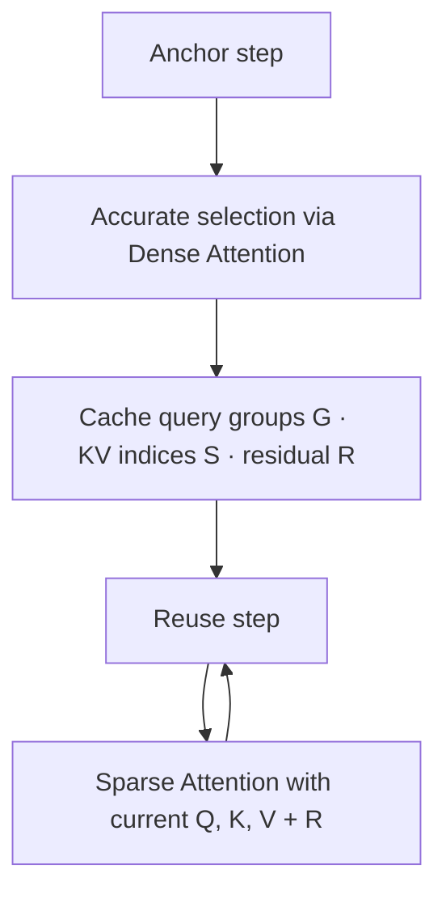

[Paper](https://arxiv.org/abs/2610.06801)
## MC-Sparse: Dissecting and Closing the Dense–Sparse Attention Gap in Diffusion Transformers

## TL;DR

By making the attention of a diffusion transformer (DiT) sparse at the **token level** without training, while caching and reusing accurate KV selections and dense–sparse output residuals at anchor steps, it achieves up to a **$2.32\times$** denoising speedup in video and 3D generation with no quality loss (source: Fig. teaser, §Abstract).

## Key Idea

Sparse attention is the primary way to reduce the latency of diffusion transformers operating on long sequences, but the lower the density, the more the generation quality collapses. The key insight of this paper is that **"the quality degradation of sparse attention is not a single problem of selection accuracy, but the result of three distinct errors compounding."**

- **Structural binding error**: block-level selection drags in the irrelevant neighbors of important tokens, and queries with different attention patterns are forced to share a single selection (source: §Method).
- **Selection error**: because important blocks are chosen using the approximation of mean-pooled scores, genuinely important interactions are missed (source: §Method).
- **Discarded tail error**: tokens excluded from the selection still carry nonzero attention mass, so even with perfect selection a residual remains relative to the dense output (source: §Method).

MC-Sparse addresses these three errors with **token-level KV selection**, **tile-aligned query grouping**, and **temporal residual compensation**, respectively. And it solves the problem that this precise selection and grouping is expensive by exploiting the stability of attention across denoising steps: **computing them only at anchor steps and reusing them at the remaining steps** (source: §Intro).

## Background: The Problem They Solved

Diffusion transformers have become the de facto standard backbone for video generation (HunyuanVideo, Wan2.1, MiniMax-H3) and 3D asset generation. But as resolution and duration grow, sequence length expands to **tens to hundreds of thousands of tokens**, and the quadratic cost of attention $O(n^2)$ becomes the main culprit behind inference latency (source: §Related Work).

Sparse attention is the natural solution to reduce this cost. Attention mass is indeed concentrated on a small number of token interactions. The problem is that **aggressive sparsity causes generation quality to drop sharply**.

Most existing methods use **block sparse attention (BSA)**. Queries and keys are grouped into blocks, and for each query block a few important KV blocks are kept whole. This aligns well with GPU compute tiles and is fast, but it estimates block importance using **mean-pooled query and key representations** (source: §Intro).

The problem with this design is that **two kinds of error are entangled**. The authors point this out precisely.

> "This design entangles two errors: the approximate score used to choose blocks, and the coarse block layout that itself limits which interactions can be chosen. As a result, it is hard to know how much of the quality gap comes from the selector, how much from the block structure, and how much remains even after improving both." (source: §Intro)

In other words, without precisely dissecting "why sparse attention is worse than dense," they bolted together a block structure and an approximate score, so it was impossible to know what to fix. This paper starts by dissecting this "dense–sparse gap" through controlled oracle comparisons.

## A New Approach: MC-Sparse

**MC-Sparse (Meta-Cached Sparse Attention)** is a training-free method that unifies three design principles into a single framework (source: §Method).

1. **Token-level KV selection**: select individual KV tokens rather than blocks, eliminating KV binding.
2. **Tile-aligned query grouping**: group similar queries into tiles of **exactly the same size ($C$)**, reducing query binding while aligning with GPU tiles.
3. **Temporal reuse of accurate selection + residual compensation**: at anchor steps, choose KVs using accurate attention probabilities and record the dense–sparse output residual to reuse at subsequent steps.

The authors' hypothesis, summarized in one sentence:

> **"By caching and reusing token-level selection based on accurate attention probabilities at anchor steps, one can simultaneously reduce the structural, selection, and tail errors of block sparse attention without training, obtaining results closer to the dense output and larger speedups."**

The key is **metadata caching**. At an anchor step, (the query grouping $\mathcal{G}$, the selected KV indices $\mathcal{S}$, the output residual $\mathbf{R}$) are cached, and at reuse steps this metadata is used as-is while only the attention is recomputed with the current $\mathbf{Q}, \mathbf{K}, \mathbf{V}$ (source: §Method, Alg. 1).

## How It Works: A Concrete Example

First, let us examine the three errors with a **$4\times4$ toy example**. Suppose there are 4 queries ($q_1..q_4$) and 4 keys ($k_1..k_4$), the block size is 2, and the density budget is 50% (2 keys kept per query). Assume the attention mass matrix (each row sums to 1) is as follows.

| | $k_1$ | $k_2$ | $k_3$ | $k_4$ |
|---|---:|---:|---:|---:|
| $q_1$ | 0.40 | 0.08 | **0.50** | 0.02 |
| $q_2$ | 0.08 | 0.40 | **0.50** | 0.02 |
| $q_3$ | 0.02 | **0.50** | 0.08 | 0.40 |
| $q_4$ | 0.02 | **0.50** | 0.08 | 0.40 |

Query block A = {$q_1,q_2$}, B = {$q_3,q_4$}; KV block 1 = {$k_1,k_2$}, 2 = {$k_3,k_4$}.

**① Structural binding error (block oracle).** The block mass of $q_1$ is 0.48 for block 1 and 0.52 for block 2, so block 2 is chosen. However, the true top 2 for $q_1$ are $k_3$(0.50) and $k_1$(0.40), summing to 0.90, and the block choice forcibly drags in the irrelevant $k_4$(0.02). This is **KV binding**. On top of this, although $q_1$ and $q_2$ in block A have opposite patterns ($q_1$ prefers $k_1$, $q_2$ prefers $k_2$), they are forced to share the same selection. This is **query binding** (source: Fig. sources_of_gap).

**② Selection error (token oracle, shared query block).** The per-key summed mass of block A is $k_3=1.00$, $k_1=0.48$, $k_2=0.48$, so the top 2 {$k_3,k_1$} are chosen. $q_1$ is perfect (0.90), but $q_2$ only gets 0.50+0.08=0.58. This differs by 0.32 from $q_2$'s true top 2 {$k_3,k_2$}=0.90. Mean-pooled scores make such omissions even worse, and the authors pinpoint the root cause with the following inequality (source: §Method).

$$
\operatorname{Softmax}\!\left(\bar{\mathbf{q}}_g \mathbf{K}^{\top}/\sqrt{d}\right)_j \;\neq\; \frac{1}{|\mathcal{G}_g|}\sum_{i\in\mathcal{G}_g} A_{ij}
$$

That is, **scoring with the group-mean query and averaging the attention probabilities of individual queries yield different values**.

**③ Discarded tail error (per-query oracle).** Even if each query chooses its own optimal 2 ($q_1$ gets 0.90, $q_2$ gets 0.90), a mass of 0.10 is discarded for each, leaving a residual relative to the dense output. Even perfect selection cannot close this error (source: Fig. sources_of_gap).

MC-Sparse addresses these three errors as follows (source: §Method).

**Tile-aligned grouping — Fast PDDP.** Similar queries must be grouped into exactly $C$ each to reduce query binding while aligning with kernel tiles. The problem is that standard clustering such as $k$-means **cannot guarantee equal-sized groups**, so padding to fit tiles increases the executed interactions (Align. 1.45~2.08). The authors use a median-split version of PDDP (principal direction divisive partitioning): sort each group along the principal component direction, then recursively split at the median so that every group has exactly $C$ members. Instead of a naive implementation that is expensive on GPUs, they develop **Fast PDDP**, which processes all heads in parallel via batched power iteration (source: §Method).

**Accurate selection — two-pass selector.** To compute attention mass accurately at anchor steps, probabilities are needed, but FlashAttention uses online softmax and does not expose logits. So it is handled in two passes: the first pass obtains the dense output and the log-sum-exp, and the second pass recomputes the QK scores to recover the probabilities, sums the per-group mass, and chooses the top-$K$. The dense matrix is never actually materialized (source: Appx. two-pass).

**Residual compensation.** At anchor step $\tau$, the following is recorded (source: §Method).

$$
\mathbf{R}_{\tau} = \mathbf{O}^{\mathrm{full}}_{\tau} - \mathbf{O}^{\mathrm{sparse}}_{\tau}
$$

At a reuse step $t$, sparse attention is computed with the cached grouping and indices, and then the residual is added.

$$
\widehat{\mathbf{O}}_t = \operatorname{SparseAttn}\!\left(\mathbf{Q}_t,\mathbf{K}_t,\mathbf{V}_t;\ \mathcal{G}_{\tau},\mathcal{S}_{\tau}\right) + \mathbf{R}_{\tau}
$$

The key evidence is the observation that **the dense–sparse residual varies less across denoising steps than the attention output itself** (source: Fig. residual_stability). The more stable the residual, the better the previous step's residual approximates the next step's tail error.

The overall pipeline alternates between anchor and reuse steps (source: Alg. 1, Fig. pipeline).

## Performance Validation: Main Results

The evaluation has two axes. **Fidelity** measures with PSNR/SSIM/LPIPS "how close the sparse output is to the dense-attention output." **Efficiency** is measured by density, the fraction of retained interactions, and by the speedup over dense denoising (source: §Exp).

**Video generation.** On MiniMax-H3-Base (768p), MC-Sparse achieves **$1.80\times$ at 15% density** and $1.61\times$ at 25% density. Notably, at 15% density it records 27.30 dB PSNR, which is about **4 dB higher at a lower density** than Sol-Attn (23.66 dB @ 32.4%) and PISA (23.45 dB @ 30.0%) (source: Tab. video, Fig. teaser). On HunyuanVideo-13B it achieves 32.89 dB PSNR and $1.82\times$ at 25% density, and on Wan2.1-14B-T2V/I2V it attains the best PSNR/SSIM and lowest LPIPS among all sparse baselines (source: Tab. video).

**3D asset generation.** On HY3D-Internal, it achieves a **$2.32\times$** speedup at 15% density while reducing the geometric fidelity Chamfer distance from PISA's 0.976 to **0.177**. Vol-IoU-1536 is 82.91 and F1@0.001 is 96.33, the best among those evaluated. In contrast, the compared methods use higher density yet still have broken surfaces and lost detail (source: Tab. 3D, Fig. geo).

**Ablation.** On Wan2.1-1.3B-T2V (480p), adding, in turn, accurate selection reuse → token-level → query grouping → residual compensation on top of vanilla BSA raises PSNR from 20.96 to 27.05 dB (density 0.2), showing that each component contributes meaningfully. Among them, **residual compensation gives the largest gain** (+3.54 dB @ s=0.2) (source: Tab. ablation). Interestingly, applying the same residual compensation to vanilla BSA (+1.25 dB) or PISA (+0.49 dB) yields a much smaller gain, meaning that residual compensation only becomes effective when combined with MC-Sparse's accurate selection and grouping (source: Tab. compensation).

**System efficiency.** Token-level selection induces irregular memory access, risking a slow kernel, but the token-sparse kernel implemented in CuTeDSL achieves **96–99%** of the ideal $1/s$ speed. PISA's kernel reaches 82–87% and SVG2's kernel 80–81% (source: Tab. kernel). Fast PDDP reduces the amortized grouping cost by $3.96\times$ at 480p and $6.14\times$ at 720p compared with Flash-KMeans (source: Tab. grouping). The additional cost of anchor steps, when converted to the overall total, is comparable to roughly a 5–6% increase in density (source: §System Efficiency).

## Our Perspective: Strengths, Limitations, and Why This Work Matters

**Strengths.** The most compelling point is that **diagnosis → design → implementation** form a single line. It separates "why sparse is bad" into three errors through oracle comparisons, attaches components that precisely address each error, and quantifies each component's contribution through ablations. Being training-free, it does not touch existing model weights, which is highly practical, and its generality is confirmed across the two domains of video and 3D. In particular, achieving **"higher PSNR at lower density"** is a result that goes beyond a simple speed-quality tradeoff.

**Limitations.** The parts the authors explicitly acknowledge are limited, but the analysis reveals some points.

1. **Dependence on dense computation at anchor steps.** To produce accurate selections and residuals, dense attention must be run at anchor steps. Amortized, this is at the 5–6% level, but even "sparse" does not completely eliminate the dense pass.
2. **Attention stability assumption.** The validity of caching rests on the assumption that "attention patterns and residuals are stable across denoising steps." In segments with abrupt motion onset or scene changes, the reused selection can become stale and degrade quality.
3. **Evaluation scope.** It focuses on video and 3D generation, and no extension to other long-sequence workloads such as image generation or autoregressive LLM decoding is shown. Also, HY3D-Internal is an internal model, so those experiments are hard to reproduce externally (source: §Exp, Appx).
4. **Constraints of comparison.** Because the PISA kernel did not operate efficiently on the relevant models, the speed was only estimated as an upper bound using the Sol-Attn kernel, and SpargeAttn could not be compared directly for latency because it uses INT8/FP8 (source: Appx. evaluation protocol). The numbers themselves are handled fairly, but it is not a fully controlled comparison.

**Why this work matters.** Sparse attention is prone to falling into the trap of "losing quality while trying to be fast," and this paper precisely decomposes **where** that quality loss comes from, separating whether the room for improvement lies in the structure (blocks), the selection (approximate score), or the residual (tail). This diagnostic framework becomes a useful lens for evaluating any sparse attention method thereafter. On top of that, by also nailing **GPU efficiency** with tile-aligned grouping (Fast PDDP) and a token-gathering kernel, the key contribution is sidestepping the dilemma between "precise but slow" and "fast but inaccurate."

## What's Next?: The Road Ahead

The authors do not enumerate specific future work at length in the conclusion. Suggesting reasonable next steps in light of the limitations:

- **Adaptive anchor schedules.** Instead of a fixed interval ($\{10,26\}$), measure the rate of attention change in real time to increase reuse in stable segments and add anchors in rapidly changing segments. This can directly capture the segments where the stability assumption breaks.
- **Combination with a trainable indexer.** Currently, being training-free is a strength, but attaching a lightweight indexer to approximate the accurate selection could further reduce the dense-computation burden of anchor steps.
- **Domain extension.** Application to image generation and autoregressive LLM decoding. In particular, LLM decoding may have attention patterns that change more abruptly between decoding steps, so separate verification is needed for whether the residual stability assumption holds.
- **Reproduction on open models.** Replacing the HY3D-Internal experiments with open 3D generation models to secure reproducibility is also a direction that would increase academic impact.

<!-- verbatim-tables -->

## Tables from the paper

> Tables converted mechanically from the arXiv e-print LaTeX source. The numbers are the paper's own and did not pass through a model.

**Table 1. Dense warm-up and MC-Sparse anchor configurations. Warm-up entries denote count / total count. Hunyuan lists dual-stream and single-stream layers, respectively.**

| Model | Setting | Warm-up layers | Warm-up steps | Anchor steps |
|---|---|---|---|---|
| Wan2.1-1.3B-T2V | 480p, 5s, text-to-video | 1/30 | 10/50 | $\{10,26\}$ |
| Wan2.1-14B-I2V | 720p, 5s, image-to-video | 1/40 | 10/50 | $\{10,26\}$ |
| Wan2.1-14B-T2V | 720p, 5s, text-to-video | 1/40 | 10/50 | $\{10,26\}$ |
| Hunyuan-13B | 720p, 5.25s, text-to-video | 1/20, 1/40 | 10/50 | $\{10,26\}$ |
| Minimax-H3-Base | 768p, 14.4s, text-to-audio-video | 1/52 | 10/49 | $\{10,26\}$ |
| HY3D-Internal | 1536 resolution, image-to-geometry | 1/40 | 1/12 | $\{1\}$ |

**Table 2. SVG2 and SVG-EAR settings following the SVG-EAR evaluation setup. $Q_c$ and $K_c$ denote the numbers of query and key clusters.**

| Model | $Q_c$ | $K_c$ | TopP SVG2 | TopP SVG-EAR |
|---|---|---|---|---|
| Wan2.1-14B-T2V | 300 | 1000 | 0.90 | 0.85 |
| Wan2.1-14B-I2V | 300 | 1000 | 0.90 | 0.85 |

**Table 3. Video generation results. PSNR, SSIM, and LPIPS compare with dense-attention outputs; ImgQual and BgCons are VBench scores. Speedup measures DiT denoising only. Bold and underlined values indicate the best and second-best results, respectively, excluding Full Attn.**

| **Method** | **PSNR**$\uparrow$ | **SSIM**$\uparrow$ | **LPIPS**$\downarrow$ | **ImgQual**$\uparrow$ | **BgCons**$\uparrow$ | **Density**$\downarrow$ | **Speedup**$\uparrow$ |
|---|---|---|---|---|---|---|---|
| **Minimax-H3-Base, 768p, T2AV (video branch)** |  |  |  |  |  |  |  |
| Full Attn (FA3) | - | - | - | 69.20 | 91.72 | 100% | $1.00\times$ |
| Sol-Attn | 23.66 | 0.816 | 0.234 | 68.83 | 91.73 | 32.4% | $1.59\times$ |
| PISA | 23.45 | 0.811 | 0.243 | 68.54 | 91.64 | 30.0% | $1.52\times$ |
| **MC-Sparse (density=25%)** | **28.44** | **0.899** | **0.161** | **69.00** | 91.81 | 25.0% | $\underline{1.61\times}$ |
| **MC-Sparse (density=15%)** | 27.30 | 0.882 | 0.176 | 68.94 | **91.85** | 15.0% | $\mathbf{1.80\times}$ |
| **HunyuanVideo-13B, 720p, T2V** |  |  |  |  |  |  |  |
| Full Attn (FA3) | - | - | - | 68.52 | 96.91 | 100% | $1.00\times$ |
| Sol-Attn | 28.06 | 0.898 | 0.159 | 68.27 | **97.03** | 32.3% | $1.79\times$ |
| PISA | 27.65 | 0.890 | 0.174 | **68.74** | 96.96 | 30.0% | $1.70\times$ |
| **MC-Sparse (density=25%)** | **32.89** | **0.940** | **0.114** | 68.66 | 96.89 | 25.0% | $\underline{1.82\times}$ |
| **MC-Sparse (density=15%)** | 30.78 | 0.919 | 0.135 | 68.67 | 96.96 | 15.0% | $\mathbf{2.00\times}$ |
| **Wan2.1-14B-T2V, 720p** |  |  |  |  |  |  |  |
| Full Attn (FA3) | - | - | - | 67.11 | 96.60 | 100% | $1.00\times$ |
| SpargeAttn | 23.56 | 0.828 | 0.212 | 66.84 | **96.81** | 30.0% | - |
| Sol-Attn | 24.62 | 0.852 | 0.157 | 67.01 | 96.72 | 31.6% | $\underline{1.52\times}$ |
| PISA | 24.03 | 0.838 | 0.202 | 67.09 | 96.76 | 30.0% | $\underline{1.52\times}$ |
| SVG2 | 26.02 | 0.875 | 0.166 | 67.11 | 96.52 | 31.5% | $1.34\times$ |
| SVG-EAR | 27.61 | 0.897 | 0.142 | 66.97 | 96.41 | 25.3% | $1.38\times$ |
| **MC-Sparse (Ours)** | **28.81** | **0.912** | **0.128** | **67.12** | 96.70 | 25.0% | $\mathbf{1.53\times}$ |
| **Wan2.1-14B-I2V, 720p** |  |  |  |  |  |  |  |
| Full Attn (FA3) | - | - | - | 70.37 | 96.51 | 100% | $1.00\times$ |
| SpargeAttn | 26.66 | 0.859 | 0.172 | 70.40 | 96.30 | 30.0% | - |
| Sol-Attn | 27.73 | 0.876 | 0.157 | 70.34 | **96.46** | 31.9% | $\underline{1.51\times}$ |
| PISA | 27.10 | 0.865 | 0.163 | 70.38 | 96.40 | 30.0% | $\underline{1.51\times}$ |
| SVG2 | 27.15 | 0.861 | 0.168 | 70.32 | 96.42 | 30.4% | $1.35\times$ |
| SVG-EAR | 30.71 | 0.916 | 0.127 | 70.34 | 96.38 | 24.6% | $1.39\times$ |
| **MC-Sparse (Ours)** | **32.11** | **0.929** | **0.117** | **70.41** | **96.46** | 25.0% | $\mathbf{1.52\times}$ |

**Table 4. Image-to-geometry results on HY3D-Internal. Geometric fidelity is measured against dense-attention outputs; Uni3D-I and ULIP3D-I measure input-image consistency. Speedup measures DiT denoising only.**

| **Config** | **CD**$\downarrow$ | **Vol-IoU-1536**$\uparrow$ | **F1@0.001**$\uparrow$ | **Uni3D-I**$\uparrow$ | **ULIP3D-I**$\uparrow$ | **Density**$\downarrow$ | **Speedup**$\uparrow$ |
|---|---|---|---|---|---|---|---|
| **HY3D-Internal** |  |  |  |  |  |  |  |
| Full Attn (FA3) | - | - | - | 0.3309 | 0.1204 | 100% | $1.00\times$ |
| Sol-Attn | 1.901 | 50.55 | 70.36 | 0.3301 | 0.1203 | 36.1% | $1.57\times$ |
| PISA | 0.976 | 63.22 | 83.29 | 0.3304 | 0.1204 | 25.0% | $<1.87\times$ |
| **MC-Sparse (Ours)** | **0.177** | **82.91** | **96.33** | **0.3311** | **0.1206** | 15.0% | $\mathbf{2.32\times}$ |

**Table 5. Cumulative ablation on Wan2.1-1.3B-T2V at 480p. Each row adds one component to the preceding configuration. Settings are provided in Appendix .**

| Configuration | Density $s=0.2$ PSNR $\uparrow$ | Density $s=0.2$ SSIM $\uparrow$ | Density $s=0.2$ LPIPS $\downarrow$ | Density $s=0.25$ PSNR $\uparrow$ | Density $s=0.25$ SSIM $\uparrow$ | Density $s=0.25$ LPIPS $\downarrow$ | Density $s=0.3$ PSNR $\uparrow$ | Density $s=0.3$ SSIM $\uparrow$ | Density $s=0.3$ LPIPS $\downarrow$ |
|---|---|---|---|---|---|---|---|---|---|
| Vanilla BSA | 20.96 | 0.7535 | 0.2714 | 21.67 | 0.7750 | 0.2469 | 22.26 | 0.7923 | 0.2278 |
| $+$ exact KV selection (w. reuse) | 21.60 | 0.7731 | 0.2482 | 22.63 | 0.8004 | 0.2176 | 23.47 | 0.8205 | 0.1956 |
| $+$ token granularity | 22.57 | 0.7954 | 0.2254 | 23.54 | 0.8188 | 0.1995 | 24.38 | 0.8380 | 0.1789 |
| $+$ query grouping | 23.51 | 0.8175 | 0.2017 | 24.47 | 0.8386 | 0.1784 | 25.24 | 0.8539 | 0.1624 |
| $+$ compensation (full model) | **27.05** | **0.8809** | **0.1326** | **27.35** | **0.8843** | **0.1294** | **27.54** | **0.8862** | **0.1273** |

**Table 6. KV-selection granularity and query grouping at matched realized attention density $s$. *Align.* is the ratio of executed to nominal sparse interactions after tile alignment. Black rows include this inflation in the density budget, whereas gray rows ignore it$^{\dagger}$.**

| Query grouping | KV granularity | Align. | Attention recall $\uparrow$ $s{=}0.1$ | Attention recall $\uparrow$ $s{=}0.2$ | Attention recall $\uparrow$ $s{=}0.3$ | Output rel. $L_1$ $\downarrow$ $s{=}0.1$ | Output rel. $L_1$ $\downarrow$ $s{=}0.2$ | Output rel. $L_1$ $\downarrow$ $s{=}0.3$ |
|---|---|---|---|---|---|---|---|---|
| No reorder | block | 1.00 | 0.637 | 0.778 | 0.847 | 0.176 | 0.101 | 0.069 |
|  | token | 1.00 | 0.745 | 0.857 | 0.910 | 0.130 | 0.070 | 0.044 |
| k-means | block | 2.08 | 0.743 | 0.830 | 0.874 | 0.160 | 0.098 | 0.071 |
|  | token | 1.45 | 0.840 | 0.904 | 0.935 | 0.093 | 0.054 | 0.036 |
|  | gray block$^{\dagger}$ | gray2.08 | gray0.834 | gray0.906 | gray0.940 | gray0.096 | gray0.052 | gray0.033 |
|  | gray token$^{\dagger}$ | gray1.45 | gray0.876 | gray0.933 | gray0.959 | gray0.071 | gray0.038 | gray0.023 |
| **Fast PDDP (ours)** | block | 1.00 | 0.791 | 0.887 | 0.930 | 0.118 | 0.062 | 0.038 |
|  | **token** | 1.00 | **0.856** | **0.923** | **0.953** | **0.080** | **0.042** | **0.026** |
| *Oracle (per query)* | token | -- | 0.908 | 0.951 | 0.971 | 0.048 | 0.025 | 0.015 |

**Table 7. PSNR (dB) before and after adding our residual compensation at target attention density $s$. $\Delta$ is the PSNR gain from adding the residual. PISA retains its native block-statistics compensation in both configurations.**

| Configuration | $s=0.20$ PSNR $\uparrow$ | $s=0.20$ $\Delta$ | $s=0.25$ PSNR $\uparrow$ | $s=0.25$ $\Delta$ | $s=0.30$ PSNR $\uparrow$ | $s=0.30$ $\Delta$ |
|---|---|---|---|---|---|---|
| MC-Sparse w/o residual compensation | 23.51 | -- | 24.47 | -- | 25.24 | -- |
| MC-Sparse | **27.05** | **+3.54** | **27.35** | **+2.88** | **27.54** | **+2.30** |
| Vanilla BSA | 20.96 | -- | 21.67 | -- | 22.26 | -- |
| $+$ our residual compensation | 22.21 | +1.25 | 23.12 | +1.45 | 23.90 | +1.64 |
| PISA | 21.66 | -- | 22.14 | -- | 22.52 | -- |
| $+$ our residual compensation | 22.15 | +0.49 | 22.92 | +0.78 | 23.42 | +0.90 |

**Table 8. Attention-kernel speedup on Wan2.1-14B-T2V (720p), using a Hopper GPU in BF16 ($H=40$, $D=128$, $S=75600$). Entries show speedup $\rho=t_{\mathrm{FA3}}/t$ (efficiency $\eta=\rho s$ relative to the ideal $1/s$ speedup). Selection and grouping are excluded.**

| Kernel | Sparse layout | $s=0.2$ | $s=0.3$ | $s=0.5$ |
|---|---|---|---|---|
| grayBSA | grayregular blocks | gray4.96$\times$ (0.99) | gray3.30$\times$ (0.99) | gray1.97$\times$ (0.99) |
| PISA kernel | regular blocks | 4.11$\times$ (0.82) | 2.84$\times$ (0.85) | 1.73$\times$ (0.87) |
| SVG2 kernel | variable-length blocks | 4.02$\times$ (0.80) | 2.70$\times$ (0.81) | 1.62$\times$ (0.81) |
| MC-Sparse | tile-aligned Q, gathered KV | 4.79$\times$ (**0.96**) | 3.25$\times$ (**0.98**) | 1.97$\times$ (**0.99**) |

> Figures in this post are taken from the original arXiv:2610.06801 (CC BY 4.0). Only size and format were changed.
