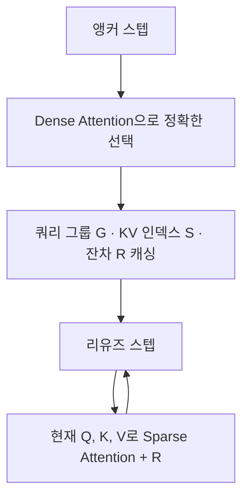

[논문 링크](https://arxiv.org/abs/2610.06801)
## MC-Sparse: Diffusion Transformer의 Dense–Sparse Attention 간극을 해부하고 메꾸다

## 한 줄 요약 (TL;DR)

학습 없이(training-free) 확산 트랜스포머(DiT)의 어텐션을 **토큰 단위**로 스파스하게 만들되, 앵커 스텝에서 정확한 KV 선택 결과와 dense–sparse 출력 잔차를 캐싱해 재사용함으로써, 비디오·3D 생성에서 품질 손실 없이 최대 **$2.32\times$** 디노이징 속도 향상을 달성한다 (근거: Fig. teaser, §Abstract).

## 핵심 아이디어

스파스 어텐션은 긴 시퀀스를 다루는 확산 트랜스포머의 지연을 줄이는 주된 방법이지만, 밀도를 낮출수록 생성 품질이 무너진다. 이 논문의 핵심 통찰은 **"스파스 어텐션의 품질 저하는 선택 정확도 하나의 문제가 아니라, 서로 다른 세 개의 오차가 겹친 결과"** 라는 점이다.

- **구조적 결합 오차(structural binding error)**: 블록 단위 선택이 중요한 토큰의 무관한 이웃까지 끌어들이고, 서로 다른 어텐션 패턴을 가진 쿼리들이 하나의 선택을 강제로 공유 (근거: §Method).
- **선택 오차(selection error)**: 평균 풀링(mean-pooled) 점수라는 근사로 중요 블록을 고르다 보니 진짜 중요한 상호작용을 놓침 (근거: §Method).
- **버려진 꼬리 오차(discarded tail error)**: 선택에서 빠진 토큰들도 0이 아닌 어텐션 질량을 지녀서, 완벽한 선택을 해도 dense 출력과 잔차가 남음 (근거: §Method).

MC-Sparse는 이 세 오차를 각각 **토큰 단위 KV 선택**, **타일 정렬 쿼리 그룹핑**, **시간 축 잔차 보상**으로 대응한다. 그리고 이 정밀한 선택·그룹핑이 비싸다는 문제를, 디노이징 스텝 사이의 어텐션 안정성을 활용해 **앵커 스텝에서만 계산하고 나머지 스텝에서 재사용**하는 방식으로 풀어낸다 (근거: §Intro).

## 배경: 그들이 해결한 문제

확산 트랜스포머는 비디오 생성(HunyuanVideo, Wan2.1, MiniMax-H3)과 3D 에셋 생성의 사실상 표준 백본이 되었다. 그런데 해상도와 재생 시간이 커질수록 시퀀스 길이가 **수만~수십만 토큰**까지 늘어나고, 어텐션의 2차 비용 $O(n^2)$이 추론 지연의 주범이 된다 (근거: §Related Work).

스파스 어텐션은 이 비용을 줄이는 자연스러운 해법이다. 실제로 어텐션 질량은 소수의 토큰 상호작용에 집중되기 때문이다. 문제는 **공격적인 스파스성이 생성 품질을 급격히 떨어뜨린다**는 점이다.

기존의 대부분 방법은 **블록 단위 스파스 어텐션(BSA)** 을 쓴다. 쿼리·키를 블록으로 묶고, 각 쿼리 블록마다 중요한 KV 블록 몇 개를 통째로 유지하는 방식이다. GPU 연산 타일과 정렬이 잘 맞아 빠르지만, 블록 중요도를 **평균 풀링된 쿼리·키 표현**으로 추정한다 (근거: §Intro).

이 설계의 문제는 **두 종류의 오차가 뒤엉켜 있다**는 것이다. 저자들은 이 점을 정확히 지적한다.

> "이 설계는 두 오차를 얽어놓는다. 블록을 고르는 근사 점수와, 어떤 상호작용을 고를 수 있는지 자체를 제한하는 거친 블록 레이아웃이 그것이다. 결과적으로 품질 간극의 얼마가 선택기에서 오고, 얼마가 블록 구조에서 오고, 둘 다 개선해도 얼마나 남는지 알기 어렵다." (근거: §Intro)

즉 "스파스 어텐션이 dense보다 못한 이유"를 정확히 해부하지 않은 채 블록 구조와 근사 점수를 붙여쓰니, 어디를 고쳐야 할지 알 수 없었다는 것이다. 이 논문은 이 "dense–sparse 간극"을 통제된 오라클 비교로 해부하는 것에서 출발한다.

## 새로운 접근법: MC-Sparse

**MC-Sparse (Meta-Cached Sparse Attention)** 는 세 가지 설계 원칙을 한 프레임워크로 묶은 training-free 방식이다 (근거: §Method).

1. **토큰 단위 KV 선택**: 블록이 아니라 개별 KV 토큰을 선택해 KV 결합을 제거한다.
2. **타일 정렬 쿼리 그룹핑**: 비슷한 쿼리를 **정확히 같은 크기($C$개)** 의 타일로 묶어 쿼리 결합을 줄이면서도 GPU 타일과 정렬한다.
3. **정확한 선택 + 잔차 보상의 시간 축 재사용**: 앵커 스텝에서 정확한 어텐션 확률로 KV를 고르고, dense–sparse 출력 잔차를 기록해 이후 스텝에서 재사용한다.

저자의 가설을 한 문장으로 정리하면:

> **"정확한 어텐션 확률 기반의 토큰 단위 선택을 앵커 스텝에서 캐싱해 재사용함으로써, 학습 없이도 블록 스파스 어텐션의 구조적·선택적·꼬리 오차를 동시에 줄여 dense 출력에 더 가까운 결과와 더 큰 속도 향상을 얻을 수 있다."**

핵심은 **메타데이터 캐싱**이다. 앵커 스텝에서 (쿼리 그룹 $\mathcal{G}$, 선택된 KV 인덱스 $\mathcal{S}$, 출력 잔차 $\mathbf{R}$)를 캐싱하고, 리유즈 스텝에서는 이 메타데이터를 그대로 쓰되 현재 시점의 $\mathbf{Q}, \mathbf{K}, \mathbf{V}$로 어텐션만 다시 계산한다 (근거: §Method, Alg. 1).

## 작동 원리: 구체적인 예시로 살펴보기

먼저 세 오차를 **$4\times4$ 장난감 예시**로 확인하자. 쿼리 4개($q_1..q_4$)와 키 4개($k_1..k_4$)가 있고, 블록 크기는 2, 밀도 예산은 50%(쿼리당 키 2개 유지)라고 하자. 어텐션 질량 행렬(각 행 합계 = 1)이 다음과 같다고 가정한다.

| | $k_1$ | $k_2$ | $k_3$ | $k_4$ |
|---|---:|---:|---:|---:|
| $q_1$ | 0.40 | 0.08 | **0.50** | 0.02 |
| $q_2$ | 0.08 | 0.40 | **0.50** | 0.02 |
| $q_3$ | 0.02 | **0.50** | 0.08 | 0.40 |
| $q_4$ | 0.02 | **0.50** | 0.08 | 0.40 |

쿼리 블록 A = {$q_1,q_2$}, B = {$q_3,q_4$}; KV 블록 1 = {$k_1,k_2$}, 2 = {$k_3,k_4$}.

**① 구조적 결합 오차 (블록 오라클).** $q_1$의 블록 질량은 블록1이 0.48, 블록2가 0.52이므로 블록2를 고른다. 그런데 $q_1$의 진짜 상위 2개는 $k_3$(0.50)과 $k_1$(0.40)로 합 0.90인데, 블록 선택은 무관한 $k_4$(0.02)를 억지로 끌어들인다. 이것이 **KV 결합**이다. 여기에 더해, 블록 A의 $q_1$과 $q_2$는 패턴이 정반대($q_1$은 $k_1$을, $q_2$는 $k_2$를 선호)인데도 같은 선택을 강제로 공유한다. 이것이 **쿼리 결합**이다 (근거: Fig. sources_of_gap).

**② 선택 오차 (토큰 오라클, 공유 쿼리 블록).** 블록 A의 키별 합산 질량은 $k_3=1.00$, $k_1=0.48$, $k_2=0.48$이므로 상위 2개 {$k_3,k_1$}을 고른다. $q_1$은 완벽(0.90)하지만, $q_2$는 0.50+0.08=0.58만 얻는다. $q_2$의 진짜 상위 2개 {$k_3,k_2$}=0.90과 0.32 차이가 난다. 평균 풀링 점수는 이런 누락을 더 심하게 만드는데, 저자는 그 근본 원인을 다음 부등식으로 짚는다 (근거: §Method).

$$
\operatorname{Softmax}\!\left(\bar{\mathbf{q}}_g \mathbf{K}^{\top}/\sqrt{d}\right)_j \;\neq\; \frac{1}{|\mathcal{G}_g|}\sum_{i\in\mathcal{G}_g} A_{ij}
$$

즉 **그룹 평균 쿼리로 점수를 내는 것과, 개별 쿼리의 어텐션 확률을 평균 내는 것은 다른 값**이다.

**③ 버려진 꼬리 오차 (per-query 오라클).** 각 쿼리가 자신만의 최적 2개를 골라도($q_1$은 0.90, $q_2$는 0.90), 각각 0.10의 질량이 버려져 dense 출력과 잔차가 남는다. 완벽한 선택도 이 오차는 메꾸지 못한다 (근거: Fig. sources_of_gap).

MC-Sparse는 이 세 오차에 다음처럼 대응한다 (근거: §Method).

**타일 정렬 그룹핑 — Fast PDDP.** 비슷한 쿼리를 정확히 $C$개씩 묶어야 쿼리 결합을 줄이면서 커널 타일과 정렬된다. 문제는 $k$-means 같은 표준 클러스터링은 **같은 크기 그룹을 보장하지 못해**, 타일에 맞추려고 패딩하면 실행 상호작용이 늘어난다(Align. 1.45~2.08). 저자는 PDDP(principal direction divisive partitioning)의 중앙값 분할 버전을 쓴다: 각 그룹을 주성분 방향으로 정렬한 뒤 중앙에서 재귀적으로 쪼개어, 모든 그룹이 정확히 $C$개가 되게 한다. GPU에서 비싼 순진한 구현 대신 배치 파워 이터레이션으로 모든 헤드를 병렬 처리하는 **Fast PDDP**를 개발했다 (근거: §Method).

**정확한 선택 — Two-pass 셀렉터.** 앵커 스텝에서 어텐션 질량을 정확히 계산하려면 확률이 필요한데, FlashAttention은 온라인 소프트맥스를 써서 로짓을 노출하지 않는다. 그래서 2-패스로 처리한다: 첫 패스에서 dense 출력과 로그섬지수(log-sum-exp)를 얻고, 두 번째 패스에서 QK 점수를 다시 계산해 확률을 복원하고 그룹별 질량을 합산해 top-$K$를 고른다. dense 행렬을 실제로 만들지 않는다 (근거: Appx. two-pass).

**잔차 보상.** 앵커 스텝 $\tau$에서 다음을 기록한다 (근거: §Method).

$$
\mathbf{R}_{\tau} = \mathbf{O}^{\mathrm{full}}_{\tau} - \mathbf{O}^{\mathrm{sparse}}_{\tau}
$$

리유즈 스텝 $t$에서는 캐싱된 그룹·인덱스로 스파스 어텐션을 계산한 뒤 잔차를 더한다.

$$
\widehat{\mathbf{O}}_t = \operatorname{SparseAttn}\!\left(\mathbf{Q}_t,\mathbf{K}_t,\mathbf{V}_t;\ \mathcal{G}_{\tau},\mathcal{S}_{\tau}\right) + \mathbf{R}_{\tau}
$$

핵심 근거는 **어텐션 출력보다 dense–sparse 잔차가 디노이징 스텝 사이에서 덜 변한다**는 관측이다 (근거: Fig. residual_stability). 잔차가 안정적일수록 이전 스텝의 잔차가 다음 스텝의 꼬리 오차를 잘 근사한다.

전체 파이프라인은 앵커/리유즈 스텝의 교대다 (근거: Alg. 1, Fig. pipeline).

## 성능 검증: 주요 결과

평가 지표는 두 축이다. **fidelity(충실도)** 는 PSNR/SSIM/LPIPS로 "스파스 출력이 dense-attention 출력에 얼마나 가까운가"를 잰다. **효율**은 유지 상호작용 비율인 밀도(density)와 dense 대비 디노이징 속도 향상(speedup)으로 잰다 (근거: §Exp).

**비디오 생성.** MiniMax-H3-Base(768p)에서 MC-Sparse는 **15% 밀도로 $1.80\times$**, 25% 밀도로 $1.61\times$ 속도 향상을 낸다. 특히 15% 밀도에서 PSNR 27.30 dB을 기록하는데, 이는 Sol-Attn(23.66 dB @ 32.4%)과 PISA(23.45 dB @ 30.0%)보다 **더 낮은 밀도에서 약 4 dB 높은** 결과다 (근거: Tab. video, Fig. teaser). HunyuanVideo-13B에서는 25% 밀도에서 PSNR 32.89 dB·$1.82\times$, Wan2.1-14B-T2V/I2V에서도 모든 스파스 베이스라인 중 최고 PSNR/SSIM·최저 LPIPS를 달성했다 (근거: Tab. video).

**3D 에셋 생성.** HY3D-Internal에서 15% 밀도로 **$2.32\times$** 속도 향상을 내면서, 기하 충실도 Chamfer distance를 PISA의 0.976에서 **0.177**로 줄였다. Vol-IoU-1536는 82.91, F1@0.001은 96.33로 평가 대상 중 최고다. 반면 비교 방법들은 더 높은 밀도를 쓰고도 표면이 깨지고 디테일이 사라졌다 (근거: Tab. 3D, Fig. geo).

**어블레이션.** Wan2.1-1.3B-T2V(480p)에서 vanilla BSA부터 정확한 선택 재사용 → 토큰 단위 → 쿼리 그룹핑 → 잔차 보상을 차례로 추가하며 PSNR이 20.96 → 27.05 dB(밀도 0.2)까지 올라, 각 구성요소가 유의미하게 기여함을 보인다. 그중 **잔차 보상의 이득이 가장 크다**(+3.54 dB @ s=0.2) (근거: Tab. ablation). 흥미롭게도 같은 잔차 보상을 vanilla BSA(+1.25 dB)나 PISA(+0.49 dB)에 얹으면 이득이 훨씬 작은데, 이는 잔차 보상이 MC-Sparse의 정확한 선택·그룹핑과 결합될 때 비로소 효과를 낸다는 뜻이다 (근거: Tab. compensation).

**시스템 효율.** 토큰 단위 선택은 불규칙한 메모리 접근을 유발해 커널이 느려질 위험이 있는데, CuTeDSL로 구현한 토큰-스파스 커널은 이상적 $1/s$ 속도의 **96–99%** 효율을 달성했다. 반면 PISA 커널은 82–87%, SVG2 커널은 80–81%다 (근거: Tab. kernel). Fast PDDP는 Flash-KMeans 대비 분할 상환 그룹핑 비용을 480p에서 $3.96\times$, 720p에서 $6.14\times$ 줄였다 (근거: Tab. grouping). 앵커 스텝의 추가 비용은 전체로 환산하면 밀도 약 5–6% 증가와 맞먹는 수준이다 (근거: §System Efficiency).

## 우리의 관점: 강점, 한계, 그리고 이 연구가 중요한 이유

**강점.** 가장 설득력 있는 점은 **진단 → 설계 → 구현**이 한 줄로 이어진다는 것이다. "스파스가 왜 나쁜가"를 오라클 비교로 세 오차로 분리하고, 각 오차에 정확히 대응하는 구성요소를 달았으며, 어블레이션으로 각 구성요소의 기여를 정량화했다. training-free라 기존 모델 가중치를 건드리지 않는다는 점도 실용성이 높고, 비디오·3D 두 도메인에 걸친 일반성도 확인했다. 특히 **"더 낮은 밀도에서 더 높은 PSNR"** 을 달성했다는 점은 단순한 속도-품질 트레이드오프를 넘는 성과다.

**한계.** 저자가 명시적으로 인정한 부분은 제한적이지만, 분석에서 드러나는 지점은 있다.

1. **앵커 스텝의 dense 계산 의존.** 정확한 선택과 잔차를 만들려면 앵커 스텝에서 dense attention을 실행해야 한다. 상환하면 5–6% 수준이지만, "스파스"라도 dense 패스를 완전히 없애지는 못한다.
2. **어텐션 안정성 가정.** 캐싱의 유효성은 "디노이징 스텝 사이에 어텐션 패턴과 잔차가 안정적"이라는 가정에 기댄다. 급격한 모션 발화나 장면 전환이 일어나는 구간에서 재사용 선택이 낡아(stale) 품질을 떨어뜨릴 수 있다.
3. **평가 범위.** 비디오·3D 생성에 집중했고, 이미지 생성이나 자동회귀 LLM 디코딩 등 다른 긴 시퀀스 워크로드로의 확장은 보이지 않는다. 또 HY3D-Internal은 내부 모델이라 그 실험은 외부에서 재현하기 어렵다 (근거: §Exp, Appx).
4. **비교의 제약.** PISA 커널이 해당 모델에서 효율적으로 동작하지 않아 속도는 Sol-Attn 커널로 상한만 추정했고, SpargeAttn은 INT8/FP8을 써서 지연을 직접 비교하지 못했다 (근거: Appx. evaluation protocol). 수치 자체는 공정하게 처리했지만, 완전한 동일 조건 비교는 아니다.

**이 연구가 중요한 이유.** 스파스 어텐션은 "빠르게 만들려다 품질을 잃는" 함정에 빠지기 쉬운데, 이 논문은 그 품질 손실이 **어디서 오는지**를 정확히 분해해, 개선 여지가 구조(블록)에 있는지 선택(근사 점수)에 있는지 잔차(꼬리)에 있는지를 분리해냈다. 이 진단 틀은 이후 어떤 스파스 어텐션 방법을 평가할 때도 유용한 렌즈가 된다. 거기에 타일 정렬 그룹핑(Fast PDDP)과 토큰 수집 커널이라는 **GPU 효율성**까지 함께 잡아, "정밀하지만 느린" 것과 "빠르지만 부정확한" 것의 딜레마를 우회한 점이 핵심 기여다.

## 다음 단계는?: 앞으로의 길

저자는 결론에서 구체적 미래 연구를 길게 열거하지 않는다. 한계에 비추어 합리적인 다음 단계를 제안하면 다음과 같다.

- **적응적 앵커 스케줄.** 고정 간격($\{10,26\}$) 대신, 어텐션 변화율을 실시간으로 측정해 안정 구간에서는 리유즈를 늘리고 급변 구간에서는 앵커를 추가하는 방식. 안정성 가정이 깨지는 구간을 직접 잡아낼 수 있다.
- **트레이너블 인덱서와의 결합.** 현재는 training-free가 강점이지만, 경량 인덱서를 붙여 정확한 선택을 근사하면 앵커 스텝의 dense 계산 부담을 더 줄일 수 있다.
- **도메인 확장.** 이미지 생성과 자동회귀 LLM 디코딩으로의 적용. 특히 LLM 디코딩은 어텐션 패턴이 디코딩 스텝 간 더 급격히 변할 수 있어 잔차 안정성 가정이 성립하는지 별도 검증이 필요하다.
- **공개 모델 기반 재현.** HY3D-Internal 실험을 공개 3D 생성 모델로 대체해 재현성을 확보하는 것도 학계 파급력을 높이는 방향이다.

<!-- verbatim-tables -->

## 논문 원문의 표

> arXiv e-print 의 LaTeX 원본에서 기계적으로 옮긴 표입니다. 숫자는 논문의 값이며 모델을 거치지 않았습니다.

**표 1. Dense warm-up and MC-Sparse anchor configurations. Warm-up entries denote count / total count. Hunyuan lists dual-stream and single-stream layers, respectively.**

| Model | Setting | Warm-up layers | Warm-up steps | Anchor steps |
|---|---|---|---|---|
| Wan2.1-1.3B-T2V | 480p, 5s, text-to-video | 1/30 | 10/50 | $\{10,26\}$ |
| Wan2.1-14B-I2V | 720p, 5s, image-to-video | 1/40 | 10/50 | $\{10,26\}$ |
| Wan2.1-14B-T2V | 720p, 5s, text-to-video | 1/40 | 10/50 | $\{10,26\}$ |
| Hunyuan-13B | 720p, 5.25s, text-to-video | 1/20, 1/40 | 10/50 | $\{10,26\}$ |
| Minimax-H3-Base | 768p, 14.4s, text-to-audio-video | 1/52 | 10/49 | $\{10,26\}$ |
| HY3D-Internal | 1536 resolution, image-to-geometry | 1/40 | 1/12 | $\{1\}$ |

**표 2. SVG2 and SVG-EAR settings following the SVG-EAR evaluation setup. $Q_c$ and $K_c$ denote the numbers of query and key clusters.**

| Model | $Q_c$ | $K_c$ | TopP SVG2 | TopP SVG-EAR |
|---|---|---|---|---|
| Wan2.1-14B-T2V | 300 | 1000 | 0.90 | 0.85 |
| Wan2.1-14B-I2V | 300 | 1000 | 0.90 | 0.85 |

**표 3. Video generation results. PSNR, SSIM, and LPIPS compare with dense-attention outputs; ImgQual and BgCons are VBench scores. Speedup measures DiT denoising only. Bold and underlined values indicate the best and second-best results, respectively, excluding Full Attn.**

| **Method** | **PSNR**$\uparrow$ | **SSIM**$\uparrow$ | **LPIPS**$\downarrow$ | **ImgQual**$\uparrow$ | **BgCons**$\uparrow$ | **Density**$\downarrow$ | **Speedup**$\uparrow$ |
|---|---|---|---|---|---|---|---|
| **Minimax-H3-Base, 768p, T2AV (video branch)** |  |  |  |  |  |  |  |
| Full Attn (FA3) | - | - | - | 69.20 | 91.72 | 100% | $1.00\times$ |
| Sol-Attn | 23.66 | 0.816 | 0.234 | 68.83 | 91.73 | 32.4% | $1.59\times$ |
| PISA | 23.45 | 0.811 | 0.243 | 68.54 | 91.64 | 30.0% | $1.52\times$ |
| **MC-Sparse (density=25%)** | **28.44** | **0.899** | **0.161** | **69.00** | 91.81 | 25.0% | $\underline{1.61\times}$ |
| **MC-Sparse (density=15%)** | 27.30 | 0.882 | 0.176 | 68.94 | **91.85** | 15.0% | $\mathbf{1.80\times}$ |
| **HunyuanVideo-13B, 720p, T2V** |  |  |  |  |  |  |  |
| Full Attn (FA3) | - | - | - | 68.52 | 96.91 | 100% | $1.00\times$ |
| Sol-Attn | 28.06 | 0.898 | 0.159 | 68.27 | **97.03** | 32.3% | $1.79\times$ |
| PISA | 27.65 | 0.890 | 0.174 | **68.74** | 96.96 | 30.0% | $1.70\times$ |
| **MC-Sparse (density=25%)** | **32.89** | **0.940** | **0.114** | 68.66 | 96.89 | 25.0% | $\underline{1.82\times}$ |
| **MC-Sparse (density=15%)** | 30.78 | 0.919 | 0.135 | 68.67 | 96.96 | 15.0% | $\mathbf{2.00\times}$ |
| **Wan2.1-14B-T2V, 720p** |  |  |  |  |  |  |  |
| Full Attn (FA3) | - | - | - | 67.11 | 96.60 | 100% | $1.00\times$ |
| SpargeAttn | 23.56 | 0.828 | 0.212 | 66.84 | **96.81** | 30.0% | - |
| Sol-Attn | 24.62 | 0.852 | 0.157 | 67.01 | 96.72 | 31.6% | $\underline{1.52\times}$ |
| PISA | 24.03 | 0.838 | 0.202 | 67.09 | 96.76 | 30.0% | $\underline{1.52\times}$ |
| SVG2 | 26.02 | 0.875 | 0.166 | 67.11 | 96.52 | 31.5% | $1.34\times$ |
| SVG-EAR | 27.61 | 0.897 | 0.142 | 66.97 | 96.41 | 25.3% | $1.38\times$ |
| **MC-Sparse (Ours)** | **28.81** | **0.912** | **0.128** | **67.12** | 96.70 | 25.0% | $\mathbf{1.53\times}$ |
| **Wan2.1-14B-I2V, 720p** |  |  |  |  |  |  |  |
| Full Attn (FA3) | - | - | - | 70.37 | 96.51 | 100% | $1.00\times$ |
| SpargeAttn | 26.66 | 0.859 | 0.172 | 70.40 | 96.30 | 30.0% | - |
| Sol-Attn | 27.73 | 0.876 | 0.157 | 70.34 | **96.46** | 31.9% | $\underline{1.51\times}$ |
| PISA | 27.10 | 0.865 | 0.163 | 70.38 | 96.40 | 30.0% | $\underline{1.51\times}$ |
| SVG2 | 27.15 | 0.861 | 0.168 | 70.32 | 96.42 | 30.4% | $1.35\times$ |
| SVG-EAR | 30.71 | 0.916 | 0.127 | 70.34 | 96.38 | 24.6% | $1.39\times$ |
| **MC-Sparse (Ours)** | **32.11** | **0.929** | **0.117** | **70.41** | **96.46** | 25.0% | $\mathbf{1.52\times}$ |

**표 4. Image-to-geometry results on HY3D-Internal. Geometric fidelity is measured against dense-attention outputs; Uni3D-I and ULIP3D-I measure input-image consistency. Speedup measures DiT denoising only.**

| **Config** | **CD**$\downarrow$ | **Vol-IoU-1536**$\uparrow$ | **F1@0.001**$\uparrow$ | **Uni3D-I**$\uparrow$ | **ULIP3D-I**$\uparrow$ | **Density**$\downarrow$ | **Speedup**$\uparrow$ |
|---|---|---|---|---|---|---|---|
| **HY3D-Internal** |  |  |  |  |  |  |  |
| Full Attn (FA3) | - | - | - | 0.3309 | 0.1204 | 100% | $1.00\times$ |
| Sol-Attn | 1.901 | 50.55 | 70.36 | 0.3301 | 0.1203 | 36.1% | $1.57\times$ |
| PISA | 0.976 | 63.22 | 83.29 | 0.3304 | 0.1204 | 25.0% | $<1.87\times$ |
| **MC-Sparse (Ours)** | **0.177** | **82.91** | **96.33** | **0.3311** | **0.1206** | 15.0% | $\mathbf{2.32\times}$ |

**표 5. Cumulative ablation on Wan2.1-1.3B-T2V at 480p. Each row adds one component to the preceding configuration. Settings are provided in Appendix .**

| Configuration | Density $s=0.2$ PSNR $\uparrow$ | Density $s=0.2$ SSIM $\uparrow$ | Density $s=0.2$ LPIPS $\downarrow$ | Density $s=0.25$ PSNR $\uparrow$ | Density $s=0.25$ SSIM $\uparrow$ | Density $s=0.25$ LPIPS $\downarrow$ | Density $s=0.3$ PSNR $\uparrow$ | Density $s=0.3$ SSIM $\uparrow$ | Density $s=0.3$ LPIPS $\downarrow$ |
|---|---|---|---|---|---|---|---|---|---|
| Vanilla BSA | 20.96 | 0.7535 | 0.2714 | 21.67 | 0.7750 | 0.2469 | 22.26 | 0.7923 | 0.2278 |
| $+$ exact KV selection (w. reuse) | 21.60 | 0.7731 | 0.2482 | 22.63 | 0.8004 | 0.2176 | 23.47 | 0.8205 | 0.1956 |
| $+$ token granularity | 22.57 | 0.7954 | 0.2254 | 23.54 | 0.8188 | 0.1995 | 24.38 | 0.8380 | 0.1789 |
| $+$ query grouping | 23.51 | 0.8175 | 0.2017 | 24.47 | 0.8386 | 0.1784 | 25.24 | 0.8539 | 0.1624 |
| $+$ compensation (full model) | **27.05** | **0.8809** | **0.1326** | **27.35** | **0.8843** | **0.1294** | **27.54** | **0.8862** | **0.1273** |

**표 6. KV-selection granularity and query grouping at matched realized attention density $s$. *Align.* is the ratio of executed to nominal sparse interactions after tile alignment. Black rows include this inflation in the density budget, whereas gray rows ignore it$^{\dagger}$.**

| Query grouping | KV granularity | Align. | Attention recall $\uparrow$ $s{=}0.1$ | Attention recall $\uparrow$ $s{=}0.2$ | Attention recall $\uparrow$ $s{=}0.3$ | Output rel. $L_1$ $\downarrow$ $s{=}0.1$ | Output rel. $L_1$ $\downarrow$ $s{=}0.2$ | Output rel. $L_1$ $\downarrow$ $s{=}0.3$ |
|---|---|---|---|---|---|---|---|---|
| No reorder | block | 1.00 | 0.637 | 0.778 | 0.847 | 0.176 | 0.101 | 0.069 |
|  | token | 1.00 | 0.745 | 0.857 | 0.910 | 0.130 | 0.070 | 0.044 |
| k-means | block | 2.08 | 0.743 | 0.830 | 0.874 | 0.160 | 0.098 | 0.071 |
|  | token | 1.45 | 0.840 | 0.904 | 0.935 | 0.093 | 0.054 | 0.036 |
|  | gray block$^{\dagger}$ | gray2.08 | gray0.834 | gray0.906 | gray0.940 | gray0.096 | gray0.052 | gray0.033 |
|  | gray token$^{\dagger}$ | gray1.45 | gray0.876 | gray0.933 | gray0.959 | gray0.071 | gray0.038 | gray0.023 |
| **Fast PDDP (ours)** | block | 1.00 | 0.791 | 0.887 | 0.930 | 0.118 | 0.062 | 0.038 |
|  | **token** | 1.00 | **0.856** | **0.923** | **0.953** | **0.080** | **0.042** | **0.026** |
| *Oracle (per query)* | token | -- | 0.908 | 0.951 | 0.971 | 0.048 | 0.025 | 0.015 |

**표 7. PSNR (dB) before and after adding our residual compensation at target attention density $s$. $\Delta$ is the PSNR gain from adding the residual. PISA retains its native block-statistics compensation in both configurations.**

| Configuration | $s=0.20$ PSNR $\uparrow$ | $s=0.20$ $\Delta$ | $s=0.25$ PSNR $\uparrow$ | $s=0.25$ $\Delta$ | $s=0.30$ PSNR $\uparrow$ | $s=0.30$ $\Delta$ |
|---|---|---|---|---|---|---|
| MC-Sparse w/o residual compensation | 23.51 | -- | 24.47 | -- | 25.24 | -- |
| MC-Sparse | **27.05** | **+3.54** | **27.35** | **+2.88** | **27.54** | **+2.30** |
| Vanilla BSA | 20.96 | -- | 21.67 | -- | 22.26 | -- |
| $+$ our residual compensation | 22.21 | +1.25 | 23.12 | +1.45 | 23.90 | +1.64 |
| PISA | 21.66 | -- | 22.14 | -- | 22.52 | -- |
| $+$ our residual compensation | 22.15 | +0.49 | 22.92 | +0.78 | 23.42 | +0.90 |

**표 8. Attention-kernel speedup on Wan2.1-14B-T2V (720p), using a Hopper GPU in BF16 ($H=40$, $D=128$, $S=75600$). Entries show speedup $\rho=t_{\mathrm{FA3}}/t$ (efficiency $\eta=\rho s$ relative to the ideal $1/s$ speedup). Selection and grouping are excluded.**

| Kernel | Sparse layout | $s=0.2$ | $s=0.3$ | $s=0.5$ |
|---|---|---|---|---|
| grayBSA | grayregular blocks | gray4.96$\times$ (0.99) | gray3.30$\times$ (0.99) | gray1.97$\times$ (0.99) |
| PISA kernel | regular blocks | 4.11$\times$ (0.82) | 2.84$\times$ (0.85) | 1.73$\times$ (0.87) |
| SVG2 kernel | variable-length blocks | 4.02$\times$ (0.80) | 2.70$\times$ (0.81) | 1.62$\times$ (0.81) |
| MC-Sparse | tile-aligned Q, gathered KV | 4.79$\times$ (**0.96**) | 3.25$\times$ (**0.98**) | 1.97$\times$ (**0.99**) |

> 이 글의 그림은 arXiv:2610.06801 원본에서 가져왔습니다 (CC BY 4.0). 크기와 형식만 바꿨습니다.
