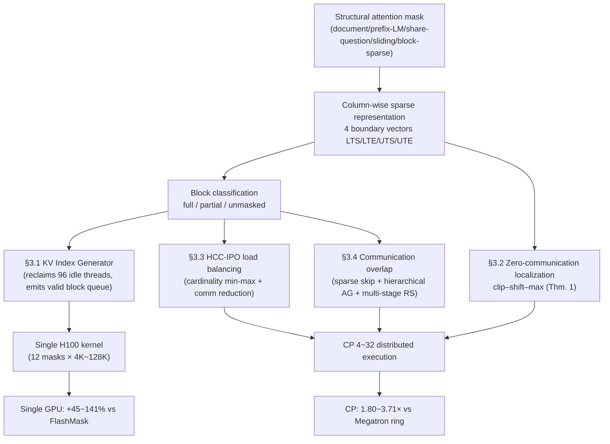

[Paper](https://arxiv.org/abs/2610.17901)
## FlashMask-3: Distributed Attention that Eliminates Mask Localization Communication

> **TL;DR** — Long-context training combines **structural attention masks**—such as document, prefix-LM, share-question, sliding-window, and block-sparse—with multi-node Context Parallelism (CP). Under this regime, mask materialization, mask-aware scheduling, and mask-induced load imbalance become first-class bottlenecks that dominate step time (source: §1). FlashAttention-3 (FA3) supports only causal, full, and varlen-document masks as first-class citizens, while FlashMask expresses 12+ patterns via four $O(n)$ boundary vectors but is an Ampere implementation lacking Hopper pipelining and distributed execution (source: §1, §2). By leveraging the asymmetry that "a column-wise sparse mask is **indexed by key positions yet stores intervals along the query axis**," FlashMask-3 reduces rank-local mask localization under arbitrary multi-chunk CP assignments to **zero-communication clip–shift–max** (source: §3.2, Thm. 1). On a single H100 across 12 masks and 4K–128K sequence lengths, it improves achieved TFLOPs/s by **45%–141%, 34%–71%, and 2%–44%** over FlashMask, FlexAttention, and MagiAttention, respectively, and achieves a **7.3%–11.0%** end-to-end throughput improvement over a Dual Chunk all-gather baseline in 128K training of a 118B-A14B MoE on 128 H100s (CP=16) (source: §4.1, §4.3, Tab. 1).

---

## Core Idea

The contribution of FlashMask-3 can be summarized in one sentence.

> It repurposes the asymmetry of the column-wise sparse representation—"indexed by keys while storing query-axis intervals"—as a lever for distributed localization. As a result, it turns rank-local mask generation under arbitrary multi-chunk CP assignments into **zero-communication clip–shift–max** (Thm. 1), enabling single-GPU kernels and multi-node distributed execution to share **a single mask schema and a single kernel binary** while jointly achieving near-FA3 Hopper throughput, load balance, and communication overlap (source: §1, §3).

This leads to three design choices (source: §3, Fig. 1).

1. **Rediscovering the column-wise sparse representation** — Using the fact that it is "indexed by keys and stores query-axis values" not merely for memory savings, but as a **lever for distributed localization**.
2. **One kernel, two execution modes** — Single-GPU execution and query-sharded CP execution share the same mask schema and the same kernel binary.
3. **Four-tier propagation of mask awareness** — Kernel scheduling (§3.1), mask localization (§3.2), load balancing (§3.3), and communication overlap (§3.4) all take the same boundary vectors as input, and block classification is reused across the kernel, host, and communication paths.

Differences from FlexAttention and MagiAttention are covered in §2.2 and the comparison table below. The key point is that FlashMask-3 does not stop at compressing masks, but reuses the asymmetry of its encoding axes for distributed localization (source: §3).

---

## Background: The Problem They Solved

### Problem 1: Structural Masks Have Become a First-Class Bottleneck in Long-Context Training

Long-context LLM and multimodal training encodes token-to-token relationships via **structural attention masks** to pack multiple documents, questions, and images into a single packed batch. Representative patterns include document, prefix-LM, share-question, sliding-window, and block-sparse (source: §1). As context lengths grow to hundreds of thousands of tokens and training scales out to multi-node CP, **mask materialization, mask-aware kernel scheduling, and mask-induced load imbalance** come to dominate step time (source: §1). Materializing the mask like a score matrix requires $O(n^2)$ storage, whereas FlashMask's column-wise sparse representation reduces this to $O(n)$ (source: Abstract, §2.2, App B).

### Problem 2: FA3 Supports a Narrow Set of Masks

FA3 boosts throughput on Hopper GPUs using TMA asynchronous loads, WGMMA instructions, and a warp-specialized producer–consumer pipeline. App B of the paper cites 740 TFLOPs/s on H100 for FA3 (source: §2.1, App B). However, §1 notes that FA3 provides first-class support only for **causal, full, and varlen-document** masks. Workloads requiring general structural masks cannot use FA3 as-is.

### Problem 3: Masks Break Balancing and Overlap Assumptions in CP

Dual chunking in Megatron CP pairs early and late query chunks to balance causal workloads. This scheme relies on the assumption that mask-induced workload varies monotonically. Under expressive masks (e.g., shared questions in RLHF, multi-document packing), this assumption breaks down, raising two additional challenges: (i) how to balance mask-induced sparse computation across ranks, and (ii) how to overlap forward all-gather and backward reduce-scatter with mask-aware computation (source: §2.3, App B).

### The Gap This Paper Fills

| Method | Mask Expressiveness | Hopper Throughput | Distributed Overhead | Trade-off |
|---|---|---|---|---|
| FlashAttention-3 | Limited (causal/full/varlen-doc, per §1) | Hopper-optimized | Unspecified in paper | No general structural mask support |
| FlexAttention | Arbitrary (mask_mod JIT) | Inferior to FA3 (Tab. 6: 0.53–0.69) | Per-rank local block mask reconstruction $O(QK/B^2)$ | Per-mask compilation cost |
| MagiAttention | Arbitrary (AttnSlice) | Inferior to FA3 (Tab. 6: 0.41–0.99) | Per-rank slice materialization | Dedicated FFA kernel (per-slice atomics) |
| FlashMask (Ampere) | Broad (12+ patterns) | No Hopper support | No distributed support | Lacks Hopper and distributed support |
| **FlashMask-3** | Broad (12+ patterns) | **Near-FA3 (Tab. 6: 0.71–1.00, on FA3-supported masks)** | **Zero-communication localization** | Restricted to column-wise representations |

A method simultaneously targeting expressiveness, Hopper throughput, and distributed support was missing, and FlashMask-3 fills this gap (source: §1).

---

## The New Approach: FlashMask-3

FlashMask-3 takes a column-wise sparse mask alongside the $(Q, K, V)$ tensors. Single-GPU execution and query-sharded CP execution share the same mask schema and kernel binary, propagating mask awareness across four tiers of the execution stack via four cooperative mechanisms (source: §3, Fig. 1).

### Premise: Column-Wise Sparse Mask Representation (§2.2)

FlashMask partitions the score matrix into lower-triangular and upper-triangular regions relative to the diagonal, encoding the **masked query rows at each key $j$** via four boundary vectors (source: §2.2):

$$
\text{masked query rows at key } j = [LTS_j,\ LTE_j) \cup [UTS_j,\ UTE_j)
$$

It uses four vectors $LTS, LTE, UTS, UTE \in \mathbb{Z}_{\ge 0}^{n}$, where the $j$-th entry of each vector is an integer boundary value. The tensors are indexed by **key position**, yet the values they hold are **interval boundaries along the query axis**. To illustrate with a causal mask, the query rows masked by key $j$ form $[0,j)$. The boundary values thus represent query-axis coordinates. The storage cost is $O(n)$ without materializing the $O(n^2)$ score matrix (source: Abstract, §2.2, App B).

The crux is this asymmetry: **indices along the key axis, values along the query axis**—which enables the zero-communication distributed localization in §3.2 (source: §2.2, §3.2).

### Hopper Mask-Aware Kernel: Three-Role Warp Specialization (§3.1)

FA3's producer warp group allocates 128 threads to TMA issue, but the paper notes that a single thread suffices for TMA issue, leaving 96 threads idle. FlashMask-3 reclaims these threads as a **third warp-specialized role: the KV Index Generator** (source: §3.1, Fig. 2).

- **KV Index Generator** — Scans the column-wise sparse boundaries to classify each query–key block as fully-masked, partially-masked, or unmasked, and emits a queue of valid blocks.
- **KV Loader** — Consumes the queue and issues TMA loads only for listed blocks.
- **MMA Consumer** — Executes the WGMMA score path and applies row-interval masks only to partially-masked blocks (source: §3.1, Fig. 2).

By inserting mask scanning as a **separate warp stage** rather than an inline branch inside the main compute loop, it avoids stalling the TMA queue or introducing barriers on the WGMMA critical path (source: §2.1, §3.1). The same classification is reused via independent paths in host preprocessing (§3.3) and communication filtering (§3.4).

Irregular masks can vary the number of valid K-blocks per Q-block by up to an order of magnitude, turning SMs assigned long-tail Q-blocks into stragglers under static tile assignment. FlashMask-3 therefore introduces a **Preemptive Persistent Tile (PPT) scheduler** where each CTA atomically claims the next Q-block from a global counter. Delegating atomic op issuance to the KV Index Generator overlaps preemption with mask scanning and keeps it off the WGMMA critical path (source: §3.1).

### Zero-Communication Mask Localization (§3.2, Thm. 1)

Localizing the global column-wise mask $F^g_M = (LTS, LTE, UTS, UTE) \in \mathbb{Z}_{\ge 0}^{4 \times N_K}$ to each rank **without communication** is the theoretical core. Suppose rank $r$ owns sorted query chunks $\{[O_i, O_i + C)\}_{i=0}^{n_r-1}$. Defining the single-chunk clip for any global boundary vector $x$ as $L_i(x)_k = \mathrm{clip}(x_k - O_i,\ 0,\ C)$, the rank-local boundary vector is (source: §3.2, Eq. 1):

$$
x^{(r)}_k = \max_{0 \le i < n_r}\Big( L_i(x)_k + \mathbb{1}[\,L_i(x)_k > 0\,] \cdot iC \Big)
$$

The roles of the four terms are clear: (1) $L_i$ maps the global boundary into chunk $i$'s local $[0, C)$ coordinates and clips values outside the chunk. (2) $L_i + iC$ embeds that local value into the rank-local concatenated space $\bigsqcup_i [iC, (i+1)C)$. (3) The indicator $\mathbb{1}[\cdot > 0]$ prevents contamination from empty clips—without it, a chunk whose clip vanishes would still contribute $iC$ and corrupt the maximum (source: §3.2, App C.1). (4) $\max_i$ ensures that only the chunk actually containing the boundary value contributes (source: §3.2). **Theorem 1** proves that this transformation produces rank-local intervals that exactly match the global mask without information loss (source: Thm. 1, App C.1).

Because this requires only the global mask and the offsets $\{O_i\}$ owned by the rank, there is **zero inter-rank communication**. The output preserves the exact kernel interface of §3.1, unifying arbitrary upstream chunk assignments (§3.3) under this single-tensor interface (source: §3.2).

### HCC-IPO Load Balancing (§3.3)

Exact joint optimization of compute and communication is intractable due to combinatorial explosion. FlashMask-3 alternates three stages via **HCC-IPO** (Hierarchical Compute-Communication Iterative Pairwise Optimal) (source: §3.3).

1. **Inter-rank compute balancing** — Cardinality-constrained min-max partitioning:
   $$
   \min_{\pi}\ \max_{j \in [P]} L_j(\pi), \quad \text{s.t.}\ |S_j(\pi)| = \kappa \ \forall j
   $$
   The compute load $w_i$ of chunk $i$ is the sum of tile costs derived from the block classification in App C.2 (with costs $\{0, \alpha_p, \alpha_u\}$). Reaching the lower bound $LB = \max\left(\lceil \tfrac{1}{P}\sum_i w_i \rceil,\ \max_i w_i \right)$ certifies global optimality (source: Thm. 2, App C.3).
2. **Inter-node communication reduction** — Swaps chunks across nodes while keeping compute balance within an $\epsilon$-tolerance to reduce maximum inter-node KV traffic $Comm_{\max}$.
3. **Intra-node rebalancing** — Fixes node assignments and re-applies IPO within each node.

Starting from an LPT initial solution, IPO iterates 2-way **Exact repartitioning** (Meet-in-the-Middle for $\kappa \le 10$, Branch-and-Bound otherwise) and 3-way **Feasible repartitioning** ($\kappa \le 8$). Because the output is deterministic, every rank obtains the identical assignment without communication (source: Thm. 2, App C.3). According to Tab. 3, LPT+P2+P3 achieves 0% suboptimality across all four configurations, which the paper summarizes as 100% LB-certified optimality. Note, however, that the † reference value for the $(128,16,8,200)$ configuration falls back to the LPT+P2+P3 result when the exact solver times out, so it is not an independent verification (source: Tab. 3, App C.3).

### Mask-Aware Compute–Communication Overlap (§3.4)

CP induces forward all-gather (AG) and backward reduce-scatter (RS). FlashMask-3 employs three mechanisms to hide them behind sparse attention (source: §3.4).

1. **Sparse mask-aware NVSHMEM symmetric substrate** — Places a single SR buffer sized to the full post-AG K and V in symmetric memory, allowing the attention kernel to read remote K and V via one-sided RDMA without intermediate copies. Prior to communication, a lightweight sparsity inspection kernel marks fully masked KV chunks in a binary `copy_chunk_mask` so the communication kernel skips them. Empirically, this eliminates **roughly 50% of AG/RS traffic** on typical causal document and prefix-LM document masks (source: §3.4). However, inter-node fetches (Phase 1) upon which same-node peers depend in Phase 2 are always executed regardless of the mask (source: App C.4.3).
2. **Decoupled hierarchical all-gather** — Exploiting the bandwidth asymmetry (5–10×) between RoCE (inter-node) and NVLink (intra-node), it routes Phase 1 as inter-node RoCE fetches along the congruence group $C(r) = \{r \bmod G + k \cdot G\}_{k=0}^{N-1}$ and Phase 2 as intra-node NVLink fetches. At $P=32$, inter-node pulls drop from $24 \to 3$, a reduction of roughly **90%** (source: §3.4, Eq. 4, App C.4).
3. **Multi-stage backward overlap** — Partitions the KV sequence into $T$ segments so that the RS of segment $t$ overlaps with the AG and backward attention of segment $t+1$. The backward pass uses KV column parallelism (where each CTA owns one KV chunk and iterates over all Q blocks), realizing RS as a sparse all-to-all via per-segment `work_done` flags and bitmask-AMO synchronization. The LSE saved during the forward pass eliminates cross-segment softmax rescaling, leaving virtually no overhead beyond fp32 dQ accumulation (source: §3.4, App C.5).

Communication kernels run on a high-priority non-blocking stream using only 4–8 SMs, and the overlap implementation requires fewer than 20 lines of changes to the attention kernel (source: §3.4).

---

## How It Works: A Concrete Walkthrough

### ① Why 'Key-Centric' Encoding Is Special

Consider a causal mask with $n = 8$. Key $j = 5$ masks query rows $[0, 5)$. This "masked interval" consists of **values along the query axis**, yet when stored, its index is attached to **key axis $j$**. In this example, both the interval start 0 and end 5 are query coordinates, while the location storing that boundary information is key index 5. This is an illustrative example explaining the encoding axes of §2.2 rather than a measured experimental result from the paper.

CP **shards queries across ranks**; because the boundary vectors already record "which queries are masked" for each key, simply applying **element-wise clip–shift–max** to the boundary vectors according to the query sharding completes the rank-local mask. No communication is needed to slice and distribute the global mask (source: §3.2).

### ② Working Through clip–shift–max by Hand (Illustrative Example)

The following is an **illustrative example** to aid intuition rather than an experiment from the paper. Suppose global key length $N_K = 8$, 2 ranks ($P=2$), chunk size $C=4$, rank 0 owns queries $[0,4)$, and rank 1 owns queries $[4,8)$. Suppose at some key $k$ the global boundary value is $LTS_k = 6$ (i.e., query rows $[6, \dots)$ are masked). Because each rank owns a single chunk ($i=0$), the actual shift term is 0.

| rank | Chunk Offset $O$ | $L(x)_k = \mathrm{clip}(6 - O,\ 0,\ 4)$ | Shift Term $\mathbb{1}[\cdot>0]\cdot iC$ | Result $x^{(r)}_k$ | Interpretation |
|---|---|---|---|---:|---|
| 0 | 0 | $\mathrm{clip}(6,0,4) = 4$ | $0$ | 4 | $4 = C$ → Masked interval starts beyond my chunk $[0,4)$, so no masking inside my interval |
| 1 | 4 | $\mathrm{clip}(2,0,4) = 2$ | $0$ | 2 | Global 6 → maps exactly to local $6-4 = 2$ |

Because global query row 6 lies inside rank 1's chunk, rank 1 obtains local boundary $LTS^{(1)}_k = 2$, whereas rank 0 clips to the upper bound $C = 4$, indicating "none inside my interval." Because this transformation is computed solely from the global mask and chunk offsets, there is zero inter-rank communication. Theorem 1 guarantees that interval membership in local coordinates is strictly equivalent to that in global coordinates (source: §3.2, Thm. 1, App C.1).

### ③ Removing the KV Index Generator Collapses Throughput

A configuration that isolates and removes a core component directly ports the Ampere FlashMask kernel onto the FA3 pipeline. Inline mask index calculation causes register spilling and clutters the pipeline with non-MMA instructions (source: App D.4). Table 7 quantifies this—showing forward TFLOPs/s for the "FA3-style Hopper port" (without the KV Index Generator) and its ratio relative to FlashMask-3. Because this port does not implement a backward pass, only the forward pass was measured (source: Tab. 7, App D.4).

| Seq | Mask | FlashMask-3 | FA3-Style Port (Ratio) |
|---|---|---:|---:|
| 8K | Full | 596.5 | 214.0 (0.36) |
| 8K | Causal | 553.3 | 241.9 (0.44) |
| 8K | Sliding Window | 432.2 | 35.8 (0.08) |
| 32K | Causal Document | 515.5 | 25.3 (0.05) |
| 128K | Document | 577.6 | 19.0 (0.03) |

On Full and Causal masks, it reaches only 0.34–0.45 of the full kernel—lower even than the 0.63–0.67 achieved by the original Ampere FlashMask in the same table. On structural masks, it **collapses to 0.03–0.13** (source: Tab. 7). The KV Index Generator eliminates this bottleneck by reclaiming idle producer threads and moving mask index generation off the MMA critical path. What this port comparison demonstrates is that, at least for the mask index generation bottleneck, simply porting to Hopper yields no gain; warp specialization including the KV Index Generator is essential. The paper does not attribute the entire +82.6% gain to a single factor (source: App D.4, §4.1).

### Overall Pipeline

---

## Performance Validation: Key Results

**Setup** — All experiments are conducted on NVIDIA H100 80 GB SXM5 GPUs (8 GPUs per node, dual Intel Xeon Platinum 8468V 48-core CPUs), intra-node NVLink and inter-node RoCE, CUDA 12.4, CUTLASS (commit afa177), NVSHMEM 3.2.5, head dim $d=128$, and BF16. Baselines are MagiAttention (commit d97b72), FlexAttention (PyTorch 2.8.0), and Megatron 2.8.0. Speed measurements are repeated, with error bars and ± values denoting ±1 standard deviation (source: §4, App D.1.1).

### Single-GPU Kernel (§4.1)

Twelve mask patterns across sequence lengths from 4K to 128K were evaluated on a single H100 (source: §4.1, Fig. 5). The geometric mean speedups are (source: §4.1, Tab. 4):

| Baseline | Min | Max | **Overall Geometric Mean** |
|---|---:|---:|---:|
| FlashMask | +44.9% | +140.5% | **+82.6%** |
| FlexAttention | +33.6% | +70.5% | **+55.3%** |
| MagiAttention | +2.0% | +44.1% | **+15.0%** |

The 15.0% speedup over MagiAttention is the geometric mean excluding the Random Eviction mask. The paper explicitly states this exclusion, noting that MagiAttention's block-sparse representation is over 50× slower on that mask. Consequently, this figure should be read with that caveat in mind (source: §4.1, App D.1.3, Fig. 9). The aggregate mean improvement over FlashMask grows from +66.2% at 8K to +97.3% at 128K (source: §4.1, Tab. 4).

### CP Scalability (§4.2)

Weak scaling protocol: fixed local sequence length per device $S_{local}=8K$, CP degree scaling from 4 to 32 (total sequence length 32K–256K), batch size $B=32/P$, $H_q=64$, $H_{kv}=1$ (GQA 64:1). Three masks are compared—Causal Document, Document, and Prefix LM Document—while the ring and all-gather variants of Megatron-Core CP do not support the Prefix LM Document mask and are omitted from that comparison (source: §4.2). On the Causal Document mask, FlashMask-3 scales from 430.5 TFLOPs/s at CP=4 to 501.6 TFLOPs/s at CP=32, maintaining strong scaling efficiency even as inter-node traffic begins at CP=16 (source: §4.2, Fig. 6).

Throughput improvements across all mask × CP configurations are (source: §4.2, Tab. 5):

| Baseline | Total FWD+BWD Speedup (Range) | Geometric Mean (± SD) |
|---|---:|---:|
| MagiAttention | 1.09×–1.46× | 1.26× ± 0.15× |
| Megatron CP (all-gather) | 1.71×–2.92× | 2.05× ± 0.39× |
| Megatron CP (ring) | 1.80×–3.71× | 2.42× ± 0.65× |

The paper explains that the effect of hiding communication latency behind computation is most pronounced in the forward pass (up to 4.12× over Megatron ring). In the backward pass, it maintains a roughly 2.2–2.4× advantage over both Megatron variants (source: App D.1.4). The compute–communication overlap efficiency $E_{overlap} = 1 - T_{exposed}/T_{comm}$ ranges from 0.31 to 0.75 across all masks and CP degrees (source: §4.4, Fig. 8).

### End-to-End Training (§4.3, Tab. 1)

A **118B-A14B MoE** model (118B total, 14B active parameters) was trained at a 128K context length on 128 H100s (16 nodes, CP=16, $S_{local}$=8K, $H_q$=64, $H_{kv}$=8, document mask). The baseline uses FlashMask-3 with Dual Chunk balancing + all-gather communication while disabling the §3.3 balancer and §3.4 overlap. Across three datasets with mask sparsity of 70%, 80%, and 86%:

| Sparsity | Baseline (tokens/s/GPU) | FlashMask-3 | **End-to-End Gain** | Attention F+B Speedup |
|---|---:|---:|---:|---:|
| 70% | 712.6 ± 8.7 | 764.7 ± 28.8 | **+7.3%** | +24.5% |
| 80% | 753.3 ± 34.7 | 811.4 ± 75.9 | **+7.7%** | +42.1% |
| 86% | 812.4 ± 57.1 | 902.1 ± 72.6 | **+11.0%** | +44.9% |

Although attention F+B speeds up by 24.5%–44.9%, end-to-end training improves by 7.3%–11.0%. This is because attention accounts for only 43.5%, 25.8%, and 24.4% of total F+B compute time, and the end-to-end measurement includes gradient synchronization and optimizer updates left unchanged by the method (step time drops from 10900.5 ms to 8757.6 ms at 70% sparsity) (source: §4.3, Tab. 1).

Component-wise contributions are +2.8%/+4.4%/+5.7% from balancing, +5.4%/+4.2%/+5.9% from overlap, and an additional +2.0%/+2.9%/+1.5% from chunk-skip pruning. Disabling hierarchical routing drops the combined balancing + overlap gain to −1.7%/−1.5%/+1.9%, worse than overlap alone—because once the balancer scatters chunks across nodes, traffic is no longer confined to congruence groups (source: §4.3, Tab. 1). Following the rule in §3.4, the number of backward pipeline segments defaults to 4 at P=16; reducing it to 2 incurs up to a 3.6% penalty, while increasing it to 8 yields no meaningful additional gain (source: §4.3).

FlashMask-3 computes **exact attention**. Mask localization matches the global mask exactly (Thm. 1), and balancing, overlap, and pruning alter only work placement rather than the numerical computation. Equivalence of convergence trajectories is verified via loss curves in App D.3: the loss curves of FlashMask trained without CP and FlashMask-3 at CP=16 are indistinguishable across 1,581 shared steps, with per-step residuals staying around $10^{-3}$—two orders of magnitude smaller than step-to-step fluctuations of the loss itself (source: App D.3, Fig. 12). Note, however, that this is a 1,581-step loss comparison; the paper does not report separate downstream evaluation benchmarks.

### Ablations (§4.4)

- **PPT Scheduler** — Across 12 mask configurations × 8K/32K/128K, the paper reports up to a **12%** improvement over a static scheduler (source: Fig. 7a).
- **IPO Balancing** — Among the four tested strategies (uniform KV sequence splitting, Dual Chunk, LPT, and IPO), IPO achieves the lowest peak/avg ratio across all three masks, further refining the LPT solution (source: §4.4, Fig. 7b). In a representative case (Causal Document, P=8, Fig. 11), the ratio goes from 1.19 (original contiguous assignment) → 1.37 (Dual Chunk) → 1.03 (IPO), coming closest to the ideal 1.0 (source: Fig. 11, App D.2).

### Candid Comparison with FA3 (Tab. 6)

Across the five masks grouped as FA3-supported in Tab. 6 (Full, Causal, Sliding Window, Causal Document, and Document), FlashMask-3 does not surpass FA3. The paper attributes this to FA3's specialization for its supported masks—i.e., the price of a general mask representation. On Full and Causal masks, FlashMask-3 reaches 0.90–1.00 of FA3 and recovers as sequences lengthen, reaching 1.00 (parity) on 128K Full. Sliding Window and the two document masks start lower at 8K (down to 0.71) before recovering to 0.92–0.95 at 128K (source: Tab. 6, App D.4). Across the same five masks relative to FA3, FlexAttention achieves 0.53–0.69, and MagiAttention lags further on structural and short-sequence settings, dropping to 0.41 on 8K Sliding Window (source: Tab. 6, App D.4).

As a side note, §1 restricts FA3's first-class support to causal, full, and varlen-document masks, whereas Tab. 6 measures five masks—including Sliding Window—as FA3-supported. The comparison above follows Tab. 6's classification.

---

## Our Perspective: Strengths, Limitations, and Why This Work Matters

### Strengths

1. **A clear, proven structural insight** — Turns the "key index · query value" asymmetry into a lever for distributed localization, backed by Theorem 1 (full proof in App C.1). The resource profile of mask localization is cleanly established as $O(n_r N_K)$ time, $O(N_K)$ memory, and 0 communication (source: Tab. 2, App C.1).
2. **One representation cutting across four tiers** — The same column-wise boundaries drive kernel scheduling, localization, load modeling, and communication filtering, while block classification is reused across kernel, host, and communication paths (source: §3).
3. **Transparency in evaluation** — Candidly reports where it trails FA3 in Tab. 6, isolates the naive Hopper port from the full kernel in Tab. 7, and verifies loss-curve equivalence in App D.3. It also explicitly states caveats behind headline figures (e.g., excluding Random Eviction from the 15% speedup over MagiAttention) (source: §4.1, Tab. 6, 7, App D.3).
4. **Validation at production scale** — Demonstrates end-to-end gains on a real-world workload (118B MoE, 128K context, 128 GPUs), proving it is more than a "fast kernel in isolation" study (source: §4.3).

### Limitations and Critique

**Author-acknowledged limitations** (source: App A):

1. Covers only the column-wise sparse mask family—masks whose masked rows per column cannot be decomposed into two intervals require extending the representation.
2. Assumes Hopper (TMA/WGMMA)—porting to other architectures requires retargeting the warp specialization.
3. Hierarchical overlap assumes 8-GPU NVLink islands per node plus rail-aligned inter-node IB topology.
4. Hierarchical routing applies only to forward all-gather—extending it to backward reduce-scatter is left for future work.
5. At small context lengths, scheduler overhead may not be fully amortized.
6. Systematic sweeps over batch size and $H_q/H_{kv}$ ratios remain future work.

**Additional points from a reviewer's perspective**:

1. **Practical ceiling on end-to-end gains** — Even when attention F+B speeds up by 24.5%–44.9%, end-to-end training improves by only 7.3%–11.0%. This is not a flaw of the method, but a structural reality: attention accounts for only 24.4%–43.5% of total F+B compute time, and gradient synchronization and optimizer steps remain unchanged. Putting "44.9%" and "11.0%" in the same sentence can be misleading, so readers should always distinguish which metric is being cited (source: §4.3, Tab. 1).
2. **TFLOPs/s calculation uses sparsity adjustment ($\rho$)** — FLOPs in Eqs. 8–10 multiply by effective density $\rho$ (the fraction of non-skipped tiles), measuring throughput in terms of "effective FLOPs." While this follows FlashMask's tile-skipping convention, higher mask sparsity causes the reported value to diverge further from raw FLOPs (source: App D.1.1). Furthermore, the 740 TFLOPs/s cited for FA3 in App B and the FWD+BWD TFLOPs/s in Tab. 6 should not be compared directly, as the paper does not state that their measurement configurations match.
3. **Scheduling cost is not free** — App D.5 reveals that at P=32 and chunk size 2048, scheduling takes 23–44 ms—on the same order of magnitude as the 35–67 ms attention execution—and thus relies on precomputation and prefetching to move it off the critical path. While this preprocessing is measured at 0.60%–0.75% of step time on the 128-GPU setup, workloads where mask types change frequently across layers would struggle to hide re-solving latency behind prefetching (source: App D.5, Tab. 8, 9).
4. **IPO's empirical margin over LPT is modest** — In Fig. 7(b), the peak/avg ratios of LPT and IPO sit right next to each other around 1.03–1.05, differing by ~0.01 even when IPO is lower. Because the 1.19 → 1.37 → 1.03 progression in Fig. 11 omits LPT, it is difficult to isolate IPO's incremental contribution there. On the synthetic instances in Tab. 3, however, IPO reaches LB-certified optimality (source: Fig. 7b, Fig. 11, Tab. 3).
5. **Reference baseline in Tab. 3** — LPT alone is suboptimal on 85%–100% of instances, and 48%–93.5% remain suboptimal after 2-way repartitioning (P2), requiring 3-way repartitioning (P3) to reach 0%. However, because the † reference value for $(128,16,8,200)$ falls back to the LPT+P2+P3 result upon exact solver timeout, that row does not provide independent verification. Moreover, max gap is reported only for the LPT and LPT+P2 columns, leaving the final IPO gap unreported (source: Tab. 3, App C.3).
6. **Mismatch between the monotonic-increase claim and Tab. 4** — §4.1 states that speedups increase monotonically with sequence length, yet the gain over MagiAttention in Tab. 4 actually drops from +25.0% at 8K to +5.9% at 128K. At least in the table's aggregate averages, speedups grow against FlashMask (+66.2% → +97.3%) and FlexAttention (+50.6% → +58.9%) but shrink against MagiAttention. Thus, the claim of a "monotonic increase across all comparisons" is inconsistent with the table (source: §4.1, Tab. 4).
7. **The +82.6% gain is not the result of a single factor** — The paper attributes this figure to the combined effect of three-role warp specialization, asynchronous TMA prefetching, Ping-Pong scheduling, and the PPT scheduler. While Tab. 7 compares FlashMask (Ampere), the FA3-style port without the KV Index Generator, and the full kernel, the full kernel also incorporates PPT, prefetching, and Ping-Pong scheduling, so the pure contribution of the KV Index Generator alone is not isolated. Their individual contributions are not reported in the paper (source: §4.1, App D.4).
8. **Limitations of static assignment under layer-varying masks** — Because HCC-IPO solves once using a weighted sum of per-mask-type cost scores, its assignment is less tailored to individual layers in models where masks vary across layers. The authors acknowledge this and include a conservative safeguard that uses HCC-IPO only when the predicted cost of the unified assignment beats Dual Chunk (source: App D.5).
9. **Absence of downstream quality measurements** — App D.3 compares only 1,581-step loss curves. While §4.3 argues that downstream quality is unaffected due to numerical exactness, no separate downstream benchmark scores are reported in the paper.
10. **Relationship to learnable sparse attention** — NSA and MoBA "learn where to attend," whereas FlashMask-3 "rapidly computes pre-specified structural masks." The paper views the two as complementary (App B). Whether learned selection will replace structural masks—or whether its patterns can be expressed via column-wise boundaries—is not experimentally explored in the paper.

### Why It Matters Anyway

In long-context training, masks are no longer auxiliary metadata but a first-class bottleneck dictating step time (source: §1). FlashMask-3's contribution lies in showing that the column-wise sparse representation is the right interface for making expressive masks practical in distributed execution. The fact that a representation originally conceived for single-GPU memory savings can be localized in multi-node CP **without communication** thanks to its axis asymmetry is precisely what allows this design to unify single-GPU and distributed execution under a single kernel (source: §5).

---

## What's Next?: The Road Ahead

**Open directions left by the authors** (source: App A, App D.5):

- **Extending expressiveness** — Supporting masks with more than two intervals per column (e.g., masks requiring three or more intervals) by extending the boundary vectors.
- **Extending hierarchical routing to backward reduce-scatter** — Applying congruence-group routing, currently used only in forward all-gather, to RS as well.
- **Porting to non-Hopper architectures** — Redesigning warp specialization on architectures without TMA/WGMMA.
- **Adaptive assignment for layer-varying masks** — Developing re-solving strategies to reduce the suboptimality of static assignments in stacks where masks change from layer to layer (source: App D.5).
- **Verifying amortization at small contexts** — Identifying the threshold context length below which scheduler overhead eats into kernel gains on short sequences (source: App A).

**Reviewer-suggested extensions** (exploratory suggestions, not reported in the paper):

- **Integration with learnable sparsity** — Expressing block patterns selected by learned mechanisms like NSA or MoBA as FlashMask-3 structural masks, bridging learned selection with hardware-aligned kernels (source: App B).
- **Online scheduling** — Replacing the current offline caching and prefetching schedule with incremental, online scheduling for scenarios where masks change dynamically at runtime, reducing reliance on prefetching assumptions (source: App D.5, Tab. 8).

### Summary

| Item | Details |
|---|---|
| Problem | Structural masks in long-context training bottleneck step time via materialization, scheduling, and load imbalance; FA3 supports a narrow mask set, and FlashMask lacks Hopper and distributed support |
| Core Insight | "Key index · query value" asymmetry of column-wise sparse masks → distributed localization reduces to zero-communication clip–shift–max (Thm. 1) |
| Method | Three-role warp specialization (Hopper kernel) + zero-communication localization + HCC-IPO balancing + mask-aware overlap (sparse skipping, hierarchical AG, multi-stage RS) |
| Nature | Exact attention, shared mask schema and kernel binary (single GPU = CP), assumes Hopper (H100) |
| Key Metrics | Single-GPU geomean +82.6% (FlashMask) / +55.3% (FlexAttention) / +15.0% (MagiAttention, excl. Random Eviction); CP 1.80–3.71× vs Megatron ring, 1.71–2.92× vs all-gather, 1.09–1.46× vs MagiAttention; 118B MoE 128K training (CP=16) +7.3%–11.0% |
| Limitations | Restricted to column-wise representations, assumes Hopper, hierarchical routing limited to AG, small-context amortization and downstream quality unverified |

Code: https://github.com/PaddlePaddle/FlashMask (public per paper abstract)

<!-- verbatim-tables -->

## Tables from the paper

> Tables converted mechanically from the arXiv e-print LaTeX source. The numbers are the paper's own and did not pass through a model.

**Table 1. End-to-end training throughput of a 118B-A14B MoE model (128K context, CP degree 16, $S_{\text{local}}{=}8$K tokens per device, $H_q{=}64$, $H_{kv}{=}8$, document mask) on 128 H100 GPUs, for three datasets of differing average mask sparsity. Each run covers 70 steps; we discard the 10 highest and 10 lowest throughput steps and report the mean ± one standard deviation over the remaining 50. $\Delta_{\text{attn}}$ is the corresponding attention forward+backward speedup over the baseline.**

| Configuration | 70% sparsity tokens/s/GPU | 70% sparsity $\Delta_{\text{attn}}$ | 80% sparsity tokens/s/GPU | 80% sparsity $\Delta_{\text{attn}}$ | 86% sparsity tokens/s/GPU | 86% sparsity $\Delta_{\text{attn}}$ |
|---|---|---|---|---|---|---|
| Baseline (Dual Chunk + all-gather) | 712.6 ± 8.7 | -- | 753.3 ± 34.7 | -- | 812.4 ± 57.1 | -- |
| + HCC-IPO balancing | 732.2 ± 24.5 | +10.4% | 786.2 ± 65.2 | +19.1% | 858.5 ± 62.1 | +10.5% |
| + mask-aware overlap | 750.8 ± 6.4 | +15.9% | 785.0 ± 33.6 | +13.9% | 860.0 ± 55.0 | +20.5% |
| + both, hierarchical routing off | 700.6 ± 28.8 | +8.4% | 742.0 ± 72.6 | +21.5% | 828.0 ± 60.6 | +23.2% |
| + both, w/o chunk-skip pruning | 750.0 ± 20.6 | +20.5% | 788.4 ± 55.0 | +25.4% | 888.6 ± 69.6 | +27.9% |
| **FlashMask-3 (balance + overlap)** | **764.7 ± 28.8** | **+24.5%** | **811.4 ± 75.9** | **+42.1%** | **902.1 ± 72.6** | **+44.9%** |

**Table 2. Resource profile of the FlashMask-3 distributed mask preprocessing on rank $r$ owning $n_r$ chunks. $N_K$ denotes the global key length. All operations are elementwise and parallelized over the key dimension.**

| Operation | Time | Memory | Cross-rank comm. | Kernel interface |
|---|---|---|---|---|
| Single-chunk clip (Def. ) | $O(N_K)$ | $O(N_K)$ | 0 | shared |
| Multi-chunk shift+merge (Def. ) | $O(n_r N_K)$ | $O(N_K)$ | 0 | shared |
| Total mask preprocessing | $O(n_r N_K)$ | $O(N_K)$ | **0** | **shared** |

**Table 3. IPO phase ablation across representative CP configurations. *Subopt*: fraction of random instances not matching the optimum. *Max gap*: worst-case relative excess over optimal makespan. *P3 wins*: cases where Phase 3 improves upon Phase 2. All configurations use 200 random instances (100 for $N\!=\!128$).**

| Configuration | $(N,P,\kappa,w_{\max})$ | LPT Subopt | LPT Gap | LPT+P2 Subopt | LPT+P2 Gap | LPT+P2+P3 Subopt | LPT+P2+P3 P3 wins |
|---|---|---|---|---|---|---|---|
| Uniform | $(64,16,4,10^3)$ | 99.0% | 6.54% | 86.0% | 6.29% | 0% | 172 |
| Uniform (wide) | $(64,16,4,10^4)$ | 100% | 8.67% | 93.5% | 3.42% | 0% | 187 |
| Causal | $(64,8,8,200)$ | 93.5% | 2.51% | 53.5% | 1.39% | 0% | 107 |
| Uniform$^\dagger$ | $(128,16,8,200)$ | 85.0% | 1.08% | 48.0% | 0.79% | 0% | 48 |

**Table 4. FlashMask-3 throughput improvement over baselines (forward+backward TFLOPs/s). Reported as $(T_{\text{ours}} / T_{\text{baseline}} - 1) \times 100\%$.**

| Baseline | Scope | Min | Max | Mean |
|---|---|---|---|---|
| FlexAttention | All | +33.6% | +70.5% | +55.3% |
|  | 8K | +33.6% | +62.9% | +50.6% |
|  | 128K | +51.9% | +70.0% | +58.9% |
| Magi-Attention | All | +2.0% | +44.1% | +15.0% |
|  | 8K | +12.0% | +44.1% | +25.0% |
|  | 128K | +2.0% | +8.9% | +5.9% |
| FlashMask | All | +44.9% | +140.5% | +82.6% |
|  | 8K | +44.9% | +84.8% | +66.2% |
|  | 128K | +74.4% | +140.5% | +97.3% |

**Table 5. FlashMask-3 speedup over distributed baselines (aggregated over all masks $\times$ CP sizes).**

| vs. Baseline | Phase | Min | Max | Geo.\ Mean ± std |
|---|---|---|---|---|
| MagiAttention | FWD | 1.04$\times$ | 2.39$\times$ | 1.56 ± 0.53$\times$ |
|  | BWD | 1.10$\times$ | 1.19$\times$ | 1.15 ± 0.03$\times$ |
|  | Total | 1.09$\times$ | 1.46$\times$ | 1.26 ± 0.15$\times$ |
| Megatron Ring | FWD | 1.62$\times$ | 4.12$\times$ | 2.50 ± 0.97$\times$ |
|  | BWD | 1.86$\times$ | 3.57$\times$ | 2.38 ± 0.56$\times$ |
|  | Total | 1.80$\times$ | 3.71$\times$ | 2.42 ± 0.65$\times$ |
| Megatron AllGather | FWD | 1.31$\times$ | 2.24$\times$ | 1.57 ± 0.31$\times$ |
|  | BWD | 1.85$\times$ | 3.15$\times$ | 2.21 ± 0.43$\times$ |
|  | Total | 1.71$\times$ | 2.92$\times$ | 2.05 ± 0.39$\times$ |

**Table 6. Single-GPU throughput on five masks supported by FA3 (total forward$+$backward TFLOPs/s, mean ± std over 50 iterations). Parentheses give the ratio to FA3.**

| Seq | Mask | FA3 | FlashMask-3 | FlexAttention | MagiAttention |
|---|---|---|---|---|---|
| 8K | Full | 604.43 ± 1.27 | 569.84 ± 1.88 (0.94) | 394.15 ± 1.34 (0.65) | 513.66 ± 8.95 (0.85) |
| 8K | Causal | 579.73 ± 0.35 | 520.85 ± 0.54 (0.90) | 341.68 ± 1.45 (0.59) | 482.17 ± 1.71 (0.83) |
| 8K | Sliding Window | 407.23 ± 1.54 | 290.30 ± 1.04 (0.71) | 218.93 ± 1.73 (0.54) | 166.22 ± 0.15 (0.41) |
| 8K | Causal Document | 478.96 ± 27.20 | 377.86 ± 35.26 (0.79) | 264.06 ± 18.37 (0.55) | 247.92 ± 47.43 (0.52) |
| 8K | Document | 546.29 ± 17.93 | 460.49 ± 31.77 (0.84) | 299.46 ± 26.68 (0.55) | 352.82 ± 48.32 (0.65) |
| 32K | Full | 616.65 ± 0.65 | 603.63 ± 1.48 (0.98) | 408.22 ± 0.02 (0.66) | 593.40 ± 1.30 (0.96) |
| 32K | Causal | 611.66 ± 0.59 | 587.87 ± 0.88 (0.96) | 371.48 ± 0.47 (0.61) | 563.30 ± 3.20 (0.92) |
| 32K | Sliding Window | 534.47 ± 1.71 | 465.00 ± 0.68 (0.87) | 309.52 ± 2.77 (0.58) | 378.13 ± 0.81 (0.71) |
| 32K | Causal Document | 532.68 ± 6.32 | 435.54 ± 15.28 (0.82) | 294.92 ± 8.42 (0.55) | 328.81 ± 21.48 (0.62) |
| 32K | Document | 592.03 ± 5.04 | 503.66 ± 6.68 (0.85) | 312.10 ± 19.68 (0.53) | 431.37 ± 17.05 (0.73) |
| 128K | Full | 603.12 ± 1.14 | 602.06 ± 0.92 (1.00) | 415.16 ± 0.40 (0.69) | 595.04 ± 2.00 (0.99) |
| 128K | Causal | 618.52 ± 0.48 | 587.92 ± 1.33 (0.95) | 377.21 ± 0.01 (0.61) | 580.09 ± 0.34 (0.94) |
| 128K | Sliding Window | 592.51 ± 0.46 | 561.46 ± 1.40 (0.95) | 358.07 ± 0.40 (0.60) | 514.87 ± 2.36 (0.87) |
| 128K | Causal Document | 591.87 ± 3.64 | 542.68 ± 6.73 (0.92) | 352.92 ± 3.70 (0.60) | 498.60 ± 8.79 (0.84) |
| 128K | Document | 615.62 ± 1.85 | 575.86 ± 4.11 (0.94) | 367.07 ± 7.90 (0.60) | 546.12 ± 3.83 (0.89) |

**Table 7. Isolating the warp specialization from the Hopper port (forward TFLOPs/s, mean ± std). Parentheses give the ratio to FlashMask-3.**

| Seq | Mask | FlashMask-3 | FlashMask | FA3-style Hopper port |
|---|---|---|---|---|
| 8K | Full | 596.53 ± 2.26 | 384.88 ± 1.84 (0.65) | 214.01 ± 0.23 (0.36) |
| 8K | Causal | 553.31 ± 1.13 | 373.46 ± 1.37 (0.67) | 241.86 ± 0.13 (0.44) |
| 8K | Sliding Window | 432.15 ± 6.60 | 256.63 ± 0.07 (0.59) | 35.77 ± 0.07 (0.08) |
| 8K | Causal Document | 483.97 ± 29.40 | 302.03 ± 15.27 (0.62) | 64.77 ± 15.83 (0.13) |
| 8K | Document | 532.26 ± 24.90 | 287.89 ± 34.54 (0.54) | 55.03 ± 14.14 (0.10) |
| 32K | Full | 614.19 ± 1.15 | 388.92 ± 1.84 (0.63) | 214.22 ± 0.08 (0.35) |
| 32K | Causal | 593.97 ± 0.87 | 379.46 ± 1.65 (0.64) | 244.95 ± 0.14 (0.41) |
| 32K | Sliding Window | 553.66 ± 2.78 | 274.60 ± 0.54 (0.50) | 31.20 ± 0.08 (0.06) |
| 32K | Causal Document | 515.48 ± 10.22 | 256.39 ± 9.50 (0.50) | 25.29 ± 2.81 (0.05) |
| 32K | Document | 544.56 ± 5.93 | 191.12 ± 36.15 (0.35) | 21.42 ± 2.48 (0.04) |
| 128K | Full | 613.49 ± 2.15 | 390.66 ± 0.19 (0.64) | 211.51 ± 0.53 (0.34) |
| 128K | Causal | 544.83 ± 0.55 | 359.79 ± 0.52 (0.66) | 245.99 ± 0.02 (0.45) |
| 128K | Sliding Window | 573.63 ± 0.94 | 274.44 ± 0.67 (0.48) | 29.96 ± 0.01 (0.05) |
| 128K | Causal Document | 554.50 ± 9.57 | 252.96 ± 9.03 (0.46) | 22.15 ± 2.44 (0.04) |
| 128K | Document | 577.55 ± 3.33 | 217.27 ± 40.17 (0.38) | 18.97 ± 2.08 (0.03) |

**Table 8. Standalone scheduling latency against attention time ($P{=}32$, chunk 2048).**

| Mask | Attention (ms) | Schedule (ms) |
|---|---|---|
| Causal Document | 35.08 ± 4.19 | 42.75 ± 8.90 |
| Document | 67.44 ± 8.78 | 23.52 ± 6.34 |
| Prefix LM Document | 35.84 ± 4.29 | 43.71 ± 6.33 |
