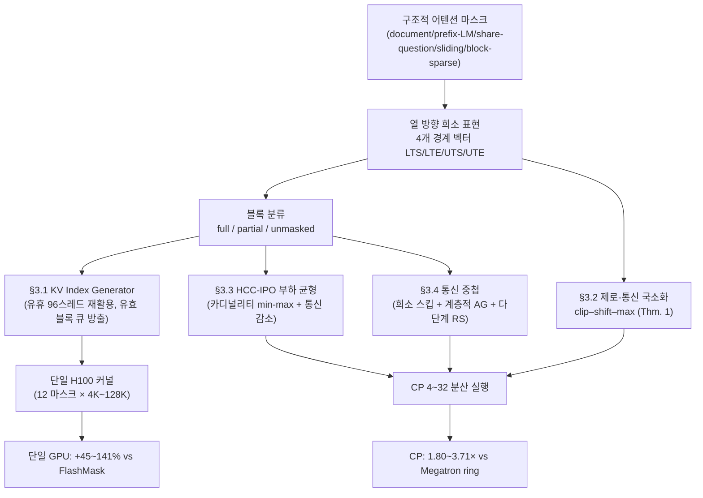

[논문 링크](https://arxiv.org/abs/2610.17901)
## FlashMask-3: 마스크 국소화 통신을 없애는 분산 어텐션

> **TL;DR** — 장문 컨텍스트 훈련은 document·prefix-LM·share-question·sliding-window·block-sparse 같은 **구조적 어텐션 마스크**를 멀티노드 CP(Context Parallelism)와 결합한다. 이때 마스크 물질화·마스크 인지 스케줄링·마스크 유발 부하 불균형이 스텝 시간을 지배하는 일급 병목이 된다(근거: §1). FlashAttention-3(FA3)는 causal·full·varlen-document 마스크만 일급으로 지원하고, FlashMask는 4개의 $O(n)$ 경계 벡터로 12+ 패턴을 표현하지만 Ampere 구현이라 Hopper 파이프라인과 분산을 지원하지 않는다(근거: §1, §2). FlashMask-3는 "열 방향 희소 마스크가 **키 위치로 인덱싱되지만 쿼리 축 구간을 저장한다**"는 비대칭성으로, 임의의 멀티청크 CP 배정에서 rank-local 마스크 국소화를 **제로-통신 clip–shift–max**로 환원한다(근거: §3.2, Thm. 1). 단일 H100에서 12개 마스크·4K~128K에 걸쳐 달성 TFLOPs/s를 FlashMask·FlexAttention·MagiAttention 대비 각각 **45%~141%·34%~71%·2%~44%** 높이고, 118B-A14B MoE의 128K 훈련(128 H100, CP=16)에서 Dual Chunk all-gather 기준선 대비 **7.3%~11.0%**의 end-to-end 처리량 향상을 얻는다(근거: §4.1, §4.3, Tab. 1).

---

## 핵심 아이디어

FlashMask-3의 기여는 한 문장으로 요약된다.

> "키로 인덱싱되고 쿼리 축 구간을 담는" 열 방향 희소 표현의 비대칭성을 분산 국소화의 지렛대로 재활용한다. 그 결과 임의의 멀티청크 CP 배정에서 rank-local 마스크를 **제로-통신 clip–shift–max**로 만들고(Thm. 1), 단일-GPU 커널과 멀티노드 분산 실행이 **하나의 마스크 스키마와 하나의 커널 바이너리**를 공유하면서 FA3에 근접하는 Hopper 처리량과 부하 균형·통신 중첩을 함께 달성한다(근거: §1, §3).

세 가지 설계 선택으로 이어진다(근거: §3, Fig. 1).

1. **열 방향 희소 표현의 재발견** — "키로 인덱싱되고 쿼리 축 값을 담는다"는 사실을 메모리 절약이 아니라 **분산 국소화의 지렛대**로 쓴다.
2. **하나의 커널, 두 개의 실행 모드** — 단일-GPU 실행과 쿼리 샤딩 CP 실행이 같은 마스크 스키마·같은 커널 바이너리를 공유한다.
3. **마스크 인지의 4층 전파** — 커널 스케줄링(§3.1)·마스크 국소화(§3.2)·부하 균형(§3.3)·통신 중첩(§3.4)이 같은 경계 벡터를 입력으로 쓰고, 블록 분류는 커널·호스트·통신 경로에서 재사용된다.

FlexAttention·MagiAttention과의 차이는 §2.2와 아래 비교표에서 다룬다. 요지는 FlashMask-3가 마스크를 압축하는 데서 멈추지 않고, 그 인코딩 축의 비대칭을 분산 국소화에 재활용한다는 점이다(근거: §3).

---

## 배경: 그들이 해결한 문제

### 문제 1: 구조적 마스크가 장문 훈련의 일급 병목이 됐다

장문 LLM·멀티모달 훈련은 하나의 packed 배치에 여러 문서·질문·이미지를 담기 위해 **구조적 어텐션 마스크**로 토큰 간 관계를 인코딩한다. document·prefix-LM·share-question·sliding-window·block-sparse 패턴이 대표적이다(근거: §1). 컨텍스트가 수십만 토큰으로 커지고 훈련이 멀티노드 CP로 확장되면서 **마스크 물질화, 마스크 인지 커널 스케줄링, 마스크 유발 부하 불균형**이 스텝 시간을 지배하게 된다(근거: §1). 마스크를 점수 행렬처럼 물질화하면 $O(n^2)$ 스토리지가 필요한 반면, FlashMask의 열 방향 희소 표현은 이를 $O(n)$으로 줄인다(근거: 초록, §2.2, App B).

### 문제 2: FA3는 지원 마스크가 좁다

FA3는 Hopper GPU에서 TMA 비동기 로드·WGMMA 명령·warp-specialized producer–consumer 파이프라인으로 처리량을 끌어올린다. 논문 App B는 FA3의 H100 740 TFLOPs/s를 인용한다(근거: §2.1, App B). 그러나 §1은 FA3가 일급으로 지원하는 마스크를 **causal·full·varlen-document**로 한정한다. 구조적 마스크가 필요한 워크로드에서는 FA3를 그대로 쓸 수 없다.

### 문제 3: CP에서 마스크가 균형·중첩 가정을 깨뜨린다

Megatron CP의 dual chunking은 초기와 후기의 쿼리 청크를 짝지어 causal 부하를 균형 맞춘다. 이 방식은 마스크에 따른 부하가 단조롭게 변한다는 가정에 기댄다. 표현력 있는 마스크(예: RLHF의 공유 질문, 다중 문서) 아래에서 이 가정이 무너지면서, (i) 마스크 유발 희소 연산을 rank 간에 어떻게 균형 잡을지, (ii) forward all-gather·backward reduce-scatter를 마스크 인지 연산과 어떻게 겹칠지가 추가 난제가 된다(근거: §2.3, App B).

### 이 논문이 채우는 공백

| 방법 | 마스크 표현력 | Hopper 처리량 | 분산 관련 비용 | 대가 |
|---|---|---|---|---|
| FlashAttention-3 | 제한적(causal/full/varlen-doc, §1 기준) | Hopper 최적화 | 원문 미기술 | 구조적 마스크 전반 미지원 |
| FlexAttention | 임의(mask_mod JIT) | FA3 대비 열세(Tab. 6: 0.53~0.69) | rank별 로컬 블록 마스크 재구성 $O(QK/B^2)$ | 마스크별 컴파일 비용 |
| MagiAttention | 임의(AttnSlice) | FA3 대비 열세(Tab. 6: 0.41~0.99) | rank별 슬라이스 물질화 | 전용 FFA 커널(슬라이스당 atomics) |
| FlashMask (Ampere) | 넓음(12+ 패턴) | Hopper 미지원 | 분산 미지원 | Hopper·분산 미지원 |
| **FlashMask-3** | 넓음(12+ 패턴) | **FA3 근접(Tab. 6: 0.71~1.00, FA3 지원 마스크 한정)** | **제로-통신 국소화** | 열 방향 표현 한정 |

표현력·Hopper 처리량·분산 지원을 동시에 겨냥한 방법이 공백이었고, FlashMask-3는 이를 메운다(근거: §1).

---

## 새로운 접근법: FlashMask-3

FlashMask-3는 $(Q, K, V)$ 텐서와 함께 열 방향 희소 마스크를 받는다. 단일-GPU 실행과 쿼리 샤딩 CP 실행이 같은 마스크 스키마와 같은 커널 바이너리를 쓰며, 마스크 인지는 실행 스택의 네 층에서 네 개의 협력 메커니즘으로 전파된다(근거: §3, Fig. 1).

### 전제: 열 방향 희소 마스크 표현 (§2.2)

FlashMask는 점수 행렬을 대각선 기준으로 하삼각·상삼각 영역으로 나누고, **각 키 $j$에서 마스킹되는 쿼리 행**을 네 개의 경계 벡터로 인코딩한다(근거: §2.2):

$$
\text{key } j \text{ 에서 마스킹된 쿼리 행} = [LTS_j,\ LTE_j) \cup [UTS_j,\ UTE_j)
$$

$LTS, LTE, UTS, UTE \in \mathbb{Z}_{\ge 0}^{n}$인 네 벡터를 사용한다. 각 벡터의 $j$번째 성분은 정수 경계값이다. 텐서는 **키 위치별**로 인덱싱되지만 담는 값은 **쿼리 축 구간의 경계**다. 설명용으로 causal 마스크를 생각하면, 키 $j$가 마스킹하는 쿼리 행은 $[0,j)$이다. 경계값은 이처럼 쿼리 축 좌표를 뜻한다. 저장 비용은 $O(n)$이며 $O(n^2)$ 점수 행렬을 물질화하지 않는다(근거: 초록, §2.2, App B).

핵심은 이 비대칭성이다. **인덱스는 키 축, 값은 쿼리 축** — 이것이 §3.2의 제로-통신 분산 국소화를 가능하게 한다(근거: §2.2, §3.2).

### Hopper 마스크 인지 커널: 삼중 역할 warp specialization (§3.1)

FA3의 producer warp group은 128스레드를 TMA 발행에 할당하지만, 논문은 TMA 발행에 1스레드면 충분하다고 서술하며 96스레드가 유휴라고 본다. FlashMask-3는 이 스레드를 **세 번째 warp-specialized 역할인 KV Index Generator**로 되찾는다(근거: §3.1, Fig. 2).

- **KV Index Generator** — 열 방향 희소 경계를 스캔해 각 쿼리–키 블록을 fully-masked / partially-masked / unmasked로 분류하고 유효 블록 큐를 방출한다.
- **KV Loader** — 큐를 소비해 목록에 있는 블록에만 TMA 로드를 발행한다.
- **MMA Consumer** — WGMMA 점수 경로를 수행하고, partially-masked 블록에만 행-구간(row-interval) 마스크를 적용한다(근거: §3.1, Fig. 2).

마스크 스캔을 주 연산 루프의 인라인 분기로 넣지 않고 **별도 warp 단계**로 삽입해 TMA 큐를 막거나 WGMMA 임계 경로에 barrier를 만들지 않는다(근거: §2.1, §3.1). 같은 분류가 §3.3의 호스트 전처리와 §3.4의 통신 필터링에 독립 경로로 재사용된다.

불규칙 마스크는 Q-블록별 유효 K-블록 수를 한 차수까지 벌려, 정적 타일 배정에서 롱테일 Q-블록을 가진 SM이 스트래글러가 된다. 그래서 **Preemptive Persistent Tile(PPT) 스케줄러**를 도입해 각 CTA가 전역 카운터에서 다음 Q-블록을 원자적으로 선점하게 한다. atomic op 발행을 KV Index Generator에 맡겨 선점이 마스크 스캔과 겹치고 WGMMA 임계 경로 밖에 놓인다(근거: §3.1).

### 제로-통신 마스크 국소화 (§3.2, Thm. 1)

전역 열 방향 마스크 $F^g_M = (LTS, LTE, UTS, UTE) \in \mathbb{Z}_{\ge 0}^{4 \times N_K}$를 **통신 없이** 각 rank로 국소화하는 것이 이론적 핵심이다. rank $r$이 정렬된 쿼리 청크 $\{[O_i, O_i + C)\}_{i=0}^{n_r-1}$을 소유한다고 하자. 임의의 전역 경계 벡터 $x$에 대해 단일 청크 클립을 $L_i(x)_k = \mathrm{clip}(x_k - O_i,\ 0,\ C)$로 정의하면, rank-local 경계 벡터는(근거: §3.2, Eq. 1):

$$
x^{(r)}_k = \max_{0 \le i < n_r}\Big( L_i(x)_k + \mathbb{1}[\,L_i(x)_k > 0\,] \cdot iC \Big)
$$

네 항의 역할은 명확하다. (1) $L_i$는 전역 경계를 청크 $i$의 로컬 $[0, C)$ 좌표로 매핑하고 청크 밖 값을 클립한다. (2) $L_i + iC$는 그 로컬 값을 rank-local 연결 공간 $\bigsqcup_i [iC, (i+1)C)$에 심는다. (3) 지시함수 $\mathbb{1}[\cdot > 0]$는 비어 있는 클립의 오염을 막는다 — 없으면 클립이 사라진 청크가 $iC$를 기여해 최댓값을 오염시킨다(근거: §3.2, App C.1). (4) $\max_i$는 경계 값을 실제로 담은 청크만 기여하게 한다(근거: §3.2). **Theorem 1**은 이 변환이 정보 손실 없이 전역 마스크와 정확히 일치하는 rank-local 구간을 만듦을 증명한다(근거: Thm. 1, App C.1).

필요한 것은 전역 마스크와 rank가 소유한 오프셋 $\{O_i\}$뿐이므로 **rank 간 통신이 없다**. 출력은 §3.1의 커널 인터페이스를 그대로 보존하므로, 상위의 어떤 청크 배정(§3.3)도 이 단일 텐서 인터페이스로 통합된다(근거: §3.2).

### HCC-IPO 부하 균형 (§3.3)

정확한 연산·통신 공동 최적화는 조합 폭발 때문에 난해하다. FlashMask-3는 **HCC-IPO**(Hierarchical Compute-Communication Iterative Pairwise Optimal)로 세 단계를 번갈아 수행한다(근거: §3.3).

1. **rank 간 연산 균형** — 카디널리티 제약 하의 min-max 분할
   $$
   \min_{\pi}\ \max_{j \in [P]} L_j(\pi), \quad \text{s.t.}\ |S_j(\pi)| = \kappa \ \forall j
   $$
   청크 $i$의 연산 부하 $w_i$는 App C.2의 블록 분류(비용 $\{0, \alpha_p, \alpha_u\}$)에서 유도된 타일 비용의 합이다. 하한 $LB = \max\left(\lceil \tfrac{1}{P}\sum_i w_i \rceil,\ \max_i w_i \right)$에 도달하면 전역 최적이 증명서로 인증된다(근거: Thm. 2, App C.3).
2. **노드 간 통신 감소** — $\epsilon$-허용 범위 안에서 연산 균형을 유지하며 청크를 노드 간에 맞교환해 최대 inter-node KV 트래픽 $Comm_{\max}$을 줄인다.
3. **노드 내 재균형** — 노드 배정을 고정한 채 노드 내부에서 다시 IPO를 적용한다.

IPO는 LPT 초기해에서 시작해 2-way **정확(Exact) 재분할**($\kappa \le 10$은 Meet-in-the-Middle, 그 외 Branch-and-Bound)과 3-way **실행가능(Feasible) 재분할**($\kappa \le 8$)을 반복한다. 출력은 결정적이라 모든 rank가 통신 없이 동일한 배정을 얻는다(근거: Thm. 2, App C.3). Tab. 3의 보고에 따르면 LPT+P2+P3는 네 구성 모두에서 subopt 0%를 기록했고, 논문은 이를 100% LB-certified optimality로 요약한다. 단 $(128,16,8,200)$ 구성의 † 기준값은 exact solver timeout 시 LPT+P2+P3 결과를 대신 쓴 것이므로 독립 검증이 아니다(근거: Tab. 3, App C.3).

### 마스크 인지 계산-통신 중첩 (§3.4)

CP는 forward all-gather(AG)와 backward reduce-scatter(RS)를 낳는다. FlashMask-3는 이를 희소 어텐션 뒤에 숨기기 위해 세 메커니즘을 쓴다(근거: §3.4).

1. **희소 마스크 인지 NVSHMEM 대칭 기판** — post-AG K, V 전체 크기의 단일 SR 버퍼를 대칭 메모리에 두고, 어텐션 커널이 중간 복사 없이 원격 K, V를 one-sided RDMA로 읽는다. 통신 전 가벼운 희소 검사 커널이 완전히 마스킹된 KV 청크를 이진 `copy_chunk_mask`로 표시해 통신 커널이 건너뛴다. 전형적인 causal document·prefix-LM document 마스크에서 실험상 **AG/RS 트래픽 약 50%**가 제거된다(근거: §3.4). 단, 동노드 peer가 Phase 2에 의존하는 노드 간 fetch(Phase 1)는 마스크와 무관하게 항상 수행된다(근거: App C.4.3).
2. **분리된 계층적 all-gather** — RoCE(노드 간)와 NVLink(노드 내)의 대역폭 비대칭(5~10배)을 이용해, congruence group $C(r) = \{r \bmod G + k \cdot G\}_{k=0}^{N-1}$을 따라 Phase 1은 노드 간 RoCE fetch, Phase 2는 노드 내 NVLink fetch로 라우팅한다. $P=32$에서 inter-node pull이 $24 \to 3$으로 약 **90%** 감소한다(근거: §3.4, Eq. 4, App C.4).
3. **다단계 backward 중첩** — KV 시퀀스를 $T$개 세그먼트로 나눠, 세그먼트 $t$의 RS가 세그먼트 $t+1$의 AG·backward 어텐션과 겹치게 한다. backward는 KV column parallelism(CTA가 KV 청크 하나를 소유하고 모든 Q 블록을 순회)을 쓰고, 세그먼트별 `work_done` 플래그와 bitmask-AMO 동기화로 RS를 희소 all-to-all로 실현한다. forward에서 저장한 LSE가 교차 세그먼트 softmax 재스케일링을 제거해, fp32 dQ 누적 외의 오버헤드가 거의 없다(근거: §3.4, App C.5).

통신 커널은 고우선순위 non-blocking 스트림에서 SM 4~8개만 사용하며, 오버랩 구현은 어텐션 커널에 대한 변경이 20줄 미만이다(근거: §3.4).

---

## 작동 원리: 구체적인 예시로 살펴보기

### ① '키 관점' 인코딩이 왜 특별한가

$n = 8$의 causal 마스크를 보자. 키 $j = 5$는 쿼리 행 $[0, 5)$를 마스킹한다. 이 "마스킹 구간"은 **쿼리 축의 값**인데, 저장할 때 인덱스는 **키 축 $j$**에 붙는다. 이 예시에서 구간의 시작 0과 끝 5는 모두 쿼리 좌표이며, 그 경계 정보를 저장하는 위치는 키 인덱스 5다. 이는 §2.2의 인코딩 축을 설명하는 예시이며 논문의 측정 결과는 아니다.

CP는 **쿼리를 rank 간에 나누는데**, 경계 벡터가 이미 "어느 쿼리가 마스킹되는가"를 키별로 담고 있으므로, 쿼리 샤딩에 맞춰 경계 벡터에 **원소 단위 clip–shift–max만** 적용하면 rank-local 마스크가 완성된다. 전역 마스크를 통째로 나눠 보내는 통신이 필요 없다(근거: §3.2).

### ② clip–shift–max를 손으로 계산해 보기 (설명용 예시)

아래는 논문 실험이 아니라 이해를 돕기 위한 **설명용 예시**다. 전역 키 길이 $N_K = 8$, rank 2개($P=2$), 청크 크기 $C=4$, rank 0은 쿼리 $[0,4)$, rank 1은 쿼리 $[4,8)$을 소유한다고 하자. 어떤 키 $k$에서 전역 경계 값이 $LTS_k = 6$(즉 쿼리 행 $[6, \dots)$이 마스킹)이라 하자. 단일 청크 소유라 $i=0$이므로 실제 이동항은 0이다.

| rank | 청크 오프셋 $O$ | $L(x)_k = \mathrm{clip}(6 - O,\ 0,\ 4)$ | 이동항 $\mathbb{1}[\cdot>0]\cdot iC$ | 결과 $x^{(r)}_k$ | 해석 |
|---|---|---|---|---:|---|
| 0 | 0 | $\mathrm{clip}(6,0,4) = 4$ | $0$ | 4 | $4 = C$ → 마스킹 구간이 내 청크 $[0,4)$ 밖에서 시작하므로 내 구간엔 마스킹 없음 |
| 1 | 4 | $\mathrm{clip}(2,0,4) = 2$ | $0$ | 2 | 전역 6 → 로컬 $6-4 = 2$에 정확히 대응 |

전역 쿼리 행 6은 rank 1의 청크 안에 있으므로 rank 1은 로컬 경계 $LTS^{(1)}_k = 2$를 얻고, rank 0은 상한 $C = 4$로 클립되어 "내 구간엔 없다"가 된다. 이 변환은 전역 마스크와 청크 오프셋만으로 계산되므로 rank 간 통신이 전혀 없다. Theorem 1이 로컬 좌표의 구간 포함 여부가 전역 좌표와 정확히 동치임을 보장한다(근거: §3.2, Thm. 1, App C.1).

### ③ KV Index Generator를 없애면 처리량이 급락한다

핵심 구성요소 하나를 뽑아 제거한 설정은 Ampere FlashMask 커널을 FA3 파이프라인에 그대로 포팅한 것이다. 인라인 마스크 인덱스 계산이 레지스터를 넘치게 하고 파이프라인을 비-MMA 명령으로 채워버린다(근거: App D.4). Table 7이 이를 수치로 보여준다 — "FA3 스타일 Hopper 포트"(KV Index Generator 없음)의 forward TFLOPs/s와 FlashMask-3 대비 비율이다. 이 설정은 backward를 구현하지 않아 forward만 측정했다(근거: Tab. 7, App D.4).

| Seq | 마스크 | FlashMask-3 | FA3 스타일 포트 (비율) |
|---|---|---:|---:|
| 8K | Full | 596.5 | 214.0 (0.36) |
| 8K | Causal | 553.3 | 241.9 (0.44) |
| 8K | Sliding Window | 432.2 | 35.8 (0.08) |
| 32K | Causal Document | 515.5 | 25.3 (0.05) |
| 128K | Document | 577.6 | 19.0 (0.03) |

Full·Causal에서는 전체 커널 대비 0.34~0.45에 그쳐, 같은 표에서 원래 Ampere FlashMask가 기록한 0.63~0.67보다도 낮다. 구조적 마스크에서는 **0.03~0.13으로 붕괴**한다(근거: Tab. 7). KV Index Generator는 유휴 producer 스레드를 되찾아 마스크 인덱스 생성을 MMA 임계 경로 밖으로 옮김으로써 이 병목을 없앤다. 이 포트 비교가 보여주는 것은, 적어도 마스크 인덱스 생성 병목에서는 Hopper로 옮긴 것만으로 이득이 나오지 않고 KV Index Generator를 포함한 warp specialization이 필요하다는 점이다. +82.6% 전체를 단일 요소로 돌리지는 않는다(근거: App D.4, §4.1).

### 전체 파이프라인

---

## 성능 검증: 주요 결과

**설정** — 모든 실험은 NVIDIA H100 80 GB SXM5(노드당 8 GPU, Intel Xeon Platinum 8468V 48코어), 노드 내 NVLink·노드 간 RoCE, CUDA 12.4, CUTLASS(commit afa177), NVSHMEM 3.2.5, head dim $d=128$, BF16에서 수행된다. 기준선은 MagiAttention(commit d97b72), FlexAttention(PyTorch 2.8.0), Megatron 2.8.0다. 속도 측정은 반복되며 오차막대·±값은 ±1 표준편차다(근거: §4, App D.1.1).

### 단일 GPU 커널 (§4.1)

12개 마스크 패턴, 시퀀스 4K~128K를 단일 H100에서 측정했다(근거: §4.1, Fig. 5). 기하평균 속도 향상은(근거: §4.1, Tab. 4):

| 기준선 | 최소 | 최대 | **전 구간 기하평균** |
|---|---:|---:|---:|
| FlashMask | +44.9% | +140.5% | **+82.6%** |
| FlexAttention | +33.6% | +70.5% | **+55.3%** |
| MagiAttention | +2.0% | +44.1% | **+15.0%** |

MagiAttention의 15.0%는 Random Eviction 마스크를 제외한 기하평균이다. 논문은 해당 마스크에서 MagiAttention의 블록 희소 표현이 50배 이상 느리다고 밝히며, 이 제외를 명시한다. 따라서 이 수치는 그 조건을 함께 읽어야 한다(근거: §4.1, App D.1.3, Fig. 9). FlashMask 대비 향상은 집계 평균 기준 8K의 +66.2%에서 128K의 +97.3%로 커진다(근거: §4.1, Tab. 4).

### CP 확장성 (§4.2)

약확장(weak scaling) 프로토콜: 장치당 로컬 시퀀스 $S_{local}=8K$ 고정, CP degree 4→32(총 시퀀스 32K~256K), batch $B=32/P$, $H_q=64$, $H_{kv}=1$(GQA 64:1). 비교 대상 마스크는 Causal Document·Document·Prefix LM Document 세 가지이며, Megatron-Core CP의 ring·all-gather 변형은 Prefix LM Document 마스크를 지원하지 않아 해당 비교에서 제외된다(근거: §4.2). Causal Document 마스크에서 FlashMask-3는 CP=4의 430.5 TFLOPs/s에서 CP=32의 501.6 TFLOPs/s로 오르며, CP 16부터 노드 간 트래픽이 시작됨에도 강한 확장 효율을 유지한다(근거: §4.2, Fig. 6).

전체 마스크 × CP 구간에서의 처리량 향상은(근거: §4.2, Tab. 5):

| 기준선 | 총 FWD+BWD 향상(범위) | 기하평균 (± 표준편차) |
|---|---:|---:|
| MagiAttention | 1.09×~1.46× | 1.26× ± 0.15× |
| Megatron CP (all-gather) | 1.71×~2.92× | 2.05× ± 0.39× |
| Megatron CP (ring) | 1.80×~3.71× | 2.42× ± 0.65× |

논문은 forward에서 통신 지연이 계산 뒤에 숨는 효과가 가장 크다고 설명한다(Megatron ring 대비 최대 4.12×). backward에서는 두 Megatron 변형 모두에 대해 약 2.2~2.4×의 우위를 유지한다(근거: App D.1.4). 계산-통신 중첩 효율 $E_{overlap} = 1 - T_{exposed}/T_{comm}$은 마스크·CP 전 구간에서 0.31~0.75를 기록한다(근거: §4.4, Fig. 8).

### End-to-end 훈련 (§4.3, Tab. 1)

**118B-A14B MoE**(총 118B, 활성 14B) 모델을 128K 컨텍스트로 128 H100(16노드, CP=16, $S_{local}$=8K, $H_q$=64, $H_{kv}$=8, document mask)에서 훈련했다. 기준선은 FlashMask-3에서 Dual Chunk 균형 + all-gather 통신을 쓰고 §3.3의 균형기와 §3.4의 중첩을 끈 것이다. 마스크 희소도 70%/80%/86%의 세 데이터셋에서:

| 희소도 | 기준선(tokens/s/GPU) | FlashMask-3 | **end-to-end 향상** | 어텐션 F+B 속도향상 |
|---|---:|---:|---:|---:|
| 70% | 712.6 ± 8.7 | 764.7 ± 28.8 | **+7.3%** | +24.5% |
| 80% | 753.3 ± 34.7 | 811.4 ± 75.9 | **+7.7%** | +42.1% |
| 86% | 812.4 ± 57.1 | 902.1 ± 72.6 | **+11.0%** | +44.9% |

어텐션 F+B는 24.5%~44.9% 빨라졌지만 end-to-end는 7.3%~11.0%에 그친다. 어텐션이 전체 F+B 연산 시간의 43.5%/25.8%/24.4%만 차지하고, 측정 범위가 방법이 바꾸지 않는 그래디언트 동기화·옵티마이저 업데이트까지 포함하기 때문이다(70% 희소도 기준 스텝 10900.5 ms → 8757.6 ms)(근거: §4.3, Tab. 1).

구성요소별 기여는 균형 +2.8%/+4.4%/+5.7%, 중첩 +5.4%/+4.2%/+5.9%, 청크 스킵 프루닝 추가 +2.0%/+2.9%/+1.5%다. 계층적 라우팅을 끄면 균형+중첩 조합이 −1.7%/−1.5%/+1.9%로, 중첩 단독보다도 낮아진다 — 균형기가 청크를 노드 간에 흩어버리면 그 트래픽이 더 이상 congruence group에 갇히지 않기 때문이다(근거: §4.3, Tab. 1). backward 파이프라인 세그먼트 수는 §3.4의 규칙대로 P=16에서 4가 기본이고, 2로 낮추면 최대 3.6% 손해, 8로 올리면 의미 있는 추가 이득이 없다(근거: §4.3).

FlashMask-3는 **정확한 어텐션**을 계산한다. 마스크 국소화는 전역 마스크와 일치하고(Thm. 1), 균형·중첩·프루닝은 작업 배치만 바꾸지 계산 내용을 바꾸지 않는다. 수렴 경로의 동등성은 App D.3에서 손실 곡선으로 확인된다: CP 없이 훈련한 FlashMask와 CP=16 FlashMask-3의 손실 곡선이 공통 1,581 스텝에 걸쳐 구분 불가능하며, 스텝별 잔차는 손실 자체의 스텝 간 변동보다 두 자릿수 낮은 $10^{-3}$ 수준으로 유지된다(근거: App D.3, Fig. 12). 다만 이는 1,581스텝 손실 비교이며, 다운스트림 품질을 별도로 측정한 수치는 원문에 없다.

### 어블레이션 (§4.4)

- **PPT 스케줄러** — 12개 마스크 구성 × 8K/32K/128K에서 정적 스케줄러 대비 논문은 최대 **12%** 향상을 보고한다(근거: Fig. 7a).
- **IPO 균형** — 검사한 네 전략(KV 시퀀스 균등 분할, Dual Chunk, LPT, IPO) 중 IPO가 세 마스크 전부에서 최저 peak/avg를 기록하며, LPT 해를 한 단계 더 정제한다(근거: §4.4, Fig. 7b). 대표 사례(Causal Document, P=8, Fig. 11)에서는 원본 연속 배정 1.19 → Dual Chunk 1.37 → IPO 1.03으로, 이상값 1.0에 가장 근접하다(근거: Fig. 11, App D.2).

### FA3와의 솔직한 비교 (Tab. 6)

논문 Tab. 6이 FA3 지원 대상으로 묶은 5개 마스크(Full·Causal·Sliding Window·Causal Document·Document)에서 FlashMask-3는 FA3를 넘지 못한다. 논문은 이를 FA3가 지원 마스크를 특화한 결과, 즉 일반 마스크 표현의 비용으로 설명한다. Full·Causal에서 FA3 대비 0.90~1.00이고 시퀀스가 길어질수록 회복해 128K Full에서 1.00(동률)에 이른다. Sliding Window·두 document 마스크는 8K에서 더 낮다가(최저 0.71) 128K에서 0.92~0.95로 회복한다(근거: Tab. 6, App D.4). 같은 5개 마스크 기준으로 FA3 대비 FlexAttention은 0.53~0.69, MagiAttention은 구조적·짧은 구간에서 더 뒤처져 8K Sliding Window에서 0.41까지 내려간다(근거: Tab. 6, App D.4).

참고로 §1은 FA3의 일급 지원을 causal·full·varlen-document로 한정하지만, Tab. 6은 Sliding Window를 포함한 5개를 FA3 지원 마스크로 측정한다. 위 비교는 Tab. 6의 분류를 따른다.

---

## 우리의 관점: 강점, 한계, 그리고 이 연구가 중요한 이유

### 강점

1. **명료하고 증명된 구조적 통찰** — "키 인덱스 · 쿼리 값" 비대칭을 분산 국소화의 지렛대로 전환하고, 이를 Theorem 1(전체 증명, App C.1)로 뒷받침한다. 마스크 국소화의 자원 프로필은 시간 $O(n_r N_K)$·메모리 $O(N_K)$·통신 0으로 정리되어 있다(근거: Tab. 2, App C.1).
2. **하나의 표현이 네 층을 관통** — 같은 열 방향 경계가 커널 스케줄링·국소화·부하 모델·통신 필터링에 쓰이고, 블록 분류는 커널·호스트·통신 경로에서 재사용된다(근거: §3).
3. **평가의 투명성** — FA3에 지는 부분을 Tab. 6에 그대로 싣고, Hopper 포트만 한 경우와 전체 커널의 차이를 Tab. 7로 분리하며, 손실 곡선 동등성을 App D.3으로 확인한다. headline 수치의 조건(예: MagiAttention 15%가 Random Eviction 제외)도 명시한다(근거: §4.1, Tab. 6, 7, App D.3).
4. **실제 생산 규모 검증** — 118B MoE·128K·128 GPU라는 실전 워크로드에서 end-to-end 이득을 확인해, "커널만 빠른" 연구가 아님을 보였다(근거: §4.3).

### 한계와 비판

**저자가 명시한 한계**(근거: App A):

1. 열 방향 희소 마스크 계열만 커버 — 컬럼당 마스킹 행이 두 구간으로 분해되지 않는 마스크는 표현 확장이 필요하다.
2. Hopper(TMA/WGMMA) 전제 — 다른 아키텍처 포팅은 warp specialization 재타게팅이 필요하다.
3. 계층적 중첩이 노드당 8-GPU NVLink 섬 + 동일 rank 간 IB 토폴로지를 가정한다.
4. 계층적 라우팅이 forward all-gather에만 적용 — backward reduce-scatter로의 확장은 미래 과제다.
5. 소규모 컨텍스트에서는 스케줄러 오버헤드가 상각되지 않을 수 있다.
6. 배치·$H_q/H_{kv}$ 비의 체계적 스윕이 남았다.

**리뷰어로서 추가로 짚을 점**:

1. **end-to-end 이득의 현실적 상한** — 어텐션 F+B가 24.5%~44.9% 빨라져도 전체 훈련은 7.3%~11.0% 향상에 그친다. 이는 방법의 결함이 아니라, 어텐션이 전체 F+B 연산 시간의 24.4%~43.5%만 차지하고 그래디언트 동기화·옵티마이저는 바뀌지 않는다는 구조적 사실이다. "44.9%"와 "11.0%"를 같은 문장에 두면 오해를 부르므로, 독자는 항상 어느 지표인지 구분해야 한다(근거: §4.3, Tab. 1).
2. **TFLOPs/s 산정이 희소도 보정($\rho$)을 쓴다** — Eq. 8~10의 FLOPs는 유효 밀도 $\rho$(건너뛰지 않은 타일 비율)를 곱한다. 즉 "유효 FLOPs 기준" 처리량이다. FlashMask의 타일-스킵 관례를 따르는 산정이지만, 희소도가 높은 마스크일수록 원시(raw) FLOPs 기준과 값이 달라진다(근거: App D.1.1). 또한 App B가 인용하는 FA3의 740 TFLOPs/s와 Tab. 6의 FWD+BWD TFLOPs/s는 논문이 측정 구성이 같다고 밝히지 않으므로 직접 비교해서는 안 된다.
3. **스케줄링 비용은 공짜가 아니다** — App D.5는 P=32·chunk 2048에서 스케줄링이 23~44 ms로 어텐션 시간 35~67 ms와 같은 자릿수임을 밝히고, 이를 사전 계산·prefetch로 스텝에서 빼는 방식을 택한다. 128-GPU 구성에서 이 전처리가 스텝의 0.60%~0.75%임은 측정됐지만, 레이어마다 마스크 유형이 자주 바뀌면 재해결 지연을 프리페치로 숨기기 어렵다(근거: App D.5, Tab. 8, 9).
4. **IPO의 실측 우위는 LPT 대비 크지 않다** — Fig. 7(b)에서 LPT와 IPO의 peak/avg는 1.03~1.05 수준으로 거의 붙어 있고, IPO가 더 낮은 경우에도 차이는 0.01 수준이다. Fig. 11의 1.19 → 1.37 → 1.03은 LPT가 포함되지 않은 비교라, IPO의 기여를 따로 읽어내기 어렵다. 반면 Tab. 3의 합성 인스턴스에서는 IPO가 LB 인증 최적에 도달했다(근거: Fig. 7b, Fig. 11, Tab. 3).
5. **Tab. 3의 비교 기준** — LPT 단독은 85~100%의 인스턴스에서 최적 미달이고 2-way 재분할(P2) 후에도 48~93.5%가 남으며, 3-way(P3)까지 적용해야 0%가 된다. 다만 $(128,16,8,200)$ 구성의 † 기준값은 exact solver timeout 시 LPT+P2+P3 결과를 쓰므로 그 행은 독립 검증을 제공하지 않는다. 또한 최대 격차(max gap)는 LPT·LPT+P2 열에만 보고되어 최종 IPO의 격차는 원문 미보고다(근거: Tab. 3, App C.3).
6. **단조 증가 서술과 Tab. 4의 불일치** — §4.1은 속도 향상이 시퀀스 길이에 따라 단조 증가한다고 서술하지만, Tab. 4의 MagiAttention 대비 값은 8K +25.0%에서 128K +5.9%로 오히려 낮아진다. 적어도 표의 집계 평균에서는 FlashMask(+66.2→+97.3%)와 FlexAttention(+50.6→+58.9%)에서 증가하지만 MagiAttention에서는 감소한다. 따라서 "모든 비교에서 단조 증가"라는 서술은 표와 일치하지 않는다(근거: §4.1, Tab. 4).
7. **+82.6%는 단일 인자의 결과가 아니다** — 논문은 이 값을 삼중 역할 warp specialization·비동기 TMA prefetch·Ping-Pong 스케줄링·PPT 스케줄러의 결합 효과로 서술한다. Tab. 7은 FlashMask(Ampere), KV Index Generator가 없는 FA3 스타일 포트, 전체 커널을 비교하지만, 전체 커널에는 PPT·prefetch·Ping-Pong도 포함되므로 KV Index Generator만의 순수 기여는 분리되지 않는다. 이들의 개별 기여는 원문 미보고다(근거: §4.1, App D.4).
8. **층마다 다른 마스크에 대한 정적 배정의 한계** — HCC-IPO는 마스크 유형별 비용 점수의 가중 합으로 한 번 풀기 때문에, 레이어별로 마스크가 자주 바뀌는 모델에서는 개별 레이어에 덜 맞다. 저자가 이를 인정하고, 통합 배정의 예측 비용이 Dual Chunk보다 나을 때만 HCC-IPO를 쓰는 보수 장치를 뒀다(근거: App D.5).
9. **다운스트림 품질의 실측 부재** — App D.3는 1,581스텝 손실 곡선만 비교한다. §4.3은 exactness를 근거로 downstream quality가 영향받지 않는다고 서술하지만, 별도 downstream 벤치마크 수치는 원문에 없다.
10. **학습 가능한 희소 어텐션과의 관계** — NSA·MoBA는 "어디를 볼지 학습"하고, FlashMask-3는 "사전 지정된 구조적 마스크를 빠르게 계산"한다. 논문은 둘을 상호 보완적으로 본다(App B). 학습 기반 선택이 구조적 마스크를 대체할지, 그 패턴을 열 방향 경계로 표현할 수 있을지는 원문에서 실험되지 않았다.

### 그래도 중요한 이유

장문 훈련에서 마스크는 더 이상 부수적 메타데이터가 아니라 스텝 시간을 좌우하는 일급 병목이다(근거: §1). FlashMask-3의 기여는 표현력 있는 마스크를 분산에서도 쓸 수 있게 하는 인터페이스가 열 방향 희소 표현임을 보인 데 있다. 단일-GPU 메모리 최적화로 출발한 표현이 그 비대칭성 덕분에 멀티노드 CP에서 **통신 없이** 국소화된다는 점이, 이 설계가 단일 GPU와 분산을 하나의 커널로 묶는 이유다(근거: §5).

---

## 다음 단계는?: 앞으로의 길

**저자가 남긴 과제**(근거: App A, App D.5):

- **표현력 확장** — 컬럼당 두 구간을 넘는 마스크(예: 세 개 이상의 구간이 필요한 마스크)를 경계 벡터의 확장으로 수용.
- **backward reduce-scatter로의 계층적 라우팅 확장** — 현재 forward all-gather에만 적용된 congruence group 라우팅을 RS에도 적용.
- **비-Hopper 포팅** — TMA/WGMMA가 없는 아키텍처에서 warp specialization 재설계.
- **레이어 가변 마스크에 대한 적응형 배정** — 마스크가 레이어마다 바뀌는 스택에서 정적 배정의 손실을 줄이는 재해결 전략(근거: App D.5).
- **소규모 컨텍스트 상각 검증** — 짧은 시퀀스에서 스케줄러 오버헤드가 이득을 잠식하지 않는 임계 컨텍스트 확인(근거: App A).

**리뷰어가 제안하는 확장**(탐색적 제안, 원문 미보고):

- **학습 가능 희소성과의 결합** — NSA·MoBA가 학습으로 선택한 블록 패턴을 FlashMask-3의 구조적 마스크로 표현해, 학습 기반 선택과 하드웨어 정렬 커널을 잇는 방향(근거: App B).
- **스케줄링 비용의 온라인화** — 마스크가 런타임에 바뀌는 상황을 위해, 현재 오프라인 캐시·prefetch 방식의 스케줄링을 증분·온라인으로 대체해 prefetch 가정에 대한 의존도를 낮추는 방향(근거: App D.5, Tab. 8).

### 요약

| 항목 | 내용 |
|---|---|
| 문제 | 장문 훈련의 구조적 마스크가 물질화·스케줄링·부하 불균형으로 병목; FA3는 지원 마스크가 좁고, FlashMask는 Hopper·분산 미지원 |
| 핵심 통찰 | 열 방향 희소 마스크의 "키 인덱스 · 쿼리 값" 비대칭 → 분산 국소화가 제로-통신 clip–shift–max로 환원(Thm. 1) |
| 방법 | 삼중 역할 warp specialization(Hopper 커널) + 제로-통신 국소화 + HCC-IPO 균형 + 마스크 인지 중첩(희소 스킵·계층적 AG·다단계 RS) |
| 성격 | 정확 어텐션, 마스크 스키마·커널 바이너리 공유(단일 GPU = CP), Hopper(H100) 전제 |
| 핵심 수치 | 단일 GPU 기하평균 +82.6%(FlashMask)/+55.3%(FlexAttention)/+15.0%(MagiAttention, Random Eviction 제외); CP 1.80~3.71× vs Megatron ring, 1.71~2.92× vs all-gather, 1.09~1.46× vs MagiAttention; 118B MoE 128K 훈련(CP=16) +7.3~11.0% |
| 한계 | 열 방향 표현 한정, Hopper 전제, 계층적 라우팅 AG 전용, 소규모 컨텍스트 상각·다운스트림 품질 미검증 |

코드: https://github.com/PaddlePaddle/FlashMask (논문 초록 기준 공개)

<!-- verbatim-tables -->

## 논문 원문의 표

> arXiv e-print 의 LaTeX 원본에서 기계적으로 옮긴 표입니다. 숫자는 논문의 값이며 모델을 거치지 않았습니다.

**표 1. End-to-end training throughput of a 118B-A14B MoE model (128K context, CP degree 16, $S_{\text{local}}{=}8$K tokens per device, $H_q{=}64$, $H_{kv}{=}8$, document mask) on 128 H100 GPUs, for three datasets of differing average mask sparsity. Each run covers 70 steps; we discard the 10 highest and 10 lowest throughput steps and report the mean ± one standard deviation over the remaining 50. $\Delta_{\text{attn}}$ is the corresponding attention forward+backward speedup over the baseline.**

| Configuration | 70% sparsity tokens/s/GPU | 70% sparsity $\Delta_{\text{attn}}$ | 80% sparsity tokens/s/GPU | 80% sparsity $\Delta_{\text{attn}}$ | 86% sparsity tokens/s/GPU | 86% sparsity $\Delta_{\text{attn}}$ |
|---|---|---|---|---|---|---|
| Baseline (Dual Chunk + all-gather) | 712.6 ± 8.7 | -- | 753.3 ± 34.7 | -- | 812.4 ± 57.1 | -- |
| + HCC-IPO balancing | 732.2 ± 24.5 | +10.4% | 786.2 ± 65.2 | +19.1% | 858.5 ± 62.1 | +10.5% |
| + mask-aware overlap | 750.8 ± 6.4 | +15.9% | 785.0 ± 33.6 | +13.9% | 860.0 ± 55.0 | +20.5% |
| + both, hierarchical routing off | 700.6 ± 28.8 | +8.4% | 742.0 ± 72.6 | +21.5% | 828.0 ± 60.6 | +23.2% |
| + both, w/o chunk-skip pruning | 750.0 ± 20.6 | +20.5% | 788.4 ± 55.0 | +25.4% | 888.6 ± 69.6 | +27.9% |
| **FlashMask-3 (balance + overlap)** | **764.7 ± 28.8** | **+24.5%** | **811.4 ± 75.9** | **+42.1%** | **902.1 ± 72.6** | **+44.9%** |

**표 2. Resource profile of the FlashMask-3 distributed mask preprocessing on rank $r$ owning $n_r$ chunks. $N_K$ denotes the global key length. All operations are elementwise and parallelized over the key dimension.**

| Operation | Time | Memory | Cross-rank comm. | Kernel interface |
|---|---|---|---|---|
| Single-chunk clip (Def. ) | $O(N_K)$ | $O(N_K)$ | 0 | shared |
| Multi-chunk shift+merge (Def. ) | $O(n_r N_K)$ | $O(N_K)$ | 0 | shared |
| Total mask preprocessing | $O(n_r N_K)$ | $O(N_K)$ | **0** | **shared** |

**표 3. IPO phase ablation across representative CP configurations. *Subopt*: fraction of random instances not matching the optimum. *Max gap*: worst-case relative excess over optimal makespan. *P3 wins*: cases where Phase 3 improves upon Phase 2. All configurations use 200 random instances (100 for $N\!=\!128$).**

| Configuration | $(N,P,\kappa,w_{\max})$ | LPT Subopt | LPT Gap | LPT+P2 Subopt | LPT+P2 Gap | LPT+P2+P3 Subopt | LPT+P2+P3 P3 wins |
|---|---|---|---|---|---|---|---|
| Uniform | $(64,16,4,10^3)$ | 99.0% | 6.54% | 86.0% | 6.29% | 0% | 172 |
| Uniform (wide) | $(64,16,4,10^4)$ | 100% | 8.67% | 93.5% | 3.42% | 0% | 187 |
| Causal | $(64,8,8,200)$ | 93.5% | 2.51% | 53.5% | 1.39% | 0% | 107 |
| Uniform$^\dagger$ | $(128,16,8,200)$ | 85.0% | 1.08% | 48.0% | 0.79% | 0% | 48 |

**표 4. FlashMask-3 throughput improvement over baselines (forward+backward TFLOPs/s). Reported as $(T_{\text{ours}} / T_{\text{baseline}} - 1) \times 100\%$.**

| Baseline | Scope | Min | Max | Mean |
|---|---|---|---|---|
| FlexAttention | All | +33.6% | +70.5% | +55.3% |
|  | 8K | +33.6% | +62.9% | +50.6% |
|  | 128K | +51.9% | +70.0% | +58.9% |
| Magi-Attention | All | +2.0% | +44.1% | +15.0% |
|  | 8K | +12.0% | +44.1% | +25.0% |
|  | 128K | +2.0% | +8.9% | +5.9% |
| FlashMask | All | +44.9% | +140.5% | +82.6% |
|  | 8K | +44.9% | +84.8% | +66.2% |
|  | 128K | +74.4% | +140.5% | +97.3% |

**표 5. FlashMask-3 speedup over distributed baselines (aggregated over all masks $\times$ CP sizes).**

| vs. Baseline | Phase | Min | Max | Geo.\ Mean ± std |
|---|---|---|---|---|
| MagiAttention | FWD | 1.04$\times$ | 2.39$\times$ | 1.56 ± 0.53$\times$ |
|  | BWD | 1.10$\times$ | 1.19$\times$ | 1.15 ± 0.03$\times$ |
|  | Total | 1.09$\times$ | 1.46$\times$ | 1.26 ± 0.15$\times$ |
| Megatron Ring | FWD | 1.62$\times$ | 4.12$\times$ | 2.50 ± 0.97$\times$ |
|  | BWD | 1.86$\times$ | 3.57$\times$ | 2.38 ± 0.56$\times$ |
|  | Total | 1.80$\times$ | 3.71$\times$ | 2.42 ± 0.65$\times$ |
| Megatron AllGather | FWD | 1.31$\times$ | 2.24$\times$ | 1.57 ± 0.31$\times$ |
|  | BWD | 1.85$\times$ | 3.15$\times$ | 2.21 ± 0.43$\times$ |
|  | Total | 1.71$\times$ | 2.92$\times$ | 2.05 ± 0.39$\times$ |

**표 6. Single-GPU throughput on five masks supported by FA3 (total forward$+$backward TFLOPs/s, mean ± std over 50 iterations). Parentheses give the ratio to FA3.**

| Seq | Mask | FA3 | FlashMask-3 | FlexAttention | MagiAttention |
|---|---|---|---|---|---|
| 8K | Full | 604.43 ± 1.27 | 569.84 ± 1.88 (0.94) | 394.15 ± 1.34 (0.65) | 513.66 ± 8.95 (0.85) |
| 8K | Causal | 579.73 ± 0.35 | 520.85 ± 0.54 (0.90) | 341.68 ± 1.45 (0.59) | 482.17 ± 1.71 (0.83) |
| 8K | Sliding Window | 407.23 ± 1.54 | 290.30 ± 1.04 (0.71) | 218.93 ± 1.73 (0.54) | 166.22 ± 0.15 (0.41) |
| 8K | Causal Document | 478.96 ± 27.20 | 377.86 ± 35.26 (0.79) | 264.06 ± 18.37 (0.55) | 247.92 ± 47.43 (0.52) |
| 8K | Document | 546.29 ± 17.93 | 460.49 ± 31.77 (0.84) | 299.46 ± 26.68 (0.55) | 352.82 ± 48.32 (0.65) |
| 32K | Full | 616.65 ± 0.65 | 603.63 ± 1.48 (0.98) | 408.22 ± 0.02 (0.66) | 593.40 ± 1.30 (0.96) |
| 32K | Causal | 611.66 ± 0.59 | 587.87 ± 0.88 (0.96) | 371.48 ± 0.47 (0.61) | 563.30 ± 3.20 (0.92) |
| 32K | Sliding Window | 534.47 ± 1.71 | 465.00 ± 0.68 (0.87) | 309.52 ± 2.77 (0.58) | 378.13 ± 0.81 (0.71) |
| 32K | Causal Document | 532.68 ± 6.32 | 435.54 ± 15.28 (0.82) | 294.92 ± 8.42 (0.55) | 328.81 ± 21.48 (0.62) |
| 32K | Document | 592.03 ± 5.04 | 503.66 ± 6.68 (0.85) | 312.10 ± 19.68 (0.53) | 431.37 ± 17.05 (0.73) |
| 128K | Full | 603.12 ± 1.14 | 602.06 ± 0.92 (1.00) | 415.16 ± 0.40 (0.69) | 595.04 ± 2.00 (0.99) |
| 128K | Causal | 618.52 ± 0.48 | 587.92 ± 1.33 (0.95) | 377.21 ± 0.01 (0.61) | 580.09 ± 0.34 (0.94) |
| 128K | Sliding Window | 592.51 ± 0.46 | 561.46 ± 1.40 (0.95) | 358.07 ± 0.40 (0.60) | 514.87 ± 2.36 (0.87) |
| 128K | Causal Document | 591.87 ± 3.64 | 542.68 ± 6.73 (0.92) | 352.92 ± 3.70 (0.60) | 498.60 ± 8.79 (0.84) |
| 128K | Document | 615.62 ± 1.85 | 575.86 ± 4.11 (0.94) | 367.07 ± 7.90 (0.60) | 546.12 ± 3.83 (0.89) |

**표 7. Isolating the warp specialization from the Hopper port (forward TFLOPs/s, mean ± std). Parentheses give the ratio to FlashMask-3.**

| Seq | Mask | FlashMask-3 | FlashMask | FA3-style Hopper port |
|---|---|---|---|---|
| 8K | Full | 596.53 ± 2.26 | 384.88 ± 1.84 (0.65) | 214.01 ± 0.23 (0.36) |
| 8K | Causal | 553.31 ± 1.13 | 373.46 ± 1.37 (0.67) | 241.86 ± 0.13 (0.44) |
| 8K | Sliding Window | 432.15 ± 6.60 | 256.63 ± 0.07 (0.59) | 35.77 ± 0.07 (0.08) |
| 8K | Causal Document | 483.97 ± 29.40 | 302.03 ± 15.27 (0.62) | 64.77 ± 15.83 (0.13) |
| 8K | Document | 532.26 ± 24.90 | 287.89 ± 34.54 (0.54) | 55.03 ± 14.14 (0.10) |
| 32K | Full | 614.19 ± 1.15 | 388.92 ± 1.84 (0.63) | 214.22 ± 0.08 (0.35) |
| 32K | Causal | 593.97 ± 0.87 | 379.46 ± 1.65 (0.64) | 244.95 ± 0.14 (0.41) |
| 32K | Sliding Window | 553.66 ± 2.78 | 274.60 ± 0.54 (0.50) | 31.20 ± 0.08 (0.06) |
| 32K | Causal Document | 515.48 ± 10.22 | 256.39 ± 9.50 (0.50) | 25.29 ± 2.81 (0.05) |
| 32K | Document | 544.56 ± 5.93 | 191.12 ± 36.15 (0.35) | 21.42 ± 2.48 (0.04) |
| 128K | Full | 613.49 ± 2.15 | 390.66 ± 0.19 (0.64) | 211.51 ± 0.53 (0.34) |
| 128K | Causal | 544.83 ± 0.55 | 359.79 ± 0.52 (0.66) | 245.99 ± 0.02 (0.45) |
| 128K | Sliding Window | 573.63 ± 0.94 | 274.44 ± 0.67 (0.48) | 29.96 ± 0.01 (0.05) |
| 128K | Causal Document | 554.50 ± 9.57 | 252.96 ± 9.03 (0.46) | 22.15 ± 2.44 (0.04) |
| 128K | Document | 577.55 ± 3.33 | 217.27 ± 40.17 (0.38) | 18.97 ± 2.08 (0.03) |

**표 8. Standalone scheduling latency against attention time ($P{=}32$, chunk 2048).**

| Mask | Attention (ms) | Schedule (ms) |
|---|---|---|
| Causal Document | 35.08 ± 4.19 | 42.75 ± 8.90 |
| Document | 67.44 ± 8.78 | 23.52 ± 6.34 |
| Prefix LM Document | 35.84 ± 4.29 | 43.71 ± 6.33 |
