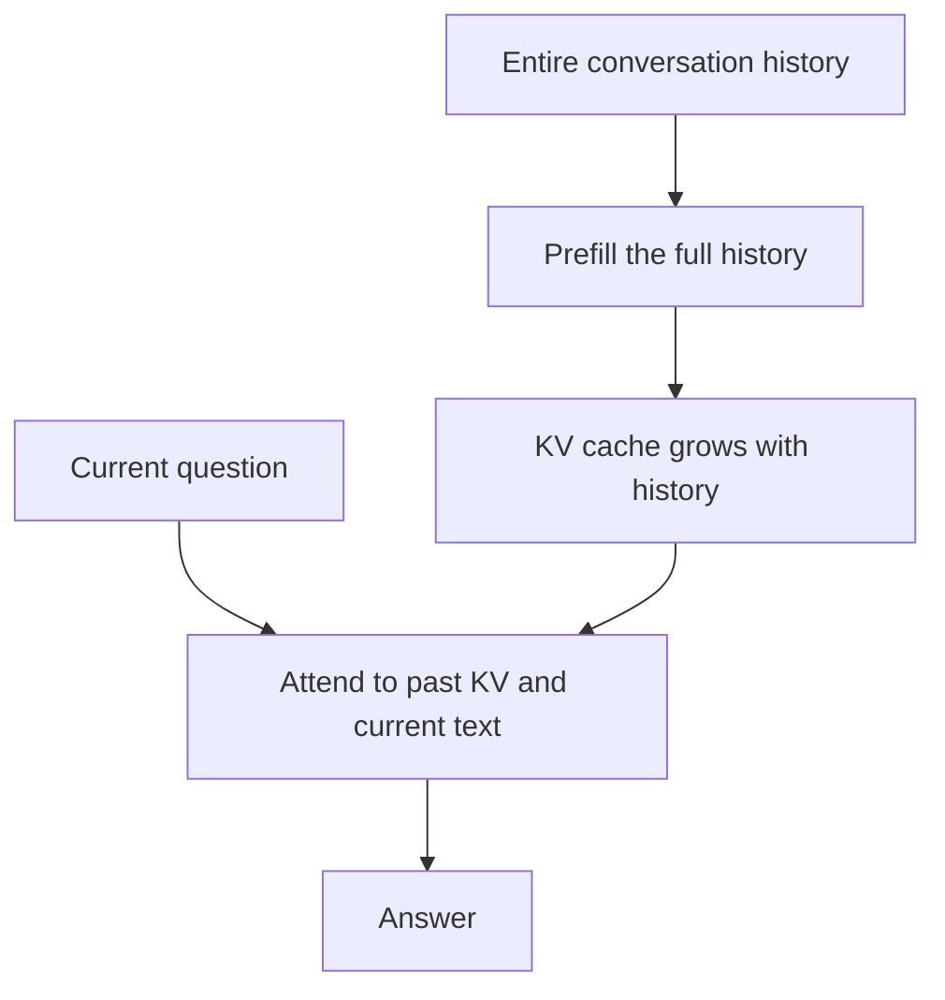
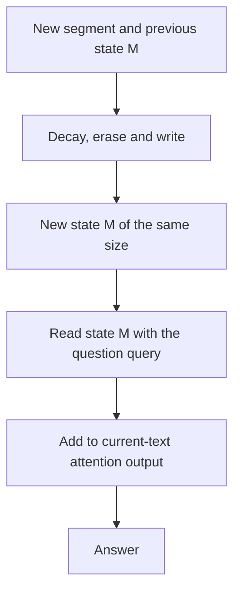

[Paper](https://arxiv.org/abs/2610.26825v1)
## MemT-1.0: A Memory Foundation Model That Puts Conversational Memory Inside Model Computation

For a chatbot or coding agent to process an ongoing conversation with full context, it must feed all text so far into the input at every turn. Attention must hold the key/value of that entire text in a cache, and the cache grows in proportion to the token count as the conversation lengthens. Instead of replaying past conversation as text, MemT-1.0 compresses it into a fixed-size state (a matrix) inside the model, and at question time accesses the past history through that state to answer.

## Why 'Fixed-Size Memory' Is Needed

With full context, longer inputs make both prefill (the stage that processes the entire input first to build a cache) and cache storage grow together, and every generation step must recompute attention over the whole cache. Reducing the input through summarization or retrieval (RAG, selecting relevant documents and putting them in context) lowers storage but can lose information or omit the necessary evidence.

MemT-1.0's idea is to discard 'carrying the entire record'. It records past information into a fixed-size matrix state **by overwriting**. When a new turn arrives, the state is updated but its size stays the same, and when a question arrives, the past history is accessed through this state. Thus, in the fixed configuration, state size becomes independent of token count.

The following is an illustrative example to aid understanding. It differs from actual token segmentation or vector values and is not a measurement result from the paper.

| Order | Text fed into the model | Change in memory state (fixed-size matrix) |
|---|---|---|
| Initial | (none) | All elements are 0 |
| Turn 1 store | "My cat's name is Mochi" | The 'name=Mochi' component is recorded |
| Turn 2 store | "Mochi moved to Busan" | The 'location=Busan' component is added, and the older 'name' component gradually fades through decay |
| Question | "Where does my cat live now?" | Restore 'Busan' from the state and generate an answer |

The key is the last row. Whether the conversation is 4K tokens or 128K tokens, in the fixed configuration the state is a matrix of the same shape, so storage size is constant. With full context, the key/value cache keeps growing as the conversation lengthens.

The native memory block is split into two parts. Information actually accumulated during the conversation is stored in a dynamic state called **local memory**, and learned parameters called **hyper memory** decide how this state is read, written, and erased. The former is initialized to zero for each trajectory (a continuous interaction within a single user session) and keeps changing during the interaction, while the latter is updated only during training and stays fixed during inference. The released models are Nano with 36B parameters (3B active, 10 million dynamic memory) and Flash with 288B parameters (17B active, 336 million dynamic memory). The backbones are Qwen3.6-35B-A3B and a prepared DeepSeek-V4-Flash, respectively.

### The Route to Past Information Changes

This explanatory diagram redraws the operations in §2.1–2.2. Both routes receive the same history and question; compare the form in which past information remains available at question time.

**Full context: past-token KV accumulates**

**MemT: read history from state and current text through attention**

The growing object in full context is the KV cache of past tokens. MemT updates a state M of the same size and reads it when a question arrives. **MemT still maintains attention and KV for the current text.** The fixed-size state is also a lossy compression: constant storage does not mean perfect recall of every past detail.

## Method: How the State Is Stored and Read

### Store: Erase, Write, Forget

In the store stage, each token computes a normalized key $k$, a value to record $v$, and three gates. The erase gate $\beta$ decides 'how much existing information to erase', the write gate $\omega$ decides 'how strongly to record the new value', and the forget gate $\lambda$ decides 'how much to blur everything over time'. $\lambda$ is initialized by sampling the initial half-life per key channel (after how many tokens it halves) log-uniformly in the range 2,048–32,768 tokens for Nano and 128–32,768 tokens for Flash, so each channel starts with a different time scale. This value is learned (Appendix B.2).

Within a single channel, the state update is as follows.

$$
M \leftarrow \big(I - u^{\top} u\big)\, D\, M + u^{\top} (\omega \odot v),
\qquad u = \sqrt{\beta} \odot k,\quad D = \operatorname{Diag}(\exp(\lambda))
$$

The erase matrix $I-u^{\top}u$ reduces the component along $u$ and keeps its orthogonal component. $D$ decays the entire state through per-channel forgetting. The write term on the right records the new value along the $u$ direction. This update repeats in order for each token, and the state updated through the last token becomes the starting state of the next turn (§2.2.2).

### Why 'Stabilization' Is Needed

The original erase term of Gated DeltaNet-2 (GDN-2), on which the paper builds, has the form $I - k^{\top}(\beta \odot k)$ and is not symmetric. If $\beta \odot k$ is not parallel to $k$ ($\gamma \neq 0$), energy is amplified in the direction perpendicular to $k$ ($\lVert eA^{\top}\rVert_2^2 = 1+\gamma^2 \ge 1$). The appendix analysis shows that a recursion passing through such a map at every token can become unstable. A sufficient condition guaranteeing uniform contraction even in the worst case is that the forget decay satisfies $d < \sqrt{3}/2 \approx 0.866$, which corresponds to a half-life of about 4.82 tokens (≈5 tokens) (Appendix C).

MemT-1.0 symmetrizes the projection so that erasing and writing use the same direction $u = \sqrt{\beta} \odot k$. Changing the erase to $I - u^{\top}u$ yields a non-expansive map that contracts along $u$ and does not expand the orthogonal direction. The paper explains that this symmetrization avoids GDN-2's unstable update. The formula above already includes this stabilization. Experimentally, removing this stabilization (the original GDN-2 update) lowers the average over 11 benchmarks by only 0.5 points, but the paper presents it as a theoretical safeguard against state divergence (Table 4, §6.4).

### Read: Pull It Out of the State with a Query

In the read stage, a normalized query $q$ is produced from the question tokens, and $q M / \sqrt{d_k}$ is computed. This can be viewed as 'a weighted sum of the values recorded under keys similar to the query'. It is multiplied by an output gate $G$ to decide how much of this read result to pass through, and a softcap (limiting the magnitude of the SiLU output with $\tau\tanh$, $\tau=2$) prevents blow-ups. This result is added to the original attention output (§2.2.2).

The important difference is that, unlike full-context attention, which revisits all past key/value at every token, MemT's read of past history **ends with a multiplication by a fixed-size state**. Attention over the current text and the KV cache are maintained separately. Because the state dimension does not grow, the read computation over past history is also constant.

### Capacity Scaling: Mixture-of-Storage

Simply enlarging the state matrix to increase memory capacity grows parameters and computation together. MemT-1.0 uses Mixture-of-Storage (MoS) to expand one memory block into $E$ independent memory experts (§2.3).

Unlike conventional sparse MoE, which selects only the top few experts per token, MoS computes **all experts always**. A store router and a utilization router each produce per-expert probabilities $\alpha$; the utilization probabilities mix the read results, and the store probabilities adjust the strength of writing and erasing. The two routers share the same expert address matrix $C$ and learn only their projections separately. Increasing the number of experts increases state, parameters, and block computation together, but there is no top-k selection. However, both released models have one expert per layer ($E=1$); the capacity comparison of 2 vs. 4 experts is in §5.4, and the cost measurement for the 4-expert configuration is in Appendix F.

In the scaling experiment, 4 experts scored higher on average than 2 experts at all three checkpoints. After 400 CPT steps, the gains were +0.41 at 200 memory post-training steps, +2.01 at 3,400 steps, and +2.69 at 5,500 steps (§5.4).

## Training: Prepare the Backbone First, Then Learn from a Teacher

A memory model inherits both the knowledge the backbone already has and the reliability with which it turns that knowledge into action. The paper argues that in this setting backbone post-training mainly improves reliability, and **new knowledge must be supplied by native memory**. Tasks the backbone could not solve in any of eight attempts remained at 1.6–4.0% accuracy on four benchmarks even after the preparation process. By contrast, on hard knowledge questions in a separate probe set, accuracy rose from 27% to 91% when the relevant facts were placed in context. The paper interprets this as meaning that much of the remaining gap comes from a lack of information (§3.1).

So DeepSeek-V4-Flash, the backbone of Flash, undergoes separate backbone post-training before memory is attached. The prepared backbone improved by 6.3 points on average across six benchmarks monitored over three tracks compared with the public version, and on SWE-bench Multilingual and IFBench v2 it even exceeded the reported scores of GLM-5.3 Flash (320B total, 18B active) and DeepSeek-V4 Pro (1.6T total, 49B active) at 284B total and 13B active (Figure 2, §3.1).

Training the memory itself is **off-policy distillation** (§3.3). A frozen backbone that sees the full context acts as the teacher and produces the next-token distribution, and the MemT-1.0 student imitates the same distribution given the current input, the observed response prefix, and the memory state compressing past history. The key point is that the teacher sees the entire past history as text, while the student sees past history only as the memory state. The loss differs by stage. CPT uses cross-entropy on the correct tokens, and memory post-training uses forward KL divergence against the teacher's top-64 token distribution (temperature 1.0, Table 7). The teacher distribution is renormalized over the top 64.

Training has two stages (§3.4–3.5). Continued pre-training (CPT, 20B tokens) builds language modeling ability to predict the next token within the current segment while accessing prior information only through memory, and memory post-training (14B tokens) adapts the model to reproduce the teacher's full-context distribution from memory. The contribution of the two stages is separated in the experiments. Removing memory post-training lowers the average by 10.7 points, and removing CPT lowers it by 2.1 points (Table 4, §6.4).

## Results: Where It Gets Faster and What It Loses

### Memory Performance

On 11 memory benchmarks, MemT-1.0 takes first and second place among parameter-memory methods (Table 2, §6.2).

| Category | Representative method | Average score |
|---|---|---|
| Text memory (history provided at question time) | MemOS (DeepSeek backbone) | 68.6 |
| Text memory | Full Context (DeepSeek) | 65.0 |
| Parameter memory (history not provided) | **MemT-1.0-Flash** | 50.6 |
| Parameter memory | **MemT-1.0-Nano** | 47.0 |
| Parameter memory (previous best) | Temp-LoRA | 38.1 |

Flash and Nano lead the previous best parameter method, Temp-LoRA, by 12.5 and 8.9 points, respectively. What matters is that these scores were obtained without inserting any past text at question time. However, it still trails the text-memory methods MemOS (68.6) and Full Context (65.0), and the gap is especially large on LongMemEval-S and BEAM-1M, which require preserving detailed evidence (§6.2). The paper explains that processing long trajectories alone does not guarantee stable access to their content; prior information must survive multiple updates and remain distinguishable from other records. Selective retention and query-dependent reading remain open problems.

General ability is compared with the backbone under a noise setting. Before evaluation, irrelevant information is written once into MemT's memory, and the same information is placed in the backbone's input context. Then general tasks are solved. Flash shows an average difference of 0.0 and Nano −0.9, largely preserving backbone performance (Table 3, §6.3). Still, there is per-task variation, such as Nano dropping 5.8 points on LiveCodeBench v6, so robustness to distractor memories must be examined at the task level.

### Efficiency: Separate Kernel Level from System Level

First is a microbenchmark measuring only one memory block on a single GPU. It uses a 32K-token pack, synthetic hidden states, a 4-expert configuration, and 2,048-token steps. Materializing all expert projections at once raises peak memory to 47.83 GiB, whereas processing steps in windows of 4,096 tokens (2 steps) brings it to 9.49 GiB (80.1% reduction) and increases forward+backward time by only 1.6%, from a median of 463.0 ms to 470.6 ms (Table 1, §4.2). This is a block-level trade-off.

End-to-end system performance is measured with BEAM history, 128-token responses, and a single request on 2 GPUs. Nano is slower than full context for short histories, becomes comparable around 32K, and gains an advantage as histories grow longer. The speedups are about 1.20× at 64K, 1.86× at 128K, and 3.99× at 256K (§6.5, Figure 8).

| History length | Full Context latency | MemT-1.0-Nano latency | Speedup |
|---|---|---|---|
| 128K | 30.07 s | 16.19 s | 1.86× |
| 256K | 94.47 s | 23.69 s | 3.99× |

The paper attributes the long-context latency advantage mainly to low history preparation cost. Full context prefills the entire history and keeps computing attention over past key/value during generation. Nano writes history into memory in 2,048-token units, reads past history only as state during generation, and maintains current-text attention separately. Excluding history preparation, time to first token (TTFT) for the query is nearly constant for Nano at 104–112 ms, while full context rises to 257 ms at 128K and 445 ms at 256K. The TTFT advantages are about 2.44× and 4.19×, respectively. This is because the fixed-size state read computation is independent of the number of past tokens (§6.5, Figure 8).

Storage follows the same split (§6.6, Figure 9).

| Method | Persistent storage per trajectory (excluding shared weights) |
|---|---|
| Full Context (256K limit) | 5.061 GiB, grows proportionally with history |
| Temp-LoRA | 172.5 MiB (fixed) |
| **MemT-1.0-Nano** | **40 MiB (fixed)** |

At a 128K history, Nano's state is about 66× smaller than full context and does not grow as the conversation lengthens. Conversely, for short conversations DenseRAG, which stores only a few chunks of text and retrieval vectors, is cheaper. DenseRAG has low storage cost when history is short, but its stored text and retrieval vectors accumulate as the conversation grows. Eventually, once history is long enough, DenseRAG's accumulated record exceeds Nano's fixed-size state, and from then on Nano has the advantage (§6.6). The storage curve for full context stops at the context window limit (256K), so the value at that point does not represent preserving the entire longest history. Total storage grows with the number of trajectories and the configured memory capacity.

## Limitations and Open Problems

A fixed-size state comes at a cost. While the state stays $O(1)$, its capacity to preserve detail is more limited than a scheme that stores in proportion to conversation length $N$ (§8). Because new information keeps entering the existing representation, a trade-off arises between retaining earlier details and adding recent information. This loss of memory fidelity on tasks requiring precise recall remains an open problem.

The paper also sees the fixed-size state as opening a possibility beyond compression: 'the iterative consolidation of accumulated experience'. Since new information enters a representation already refined by previous interactions at every update, unlike a structure where past records keep growing, it could serve as a basis for latent reflection (§8). However, this is a directional interpretation, and the original paper does not report experimental results supporting it.

The relationship between the two kinds of memory is also unresolved. Local memory holds information accumulated during interaction, and hyper memory holds the learned ability to store and use it. Whether experience accumulated in local memory can consolidate into hyper memory parameters through additional training, and how hyper memory's knowledge is instantiated through local memory, remain open questions (§8).

The validation scope of MoS for increasing memory capacity is also narrow. Both released models have one expert per layer ($E=1$). The 2-vs-4-expert comparison was made only at three checkpoints: after 400 CPT steps, at 200, 3,400, and 5,500 memory post-training steps (§5.4). In addition, the single-GPU microbenchmark measures block cost including per-expert projections, routers, state updates, reads, and backward passes with synthetic inputs, but does not reflect communication and memory costs at full backbone scale (§4.2, Appendix F).

## Closing

MemT-1.0 moves past history into a fixed-size state inside model computation, decoupling state size and past-history read cost from conversation length in the fixed configuration, and increasing its latency and storage advantage over full context on long histories. At a 128K history it achieves end-to-end inference about 1.86× faster than full context and per-trajectory logical state storage about 66× smaller, and it ranks first and second among parameter-memory methods on the 11-benchmark average. However, a gap with text-memory methods remains, and the paper leaves improving long-term memory, scaling memory capacity, and reducing memory update cost as future work.

## Reference Links

- Code: https://github.com/MemTensor/MemT-1.0
- Models: https://huggingface.co/collections/MemTensor/memt-1
<!-- verbatim-tables -->

Tables from the paper

> Tables converted mechanically from the arXiv e-print LaTeX source. The numbers are the paper's own and did not pass through a model.

**Table 1. Backbone and native-memory configuration. State size counts the persistent memory matrices for one trajectory, excluding model weights and current-step KV caches.**

| **Configuration** | **MemT-1.0-Nano** | **MemT-1.0-Flash** |
|---|---|---|
| Backbone | Qwen3.6-35B-A3B | DeepSeek-V4-Flash, after backbone preparation |
| Hidden width / decoder layers | 2048 / 40 | 4096 / 43 |
| Memory layers | $3,7,\ldots,39$ (10 layers) | $4,6,\ldots,42$ (20 layers) |
| Memory-layer type | Full attention | Compressed sparse attention |
| Memory $H_q/H_{kv}$ | 16 / 16 | 64 / 64 |
| Memory $d_k/d_v$ | 256 / 256 | 512 / 512 |
| Memory experts per layer | 1 | 1 |
| Trainable memory parameters | 450,931,360 | 3,608,608,000 |
| State elements per trajectory | 10,485,760 | 335,544,320 |
| FP32 state size | 40 MiB | 1280 MiB |
| Readout / fusion-point width | 4096 / 4096 | 32768 / 8192 |

**Table 2. Execution and distillation settings for the evaluated checkpoints. TP, PP, CP, and EP denote tensor, pipeline, context, and expert parallelism. DP counts logical data-parallel replicas. EP partitions backbone experts within that topology.**

| Setting | MemT-1.0-Nano | MemT-1.0-Flash |
|---|---|---|
| TP / PP / CP / EP | 1 / 1 / 1 / 8 | 1 / 4 / 2 / 8 |
| Logical DP / accumulation steps | 64 / 1 | 12 / 16 |
| Global batch (packs) | 64 | 192 |
| Maximum pack / storage step | 65536 / 2048 tokens | 65536 / 2048 tokens |
| Post-training target | Online backbone, Top-64 KL | Online backbone, Top-64 KL |
| Temperature / KL / CE weight | 1 / 1 / 0 | 1 / 1 / 0 |
| Memory writer / reader | Chunked update / step snapshot | Chunked update / step snapshot |
| MoE communication backend | DeepEP | DeepEP |

**Table 3. Experience bank construction and statistics. Token counts use the Qwen3.6-35B-A3B tokenizer.**

| (a) Construction stages Source trajectories (23,667 instances, 2,562 repositories) | (a) Construction stages 41,057 |
|---|---|
| Induced policies (88.5% cite a single trajectory) | 3,678 |
| Representative policies after clustering | 1,200 |
| Audit: usable / usable with caveat / severe error | 401 / 639 / 160 |
| **Experiences in the final bank** | **1,040** |
| (b) Bank statistics |  |
| Fields per experience | 10 |
| Length as JSON / as rendered text (tokens, mean) | 715 / 456 |
| Rendered text, 10th / 90th percentile (tokens) | 391 / 521 |
| Steps per experience (range; experiences with five steps) | 3--6; 573 |
| Source trajectories per experience (mean; single-source experiences) | 3.0; 942 |
| Most frequent tags: *python* / *verification* / *testing* / *pytest* | 792 / 192 / 168 / 133 |
| Top-1 cosine similarity (mean; 10th--90th percentile) | 0.611; 0.556--0.668 |
| Median similarity gap between top-1 and top-5 | 0.029 |

**Table 4. Task and repository counts for the training and validation splits and SWE-bench Verified.**

| **Statistic** | **Train** | **Validation** | **Test (Verified)** |
|---|---|---|---|
| Number of repositories | 537 | 176 | 12 |
| Number of tasks | 2,396 | 266 | 500 |

**Table 5. Training data construction statistics and experience intervention outcomes.**

| **Statistic** | **Value** | **Calculation or description** |
|---|---|---|
| Original trajectories | 18,820 | Target rollouts generated by Qwen3.6-35B-A3B |
| Unsolved original trajectories | 14,649 (77.8%) | \(14,649 / 18,820\) |
| Breakpoint--experience variants | 199,500 | 7,901 usable trajectories produced 19,950 retained breakpoints |
| Successful experience | 45,481 (22.8%) | \(45,481 / 199,500\) |

**Table 6. Validation NLL and preliminary agent performance under CE and KD. Average success rates are measured on the 100-task development subset of SWE-bench Verified with three runs per task. Validation NLL uses hard-label targets; lower is better.**

| Configuration | Validation NLL CE | Validation NLL KD | Avg. Success (%) CE | Avg. Success (%) KD |
|---|---|---|---|---|
| First-Step-Max2 | 0.3452 | 0.4304 | 12.5 | 52.0 |
| First-Step-Max3 | 0.3373 | 0.4267 | 34.1 | 52.0 |
| Full-Suffix-Max2 | 0.1795 | 0.2005 | 37.5 | 54.3 |
| Full-Suffix-Max3 | 0.1771 | 0.1996 | 22.7 | 52.7 |

**Table 7. Metis KD configurations on the 100-task development subset of SWE-bench Verified under Before Execution. All values are percentages; bold values indicate the highest scores in each column.**

| Configuration | Avg. Success | pass@3 | pass3 |
|---|---|---|---|
| First-Step-Max2 | 52.00 | 65.00 | 38.00 |
| First-Step-Max3 | 52.00 | 61.00 | **42.00** |
| Full-Suffix-Max2 | **54.33** | **66.00** | **42.00** |
| Full-Suffix-Max3 | 52.67 | **66.00** | 36.00 |

**Table 8. Textual Experience selection on SWE-bench Multilingual (300 tasks). Fixed Rank-$k$ uses the single experience at rank $k$; Per-Task Best selects among three candidates using evaluation outcomes. All values are percentages.**

| Method | Avg. Success | pass@3 | pass3 |
|---|---|---|---|
| *Before Execution* |  |  |  |
| No Experience | 60.00 | 73.67 | 45.33 |
| Textual Experience: Fixed Rank-1 | 64.22 | 72.67 | 56.33 |
| Textual Experience: Fixed Rank-2 | 61.89 | 72.67 | 51.33 |
| Textual Experience: Fixed Rank-3 | 63.78 | 74.00 | 54.33 |
| Textual Experience: Per-Task Best | 70.56 | 78.67 | 61.67 |
| *Harness-Triggered* |  |  |  |
| No Experience | 60.00 | 73.67 | 45.33 |
| Textual Experience: Fixed Rank-1 | 63.00 | 72.67 | 53.67 |
| Textual Experience: Fixed Rank-2 | 64.44 | 72.00 | 56.67 |
| Textual Experience: Fixed Rank-3 | 63.56 | 72.00 | 54.67 |
| Textual Experience: Per-Task Best | 70.00 | 78.67 | 61.67 |

