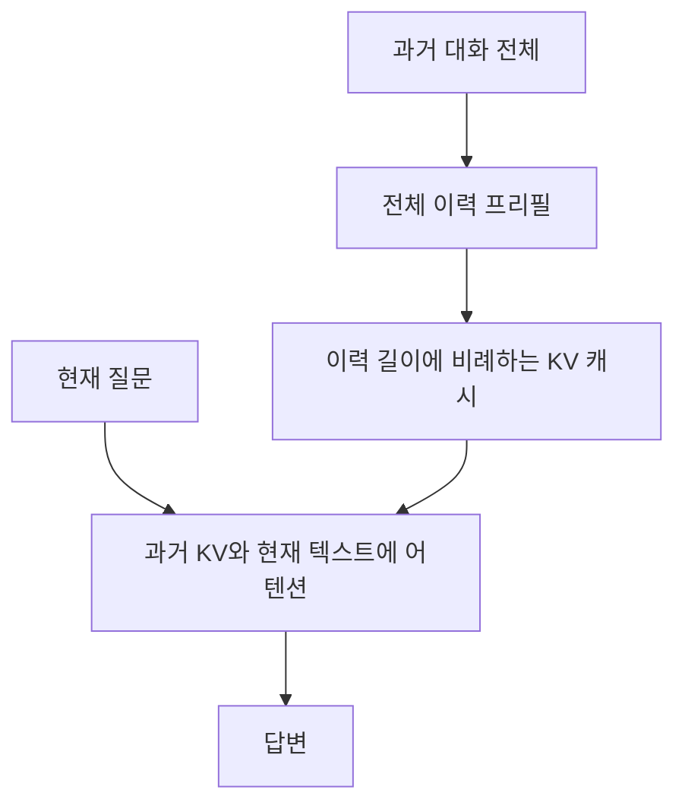
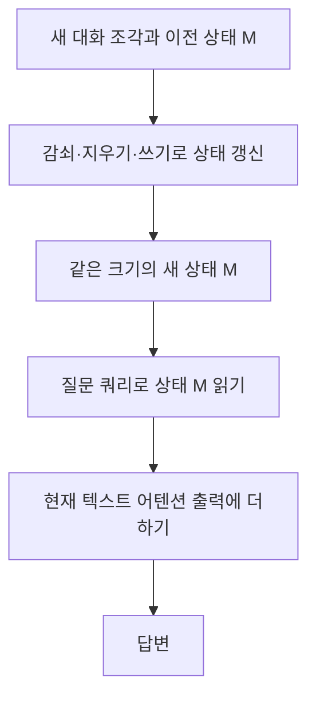

[논문 링크](https://arxiv.org/abs/2610.26825v1)
## MemT-1.0: 대화 기억을 모델 계산 안에 넣는 메모리 파운데이션 모델

챗봇이나 코딩 에이전트가 오가는 대화를 전체 맥락으로 처리하려면 매 턴마다 지금까지의 텍스트를 입력에 넣어야 한다. 어텐션은 그 텍스트 전체의 key·value를 캐시에 들고 있어야 하고, 캐시는 대화가 길어질수록 토큰 수에 비례해 커진다. MemT-1.0은 과거 대화를 텍스트로 되풀이하는 대신, 모델 안의 고정 크기 상태(행렬)로 압축해 두고 질문 시점에는 그 상태로 과거 이력에 접근해 답한다.

## 왜 '고정 크기 메모리'가 필요한가

전체 맥락을 쓰는 방식은 입력이 길어질수록 프리필(prefill, 입력 전체를 먼저 처리해 캐시를 만드는 단계)과 캐시 저장이 함께 커지고, 생성 한 걸음마다 전체 캐시에 어텐션을 다시 계산해야 한다. 요약이나 검색(RAG, 관련 문서를 골라 컨텍스트에 넣는 방식)으로 입력을 줄이면 저장은 줄지만 정보가 유실되거나 필요한 근거가 빠질 수 있다.

MemT-1.0의 발상은 '전체 기록을 들고 있는 것'을 버리는 것이다. 과거 정보를 고정 크기의 행렬 상태에 **덮어쓰기 방식으로** 기록한다. 새 턴이 들어오면 상태를 갱신하되 크기는 그대로 두고, 질문이 들어오면 이 상태로 과거 이력에 접근한다. 그래서 고정 설정에서는 상태 크기가 토큰 수와 무관해진다.

아래는 이해를 돕기 위한 설명용 예시다. 실제 토큰 분할이나 벡터 값과는 다르고, 논문의 측정 결과가 아니다.

| 순서 | 모델에 들어가는 텍스트 | 메모리 상태(고정 크기 행렬)의 변화 |
|---|---|---|
| 초기 | (없음) | 모든 원소가 0 |
| 1턴 저장 | "내 고양이 이름은 모찌야" | '이름=모찌' 성분이 기록됨 |
| 2턴 저장 | "모찌가 부산으로 이사했어" | '위치=부산' 성분이 추가되고, 오래된 '이름' 성분은 감쇠로 서서히 흐려짐 |
| 질문 | "내 고양이는 지금 어디 살아?" | 상태에서 '부산'을 복원해 답 생성 |

핵심은 마지막 줄이다. 대화가 4K 토큰이든 128K 토큰이든, 고정 설정에서 상태는 같은 모양의 행렬이므로 저장 크기는 일정하다. 전체 맥락(full context) 방식은 대화가 길어질수록 key·value 캐시가 계속 커진다.

네이티브 메모리 블록은 두 부분으로 나뉜다. 대화 중 실제로 쌓이는 정보는 <strong>로컬 메모리(local memory)</strong>라는 동적 상태에 저장되고, 이 상태를 어떻게 읽고 쓰고 지울지는 <strong>하이퍼 메모리(hyper memory)</strong>라는 학습된 파라미터가 결정한다. 전자는 궤적(trajectory, 한 사용자 세션의 연속된 상호작용)마다 0으로 초기화되어 상호작용 중 계속 바뀌고, 후자는 훈련 때만 갱신되고 추론 중에는 고정된다. 공개한 모델은 Nano가 36B 파라미터(활성 3B, 동적 메모리 1,000만), Flash가 288B 파라미터(활성 17B, 동적 메모리 3.36억)다. 백본은 각각 Qwen3.6-35B-A3B와 준비된 DeepSeek-V4-Flash다.

### 과거 기록을 읽는 경로가 달라진다

아래는 §2.1–2.2의 동작을 다시 그린 설명용 도식이다. 두 경로에 같은 과거 대화와 질문을 주되, 질문 시점에 과거 기록이 어떤 형태로 남아 있는지 비교한다.

**전체 맥락: 과거 토큰의 KV가 계속 쌓인다**

**MemT: 과거는 상태로, 현재 텍스트는 어텐션으로 읽는다**

전체 맥락 쪽에서 커지는 것은 과거 토큰의 KV 캐시다. MemT 쪽은 과거 정보를 담은 상태 M을 같은 크기로 갱신하며, 질문이 오면 그 상태를 읽는다. **현재 텍스트의 어텐션과 KV는 MemT에도 남는다.** 또 고정 크기 상태는 손실 압축이므로, 저장 공간이 일정하다고 모든 과거 세부를 정확히 기억한다는 뜻은 아니다.

## 방법: 상태를 어떻게 저장하고 읽는가

### 저장: 지우고, 쓰고, 잊는다

저장 단계에서 각 토큰은 정규화된 키 $k$, 기록할 값 $v$, 그리고 세 개의 게이트를 계산한다. 지우기(erase) 게이트 $\beta$는 '기존 정보를 얼마나 지울지', 쓰기(write) 게이트 $\omega$는 '새 값을 얼마나 강하게 기록할지', 망각(forget) 게이트 $\lambda$는 '시간이 지나며 전체를 얼마나 흐리게 할지'를 정한다. $\lambda$는 키 채널별 초기 반감기(몇 토큰 뒤 절반이 되는지)를 Nano 기준 2,048~32,768토큰, Flash 기준 128~32,768토큰 범위에서 로그균등하게 샘플해 초기화하므로 채널마다 초기 시간 척도가 다르다. 이 값은 학습된다(Appendix B.2).

하나의 채널에서 상태 갱신은 다음과 같다.

$$
M \leftarrow \big(I - u^{\top} u\big)\, D\, M + u^{\top} (\omega \odot v),
\qquad u = \sqrt{\beta} \odot k,\quad D = \operatorname{Diag}(\exp(\lambda))
$$

지우기 행렬 $I-u^{\top}u$는 $u$ 방향 성분을 줄이고 그 직교 성분은 남긴다. $D$는 채널별 망각으로 상태 전체를 감쇠시킨다. 오른쪽 쓰기 항은 새 값을 $u$ 방향에 기록한다. 이 갱신이 토큰마다 순서대로 반복되어, 마지막 토큰까지 갱신된 상태가 다음 턴의 시작 상태가 된다(§2.2.2).

### 왜 '안정화'가 필요한가

논문이 기반으로 삼은 Gated DeltaNet-2(GDN-2)의 원래 지우기 항은 $I - k^{\top}(\beta \odot k)$ 형태로, 대칭이 아니다. $\beta \odot k$가 $k$와 평행하지 않으면($\gamma \neq 0$), $k$에 수직인 방향으로 에너지가 증폭된다($\lVert eA^{\top}\rVert_2^2 = 1+\gamma^2 \ge 1$). 부록의 분석은 이런 사상을 토큰마다 거치는 재귀가 불안정해질 수 있음을 보인다. 최악의 경우에도 균등 수축을 보장하는 충분조건은 망각 감쇠가 $d < \sqrt{3}/2 \approx 0.866$인 것이며, 이때 반감기는 약 4.82토큰(≈5토큰)에 해당한다(Appendix C).

MemT-1.0은 지우기와 쓰기가 같은 방향 $u = \sqrt{\beta} \odot k$를 쓰도록 사영을 대칭화한다. 지우기를 $I - u^{\top}u$로 바꾸면 $u$ 방향으로는 수축하고 직교 방향은 팽창시키지 않는 비팽창 사상이 된다. 논문은 이 대칭화가 GDN-2의 불안정한 갱신을 피한다고 설명한다. 위 수식은 이미 이 안정화를 적용한 형태다. 실험상 이 안정화를 제거하면(원래 GDN-2 갱신) 11개 벤치마크 평균은 0.5점 내려갈 뿐이지만, 논문은 이를 상태 발산을 막는 이론적 안전장치로 제시한다(Table 4, §6.4).

### 읽기: 쿼리로 상태에서 꺼낸다

읽기 단계에서는 질문 토큰에서 정규화된 쿼리 $q$를 만들고, $q M / \sqrt{d_k}$를 계산한다. 이는 '쿼리와 비슷한 키에 기록된 값들의 가중 합'으로 볼 수 있다. 여기에 출력 게이트 $G$를 곱해 이 읽기 결과를 얼마나 통과시킬지 정하고, 소프트캡(SiLU 출력의 크기를 $\tau\tanh$로 제한, $\tau=2$)으로 폭주를 막는다. 이 결과가 원래 어텐션 출력에 더해진다(§2.2.2).

중요한 차이는, 전체 맥락 어텐션이 매 토큰마다 과거 전체 key·value를 다시 보는 것과 달리 MemT의 과거 이력 읽기는 **고정 크기 상태와의 곱으로 끝난다**는 점이다. 현재 텍스트에 대한 어텐션과 KV 캐시는 별도로 유지된다. 상태 차원이 커지지 않으므로 과거 이력에 대한 읽기 계산도 일정하다.

### 용량 확장: Mixture-of-Storage

메모리 용량을 키우려고 상태 행렬을 단순히 키우면 파라미터와 계산량이 함께 커진다. MemT-1.0은 Mixture-of-Storage(MoS)로 한 메모리 블록을 $E$개의 독립적인 메모리 전문가(expert)로 확장한다(§2.3).

기존 희소 MoE가 토큰마다 상위 몇 개 전문가만 고르는 것과 달리, MoS는 **모든 전문가를 항상** 계산한다. 저장 라우터와 활용 라우터가 각각 전문가별 확률 $\alpha$를 만들고, 활용 확률로 읽기 결과를 섞고 저장 확률로 쓰기·지우기 세기를 조절한다. 두 라우터는 같은 전문가 주소 행렬 $C$를 공유하고 투사만 따로 배운다. 전문가 수를 늘리면 상태와 파라미터, 블록 계산량이 함께 늘어나지만 상위-k 선택은 없다. 다만 배포된 두 모델은 레이어당 전문가 1개($E=1$)이며, 2전문가 대 4전문가의 용량 비교는 §5.4, 4전문가 구성의 비용 측정은 Appendix F에 있다.

확장 실험에서는 4전문가가 2전문가보다 세 체크포인트 모두에서 평균 점수가 높았다. 400 CPT 스텝 뒤 메모리 사후훈련 200스텝에서 +0.41, 3,400스텝에서 +2.01, 5,500스텝에서 +2.69였다(§5.4).

## 훈련: 백본을 먼저 준비하고, 교사에게 배운다

메모리 모델은 백본이 이미 아는 지식과, 그 지식을 행동으로 옮기는 신뢰도를 모두 물려받는다. 논문은 이 설정에서 백본 사후훈련이 주로 개선하는 것은 신뢰도이며, **새 지식은 네이티브 메모리가 공급해야 한다**고 본다. 백본이 여덟 번 시도에서 한 번도 못 푼 과제는 준비 과정을 거친 뒤에도 네 벤치마크에서 1.6~4.0% 정확도에 머물렀다. 반면 별도 탐침 세트의 어려운 지식 질문에서는 관련 사실을 맥락에 넣었을 때 정확도가 27%에서 91%로 올랐다. 논문은 이로부터 남은 격차가 상당 부분 정보 부족에서 온다고 해석한다(§3.1).

그래서 Flash의 백본인 DeepSeek-V4-Flash는 메모리를 붙이기 전에 별도의 백본 사후훈련을 거친다. 준비된 백본은 세 트랙에 걸쳐 모니터링하는 6개 벤치마크 평균이 공개판 대비 6.3점 올랐고, SWE-bench Multilingual과 IFBench v2에서는 284B 전체·13B 활성 규모로 GLM-5.3 Flash(320B 전체·18B 활성)와 DeepSeek-V4 Pro(1.6T 전체·49B 활성)의 보고 점수를 넘기도 했다(Figure 2, §3.1).

메모리 자체의 훈련은 **오프폴리시 증류**다(§3.3). 전체 맥락을 보는 얼어붙은 백본이 교사가 되어 다음 토큰 분포를 내놓고, MemT-1.0 학생은 현재 입력과 관측된 응답 접두부, 그리고 과거 이력을 압축한 메모리 상태를 보고 같은 분포를 흉내 낸다. 교사는 과거 이력 전체를 텍스트로 보지만, 학생은 과거 이력을 메모리 상태로만 본다는 점이 핵심이다. 손실은 단계별로 갈린다. CPT는 정답 토큰에 대한 교차 엔트로피를 쓰고, 메모리 사후훈련은 교사의 상위 64개(top-64) 토큰 분포에 대한 전방 KL 발산을 쓴다(온도 1.0, Table 7). 교사 분포는 top-64로 재정규화된다.

훈련은 두 단계다(§3.4~3.5). 연속 사전훈련(CPT, 20B 토큰)은 앞선 정보를 메모리로만 접근하면서 현재 세그먼트 안에서 다음 토큰을 예측하는 언어 모델링 능력을 세우고, 메모리 사후훈련(14B 토큰)은 교사의 전체 맥락 분포를 메모리로 재현하도록 적응시킨다. 두 단계의 기여는 실험에서 갈린다. 메모리 사후훈련을 빼면 평균이 10.7점 떨어지고, CPT를 빼면 2.1점 떨어진다(Table 4, §6.4).

## 결과: 어디서 빨라지고, 무엇을 잃는가

### 메모리 성능

11개 메모리 벤치마크에서 MemT-1.0은 파라미터 메모리 방식 중 1·2위를 차지한다(Table 2, §6.2).

| 구분 | 대표 방식 | 평균 점수 |
|---|---|---|
| 텍스트 메모리 (질문 시 history 제공) | MemOS (DeepSeek 백본) | 68.6 |
| 텍스트 메모리 | Full Context (DeepSeek) | 65.0 |
| 파라미터 메모리 (history 제공 안 함) | **MemT-1.0-Flash** | 50.6 |
| 파라미터 메모리 | **MemT-1.0-Nano** | 47.0 |
| 파라미터 메모리 (기존 최고) | Temp-LoRA | 38.1 |

Flash와 Nano는 기존 최고 파라미터 방식인 Temp-LoRA보다 각각 12.5점, 8.9점 앞선다. 질문 시점에 과거 텍스트를 전혀 넣지 않고 이 점수를 얻었다는 점이 의미다. 다만 텍스트 메모리 방식인 MemOS(68.6)와 Full Context(65.0)에는 여전히 못 미치고, 격차는 상세 근거 보존을 요구하는 LongMemEval-S와 BEAM-1M에서 특히 크다(§6.2). 논문은 긴 궤적을 처리하는 것만으로는 그 내용의 안정적인 접근이 보장되지 않으며, 앞선 정보가 여러 갱신을 거쳐 남고 다른 기록과 구별되어야 한다고 설명한다. 선택적 보존과 쿼리 의존적 읽기가 남은 과제다.

일반 능력은 잡음 설정에서 백본과 비교한다. MemT에는 평가 전에 무관한 정보를 메모리에 한 번 기록하고, 백본에는 같은 정보를 입력 맥락에 넣는다. 이후 일반 과제를 푼다. Flash는 평균 차이 0.0, Nano는 −0.9로 대체로 백본 성능을 유지한다(Table 3, §6.3). 단 LiveCodeBench v6에서 Nano가 5.8점 떨어지는 등 과제별 편차가 있어, 방해 기억에 대한 저항은 과제 수준에서 따로 봐야 한다.

### 효율: 커널 수준과 시스템 수준을 구분한다

먼저 단일 GPU에서 메모리 블록 하나만 잰 마이크로 벤치마크다. 32K 토큰 팩, 합성 은닉 상태, 4전문가 구성, 2,048토큰 스텝을 쓴다. 모든 전문가 투영을 한 번에 만들면 피크 메모리가 47.83 GiB까지 오르는데, 스텝을 4,096토큰(2스텝) 단위 윈도우로 처리하면 9.49 GiB(80.1% 절감)가 되고 전방+역방향 시간은 중앙값 463.0ms에서 470.6ms로 1.6%만 는다(Table 1, §4.2). 이는 블록 수준의 트레이드오프다.

전체 시스템 성능은 BEAM 히스토리, 128토큰 응답, 2-GPU 단일 요청 조건에서 잰다. Nano는 짧은 히스토리에서는 전체 맥락보다 느리다가 32K 근처에서 비슷해지고, 길어질수록 유리해진다. 속도 향상은 64K에서 약 1.20배, 128K에서 1.86배, 256K에서 3.99배다(§6.5, Figure 8).

| 히스토리 길이 | Full Context 지연 | MemT-1.0-Nano 지연 | 배수 |
|---|---|---|---|
| 128K | 30.07초 | 16.19초 | 1.86배 |
| 256K | 94.47초 | 23.69초 | 3.99배 |

논문은 이 장기 지연 우위의 주된 원인으로 낮은 히스토리 준비 비용을 든다. 전체 맥락은 히스토리 전체를 프리필하고 생성 중에도 과거 key·value에 어텐션을 계속 계산한다. Nano는 히스토리를 2,048토큰 단위로 메모리에 쓰고, 생성 시 과거 이력은 상태로만 읽으며 현재 텍스트 어텐션은 별도로 유지한다. 히스토리 준비를 제외한 질의 첫 토큰 지연(TTFT)은 Nano가 104~112ms로 거의 일정하고, 전체 맥락은 128K에서 257ms, 256K에서 445ms까지 오른다. TTFT 기준 이점은 각각 약 2.44배, 4.19배다. 고정 크기 상태 읽기 계산이 과거 토큰 수와 무관하기 때문이다(§6.5, Figure 8).

저장 공간도 마찬가지로 갈린다(§6.6, Figure 9).

| 방식 | 궤적당 영속 저장 (공유 가중치 제외) |
|---|---|
| Full Context (256K 한계) | 5.061 GiB, 히스토리에 비례 증가 |
| Temp-LoRA | 172.5 MiB (고정) |
| **MemT-1.0-Nano** | **40 MiB (고정)** |

128K 히스토리 기준 Nano의 상태는 전체 맥락 대비 약 66배 작고, 대화가 길어져도 커지지 않는다. 반대로 짧은 대화에서는 텍스트 몇 덩어리와 검색 벡터만 저장하는 DenseRAG가 더 싸다. DenseRAG는 히스토리가 짧을 때 저장 비용이 작지만, 저장한 텍스트와 검색 벡터가 대화가 늘어날수록 함께 쌓인다. 결국 히스토리가 충분히 길어지면 DenseRAG의 누적 기록이 Nano의 고정 크기 상태를 넘어서고, 그때부터 Nano가 유리해진다(§6.6). 전체 맥락 방식의 저장 곡선은 컨텍스트 윈도우 한계(256K)에서 끊기므로, 그 지점의 수치는 가장 긴 히스토리 전체를 보존한 값이 아니다. 전체 저장량은 궤적 수와 설정된 메모리 용량에 따라 늘어난다.

## 한계와 남은 과제

고정 크기 상태에는 대가가 따른다. 상태가 $O(1)$로 유지되는 대신, 대화 길이 $N$에 비례해 저장하는 방식보다 세부 정보 보존 용량이 제한된다(§8). 새 정보가 기존 표현 안에 계속 들어가므로, 앞선 세부를 남겨 두는 것과 최근 정보를 추가하는 것 사이에 상충 관계가 생긴다. 정밀한 회상이 필요한 과제에서 이 메모리 충실도 손실은 여전히 남은 과제다.

논문은 고정 크기 상태가 압축을 넘어 '누적된 경험의 반복적 정착'이라는 가능성도 연다고 본다. 매 갱신마다 새 정보가 이전 상호작용으로 이미 다듬어진 표현 안에 들어가므로, 과거 기록이 계속 늘어나는 구조와 달리 잠재적 반성(latent reflection)의 기반이 될 수 있다는 것이다(§8). 다만 이는 방향성 있는 해석이며, 이를 뒷받침하는 실험 결과는 원문 미보고다.

두 종류 메모리의 관계도 미해결이다. 로컬 메모리는 상호작용 중 쌓인 정보를 담고, 하이퍼 메모리는 그것을 저장·활용하는 학습된 능력을 담는다. 로컬 메모리에 쌓인 경험이 추가 훈련을 통해 하이퍼 메모리 파라미터로 정착될 수 있는지, 그리고 하이퍼 메모리의 지식이 로컬 메모리를 통해 어떻게 인스턴스화되는지는 열린 질문으로 남는다(§8).

메모리 용량을 늘리는 MoS의 검증 범위도 좁다. 배포된 두 모델은 레이어당 전문가가 1개($E=1$)다. 2전문가 대 4전문가 비교는 400 CPT 스텝 뒤, 메모리 사후훈련 200·3,400·5,500스텝의 세 체크포인트에서만 이뤄졌다(§5.4). 또한 단일 GPU 마이크로 벤치마크는 합성 입력으로 전문가별 투영, 라우터, 상태 갱신, 읽기, 역방향을 포함한 블록 비용을 재지만, 백본 전체 규모의 통신·메모리 비용은 반영하지 않는다(§4.2, Appendix F).

## 마무리

MemT-1.0은 과거 이력을 모델 계산 안의 고정 크기 상태로 옮겨, 고정 설정에서 상태 크기와 과거 이력 읽기 비용을 대화 길이에서 분리하고, 긴 이력에서 전체 맥락 대비 지연·저장 우위를 키웠다. 128K 히스토리 기준 전체 맥락 대비 약 1.86배 빠른 끝-끝 추론과 약 66배 작은 궤적당 논리 상태 저장을 달성했고, 11개 벤치마크 평균에서 파라미터 메모리 방식 중 1·2위를 차지했다. 다만 텍스트 메모리 방식과의 격차는 남아 있으며, 논문은 장기 기억 개선과 메모리 용량 확장, 메모리 갱신 비용 감소를 향후 과제로 남긴다.

## 참고 링크

- 코드: https://github.com/MemTensor/MemT-1.0
- 모델: https://huggingface.co/collections/MemTensor/memt-1

<!-- verbatim-tables -->

논문 원문의 표

> arXiv e-print 의 LaTeX 원본에서 기계적으로 옮긴 표입니다. 숫자는 논문의 값이며 모델을 거치지 않았습니다.

**표 1. Backbone and native-memory configuration. State size counts the persistent memory matrices for one trajectory, excluding model weights and current-step KV caches.**

| **Configuration** | **MemT-1.0-Nano** | **MemT-1.0-Flash** |
|---|---|---|
| Backbone | Qwen3.6-35B-A3B | DeepSeek-V4-Flash, after backbone preparation |
| Hidden width / decoder layers | 2048 / 40 | 4096 / 43 |
| Memory layers | $3,7,\ldots,39$ (10 layers) | $4,6,\ldots,42$ (20 layers) |
| Memory-layer type | Full attention | Compressed sparse attention |
| Memory $H_q/H_{kv}$ | 16 / 16 | 64 / 64 |
| Memory $d_k/d_v$ | 256 / 256 | 512 / 512 |
| Memory experts per layer | 1 | 1 |
| Trainable memory parameters | 450,931,360 | 3,608,608,000 |
| State elements per trajectory | 10,485,760 | 335,544,320 |
| FP32 state size | 40 MiB | 1280 MiB |
| Readout / fusion-point width | 4096 / 4096 | 32768 / 8192 |

**표 2. Execution and distillation settings for the evaluated checkpoints. TP, PP, CP, and EP denote tensor, pipeline, context, and expert parallelism. DP counts logical data-parallel replicas. EP partitions backbone experts within that topology.**

| Setting | MemT-1.0-Nano | MemT-1.0-Flash |
|---|---|---|
| TP / PP / CP / EP | 1 / 1 / 1 / 8 | 1 / 4 / 2 / 8 |
| Logical DP / accumulation steps | 64 / 1 | 12 / 16 |
| Global batch (packs) | 64 | 192 |
| Maximum pack / storage step | 65536 / 2048 tokens | 65536 / 2048 tokens |
| Post-training target | Online backbone, Top-64 KL | Online backbone, Top-64 KL |
| Temperature / KL / CE weight | 1 / 1 / 0 | 1 / 1 / 0 |
| Memory writer / reader | Chunked update / step snapshot | Chunked update / step snapshot |
| MoE communication backend | DeepEP | DeepEP |

**표 3. Experience bank construction and statistics. Token counts use the Qwen3.6-35B-A3B tokenizer.**

| (a) Construction stages Source trajectories (23,667 instances, 2,562 repositories) | (a) Construction stages 41,057 |
|---|---|
| Induced policies (88.5% cite a single trajectory) | 3,678 |
| Representative policies after clustering | 1,200 |
| Audit: usable / usable with caveat / severe error | 401 / 639 / 160 |
| **Experiences in the final bank** | **1,040** |
| (b) Bank statistics |  |
| Fields per experience | 10 |
| Length as JSON / as rendered text (tokens, mean) | 715 / 456 |
| Rendered text, 10th / 90th percentile (tokens) | 391 / 521 |
| Steps per experience (range; experiences with five steps) | 3--6; 573 |
| Source trajectories per experience (mean; single-source experiences) | 3.0; 942 |
| Most frequent tags: *python* / *verification* / *testing* / *pytest* | 792 / 192 / 168 / 133 |
| Top-1 cosine similarity (mean; 10th--90th percentile) | 0.611; 0.556--0.668 |
| Median similarity gap between top-1 and top-5 | 0.029 |

**표 4. Task and repository counts for the training and validation splits and SWE-bench Verified.**

| **Statistic** | **Train** | **Validation** | **Test (Verified)** |
|---|---|---|---|
| Number of repositories | 537 | 176 | 12 |
| Number of tasks | 2,396 | 266 | 500 |

**표 5. Training data construction statistics and experience intervention outcomes.**

| **Statistic** | **Value** | **Calculation or description** |
|---|---|---|
| Original trajectories | 18,820 | Target rollouts generated by Qwen3.6-35B-A3B |
| Unsolved original trajectories | 14,649 (77.8%) | \(14,649 / 18,820\) |
| Breakpoint--experience variants | 199,500 | 7,901 usable trajectories produced 19,950 retained breakpoints |
| Successful experience | 45,481 (22.8%) | \(45,481 / 199,500\) |

**표 6. Validation NLL and preliminary agent performance under CE and KD. Average success rates are measured on the 100-task development subset of SWE-bench Verified with three runs per task. Validation NLL uses hard-label targets; lower is better.**

| Configuration | Validation NLL CE | Validation NLL KD | Avg. Success (%) CE | Avg. Success (%) KD |
|---|---|---|---|---|
| First-Step-Max2 | 0.3452 | 0.4304 | 12.5 | 52.0 |
| First-Step-Max3 | 0.3373 | 0.4267 | 34.1 | 52.0 |
| Full-Suffix-Max2 | 0.1795 | 0.2005 | 37.5 | 54.3 |
| Full-Suffix-Max3 | 0.1771 | 0.1996 | 22.7 | 52.7 |

**표 7. Metis KD configurations on the 100-task development subset of SWE-bench Verified under Before Execution. All values are percentages; bold values indicate the highest scores in each column.**

| Configuration | Avg. Success | pass@3 | pass3 |
|---|---|---|---|
| First-Step-Max2 | 52.00 | 65.00 | 38.00 |
| First-Step-Max3 | 52.00 | 61.00 | **42.00** |
| Full-Suffix-Max2 | **54.33** | **66.00** | **42.00** |
| Full-Suffix-Max3 | 52.67 | **66.00** | 36.00 |

**표 8. Textual Experience selection on SWE-bench Multilingual (300 tasks). Fixed Rank-$k$ uses the single experience at rank $k$; Per-Task Best selects among three candidates using evaluation outcomes. All values are percentages.**

| Method | Avg. Success | pass@3 | pass3 |
|---|---|---|---|
| *Before Execution* |  |  |  |
| No Experience | 60.00 | 73.67 | 45.33 |
| Textual Experience: Fixed Rank-1 | 64.22 | 72.67 | 56.33 |
| Textual Experience: Fixed Rank-2 | 61.89 | 72.67 | 51.33 |
| Textual Experience: Fixed Rank-3 | 63.78 | 74.00 | 54.33 |
| Textual Experience: Per-Task Best | 70.56 | 78.67 | 61.67 |
| *Harness-Triggered* |  |  |  |
| No Experience | 60.00 | 73.67 | 45.33 |
| Textual Experience: Fixed Rank-1 | 63.00 | 72.67 | 53.67 |
| Textual Experience: Fixed Rank-2 | 64.44 | 72.00 | 56.67 |
| Textual Experience: Fixed Rank-3 | 63.56 | 72.00 | 54.67 |
| Textual Experience: Per-Task Best | 70.00 | 78.67 | 61.67 |

