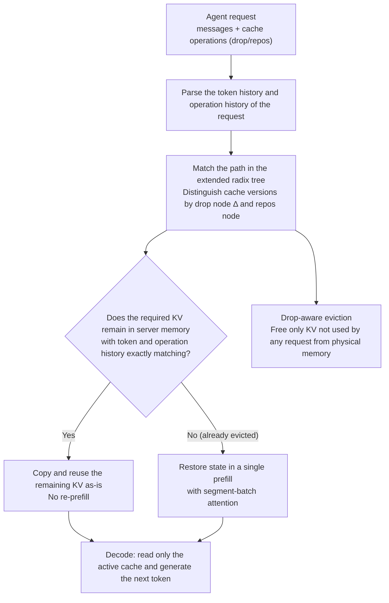

[Paper](https://arxiv.org/abs/2610.28577v1)
## The Cost and Accuracy Dilemma of Long Agent Trajectories

LLM agents accumulate long trajectories by repeating reasoning and tool calls for hundreds of rounds. To make inference fast, the already-computed key-value (KV) cache must stay on the GPU and be read again for each next token; as the trajectory grows, storage and read costs increase. The paper measures KV cache reads at 82.4% of total API cost (§1, Figure 13), and points out that accuracy degrades once the number of KVs or the positional span handled by attention exceeds what the model can handle (§1).

### The dilemma of context engineering

The existing approach is **context engineering**, which shrinks the prompt itself by trimming or summarizing text. The problem is that editing earlier text invalidates all KV state appended after it. The invalidated span must be recomputed through **re-prefill** (running the already-computed prefix through the forward pass again), and the earlier the edit, the longer the tail that must be recomputed. As a result, real harnesses delay reduction until the context hits a threshold, then summarize or delete most of it at once and keep only the most recent rounds (§1, §2). Re-prefill becomes shorter, but useful information from intermediate rounds may be lost.

The paper quantified this dilemma directly. It ran the first 100 BCP (BrowseComp-Plus) tasks with GPT-OSS-120B (four attempts per task, up to 100 rounds) and obtained the following results (§3.2, Figure 3).

| Method | What it retains | Result vs. cost |
|---|---|---|
| Full context | KV for all tokens | Baseline |
| Trim | Only the last 12 tool responses | Cost is 1.85× the baseline |
| Summarize (48k threshold) | Replace everything below the threshold with a summary paragraph | Cost down about 7%, accuracy down 5%p |

### A small example: the same 100 rounds, different cache handling

This is an illustrative example (not a measured result). Suppose an agent starts from the user message "Search ICLR" and repeats reasoning → tool call → tool response for 100 rounds. At every decode step, the KV of the new token is appended through `append`, increasing the active cache.

| Step | Context engineering | Cache engineering |
|---|---|---|
| Input | 100-round text trajectory (prompt + reasoning + tool responses) | Same |
| Retained state | Rounds 1–80 compressed into a single summary paragraph, rounds 81–100 retained | Text left untouched; reasoning KV and the KV of the last 12 tool responses retained in the active cache |
| Changes / omissions | Use the summary paragraph as the prefix and recompute the KV for rounds 81–100 (re-prefill) | Exclude only the KV of old tool responses from attention (`drop`) |
| Output | Shorter context after the summary, with possible loss of intermediate information | The active cache read at each decode step is shorter, but the remaining KV is used as-is without recomputation |

Direct cache deletion is possible because the influence of the discarded history may already be reflected in the computation of the remaining KV (§3.2, Figure 1). The overlapping colored blocks in Figure 1 convey the same idea. The remaining KV was computed while seeing the deleted history and therefore indirectly encodes that information, so the later parts do not need to be recomputed.

### What to retain, and how to align positions

What to delete was decided through attention analysis. Old tokens receive less attention than recent tokens, and at similar relative positions, tool responses receive less attention than assistant messages (§3.2, Figure 2). In a layer-wise analysis of 10 BCP trajectories, old tool responses also received less attention than old reasoning in most cases (Appendix A.4.3, Figure 15). The default policy is therefore **tool-response rolling drop**. Reasoning KV and the KV of the last 12 tool responses are retained, and only the KV of old tool responses is deleted.

Position encoding must be managed separately. **Rotary position embedding (RoPE)** encodes the relative distance of tokens through cosine and sine rotations. By default, the position index keeps increasing along the logical trajectory. `drop` does not change the position index, so no matter how much the cache is reduced, the index of the next token keeps rising and eventually hits the model limit. The paper decouples the position index from the logical index and the cache size, remaps the remaining keys to 0…r−1 in logical order, and uses `repos` to reset the position of the next append to r. Under RoPE, moving a cached key K from position p to q multiplies only the rotation matrix and leaves the value unchanged (§3.3):

$$
K \leftarrow R(q)\,R(p)^{-1}\,K
$$

Because this transformation does not recompute hidden states, positions can be changed without re-prefill.

## Three cache operations

Cache engineering is defined by three operations (§3.3). It does not touch the logical token sequence; it changes only the cache visible to attention.

- `append` is the same as ordinary inference. It appends a new token to the active cache: $C \leftarrow [C; C_{t+1}]$.
- `drop(P)` excludes the items in set P from subsequent attention: $C \leftarrow C \setminus \{C_i : i \in P\}$. The values, positional encodings, and logical tokens of the remaining items are unchanged, and later states do not need to be recomputed.
- `repos` remaps the positional encodings of the remaining keys in logical order and resets the index that the next append will use.

A sequence of operations written one after another is called a **cache operation sequence** (§3.4). For the same model, this sequence starts from an empty cache and determines the current cache state.

### History dependence: the same tokens can yield different states depending on order

In a conventional KV cache, the same token prefix produced the same cache, and serving systems relied on that reuse. In cache engineering, **even if the same tokens remain, a different operation order produces a different KV state** (§3.4). Consider the three trajectories in Figure 5.

| Trajectory | Operation order | Retained items | Items attended to when computing C | KV of the retained C |
|---|---|---|---|---|
| ① | append(A) → append(B) → append(C) → drop(A) | B, C | A, B | C was computed having seen A and B |
| ② | append(A) → append(B) → drop(A) → append(C) | B, C | B only (A was already dropped) | C was computed without seeing A |
| ③ | append(B) → append(C) | B, C | B only (no A) | Computed on a B state that also differs from ② |

All three trajectories retain B and C, yet the KV of C differs in all three. The state of B is conditioned on A in ① and ②, but not in ③. Correct reuse and restoration require recording both the token history and the cache operation history (Figure 5).

## Serving system AKV: state on the server, stateless interface

To hide history dependence, AKV follows **a stateless interface with stateful serving** (§4). The agent sends `messages` as before (each entry in `messages` is an implicit append) and optionally adds `drop` and `reposition` to the `cache` field. It does not need to track which KV remains on the server. `drop` specifies after which message the cache of which message should be deleted, and `reposition` specifies after which message positions should be remapped (operate-after syntax, Figure 6). At the same boundary, drop is applied before repos. The server handles reuse, eviction, and restoration of the physical cache.

For example, in the request below, the server drops the cache of message 0 (user) when message 1 (assistant) ends, then drops the cache of message 1 when message 2 (tool) ends and repos the remaining keys at the same point.

```json
{ "model": "gpt-oss-120b",
  "messages": [
    {"role": "user", "content": "Search ICLR"},
    {"role": "assistant", "content": "Searching"},
    {"role": "tool", "content": "ICLR is..."}
  ],
  "cache": {
    "drop": {"1": [0], "2": [1]},
    "reposition": [2]
  }
}
```

### Serving flow that exposes state changes

Once a request arrives, the server performs the following steps.



The serving engine must preserve three properties of existing systems. (1) Reuse only when the state exactly matches, (2) evict unused cache without breaking isolation between requests, and (3) restore evicted state with a single prefill (§4.2). It provides three mechanisms for this.

**Extended radix tree with drop nodes.** A conventional radix tree shares cache when token prefixes are the same. AKV inserts a drop node Δ at the point where `drop` is invoked and records which items' caches were deleted. In the table above, ① and ② share the A–B prefix but differ in when A was dropped, so the C states diverge, while ③ follows a separate branch. Prefix sharing is preserved while later states are distinguished (Figure 5c). `repos` rotates keys to create versions with different positions and splits them into a new branch. If the position index is the same, the cache is reused as-is; if it differs, it is converted through key rotation (§4.2, A.1.2, Figure 8).

**Drop-aware eviction.** A cache dropped by one request may still be needed by another. AKV frees physical storage only when an in-flight computation or restoration no longer uses that cache, and it reclaims unused cache even before the request completes. In eviction priority, dropped cache comes before the cache of completed requests, because the latter is likely to be reused in the next round. Storage is emptied but the tree nodes remain as empty slots so that descendant caches can be accessed. Eviction is also independent per position version (§4.2, A.1.2).

**Single-prefill restoration with segment-batch attention.** Restoring an evicted state requires reproducing the attention visibility created by drop and repos. At each layer, AKV slices the queries at the points where drop and repos occurred and splits them into multiple segments. Each segment performs standard causal attention over its own tokens and the active cache of preceding segments. Deleted cache is invisible to later segments, but remains visible to the earlier segment that originally used it. Only attention is segmented; FFN processes the entire sequence in one batch, avoiding the memory traffic of rereading FFN weights for each segment (§4.2, A.1.1, Figure 10). Restoration happens in a single prefill without multiple forward passes, and when repos is involved, temporary KV versions are created per segment through key rotation and value copying (A.1.1).

## Results: score, cost, and serving throughput

The experiments used three models (MiniMax-M2.7, GPT-OSS-120B, and MiroThinker-1.7-Mini) and four long-horizon agent benchmarks (BCP, GAIA-Text, SWE-Verified, and xbench-DS) (§5.1). The baselines were **Standard**, which uses a high threshold (96k per model, with MiroThinker summarizing at 192k), and **Text Engineering**, which lowers the threshold to 48k. AKV uses tool-response rolling drop (retaining the last 12 tool responses), with the repos threshold set equal to each model's Standard summarization threshold.

**Average score (pass rate, %) and average cost (cents)** — reconstruction of the Average column in Table 1

| Model | Metric | Standard | Text Eng. | AKV |
|---|---|---|---|---|
| GPT-OSS-120B | Score / cost | 51.0 / 11.2 | 48.3 / 10.2 | **53.1 / 7.3** |
| MiniMax-M2.7 | Score / cost | 52.4 / 5.0 | 52.8 / 5.7 | **53.7 / 4.4** |
| MiroThinker-1.7-Mini | Score / cost | 44.1 / 20.4 | 37.1 / 18.1 | **45.8 / 14.8** |

Across all three models, AKV delivers the highest average score and the lowest cost. Average scores are 1.7 points higher than Standard (1.3–2.1 points per model) and 0.9–8.7 points higher than Text Engineering, while cost is 27.7% lower than Standard and 21.9% lower than Text Engineering (§5.2, Table 1).

The score differences come from the range beyond the summarization threshold. On the first 100 BCP tasks, all three methods scored similarly at 88% for contexts at or below 48k, but Text Engineering fell to 54% in the 48–96k range (AKV 70%), and Standard fell to 24% at or above 96k (AKV 37%) (Figure 7). The abrupt context reduction at the threshold is consistent with information loss, whereas rolling drop gradually deletes old tool-response KV (§5.2; Figure 14, Appendix A.4.2).

Cost savings come from two places (BCP, GPT-OSS-120B). Dropping reduces the cache history that later requests read, cutting cache read cost by about 17% versus Standard, and eliminating the re-prefill caused when summarization rewrites text, cutting cache-miss input cost by about 48% versus Text Engineering (Figure 13, Appendix A.4.2).

### Serving latency and throughput

The serving experiments ran GPT-OSS-120B on eight A800-80GB GPUs (four prefill and four decode, TP4 each, BF16) and replayed the 80 SWE-Verified tasks with the longest contexts (Table 5, A.1.3; A.1.4).

**At the kernel level**, at the same batch size, AKV reduces full-attention time by 59.8% and overall decode step time by 16.0% (Figure 12, Appendix A.4.1). Dropping reduces the KV read and attention computation at every decode step.

**At the system level**, the comparison uses each method's peak-throughput setting. Standard reaches peak throughput at C=12 and AKV at C=14 (Table 2).

| Metric (peak-throughput setting) | Standard (C=12) | AKV (C=14) | Speedup |
|---|---|---|---|
| Average request latency (s) | 12.39 | 9.09 | 1.36× |
| P95 request latency (s) | 43.16 | 28.49 | 1.51× |
| Input throughput (tok/s) | 33,832 | 51,837 | 1.53× |
| Output throughput (tok/s) | 313 | 369 | 1.18× |

The gains grow under high load with concurrency (C) of 14 or higher. As KV pressure increases, Standard performs more re-prefill and can decode fewer requests concurrently, whereas AKV avoids that pressure with a shorter active context (§5.3). The measurement protocol warrants caution (A.1.4). At high concurrency, Standard degrades severely under KV pressure, so it was measured over a fixed one-hour window (some requests were incomplete when the window ended), while AKV's C=14 and C=16 runs were truncated to the window ending when the first 30 tasks completed.

### Refining the cache policy automatically or handing it to the agent

RSI (recursive self-improvement) lets the model improve the cache policy instead of having humans fix it. With MiniMax-M2.7, the policy was refined on 20 BCP tasks and evaluated on 100 held-out tasks; it maintained Standard's accuracy while reducing cost per task by 15.6–17.8% (§5.4, Figure 4). According to the abstract and §1, the RSI policy reduced cost by a further 7.1% compared with a human-expert design.

Cache-as-Tool exposes cache management to the agent as a tool. The agent decides when to reduce the cache and what to retain. On a 100-task BCP subset, both models recorded their highest pass rates (GPT-OSS-120B 61.0%, MiniMax-M2.7 64.0%). Cost fell from 13.4 to 12.1 cents for GPT-OSS-120B, while MiniMax-M2.7 ran more rounds and rose from 5.4 to 5.9 cents (Table 4).

## Limitations and when to apply it

The paper states three limitations of its own (§6). The authors should explore cache engineering strategies more broadly, train agents directly under this approach, and extend serving support to linear attention models.

From a reviewer's perspective, adoption should be considered carefully under the following conditions.

- **RoPE and KV cache assumptions.** `drop` and `repos` assume standard attention plus a KV cache. RoPE rotation is a finite-precision operation and may not be bitwise identical to recomputation; the authors state that the correctness argument does not require bitwise equality (A.1.2). Linear attention variants are not yet supported.
- **Dependence on policy quality.** Performance depends heavily on the policy for what to delete. In the ablation (Table 3, first 100 tasks per task type), using tool drop without repos reached 55.0% on BCP, failing to surpass Standard (56.0%), while adding repos reached 62.0% (by enabling exploration beyond the position limit, §5.4). In contrast, strategies that delete reasoning cache, whether alone or combined, score lower than tool drop alone on both benchmarks (BCP 56.5, SWE 34.5–36.5 vs. 41.0). On the smaller GPT-OSS-20B, the best average pass rate was 45.2%, only 1.2%p above Standard (44.0%), which the authors attribute to the smaller model's inability to use retained information effectively (Table 7, A.4.4). Drop itself does not raise the score; a good drop policy does.
- **Evaluation scope.** The serving experiments were conducted on a single node (8×A800) and a single model family (GPT-OSS) using replay. Replay does not re-execute tools and uses recorded responses as-is; each method replays trajectories collected under its own policy, so turn counts and output budgets may differ across methods (A.1.4). Behavior under multi-node deployment or workloads mixing live tool re-execution has not been validated. The benchmarks are also limited to four long-horizon agents.
- **Increased complexity.** Exact reuse requires tracking both token history and operation history, making tree matching and state management more complex than conventional prefix caching. The stateless interface hides this, but it is difficult to apply directly to existing serving stacks that have not been extended to track operation history.

In summary, AKV's cache engineering is best suited to agent serving where long tool-call trajectories run for hundreds of rounds and KV cache read and re-prefill costs become a problem. Benefits may be limited in short-session workloads, in settings that use linear attention, or in environments where cache policies are difficult to design carefully.


<!-- verbatim-tables -->

<details>
<summary>Tables from the paper</summary>

> Tables converted mechanically from the arXiv e-print LaTeX source. The numbers are the paper's own and did not pass through a model.

**Table 1. Benchmark scores (pass rate, %) and costs (cents) by model and management method. Bold indicates the highest score and lowest cost within each model, including ties.**

| Method | BCP Score | BCP Cost | GAIA-Text Score | GAIA-Text Cost | SWE-Verified Score | SWE-Verified Cost | xbench-DS Score | xbench-DS Cost | Average Score | Average Cost |
|---|---|---|---|---|---|---|---|---|---|---|
| *MiniMax-M2.7* (230B total, 10B active) |  |  |  |  |  |  |  |  |  |  |
| Standard | 58.9 | 5.2 | 35.0 | **2.4** | **75.2** | 7.0 | **40.5** | 5.5 | 52.4 | 5.0 |
| Text Engineering | **62.3** | 5.3 | 36.9 | 2.7 | 72.0 | 9.4 | 40.0 | 5.2 | 52.8 | 5.7 |
| \name | 58.9 | **4.8** | **40.8** | 2.6 | 74.4 | **5.5** | **40.5** | **4.7** | **53.7** | **4.4** |
| *GPT-OSS-120B* (5.1B active) |  |  |  |  |  |  |  |  |  |  |
| Standard | 57.5 | 13.1 | 68.0 | 5.4 | 40.0 | 20.0 | **38.5** | 6.2 | 51.0 | 11.2 |
| Text Engineering | 52.7 | 12.6 | 65.1 | 6.8 | 36.8 | 15.8 | **38.5** | 5.4 | 48.3 | 10.2 |
| \name | **61.9** | **11.4** | **69.9** | **4.1** | **43.2** | **9.7** | 37.5 | **3.8** | **53.1** | **7.3** |
| *MiroThinker-1.7-Mini* (30B total, 3B active) |  |  |  |  |  |  |  |  |  |  |
| Standard | 60.0 | 25.2 | 68.0 | **9.2** | **7.8** | 33.6 | 40.5 | 13.5 | 44.1 | 20.4 |
| Text Engineering | 45.7 | 17.6 | 66.0 | 11.0 | 4.2 | 28.4 | 32.5 | 15.3 | 37.1 | 18.1 |
| \name | **63.5** | **15.3** | **68.9** | 9.5 | 7.4 | **26.3** | **43.5** | **8.1** | **45.8** | **14.8** |

**Table 2. Serving performance (latency, s; TTFT, s; TPOT, ms/token; throughput, tokens/s) of GPT-OSS-120B on Top-80 SWE-Verified across concurrency ($C$) levels.**

| $C$ | Method | Request latency mean | Request latency P95 | TTFT mean | TTFT P95 | TPOT mean | TPOT P95 | Throughput Input | Throughput Output |
|---|---|---|---|---|---|---|---|---|---|
| 8 | Standard | 12.16 | 43.57 | 3.18 | 8.42 | 26.57 | 31.38 | 25200 | 217 |
|  | Text Engineering | 12.84 | 43.57 | 4.94 | 22.99 | **23.23** | **25.68** | 17313 | 228 |
|  | \name | **7.79** | **25.93** | **1.87** | **5.99** | 23.50 | 29.42 | **39227** | **245** |
| 10 | Standard | 12.82 | 45.03 | 3.93 | 9.76 | 26.47 | 30.83 | 30108 | 254 |
|  | Text Engineering | 15.17 | 50.27 | 7.35 | 34.07 | **22.57** | **25.09** | 18533 | 246 |
|  | \name | **8.13** | **27.11** | **2.22** | **7.36** | 23.20 | 29.86 | **46002** | **295** |
| 12 | Standard | 12.39 | 43.16 | 2.97 | 9.99 | 28.00 | 32.78 | 33832 | 313 |
|  | Text Engineering | 16.83 | 52.82 | 8.86 | 37.98 | 23.24 | **25.95** | 19945 | 264 |
|  | \name | **8.47** | **27.18** | **2.60** | **8.17** | **23.06** | 29.23 | **48923** | **339** |
| 14 | Standard | 30.16 | 108.86 | 21.36 | 88.29 | **24.50** | 29.85 | 12767 | 146 |
|  | Text Engineering | 19.59 | 60.67 | 11.19 | 47.36 | **24.50** | **27.23** | 19992 | 267 |
|  | \name | **9.09** | **28.49** | **2.92** | **8.62** | **24.50** | 31.56 | **51837** | **369** |
| 16 | Standard | 36.50 | 229.90 | 27.71 | 223.57 | 24.83 | 29.25 | 10866 | 138 |
|  | Text Engineering | 23.00 | 69.96 | 14.48 | 52.71 | **24.44** | **27.56** | 19595 | 267 |
|  | \name | **10.32** | **30.63** | **4.16** | **13.02** | 24.84 | 32.41 | **50817** | **369** |

**Table 3. Drop-target and $\operatorname{repos}$ ablations with GPT-OSS-120B on each benchmark's first 100 tasks.**

| Strategy | $\operatorname{Repos}$ | BCP Score | BCP Cost | SWE Score | SWE Cost |
|---|---|---|---|---|---|
| Standard | ✗ | 56.0 | 13.5 | **41.0** | 19.1 |
| Tool drop | ✗ | 55.0 | 7.1 | **41.0** | 9.4 |
| Reasoning drop | ✓ | 56.5 | 8.2 | 36.5 | 14.2 |
| Both drop | ✓ | 56.5 | 8.7 | 34.5 | 7.8 |
| Tool drop | ✓ | **62.0** | 10.9 | **41.0** | 9.5 |

**Table 4. **Serving configuration.****

| Setting | Value |
|---|---|
| Model and weight precision | GPT-OSS-120B, BF16 |
| Hardware | Eight NVIDIA A800 GPUs, 80 GB each |
| Parallelism | Prefill: TP4; decode: TP4 |
| KV transfer | Mooncake over intra-node NVLink |
| Attention backend | Triton |
| MoE backend | `triton_kernel` |
| Static memory fraction | 0.85 |
| KV page size | One token per page |
| Prefill chunk size | 8,192 tokens |
| Maximum prefill tokens | 8,192 |
| Prefix caching | Radix cache enabled on both workers |
| Eviction | Baselines: LRU; \name: drop-aware eviction |

**Table 5. Token prices for API-equivalent cost rate (USD per million tokens).**

| Model | Cache-miss | Cache-hit | Output |
|---|---|---|---|
| MiniMax-M2.7 | 0.300 | 0.060 | 1.200 |
| GPT-OSS-120B | 0.150 | 0.075 | 0.600 |
| MiroThinker-1.7-Mini | 0.200 | 0.040 | 2.400 |
| GPT-OSS-20B | 0.075 | 0.0375 | 0.300 |

**Table 6. Benchmark scores (pass rate, %) and costs (cents) of GPT-OSS-20B across different management methods. Bold indicates the highest score and lowest cost, including ties.**

| Method | BCP Score | BCP Cost | GAIA-Text Score | GAIA-Text Cost | SWE-Verified Score | SWE-Verified Cost | xbench-DS Score | xbench-DS Cost | Average Score | Average Cost |
|---|---|---|---|---|---|---|---|---|---|---|
| Standard | 49.0 | 6.5 | 60.2 | 3.5 | 41.8 | 12.5 | **25.0** | 2.4 | 44.0 | 6.2 |
| Text Engineering | 43.0 | **4.4** | **65.1** | 3.0 | 25.6 | **8.8** | 19.0 | 2.0 | 38.2 | **4.6** |
| \name | **50.5** | 6.0 | 62.1 | **2.5** | **44.2** | 8.9 | 24.0 | **1.8** | **45.2** | 4.8 |

</details>
