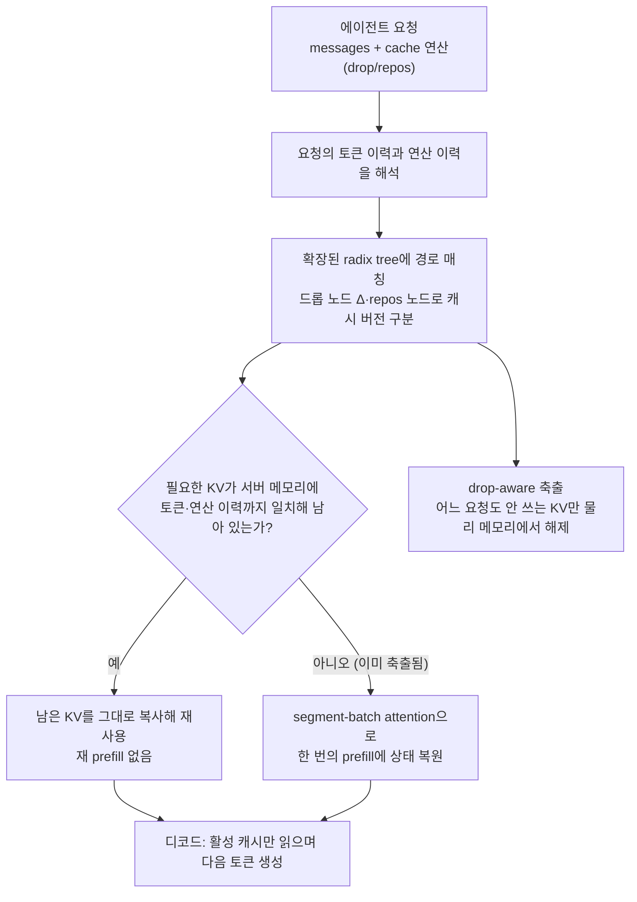

[논문 링크](https://arxiv.org/abs/2610.28577v1)
## 긴 에이전트 궤적이 만드는 비용과 정확도 딜레마

LLM 에이전트는 추론과 도구 호출을 수백 라운드 반복하며 긴 궤적을 쌓는다. 추론을 빠르게 만들려면 이미 계산한 key-value(KV) 캐시를 GPU에 두고 다음 토큰마다 다시 읽어야 하는데, 궤적이 길어질수록 저장·읽기 비용이 커진다. 논문은 KV 캐시 읽기가 전체 API 비용의 82.4%를 차지한다고 측정했고(§1, Figure 13), attention이 다루는 KV 개수나 위치 범위가 모델이 감당할 수준을 넘으면 정확도까지 떨어진다고 지적한다(§1).

### 컨텍스트 엔지니어링의 딜레마

기존 접근은 텍스트를 잘라내거나 요약해 프롬프트 자체를 줄이는 **컨텍스트 엔지니어링**이다. 문제는 앞부분의 텍스트를 고치면 그 뒤에 이어 붙인 KV 상태가 전부 무효화된다는 점이다. 무효화된 구간은 **재 prefill**(이미 계산한 접두사를 다시 forward로 푸는 과정)로 다시 계산해야 하며, 고치는 위치가 앞일수록 다시 계산할 꼬리가 길어진다. 그래서 실제 하네스는 컨텍스트가 임계치에 이를 때까지 줄이기를 미루다가, 한 번에 대부분을 요약·삭제하고 최근 몇 라운드만 남긴다(§1, §2). 재 prefill은 짧아지지만 중간 라운드의 유용한 정보가 사라질 위험이 있다.

이 딜레마를 논문이 직접 측정했다. GPT-OSS-120B로 BCP(BrowseComp-Plus) 첫 100개 작업(작업당 4회 시도, 최대 100 라운드)을 돌린 결과다(§3.2, Figure 3).

| 방법 | 무엇을 남기나 | 비용 대비 결과 |
|---|---|---|
| 전체 컨텍스트 | 모든 토큰의 KV | 기준선 |
| 자르기(trim) | 최근 12개 도구 응답만 | 비용이 기준선의 1.85배 |
| 요약(48k 임계치) | 임계치 아래를 요약 문단으로 교체 | 비용 약 7% 감소, 정확도 5%p 하락 |

### 작은 예시: 같은 100라운드, 서로 다른 캐시 처리

설명용 예시다(측정 결과가 아니다). 에이전트가 "ICLR을 검색해 줘"라는 사용자 메시지에서 출발해, 추론 → 도구 호출 → 도구 응답을 100라운드 반복했다고 하자. 매 디코드 단계마다 새 토큰의 KV가 `append`로 이어 붙어 활성 캐시가 늘어난다.

| 단계 | 컨텍스트 엔지니어링 | 캐시 엔지니어링 |
|---|---|---|
| 입력 | 100라운드 텍스트 궤적(프롬프트 + 추론 + 도구 응답) | 동일 |
| 남는 상태 | 1~80라운드를 요약 문단 하나로 압축, 81~100라운드 유지 | 텍스트는 그대로 두고, 추론 KV와 최근 12개 도구 응답 KV를 활성 캐시에 남긴다 |
| 변경·생략 | 요약 문단을 접두사로 삼아 81~100라운드 KV를 다시 계산(재 prefill) | 오래된 도구 응답의 KV만 attention에서 제외(`drop`) |
| 출력 | 요약 뒤 짧아진 컨텍스트, 중간 정보 손실 가능 | 매 디코드 단계가 읽는 활성 캐시가 짧아지지만, 재계산 없이 남은 KV를 그대로 쓴다 |

캐시를 직접 지우는 방식이 가능한 이유는, 버려지는 히스토리의 영향이 이미 남은 KV의 계산에 반영되어 있을 수 있기 때문이다(§3.2, Figure 1). Figure 1의 겹친 색 블록도 같은 뜻이다. 지워진 이력을 본 채로 계산된 남은 KV는 그 정보를 간접으로 담고 있어서, 뒤쪽을 재계산할 필요가 없다.

### 무엇을 남길까, 위치를 어떻게 맞출까

무엇을 지울지는 attention 분석으로 정했다. 오래된 토큰은 최근 토큰보다 attention을 적게 받고, 비슷한 상대 위치에서는 도구 응답이 어시스턴트 메시지보다 attention을 적게 받는다(§3.2, Figure 2). 10개 BCP 궤적의 층별 분석에서도 오래된 도구 응답이 오래된 추론보다 attention을 적게 받는 경우가 대부분이었다(Appendix A.4.3, Figure 15). 그래서 기본 정책은 **tool-response rolling drop**이다. 추론 KV와 최근 12개 도구 응답 KV는 남기고, 오래된 도구 응답 KV만 지운다.

위치 인코딩은 별도로 관리해야 한다. <strong>회전 위치 임베딩(RoPE)</strong>은 토큰의 상대적 거리를 코사인·사인 회전으로 인코딩하는 방식이다. 기본적으로 위치 인덱스는 논리 궤적을 따라 계속 커진다. `drop`은 위치 인덱스를 바꾸지 않으므로, 캐시를 아무리 줄여도 다음 토큰의 인덱스는 올라가 결국 모델 한계에 부딪힌다. 논문은 위치 인덱스를 논리 인덱스·캐시 크기와 분리하고, 남은 키를 논리 순서대로 0…r−1로 다시 매긴 뒤 다음 append의 위치를 r으로 초기화하는 `repos`를 쓴다. RoPE에서는 캐시된 키 K를 위치 p에서 q로 옮길 때 회전 행렬만 곱하고 값(value)은 그대로 둔다(§3.3):

$$
K \leftarrow R(q)\,R(p)^{-1}\,K
$$

은닉 상태를 다시 계산하지 않는 변환이므로, 재 prefill 없이 위치만 바꿀 수 있다.

## 세 가지 캐시 연산

캐시 엔지니어링은 세 연산으로 정의된다(§3.3). 논리 토큰 시퀀스는 건드리지 않고, attention에 보이는 캐시만 바꾼다.

- `append`는 일반 추론과 같다. 새 토큰을 활성 캐시에 이어 붙인다: $C \leftarrow [C; C_{t+1}]$.
- `drop(P)`는 집합 P의 항목을 이후 attention에서 제외한다: $C \leftarrow C \setminus \{C_i : i \in P\}$. 남은 항목의 값·위치 인코딩·논리 토큰은 그대로이며, 뒤쪽 상태를 재계산하지 않아도 된다.
- `repos`는 남은 키의 위치 인코딩을 논리 순서대로 다시 매기고, 다음 append가 쓸 인덱스를 초기화한다.

연산을 이어서 적은 것을 **캐시 연산 시퀀스**라 한다(§3.4). 같은 모델에서는 이 시퀀스가 빈 캐시에서 출발해 현재 캐시 상태를 결정한다.

### 히스토리 의존성: 같은 토큰이라도 순서에 따라 상태가 갈린다

기존 KV 캐시에서는 토큰 접두사가 같으면 캐시가 같았고, 서빙 시스템도 그 재사용에 의존했다. 캐시 엔지니어링에서는 **같은 토큰이 남아도 연산 순서가 다르면 KV 상태가 달라진다**(§3.4). Figure 5의 세 궤적을 보자.

| 궤적 | 연산 순서 | 유지되는 항목 | C를 계산할 때 attention한 항목 | 남는 C의 KV |
|---|---|---|---|---|
| ① | append(A) → append(B) → append(C) → drop(A) | B, C | A, B | C는 A·B를 본 상태 |
| ② | append(A) → append(B) → drop(A) → append(C) | B, C | B만 (A는 이미 drop됨) | C는 A를 못 본 상태 |
| ③ | append(B) → append(C) | B, C | B만 (A 없음) | ②와도 다른 B 위에 계산 |

세 궤적 모두 B와 C를 남기지만 C의 KV는 셋 다 다르다. B의 상태도 ①·②는 A에 조건화되고 ③은 그렇지 않다. 올바른 재사용과 복원을 위해서는 토큰 이력과 캐시 연산 이력을 함께 기록해야 한다(Figure 5).

## 서빙 시스템 AKV: 상태는 서버가, 인터페이스는 무상태

AKV는 히스토리 의존성을 감추기 위해 **무상태 인터페이스, 유상태 서빙**을 따른다(§4). 에이전트는 기존처럼 `messages`를 보내되(messages의 각 항목은 암시적 append), 선택적으로 `cache` 필드에 `drop`·`reposition`을 덧붙인다. 어느 KV가 서버에 남아 있는지는 추적하지 않아도 된다. `drop`은 몇 번째 메시지 다음에 어떤 메시지의 캐시를 지울지, `reposition`은 몇 번째 메시지 다음에 위치를 다시 매길지를 지정하며(operate-after 문법, Figure 6), 같은 경계에서는 drop이 repos보다 먼저 적용된다. 서버가 물리 캐시의 재사용·축출·복원을 처리한다.

예를 들어 아래 요청에서 서버는 메시지 1번(assistant)이 끝난 시점에 메시지 0번(user)의 캐시를 drop하고, 메시지 2번(tool)이 끝난 시점에 메시지 1번의 캐시를 drop한 뒤 같은 지점에서 남은 키를 repos한다.

```json
{ "model": "gpt-oss-120b",
  "messages": [
    {"role": "user", "content": "Search ICLR"},
    {"role": "assistant", "content": "Searching"},
    {"role": "tool", "content": "ICLR is..."}
  ],
  "cache": {
    "drop": {"1": [0], "2": [1]},
    "reposition": [2]
  }
}
```

### 상태 변화가 보이는 서빙 흐름

요청이 들어온 뒤 서버가 실제로 하는 일은 다음과 같다.



서빙 엔진은 기존 시스템의 세 성질을 지켜야 한다. (1) 필요한 상태와 완전히 같을 때만 재사용하고, (2) 다른 요청의 격리를 깨지 않으면서 안 쓰는 캐시를 축출하며, (3) 축출된 상태를 한 번의 prefill로 복원한다(§4.2). 이를 위해 세 장치를 둔다.

**드롭 노드가 있는 확장된 radix tree.** 기존 radix tree는 토큰 접두사가 같으면 캐시를 공유한다. AKV는 `drop`이 호출되는 지점에 드롭 노드 Δ를 삽입해 어떤 항목의 캐시가 지워졌는지 기록한다. 위 표의 ①과 ②는 A–B 접두사를 공유하되 A를 지운 시점이 다르므로 C 상태가 갈라지고, ③은 별도 가지를 따른다. 접두사 공유는 유지하면서 그 이후의 상태를 구분할 수 있다(Figure 5c). `repos`는 키를 회전시켜 위치가 다른 버전을 만들고, 새 가지로 분기한다. 위치 인덱스가 같으면 그대로 재사용하고, 다르면 키 회전으로 변환해 쓴다(§4.2, A.1.2, Figure 8).

**드롭을 아는 축출.** 한 요청이 지운 캐시는 다른 요청에 아직 필요할 수 있다. AKV는 진행 중인 계산이나 복원이 그 캐시를 더 이상 쓰지 않을 때만 물리 저장소를 해제하고, 요청이 끝나기 전에도 쓰지 않는 캐시를 먼저 되찾는다. 축출 우선순위에서는 드롭된 캐시가 완료된 요청의 캐시보다 앞선다. 후자는 다음 라운드에 다시 쓰일 가능성이 크기 때문이다. 저장소는 비우되 트리 노드는 빈 자리로 남겨 하위 캐시에 접근할 수 있게 한다. 위치 버전별로도 독립적으로 축출한다(§4.2, A.1.2).

**segment-batch attention으로 단일 prefill 복원.** 축출된 상태를 되살리려면 drop·repos가 만든 attention 가시성을 그대로 재현해야 한다. AKV는 각 레이어에서 쿼리를 drop·repos가 발생한 지점에서 잘라 여러 세그먼트로 나눈다. 각 세그먼트는 자기 토큰과 앞 세그먼트의 활성 캐시에 대해 표준 인과(causal) attention을 수행한다. 지워진 캐시는 뒤 세그먼트에서는 보이지 않지만, 원래 그것을 썼던 앞 세그먼트에서는 계속 보인다. attention만 세그먼트로 나누고 FFN은 전체 시퀀스를 한 배치로 처리해, 세그먼트마다 FFN 가중치를 다시 읽는 메모리 트래픽을 피한다(§4.2, A.1.1, Figure 10). 여러 번의 순방향 패스 없이 한 번의 prefill로 복원하며, repos가 섞인 경우엔 세그먼트별 임시 KV 버전을 키 회전·값 복사로 만들어 쓴다(A.1.1).

## 결과: 점수·비용과 서빙 처리량

실험은 세 모델(MiniMax-M2.7, GPT-OSS-120B, MiroThinker-1.7-Mini)과 네 개의 장기 에이전트 벤치마크(BCP, GAIA-Text, SWE-Verified, xbench-DS)에서 진행했다(§5.1). 비교 대상은 임계치를 높게 둔 **Standard**(모델별 96k, MiroThinker만 192k에서 요약)와 임계치를 48k로 낮춘 **Text Engineering**이다. AKV는 tool-response rolling drop(최근 12개 도구 응답 유지)을 쓰고, repos 임계치는 모델별 Standard 요약 임계치와 같게 두었다.

**평균 점수(통과율, %)와 평균 비용(센트)** — Table 1의 Average 열 재구성

| 모델 | 지표 | Standard | Text Eng. | AKV |
|---|---|---|---|---|
| GPT-OSS-120B | 점수 / 비용 | 51.0 / 11.2 | 48.3 / 10.2 | **53.1 / 7.3** |
| MiniMax-M2.7 | 점수 / 비용 | 52.4 / 5.0 | 52.8 / 5.7 | **53.7 / 4.4** |
| MiroThinker-1.7-Mini | 점수 / 비용 | 44.1 / 20.4 | 37.1 / 18.1 | **45.8 / 14.8** |

세 모델 모두 AKV가 가장 높은 평균 점수를 내면서 비용은 가장 낮다. 평균 점수는 Standard 대비 1.7점(모델별 1.3~2.1점), Text Engineering 대비 0.9~8.7점 높고, 비용은 Standard 대비 27.7%, Text Engineering 대비 21.9% 낮다(§5.2, Table 1).

점수 차이는 요약 임계치 너머의 구간에서 나온다. BCP 첫 100개 작업에서 세 방법 모두 48k 이하에서는 88%로 비슷했지만, Text Engineering은 48~96k 구간에서 54%(AKV 70%), Standard는 96k 이상에서 24%(AKV 37%)로 낮아졌다(Figure 7). 임계치에서 컨텍스트를 갑자기 줄이는 것과 정보 손실이 일관되는 패턴인 반면, rolling drop은 오래된 도구 응답 KV를 점진적으로 지운다(§5.2; Figure 14, Appendix A.4.2).

비용 절감은 두 곳에서 온다(BCP, GPT-OSS-120B 기준). 드롭으로 이후 요청이 읽는 캐시 이력이 줄어 캐시 읽기 비용이 Standard 대비 약 17% 줄고, 요약이 텍스트를 다시 쓸 때 생기는 재 prefill이 없어 cache-miss 입력 비용이 Text Engineering 대비 약 48% 줄어든다(Figure 13, Appendix A.4.2).

### 서빙 지연과 처리량

서빙 실험은 GPT-OSS-120B를 8대의 A800-80GB GPU(프리필 4대 + 디코드 4대, 각 TP4, BF16)에서 돌렸고, SWE-Verified에서 컨텍스트가 가장 긴 상위 80개 작업을 재생(replay)했다(Table 5, A.1.3; A.1.4).

**커널 수준**에서는 같은 배치 크기에서 AKV가 full-attention 시간을 59.8%, 디코드 단계 전체 시간을 16.0% 줄인다(Figure 12, Appendix A.4.1). 드롭으로 매 디코드 단계에서 읽는 KV와 attention 계산이 줄기 때문이다.

**시스템 수준**에서는 각 방법의 최고 처리량 설정에서 비교한다. Standard는 C=12, AKV는 C=14일 때 최고 처리량을 낸다(Table 2).

| 지표 (최고 처리량 설정) | Standard (C=12) | AKV (C=14) | 배수 |
|---|---|---|---|
| 평균 요청 지연 (s) | 12.39 | 9.09 | 1.36× |
| P95 요청 지연 (s) | 43.16 | 28.49 | 1.51× |
| 입력 처리량 (tok/s) | 33,832 | 51,837 | 1.53× |
| 출력 처리량 (tok/s) | 313 | 369 | 1.18× |

이득은 동시성(C)이 14 이상인 고부하에서 커진다. Standard는 KV 압력이 커지면 재 prefill이 늘어 동시에 디코딩할 수 있는 요청 수가 줄지만, AKV는 활성 컨텍스트가 짧아 그 압력을 피한다(§5.3). 측정 프로토콜에 유의해야 한다(A.1.4). 고동시성에서 Standard는 KV 압력으로 심하게 저하되어 1시간 고정 창으로 측정했고(일부 요청이 창 종료 시점에 미완료), AKV의 C=14·16 실행은 처음 30개 작업 완료 시점까지의 창으로 잘랐다.

### 캐시 정책을 스스로 다듬거나 에이전트에 넘기는 경우

RSI(재귀적 자기 개선)는 캐시 정책을 사람이 고정하지 않고 모델 스스로 개선하는 방식이다. MiniMax-M2.7로 20개 BCP 작업에서 정책을 다듬고 100개 보류 작업에서 평가한 결과, Standard의 정확도를 유지하면서 과제당 비용을 15.6~17.8% 줄였다(§5.4, Figure 4). 초록·§1에 따르면 RSI 정책은 사람 전문가 설계 대비 비용을 7.1% 더 줄였다.

Cache-as-Tool는 캐시 관리를 도구로 에이전트에게 노출한 방식이다. 에이전트가 스스로 언제 줄이고 무엇을 남길지 정한다. BCP 100개 하위집합에서 두 모델 모두 최고 통과율을 기록했다(GPT-OSS-120B 61.0%, MiniMax-M2.7 64.0%). 비용은 GPT-OSS-120B가 13.4→12.1센트로 줄었고, MiniMax-M2.7은 더 많은 라운드를 실행해 5.4→5.9센트로 늘었다(Table 4).

## 한계와 적용 판단

논문이 스스로 밝힌 한계는 세 가지다(§6). 연구자들은 캐시 엔지니어링 전략을 더 넓게 탐색하고, 이 방식 아래에서 에이전트를 직접 학습시키며, 선형 attention 모델에서도 서빙 지원을 확장해야 한다.

리뷰어 관점에서 보면 아래 조건에서는 적용을 신중히 따져야 한다.

- **RoPE와 KV 캐시 전제.** `drop`·`repos`는 표준 attention + KV 캐시를 가정한다. RoPE 회전은 유한 정밀도 연산이라 재계산과 비트 단위로 같지 않을 수 있고, 저자는 정확성 논증이 비트 단위 일치를 요구하지 않는다고 명시한다(A.1.2). 선형 attention 계열에는 아직 미지원이다.
- **정책 품질에 의존.** 성능은 무엇을 지울지 정책에 크게 좌우된다. ablation(Table 3, 작업별 첫 100개)에서 repos 없이 tool drop만 쓰면 BCP 55.0%로 Standard(56.0%)를 넘지 못했고, repos를 더해 62.0%에 도달했다(포지션 한계를 넘어 탐색할 수 있게 되어서, §5.4). 반면 추론 캐시를 지우는 전략은 단독이든 함께든 tool drop만 한 경우보다 두 벤치마크 모두에서 점수가 낮다(BCP 56.5, SWE 34.5~36.5 vs 41.0). 작은 GPT-OSS-20B에서는 최고 평균 통과율이 45.2%로 Standard(44.0%)보다 1.2%p 높은 수준에 그쳤고, 저자는 작은 모델이 보유 정보를 효과적으로 활용하지 못하기 때문으로 본다(Table 7, A.4.4). drop 자체가 점수를 올리는 것이 아니라, 좋은 drop 정책이 그렇다.
- **평가 범위.** 서빙 실험은 단일 노드(8×A800)와 한 모델 계열(GPT-OSS)에서 재생 방식으로 이뤄졌다. 재생은 도구를 다시 실행하지 않고 기록된 응답을 그대로 쓰며, 각 방법은 자기 정책으로 수집한 궤적을 재생하므로 턴 수와 출력 예산이 방법마다 다를 수 있다(A.1.4). 다중 노드 배치나 실시간 도구 재실행이 섞인 부하에서의 동작은 검증되지 않았다. 벤치마크도 장기 에이전트 4종에 한정된다.
- **복잡성 증가.** 정확한 재사용을 위해 토큰 이력과 연산 이력을 함께 추적해야 하므로, 기존 prefix 캐싱보다 트리 매칭과 상태 관리가 복잡해진다. 무상태 인터페이스가 이를 감추지만, 연산 이력을 추적하도록 확장되지 않은 기존 서빙 스택에는 그대로 적용하기 어렵다.

정리하면, AKV의 캐시 엔지니어링은 긴 도구 호출 궤적을 수백 라운드 돌리며 KV 캐시 읽기와 재 prefill 비용이 문제가 되는 에이전트 서빙에 가장 잘 맞는다. 짧은 세션 위주이거나, 선형 attention을 쓰거나, 캐시 정책을 정교하게 설계하기 어려운 환경에서는 이득이 제한적일 수 있다.


<!-- verbatim-tables -->

<details>
<summary>논문 원문의 표</summary>

> arXiv e-print 의 LaTeX 원본에서 기계적으로 옮긴 표입니다. 숫자는 논문의 값이며 모델을 거치지 않았습니다.

**표 1. Benchmark scores (pass rate, %) and costs (cents) by model and management method. Bold indicates the highest score and lowest cost within each model, including ties.**

| Method | BCP Score | BCP Cost | GAIA-Text Score | GAIA-Text Cost | SWE-Verified Score | SWE-Verified Cost | xbench-DS Score | xbench-DS Cost | Average Score | Average Cost |
|---|---|---|---|---|---|---|---|---|---|---|
| *MiniMax-M2.7* (230B total, 10B active) |  |  |  |  |  |  |  |  |  |  |
| Standard | 58.9 | 5.2 | 35.0 | **2.4** | **75.2** | 7.0 | **40.5** | 5.5 | 52.4 | 5.0 |
| Text Engineering | **62.3** | 5.3 | 36.9 | 2.7 | 72.0 | 9.4 | 40.0 | 5.2 | 52.8 | 5.7 |
| \name | 58.9 | **4.8** | **40.8** | 2.6 | 74.4 | **5.5** | **40.5** | **4.7** | **53.7** | **4.4** |
| *GPT-OSS-120B* (5.1B active) |  |  |  |  |  |  |  |  |  |  |
| Standard | 57.5 | 13.1 | 68.0 | 5.4 | 40.0 | 20.0 | **38.5** | 6.2 | 51.0 | 11.2 |
| Text Engineering | 52.7 | 12.6 | 65.1 | 6.8 | 36.8 | 15.8 | **38.5** | 5.4 | 48.3 | 10.2 |
| \name | **61.9** | **11.4** | **69.9** | **4.1** | **43.2** | **9.7** | 37.5 | **3.8** | **53.1** | **7.3** |
| *MiroThinker-1.7-Mini* (30B total, 3B active) |  |  |  |  |  |  |  |  |  |  |
| Standard | 60.0 | 25.2 | 68.0 | **9.2** | **7.8** | 33.6 | 40.5 | 13.5 | 44.1 | 20.4 |
| Text Engineering | 45.7 | 17.6 | 66.0 | 11.0 | 4.2 | 28.4 | 32.5 | 15.3 | 37.1 | 18.1 |
| \name | **63.5** | **15.3** | **68.9** | 9.5 | 7.4 | **26.3** | **43.5** | **8.1** | **45.8** | **14.8** |

**표 2. Serving performance (latency, s; TTFT, s; TPOT, ms/token; throughput, tokens/s) of GPT-OSS-120B on Top-80 SWE-Verified across concurrency ($C$) levels.**

| $C$ | Method | Request latency mean | Request latency P95 | TTFT mean | TTFT P95 | TPOT mean | TPOT P95 | Throughput Input | Throughput Output |
|---|---|---|---|---|---|---|---|---|---|
| 8 | Standard | 12.16 | 43.57 | 3.18 | 8.42 | 26.57 | 31.38 | 25200 | 217 |
|  | Text Engineering | 12.84 | 43.57 | 4.94 | 22.99 | **23.23** | **25.68** | 17313 | 228 |
|  | \name | **7.79** | **25.93** | **1.87** | **5.99** | 23.50 | 29.42 | **39227** | **245** |
| 10 | Standard | 12.82 | 45.03 | 3.93 | 9.76 | 26.47 | 30.83 | 30108 | 254 |
|  | Text Engineering | 15.17 | 50.27 | 7.35 | 34.07 | **22.57** | **25.09** | 18533 | 246 |
|  | \name | **8.13** | **27.11** | **2.22** | **7.36** | 23.20 | 29.86 | **46002** | **295** |
| 12 | Standard | 12.39 | 43.16 | 2.97 | 9.99 | 28.00 | 32.78 | 33832 | 313 |
|  | Text Engineering | 16.83 | 52.82 | 8.86 | 37.98 | 23.24 | **25.95** | 19945 | 264 |
|  | \name | **8.47** | **27.18** | **2.60** | **8.17** | **23.06** | 29.23 | **48923** | **339** |
| 14 | Standard | 30.16 | 108.86 | 21.36 | 88.29 | **24.50** | 29.85 | 12767 | 146 |
|  | Text Engineering | 19.59 | 60.67 | 11.19 | 47.36 | **24.50** | **27.23** | 19992 | 267 |
|  | \name | **9.09** | **28.49** | **2.92** | **8.62** | **24.50** | 31.56 | **51837** | **369** |
| 16 | Standard | 36.50 | 229.90 | 27.71 | 223.57 | 24.83 | 29.25 | 10866 | 138 |
|  | Text Engineering | 23.00 | 69.96 | 14.48 | 52.71 | **24.44** | **27.56** | 19595 | 267 |
|  | \name | **10.32** | **30.63** | **4.16** | **13.02** | 24.84 | 32.41 | **50817** | **369** |

**표 3. Drop-target and $\operatorname{repos}$ ablations with GPT-OSS-120B on each benchmark's first 100 tasks.**

| Strategy | $\operatorname{Repos}$ | BCP Score | BCP Cost | SWE Score | SWE Cost |
|---|---|---|---|---|---|
| Standard | ✗ | 56.0 | 13.5 | **41.0** | 19.1 |
| Tool drop | ✗ | 55.0 | 7.1 | **41.0** | 9.4 |
| Reasoning drop | ✓ | 56.5 | 8.2 | 36.5 | 14.2 |
| Both drop | ✓ | 56.5 | 8.7 | 34.5 | 7.8 |
| Tool drop | ✓ | **62.0** | 10.9 | **41.0** | 9.5 |

**표 4. **Serving configuration.****

| Setting | Value |
|---|---|
| Model and weight precision | GPT-OSS-120B, BF16 |
| Hardware | Eight NVIDIA A800 GPUs, 80 GB each |
| Parallelism | Prefill: TP4; decode: TP4 |
| KV transfer | Mooncake over intra-node NVLink |
| Attention backend | Triton |
| MoE backend | `triton_kernel` |
| Static memory fraction | 0.85 |
| KV page size | One token per page |
| Prefill chunk size | 8,192 tokens |
| Maximum prefill tokens | 8,192 |
| Prefix caching | Radix cache enabled on both workers |
| Eviction | Baselines: LRU; \name: drop-aware eviction |

**표 5. Token prices for API-equivalent cost rate (USD per million tokens).**

| Model | Cache-miss | Cache-hit | Output |
|---|---|---|---|
| MiniMax-M2.7 | 0.300 | 0.060 | 1.200 |
| GPT-OSS-120B | 0.150 | 0.075 | 0.600 |
| MiroThinker-1.7-Mini | 0.200 | 0.040 | 2.400 |
| GPT-OSS-20B | 0.075 | 0.0375 | 0.300 |

**표 6. Benchmark scores (pass rate, %) and costs (cents) of GPT-OSS-20B across different management methods. Bold indicates the highest score and lowest cost, including ties.**

| Method | BCP Score | BCP Cost | GAIA-Text Score | GAIA-Text Cost | SWE-Verified Score | SWE-Verified Cost | xbench-DS Score | xbench-DS Cost | Average Score | Average Cost |
|---|---|---|---|---|---|---|---|---|---|---|
| Standard | 49.0 | 6.5 | 60.2 | 3.5 | 41.8 | 12.5 | **25.0** | 2.4 | 44.0 | 6.2 |
| Text Engineering | 43.0 | **4.4** | **65.1** | 3.0 | 25.6 | **8.8** | 19.0 | 2.0 | 38.2 | **4.6** |
| \name | **50.5** | 6.0 | 62.1 | **2.5** | **44.2** | 8.9 | 24.0 | **1.8** | **45.2** | 4.8 |

</details>
