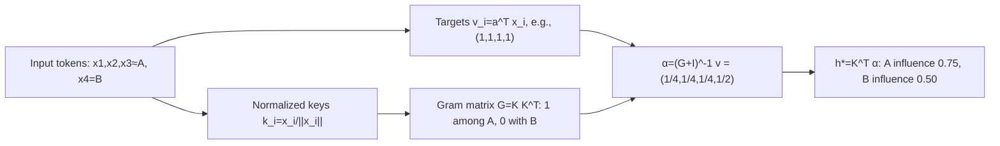

[Paper](https://arxiv.org/abs/2610.31574v1)
## Introduction

In models that handle long contexts, the compression operation that reduces multiple tokens to a single vector becomes a performance bottleneck. This paper reframes compression not as a choice of weighted averaging, but as the problem of finding the coefficients of a regression problem defined by the tokens. TTR-Compressor constructs a label-free ridge regression problem from the input tokens and uses its closed-form solution as the compressed representation.

## Why existing compressors discard information

Sequence compression is an operation that transforms T d-dimensional token vectors into a single d-dimensional summary vector. In block-sparse attention, this vector becomes the retrieval key that selects the blocks a query reads, while in visual token merging, this vector itself becomes the visual token seen by the language model. In both cases, the compressor stores the tokens as a single vector, and subsequent layers read only that vector. Information discarded here cannot be recovered later.

Existing approaches fall into three categories. (1) Mean pooling assigns the same weight to every token. (2) Concatenating tokens and passing them through a learned linear projection uses fixed weights per position. (3) Attention-weighted pooling scores each token individually but evaluates each token independently of the others. What all three share is that their weights do not reflect relationships among tokens. They use only first-order statistics—how important each token is individually—and ignore second-order statistics, the correlations between tokens. Consequently, duplicate tokens reinforce one another, and rare features are diluted.

A small example illustrates this difference. The example below is for explanation and is not an actual measured result.

**Illustrative example.** Suppose four tokens are given, three of which carry essentially the same content A, and only one carries distinct information B. Set all target values to v=(1,1,1,1). Additive pooling (mean) assigns a weight of 1/4 to each token, yielding an influence of 3/4 for the A group and 1/4 for B, a ratio of 3:1. TTR groups token similarities into a Gram matrix and fits them jointly, so the three correlated A tokens are treated as duplicates; the group influence is still 3/4, but B becomes 1/2. The ratio becomes 3:2, weakening the dominance of the duplicate group and increasing the relative weight of the distinct token B. In general, according to Appendix B (Proposition 4, Corollary 1), the relative influence ratio between m fully overlapping tokens and a single distinct token is not m but m(λ+1)/(λ+m) < m, so duplicated evidence has diminishing returns. This number comes from the example in Figure 2(b) of the paper (normalized D=I, λ=1) and its general formula; it is not a measured value.

| Category | Additive pooling (mean, etc.) | TTR (joint regression) |
| --- | --- | --- |
| Input | 4 tokens: A, A, A (duplicate), B (distinct) | Same |
| Computed weights α | 1/4 each for A, 1/4 for B | 1/4 each for A, 1/2 for B |
| Group influence Kᵀα | A 0.75, B 0.25 | A 0.75, B 0.50 |
| Output ratio | 3 : 1 | 3 : 2 |
| What remains | Duplicate A dominates the summary | B's relative weight increases |
| What is rejected | None: A continues to be added | The residual left by A's third token approaches zero, reducing its weight |

## What changes when tokens become a regression problem

Given tokens X=[x₁,…,x_T], TTR-Compressor defines a ridge regression problem on the tokens themselves and uses the fitted coefficients h* as the compressed representation (§3.1, Eq. 1). Ridge regression fits target values while penalizing the magnitude of coefficients. The key is to solve, for each input, "which coefficients best explain these tokens" and use those coefficients as the summary.

Specifically, it determines two things. One is each token's key k_t = x_t / ‖x_t‖, retaining only the vector direction so that inner products between keys measure only directional similarity. The other is a scalar target v_t = aᵀx_t, which extracts a single number from each token using one shared learnable vector a (§3.2). This target requires no labels and is derived from the input.

The reason key normalization matters is clear. Since targets are generated linearly as v_t = aᵀx_t, without key normalization (k_t = x_t), the fixed vector a itself becomes the correct answer, and h* converges to a fixed vector independent of the input. In addition, outlier tokens with large norms dominate the Gram matrix, so the model sees magnitude instead of similarity. Normalization removes both problems at once. Indeed, removing key normalization drops the RULER average from 0.509 to 0.253 (§5.4, Table 5).

Solving the regression problem yields the following compressed representation.

$$h^* = (K^\top K + D)^{-1} K^\top v$$

Here K is the key matrix, v is the target vector, and D is the normalization matrix. The result is determined jointly by the statistics of keys and targets, Kᵀv, and by KᵀK, which captures the similarity structure among tokens. KᵀK is the Gram matrix in feature space, and because it groups tokens pointing in the same direction, it produces the property from the earlier example: "duplicates have reduced influence."

Conventional ridge regression requires tuning the regularization strength λ as a hyperparameter, but tuning it during large-scale pretraining is expensive and cumbersome when model size changes. Instead of a scalar λ, TTR uses a learnable diagonal matrix D = diag(softplus(ρ)) (§3.2, Eq. 3). It learns a different regularization strength for each channel, penalizing less important feature directions more strongly and preserving directions important to the task. The learned diagonal outperforms the best fixed λ (λ=0.001, 0.502) with 0.509 (Table 6), and a learned scalar is also competitive at 0.497, showing that the task loss can find the regularization strength on its own.

## Solving small blocks in dual form

Working directly in d dimensions requires solving a d×d linear system, but the number of tokens to compress, T, is typically much smaller than the channel dimension d (e.g., T∈{4, 9, 64} versus d≥1024). In this case, we can switch to the dual form and solve only a T×T system (§3.3, Eq. 7). The dual form is an equivalent transformation that turns a d×d system into a T×T system.

$$TTR(X) = D^{-1/2} \tilde{K}^\top \big(I_T + \tilde{K}\tilde{K}^\top\big)^{-1} v$$

The computation proceeds as follows. Rescale the keys by D to form K̃, factor the T×T Gram matrix I_T + K̃K̃ᵀ via Cholesky decomposition, solve for α, and then apply K̃ᵀα to obtain the compressed representation. Cholesky decomposition factors a symmetric positive-definite matrix into a product involving a lower-triangular matrix, solving the linear system with two substitutions. The complexity is O(T²d + T³), much lighter than the O(Td² + d³) of solving the d×d system directly when T≪d. The actual computation never forms an explicit inverse and uses only triangular solves (§5.3, Table 4; Appendix C).

This structure makes training bi-level (§3.4, Figure 2(a); §4.1). The outer loop learns parameters a and ρ that determine "which regression problem is useful" using the task loss, while the inner loop solves "how to fit" that regression problem in closed form for each input. The only learnable parameters are the target projection a (d values) and the regularization ρ (d values) per compressor, and because the inner solution is a differentiable closed form, gradients flow through it directly. At inference time, the learned parameters are fixed, and only h* is recomputed for each input. This differs from existing test-time training approaches that run gradient descent for every input or approximate it with a single delta-rule step (§3): because computation is independent per block, a single T×T dual solve yields the exact solution.

The matrix coordinate (i,j) is the directional similarity between tokens i and j, where a value of 1 means the same direction and 0 means orthogonal. The fourth value of α grows to 1/2 because B captures the residual not explained by the A group.

## Results: block-sparse attention

The first application is block-sparse attention based on HiLS-Attention (§5.1). The context is divided into 64-token blocks, and for each block's compressed representation, up to 32 relevant blocks are selected and attended to together with a 512-token local window. The compressor stores each block as a retrieval key vector, and the query uses those keys to select blocks to read. Retrieval accuracy therefore directly reflects compression quality. We trained a 345M model on FineWeb with an 8K context for about 30B tokens and evaluated it on RULER's needle-retrieval tasks (S-NIAH, MK-NIAH).

Before the evaluation, consider one question. **With the same attention architecture, how much more hidden information can be found in contexts extending to 32K if only the compressor changes?** The table below extracts only the average across compressors and representative long-context numbers (Table 1).

| Compressor | Avg (4K–32K) | S-NIAH-1 @16K | S-NIAH-1 @32K |
| --- | --- | --- | --- |
| Mean pooling | 0.2971 | 0.470 | 0.270 |
| Concat + projection | 0.3919 | 0.792 | 0.582 |
| Attention-weighted pooling | 0.3920 | 0.876 | 0.740 |
| **TTR** | **0.5092** | **0.992** | 0.650 |
| TTR (w/ Conv) | **0.5144** | 0.994 | **0.988** |

The interpretation has two parts. First, the choice of compressor itself strongly affects retrieval quality. The gap between mean pooling and attention-weighted pooling reaches about 9.5 points on average. Second, TTR substantially outperforms all competing compressors on average. At 16K extrapolation beyond the 8K training length, the advantage extends to individual tasks, but under 32K extrapolation, standard TTR loses S-NIAH-1 (0.650) to attention-weighted pooling (0.740), and on the 32K four-task average, TTR's 0.238 versus attention-weighted pooling's 0.224 narrows the lead. The convolution variant largely mitigates this, recording 0.988 on 32K S-NIAH-1. The paper attributes this to convolution making the target v_t more informative and thereby improving compression quality; the convolution variant leads the strongest baseline by 12.24 points (§5.1).

One caveat is that the gains are confirmed on "finding" tasks, and whether they extend to general language quality is a separate question. In the commonsense reasoning benchmark in Table 2, evaluation contexts are short, so sparse attention is not activated; all compressors are similar in the 48-point range. This is discussed in the limitations section below.

## Results: visual token merging and efficiency

The second application is visual token merging in multimodal models (§5.2). High-resolution images produce many visual tokens, making it expensive to feed them directly into the language backbone. The standard design concatenates adjacent 2×2 features and reduces them to one token through a two-layer MLP. Here, TTR fits one regression per spatial group (2×2 or 3×3) to compress 4 or 9 features into a single vector, and a two-layer MLP projects it to the language model dimension. We trained with Qwen3-VL's ViT encoder and Qwen3-4B-Instruct using a two-stage procedure that trains the merger and backbone sequentially.

The comparison question before the table is this. **With the same encoder and language model, how much less information is lost on tasks where fine-grained details such as documents and charts matter when the merger changes?**

| Merge ratio | Merger | Avg |
| --- | --- | --- |
| 2×2 | MLP | 54.93 |
| 2×2 | TTR | 55.92 |
| 2×2 | TTR (w/ Conv) | 56.03 |
| 3×3 | MLP | 52.27 |
| 3×3 | TTR | 54.30 |
| 3×3 | TTR (w/ Conv) | **54.85** |

TTR outperforms the MLP at both ratios, and the gain grows with the stronger 3×3 compression (for 3×3, the convolution variant is +2.58 on average versus the MLP). The difference is most pronounced on text-heavy benchmarks where fine details are easily lost during merging: at 3×3, the convolution variant records OCRBench +4.10 (55.90→60.00), InfoVQA +4.54 (35.16→39.70), and ChartQA +3.56 (63.60→67.16) versus the MLP (Table 3). The key point is that TTR (w/ Conv) with 3×3 merging averages 54.85, almost the same as the 2×2 MLP's 54.93. In other words, it reduces the token count by 55.6% (N/4 → N/9, less than half in terms of token count) while maintaining performance at the level of the standard 2×2 MLP. The paper explains this with a second correlation-structure interpretation: when a merger mixes features with fixed weights, redundant features such as background patches dominate the token and erase details, whereas TTR fits correlated features jointly and reduces the influence of redundancy.

Efficiency must be examined at two levels. **The operator itself** costs O(T²d) for TTR, heavier than mean pooling O(Td, 0 parameters) but lighter than concat+projection (O(Td²), Td² parameters) or independent attention compressors (O(Td²), ~4d² parameters), and its 2d learnable parameters are relatively few (Table 4). The convolution variant adds kernel parameters, bringing the count to 7d for language and 11d for vision (Appendix C). **At the system level**, wall-clock time in Figure 3 shows that in block-sparse attention training (8×H100), TTR takes 22.50 hours, slower than mean pooling's 19.33 hours but similar to other learned compressors (23.12 and 21.57 hours), while in visual merging (2×8×H100) it is slightly slower than the MLP at 2×2 but actually faster at 3×3. Inference latency is similar across compressors and substantially lower than full attention after 16K (Appendix F, Figure 4). In other words, most of TTR's cost falls on training time, and at inference it is effectively the same as other compressors.

## Limitations and when to apply

We separate limitations directly exposed by the authors' data from those the reviewer must infer.

**Constraints directly confirmed in the authors' experiments.** First, training cost is not free. Training is slower than the lightest mean pooling, and at 2×2 visual merging it is even slightly slower than the MLP (Figure 3). Second, under 32K extrapolation, more than four times the training length, standard TTR drops sharply on some subtasks (S-NIAH-1 32K = 0.650). The convolution variant largely mitigates this (0.988), but it adds parameters and convolution operations. Third, the design is sensitive to choices, to the point that removing key normalization collapses performance (0.509→0.253; Table 5).

**Unverified points from the reviewer's perspective.** First, it has not been confirmed that improved retrieval accuracy translates into better general language quality. In the commonsense reasoning benchmark in Table 2, contexts are short, so sparse attention is not activated and the compressor does not affect performance; all compressors are similar in the 48-point range (though Concat & Projection has far more parameters and may have benefited in pretraining itself). In other words, the gains are currently limited to tasks of a "finding/retrieval" nature. Second, the validation scale is small. The advantage was shown at 345M, and scaling to a 1B model with 100B tokens maintains the lead at an average of 0.7996 versus 0.735, with the gap widening as context grows (Appendix E.1, Table 7). However, as HiLS-Attention notes, large models can compensate for retrieval errors with greater information bandwidth, leaving room for compressor differences to shrink. Third, the applications are limited to block-sparse attention and visual merging, so generalization to other compression points is unverified, and TTR is efficient only when T≪d; as blocks grow, the O(T²d + T³) cost increases rapidly.

Given these characteristics, TTR-Compressor is well suited to points where small blocks (tens of tokens or fewer) are reduced to vectors with large channel dimensions. Examples include retrieval-key summaries for block-sparse attention and visual token merging that preserves fine details such as those in documents and charts. Conversely, the gains are not yet proven for retrieval in large models where attention-weighted pooling is already sufficient, compression with large block sizes, or situations where inference latency itself must be reduced.

<!-- verbatim-tables -->

Tables from the paper

> Tables converted mechanically from the arXiv e-print LaTeX source. The numbers are the paper's own and did not pass through a model.

**Table 1. Accuracy on Single Needle-In-A-Haystack (S-NIAH) and Multi-Key Needle-In-A-Haystack (MK-NIAH) tasks from RULER across varied context lengths. Best values for each context length are **bolded**, and second-best values are underlined.**

| **Model** | **S-NIAH-1** 4K | **S-NIAH-1** 8K | **S-NIAH-1** 16K | **S-NIAH-1** 32K | **S-NIAH-2** 4K | **S-NIAH-2** 8K | **S-NIAH-2** 16K | **S-NIAH-2** 32K | **S-NIAH-3** 4K | **S-NIAH-3** 8K | **S-NIAH-3** 16K | **S-NIAH-3** 32K | **MK-NIAH-1** 4K | **MK-NIAH-1** 8K | **MK-NIAH-1** 16K | **MK-NIAH-1** 32K | **Avg.** |
|---|---|---|---|---|---|---|---|---|---|---|---|---|---|---|---|---|---|
| \shline Full Attention | 0.834 | 0.428 | 0 | 0 | 0.850 | 0.412 | 0 | 0 | 0.572 | 0.470 | 0 | 0 | 0.374 | 0.272 | 0 | 0 | 0.2632 |
| Sliding Window Attention | 0.116 | 0.050 | 0.044 | 0.016 | 0.148 | 0.048 | 0.034 | 0.030 | 0.112 | 0.094 | 0.030 | 0.034 | 0.126 | 0.080 | 0.026 | 0.028 | 0.0635 |
| Mean Pooling | 0.938 | 0.536 | 0.470 | 0.270 | 0.840 | 0.258 | 0.042 | 0.050 | 0.292 | 0.282 | 0.040 | 0.042 | 0.366 | 0.230 | 0.042 | 0.056 | 0.2971 |
| Concat & Projection | 0.892 | 0.840 | 0.792 | 0.582 | 0.764 | 0.232 | 0.124 | 0.068 | 0.512 | 0.324 | 0.174 | 0.076 | 0.476 | 0.278 | 0.084 | 0.052 | 0.3919 |
| Attention-Weighted Pooling | 0.944 | 0.914 | 0.876 | 0.740 | 0.926 | 0.274 | 0.136 | 0.060 | 0.340 | 0.082 | 0.026 | 0.026 | 0.474 | 0.258 | 0.124 | 0.072 | 0.3920 |
| TTR-Compressor | 0.996 | 0.996 | 0.992 | 0.650 | **0.982** | **0.566** | **0.288** | **0.126** | 0.770 | 0.376 | **0.188** | 0.066 | 0.528 | **0.302** | **0.212** | **0.110** | 0.5092 |
| TTR-Compressor (w/ Conv) | **0.998** | **1.000** | **0.994** | **0.988** | 0.960 | 0.454 | 0.128 | 0.102 | **0.834** | **0.482** | 0.130 | **0.096** | **0.542** | 0.298 | 0.116 | 0.108 | **0.5144** |

**Table 2. Performance comparison on language modeling and zero-shot common-sense reasoning. The evaluation context lengths are too short to activate sparse attention, so the compressor is not involved during inference; these results therefore only reflect the common-sense reasoning ability acquired during language model pretraining. Note that Concat & Projection has significantly more parameters than the others. Best values are **bolded**, and second-best values are underlined.**

| **Model** | **ARC-c** | **ARC-e** | **BoolQ** | **COPA** | **Hella.** | **LMB.** | **OBQA** | **PIQA** | **SciQ** | **Wino.** | **Avg.** |
|---|---|---|---|---|---|---|---|---|---|---|---|
|  | acc $\uparrow$ | acc $\uparrow$ | acc $\uparrow$ | acc $\uparrow$ | acc $\uparrow$ | acc $\uparrow$ | acc $\uparrow$ | acc $\uparrow$ | acc $\uparrow$ | acc $\uparrow$ | acc $\uparrow$ |
| \shline Full Attention | 24.74 | 42.09 | 60.15 | 68.00 | 39.85 | 35.71 | 29.60 | 67.74 | 62.70 | 51.07 | 48.16 |
| Sliding Window Attention | 24.91 | 41.96 | 55.02 | 69.00 | 39.53 | 35.47 | 29.00 | 67.14 | 63.00 | 50.75 | 47.58 |
| Mean Pooling | 24.66 | **42.38** | 55.99 | 66.00 | 39.62 | 35.88 | 28.40 | **69.31** | **65.50** | **53.04** | 48.08 |
| Concat & Projection | 24.83 | 42.30 | 58.65 | 68.00 | 39.58 | **36.62** | 30.00 | 67.74 | 62.20 | 51.78 | **48.17** |
| Attention-Weighted Pooling | **25.00** | 41.75 | **61.22** | 65.00 | 39.61 | 35.61 | 29.40 | 68.93 | 63.80 | 50.51 | 48.08 |
| TTR-Compressor | 23.29 | 41.58 | 57.95 | **71.00** | 39.41 | 36.27 | **30.20** | **69.31** | 63.00 | 49.57 | 48.16 |
| TTR-Compressor (w/ Conv) | 24.15 | 41.33 | 59.94 | 70.00 | **39.63** | 35.36 | **30.20** | 67.85 | 62.80 | 49.96 | 48.12 |

**Table 3. Evaluation across multimodal benchmarks under different token compression ratios. Results are grouped by $2\times2$ and $3\times3$ token compression. Best values within each compression group are **bolded**, and second-best values are underlined.**

| **Method** | **General VQA** **MMBench** | **General VQA** **MMStar** | **General VQA** **RWQA** | **Knowledge Reasoning** **MMMU** | **Knowledge Reasoning** **AI2D** | **Document Understanding** **OCRBench** | **Document Understanding** **InfoVQA** | **Document Understanding** **ChartQA** | **Spatial Under.** **MMSI** | **Spatial Under.** **ERQA** | **Avg.** |
|---|---|---|---|---|---|---|---|---|---|---|---|
| \shline *$2\times2$ Token Compression* |  |  |  |  |  |  |  |  |  |  |  |
| MLP | 76.63 | 49.93 | 64.44 | **46.22** | 75.49 | 62.80 | 41.72 | 70.64 | 26.20 | 35.25 | 54.93 |
| TTR-Compressor | **76.89** | **53.94** | 63.40 | 45.44 | **76.94** | 62.90 | 43.74 | **73.04** | **26.90** | **36.00** | 55.92 |
| TTR-Compressor (w/ Conv) | 75.86 | 52.26 | **66.93** | 45.67 | 76.65 | **63.80** | **44.33** | 72.52 | 26.30 | **36.00** | **56.03** |
| *$3\times3$ Token Compression* |  |  |  |  |  |  |  |  |  |  |  |
| MLP | 74.74 | 50.89 | 64.31 | 44.44 | 74.68 | 55.90 | 35.16 | 63.60 | 26.00 | 33.00 | 52.27 |
| TTR-Compressor | 76.46 | **52.40** | 65.62 | 45.89 | **75.23** | 58.70 | 38.27 | **67.16** | 26.80 | **36.50** | 54.30 |
| TTR-Compressor (w/ Conv) | **76.63** | 51.16 | **65.88** | **47.44** | 75.16 | **60.00** | **39.70** | **67.16** | **28.90** | **36.50** | **54.85** |

**Table 4. Ablation study on key normalization in TTR-Compressor. We compare the full model with a variant without normalizing $\mathbf{k}$ (w/o normalize $\mathbf{k}$). Best values for each context length are **bolded**.**

| **Model** | **S-NIAH-1** 4K | **S-NIAH-1** 8K | **S-NIAH-1** 16K | **S-NIAH-1** 32K | **S-NIAH-2** 4K | **S-NIAH-2** 8K | **S-NIAH-2** 16K | **S-NIAH-2** 32K | **S-NIAH-3** 4K | **S-NIAH-3** 8K | **S-NIAH-3** 16K | **S-NIAH-3** 32K | **MK-NIAH-1** 4K | **MK-NIAH-1** 8K | **MK-NIAH-1** 16K | **MK-NIAH-1** 32K | **Avg.** |
|---|---|---|---|---|---|---|---|---|---|---|---|---|---|---|---|---|---|
| \shline TTR-Compressor | **0.996** | **0.996** | **0.992** | **0.650** | **0.982** | **0.566** | **0.288** | **0.126** | **0.770** | 0.376 | **0.188** | 0.066 | **0.528** | **0.302** | **0.212** | 0.110 | **0.5092** |
| w/o normalize $\mathbf{k}$ | 0.010 | 0.000 | 0.002 | 0.000 | 0.938 | 0.254 | 0.136 | 0.104 | 0.764 | **0.592** | 0.186 | **0.092** | 0.500 | 0.258 | 0.098 | **0.116** | 0.2531 |

**Table 5. Ablation study on the regularization parameter $\lambda$ in TTR-Compressor. Best values for each context length are **bolded**, and second-best values are underlined.**

| **Model** | **S-NIAH-1** 4K | **S-NIAH-1** 8K | **S-NIAH-1** 16K | **S-NIAH-1** 32K | **S-NIAH-2** 4K | **S-NIAH-2** 8K | **S-NIAH-2** 16K | **S-NIAH-2** 32K | **S-NIAH-3** 4K | **S-NIAH-3** 8K | **S-NIAH-3** 16K | **S-NIAH-3** 32K | **MK-NIAH-1** 4K | **MK-NIAH-1** 8K | **MK-NIAH-1** 16K | **MK-NIAH-1** 32K | **Avg.** |
|---|---|---|---|---|---|---|---|---|---|---|---|---|---|---|---|---|---|
| \shline $\lambda=0.0001$ | 0.986 | 0.896 | 0.826 | 0.628 | 0.888 | 0.348 | 0.134 | 0.054 | 0.654 | 0.528 | 0.086 | 0.108 | 0.384 | 0.242 | 0.118 | 0.102 | 0.4364 |
| $\lambda=0.001$ | 0.998 | 0.996 | 0.990 | 0.948 | **0.998** | 0.448 | 0.186 | 0.112 | 0.686 | 0.420 | 0.186 | 0.072 | 0.466 | 0.274 | 0.174 | 0.082 | 0.5023 |
| $\lambda=0.01$ | **1.000** | **1.000** | **1.000** | **1.000** | 0.936 | 0.486 | 0.148 | 0.076 | 0.692 | 0.374 | 0.042 | 0.022 | 0.484 | 0.288 | 0.146 | 0.068 | 0.4851 |
| $\lambda=0.1$ | 0.990 | 0.986 | 0.982 | 0.978 | 0.932 | 0.312 | 0.054 | 0.068 | 0.728 | 0.424 | 0.088 | 0.078 | 0.470 | 0.252 | 0.112 | 0.074 | 0.4705 |
| $\lambda=1$ | 0.872 | 0.552 | 0.826 | 0.794 | 0.896 | 0.204 | 0.062 | 0.072 | 0.772 | 0.496 | 0.184 | 0.088 | 0.526 | 0.278 | 0.090 | 0.068 | 0.4238 |
| Learnable Scalar | 0.988 | 0.986 | 0.970 | 0.806 | 0.938 | 0.368 | 0.104 | 0.104 | **0.788** | **0.536** | **0.212** | **0.112** | **0.554** | 0.274 | 0.132 | 0.082 | 0.4971 |
| Learnable Diagonal | 0.996 | 0.996 | 0.992 | 0.650 | 0.982 | **0.566** | **0.288** | **0.126** | 0.770 | 0.376 | 0.188 | 0.066 | 0.528 | **0.302** | **0.212** | **0.110** | **0.5092** |

**Table 6. Accuracy on Single Needle-In-A-Haystack (S-NIAH) and Multi-Key Needle-In-A-Haystack (MK-NIAH) tasks from RULER across varied context lengths. Results are based on a 1B-parameter model trained on 100B tokens. Best values for each context length are **bolded**.**

| **Model** | **S-NIAH-1** 4K | **S-NIAH-1** 8K | **S-NIAH-1** 16K | **S-NIAH-1** 32K | **S-NIAH-2** 4K | **S-NIAH-2** 8K | **S-NIAH-2** 16K | **S-NIAH-2** 32K | **S-NIAH-3** 4K | **S-NIAH-3** 8K | **S-NIAH-3** 16K | **S-NIAH-3** 32K | **MK-NIAH-1** 4K | **MK-NIAH-1** 8K | **MK-NIAH-1** 16K | **MK-NIAH-1** 32K | **Avg.** |
|---|---|---|---|---|---|---|---|---|---|---|---|---|---|---|---|---|---|
| \shline Attention-Weighted Pooling | 0.978 | 0.972 | 0.984 | 0.990 | **1.000** | **0.982** | 0.860 | 0.732 | 0.898 | 0.856 | 0.456 | 0.550 | 0.494 | 0.358 | 0.336 | 0.314 | 0.735 |
| TTR-Compressor | **1.000** | **1.000** | **1.000** | **1.000** | **1.000** | 0.956 | **0.862** | **0.750** | **0.980** | **0.918** | **0.740** | **0.662** | **0.626** | **0.442** | **0.446** | **0.412** | **0.7996** |

**Table 7. Ablation on the parameterization of the value target $\boldsymbol{v}_t$ in the TTR objective $\boldsymbol{h}^{\star}=\arg\min_{\boldsymbol{h}}\frac{1}{2}\|\boldsymbol{K}\boldsymbol{h}-\boldsymbol{v}\|_2^2+\frac{1}{2}\boldsymbol{h}^{\top}\boldsymbol{D}\boldsymbol{h}$. All variants use $3\times3$ token compression. Gray rows denote the TTR-Compressor configurations used in the main paper. Best values are **bolded**, and second-best values are underlined.**

| **Method** | **$\boldsymbol{v}_t$** | **General VQA** **MMBench** | **General VQA** **MMStar** | **General VQA** **RWQA** | **Knowledge Reasoning** **MMMU** | **Knowledge Reasoning** **AI2D** | **Document Understanding** **OCRBench** | **Document Understanding** **InfoVQA** | **Document Understanding** **ChartQA** | **Spatial Under.** **MMSI** | **Spatial Under.** **ERQA** | **Avg.** |
|---|---|---|---|---|---|---|---|---|---|---|---|---|
| \shline *Constant value* |  |  |  |  |  |  |  |  |  |  |  |  |
| Constant | $1$ | 75.26 | 51.63 | 64.31 | 45.67 | 76.07 | 55.90 | 37.84 | 67.20 | 26.80 | 35.00 | 53.56 |
| *Linear value* |  |  |  |  |  |  |  |  |  |  |  |  |
| TTR-Compressor | $\boldsymbol{a}^{\top}\boldsymbol{x}_t$ | 76.46 | **52.40** | 65.62 | 45.89 | 75.23 | 58.70 | 38.27 | 67.16 | 26.80 | 36.50 | 54.30 |
| TTR-Compressor (w/ Conv) | $\boldsymbol{a}^{\top}\mathrm{Conv}(\boldsymbol{X})_t$ | **76.63** | 51.16 | **65.88** | **47.44** | 75.16 | **60.00** | **39.70** | 67.16 | 28.90 | 36.50 | **54.85** |
| *MLP value* |  |  |  |  |  |  |  |  |  |  |  |  |
| MLP | $\mathrm{MLP}(\boldsymbol{x}_t)$ | 76.29 | 52.06 | 63.92 | 44.78 | **76.42** | 58.30 | 38.66 | 67.00 | 28.10 | 37.50 | 54.30 |
| MLP (w/ Conv) | $\mathrm{MLP}(\mathrm{Conv}(\boldsymbol{X})_t)$ | 76.46 | 50.87 | 64.18 | 44.56 | 75.32 | 58.10 | 38.09 | 66.80 | 26.50 | **38.25** | 53.91 |
| *MLP-dot value* |  |  |  |  |  |  |  |  |  |  |  |  |
| MLP-dot | $\mathrm{MLP}(\boldsymbol{x}_t)^{\top}\boldsymbol{x}_t$ | 76.20 | 51.84 | 65.23 | 47.33 | 75.55 | 59.60 | 38.47 | **68.88** | 27.40 | 35.00 | 54.55 |
| MLP-dot (w/ Conv) | $\mathrm{MLP}(\mathrm{Conv}(\boldsymbol{X})_t)^{\top}\boldsymbol{x}_t$ | 76.29 | 51.08 | 64.05 | 46.56 | 75.26 | 58.10 | 38.81 | 66.36 | **29.90** | 37.25 | 54.37 |

