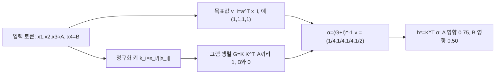

[논문 링크](https://arxiv.org/abs/2610.31574v1)
## 도입

긴 문맥을 다루는 모델에서 여러 토큰을 하나의 벡터로 줄이는 압축 연산이 성능 병목이 된다. 이 논문은 압축을 가중 평균 선택이 아니라, 토큰들이 정의하는 회귀 문제의 계수를 구하는 문제로 다시 본다. TTR-Compressor는 입력 토큰에서 라벨 없이 릿지 회귀 문제를 만들고, 그 닫힌 형태 해를 압축 표현으로 사용한다.

## 기존 압축기가 정보를 버리는 이유

시퀀스 압축은 T개의 d차원 토큰 벡터를 하나의 d차원 요약 벡터로 바꾸는 연산이다. 블록 단위 희소 어텐션에서는 이 벡터가 쿼리가 읽을 블록을 고르는 검색 키가 되고, 시각 토큰 병합에서는 이 벡터가 언어 모델이 보는 시각 토큰 자체가 된다. 두 경우 모두 압축기가 토큰을 하나의 벡터로 저장하고, 뒤 계층은 그 벡터만 읽는다. 여기서 버린 정보는 뒤에서 되살릴 수 없다.

기존 방식은 세 갈래다. (1) 평균 풀링은 모든 토큰에 같은 가중치를 준다. (2) 토큰을 이어 붙인 뒤 학습된 선형 투사를 거치는 방식은 위치마다 고정된 가중치를 쓴다. (3) 어텐션 가중 풀링은 토큰마다 점수를 매기지만 각 토큰을 다른 토큰과 무관하게 평가한다. 셋의 공통점은 가중치가 토큰 사이의 관계를 반영하지 않는다는 것이다. 이들은 각 토큰이 개별적으로 얼마나 중요한지를 보는 1차 통계만 쓰고, 토큰 간 상관관계라는 2차 통계를 무시한다. 그래서 중복 토큰이 서로를 강화하고, 드문 특징은 희석된다.

작은 예시로 이 차이를 확인한다. 아래는 이해를 돕는 설명용 예시이며 실제 측정 결과가 아니다.

**설명용 예시.** 4개 토큰이 들어오고, 3개는 사실상 같은 내용 A, 1개만 구분되는 정보 B라고 하자. 목표값을 모두 v=(1,1,1,1)로 둔다. 가산 풀링(평균)은 각 토큰에 1/4씩 가중치를 주어 A 그룹 영향 3/4, B 영향 1/4, 비율 3:1이 된다. TTR은 토큰 간 유사도를 그램 행렬로 묶어 공동으로 맞추므로, 서로 상관된 A 셋이 중복으로 취급되어 그룹 영향이 여전히 3/4지만 B는 1/2가 된다. 비율은 3:2가 되어 중복 그룹의 지배가 약화되고 구분 토큰 B의 상대 비중이 커진다. 일반화하면 Appendix B(Proposition 4, Corollary 1)에 따라 완전히 겹치는 m개 토큰과 단일 구분 토큰의 상대 영향비는 m이 아니라 m(λ+1)/(λ+m) < m으로, 중복 증거는 체감효과를 가진다. 이 수치는 논문 Figure 2(b)의 예시(정규화 D=I, λ=1)와 그 일반식에서 나온 것이며, 측정값이 아니다.

| 구분 | 가산 풀링(평균 등) | TTR(공동 회귀) |
| --- | --- | --- |
| 입력 | 4토큰: A, A, A(중복), B(구분) | 동일 |
| 계산된 가중치 α | A마다 1/4, B 1/4 | A마다 1/4, B 1/2 |
| 그룹 영향 Kᵀα | A 0.75, B 0.25 | A 0.75, B 0.50 |
| 출력 비율 | 3 : 1 | 3 : 2 |
| 남는 상태 | 중복 A가 요약을 지배 | B 비중이 상대적으로 커짐 |
| 거절되는 부분 | 없음: A가 계속 더해짐 | A의 세 번째 토큰이 남긴 잔차가 0에 가까워져 가중치가 줄어듦 |

## 토큰을 회귀 문제로 바꾸면 무엇이 달라지는가

TTR-Compressor는 토큰 X=[x₁,…,x_T]가 주어지면 그 자체로 릿지 회귀 문제를 정의하고, 맞춰진 계수 h*를 압축 표현으로 쓴다(§3.1, Eq. 1). 릿지 회귀는 목표값에 맞추되 계수 크기를 벌점으로 억제하는 회귀다. 핵심은 "어떤 계수가 이 토큰들을 가장 잘 설명하는가"를 매 입력마다 풀어서 그 계수를 요약으로 삼는 것이다.

구체적으로 두 가지를 정한다. 하나는 각 토큰의 키 k_t = x_t / ‖x_t‖로, 벡터 방향만 남겨 키끼리의 내적이 의미 유사도만 측정하게 만든다. 다른 하나는 스칼라 목표값 v_t = aᵀx_t로, 학습 가능한 벡터 a 하나를 공유해 토큰에서 숫자 하나를 뽑는다(§3.2). 이 목표값에는 라벨이 필요 없고 입력에서 나온다.

키를 정규화하는 선택이 중요한 이유는 명확하다. 목표값이 v_t = aᵀx_t로 선형 생성되므로, 키를 정규화하지 않으면(k_t = x_t) 고정 벡터 a가 그대로 정답이 되어 h*가 입력과 무관한 고정 벡터로 수렴한다. 또 노름이 큰 이상치 토큰이 그램 행렬을 지배해 유사도 대신 크기를 보게 된다. 정규화는 이 두 문제를 동시에 제거한다. 실제로 키 정규화를 빼면 RULER 평균이 0.509에서 0.253으로 떨어진다(§5.4, Table 5).

회귀 문제를 풀면 압축 표현은 다음과 같이 정리된다.

$$h^* = (K^\top K + D)^{-1} K^\top v$$

여기서 K는 키 행렬, v는 목표값 벡터, D는 정규화 행렬이다. 결과는 키와 목표값의 통계 Kᵀv와, 토큰 간 유사도 구조를 담은 KᵀK가 함께 결정한다. KᵀK는 특징 공간의 그램 행렬로, 같은 방향의 토큰들이 서로 묶어주기 때문에 앞선 예시의 "중복은 영향이 줄어든다"는 성질이 생긴다.

기존 릿지 회귀는 정규화 강도 λ를 하이퍼파라미터로 조정해야 하는데, 대규모 사전학습에서 이걸 튜닝하는 일은 비싸고 모델 크기를 바꿀 때도 번거롭다. TTR은 스칼라 λ 대신 학습 가능한 대각 행렬 D = diag(softplus(ρ))를 쓴다(§3.2, Eq. 3). 채널마다 다른 정규화 강도를 학습해, 덜 중요한 특징 방향은 세게 벌점을 주고 과제에 중요한 방향은 보존한다. 고정 λ의 최선값(λ=0.001, 0.502)보다 학습 대각이 나으며(0.509, Table 6), 학습 스칼라도 0.497로 경쟁력 있어 과제 손실이 정규화 강도를 스스로 찾을 수 있음을 보인다.

## 작은 블록은 쌍대 형태로 푼다

d차원을 직접 다루면 d×d 선형 시스템을 풀어야 하는데, 압축할 토큰 수 T가 채널 차원 d보다 훨씬 작은 경우가 일반적이다(예: T∈{4, 9, 64} 대 d≥1024). 이때는 쌍대(dual) 형태로 바꿔 T×T 시스템만 풀면 된다(§3.3, Eq. 7). 쌍대 형태는 d×d 시스템을 T×T 시스템으로 바꾸는 동치 변형이다.

$$TTR(X) = D^{-1/2} \tilde{K}^\top \big(I_T + \tilde{K}\tilde{K}^\top\big)^{-1} v$$

계산 순서는 다음과 같다. 키를 D로 재조정해 K̃를 만들고, T×T 그램 행렬 I_T + K̃K̃ᵀ를 숄레스키 분해로 분해한 뒤 α를 구하고, K̃ᵀα를 되돌려 압축 표현을 얻는다. 숄레스키 분해는 대칭 양정부호 행렬을 하삼각행렬 곱으로 나눠 연립방정식을 두 번의 대입으로 푸는 방법이다. 복잡도는 O(T²d + T³)로, 직접 d×d를 푸는 O(Td² + d³)보다 T≪d에서 훨씬 가볍다. 실제 연산은 역행렬을 명시적으로 만들지 않고 삼각 치환으로만 수행한다(§5.3, Table 4; Appendix C).

이 구조는 학습을 이중 최적화(bi-level)로 만든다(§3.4, Figure 2(a); §4.1). 바깥 루프는 과제 손실로 "어떤 회귀 문제가 유용한가"를 정하는 파라미터 a와 ρ를 학습하고, 안쪽 루프는 각 입력에 대해 그 회귀 문제를 닫힌 형태로 "어떻게 맞출지"를 푼다. 학습 가능한 파라미터는 압축기당 목표 투사 a(d개)와 정규화 ρ(d개)뿐인데, 안쪽 해는 미분 가능한 닫힌 형태라 역전파가 그대로 흐른다. 추론 시에는 학습된 파라미터가 고정되고, 입력마다 h*만 새로 계산된다. 이 점이 그라디언트 하강을 매 입력마다 돌리거나 델타 규칙 한 스텝으로 근사하는 기존 test-time training 계열과 다른 부분이다(§3): 블록 단위로 독립 계산되기 때문에 단 한 번의 T×T 쌍대 풀이로 정확한 해를 얻는다.

행렬의 좌표 (i,j)는 토큰 i와 j의 방향 유사도이고, 값 1은 같은 방향, 0은 직교를 뜻한다. α의 네 번째 값이 1/2로 커지는 이유는 B가 A 그룹으로 설명되지 않는 잔차를 담기 때문이다.

## 결과: 블록 단위 희소 어텐션

첫 응용은 HiLS-Attention 기반의 블록 단위 희소 어텐션이다(§5.1). 문맥을 64토큰 블록으로 나누고, 각 블록의 압축 표현으로 관련 블록을 최대 32개 골라 512토큰 로컬 윈도우와 함께 어텐션한다. 압축기는 각 블록을 검색 키 벡터로 저장하고, 쿼리가 그 키로 읽을 블록을 고른다. 따라서 검색 정확도가 압축 품질을 직접 드러낸다. 345M 모델을 FineWeb으로 8K 문맥, 약 30B 토큰 학습하고 RULER의 니들 검색 과제(S-NIAH, MK-NIAH)로 평가했다.

평가 전에 질문을 하나 던져보자. **같은 어텐션 구조에서 압축기만 바꾸면, 32K까지 늘어나는 문맥에서 숨겨진 정보를 얼마나 더 잘 찾아낼까?** 아래 표는 압축기별 평균과 긴 문맥의 대표 수치만 뽑은 것이다(Table 1).

| 압축기 | Avg (4K–32K) | S-NIAH-1 @16K | S-NIAH-1 @32K |
| --- | --- | --- | --- |
| 평균 풀링 | 0.2971 | 0.470 | 0.270 |
| Concat + projection | 0.3919 | 0.792 | 0.582 |
| Attention-weighted pooling | 0.3920 | 0.876 | 0.740 |
| **TTR** | **0.5092** | **0.992** | 0.650 |
| TTR (w/ Conv) | **0.5144** | 0.994 | **0.988** |

해석은 두 갈래다. 첫째, 압축기 선택 자체가 검색 품질을 크게 좌우한다. 평균 풀링과 어텐션 가중 풀링의 차이가 평균 약 9.5포인트에 이른다. 둘째, TTR은 모든 경쟁 압축기를 평균에서 크게 앞선다. 학습 길이 8K를 넘는 16K 확장에서는 개별 과제까지 유지되지만, 32K 외삽에서는 일반 TTR이 S-NIAH-1(0.650)을 어텐션 가중 풀링(0.740)에 내주며 32K의 네 과제 평균에서는 TTR이 0.238, 어텐션 가중 풀링이 0.224로 우위가 좁아진다. 컨볼루션 변형은 이를 크게 완화해 32K S-NIAH-1에서 0.988을 기록한다. 논문은 이를 컨볼루션이 목표값 v_t를 더 유익하게 만들어 압축 품질을 높인 결과로 설명하며, 컨볼루션 변형은 가장 강한 baseline 대비 12.24포인트 앞선다(§5.1).

한 가지 주의할 점은, 이득이 "찾기" 과제에서 확인된 것이지 일반 언어 품질로까지 이어지는지는 별개라는 것이다. Table 2의 상식 추론 벤치마크는 평가 문맥이 짧아 희소 어텐션이 켜지지 않아 모든 압축기가 48점대에서 비슷한데, 이는 뒤의 한계 절에서 다룬다.

## 결과: 시각 토큰 병합과 효율

두 번째 응용은 멀티모달 모델의 시각 토큰 병합이다(§5.2). 고해상도 이미지는 시각 토큰을 많이 만들어 언어 백본에 직접 넣기 비싸다. 표준 설계는 인접 2×2 특징을 이어 붙여 2층 MLP로 토큰 하나로 줄이는 것이다. 여기서 TTR은 각 공간 그룹(2×2 또는 3×3)에 회귀 하나를 맞춰 4개 또는 9개 특징을 한 벡터로 압축하고, 2층 MLP가 언어 모델 차원으로 투사한다. Qwen3-VL의 ViT 인코더와 Qwen3-4B-Instruct로, 병합기와 백본을 순차학습하는 2단계 훈련으로 학습했다.

표 앞의 비교 질문은 이렇다. **같은 인코더와 언어 모델에서, 병합기를 바꾸면 문서·차트처럼 세밀한 정보가 중요한 과제에서 얼마나 덜 잃을까?**

| 병합 비율 | 병합기 | Avg |
| --- | --- | --- |
| 2×2 | MLP | 54.93 |
| 2×2 | TTR | 55.92 |
| 2×2 | TTR (w/ Conv) | 56.03 |
| 3×3 | MLP | 52.27 |
| 3×3 | TTR | 54.30 |
| 3×3 | TTR (w/ Conv) | **54.85** |

TTR은 두 비율 모두 MLP를 앞서고, 이득은 더 강하게 압축하는 3×3에서 커진다(3×3 기준 컨볼루션 변형이 MLP 대비 평균 +2.58). 세밀한 디테일이 병합 중 잘 유실되는 텍스트 위주 벤치마크에서 차이가 두드러진다: 3×3 기준 컨볼루션 변형은 MLP 대비 OCRBench +4.10(55.90→60.00), InfoVQA +4.54(35.16→39.70), ChartQA +3.56(63.60→67.16)를 기록한다(Table 3). 핵심은 TTR (w/ Conv)의 3×3 병합이 평균 54.85로, 2×2 MLP의 54.93과 거의 같다는 것이다. 즉 토큰 수를 55.6% 줄이면서도(N/4 → N/9, 토큰 수 기준 절반 이하) 표준 2×2 MLP 수준의 성능을 유지한다. 논문은 이를 두 번째 상관 구조 해석으로 설명한다: 병합기가 고정 가중치로 특징을 섞으면 배경 패치 같은 중복 특징이 토큰을 지배해 세부를 지워버리지만, TTR은 상관된 특징을 공동으로 맞춰 중복의 영향을 줄인다.

효율은 두 층위를 구분해서 봐야 한다. **연산자 자체**는 TTR이 O(T²d)로, 평균 풀링 O(Td, 파라미터 0)보다는 무겁지만 concat+projection(O(Td²), Td²개)이나 독립 어텐션 압축기(O(Td²), ~4d²개)보다는 가볍고, 학습 파라미터는 2d로 적은 편이다(Table 4). 컨볼루션 변형은 커널 파라미터가 더해져 언어 7d, 시각 11d가 된다(Appendix C). **시스템 차원**의 벽시계 시간은 Figure 3에서, 블록 희소 어텐션(8×H100) 훈련에서 TTR이 22.50시간으로 평균 풀링 19.33시간보다 느리지만 다른 학습 압축기(23.12, 21.57시간)와 비슷하고, 시각 병합(2×8×H100)에서는 2×2에서 MLP보다 약간 느리지만 3×3에서는 오히려 빠르다. 추론 지연은 모든 압축기가 비슷하고 16K 이후 full attention보다 크게 낮다(Appendix F, Figure 4). 즉 TTR의 비용은 대부분 훈련 시간에 실리고, 추론 단계에서는 다른 압축기와 사실상 같다.

## 한계와 적용 판단

저자가 데이터로 드러낸 한계와 리뷰어가 추론해야 하는 한계를 구분해서 정리한다.

**저자 실험에서 직접 확인되는 제약.** 첫째, 훈련 비용이 공짜가 아니다. 가장 가벼운 평균 풀링보다 훈련이 느리고, 2×2 시각 병합에서는 MLP보다도 약간 느리다(Figure 3). 둘째, 학습 길이를 4배 넘는 32K 확장에서 일반 TTR은 일부 하위 과제에서 급락한다(S-NIAH-1 32K = 0.650). 컨볼루션 변형이 이를 크게 완화하지만(0.988), 그만큼 파라미터와 컨볼루션 연산이 더해진다. 셋째, 키 정규화를 빼면 성능이 붕괴할 정도로(0.509→0.253) 설계 선택에 민감하다(Table 5).

**리뷰어 관점의 미검증 지점.** 첫째, 검색 정확도 향상이 일반 언어 품질 향상으로 이어지는지는 확인되지 않았다. Table 2의 상식 추론 벤치마크는 문맥이 짧아 희소 어텐션이 켜지지 않아 압축기가 성능에 관여하지 않고, 모든 압축기가 48점대로 비슷하다(단, Concat & Projection은 파라미터가 훨씬 많아 사전학습 자체에서 유리했을 수 있다). 즉 이득은 현재로선 "찾기/검색" 성격의 과제에 국한된다. 둘째, 검증 규모가 소형이다. 345M에서 우위를 보였고 1B 모델/100B 토큰으로 확장하면 평균 0.7996 대 0.735로 우위가 이어지며 격차가 문맥이 길어질수록 벌어진다(Appendix E.1, Table 7)지만, HiLS-Attention이 지적하듯 대형 모델은 더 큰 정보 대역폭으로 검색 오류를 보완할 수 있어 압축기 차이가 줄어들 여지가 있다. 셋째, 응용이 블록 희소 어텐션과 시각 병합 두 곳뿐이라 다른 압축 지점으로의 일반화는 미검증이며, TTR은 T≪d일 때만 효율적이라 블록이 커지면 O(T²d + T³) 비용이 빠르게 커진다.

이런 특성상 TTR-Compressor는 작은 블록(수십 토큰 이하)을 큰 채널 차원의 벡터로 줄이는 지점에 잘 맞는다. 블록 단위 희소 어텐션의 검색 키 요약, 그리고 문서·차트처럼 세밀한 디테일을 담은 시각 토큰 병합이 그 예다. 반대로 이미 어텐션 가중 풀링이 충분한 대형 모델의 검색, 블록 크기가 큰 압축, 추론 지연 자체를 줄여야 하는 상황에서는 이득이 아직 증명되지 않았다.

<!-- verbatim-tables -->

논문 원문의 표

> arXiv e-print 의 LaTeX 원본에서 기계적으로 옮긴 표입니다. 숫자는 논문의 값이며 모델을 거치지 않았습니다.

**표 1. Accuracy on Single Needle-In-A-Haystack (S-NIAH) and Multi-Key Needle-In-A-Haystack (MK-NIAH) tasks from RULER across varied context lengths. Best values for each context length are **bolded**, and second-best values are underlined.**

| **Model** | **S-NIAH-1** 4K | **S-NIAH-1** 8K | **S-NIAH-1** 16K | **S-NIAH-1** 32K | **S-NIAH-2** 4K | **S-NIAH-2** 8K | **S-NIAH-2** 16K | **S-NIAH-2** 32K | **S-NIAH-3** 4K | **S-NIAH-3** 8K | **S-NIAH-3** 16K | **S-NIAH-3** 32K | **MK-NIAH-1** 4K | **MK-NIAH-1** 8K | **MK-NIAH-1** 16K | **MK-NIAH-1** 32K | **Avg.** |
|---|---|---|---|---|---|---|---|---|---|---|---|---|---|---|---|---|---|
| \shline Full Attention | 0.834 | 0.428 | 0 | 0 | 0.850 | 0.412 | 0 | 0 | 0.572 | 0.470 | 0 | 0 | 0.374 | 0.272 | 0 | 0 | 0.2632 |
| Sliding Window Attention | 0.116 | 0.050 | 0.044 | 0.016 | 0.148 | 0.048 | 0.034 | 0.030 | 0.112 | 0.094 | 0.030 | 0.034 | 0.126 | 0.080 | 0.026 | 0.028 | 0.0635 |
| Mean Pooling | 0.938 | 0.536 | 0.470 | 0.270 | 0.840 | 0.258 | 0.042 | 0.050 | 0.292 | 0.282 | 0.040 | 0.042 | 0.366 | 0.230 | 0.042 | 0.056 | 0.2971 |
| Concat & Projection | 0.892 | 0.840 | 0.792 | 0.582 | 0.764 | 0.232 | 0.124 | 0.068 | 0.512 | 0.324 | 0.174 | 0.076 | 0.476 | 0.278 | 0.084 | 0.052 | 0.3919 |
| Attention-Weighted Pooling | 0.944 | 0.914 | 0.876 | 0.740 | 0.926 | 0.274 | 0.136 | 0.060 | 0.340 | 0.082 | 0.026 | 0.026 | 0.474 | 0.258 | 0.124 | 0.072 | 0.3920 |
| TTR-Compressor | 0.996 | 0.996 | 0.992 | 0.650 | **0.982** | **0.566** | **0.288** | **0.126** | 0.770 | 0.376 | **0.188** | 0.066 | 0.528 | **0.302** | **0.212** | **0.110** | 0.5092 |
| TTR-Compressor (w/ Conv) | **0.998** | **1.000** | **0.994** | **0.988** | 0.960 | 0.454 | 0.128 | 0.102 | **0.834** | **0.482** | 0.130 | **0.096** | **0.542** | 0.298 | 0.116 | 0.108 | **0.5144** |

**표 2. Performance comparison on language modeling and zero-shot common-sense reasoning. The evaluation context lengths are too short to activate sparse attention, so the compressor is not involved during inference; these results therefore only reflect the common-sense reasoning ability acquired during language model pretraining. Note that Concat & Projection has significantly more parameters than the others. Best values are **bolded**, and second-best values are underlined.**

| **Model** | **ARC-c** | **ARC-e** | **BoolQ** | **COPA** | **Hella.** | **LMB.** | **OBQA** | **PIQA** | **SciQ** | **Wino.** | **Avg.** |
|---|---|---|---|---|---|---|---|---|---|---|---|
|  | acc $\uparrow$ | acc $\uparrow$ | acc $\uparrow$ | acc $\uparrow$ | acc $\uparrow$ | acc $\uparrow$ | acc $\uparrow$ | acc $\uparrow$ | acc $\uparrow$ | acc $\uparrow$ | acc $\uparrow$ |
| \shline Full Attention | 24.74 | 42.09 | 60.15 | 68.00 | 39.85 | 35.71 | 29.60 | 67.74 | 62.70 | 51.07 | 48.16 |
| Sliding Window Attention | 24.91 | 41.96 | 55.02 | 69.00 | 39.53 | 35.47 | 29.00 | 67.14 | 63.00 | 50.75 | 47.58 |
| Mean Pooling | 24.66 | **42.38** | 55.99 | 66.00 | 39.62 | 35.88 | 28.40 | **69.31** | **65.50** | **53.04** | 48.08 |
| Concat & Projection | 24.83 | 42.30 | 58.65 | 68.00 | 39.58 | **36.62** | 30.00 | 67.74 | 62.20 | 51.78 | **48.17** |
| Attention-Weighted Pooling | **25.00** | 41.75 | **61.22** | 65.00 | 39.61 | 35.61 | 29.40 | 68.93 | 63.80 | 50.51 | 48.08 |
| TTR-Compressor | 23.29 | 41.58 | 57.95 | **71.00** | 39.41 | 36.27 | **30.20** | **69.31** | 63.00 | 49.57 | 48.16 |
| TTR-Compressor (w/ Conv) | 24.15 | 41.33 | 59.94 | 70.00 | **39.63** | 35.36 | **30.20** | 67.85 | 62.80 | 49.96 | 48.12 |

**표 3. Evaluation across multimodal benchmarks under different token compression ratios. Results are grouped by $2\times2$ and $3\times3$ token compression. Best values within each compression group are **bolded**, and second-best values are underlined.**

| **Method** | **General VQA** **MMBench** | **General VQA** **MMStar** | **General VQA** **RWQA** | **Knowledge Reasoning** **MMMU** | **Knowledge Reasoning** **AI2D** | **Document Understanding** **OCRBench** | **Document Understanding** **InfoVQA** | **Document Understanding** **ChartQA** | **Spatial Under.** **MMSI** | **Spatial Under.** **ERQA** | **Avg.** |
|---|---|---|---|---|---|---|---|---|---|---|---|
| \shline *$2\times2$ Token Compression* |  |  |  |  |  |  |  |  |  |  |  |
| MLP | 76.63 | 49.93 | 64.44 | **46.22** | 75.49 | 62.80 | 41.72 | 70.64 | 26.20 | 35.25 | 54.93 |
| TTR-Compressor | **76.89** | **53.94** | 63.40 | 45.44 | **76.94** | 62.90 | 43.74 | **73.04** | **26.90** | **36.00** | 55.92 |
| TTR-Compressor (w/ Conv) | 75.86 | 52.26 | **66.93** | 45.67 | 76.65 | **63.80** | **44.33** | 72.52 | 26.30 | **36.00** | **56.03** |
| *$3\times3$ Token Compression* |  |  |  |  |  |  |  |  |  |  |  |
| MLP | 74.74 | 50.89 | 64.31 | 44.44 | 74.68 | 55.90 | 35.16 | 63.60 | 26.00 | 33.00 | 52.27 |
| TTR-Compressor | 76.46 | **52.40** | 65.62 | 45.89 | **75.23** | 58.70 | 38.27 | **67.16** | 26.80 | **36.50** | 54.30 |
| TTR-Compressor (w/ Conv) | **76.63** | 51.16 | **65.88** | **47.44** | 75.16 | **60.00** | **39.70** | **67.16** | **28.90** | **36.50** | **54.85** |

**표 4. Ablation study on key normalization in TTR-Compressor. We compare the full model with a variant without normalizing $\mathbf{k}$ (w/o normalize $\mathbf{k}$). Best values for each context length are **bolded**.**

| **Model** | **S-NIAH-1** 4K | **S-NIAH-1** 8K | **S-NIAH-1** 16K | **S-NIAH-1** 32K | **S-NIAH-2** 4K | **S-NIAH-2** 8K | **S-NIAH-2** 16K | **S-NIAH-2** 32K | **S-NIAH-3** 4K | **S-NIAH-3** 8K | **S-NIAH-3** 16K | **S-NIAH-3** 32K | **MK-NIAH-1** 4K | **MK-NIAH-1** 8K | **MK-NIAH-1** 16K | **MK-NIAH-1** 32K | **Avg.** |
|---|---|---|---|---|---|---|---|---|---|---|---|---|---|---|---|---|---|
| \shline TTR-Compressor | **0.996** | **0.996** | **0.992** | **0.650** | **0.982** | **0.566** | **0.288** | **0.126** | **0.770** | 0.376 | **0.188** | 0.066 | **0.528** | **0.302** | **0.212** | 0.110 | **0.5092** |
| w/o normalize $\mathbf{k}$ | 0.010 | 0.000 | 0.002 | 0.000 | 0.938 | 0.254 | 0.136 | 0.104 | 0.764 | **0.592** | 0.186 | **0.092** | 0.500 | 0.258 | 0.098 | **0.116** | 0.2531 |

**표 5. Ablation study on the regularization parameter $\lambda$ in TTR-Compressor. Best values for each context length are **bolded**, and second-best values are underlined.**

| **Model** | **S-NIAH-1** 4K | **S-NIAH-1** 8K | **S-NIAH-1** 16K | **S-NIAH-1** 32K | **S-NIAH-2** 4K | **S-NIAH-2** 8K | **S-NIAH-2** 16K | **S-NIAH-2** 32K | **S-NIAH-3** 4K | **S-NIAH-3** 8K | **S-NIAH-3** 16K | **S-NIAH-3** 32K | **MK-NIAH-1** 4K | **MK-NIAH-1** 8K | **MK-NIAH-1** 16K | **MK-NIAH-1** 32K | **Avg.** |
|---|---|---|---|---|---|---|---|---|---|---|---|---|---|---|---|---|---|
| \shline $\lambda=0.0001$ | 0.986 | 0.896 | 0.826 | 0.628 | 0.888 | 0.348 | 0.134 | 0.054 | 0.654 | 0.528 | 0.086 | 0.108 | 0.384 | 0.242 | 0.118 | 0.102 | 0.4364 |
| $\lambda=0.001$ | 0.998 | 0.996 | 0.990 | 0.948 | **0.998** | 0.448 | 0.186 | 0.112 | 0.686 | 0.420 | 0.186 | 0.072 | 0.466 | 0.274 | 0.174 | 0.082 | 0.5023 |
| $\lambda=0.01$ | **1.000** | **1.000** | **1.000** | **1.000** | 0.936 | 0.486 | 0.148 | 0.076 | 0.692 | 0.374 | 0.042 | 0.022 | 0.484 | 0.288 | 0.146 | 0.068 | 0.4851 |
| $\lambda=0.1$ | 0.990 | 0.986 | 0.982 | 0.978 | 0.932 | 0.312 | 0.054 | 0.068 | 0.728 | 0.424 | 0.088 | 0.078 | 0.470 | 0.252 | 0.112 | 0.074 | 0.4705 |
| $\lambda=1$ | 0.872 | 0.552 | 0.826 | 0.794 | 0.896 | 0.204 | 0.062 | 0.072 | 0.772 | 0.496 | 0.184 | 0.088 | 0.526 | 0.278 | 0.090 | 0.068 | 0.4238 |
| Learnable Scalar | 0.988 | 0.986 | 0.970 | 0.806 | 0.938 | 0.368 | 0.104 | 0.104 | **0.788** | **0.536** | **0.212** | **0.112** | **0.554** | 0.274 | 0.132 | 0.082 | 0.4971 |
| Learnable Diagonal | 0.996 | 0.996 | 0.992 | 0.650 | 0.982 | **0.566** | **0.288** | **0.126** | 0.770 | 0.376 | 0.188 | 0.066 | 0.528 | **0.302** | **0.212** | **0.110** | **0.5092** |

**표 6. Accuracy on Single Needle-In-A-Haystack (S-NIAH) and Multi-Key Needle-In-A-Haystack (MK-NIAH) tasks from RULER across varied context lengths. Results are based on a 1B-parameter model trained on 100B tokens. Best values for each context length are **bolded**.**

| **Model** | **S-NIAH-1** 4K | **S-NIAH-1** 8K | **S-NIAH-1** 16K | **S-NIAH-1** 32K | **S-NIAH-2** 4K | **S-NIAH-2** 8K | **S-NIAH-2** 16K | **S-NIAH-2** 32K | **S-NIAH-3** 4K | **S-NIAH-3** 8K | **S-NIAH-3** 16K | **S-NIAH-3** 32K | **MK-NIAH-1** 4K | **MK-NIAH-1** 8K | **MK-NIAH-1** 16K | **MK-NIAH-1** 32K | **Avg.** |
|---|---|---|---|---|---|---|---|---|---|---|---|---|---|---|---|---|---|
| \shline Attention-Weighted Pooling | 0.978 | 0.972 | 0.984 | 0.990 | **1.000** | **0.982** | 0.860 | 0.732 | 0.898 | 0.856 | 0.456 | 0.550 | 0.494 | 0.358 | 0.336 | 0.314 | 0.735 |
| TTR-Compressor | **1.000** | **1.000** | **1.000** | **1.000** | **1.000** | 0.956 | **0.862** | **0.750** | **0.980** | **0.918** | **0.740** | **0.662** | **0.626** | **0.442** | **0.446** | **0.412** | **0.7996** |

**표 7. Ablation on the parameterization of the value target $\boldsymbol{v}_t$ in the TTR objective $\boldsymbol{h}^{\star}=\arg\min_{\boldsymbol{h}}\frac{1}{2}\|\boldsymbol{K}\boldsymbol{h}-\boldsymbol{v}\|_2^2+\frac{1}{2}\boldsymbol{h}^{\top}\boldsymbol{D}\boldsymbol{h}$. All variants use $3\times3$ token compression. Gray rows denote the TTR-Compressor configurations used in the main paper. Best values are **bolded**, and second-best values are underlined.**

| **Method** | **$\boldsymbol{v}_t$** | **General VQA** **MMBench** | **General VQA** **MMStar** | **General VQA** **RWQA** | **Knowledge Reasoning** **MMMU** | **Knowledge Reasoning** **AI2D** | **Document Understanding** **OCRBench** | **Document Understanding** **InfoVQA** | **Document Understanding** **ChartQA** | **Spatial Under.** **MMSI** | **Spatial Under.** **ERQA** | **Avg.** |
|---|---|---|---|---|---|---|---|---|---|---|---|---|
| \shline *Constant value* |  |  |  |  |  |  |  |  |  |  |  |  |
| Constant | $1$ | 75.26 | 51.63 | 64.31 | 45.67 | 76.07 | 55.90 | 37.84 | 67.20 | 26.80 | 35.00 | 53.56 |
| *Linear value* |  |  |  |  |  |  |  |  |  |  |  |  |
| TTR-Compressor | $\boldsymbol{a}^{\top}\boldsymbol{x}_t$ | 76.46 | **52.40** | 65.62 | 45.89 | 75.23 | 58.70 | 38.27 | 67.16 | 26.80 | 36.50 | 54.30 |
| TTR-Compressor (w/ Conv) | $\boldsymbol{a}^{\top}\mathrm{Conv}(\boldsymbol{X})_t$ | **76.63** | 51.16 | **65.88** | **47.44** | 75.16 | **60.00** | **39.70** | 67.16 | 28.90 | 36.50 | **54.85** |
| *MLP value* |  |  |  |  |  |  |  |  |  |  |  |  |
| MLP | $\mathrm{MLP}(\boldsymbol{x}_t)$ | 76.29 | 52.06 | 63.92 | 44.78 | **76.42** | 58.30 | 38.66 | 67.00 | 28.10 | 37.50 | 54.30 |
| MLP (w/ Conv) | $\mathrm{MLP}(\mathrm{Conv}(\boldsymbol{X})_t)$ | 76.46 | 50.87 | 64.18 | 44.56 | 75.32 | 58.10 | 38.09 | 66.80 | 26.50 | **38.25** | 53.91 |
| *MLP-dot value* |  |  |  |  |  |  |  |  |  |  |  |  |
| MLP-dot | $\mathrm{MLP}(\boldsymbol{x}_t)^{\top}\boldsymbol{x}_t$ | 76.20 | 51.84 | 65.23 | 47.33 | 75.55 | 59.60 | 38.47 | **68.88** | 27.40 | 35.00 | 54.55 |
| MLP-dot (w/ Conv) | $\mathrm{MLP}(\mathrm{Conv}(\boldsymbol{X})_t)^{\top}\boldsymbol{x}_t$ | 76.29 | 51.08 | 64.05 | 46.56 | 75.26 | 58.10 | 38.81 | 66.36 | **29.90** | 37.25 | 54.37 |

