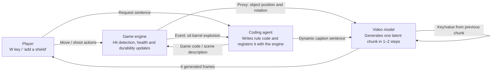

[Paper](https://arxiv.org/abs/2610.27999)
## Introduction

A game world built by a video generation model alone stores off-screen state nowhere. Every time a corridor you have already passed through is redrawn, it changes, and rules such as health have to be read back from pixels. Matrix-Game 4.0 has the game engine enforce rules and state in code, while the video model is responsible only for rendering the screen.

## Problem: why a video model collapses when it plays the game alone

Existing interactive world models (the Genie series, GameNGen, and others) pack both the "world's dynamics" and the "screen" into the network. The model that generates the next frame is also the only place that remembers world state. The authors cite four limitations of this structure (§1).

- The external environment never continuously corrects it. The model rolls forward on its own, detached from the world, and state outside the view is not maintained separately.
- Small errors accumulate in autoregressive generation. Even with external 3D tools, accumulated error in the estimated camera pose collapses the scene.
- Past frames pile up uncompressed. Memory grows linearly with rollout length.
- Rules remain at the level of exploration. There are no executable rules that support persistent action consequences and explicit goals.

More fundamentally, the authors argue that a playable world also requires low interaction latency, meaningful game mechanics beyond exploration, and a shared world state for multiplayer (§1).

### A small example: what happens when you look back down a corridor

This is an illustrative example, not a measurement. It compares a situation in which the protagonist walks into a castle corridor and then turns around.

| Step | Pixel-memory model | Matrix-Game 4.0 |
|---|---|---|
| Input | A single backward action | The same single action |
| Remaining state | The corridor seen on the way in survives only as tokens compressed into context; there are no separate state values | The engine stores the off-screen door object in code and updates its position and open state according to rules (§2.1) |
| Change, omission, rejection | Re-imagines the corridor from memory (change). It does not keep door state separately, so it omits it, and it does not check "is this the same door I came through?" (rejection) | The proxy draws the door's location with simple geometry. When a reference image is available, the coding agent fills in a caption such as "a wind-worn thatched hut, a dark red wooden front gate" (§2.2) |
| Output | A corridor with no guarantee that the door passed on the way in has the same color and position | A corridor where the door's position and state match the previous visit. Spatial memory frames help keep revisited locations consistent (§4.1) |

The key question is where off-screen state is stored, and this paper moves that responsibility from the network to the game engine.

## Method: dividing rules, state, and rendering among three actors

An execution harness is a framework that keeps game logic outside the video model and lets the model render only the screen. Matrix-Game 4.0 wraps the video model in such a harness. Three components run in one loop (Figure 2). The arrows in the diagram below are not names but the values actually exchanged.

- **Game engine (referee)** computes what actually happened on every frame. It updates health by adding damage taken, compares bullet and object coordinates to detect hits, and stores quest progress. Instead of the screen, it sends the video model a structural render—a proxy that draws roads, buildings, characters, and interactive objects as simple geometry. Even when an object leaves the screen, its state continues according to engine rules (§2.1).
- **Multimodal coding agent (screenwriter and translator)** communicates with the engine in both directions. It reads the state and events sent by the engine and turns them into sentences (downward), and it writes the player's ideas as executable game code and registers them with the engine (upward). "Make monsters swarm in from all sides" does not stop at adding monsters; it defines in code where and how they spawn, how they move and attack, and what constitutes victory or defeat (§2.2). For requests with unspecified details (such as the space behind a door whose contents are not predetermined), it invents the scene layout, story, and NPC dialogue and hands them to the engine, which then manages that state (§2.2).
- **Video generation model (painter)** receives the proxy and turns it into frames with materials, lighting, atmosphere, and fine detail (§2.3).

This division leaves one challenge. The real-time performance burden lands entirely on visual generation. The engine only has to run a lightweight simulation, and what remains is "how fast can the video model be made?" (§2).

## Conditions: the proxy and caption the engine passes every frame

To preserve structure and fill in only details, the video model needs "conditions" that change from moment to moment. The authors split conditions into two streams: a proxy and a dynamic caption.

### Proxy and paired training data

A proxy is a screen that draws terrain, buildings, and characters as untextured geometric shapes; it tells the model what to draw and where. Training data is collected by pairing this proxy with high-fidelity screens.

From Unreal Engine 5 (UE5), four scenes are captured: a medieval castle, an ancient Egyptian desert, an aerial battle over a desert canyon, and the CitySample city. Each capture is recorded at 1280×720 and keeps three aligned videos that share the same camera trajectory and frame indices—a UE5 RGB render, a low-polygon structural render (BBox), and a depth render of the proxy geometry (Figure 3a, §3.1). In the proxy, the sky is black and the ground is a gray checkerboard. Buildings and walls are flat-colored boxes and prisms, trees are cylinders plus spheres, characters are block figures, and every primitive has only a black outline, removing texture, reflection, and shadow. Shooter and aerial clips are about one minute long. There are 114,334 training clips in total, or 1,712 hours (Table 1). Castle, desert, and city each contribute three capture sessions, while the entire aerial capture batch is held out, so no holdout source contributes training clips. Alongside capture, the system records object instance IDs, visibility, and causal interaction events in per-frame metadata (§3.1).

### Dynamic captions: descriptions refreshed every frame

A dynamic caption is not a fixed sentence but a description that changes with the current game state. In an interactive game, turning the camera changes which objects are visible, and moving or triggering an event changes object states. A fixed sentence cannot follow these changes.

For every 81-frame clip, camera pose, actions, visible objects, events, and environment are written to a frame-aligned CSV. The system looks up a semantic description table using the IDs of currently visible objects, then fills a template with position, distance, state, and events to build the prompt (Figure 3b, §3.2). This lookup and assembly runs on **rule-based templates** without a vision-language model (§3.2).

The city-driving example in Figure 4 shows this in action. As the car moves forward, parked vehicles drop out of the description, a pedestrian changes from "standing" to "walking closer", and newly visible objects are announced under "Changes". Caption color encodes meaning: orange text comes from object states and events, while blue text comes from position and distance (Figure 4). The proxy supplies structure (position, layout, motion), and the caption supplies semantics (which objects exist and what state they are in). Because they carry different information, together they impose constraints.

## Renderer: turning a bidirectional model into a 1–2 step causal generator

The rendering model is Wan2.2 5B's Fun Control variant converted into a video-to-video (V2V, a method that rewrites an input video) model (§4.1). Starting from the Wan2.2-Fun-5B Control weights, it uses an 81-frame window (704×1280) and performs bidirectional V2V fine-tuning with a flow-matching objective, conditioned on the proxy, the caption, the first frame, and up to three spatial memory frames (§4.2).

After fine-tuning, the model is converted into a causal generator through the three stages of Causal Forcing++ (§4.3). A "chunk" is a block completed at once, consisting of one latent frame (in practice, four video frames).

1. **Teacher-forced autoregressive diffusion**: A causal teacher is trained so that each latent frame sees only preceding ground-truth frames plus the first and context frames. This teacher samples chunks with a multi-step ODE solver that integrates over several fine steps.
2. **Causal consistency distillation**: With a fixed teacher and an online student plus an EMA student (an exponential moving average copy of the weights), the teacher moves from one point on a 48-level noise grid to the next lower level in one step (classifier-free guidance 3). The online student predicts the clean chunk from a higher level and is trained to match the EMA student's prediction at the lower level. After 5,000 steps (EMA decay 0.99), the EMA student generates a chunk in 4 steps.
3. **Distribution matching (DMD)**: The student learns from its own autoregressive rollouts, eventually reducing generation to 2 steps per chunk (4 steps for the first latent frame).

The completed chunk is conditioned on four inputs: the low-polygon proxy drawn by the engine, the dynamic caption, spatial memory frames that preserve consistency when revisiting a location, and the first frame that connects it to the scene already on screen (Figure 5).

The network is a Diffusion Transformer (DiT), the transformer backbone of a diffusion model that denoises noise into a screen. Thirty blocks apply causal self-attention, text cross-attention, and a feedforward network (hidden width 14336) in sequence, and the timestep modulates the blocks through AdaLN (a technique that adjusts normalization statistics by timestep). At 480×864, one latent frame becomes 15×27=405 tokens. Self-attention reads a KV cache—a temporary memory that stores the keys and values of past outputs—containing three spatial memory frames, a reference frame, and the most recent 20 chunks. Once a chunk is complete, the model passes its latent through once more at t=0 without control inputs and writes clean keys and values into the cache (§4.1, Figure 5).

The output head predicts a "velocity", and the latent is updated with a flow update.

$$ z \leftarrow z - \sigma\, v $$

Here $z$ is the latent, $v$ is the predicted velocity, and $\sigma$ is the noise level. One such update gives 1-step generation, and two give 2-step generation (§4.1). The evaluation setting uses 2 steps per chunk (§6.1).

## Opening 60 FPS on a single GPU with kernel optimization

Because a chunk is just one latent frame (four video frames), fewer steps mean less work per invocation. In exchange, the GPU spends more time waiting for the CPU to launch kernels. The bottleneck shifts from "amount of computation" to "launch overhead" (§5, Figure 6a).

Performance is best read as two metrics. **Throughput** is the steady-state generation rate at which the model produces frames, while **latency** is the time from a key press to the first frame that reflects it. Latency is measured while the game runs at 60 FPS. The authors remove overhead in the order shown in Table 2.

| Setting (cumulative) | FPS↑ | Latency (ms)↓ |
|---|---:|---:|
| Causal Wan2.2 DiT, 4 steps, full Wan VAE | 4.5 | 1110 |
| + lightweight VAE (TAEHV) | 6.5 | 867 |
| + RoPE kernel, text KV cache | 15.4 | 551 |
| + FP8 weights + CUDA Graph | 24.2 | 466 |
| + 1-step distillation | 51.2 | 376 |
| + asynchronous I/O pipeline | 57.7 | 367 |
| + fused Triton kernels | 65.8 | 121 |
| + ring KV cache | 73.7 | 117 |
| + split KV FlashAttention | 83.4 | 112 |

*Table conditions: 480×864, chunk size one latent frame (four video frames), KV window 21 latent frames, one NVIDIA RTX 5090.*

Overall, FPS rises from 4.5 to 83.4 (about 19×), and latency falls from 1110 to 112 ms (about 9.9×) (Table 2, §5). Each optimization does the following.

- **CUDA Graph**: Records the operation order of the DiT backbone once and replays it with a single launch at execution time. Kernel launch overhead disappears. Linear-layer weights are stored in 8-bit (FP8) (§5).
- **Fused kernels**: RoPE (an attention technique that encodes position as a rotation), normalization, and FP8 quantization are fused in Triton (a language for building GPU kernels). The query, key, and value projections of a layer share a single quantization of the input, and the caption's keys and values are recomputed only when the caption changes (§5).
- **Ring KV cache**: Instead of shifting the entire KV window whenever the window slides, it overwrites the oldest slot with the new latent frame, eliminating movement cost (Figure 6c).
- **Split KV attention**: It splits the self-attention KV window into seven ranges, computes them in parallel, and combines them with log-sum-exp. It caches INT8 K and FP8 V for each range and requantizes only the changed ranges (Figure 6d).
- **Decoding and I/O**: It replaces the full Wan VAE decoder that restores latents to a screen with the lightweight TAEHV and runs model input/output through an asynchronous pipeline. Decoding is moved ahead of the clean KV update so that frames can be emitted earlier (Figure 6b, §5).

It is worth distinguishing the low-precision representations. FP8 is the **storage format for linear-layer weights**, whereas INT8 K and FP8 V are **quantization of the attention KV cache**, recomputed when the window changes (§5, Figure 6d). Both reduce memory and bandwidth, but they play different roles.

With all these optimizations combined, on a single RTX 5090 the peak GPU memory is about 18.2 GiB for both one- and two-step generation, and one step processes one chunk (four frames) in 48 ms. The text encoder, DiT, and VAE all fit on the same card (§5). Even on 16 GiB cards, under one-step generation with a fixed prompt, it reaches about 67 FPS on an RTX 5080 (about 12.8 GiB) and about 58 FPS on an RTX 5070 Ti (about 10.9 GiB) (§5).

## Results: what 112 ms means and comparison with other systems

The integrated system runs a 60 FPS game at 480p on a single RTX 5090 and takes 112 ms from key input to screen update (§1, Table 3). Table 3 compares end-to-end latency with recent interactive generation systems.

| System | Latency | Resolution | Hardware |
|---|---:|---|---|
| Code World Model (streaming) | ~10.2 s | 1344×768 | 1×H200 |
| Magpie | ~1.55 s | 1280×768 | 1×H100 |
| AgentGarten | ~878 ms | 832×480 | 1×H100 |
| StreamRender-H3 | ~517 ms | 1344×768 | 8×GB200 |
| **Matrix-Game 4.0** | **112 ms** | 864×480 | 1×RTX 5090 |

Matrix-Game 4.0's latency is about one-fifth that of the next-fastest StreamRender-H3, and it is the only system in the comparison that runs on a single consumer GPU (§6.2, Table 3).

However, the latencies in this table use different resolutions, hardware, and timing definitions. For chunk-based systems, latency is recorded as twice the chunk generation time. Streaming Code World Model renders a 17-frame chunk in 5.1 s, AgentGarten renders a 16-frame chunk in 439 ms, and StreamRender-H3's 258 ms is the sum of three stage times reported on the project page (reference encoding 16.67 ms, 2-step rendering 217.96 ms, causal video decoding 23.8 ms). Magpie's figure is the sum of engine preparation 0.83 s, transfer/encoding about 0.1 s, and rendering 0.62 s (Table 3 notes). It is therefore more accurate to read the direction—"what used to require several data-center GPUs has moved to a single consumer card"—than to compare absolute numbers 1:1. Release status was checked as of 2026-10-19, and the scope of released code and weights varies by system (Table 3).

Quality is shown not through quantitative metrics but through 40-second holdout rollouts. The distilled causal models for the castle, desert, and city games run at 2 steps per chunk; starting from the ground-truth first frame, they generate 961 frames autoregressively (40 seconds at 24 FPS). The resulting frames follow the proxy's layout, camera, and object motion all the way through, while the model fills in materials, vegetation, lighting, smoke, and muzzle flashes that the proxy omitted (Figure 7, §6.1, §6.3).

Game customization through the coding agent is also demonstrated (Figure 8). A lone shooter becomes a team battle, with health and ammo control, a durability-limited shield, an automatic shotgun, a game-over condition at zero health, and simple sound effects. The driving game gains a checkpoint time limit, collision penalties, drifting, and even a pursuit mode that intercepts a target vehicle, closes to a set distance, and holds it. All of these rules are stored and evaluated by the engine; the video model only reads the engine output and translates it to the screen (§6.4).

## Limitations and applicability

**Future directions stated in the paper (§8).** The near-term goals are to reduce inference cost and hardware requirements and to release a Steam technical preview. Further directions include improving visual fidelity, a refinement stage for high-resolution output, multiplayer rendering in which multiple players see consistent viewpoints, precise control of generated frames, and expansion to more genres and scenes.

**Constraints from a reviewer's perspective.**

- **A separate model is trained for each game.** As stated in "We train one model per game" (§4.2), the castle, desert, and city are different fine-tuned models. Generalization to an arbitrary new game has not been demonstrated.
- **The quality of 1–2 step distillation has not been quantitatively validated.** §6 presents only qualitative results (Figure 7 rollouts, Figure 8 customization), and fidelity metrics for the distilled student versus the multi-step teacher (FID, PSNR, etc.) are not reported in the paper. The claim that it "preserves structure to the end" is based on visual inspection, not numerical evidence.
- **Dynamic captions are rule-based and depend on the engine's object descriptions.** Because no vision-language model is used (§3.2), latency is low, but description quality is tied to a prebuilt object description table. There is no guarantee that it describes unknown scenes or situations requiring more expressive language well.
- **Training data is limited to four synthetic UE5 captures (Table 1).** Whether the model generalizes to photorealistic scenes or styles different from these four has not been verified.
- **The 112 ms latency corresponds to about 6.7 frames at 60 FPS.** 60 FPS is the game execution performance maintained by the integrated system (with the renderer's distillation setting at 2 steps per chunk), while 112 ms is a separate latency from key input to screen update. This latency may be a problem for fighting or rhythm games where timing feel matters, and the paper does not address these genres.

This architecture fits best with genres that have clear rules and visuals that can be represented by structural sketches. Shooters, driving, and flight are good targets because object state is easy for the engine to maintain and the proxy can convey layout and motion sufficiently. Conversely, games with implicit rules or off-screen state that is hard to maintain in code, and styles for which synthetic capture data is hard to obtain, remain unverified.

<!-- verbatim-tables -->

Tables from the paper

> Tables converted mechanically from the arXiv e-print LaTeX source. The numbers are the paper's own and did not pass through a model.

**Table 1. **UE5 paired training data.** Each clip is a pair of pixel-aligned low-poly and high-fidelity videos at $1280\times720$. Held-out clips come from capture sessions (for air combat, whole multi-machine capture batches) that contribute no training clip.**

| Scene | Game | Train clips | Hours | FPS | Held-out |
|---|---|---|---|---|---|
| Medieval castle | Third-person shooter | 17,848 | 290 | 24 | 3 sessions, 683 clips |
| Ancient Egypt desert | Third-person shooter | 40,296 | 643 | 24 | 3 sessions, 617 clips |
| Desert canyon air combat | Flight combat | 28,720 | 467 | 24 | whole capture batches |
| CitySample megacity | Driving | 27,470 | 312 | 17 | 3 sessions |
| Total |  | 114,334 | 1,712 |  |  |

**Table 2. **Inference speed and latency, applied cumulatively.** Each row adds one optimization to all rows above it. FPS is the steady-state generation rate of the model; latency is the time from a key press to the first generated frame that reflects it, with the game running at 60 FPS. Speedup is the FPS ratio to the previous row. Setting: $480\times864$, chunk size of one latent frame (four frames), KV window of 21 latent frames, one NVIDIA RTX 5090.**

| Configuration | FPS $\uparrow$ | Latency (ms) $\downarrow$ | Speedup |
|---|---|---|---|
| Causal Wan2.2 DiT, 4 steps, full Wan VAE | 4.5 | 1110 | -- |
| + tiny VAE (TAEHV) | 6.5 | 867 | 1.4$\times$ |
| + RoPE kernel, cached text KV | 15.4 | 551 | 2.4$\times$ |
| + 8-bit weights + CUDA Graph | 24.2 | 466 | 1.6$\times$ |
| + 1-step distillation | 51.2 | 376 | 2.1$\times$ |
| + asynchronous I/O pipeline | 57.7 | 367 | 1.1$\times$ |
| + fused Triton kernels | 65.8 | 121 | 1.1$\times$ |
| + ring KV cache | 73.7 | 117 | 1.1$\times$ |
| + split-KV FlashAttention | **83.4** | **112** | 1.1$\times$ |
| Overall | 19$\times$ faster | 9.9$\times$ lower |  |

**Table 3. **Latency, hardware, and openness of recent real-time interactive generation systems.** Latency is the end-to-end latency, and resolution is the output resolution at which each system reports its timings. For the systems that generate in chunks, the latency is two chunk generation times. Code World Model (streaming) renders a 17-frame chunk in 5.1 s on one H200. For StreamRender-H3, the chunk time of 258 ms is the sum of the three warm-renderer stage times reported on its project page: 16.67 ms for reference encoding, 217.96 ms for the two-step render, and 23.8 ms for causal video decoding, the last measured at 720p on one GB200. AgentGarten renders a 16-frame chunk in 439 ms on one H100. For Magpie, the latency is the end-to-end time reported by its authors: 0.83 s for the engine to prepare a 20-frame chunk, about 0.1 s for transmission and encoding, and 0.62 s for rendering. Matrix-Game 4.0 latency is measured from a key press to the first frame that reflects it, with the game running at 60 FPS. Open release is checked against the GitHub and Hugging Face pages of each project on October 19, 2026.**

| System | Latency | Resolution | Compute | Open release |
|---|---|---|---|---|
| tabular[t]@l@Code World Model |  |  |  |  |
| (streaming) |  |  |  |  |

