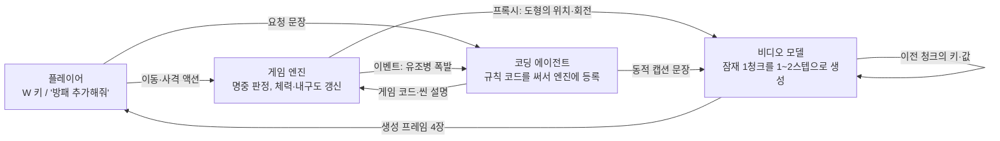

[논문 링크](https://arxiv.org/abs/2610.27999)
## 도입

비디오 생성 모델만으로 게임 세상을 만들면, 화면 밖에 놓인 상태는 어디에도 저장되지 않는다. 한 번 지나친 복도는 다시 그려질 때마다 달라지고, 체력 같은 규칙도 픽셀에서 다시 읽어야 한다. Matrix-Game 4.0은 규칙과 상태를 게임 엔진이 코드로 지키게 하고, 비디오 모델은 화면을 그리는 일만 맡긴다.

## 문제: 비디오 모델이 혼자 게임을 하면 왜 무너지나

기존 인터랙티브 월드 모델(Genie 시리즈, GameNGen 등)은 네트워크 안에 '세계의 역학'과 '화면'을 함께 담는다. 다음 프레임을 만드는 모델이 곧 세계 상태를 기억하는 유일한 장소다. 저자는 이 구조의 한계로 네 가지를 든다(§1).

- 외부 환경이 지속적으로 보정해 주지 않는다. 모델은 세상과 떨어져 혼자 굴러가고, 시야 밖 영역의 상태는 따로 유지되지 않는다.
- 작은 오차가 자동회귀 생성에서 쌓인다. 외부 3D 도구를 써도 추정한 카메라 포즈의 오차가 누적되면 장면이 무너진다.
- 과거 프레임이 압축되지 않고 그대로 쌓인다. 메모리는 롤아웃 길이에 비례해 커진다.
- 규칙이 탐색 수준에 그친다. 지속되는 행동 결과와 명시적 목표를 지원하는 실행 가능한 규칙이 없다.

더 근본적으로, 저자는 플레이 가능한 세계가 낮은 상호작용 지연, 탐색 너머의 의미 있는 게임 메커니즘, 멀티플레이를 위한 공유 세계 상태도 함께 요구한다고 본다(§1).

### 작은 예시: 복도를 되돌아보면 생기는 일

설명용 예시이며 측정 결과는 아니다. 주인공이 성 복도를 걸어 들어가다가 뒤돌아선 상황을 두고 비교한다.

| 단계 | 픽셀 기억 모델 | Matrix-Game 4.0 |
|---|---|---|
| 입력 | 뒤로 도는 액션 한 번 | 같은 액션 한 번 |
| 남는 상태 | 걸어오며 본 복도가 맥락(context)에 압축된 토큰으로만 남고, 별도의 상태값은 없다 | 엔진은 화면 밖에 있는 문 객체를 코드에 저장하고, 위치와 열림 상태를 규칙대로 갱신한다(§2.1) |
| 변경·생략·거절 | 기억으로부터 복도를 다시 상상한다(변경). 문 상태를 따로 두지 않으므로 생략하고, "들어올 때와 같은 문인가"를 검증하지도 않는다(거절) | 프록시는 문 자리를 단순 기하로 그린다. 참조 이미지가 있으면 코딩 에이전트가 "바람에 낡은 초가, 어두운 붉은색 나무 정문"처럼 캡션을 채운다(§2.2) |
| 출력 | 들어올 때 통과한 문이 같은 색·같은 위치라는 보장이 없는 복도 | 문의 위치와 상태가 이전과 같은 복도. 재방문한 장소의 일관성은 공간 메모리 프레임이 돕는다(§4.1) |

핵심은 "화면 밖 상태를 어디에 저장하는가"이고, 이 논문은 그 책임을 네트워크에서 게임 엔진으로 옮긴다.

## 방법: 규칙·상태·그림을 세 주체로 나누다

실행 하네스(harness)란 게임 로직을 비디오 모델 밖에 두고, 모델은 화면만 그리게 만드는 틀을 말한다. Matrix-Game 4.0은 비디오 모델을 이런 하네스 안에 감싼다. 세 구성요소가 한 루프를 돈다(Figure 2). 아래 도식의 화살표는 이름이 아니라 실제로 주고받는 값이다.

- <strong>게임 엔진(심판)</strong>은 매 프레임 실제 무슨 일이 일어났는지 계산한다. 플레이어가 입은 피해를 더해 체력을 갱신하고, 총알과 사물의 좌표를 비교해 명중을 판정하며, 퀘스트 진행도를 저장한다. 화면 대신 도로·건물·캐릭터·상호작용 객체를 단순 기하로 그린 구조 렌더링, 즉 프록시를 비디오 모델에 보낸다. 객체가 화면 밖으로 나가도 상태는 엔진 규칙대로 계속 유지된다(§2.1).
- <strong>멀티모달 코딩 에이전트(각본가 겸 번역가)</strong>는 엔진과 양방향으로 통신한다. 엔진이 보내는 상태와 이벤트를 읽어 문장으로 바꾸고(아래 방향), 플레이어의 아이디어를 실행 가능한 게임 코드로 써서 엔진에 등록한다(위 방향). "몬스터가 사방에서 몰려오게 해줘"는 몬스터를 추가하는 데서 끝나지 않고, 어디서 어떻게 생성하는지, 어떻게 움직이고 공격하는지, 무엇을 해야 승리·패배하는지까지 코드로 정의한다(§2.2). 세부가 비워진 요청(내용이 미리 정해지지 않은 문 뒤 공간 등)에는 씬 구성·스토리·NPC 대사를 스스로 지어내 엔진에 넘기고, 이후 그 상태는 엔진이 관리한다(§2.2).
- <strong>비디오 생성 모델(화가)</strong>는 프록시를 받아 재질·조명·대기·세부 디테일이 있는 프레임으로 바꾼다(§2.3).

이 분업이 남긴 과제는 하나다. 실시간 성능 부담이 화면 생성 한 곳으로 몰리기 때문이다. 엔진은 가벼운 시뮬레이션만 돌면 되고, 남은 것은 "비디오 모델을 얼마나 빠르게 만드느냐"이다(§2).

## 조건: 엔진이 매 프레임 넘겨주는 프록시와 캡션

비디오 모델이 구조를 지키며 세부만 채우려면 매 순간 바뀌는 '조건'이 필요하다. 저자는 조건을 프록시와 동적 캡션 두 갈래로 만든다.

### 프록시와 짝지어진 학습 데이터

프록시는 지형·건물·캐릭터를 질감 없이 기하 도형으로만 그린 화면으로, 모델에게 "어디에 무엇을 그릴지"를 알려준다. 학습 데이터는 이 프록시와 고충실도 화면을 짝지어 수집한다.

Unreal Engine 5(UE5)에서 네 장면(중세 성, 고대 이집트 사막, 사막 협곡 공중전, CitySample 도시)을 캡처한다. 각 캡처는 1280×720으로 기록되고, 같은 카메라 궤적과 프레임 인덱스를 공유하는 세 개의 정렬 비디오—UE5 RGB 렌더, 저폴리곤 구조 렌더(BBox), 프록시 기하의 뎁스 렌더—를 함께 남긴다(Figure 3a, §3.1). 프록시에서 하늘은 검은색이고 바닥은 회색 체커보드다. 건물과 벽은 평평한 색 상자와 각기둥, 나무는 원기둥+구, 캐릭터는 블록 인형이며, 모든 프리미티브에 검은 외곽선만 두어 질감·반사·그림자를 없앴다. 슈터·공중전 클립은 약 1분 길이다. 총 114,334개 학습 클립, 1,712시간이며(Table 1), 성·사막·도시는 캡처 세션 3개씩을, 공중전은 캡처 배치 통째로 홀드아웃해 어떤 홀드아웃 소스도 학습 클립을 내지 않는다. 캡처와 동시에 시스템은 객체 인스턴스 ID, 가시성, 인과적 상호작용 이벤트를 프레임 단위 메타데이터에 기록한다(§3.1).

### 동적 캡션: 프레임마다 갱신되는 설명

동적 캡션은 고정 문장이 아니라 현재 게임 상태를 따라 바뀌는 설명이다. 인터랙티브 게임에서는 카메라를 돌리면 보이는 객체가 바뀌고, 움직이거나 이벤트가 터지면 객체 상태가 바뀐다. 고정 문장은 이런 변화를 따라갈 수 없다.

81프레임 클립마다 카메라 포즈·액션·가시 객체·이벤트·환경을 프레임 정렬 CSV에 남긴다. 시스템은 현재 보이는 객체의 ID로 의미 설명 테이블을 조회한 뒤, 위치·거리·상태·이벤트를 템플릿에 채워 프롬프트를 만든다(Figure 3b, §3.2). 이 조회와 조립은 시각-언어 모델 없이 **규칙 기반 템플릿**으로 동작한다(§3.2).

Figure 4의 도시 주행 예시가 그 동작을 보여준다. 차가 앞으로 갈수록 주차된 차량이 설명에서 빠지고, 보행자는 '서 있음'에서 '걸어오며 가까워짐'으로 바뀌며, 새로 보이는 객체는 "Changes" 항목으로 공지된다. 캡션의 색이 의미를 나눈다: 주황색 글자는 객체의 상태와 이벤트에서, 파랑 글자는 위치와 거리에서 온다(Figure 4). 프록시는 구조(위치·배치·움직임)를 공급하고, 캡션은 의미(어떤 객체가 있고 어떤 상태인지)를 공급한다. 둘은 서로 다른 정보를 주기 때문에 함께 제약을 만든다.

## 렌더러: 양방향 모델을 1~2스텝 인과 생성기로

렌더링 모델은 Wan2.2 5B의 Fun Control 변형을 비디오-투-비디오(V2V, 입력 영상을 다시 쓰는 방식) 모델로 바꾼 것이다(§4.1). 먼저 Wan2.2-Fun-5B Control 가중치에서 81프레임 창(704×1280)을 쓰며, 프록시·캡션·첫 프레임·공간 메모리 최대 3프레임을 조건으로 플로우 매칭 목적의 양방향 V2V 파인튜닝을 진행한다(§4.2).

파인튜닝이 끝나면 Causal Forcing++ 방식의 세 단계를 거쳐 인과 생성기로 바꾼다(§4.3). '청크'는 한 번에 완성하는 덩어리로, 잠재 프레임 하나(실제로는 비디오 4프레임)다.

1. **교사 강제 자동회귀 확산**: 각 잠재 프레임이 앞선 정답 프레임과 첫 프레임·컨텍스트 프레임만 보도록 인과적 교사(teacher)를 학습한다. 이 교사는 여러 미세 스텝으로 적분하는 다중 스텝 ODE 솔버로 청크를 샘플링한다.
2. **인과 일관성 증류**: 고정된 교사와 온라인 학생·EMA 학생(가중치의 지수이동평균본)을 두고, 48개 노이즈 레벨 격자에서 교사가 한 스텝(분류기 없는 안내 3)으로 다음 낮은 레벨로 이동한 지점을 만들면, 온라인 학생은 더 높은 레벨에서 깨끗한 청크를 예측해 더 낮은 레벨의 EMA 학생 예측과 일치하도록 학습한다. 5,000 스텝(EMA 감쇠 0.99) 후 EMA 학생은 청크를 4스텝으로 생성한다.
3. **분포 정합(DMD)**: 학생이 자기 자신의 자동회귀 롤아웃에서 학습하며, 최종적으로 청크당 2스텝(첫 잠재 프레임은 4스텝)까지 줄인다.

완성된 청크는 네 입력에 조건화된 결과물이다: 엔진이 그린 저폴리곤 프록시, 동적 캡션, 같은 장소를 다시 볼 때 일관성을 지키는 공간 메모리 프레임, 이미 화면에 있는 장면과 이어주는 첫 프레임(Figure 5).

네트워크는 Diffusion Transformer(DiT)로, 노이즈를 줄여 화면을 만드는 확산 모델의 트랜스포머 골격이다. 30개 블록이 인과적 셀프 어텐션·텍스트 크로스 어텐션·피드포워드(은닉 폭 14336)를 순서대로 적용하고, 타임스텝은 AdaLN(정규화 통계를 시간 단계에 따라 조절하는 기법)으로 블록을 변조한다. 480×864 조건에서 잠재 프레임 하나는 15×27=405개 토큰이 된다. 셀프 어텐션은 KV 캐시—과거 출력의 키·값을 저장해 두는 임시 메모리—를 읽는데, 그 안에는 세 개의 공간 메모리 프레임, 참조 프레임, 최근 20개 청크가 들어 있다. 청크가 완성되면 모델은 그 잠재를 t=0에서 제어 입력 없이 한 번 더 통과시켜 깨끗한 키·값을 캐시에 써 넣는다(§4.1, Figure 5).

출력 헤드는 '속도(velocity)'를 예측하고, 잠재는 유량(flow) 업데이트로 정리된다.

$$ z \leftarrow z - \sigma\, v $$

여기서 $z$는 잠재, $v$는 예측 속도, $\sigma$는 노이즈 레벨이다. 이 업데이트를 한 번 하면 1스텝, 두 번 하면 2스텝 생성이 된다(§4.1). 평가에 쓰는 설정은 청크당 2스텝이다(§6.1).

## 단일 GPU에서 60 FPS를 여는 커널 최적화

청크가 잠재 프레임 하나(비디오 4프레임)로 아주 작기 때문에, 스텝이 줄면 한 번의 호출이 하는 계산이 적어진다. 그 대신 GPU가 커널을 실행해주는 CPU를 기다리는 시간이 길어진다. 병목이 '계산량'이 아니라 '실행 오버헤드'로 이동한다(§5, Figure 6a).

성능은 두 지표로 나눠 읽는다. **처리량**은 모델이 프레임을 찍어내는 steady-state 생성률이고, **지연**은 키를 눌렀을 때 그것이 반영된 첫 프레임이 나오기까지의 시간이다. 지연은 60 FPS로 게임이 돌아가는 상황에서 측정한다. 저자는 Table 2의 순서대로 오버헤드를 제거한다.

| 설정(누적) | FPS↑ | 지연(ms)↓ |
|---|---:|---:|
| 인과 Wan2.2 DiT, 4스텝, 전체 Wan VAE | 4.5 | 1110 |
| + 경량 VAE(TAEHV) | 6.5 | 867 |
| + RoPE 커널, 텍스트 KV 캐시 | 15.4 | 551 |
| + FP8 가중치 + CUDA Graph | 24.2 | 466 |
| + 1스텝 증류 | 51.2 | 376 |
| + 비동기 I/O 파이프라인 | 57.7 | 367 |
| + 융합 Triton 커널 | 65.8 | 121 |
| + 링 KV 캐시 | 73.7 | 117 |
| + 분할 KV FlashAttention | 83.4 | 112 |

*표 조건: 480×864, 청크 크기 잠재 프레임 1개(비디오 4프레임), KV 창 21 잠재 프레임, NVIDIA RTX 5090 한 장.*

합계로 FPS는 4.5→83.4(약 19배), 지연은 1110→112 ms(약 9.9배)로 줄어든다(Table 2, §5). 각 최적화가 하는 일은 다음과 같다.

- **CUDA Graph**: DiT 백본의 연산 순서를 한 번 기록해 두고, 실행할 때는 한 번의 launch로 재생한다. 커널 호출 오버헤드가 사라진다. 선형 계층 가중치는 8비트(FP8)로 저장한다(§5).
- **융합 커널**: RoPE(위치를 회전으로 인코딩하는 어텐션 기법)·정규화·FP8 양자화를 Triton(GPU 커널을 만드는 언어)으로 하나로 묶는다. 한 레이어의 쿼리·키·값 투영은 입력의 양자화를 한 번만 공유하고, 캡션의 키·값은 캡션이 바뀔 때만 다시 계산한다(§5).
- **링 KV 캐시**: 창이 밀릴 때마다 전체 KV 창을 옮기는 대신, 새 잠재 프레임을 가장 오래된 슬롯에 덮어써서 이동 비용을 없앤다(Figure 6c).
- **분할 KV 어텐션**: 셀프 어텐션의 KV 창을 7개 범위로 나눠 병렬로 계산하고 log-sum-exp로 합친다. 범위마다 INT8 K·FP8 V를 캐시해 두고, 바뀐 범위만 다시 양자화한다(Figure 6d).
- **디코딩·I/O**: 잠재를 화면으로 복원하는 전체 Wan VAE 디코더를 경량 TAEHV로 교체하고, 모델 입출력을 비동기 파이프라인으로 돌린다. 디코딩은 깨끗한 KV 갱신보다 앞당겨 프레임을 더 일찍 내보낸다(Figure 6b, §5).

저정밀 표현를 구분해 두는 게 좋다. FP8은 선형 계층 **가중치의 저장 형식**인 반면, INT8 K·FP8 V는 어텐션 **KV 캐시의 양자화**로 범위가 바뀔 때 다시 계산된다(§5, Figure 6d). 둘 다 메모리·대역폭을 줄이지만 역할이 다르다.

이 모든 최적화를 합치면 단일 RTX 5090 기준 최대 GPU 메모리는 1·2스텝 모두 약 18.2 GiB이고, 1스텝으로 한 청크(4프레임)를 48 ms에 처리한다. 텍스트 인코더·DiT·VAE는 모두 같은 카드에 올라간다(§5). 16 GiB 카드에서도 1스텝·고정 프롬프트 조건으로 RTX 5080에서 약 67 FPS(약 12.8 GiB), RTX 5070 Ti에서 약 58 FPS(약 10.9 GiB)를 낸다(§5).

## 결과: 112 ms의 의미와 다른 시스템과의 비교

통합 시스템은 480p에서 단일 RTX 5090 한 장으로 60 FPS 게임을 돌리고, 키 입력부터 화면 반영까지 112 ms가 걸린다(§1, Table 3). Table 3은 최근 인터랙티브 생성 시스템들과의 종단 간 지연 비교다.

| 시스템 | 지연 | 해상도 | 하드웨어 |
|---|---:|---|---|
| Code World Model(스트리밍) | 약 10.2 s | 1344×768 | 1×H200 |
| Magpie | 약 1.55 s | 1280×768 | 1×H100 |
| AgentGarten | 약 878 ms | 832×480 | 1×H100 |
| StreamRender-H3 | 약 517 ms | 1344×768 | 8×GB200 |
| **Matrix-Game 4.0** | **112 ms** | 864×480 | 1×RTX 5090 |

Matrix-Game 4.0의 지연은 다음으로 빠른 StreamRender-H3의 약 5분의 1이며, 비교 대상 중 유일하게 단일 컨슈머 GPU에서 돌아간다(§6.2, Table 3).

다만 이 표의 지연은 해상도·하드웨어·시간 측정 정의가 제각각이다. 청크 단위 시스템의 지연은 청크 생성 시간의 두 배로 기록된다. Streaming Code World Model은 17프레임 청크를 5.1 s에 렌더링하고, AgentGarten은 16프레임 청크를 439 ms에 렌더링하며, StreamRender-H3의 258 ms는 프로젝트 페이지에 보고된 세 스테이지 시간의 합(참조 인코딩 16.67 ms, 2스텝 렌더 217.96 ms, 인과 비디오 디코딩 23.8 ms)이다. Magpie은 엔진 준비 0.83 s·전송/인코딩 약 0.1 s·렌더링 0.62 s의 합이다(Table 3 주석). 그러므로 절대 수치를 1:1로 견주기보다 '데이터센터 GPU 여러 장이 필요하던 것이 컨슈머 카드 한 장으로 내려왔다'는 방향을 읽는 게 정확하다. 공개 여부는 2026-10-19 기준으로 확인했으며, 시스템에 따라 코드·가중치 공개 범위도 다르다(Table 3).

품질은 정량 지표가 아니라 40초 홀드아웃 롤아웃으로 보여준다. 성·사막·도시 세 게임의 증류된 인과 모델을 청크당 2스텝으로 돌리고, 정답 첫 프레임에서 시작해 961프레임(24 FPS 기준 40초)을 자동회귀 생성한다. 그 결과 생성 프레임이 프록시의 배치·카메라·객체 움직임을 끝까지 따라가면서도, 모델은 프록시가 생략한 재질·식생·조명·연기·총구 섬광을 채워 넣는다(Figure 7, §6.1, §6.3).

코딩 에이전트를 통한 게임 커스터마이징도 시연된다(Figure 8). 혼자 싸우는 슈터가 팀 전투로 바뀌고, 체력·탄약 제어, 내구도 제한 방패, 연사 샷건, 체력 0에서의 게임 오버 조건, 간단한 효과음이 추가된다. 주행 게임에는 체크포인트 시간 제한, 충돌 페널티, 드리프트가 붙고, 표적 차량을 가로채 일정 거리로 접근해 유지하는 추격 모드까지 만들어진다. 이 규칙들은 모두 엔진이 저장하고 평가하며, 비디오 모델은 엔진 출력을 읽어 화면으로 옮길 뿐이다(§6.4).

## 한계와 적용 판단

**논문이 밝힌 향후 방향(§8).** 가까운 목표로 추론 비용·하드웨어 요구량을 낮추고 Steam 기술 프리뷰를 내는 것을 꼽는다. 이후 방향으로는 시각 충실도 개선, 고해상도 출력을 위한 정제(refinement) 단계, 여러 플레이어가 일관된 시점을 보는 멀티플레이 렌더링, 생성 화면의 정밀한 제어, 더 다양한 장르·씬 확장을 나열한다.

**리뷰어 관점에서의 제약.**

- **게임마다 별도 모델을 학습한다.** "We train one model per game"(§4.2)에 따라 성·사막·도시가 각기 다른 파인튜닝 모델이다. 임의의 새 게임으로 바로 옮기는 일반화는 시연되지 않았다.
- **1~2스텝 증류의 품질은 정량적으로 검증되지 않았다.** §6은 정성적 결과(Figure 7 롤아웃, Figure 8 커스터마이징)만 제시하고, 다중 스텝 교사 대비 증류 학생의 충실도 지표(FID·PSNR 등)는 원문 미보고다. "끝까지 구조를 지킨다"는 주장은 눈으로 확인한 것이지 수치로 뒷받침된 것이 아니다.
- **동적 캡션은 규칙 기반이라 엔진의 객체 설명에 의존한다.** 시각-언어 모델을 쓰지 않아(§3.2) 지연은 낮지만, 설명 품질이 미리 만들어 둔 객체 설명 테이블에 묶인다. 미지의 장면이나 표현력이 필요한 상황을 잘 서술한다는 보장은 없다.
- **학습 데이터가 UE5 합성 캡처 4종에 국한된다(Table 1).** 실제 사진 수준의 장면이나 이 네 장면과 다른 스타일로 일반화되는지는 확인되지 않았다.
- **112 ms 지연은 60 FPS 기준 약 6.7프레임 분량이다.** 60 FPS는 통합 시스템이 유지하는 게임 실행 성능이고(렌더러 증류 설정은 청크당 2스텝), 112 ms는 키 입력이 화면에 반영되기까지의 별개 지연이다. 리듬감이 중요한 격투·리듬 게임 등에는 이 지연이 문제가 될 수 있고, 논문은 이런 장르를 다루지 않는다.

이 구조가 잘 맞는 곳은 규칙이 명확하고 화면이 구조 스케치로 표현 가능한 장르다. 슈터·주행·비행처럼 객체 상태를 엔진이 유지하기 쉽고 프록시로 배치와 움직임을 충분히 줄 수 있는 게임이 그 대상이다. 반대로 규칙이 암묵적이거나 화면 밖 상태를 코드로 유지하기 어려운 게임, 그리고 합성 캡처 데이터를 확보하기 어려운 스타일은 아직 검증되지 않은 영역이다.

<!-- verbatim-tables -->

논문 원문의 표

> arXiv e-print 의 LaTeX 원본에서 기계적으로 옮긴 표입니다. 숫자는 논문의 값이며 모델을 거치지 않았습니다.

**표 1. **UE5 paired training data.** Each clip is a pair of pixel-aligned low-poly and high-fidelity videos at $1280\times720$. Held-out clips come from capture sessions (for air combat, whole multi-machine capture batches) that contribute no training clip.**

| Scene | Game | Train clips | Hours | FPS | Held-out |
|---|---|---|---|---|---|
| Medieval castle | Third-person shooter | 17,848 | 290 | 24 | 3 sessions, 683 clips |
| Ancient Egypt desert | Third-person shooter | 40,296 | 643 | 24 | 3 sessions, 617 clips |
| Desert canyon air combat | Flight combat | 28,720 | 467 | 24 | whole capture batches |
| CitySample megacity | Driving | 27,470 | 312 | 17 | 3 sessions |
| Total |  | 114,334 | 1,712 |  |  |

**표 2. **Inference speed and latency, applied cumulatively.** Each row adds one optimization to all rows above it. FPS is the steady-state generation rate of the model; latency is the time from a key press to the first generated frame that reflects it, with the game running at 60 FPS. Speedup is the FPS ratio to the previous row. Setting: $480\times864$, chunk size of one latent frame (four frames), KV window of 21 latent frames, one NVIDIA RTX 5090.**

| Configuration | FPS $\uparrow$ | Latency (ms) $\downarrow$ | Speedup |
|---|---|---|---|
| Causal Wan2.2 DiT, 4 steps, full Wan VAE | 4.5 | 1110 | -- |
| + tiny VAE (TAEHV) | 6.5 | 867 | 1.4$\times$ |
| + RoPE kernel, cached text KV | 15.4 | 551 | 2.4$\times$ |
| + 8-bit weights + CUDA Graph | 24.2 | 466 | 1.6$\times$ |
| + 1-step distillation | 51.2 | 376 | 2.1$\times$ |
| + asynchronous I/O pipeline | 57.7 | 367 | 1.1$\times$ |
| + fused Triton kernels | 65.8 | 121 | 1.1$\times$ |
| + ring KV cache | 73.7 | 117 | 1.1$\times$ |
| + split-KV FlashAttention | **83.4** | **112** | 1.1$\times$ |
| Overall | 19$\times$ faster | 9.9$\times$ lower |  |

**표 3. **Latency, hardware, and openness of recent real-time interactive generation systems.** Latency is the end-to-end latency, and resolution is the output resolution at which each system reports its timings. For the systems that generate in chunks, the latency is two chunk generation times. Code World Model (streaming) renders a 17-frame chunk in 5.1 s on one H200. For StreamRender-H3, the chunk time of 258 ms is the sum of the three warm-renderer stage times reported on its project page: 16.67 ms for reference encoding, 217.96 ms for the two-step render, and 23.8 ms for causal video decoding, the last measured at 720p on one GB200. AgentGarten renders a 16-frame chunk in 439 ms on one H100. For Magpie, the latency is the end-to-end time reported by its authors: 0.83 s for the engine to prepare a 20-frame chunk, about 0.1 s for transmission and encoding, and 0.62 s for rendering. Matrix-Game 4.0 latency is measured from a key press to the first frame that reflects it, with the game running at 60 FPS. Open release is checked against the GitHub and Hugging Face pages of each project on October 19, 2026.**

| System | Latency | Resolution | Compute | Open release |
|---|---|---|---|---|
| tabular[t]@l@Code World Model |  |  |  |  |
| (streaming) |  |  |  |  |

