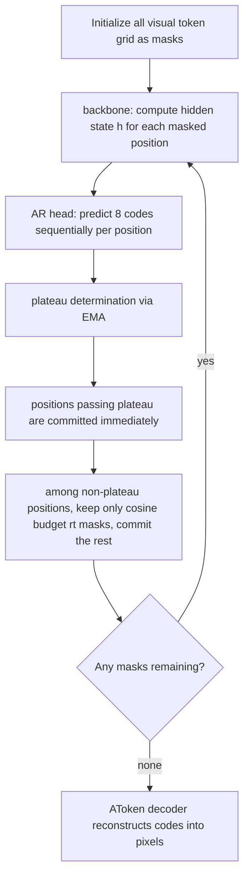

[Paper](https://arxiv.org/abs/2610.20818)
## Problem: Why It's Hard to Unify Understanding and Generation in One Representation

There have been many attempts to merge image understanding and image generation into a single model. Most, however, optimize the two abilities separately in different representation spaces. When text is trained as a token classification problem and images are trained with a diffusion/flow objective over continuous vectors, the two objectives push against each other within one backbone, which tends to make training unstable.

Conversely, if images are represented entirely as discrete tokens like text, the objective is unified into one. But because one position is compressed into a single code, it becomes hard to carry fine-grained detail and high-level semantics at the same time.

Intern Lumina U2 sidesteps this dilemma. It represents images entirely as discrete tokens, but **bundles 8 codes per position** to increase expressiveness, and trains understanding and generation together with a single mask prediction loss. As a result, with only about 1.4B parameters activated per token out of 16.9B total, it ranks first on 6 of 10 image understanding benchmarks (tied with BAGEL on MME-C), sits at the top level among unified models for text-to-image generation, and approaches the top tier for editing (original §1, §7). It beats LLaDA2.0-Uni, which uses the same language backbone, on 8 of 10 benchmarks.

On the inference side, within the same evaluation protocol, it cuts the time to produce one image from 159.9 seconds to 35.9 seconds—about 4.45×—while raising GenEval from 86.6 to 89.3 (original Table 4).

Original Fig. 1 (PDF p.1) shows the breadth of tasks this model handles. You can see a single checkpoint answering text questions as understanding while generating images according to text and editing instructions. The performance numbers in the body are measured values taken from the benchmark tables that appear later, not the "demonstrations" in this figure.

## Background: Why a Single Code per Position Is Not Enough

The visual tokenizer of existing discrete unified models quantizes one position of an image into a single code. For example, VQGAN-style tokenizers preserve fine detail for reconstruction but are not aligned with text, while semantic encoders such as SigLIP match text well but cannot reconstruct pixels (original §3.2). A single code lacks the information capacity to carry both at once.

So this paper uses AToken, but in its **discrete (FSQ) configuration**. AToken is a tokenizer that starts from a SigLIP2 encoder and is trained jointly for reconstruction and understanding, and it quantizes one position into a code from each of 8 codebooks. Each codebook has a vocabulary of 4096 entries, and a code is the index of that entry (original §3.2).

**Illustrative example.** Given one 256×256 image, AToken with patch size 16 turns it into a grid of 16×16 = 256 positions (original Appendix B, Table 20). To show the code bundle, shrink to a 2×2 grid and look at only position `(0,0)`; that visual token is 8 integers `(c₁, …, c₈)`, each between 0 and 4095. On the input side, the model looks these 8 integers up in **the embedding table of their respective codebooks**, obtaining 8 2048-dim vectors, concatenates them into 16384 dimensions, and compresses that into one 2048-dim vector with a linear transform. That is, the 8 codes enter the backbone as "one token." In the actual 256×256 layout, 256 positions plus 16 separators at the end of each row make a sequence of 272 positions (original Appendix B). The 2×2 reduction is for explaining the code bundle and should not be confused with the experimental numbers below.

Why this structure is needed becomes clearer when looking at the generation side. In understanding, images are "conditions," but in generation, images are "prediction targets." The figure below shows the overall flow.

Original Fig. 3 (PDF p.7) shows the structure at a glance. Visual input is tokenized by AToken and text by LLaDA2.0's tokenizer, and the two are merged into one sequence. The MoE diffusion backbone reconstructs masked text tokens with the text head and masked visual tokens with the multi-codebook AR head. The fact that the AR head draws 8 codes per position "sequentially" is the core axis of this model.

## Method: How the 8 Codes Go In and Come Out

There are three ways to handle the 8 codes at one position. Unfolding the 8 separately into 8 tokens makes the sequence 8× longer. Keeping one token and predicting the 8 codes independently of one another discards dependencies between codes. Intern Lumina U2 takes the third. It keeps one position as **a single backbone token** but models the 8 codes **jointly as a joint distribution** (original §3.4).

### Input: Embed each codebook separately and concatenate

The input interface turns the 8 codes at a position into one 2048-dim vector. Each codebook `k` has its own embedding table `E_k` (4096 codes + mask/separator entries). When a position is masked, all 8 codes become the mask entry. The input vector is obtained by concatenating the 8 embeddings and applying a single linear transform.

$$x = W_{\mathrm{in}} [E_1(c_1); E_2(c_2); \dots; E_8(c_8)], \quad W_{\mathrm{in}} \in \mathbb{R}^{2048 \times (8 \cdot 2048)}$$

This design has two benefits. Because the codes are merged before entering the backbone, sequence length does not grow 8×, and because each codebook has its own table, there is no need to insert visual codes into the text vocabulary or distinguish them with index offsets (original §3.4). The figure below compares the three candidates.

Original Fig. 4 (PDF p.9) shows the three designs; the adopted third design (D3) places an independent embedding table per codebook, concatenates across spatial positions, and projects. This choice is supported by measurement, not decoration. Under the same conditions, D3's next-code top-1 accuracy is 0.0459, ahead of the single shared table D1 (0.0426) and offset shared D2 (0.0415) by more than 10 standard errors (original Table 15). D1 requires 2.35× the memory of D3 because of its wider classifier and also converges more slowly (original §7, Table 15).

### Output: An AR head that draws the 8 codes sequentially

The output interface predicts 8 codes from a single final hidden state `h` (2048-dim) of the backbone. It factorizes the joint distribution of the 8 codes in codebook index order.

$$p(c \mid h) = \prod_{k=1}^{8} p(c_k \mid h, c_{\lt k})$$

This is implemented as the **multi-codebook AR head**. It is a 6-layer causal Transformer that processes a length-8 "depth sequence" for each visual position. The first element is `q = W_q h + b_q` (the projection of `h`) plus position embedding `s₁`; the `k ≥ 2`-th element is the embedding `e_{k-1}` of the previously predicted code `ĉ_{k-1}` plus position embedding `s_k`. Each block is conditioned on `q + u_k` via adaLN, so the backbone output directly modulates each prediction step. Finally, a separate classifier `W_k^out` (4096×2048) per codebook produces the logits (original §3.4).

The difference between training and inference is key to understanding this head. The figure below shows it.

Original Fig. 5 (PDF p.11) places training and inference side by side. During training, ground-truth codes are fed in, and a single teacher-forced causal pass yields the logits for all 8 codes at once. During inference there is no ground truth, so codes are sampled sequentially over 8 steps, appending the embedding of the sampled code to the prefix for the next step. **Positions are processed in parallel, codebooks sequentially.**

Why "sequential prediction" rather than "independent prediction"? In an ideal conditional model, if the 8 codes are independent given `h`, the cross-entropy of the two approaches is the same; if they are not independent, sequential prediction's cross-entropy is no higher (original §3.4). In experiments this difference is in fact large. In a 512×512 comparison with a similar token budget, the parallel independent head scores GenEval 68.94, the AR head 82.78, and the Q-Former-style head only 69.67 (original Table 16). The parallel head falls particularly on counting, position, and attribute binding—tasks that require "exactly one correct combination" of object and attribute. That is, the AR head's gain comes not from fancier conditioning but from **modeling dependencies between codes** (original §7).

### Sequence and masks: every task in one format

Once the input/output interfaces are set, understanding, generation, and editing must all fit into one sequence format. Every sample is converted into a conversation of "user message (condition) + assistant answer (prediction target)." Conditions are combinations of text, image, video, and 3D assets; answers are text answers or visual answers. Each token in the sequence carries five pieces of metadata: type, turn number, noise status (clean/noisy), block number, and position ID (original §3.5).

This metadata leads to rules that determine the attention mask. Conditions are visible to their own turn and later turns; answers are not visible to conditions. Text answers follow turn-level block diffusion, and visual answers follow spatial mask diffusion. The figure below draws four scenarios.

Original Fig. 6 (PDF p.12) shows four cases. (a) For an image answer, one noisy visual answer follows the clean condition, and all positions are bidirectional. (b) For a text answer, noisy blocks undergo block diffusion and read clean copies of preceding blocks. (c) is the case where, when an image answer follows a text answer as in "think then generate," the image reads clean copies of the preceding text blocks. (d) is the case in multi-turn where a later turn reads clean copies of earlier answers. Clean copies serve as unmasked context that later blocks/turns and subsequent diffusion steps can reference (original §3.5). Visual answers have no clean copies because later turns do not reference them as conditions.

By changing only the mask rules this way, text generation (block diffusion), image generation (spatial mask diffusion), editing (source image condition + target image), and multi-turn understanding are all trained simultaneously with **a single mask prediction loss**. The loss for text tokens and the loss for visual positions (the mean negative log-likelihood of the 8 codes) are averaged over the same denominator, and the MoE load-balancing loss is added with weight $10^{-3}$ (original §3.6). At generation time, text expands left to right block by block and denoises within a block in parallel, while images iteratively refine all screen positions in parallel (original §6.1).

## Inference Acceleration: How the Expensive Image Sampling Was Reduced

Image generation is far more expensive than text. A single 1024×1024 image has 64×65 = 4160 positions, each requiring 8 codes drawn sequentially, and this process repeats 96 times in the default setting (original Appendix B, §6.2). The paper reduces this cost by changing the sampler without additional training. There are two directions: one is "reduce the computation of one step with caching," and the other is "reduce the number of steps needed."

The Mermaid below shows how the image generation loop updates state—what is kept and what is recomputed.

At each iteration, what is **kept** is the codes of committed positions, and what is **recomputed** is the hidden states of still-masked positions. The cache described below reuses "the hidden states of positions whose codes have not changed," and the plateau determination reduces the number of steps by selecting "positions that can be committed earlier."

### Cache reuse: don't recompute the same input

In image refinement, the codes of most positions no longer change as steps proceed. The paper layers three reuse techniques (original §6.2.1). First, it runs the conditional and unconditional branches of classifier-free guidance (CFG) as one batch to share backbone computation. Second, while the AR head predicts the 8 codes per position, it caches the key-value states of the previously generated code prefix. Third, the backbone reuses the hidden states of positions whose codes have not changed.

The third cache needs a criterion for judging when it has gone stale. It measures the normalized difference (drift) between the new hidden state and the cached hidden state at recomputed positions, and when this exceeds a threshold, it refreshes the entire cache at the next step. This is taken from the V-verify score of dLLM-Cache (original §6.2.1).

### Plateau determination + Halton order: commit earlier

Caching reduces the cost per step but leaves the number of steps unchanged. Reducing steps requires deciding when to commit a position. Yet visual token confidence, unlike text, has very low absolute values. Over 96 steps, the median per-prompt confidence rises only from 0.046 to 0.127, and the 90th percentile does not exceed 0.32 (original §6.2.2, Fig. 8). So the existing approach of "commit when confidence exceeds an absolute threshold" does not fit here.

Instead, the paper uses confidence as a **temporal signal**. It takes an exponential moving average (EMA, β=0.7) of each position's sample confidence, and if after the first 4 iterations the rate of change stays below a threshold for P=5 consecutive steps and the EMA value exceeds a floor, it judges that "a plateau has been reached" and commits immediately. The floor prevents "low but flat" confidence from being mistaken for stability (original §6.2.2). Positions passing the plateau are committed immediately, and among non-plateau positions only the cosine budget `rt = min(nt, |Ut|)` are kept masked. The positions to keep are chosen from the later part of the Halton order (a low-discrepancy sequence) so they spread evenly across the image. This combination is called Plateau-Halton sampling with V-verify, or **PHV** for short. The chosen settings are δp=0.18, fp=0.005 (original Table 4).

Whether plateau determination actually finds "stable positions" well was confirmed by offline validation. It pairs positions that passed plateau determination with positions in the same image that have similar confidence/EMA but did not pass, and compares the flip rate (the fraction of top-1 predictions that flip when both are kept masked for additional steps). Across 200 prompts, plateau positions have a lower flip rate, and the gap widens with longer retention (H=2: −0.012, H=8: −0.048). In 157 of 200 prompts, plateau positions were more stable (original §6.2.2, Fig. 9). That is, plateau determination is not a perfect indicator but a statistically significant stability signal.

### A table that looks at speed and quality together

The table below shows results when optimizations are stacked one at a time on the same checkpoint and the same 1024×1024 protocol (553 GenEval prompts, 1 image per prompt, CFG scale 4.0, temperature 0.9, seed 42) (original Table 4). Latency is wall-clock time per image excluding kernel preheat and including cache warmup, so it is **end-to-end system time**, not kernel-level. GenEval in this table uses a one-image-per-prompt protocol, so its numbers should not be compared directly with the official multi-sample GenEval in the results table (Table 7) (original Table 4 caption).

| Method | Steps | Backbone forward (cache hit rate) | Latency (s) | Speed | GenEval |
|---|---|---|---|---|---|
| Production path | 96.0 | 192 | 159.9 | 1.00× | 86.6 |
| + CFG batching | 96.0 | 192 | 117.2 | 1.36× | 89.0 |
| + AR head KV cache | 96.0 | 192 | 84.2 | 1.90× | 88.6 |
| + hidden state cache | 96.0 | 192 (65%) | 64.1 | 2.49× | 89.2 |
| + V-verify refresh | 96.0 | 192 (63%) | 64.5 | 2.48× | 89.3 |
| + Halton selection (HVV) | 96.0 | 192 (64%) | 66.5 | 2.40× | 88.2 |
| HVV, fixed 60 steps | 60.0 | 120 (63%) | 42.6 | 3.75× | 89.7 |
| Plateau only (no cache/Halton) | 56.9 | 114 | 46.5 | 3.44× | 87.2 |
| Plateau + V-verify | 56.2 | 112 (35%) | 34.8 | 4.59× | 87.2 |
| **PHV (chosen)** | **60.4** | **121 (41%)** | **35.9** | **4.45×** | **89.3** |

The trick to reading the table is to separate the cache series from the step-reduction series. The top six rows fix steps at 96 and stack caches, reducing latency from 159.9 s to the 64 s range (2.5×). GenEval rises from 86.6 to a maximum of 89.3, and the last Halton selection row is 88.2. The lower rows that reduce steps drop to the 35–47 s range, and among them the "plateau only" and "plateau + V-verify" rows fall to GenEval 87.2.

PHV maintaining GenEval 89.3 at 35.9 s is because Halton order better chooses "which positions to commit within the same step budget," raising GenEval by more than 2 points over using only plateau and V-verify without Halton (34.8 s, 87.2) (original §6.2.2). Note that the cache hit rate (41%, 63%, etc.) is the backbone forward reuse ratio, not the latency reduction rate itself.

## Results: Where It Stands Among Unified Models

Results can be split along two axes: "understanding" and "generation." Comparison targets are divided into understanding-only models (Qwen2.5-VL, LLaDA-V), unified models (Janus-Pro, BAGEL, InternVL-U, LLaDA2.0-Uni, etc.), and generation-only models (FLUX.1, Qwen-Image) (original §7). Unless otherwise noted, the numbers below are for the Ascend base model.

### Image understanding and reasoning

In image understanding and reasoning, this model ranks first on 6 of 10 benchmarks (tied with BAGEL on MME-C). The most notable gaps appear on CharXiv (85.9), HallusionBench (64.6), MathVision (36.5), and DynaMath (63.6) (original Table 5). The comparison with LLaDA2.0-Uni, which shares the same language backbone, is especially informative, since LLaDA2.0-Uni uses a semantics-only visual interface. The paper interprets the pattern of leading on 8 of 10 as a result consistent with **the expressiveness of the multi-codebook representation** (original §7).

For video understanding, the Ascend base model ranks first on MLVU 62.1 and MVBench 61.8, while the NVIDIA reference model ranks first on Video-MME with 56.7. However, the Ascend base model's Video-MME 52.6 is lower than LLaDA-V's 56.1 (original Table 6). On 3D MM-Vet, the Ascend base model scores 50.5, ahead of ShapeLLM (47.4) and PointLLM (41.2), but the NVIDIA reference model scores 43.8, behind ShapeLLM. Video and 3D generation are not yet supported.

### Text-to-image generation

On the generation side, it is at the top level among unified models on major benchmarks: GenEval 89 (tied for best among unified models), DPG-Bench 87.79, UniGenBench 86.11 (EN overall average), and TIIF-Bench long-form 87.1 (original Table 7, 8). On UniGenBench, the gaps are especially large in the logical reasoning (84.17) and grammar (91.18) dimensions (original Table 8). On WISE it scores 0.56, second among unified models behind LLaDA2.0-Uni (0.68) (original Table 7).

### Editing and scientific diagrams

For editing, ImgEdit 3.82 and GEdit-Bench (EN) 6.06 (original Table 14). On ImgEdit it beats BAGEL (3.20) and OmniGen2 (3.44), but on GEdit-EN it is lower than BAGEL (6.52) and OmniGen2 (6.41). For scientific diagram generation, it ranks first on VeriphyT2IBench's Local score with 76.58, and second on Global overall with 81.22 behind Princigram-BAGEL (82.54). In the domain breakdown, it leads the physics-specialized Princigram family in some domains, such as Local E&M (83.30) and Global Mechanics (84.80) (original Table 11, 12).

### Contribution of the core designs

The contributions of the two core designs are separated by ablation. The input interface D3 leads D1 and D2 in next-code accuracy, matches D2 in memory, and uses only 1.9% more parameters (original Table 15). The output head AR is best on all four generation benchmarks versus parallel and Q-Former (original Table 16). These two results support the choice of "independent embedding per codebook + modeling dependencies between codes."

### Cross-platform validation

One thing to note is that the main numbers for this model come from a checkpoint trained on 1024 Ascend 910B NPUs, and a reference model trained separately on NVIDIA GPUs with the same architecture and recipe but a smaller token budget is used for cross-validation (original §5, Table 3, Appendix D). Since the numbers for both platforms are reported side by side in the tables, this can be read as evidence of cross-platform portability and consistency, not an accidental dependence on a single hardware.

## Limitations and Adoption Judgment

The authors themselves state two limitations. First, the multi-codebook AR head must draw 8 codes sequentially, adding decoding overhead, and high-resolution generation lengthens the visual sequence (original §8). At 1024×1024 there are 4160 positions each with 8 codes, and even with PHV's 4.45× reduction it still takes 35.9 seconds per image (original Table 4), which gives a sense of this cost. Second, the current system covers image generation/editing and does not support video/3D generation (original §8).

There are also constraints readable from the tables that the authors do not state directly. On OneIG-Bench, this model's overall score is 0.494, similar to the best unified model LLaDA2.0-Uni (0.505), but **sample diversity is low at 0.150** (original Table 10). The original does not analyze the cause of this degradation. Meanwhile, the authors describe the stability signal of plateau determination as an average tendency rather than a perfect indicator, and plateau positions were more stable in only 157 of 200 cases, so the relationship did not hold in the remaining 43 (original Fig. 9).

## Conclusion

This model is suitable for **environments that want image, video, and 3D understanding plus image generation and editing all from a single checkpoint**. With about 1.4B activated parameters, it delivers top-level understanding and generation performance among unified models, and training and evaluation on both Ascend and NVIDIA platforms confirmed platform portability and consistency.

On the other hand, for cases that need to generate video or 3D, real-time services requiring very low latency at high resolution, or creative uses where sample diversity is central, it is not yet validated or not suitable.
<!-- verbatim-tables -->

Tables from the paper

> Tables converted mechanically from the arXiv e-print LaTeX source. The numbers are the paper's own and did not pass through a model.

**Table 1. Capability and design checklist for representative unified multimodal models, grouped by backbone paradigm. *Discrete tokens* refers to the visual state inside the backbone; *Masked-diff. decoding* marks models that generate visual tokens by iterative masked denoising rather than left-to-right prediction; *Multi-codebook* denotes multiple codes per visual position with their dependence modeled explicitly; *Diffusion text* marks models that also generate text through the masked-diffusion process rather than autoregressively; *No continuous generator* marks systems that decode images through backbone tokens, without a separate continuous (diffusion or flow) generator. Systems: Emu3 , Emu3.5 , Janus-Pro , VILA-U , UniTok , BAGEL , InternVL-U , SenseNova-U1 , Show-o2 , Show-o , MMaDA , Lavida-O , Lumina-DiMOO , LLaDA2.0-Uni .**

| Model | Supported modalities Image und. | Supported modalities Image gen. | Supported modalities Video und. | Supported modalities 3D und. | Representation and decoding Discrete tokens | Representation and decoding Masked-diff. decoding | Representation and decoding Multi- codebook | Representation and decoding Diffusion text | Representation and decoding No continuous generator |
|---|---|---|---|---|---|---|---|---|---|
| *Autoregressive* |  |  |  |  |  |  |  |  |  |
| Emu3 | ✓ | ✓ | ✓ | ✗ | ✓ | ✗ | ✗ | ✗ | ✓ |
| Emu3.5 | ✓ | ✓ | ✗ | ✗ | ✓ | ✗ | ✗ | ✗ | ✓ |
| Janus-Pro | ✓ | ✓ | ✗ | ✗ | ✓ | ✗ | ✗ | ✗ | ✓ |
| VILA-U | ✓ | ✓ | ✓ | ✗ | ✓ | ✗ | ✓ | ✗ | ✓ |
| UniTok | ✓ | ✓ | ✗ | ✗ | ✓ | ✗ | ✓ | ✗ | ✓ |
| BAGEL | ✓ | ✓ | ✗ | ✗ | ✗ | ✗ | ✗ | ✗ | ✗ |
| InternVL-U | ✓ | ✓ | ✗ | ✗ | ✗ | ✗ | ✗ | ✗ | ✗ |
| SenseNova-U1 | ✓ | ✓ | ✗ | ✗ | ✗ | ✗ | ✗ | ✗ | ✗ |
| Show-o2 | ✓ | ✓ | ✓ | ✗ | ✗ | ✗ | ✗ | ✗ | ✗ |
| *Masked diffusion* |  |  |  |  |  |  |  |  |  |
| Show-o | ✓ | ✓ | ✗ | ✗ | ✓ | ✓ | ✗ | ✗ | ✓ |
| MMaDA | ✓ | ✓ | ✗ | ✗ | ✓ | ✓ | ✗ | ✓ | ✓ |
| Lavida-O | ✓ | ✓ | ✗ | ✗ | ✓ | ✓ | ✗ | ✓ | ✓ |
| Lumina-DiMOO | ✓ | ✓ | ✗ | ✗ | ✓ | ✓ | ✗ | ✓ | ✓ |
| LLaDA2.0-Uni | ✓ | ✓ | ✗ | ✗ | ✓ | ✓ | ✗ | ✓ | ✗ |
| **Intern Lumina U2** | ✓ | ✓ | ✓ | ✓ | ✓ | ✓ | ✓ | ✓ | ✓ |

**Table 2. Data mixture at each training stage. Shares are fractions of estimated backbone positions per pass over the mixture; the corresponding resolution and optimization settings are given in Table .**

| Stage | Position share (%) Und. | Position share (%) T2I | Position share (%) Text | Position share (%) Edit | Position share (%) Video | Position share (%) 3D |
|---|---|---|---|---|---|---|
| Vision--Language alignment | 30 | 50 | 20 | -- | -- | -- |
| Perception pretraining | 30 | 50 | 20 | -- | -- | -- |
| Omni-visual mid-training, Stage 1 | 30 | 60 | 10 | -- | -- | -- |
| Omni-visual mid-training, Stage 2 | 40 | 40 | 10 | 5 | 4 | 1 |
| Instruction SFT | 25 | 50 | 5 | 10 | 8 | 2 |

**Table 3. Training configurations for the primary Ascend run and the NVIDIA reference line.**

| **Configuration** | **Vision-** **Language** **alignment** | **Perception** **pretraining** | **Omni-visual** **mid-training** **Stage 1** | **Omni-visual** **mid-training** **Stage 2** | **Instruction** **SFT** |
|---|---|---|---|---|---|
| Training setup Generation resolution | $256$ | $512$ | $1024$ | $1024$ | $1024$ |
| Sequence length | 8,192 | 8,192 | 16,384 | 16,384 | 16,384 |
| Text length limit | 2,048 | 2,048 | 2,048 | 2,048 | 2,048 |
| Text block length | 32 | 32 | 32 | 32 | 32 |
| Global batch size (Ascend) | 1,024 | 1,024 | 1,024 | 1,024 | 1,024 |
| Global batch size (NVIDIA) | 192 | 192 | 192 | 192 | 192 |
| Training tokens (Ascend) | $50$B | $200$B | $500$B (combined) |  | $300$B |
| Training tokens (NVIDIA) | $50$B | $200$B | $200$B (combined) |  | $200$B |
| Learning rates and regularization Backbone peak LR | $2\!\times\!10^{-4}$ | $1\!\times\!10^{-4}$ | $1\!\times\!10^{-4}$ | $1\!\times\!10^{-4}$ | $1\!\times\!10^{-5}$ |
| Text embedding/head LR | $1\!\times\!10^{-4}$ | $5\!\times\!10^{-5}$ | $5\!\times\!10^{-5}$ | $5\!\times\!10^{-5}$ | $5\!\times\!10^{-6}$ |
| LR schedule | Cosine | Cosine | Cosine | Cosine | Constant |
| Minimum backbone LR | $10^{-7}$ | $10^{-7}$ | $10^{-7}$ | $10^{-7}$ | $10^{-7}$ |
| Warmup (% of steps) | 3 | 3 | 3 | 3 | 1 |
| Weight decay | 0.1 | 0.1 | 0.1 | 0.1 | 0.1 |
| Norm/bias weight decay | 0 | 0 | 0 | 0 | 0 |
| Gradient norm clip | 4.0 | 2.0 | 1.0 | 1.0 | 1.0 |
| Optimizer Matrix optimizer | Muon | Muon | Muon | Muon | Muon |
| Fallback optimizer$^c$ | AdamW | AdamW | AdamW | AdamW | AdamW |
| AdamW betas | $(0.9,\,0.999)$ | $(0.9,\,0.999)$ | $(0.9,\,0.999)$ | $(0.9,\,0.999)$ | $(0.9,\,0.999)$ |
| AdamW epsilon | $10^{-8}$ | $10^{-8}$ | $10^{-8}$ | $10^{-8}$ | $10^{-8}$ |
| Muon momentum | 0.95 | 0.95 | 0.95 | 0.95 | 0.95 |
| Newton--Schulz steps | 5 | 5 | 5 | 5 | 5 |
| Muon RMS scale | 0.2 | 0.2 | 0.2 | 0.2 | 0.2 |
| Nesterov / per-head QKV | Yes / Yes | Yes / Yes | Yes / Yes | Yes / Yes | Yes / Yes |

**Table 4. Inference acceleration under a matched $1024\times1024$ text-to-image protocol with the same checkpoint, 553 GenEval prompts, one image per prompt, CFG scale $4.0$, temperature $0.9$, and seed $42$. ``Steps'' is the realized number of outer diffusion steps, prompt-dependent for the plateau rows and fixed elsewhere. ``BB fwd'' counts conditional plus unconditional backbone forwards, with the cache-hit ratio in parentheses where a cache is active. Latency is wall-clock per image after a discarded kernel preheat and includes cache warm-up. The selected PHV setting is $\delta_p=0.18$, $f_p=0.005$, with the remaining cache and V-verify controls fixed across rows. GenEval uses one image per prompt and is therefore not comparable to the four-seed protocol of Table ; no configuration scores below the production path.**

| Method | Steps | BB fwd | Lat. (s) | Speedup | GenEval |
|---|---|---|---|---|---|
| *Cumulative system optimizations (fixed 96-step schedule)* |  |  |  |  |  |
| Production path | 96.0 | 192 | 159.9 | 1.00$\times$ | 86.6 |
| + CFG batching | 96.0 | 192 | 117.2 | 1.36$\times$ | 89.0 |
| + AR-head KV cache | 96.0 | 192 | 84.2 | 1.90$\times$ | 88.6 |
| + hidden-state cache | 96.0 | 192 (65%) | 64.1 | 2.49$\times$ | 89.2 |
| + V-verify refresh | 96.0 | 192 (63%) | 64.5 | 2.48$\times$ | 89.3 |
| + Halton selection (HVV) | 96.0 | 192 (64%) | 66.5 | 2.40$\times$ | 88.2 |
| *Reduced and adaptive step budgets* |  |  |  |  |  |
| HVV, fixed 60 steps | 60.0 | 120 (63%) | 42.6 | 3.75$\times$ | 89.7 |
| Plateau only (no cache, no Halton) | 56.9 | 114 | 46.5 | 3.44$\times$ | 87.2 |
| Plateau + V-verify | 56.2 | 112 (35%) | 34.8 | 4.59$\times$ | 87.2 |
| **PHV** | **60.4** | **121 (41%)** | **35.9** | **4.45$\times$** | **89.3** |

**Table 5. Image understanding and reasoning, grouped into document and chart understanding, perception and hallucination, and knowledge and mathematical reasoning. Benchmarks: ChartQA , CharXiv , HallusionBench , MME , RealWorldQA , MMMU , MMMU-Pro , MathVista , MathVision , and DynaMath . Baseline numbers are taken from . **Bold** marks the best score in each row.**

| Benchmark | Understanding-only Qwen2.5- VL | Understanding-only LLaDA-V | Unified BAGEL | Unified Intern VL-U | Unified Lumina- DiMOO | Unified LLaDA-o | Unified LLaDA 2.0-Uni | Intern Lumina U2 Ascend | Intern Lumina U2 NVIDIA |
|---|---|---|---|---|---|---|---|---|---|
| #Params | 7B | 8B | 7B+7B | 2B+1.7B | 8B | 8B | 16B-A1.4B | 16.9B-A1.4B |  |
| *Documents and charts* |  |  |  |  |  |  |  |  |  |
| ChartQA | 84.1 | 78.3 | 74.3 | 76.6 | 8.3 | **87.9** | 80.1 | 86.2 | 81.2 |
| CharXiv (DQ) | 73.9 | 47.0 | 70.6 | 53.3 | 27.8 | 69.8 | 68.4 | **85.9** | 84.0 |
| *Perception and hallucination* |  |  |  |  |  |  |  |  |  |
| HallusionBench | 51.9 | 39.2 | 52.5 | 44.8 | 32.9 | 47.4 | 50.2 | **64.6** | 56.5 |
| MME-C | 624 | 491 | **667** | 279 | 352 | 527 | 587 | **667** | 606 |
| RealWorldQA | 68.5 | 63.2 | **73.9** | 56.4 | 52.4 | 60.8 | 66.7 | 62.9 | 59.9 |
| *Knowledge and mathematical reasoning* |  |  |  |  |  |  |  |  |  |
| MMMU | 51.3 | 48.6 | 55.3 | 54.7 | **58.6** | 44.9 | 50.1 | 52.2 | 55.5 |
| MMMU-Pro | 38.3 | 35.2 | 37.1 | 20.8 | 20.6 | 28.3 | 34.0 | **38.5** | 37.4 |
| MathVista | 68.2 | 59.7 | **73.1** | 55.8 | 10.3 | 66.1 | 68.1 | 68.0 | 70.4 |
| MathVision | 22.4 | 21.2 | 24.1 | 22.1 | 13.1 | 15.7 | 26.7 | **36.5** | 30.6 |
| DynaMath | -- | -- | -- | 46.97 | -- | 40.58 | 46.89 | **63.6** | 55.8 |

**Table 6. Video and 3D understanding from the same checkpoint. Left: video benchmarks (Video-MME without subtitles, MLVU m-avg, MVBench ); baseline numbers are taken from . Right: 3D MM-Vet , with baseline numbers for ShapeLLM and PointLLM taken from . **Bold** marks the best score in each column.**

| Model | Video-MME | MLVU | MVBench |
|---|---|---|---|
| Video-LLaVA-7B | 39.9 | -- | 43.1 |
| LLaVA-Mini | -- | 42.8 | 44.5 |
| VideoLLaMA2-7B | 46.6 | -- | 54.6 |
| LLaDA-V | 56.1 | 59.5 | -- |
| Ours (Ascend) | 52.6 | 62.1 | **61.8** |
| Ours (NVIDIA) | **56.7** | **64.9** | 57.2 |

**Table 7. Text-to-image generation. GenEval , DPG-Bench , TIIF-Bench , and WISE overall scores (GenEval on a 0--100 scale); higher is better. Baseline numbers are taken from , , and ; TIIF reports the overall score on long prompts. UniGenBench results are reported per dimension in Table . **Bold** marks the best unified-model score in each column**

| Model | #Params | GenEval | DPG-Bench | TIIF | WISE |
|---|---|---|---|---|---|
| *Generation-only models* |  |  |  |  |  |
| FLUX.1 [Dev] | 12B | 66 | 83.84 | 71.8 | 0.50 |
| Qwen-Image | 20B | 87 | 88.32 | 86.8 | 0.62 |
| *Unified understanding-and-generation models* |  |  |  |  |  |
| Janus-Pro | 7B | 80 | 84.19 | 65.0 | 0.35 |
| Show-o2 | 7B | 76 | 86.14 | -- | 0.39 |
| BAGEL | 7B+7B | 82 | 85.07 | 71.7 | 0.52 |
| OmniGen2 | 3B+4B | 80 | 83.57 | -- | -- |
| InternVL-U | 2B+1.7B | 85 | 85.18 | 73.9 | 0.46 |
| MMaDA | 8B | 63 | 69.97 | -- | -- |
| Lumina-DiMOO | 8B | 88 | 86.04 | 68.8 | 0.40 |
| LLaDA-o | 8B | 86 | 87.04 | -- | -- |
| LLaDA2.0-Uni | 16B-A1.4B | **89** | 87.76 | -- | **0.68** |
| Ours (Ascend) | 16.9B-A1.4B | **89** | 87.79 | **87.1** | 0.56 |
| Ours (NVIDIA) | 16.9B-A1.4B | **89** | **87.99** | 84.8 | 0.59 |

**Table 8. UniGenBench (EN) results on the ten first-level dimensions; Overall is their mean. Baseline numbers are taken from ; **bold** marks the best unified-model score in each column. Dimensions: Sty(le), Wor(ld knowledge), Att(ribute), Act(ion), Rel(ationship), Log(ical reasoning), Gra(mmar), Com(pound), Lay(out), Txt (text generation).**

| Model | Sty | Wor | Att | Act | Rel | Log | Gra | Com | Lay | Txt | Overall |
|---|---|---|---|---|---|---|---|---|---|---|---|
| *Generation-only models* |  |  |  |  |  |  |  |  |  |  |  |
| FLUX.1 [Dev] | 83.90 | 88.92 | 67.84 | 62.17 | 67.26 | 30.91 | 60.96 | 47.04 | 71.83 | 32.18 | 61.30 |
| Qwen-Image | 94.70 | 94.15 | 87.93 | 82.60 | 80.08 | 51.59 | 60.96 | 72.94 | 86.57 | 72.13 | 78.36 |
| *Unified understanding-and-generation models* |  |  |  |  |  |  |  |  |  |  |  |
| Janus-Pro | 90.80 | 86.71 | 67.74 | 64.26 | 68.40 | 37.05 | 64.44 | 62.11 | 72.01 | 2.59 | 61.61 |
| BAGEL | 90.20 | 85.60 | 67.74 | 61.98 | 70.69 | 30.23 | 66.44 | 58.12 | 76.49 | 7.76 | 61.53 |
| OmniGen2 | 91.90 | 86.39 | 72.12 | 62.83 | 68.27 | 32.50 | 59.89 | 56.31 | 71.64 | 29.02 | 63.09 |
| MMaDA | 82.40 | 56.65 | 48.39 | 37.83 | 50.25 | 17.95 | 55.75 | 32.35 | 30.22 | 1.15 | 41.35 |
| Lumina-DiMOO | 89.70 | 90.03 | 81.62 | 71.12 | 78.43 | 45.45 | 70.45 | 73.32 | 82.84 | 25.57 | 71.12 |
| LLaDA2.0-Uni | 95.30 | 93.67 | 91.77 | 85.65 | 86.42 | 63.99 | 72.19 | 85.82 | 90.30 | **31.23** | 79.63 |
| Ours (Ascend) | **99.40** | **98.73** | **91.99** | **91.92** | **93.53** | **84.17** | **91.18** | **92.65** | **97.39** | 20.11 | **86.11** |
| Ours (NVIDIA) | 97.10 | 96.99 | 88.88 | 88.27 | 89.34 | 71.72 | 81.53 | 89.56 | 93.07 | 11.56 | 80.80 |

> Figures in this post are taken from the original arXiv:2610.20818 (CC BY 4.0). Only size and format were changed.
