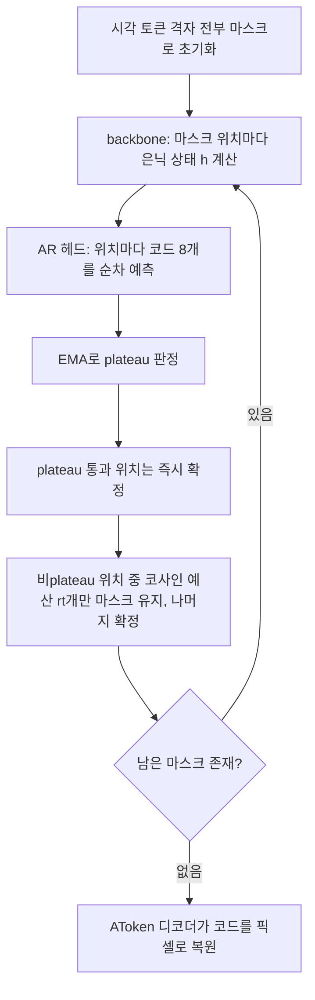

[논문 링크](https://arxiv.org/abs/2610.20818)
## 문제: 이해와 생성을 하나의 표현으로 합치기 어려운 이유

이미지 이해와 이미지 생성을 한 모델로 합치려는 시도는 많다. 그러나 대부분은 두 능력을 서로 다른 표현 공간에서 따로 최적화한다. 텍스트는 토큰 분류 문제로, 이미지는 연속 벡터에 대한 확산·플로우 목표로 학습하면, 한 백본 안에서 두 목표가 서로 밀어내 학습이 불안정해지기 쉽다.

반대로 이미지를 텍스트처럼 완전히 이산 토큰으로만 표현하면 목표는 하나로 통일된다. 다만 한 위치를 코드 하나로 압축하는 탓에 세부 묘사와 고수준 의미를 동시에 담기 어렵다.

Intern Lumina U2는 이 딜레마를 우회한다. 이미지를 완전히 이산 토큰으로 표현하되, **한 위치에 코드 8개를 묶어** 표현력을 키우고, 이해와 생성을 하나의 마스크 예측 손실로 함께 학습한다. 그 결과 총 16.9B 파라미터 중 토큰당 활성화되는 약 1.4B만으로, 이미지 이해 벤치마크 10개 중 6개(MME-C에서는 BAGEL과 동률)에서 1위, 텍스트-이미지 생성에서는 통합 모델 최고 수준, 편집에서는 최상위권에 근접한다(원문 §1, §7). 같은 언어 백본을 쓰는 LLaDA2.0-Uni보다는 10개 중 8개 벤치마크에서 앞선다.

추론 쪽에서는 같은 평가 프로토콜 안에서 이미지 한 장을 뽑는 시간을 159.9초에서 35.9초로, 약 4.45배 줄이면서 GenEval은 86.6에서 89.3으로 끌어올렸다(원문 Table 4).

원문 Fig. 1 (PDF p.1)은 이 모델이 다루는 작업의 폭을 보여준다. 한 체크포인트가 텍스트 질문에 답하는 이해와, 텍스트·편집 지시에 따라 이미지를 생성하는 작업을 함께 수행하는 것을 확인할 수 있다. 본문의 성능 수치는 이 그림의 "시연"이 아니라 뒤에 나오는 벤치마크 표에서 가져온 측정값이다.

## 배경: 한 위치에 코드 하나로는 왜 부족한가

기존 이산 통합 모델의 시각 토크나이저는 이미지의 한 위치를 코드 하나로 양자화한다. 예를 들어 VQGAN 계열은 복원을 위해 세부 묘사를 남기지만 텍스트와 정렬되지 않고, SigLIP 같은 의미 인코더는 텍스트와 잘 맞지만 픽셀 복원을 못 한다(원문 §3.2). 코드 하나는 이 둘을 동시에 담기에 정보량이 모자란다.

그래서 이 논문은 AToken을 쓰되, 그 **이산(FSQ) 설정**을 사용한다. AToken은 SigLIP2 인코더로 시작해 복원과 이해를 함께 학습한 토크나이저라, 한 위치를 8개 코드북 각각의 코드로 양자화한다. 각 코드북은 4096개 항목의 어휘이고, 한 코드는 그 항목의 인덱스다(원문 §3.2).

**설명용 예시.** 256×256 이미지 한 장이 들어오면 AToken은 패치 크기 16으로 이를 16×16 = 256개 위치의 격자로 만든다(원문 부록 B, Table 20). 코드 묶음을 보여주기 위해 2×2 격자로 축소해 한 위치 `(0,0)`만 보면, 그 시각 토큰은 정수 8개 `(c₁, …, c₈)`이고 각 정수는 0~4095 사이다. 입력 쪽에서 모델은 이 8개 정수를 **각각 자기 코드북의 임베딩 테이블**에서 조회해 2048차원 벡터 8개를 얻고, 이를 이어 붙인 16384차원을 선형 변환으로 2048차원 하나로 압축한다. 즉 8개 코드가 백본에는 "한 개의 토큰"으로 들어간다. 실제 256×256 레이아웃에서는 256개 위치에 각 행 끝의 구분자 16개를 더해 시퀀스가 272개 위치가 된다(원문 부록 B). 2×2 축소는 코드 묶음 설명을 위한 것이므로 아래 실험 수치와 혼동하지 않아야 한다.

왜 이런 구조가 필요한지는 생성 쪽을 보면 더 분명해진다. 이해에서 이미지는 "조건"이지만, 생성에서 이미지는 "예측 대상"이다. 아래 그림이 전체 흐름이다.

원문 Fig. 3 (PDF p.7)은 구조를 한눈에 보여준다. 시각 입력은 AToken이, 텍스트는 LLaDA2.0의 토크나이저가 토큰으로 만들고, 둘이 한 시퀀스로 합쳐진다. MoE 확산 백본은 마스크된 텍스트 토큰은 텍스트 헤드로, 마스크된 시각 토큰은 다중 코드북 AR 헤드로 복원한다. AR 헤드가 위치마다 코드 8개를 "순차로" 뽑는 점이 이 모델의 핵심 축이다.

## 방법: 8개 코드를 어떻게 넣고 빼는가

한 위치의 8개 코드를 다루는 방법은 세 가지를 비교할 수 있다. 8개를 따로 펼쳐 8개의 토큰으로 만들면 시퀀스 길이가 8배가 된다. 한 토큰으로 두고 8개 코드를 서로 독립으로 예측하면 코드 사이 의존성을 버린다. Intern Lumina U2는 세 번째를 택한다. 한 위치를 **백본 토큰 하나**로 유지하되, 8개 코드를 **결합 분포로 함께** 모델링한다(원문 §3.4).

### 입력: 코드북마다 따로 임베딩하고 이어 붙인다

입력 인터페이스는 한 위치의 8개 코드를 2048차원 벡터 하나로 만든다. 각 코드북 `k`는 자기 임베딩 테이블 `E_k`를 따로 가진다(4096개 코드 + 마스크·구분자 항목). 위치가 마스크되면 8개 코드가 전부 마스크 항목으로 바뀐다. 입력 벡터는 8개 임베딩을 이어 붙이고 선형 변환을 한 번 적용해 얻는다.

$$x = W_{\mathrm{in}} [E_1(c_1); E_2(c_2); \dots; E_8(c_8)], \quad W_{\mathrm{in}} \in \mathbb{R}^{2048 \times (8 \cdot 2048)}$$

이 설계의 이득은 두 가지다. 코드가 백본에 들어가기 전에 합쳐지므로 시퀀스 길이가 8배로 늘지 않고, 코드북마다 테이블이 따로 있어서 시각 코드를 텍스트 어휘에 끼워 넣거나 인덱스 오프셋으로 구분할 필요가 없다(원문 §3.4). 아래 그림이 세 후보를 비교한다.

원문 Fig. 4 (PDF p.9)는 세 설계를 보여주고, 채택된 셋째 설계(D3)는 코드북별로 독립 임베딩 테이블을 두고 공간 위치마다 이어 붙인 뒤 투영한다. 이 선택은 장식이 아니라 측정으로 뒷받침된다. 같은 조건에서 D3의 다음-코드 top-1 정확도는 0.0459로, 단일 공유 테이블 D1(0.0426)과 오프셋 공유 D2(0.0415)를 표준오차 10개 이상 차이로 앞선다(원문 Table 15). D1은 분류기 폭이 커져 메모리가 D3의 2.35배 필요하고 수렴도 느리다(원문 §7, Table 15).

### 출력: 코드 8개를 순차로 뽑는 AR 헤드

출력 인터페이스는 백본의 마지막 은닉 상태 `h`(2048차원) 하나로부터 8개 코드를 예측한다. 8개 코드의 결합 분포를 코드북 인덱스 순서대로 인수분해한다.

$$p(c \mid h) = \prod_{k=1}^{8} p(c_k \mid h, c_{\lt k})$$

이를 구현한 것이 **다중 코드북 AR 헤드**다. 6층의 인과(causal) Transformer로, 각 시각 위치마다 길이 8짜리 "깊이 시퀀스"를 처리한다. 첫 원소는 `h`를 투영한 `q = W_q h + b_q`에 위치 임베딩 `s₁`을 더한 값이고, `k ≥ 2`번째 원소는 앞서 예측한 코드 `ĉ_{k-1}`의 임베딩 `e_{k-1}`에 위치 임베딩 `s_k`를 더한 값이다. 각 블록은 adaLN으로 `q + u_k`를 조건으로 받아, 백본 출력이 매 예측 단계를 직접 조절한다. 마지막으로 코드북마다 분리된 분류기 `W_k^out`(4096×2048)가 로짓을 만든다(원문 §3.4).

학습과 추론의 차이가 이 헤드를 이해하는 핵심이다. 아래 그림이 그것을 보여준다.

원문 Fig. 5 (PDF p.11)는 학습과 추론을 나란히 놓는다. 학습 때는 정답 코드를 넣어 한 번의 teacher-forced 인과 패스로 8개 코드의 로짓을 한꺼번에 얻는다. 추론 때는 정답이 없으므로 코드를 8단계에 걸쳐 순차로 샘플링하고, 뽑은 코드의 임베딩을 접두어에 이어 붙여 다음 단계로 넘긴다. **위치들은 병렬로, 코드북들은 순차로** 처리된다.

왜 "독립 예측"이 아니라 "순차 예측"인가. 이상적 조건부 모델에서 코드 8개가 `h` 아래 독립이면 두 방식의 교차 엔트로피가 같고, 독립이 아니면 순차 예측의 교차 엔트로피가 더 높지 않다(원문 §3.4). 실험에서 이 차이는 실제로 크게 나타난다. 512×512, 유사 토큰 예산 비교에서 병렬 독립 헤드는 GenEval 68.94인 반면 AR 헤드는 82.78이고, Q-Former 방식 헤드는 69.67에 그친다(원문 Table 16). 병렬 헤드가 특히 떨어지는 항목은 개수 세기·위치·속성 결합으로, 객체와 속성의 "정확한 하나의 조합"을 요구하는 과제다. 즉 AR 헤드의 이득은 더 화려한 조건화가 아니라 **코드 사이 의존성을 모델링한 데서** 나온다(원문 §7).

### 시퀀스와 마스크: 모든 작업을 한 포맷으로

입력·출력 인터페이스가 정해졌으면, 이해·생성·편집을 전부 한 시퀀스 포맷으로 담아야 한다. 모든 샘플은 "사용자 메시지(조건) + 어시스턴트 답변(예측 대상)"의 대화로 변환된다. 조건은 텍스트·이미지·비디오·3D 자산의 조합이고, 답변은 텍스트 답변 또는 시각 답변이다. 시퀀스의 각 토큰에는 타입, 턴 번호, 노이즈 여부(clean/noisy), 블록 번호, 위치 ID라는 다섯 가지 메타데이터가 붙는다(원문 §3.5).

이 메타데이터는 어텐션 마스크를 정하는 규칙으로 이어진다. 조건은 자기 턴과 이후 턴에 보이고, 답변은 조건에 보이지 않는다. 텍스트 답변은 턴 단위 블록 확산을 따르고, 시각 답변은 공간 마스크 확산을 따른다. 아래 그림이 네 시나리오를 그린다.

원문 Fig. 6 (PDF p.12)는 네 경우를 보여준다. (a) 이미지 답변은 깨끗한 조건 뒤에 노이즈 시각 답변 하나가 오고 모든 위치가 양방향이다. (b) 텍스트 답변은 노이즈 블록을 블록 확산으로, 앞선 블록의 깨끗한 복사본을 읽는다. (c)는 "생각 후 생성"처럼 텍스트 답변 뒤 이미지 답변이 이어질 때, 이미지가 앞 텍스트 블록의 깨끗한 복사본을 읽는 경우다. (d)는 다중 턴에서 뒤 턴이 앞 답변의 깨끗한 복사본을 읽는 경우다. 깨끗한 복사본은 뒤 블록·턴과 이어지는 확산 스텝이 참조할 수 있는 마스크되지 않은 문맥 역할을 한다(원문 §3.5). 시각 답변에는 이후 턴이 조건으로 참조하지 않으므로 깨끗한 복사본을 두지 않는다.

이렇게 마스크 규칙만 바꾸면, 텍스트 생성(블록 확산), 이미지 생성(공간 마스크 확산), 편집(소스 이미지 조건 + 목표 이미지), 멀티턴 이해가 **하나의 마스크 예측 손실**로 동시에 학습된다. 텍스트 토큰의 손실과 시각 위치의 손실(8개 코드 음의 로그 우도의 평균)을 같은 분모로 평균하고, MoE 부하 균형 손실을 가중치 $10^{-3}$으로 더한다(원문 §3.6). 생성 시 텍스트는 블록 단위로 왼쪽에서 오른쪽으로 확장하며 블록 안을 병렬로 디노이즈하고, 이미지는 화면 전체 위치를 병렬로 반복 정제한다(원문 §6.1).

## 추론 가속: 비싼 이미지 샘플링을 어떻게 줄였나

이미지 생성은 텍스트보다 훨씬 비싸다. 1024×1024 이미지 한 장이면 위치가 64×65 = 4160개에 달하고, 각 위치마다 코드 8개를 순차로 뽑아야 하며, 이 과정을 기준 설정에서 96번 반복한다(원문 부록 B, §6.2). 논문은 추가 학습 없이 샘플러를 바꾸는 방식으로 이 비용을 줄였다. 두 갈래가 있다. 한 갈래는 "한 스텝의 계산을 캐시로 줄이는 것"이고, 다른 갈래는 "필요한 스텝 수 자체를 줄이는 것"이다.

아래 Mermaid는 이미지 생성 루프가 어떻게 상태를 갱신하는지, 무엇이 유지되고 무엇이 다시 계산되는지를 보여준다.

각 반복에서 **유지되는 것**은 확정된 위치의 코드이고, **다시 계산되는 것**은 여전히 마스크된 위치의 은닉 상태다. 아래에서 설명할 캐시는 "코드가 바뀌지 않은 위치의 은닉 상태"를 재사용하고, 고원(plateau) 판정은 "더 일찍 확정해도 되는 위치"를 골라 스텝 수를 줄인다.

### 캐시 재사용: 같은 입력은 다시 계산하지 않는다

이미지 정제는 스텝을 거듭해도 대부분 위치의 코드가 이미 바뀌지 않는다. 논문은 세 가지 재사용 기법을 겹쳐 쓴다(원문 §6.2.1). 첫째, classifier-free guidance(CFG)의 조건부·무조건부 두 갈래를 한 배치로 돌려 백본 계산을 공유한다. 둘째, AR 헤드가 위치마다 코드 8개를 예측하는 동안 앞서 생성한 코드 접두어의 key-value 상태를 캐시한다. 셋째, 백본이 코드가 변하지 않은 위치의 은닉 상태를 재사용한다.

세 번째 캐시는 언제 낡았는지를 판별하는 기준이 필요하다. 재계산된 위치에서 새 은닉 상태와 캐시된 은닉 상태의 정규화된 차이(드리프트)를 측정하고, 이 값이 임계값을 넘으면 다음 스텝에 전체 캐시를 갱신한다. 이는 dLLM-Cache의 V-verify 점수에서 가져온 방식이다(원문 §6.2.1).

### 고원 판정 + Halton 순서: 더 일찍 확정한다

캐시는 스텝 비용을 줄이지만 스텝 수는 그대로다. 스텝 수를 줄이려면 언제 위치를 확정할지 정해야 한다. 그런데 시각 토큰의 신뢰도는 텍스트와 달리 절대값이 매우 낮다. 96스텝 동안 프롬프트별 신뢰도 중앙값은 0.046에서 0.127로만 오르고, 90번째 백분위수도 0.32를 넘지 않는다(원문 §6.2.2, Fig. 8). 따라서 "신뢰도가 절대 임계값을 넘으면 확정"하는 기존 방식은 여기에 맞지 않는다.

대신 논문은 신뢰도를 **시간 신호**로 쓴다. 각 위치의 샘플 신뢰도에 지수 이동 평균(EMA, β=0.7)을 취하고, 초기 4회 이후 변화율이 임계값 아래로 P=5스텝 연속 머물며 EMA 값이 최소값(floor)을 넘으면 "고원에 도달했다"고 보고 즉시 확정한다. 최소값은 "낮지만 평평한" 신뢰도가 안정으로 오인되는 것을 막는다(원문 §6.2.2). 고원 통과 위치는 즉시 확정하고, 비고원 위치 중 코사인 예산 `rt = min(nt, |Ut|)`개만 마스크로 남긴다. 남길 위치는 Halton 순서(저불일치 수열)상 늦은 쪽에서 골라 이미지 전역에 고르게 퍼뜨린다. 이 조합을 Plateau-Halton sampling with V-verify, 줄여서 **PHV**라고 부른다. 선택된 설정은 δp=0.18, fp=0.005다(원문 Table 4).

고원 판정이 실제로 "안정된 위치"를 잘 찾는지는 오프라인 검증으로 확인했다. 고원 판정을 통과한 위치와, 비슷한 신뢰도·EMA를 갖지만 판정을 통과하지 못한 같은 이미지의 위치를 짝지어, 둘 다 추가로 마스크로 유지했을 때 top-1 예측이 뒤집히는 비율(flip rate)을 비교한다. 200개 프롬프트에서 고원 위치의 flip rate가 더 낮고, 그 격차는 유지 기간이 길수록 벌어진다(H=2에서 −0.012, H=8에서 −0.048). 200개 중 157개 프롬프트에서 고원 위치가 더 안정적이었다(원문 §6.2.2, Fig. 9). 즉 고원 판정은 완벽한 지표가 아니라 통계적으로 유의한 안정성 신호다.

### 속도와 품질을 함께 보는 표

아래 표는 같은 체크포인트, 같은 1024×1024 프로토콜(553개 GenEval 프롬프트, 프롬프트당 이미지 1장, CFG 스케일 4.0, 온도 0.9, 시드 42)에서 최적화를 하나씩 쌓았을 때의 결과다(원문 Table 4). 지연 시간은 커널 프리히트를 제외한 이미지당 벽시계 시간이며 캐시 워밍업을 포함하므로, 커널 단위가 아닌 **엔드투엔드 시스템 시간**이다. 이 표의 GenEval은 프롬프트당 이미지 1장짜리 프로토콜이라 결과 표(Table 7)의 공식 다중 샘플 GenEval과 수치를 직접 비교해서는 안 된다(원문 Table 4 캡션).

| 방법 | 스텝 | 백본 순방향 (캐시 적중률) | 지연(s) | 속도 | GenEval |
|---|---|---|---|---|---|
| 생산 경로 | 96.0 | 192 | 159.9 | 1.00× | 86.6 |
| + CFG 배치 | 96.0 | 192 | 117.2 | 1.36× | 89.0 |
| + AR 헤드 KV 캐시 | 96.0 | 192 | 84.2 | 1.90× | 88.6 |
| + 은닉 상태 캐시 | 96.0 | 192 (65%) | 64.1 | 2.49× | 89.2 |
| + V-verify 갱신 | 96.0 | 192 (63%) | 64.5 | 2.48× | 89.3 |
| + Halton 선택 (HVV) | 96.0 | 192 (64%) | 66.5 | 2.40× | 88.2 |
| HVV, 고정 60스텝 | 60.0 | 120 (63%) | 42.6 | 3.75× | 89.7 |
| 고원만 (캐시·Halton 없음) | 56.9 | 114 | 46.5 | 3.44× | 87.2 |
| 고원 + V-verify | 56.2 | 112 (35%) | 34.8 | 4.59× | 87.2 |
| **PHV (선택)** | **60.4** | **121 (41%)** | **35.9** | **4.45×** | **89.3** |

표를 읽는 요령은 캐시 계열과 스텝-절감 계열을 나눠 보는 것이다. 위쪽 여섯 행은 스텝을 96으로 고정한 채 캐시를 쌓아 지연을 159.9초에서 64초대로 줄인다(2.5배). 이때 GenEval은 86.6에서 최고 89.3까지 오르고, 마지막 Halton 선택 행은 88.2다. 스텝을 줄인 아래쪽 행들은 35~47초대로 내려가며, 이 중 "고원만"과 "고원 + V-verify" 행은 GenEval 87.2로 떨어진다.

PHV가 35.9초에서 GenEval 89.3을 유지하는 것은 Halton 순서가 "같은 스텝 예산에서 어떤 위치를 확정하느냐"를 더 잘 골라, Halton 없이 고원과 V-verify만 쓴 경우(34.8초, 87.2)보다 GenEval을 2점 넘게 끌어올리기 때문이다(원문 §6.2.2). 캐시 적중률(41%, 63% 등)은 백본 순방향 재사용 비율이지 지연 절감률 그 자체가 아니라는 점에 주의해야 한다.

## 결과: 통합 모델 안에서의 위치

결과는 "이해"와 "생성" 두 축으로 나눠 볼 수 있다. 비교 대상은 이해 전용 모델(Qwen2.5-VL, LLaDA-V), 통합 모델(Janus-Pro, BAGEL, InternVL-U, LLaDA2.0-Uni 등), 생성 전용 모델(FLUX.1, Qwen-Image)로 구분된다(원문 §7). 별도 표기가 없으면 아래 수치는 Ascend 기본 모델의 것이다.

### 이미지 이해·추론

이미지 이해·추론에서 이 모델은 10개 벤치마크 중 6개(MME-C는 BAGEL과 동률)에서 1위를 기록한다. 가장 두드러진 격차는 CharXiv(85.9), HallusionBench(64.6), MathVision(36.5), DynaMath(63.6)에서 난다(원문 Table 5). 같은 언어 백본을 공유하는 LLaDA2.0-Uni와의 비교가 특히 유익한데, LLaDA2.0-Uni는 의미 전용 시각 인터페이스를 쓴다. 논문은 이 모델이 10개 중 8개에서 앞선 패턴을 **다중 코드북 표현의 표현력**과 일관된 결과로 해석한다(원문 §7).

비디오 이해는 MLVU 62.1과 MVBench 61.8에서 Ascend 기본 모델이 1위이고, Video-MME는 NVIDIA 참조 모델이 56.7로 1위다. 다만 Ascend 기본 모델의 Video-MME 52.6은 LLaDA-V의 56.1보다 낮다(원문 Table 6). 3D MM-Vet는 Ascend 기본 모델이 50.5로 ShapeLLM(47.4)·PointLLM(41.2)을 앞서지만, NVIDIA 참조 모델은 43.8로 ShapeLLM에 뒤진다. 비디오·3D 생성은 아직 지원하지 않는다.

### 텍스트-이미지 생성

생성 쪽은 GenEval 89(통합 모델 최고와 동률), DPG-Bench 87.79, UniGenBench 86.11(EN 전체 평균), TIIF-Bench 장문 87.1로, 주요 벤치마크에서 통합 모델 최고 수준이다(원문 Table 7, 8). UniGenBench에서는 논리 추론(84.17)과 문법(91.18) 차원에서 격차가 특히 크다(원문 Table 8). WISE는 0.56으로 LLaDA2.0-Uni(0.68)에 뒤진 통합 모델 2위다(원문 Table 7).

### 편집과 과학 다이어그램

편집에서는 ImgEdit 3.82, GEdit-Bench(EN) 6.06이다(원문 Table 14). ImgEdit에서는 BAGEL(3.20)과 OmniGen2(3.44)를 앞서지만, GEdit-EN에서는 BAGEL(6.52)과 OmniGen2(6.41)보다 낮다. 과학 다이어그램 생성에서는 VeriphyT2IBench의 Local 점수 76.58로 1위를 기록하고, Global 전체는 81.22로 Princigram-BAGEL(82.54)에 이어 2위다. 도메인 분해에서는 Local E&M(83.30)과 Global Mechanics(84.80) 등 일부 도메인에서 물리 전문 모델인 Princigram 계열보다 앞선다(원문 Table 11, 12).

### 핵심 설계의 기여

핵심 설계 두 가지의 기여는 제거 실험(ablation)으로 분리된다. 입력 인터페이스 D3는 다음-코드 정확도에서 D1·D2를 앞서고 메모리는 D2와 같으면서 파라미터는 1.9%만 더 쓴다(원문 Table 15). 출력 헤드 AR은 병렬·Q-Former 대비 4개 생성 벤치마크 전부에서 최고다(원문 Table 16). 이 두 결과가 "코드북마다 독립 임베딩 + 코드 간 의존성 모델링"이라는 선택을 떠받친다.

### 플랫폼 교차 검증

한 가지 짚을 것은, 이 모델의 주요 수치는 1024개 Ascend 910B NPU로 학습한 체크포인트에서 나온 것이고, 같은 아키텍처와 레시피로 더 작은 토큰 예산으로 NVIDIA GPU에서 따로 학습한 참조 모델을 교차 검증에 쓴다는 점이다(원문 §5, Table 3, 부록 D). 두 플랫폼의 수치는 표에 나란히 보고되어 있으므로, 단일 하드웨어에의 우연한 종속이 아니라 플랫폼 간 이식성과 일관성을 보여주는 증거로 읽을 수 있다.

## 한계와 적용 판단

저자가 직접 밝힌 한계는 두 가지다. 첫째, 다중 코드북 AR 헤드는 코드 8개를 순차로 뽑아야 하므로 디코딩 오버헤드가 추가되고, 고해상도 생성은 시각 시퀀스가 길어진다(원문 §8). 1024×1024면 위치 4160개에 각각 코드 8개인데, PHV로 4.45배를 줄여도 여전히 이미지당 35.9초가 걸린다는 숫자(원문 Table 4)가 이 비용의 실감을 준다. 둘째, 현재 시스템은 이미지 생성·편집까지이고 비디오·3D 생성은 미지원이다(원문 §8).

저자가 직접 밝히지 않았지만 표에서 읽히는 제약도 있다. OneIG-Bench에서 이 모델의 전체 점수는 0.494로 최고 통합 모델 LLaDA2.0-Uni(0.505)와 비슷하지만, **샘플 다양성(diversity)은 0.150으로 낮다**(원문 Table 10). 원문은 이 저하의 원인을 분석하지 않는다. 한편 고원 판정의 안정성 신호는 저자도 완벽한 지표가 아니라 평균적 경향으로 설명하며, 200개 중 157개에서만 고원 위치가 더 안정적이어서 나머지 43개에서는 그 관계가 성립하지 않았다(원문 Fig. 9).

## 결론

이 모델은 **단일 체크포인트로 이미지·비디오·3D 이해와 이미지 생성·편집을 모두 원하는 환경**에 적합하다. 활성화 파라미터 약 1.4B로 통합 모델 중 최고 수준의 이해·생성 성능을 내고, Ascend와 NVIDIA 양 플랫폼에서 학습·평가를 수행해 플랫폼 이식성과 일관성을 확인했다.

반면 비디오·3D를 생성해야 하거나, 고해상도에서 매우 낮은 지연을 요구하는 실시간 서비스, 또는 샘플 다양성이 핵심인 창작 용도에서는 아직 검증되지 않았거나 적합하지 않다.

<!-- verbatim-tables -->

논문 원문의 표

> arXiv e-print 의 LaTeX 원본에서 기계적으로 옮긴 표입니다. 숫자는 논문의 값이며 모델을 거치지 않았습니다.

**표 1. Capability and design checklist for representative unified multimodal models, grouped by backbone paradigm. *Discrete tokens* refers to the visual state inside the backbone; *Masked-diff. decoding* marks models that generate visual tokens by iterative masked denoising rather than left-to-right prediction; *Multi-codebook* denotes multiple codes per visual position with their dependence modeled explicitly; *Diffusion text* marks models that also generate text through the masked-diffusion process rather than autoregressively; *No continuous generator* marks systems that decode images through backbone tokens, without a separate continuous (diffusion or flow) generator. Systems: Emu3 , Emu3.5 , Janus-Pro , VILA-U , UniTok , BAGEL , InternVL-U , SenseNova-U1 , Show-o2 , Show-o , MMaDA , Lavida-O , Lumina-DiMOO , LLaDA2.0-Uni .**

| Model | Supported modalities Image und. | Supported modalities Image gen. | Supported modalities Video und. | Supported modalities 3D und. | Representation and decoding Discrete tokens | Representation and decoding Masked-diff. decoding | Representation and decoding Multi- codebook | Representation and decoding Diffusion text | Representation and decoding No continuous generator |
|---|---|---|---|---|---|---|---|---|---|
| *Autoregressive* |  |  |  |  |  |  |  |  |  |
| Emu3 | ✓ | ✓ | ✓ | ✗ | ✓ | ✗ | ✗ | ✗ | ✓ |
| Emu3.5 | ✓ | ✓ | ✗ | ✗ | ✓ | ✗ | ✗ | ✗ | ✓ |
| Janus-Pro | ✓ | ✓ | ✗ | ✗ | ✓ | ✗ | ✗ | ✗ | ✓ |
| VILA-U | ✓ | ✓ | ✓ | ✗ | ✓ | ✗ | ✓ | ✗ | ✓ |
| UniTok | ✓ | ✓ | ✗ | ✗ | ✓ | ✗ | ✓ | ✗ | ✓ |
| BAGEL | ✓ | ✓ | ✗ | ✗ | ✗ | ✗ | ✗ | ✗ | ✗ |
| InternVL-U | ✓ | ✓ | ✗ | ✗ | ✗ | ✗ | ✗ | ✗ | ✗ |
| SenseNova-U1 | ✓ | ✓ | ✗ | ✗ | ✗ | ✗ | ✗ | ✗ | ✗ |
| Show-o2 | ✓ | ✓ | ✓ | ✗ | ✗ | ✗ | ✗ | ✗ | ✗ |
| *Masked diffusion* |  |  |  |  |  |  |  |  |  |
| Show-o | ✓ | ✓ | ✗ | ✗ | ✓ | ✓ | ✗ | ✗ | ✓ |
| MMaDA | ✓ | ✓ | ✗ | ✗ | ✓ | ✓ | ✗ | ✓ | ✓ |
| Lavida-O | ✓ | ✓ | ✗ | ✗ | ✓ | ✓ | ✗ | ✓ | ✓ |
| Lumina-DiMOO | ✓ | ✓ | ✗ | ✗ | ✓ | ✓ | ✗ | ✓ | ✓ |
| LLaDA2.0-Uni | ✓ | ✓ | ✗ | ✗ | ✓ | ✓ | ✗ | ✓ | ✗ |
| **Intern Lumina U2** | ✓ | ✓ | ✓ | ✓ | ✓ | ✓ | ✓ | ✓ | ✓ |

**표 2. Data mixture at each training stage. Shares are fractions of estimated backbone positions per pass over the mixture; the corresponding resolution and optimization settings are given in Table .**

| Stage | Position share (%) Und. | Position share (%) T2I | Position share (%) Text | Position share (%) Edit | Position share (%) Video | Position share (%) 3D |
|---|---|---|---|---|---|---|
| Vision--Language alignment | 30 | 50 | 20 | -- | -- | -- |
| Perception pretraining | 30 | 50 | 20 | -- | -- | -- |
| Omni-visual mid-training, Stage 1 | 30 | 60 | 10 | -- | -- | -- |
| Omni-visual mid-training, Stage 2 | 40 | 40 | 10 | 5 | 4 | 1 |
| Instruction SFT | 25 | 50 | 5 | 10 | 8 | 2 |

**표 3. Training configurations for the primary Ascend run and the NVIDIA reference line.**

| **Configuration** | **Vision-** **Language** **alignment** | **Perception** **pretraining** | **Omni-visual** **mid-training** **Stage 1** | **Omni-visual** **mid-training** **Stage 2** | **Instruction** **SFT** |
|---|---|---|---|---|---|
| Training setup Generation resolution | $256$ | $512$ | $1024$ | $1024$ | $1024$ |
| Sequence length | 8,192 | 8,192 | 16,384 | 16,384 | 16,384 |
| Text length limit | 2,048 | 2,048 | 2,048 | 2,048 | 2,048 |
| Text block length | 32 | 32 | 32 | 32 | 32 |
| Global batch size (Ascend) | 1,024 | 1,024 | 1,024 | 1,024 | 1,024 |
| Global batch size (NVIDIA) | 192 | 192 | 192 | 192 | 192 |
| Training tokens (Ascend) | $50$B | $200$B | $500$B (combined) |  | $300$B |
| Training tokens (NVIDIA) | $50$B | $200$B | $200$B (combined) |  | $200$B |
| Learning rates and regularization Backbone peak LR | $2\!\times\!10^{-4}$ | $1\!\times\!10^{-4}$ | $1\!\times\!10^{-4}$ | $1\!\times\!10^{-4}$ | $1\!\times\!10^{-5}$ |
| Text embedding/head LR | $1\!\times\!10^{-4}$ | $5\!\times\!10^{-5}$ | $5\!\times\!10^{-5}$ | $5\!\times\!10^{-5}$ | $5\!\times\!10^{-6}$ |
| LR schedule | Cosine | Cosine | Cosine | Cosine | Constant |
| Minimum backbone LR | $10^{-7}$ | $10^{-7}$ | $10^{-7}$ | $10^{-7}$ | $10^{-7}$ |
| Warmup (% of steps) | 3 | 3 | 3 | 3 | 1 |
| Weight decay | 0.1 | 0.1 | 0.1 | 0.1 | 0.1 |
| Norm/bias weight decay | 0 | 0 | 0 | 0 | 0 |
| Gradient norm clip | 4.0 | 2.0 | 1.0 | 1.0 | 1.0 |
| Optimizer Matrix optimizer | Muon | Muon | Muon | Muon | Muon |
| Fallback optimizer$^c$ | AdamW | AdamW | AdamW | AdamW | AdamW |
| AdamW betas | $(0.9,\,0.999)$ | $(0.9,\,0.999)$ | $(0.9,\,0.999)$ | $(0.9,\,0.999)$ | $(0.9,\,0.999)$ |
| AdamW epsilon | $10^{-8}$ | $10^{-8}$ | $10^{-8}$ | $10^{-8}$ | $10^{-8}$ |
| Muon momentum | 0.95 | 0.95 | 0.95 | 0.95 | 0.95 |
| Newton--Schulz steps | 5 | 5 | 5 | 5 | 5 |
| Muon RMS scale | 0.2 | 0.2 | 0.2 | 0.2 | 0.2 |
| Nesterov / per-head QKV | Yes / Yes | Yes / Yes | Yes / Yes | Yes / Yes | Yes / Yes |

**표 4. Inference acceleration under a matched $1024\times1024$ text-to-image protocol with the same checkpoint, 553 GenEval prompts, one image per prompt, CFG scale $4.0$, temperature $0.9$, and seed $42$. ``Steps'' is the realized number of outer diffusion steps, prompt-dependent for the plateau rows and fixed elsewhere. ``BB fwd'' counts conditional plus unconditional backbone forwards, with the cache-hit ratio in parentheses where a cache is active. Latency is wall-clock per image after a discarded kernel preheat and includes cache warm-up. The selected PHV setting is $\delta_p=0.18$, $f_p=0.005$, with the remaining cache and V-verify controls fixed across rows. GenEval uses one image per prompt and is therefore not comparable to the four-seed protocol of Table ; no configuration scores below the production path.**

| Method | Steps | BB fwd | Lat. (s) | Speedup | GenEval |
|---|---|---|---|---|---|
| *Cumulative system optimizations (fixed 96-step schedule)* |  |  |  |  |  |
| Production path | 96.0 | 192 | 159.9 | 1.00$\times$ | 86.6 |
| + CFG batching | 96.0 | 192 | 117.2 | 1.36$\times$ | 89.0 |
| + AR-head KV cache | 96.0 | 192 | 84.2 | 1.90$\times$ | 88.6 |
| + hidden-state cache | 96.0 | 192 (65%) | 64.1 | 2.49$\times$ | 89.2 |
| + V-verify refresh | 96.0 | 192 (63%) | 64.5 | 2.48$\times$ | 89.3 |
| + Halton selection (HVV) | 96.0 | 192 (64%) | 66.5 | 2.40$\times$ | 88.2 |
| *Reduced and adaptive step budgets* |  |  |  |  |  |
| HVV, fixed 60 steps | 60.0 | 120 (63%) | 42.6 | 3.75$\times$ | 89.7 |
| Plateau only (no cache, no Halton) | 56.9 | 114 | 46.5 | 3.44$\times$ | 87.2 |
| Plateau + V-verify | 56.2 | 112 (35%) | 34.8 | 4.59$\times$ | 87.2 |
| **PHV** | **60.4** | **121 (41%)** | **35.9** | **4.45$\times$** | **89.3** |

**표 5. Image understanding and reasoning, grouped into document and chart understanding, perception and hallucination, and knowledge and mathematical reasoning. Benchmarks: ChartQA , CharXiv , HallusionBench , MME , RealWorldQA , MMMU , MMMU-Pro , MathVista , MathVision , and DynaMath . Baseline numbers are taken from . **Bold** marks the best score in each row.**

| Benchmark | Understanding-only Qwen2.5- VL | Understanding-only LLaDA-V | Unified BAGEL | Unified Intern VL-U | Unified Lumina- DiMOO | Unified LLaDA-o | Unified LLaDA 2.0-Uni | Intern Lumina U2 Ascend | Intern Lumina U2 NVIDIA |
|---|---|---|---|---|---|---|---|---|---|
| #Params | 7B | 8B | 7B+7B | 2B+1.7B | 8B | 8B | 16B-A1.4B | 16.9B-A1.4B |  |
| *Documents and charts* |  |  |  |  |  |  |  |  |  |
| ChartQA | 84.1 | 78.3 | 74.3 | 76.6 | 8.3 | **87.9** | 80.1 | 86.2 | 81.2 |
| CharXiv (DQ) | 73.9 | 47.0 | 70.6 | 53.3 | 27.8 | 69.8 | 68.4 | **85.9** | 84.0 |
| *Perception and hallucination* |  |  |  |  |  |  |  |  |  |
| HallusionBench | 51.9 | 39.2 | 52.5 | 44.8 | 32.9 | 47.4 | 50.2 | **64.6** | 56.5 |
| MME-C | 624 | 491 | **667** | 279 | 352 | 527 | 587 | **667** | 606 |
| RealWorldQA | 68.5 | 63.2 | **73.9** | 56.4 | 52.4 | 60.8 | 66.7 | 62.9 | 59.9 |
| *Knowledge and mathematical reasoning* |  |  |  |  |  |  |  |  |  |
| MMMU | 51.3 | 48.6 | 55.3 | 54.7 | **58.6** | 44.9 | 50.1 | 52.2 | 55.5 |
| MMMU-Pro | 38.3 | 35.2 | 37.1 | 20.8 | 20.6 | 28.3 | 34.0 | **38.5** | 37.4 |
| MathVista | 68.2 | 59.7 | **73.1** | 55.8 | 10.3 | 66.1 | 68.1 | 68.0 | 70.4 |
| MathVision | 22.4 | 21.2 | 24.1 | 22.1 | 13.1 | 15.7 | 26.7 | **36.5** | 30.6 |
| DynaMath | -- | -- | -- | 46.97 | -- | 40.58 | 46.89 | **63.6** | 55.8 |

**표 6. Video and 3D understanding from the same checkpoint. Left: video benchmarks (Video-MME without subtitles, MLVU m-avg, MVBench ); baseline numbers are taken from . Right: 3D MM-Vet , with baseline numbers for ShapeLLM and PointLLM taken from . **Bold** marks the best score in each column.**

| Model | Video-MME | MLVU | MVBench |
|---|---|---|---|
| Video-LLaVA-7B | 39.9 | -- | 43.1 |
| LLaVA-Mini | -- | 42.8 | 44.5 |
| VideoLLaMA2-7B | 46.6 | -- | 54.6 |
| LLaDA-V | 56.1 | 59.5 | -- |
| Ours (Ascend) | 52.6 | 62.1 | **61.8** |
| Ours (NVIDIA) | **56.7** | **64.9** | 57.2 |

**표 7. Text-to-image generation. GenEval , DPG-Bench , TIIF-Bench , and WISE overall scores (GenEval on a 0--100 scale); higher is better. Baseline numbers are taken from , , and ; TIIF reports the overall score on long prompts. UniGenBench results are reported per dimension in Table . **Bold** marks the best unified-model score in each column**

| Model | #Params | GenEval | DPG-Bench | TIIF | WISE |
|---|---|---|---|---|---|
| *Generation-only models* |  |  |  |  |  |
| FLUX.1 [Dev] | 12B | 66 | 83.84 | 71.8 | 0.50 |
| Qwen-Image | 20B | 87 | 88.32 | 86.8 | 0.62 |
| *Unified understanding-and-generation models* |  |  |  |  |  |
| Janus-Pro | 7B | 80 | 84.19 | 65.0 | 0.35 |
| Show-o2 | 7B | 76 | 86.14 | -- | 0.39 |
| BAGEL | 7B+7B | 82 | 85.07 | 71.7 | 0.52 |
| OmniGen2 | 3B+4B | 80 | 83.57 | -- | -- |
| InternVL-U | 2B+1.7B | 85 | 85.18 | 73.9 | 0.46 |
| MMaDA | 8B | 63 | 69.97 | -- | -- |
| Lumina-DiMOO | 8B | 88 | 86.04 | 68.8 | 0.40 |
| LLaDA-o | 8B | 86 | 87.04 | -- | -- |
| LLaDA2.0-Uni | 16B-A1.4B | **89** | 87.76 | -- | **0.68** |
| Ours (Ascend) | 16.9B-A1.4B | **89** | 87.79 | **87.1** | 0.56 |
| Ours (NVIDIA) | 16.9B-A1.4B | **89** | **87.99** | 84.8 | 0.59 |

**표 8. UniGenBench (EN) results on the ten first-level dimensions; Overall is their mean. Baseline numbers are taken from ; **bold** marks the best unified-model score in each column. Dimensions: Sty(le), Wor(ld knowledge), Att(ribute), Act(ion), Rel(ationship), Log(ical reasoning), Gra(mmar), Com(pound), Lay(out), Txt (text generation).**

| Model | Sty | Wor | Att | Act | Rel | Log | Gra | Com | Lay | Txt | Overall |
|---|---|---|---|---|---|---|---|---|---|---|---|
| *Generation-only models* |  |  |  |  |  |  |  |  |  |  |  |
| FLUX.1 [Dev] | 83.90 | 88.92 | 67.84 | 62.17 | 67.26 | 30.91 | 60.96 | 47.04 | 71.83 | 32.18 | 61.30 |
| Qwen-Image | 94.70 | 94.15 | 87.93 | 82.60 | 80.08 | 51.59 | 60.96 | 72.94 | 86.57 | 72.13 | 78.36 |
| *Unified understanding-and-generation models* |  |  |  |  |  |  |  |  |  |  |  |
| Janus-Pro | 90.80 | 86.71 | 67.74 | 64.26 | 68.40 | 37.05 | 64.44 | 62.11 | 72.01 | 2.59 | 61.61 |
| BAGEL | 90.20 | 85.60 | 67.74 | 61.98 | 70.69 | 30.23 | 66.44 | 58.12 | 76.49 | 7.76 | 61.53 |
| OmniGen2 | 91.90 | 86.39 | 72.12 | 62.83 | 68.27 | 32.50 | 59.89 | 56.31 | 71.64 | 29.02 | 63.09 |
| MMaDA | 82.40 | 56.65 | 48.39 | 37.83 | 50.25 | 17.95 | 55.75 | 32.35 | 30.22 | 1.15 | 41.35 |
| Lumina-DiMOO | 89.70 | 90.03 | 81.62 | 71.12 | 78.43 | 45.45 | 70.45 | 73.32 | 82.84 | 25.57 | 71.12 |
| LLaDA2.0-Uni | 95.30 | 93.67 | 91.77 | 85.65 | 86.42 | 63.99 | 72.19 | 85.82 | 90.30 | **31.23** | 79.63 |
| Ours (Ascend) | **99.40** | **98.73** | **91.99** | **91.92** | **93.53** | **84.17** | **91.18** | **92.65** | **97.39** | 20.11 | **86.11** |
| Ours (NVIDIA) | 97.10 | 96.99 | 88.88 | 88.27 | 89.34 | 71.72 | 81.53 | 89.56 | 93.07 | 11.56 | 80.80 |

> 이 글의 그림은 arXiv:2610.20818 원본에서 가져왔습니다 (CC BY 4.0). 크기와 형식만 바꿨습니다.
