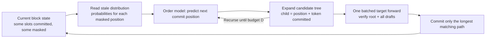

[Paper](https://arxiv.org/abs/2610.22543)
## Diffusion language models must decide 'what' and 'where' at the same time

Diffusion language models generate sentences by repeatedly filling masked tokens. To decode exactly, each model forward must commit only the single most certain masked position as a token, which is slow; committing multiple positions at once to increase speed degrades generation quality. This paper moves speculative decoding, a lossless acceleration technique validated on autoregressive models, to diffusion language models, but finds the solution by predicting not tokens but **the order of which position to fill next**.

The authors first show one observation experimentally. Looking only at the probability distribution left by the target model in the previous forward, the token that belongs at each position can mostly be predicted in advance (92% for the first block commit and over 90% thereafter), but which position will be filled next is rarely predicted. So they reuse tokens from the old distribution as-is, and a small 0.62M-parameter model (SPOT) predicts only the commit order to build a tree of candidate states. The target verifies that tree with a single batched forward. On SDAR-8B, this reduces target forwards by up to 6.8× and raises throughput up to 3.4× versus standard decoding (§1, §5.2).

## Background: decoding that fills a block one slot at a time

The target of this paper is a block-causal diffusion language model. An active block has positions of length $L$ (the paper mainly uses b32, i.e. $L{=}32$), and each position is either a token or a mask. A single forward returns a full-vocabulary probability distribution for every masked position. The target then selects only the position whose top probability is highest and fills it with that position's argmax token. This is called commit, and the paper counts the number of target forwards as NFE (number of function evaluations) (§3).

The issue is that attention within a block is bidirectional. The moment one position is filled, the representations and probability distributions of all remaining masked positions change. So, unlike an autoregressive model, "the next position is fixed and only its token needs to be predicted" does not hold. Speculative decoding for diffusion language models must determine both **which token to use** and **which position to use** (§1, §2).

### Illustrative example (not experimental numbers)

Let us reduce the block width to 8. Three tokens, "The", "cat", and "sat", have already been filled, and the remaining five slots are masks. Suppose the highest-probability candidates (stale argmax) for the masked positions returned by one forward are as shown below.

| Position | stale argmax candidate | Probability |
|------|-------------------|------|
| 3 | "on" | 0.90 |
| 4 | "the" | 0.70 |
| 5 | "mat" | 0.60 |
| 6 | "quietly" | 0.50 |
| 7 | "." | 0.95 |

In this forward, the target commits only the single most certain position. Position 7's "." has the highest probability at 0.95, so it fills position 7 with "." and examines the remaining four slots again in the next forward. The state retained here consists of the already committed tokens ("The cat sat …"), and what changes from forward to forward is the single filled position and the entire probability distribution over the remaining masked positions.

The key point is that two things diverge in this example. The token that will ultimately go into each position largely matches the stale argmax in this table ("on", "the", and "mat" are mostly right). But "which position to commit first" cannot be known from probability magnitude alone. The moment position 7 is filled, the distributions of the remaining slots all shift, so this table becomes the stale (old) distribution from the next moment onward.

## Observation: the tokens are already known, but the order is not

Before designing the method, the authors quantified what the drafter should predict for the gain to materialize. To do this, they use a live oracle that peeks at the target's actual future. They compare three kinds: a position oracle that reveals the true next position, a token oracle that reveals the true token, and a joint oracle that gives both (§3.1).

Original Figure 2 (live oracle, SDAR-8B b32). The left panel shows the throughput ratio versus draft-free by oracle type and budget, and the right panel shows the probability that committed tokens in the next $K$ steps fall within the stale top-$t$ candidates. On the left, read that the position oracle lies above the token oracle on every task; on the right, read that even a few candidates cover almost all future tokens.

The results are clear. Knowing the position is always more beneficial than knowing the token. Going from D8 to D20, the position oracle's NFE reduction grows from 5.4×→7.2× on GSM8K and from 5.7×→8.2× on MBPP, whereas the token oracle reaches only 3.4–6.5× at D20. A perfect drafter (joint oracle) reaches a throughput of 6.2–7.0× (§3.1, Figure 2).

The reason is already hidden in the stale distribution. The probability that the stale argmax matches the actually committed token is 92% at the first block commit and remains above 90% thereafter. But "the probability that the position the model was most confident about in the last round will be committed next" falls to 3% by block 9. The tokens are almost already known; what is truly unknown is the order. A model trained on this order predicts the next commit position with 75% accuracy, whereas reading the order from stale confidence reaches only 22% (§3.1, Appendix).

## Method: a drafter that predicts only order, and coupled-noise verification

SPOT (Speculating Positions Order Trajectory) is split into two parts: what to draft (the order model) and how to verify it (coupled noise).

### Drafter: commit-order model

The drafter is a 3-layer Transformer encoder ($d_{model}{=}128$, 8 heads, 0.62M parameters). It reads the stale top-32 probabilities (raw and log) for each masked position, summary statistics, and path features, and predicts the distribution over the next position to be committed $q_\phi(s|y)$. It uses no target hidden states, token embeddings, or text at all (§4.2).

It does not predict tokens. Candidate tokens for each position come from the stale distribution. At $T{=}0$, it uses the stale argmax as the primary candidate, and if the stale top-1 probability is below 0.6, it adds one more second-ranked candidate (token hedge). This exception reduces cases where, even with the right order, the wrong token is rejected during verification (§4.2).

The key is the prefix-conditional approach. When the drafter predicts the next position in some virtual state, it then predicts the next position again in the new virtual state after filling that position, and repeats this recursively to grow a tree of candidate states. The criterion for expanding the tree is prefix mass, defined as child mass = parent mass × (probability that this position will be committed) × (probability that this token will be filled), and since all factors are in $[0,1]$, a child cannot have greater mass than its parent. Thanks to this monotonicity, a search that selects the top-$D$ highest-mass candidates level by level (DDTree) produces the same result as sequential best-first search (§4.2, Appendix).

Original Figure 1 (SPOT overview). (a) The target commits the single most certain position per forward, but the tokens are largely known in advance and only the order is unknown. (b) SPOT reads the stale distribution, predicts the next position with the 0.62M order model, grows a state tree by prefix mass (edge thickness), verifies all of it with a single batched forward, and commits three positions.

Verification uses state equality. Each draft state is appended as a block copy after the cached prefix, and forwarding $(1{+}D)L$ positions at once yields the target's next commit for the root and every draft state in one pass. A draft is accepted only when its next commit matches the commit the target actually produces at that parent. Since the target's next commit is unique, what is accepted is always a single path. Therefore, **the output never changes no matter how wrong the drafts are** — the drafter determines only speed and does not affect correctness (§4.1, §4.2).

### Verification: coupled noise that preserves correctness even under sampling

At $T{=}0$, commits are deterministic, so state-equality verification holds as is (Proposition 1). The problem is sampling at $T{>}0$. Drawing samples independently from the same distribution can produce different tokens, so even a correct draft is rejected because its state differs.

SPOT's solution is for the drafter and the target to share the same Gumbel random numbers. Drawing a token at temperature $T$ is mathematically equivalent to drawing a Gumbel random number $G_{a,v}$ for each position-token pair and choosing $\argmax_v[(1/T)\log p + G_{a,v}]$ (the Gumbel-argmax identity). If both sides share the same table of random numbers on an absolute-position basis, then once the random numbers are fixed, the target's draw becomes deterministic. Sampling verification then reduces once again to state equality. It is exact conditional on the random numbers $G$, and integrating over $G$ recovers the original sampling distribution exactly (Proposition 2, §4.3).

This coupled verification matters more as temperature rises. At $T{\le}1$, the drawn token is the argmax 99–99.8% of the time, so the difference between the two methods is within 2%, but at $T{=}2$, independent-sample verification accepts almost nothing (257.5 NFE versus 267.1 draft-free), whereas coupled verification keeps drafting (187.2 NFE). The acceptance probability of coupled verification is lower-bounded by the total variation distance $\delta$ between the stale and fresh distributions: at least $(1-\delta)/(1+\delta)$ (§3.2, §4.3).

## SPOT-Sets: on decoding that commits several slots at once

So far, this has been exact decoding that commits one position per forward. But faster decoders commit all positions whose probability exceeds a threshold $\tau$ in a single forward (dynamic-threshold decoding). In that case, the unit of drafting becomes a commit set rather than a single position, and the drafter must also determine the tokens. That is because the stale argmax is 83% correct one step ahead but only 44% correct three steps ahead (§4.4).

SPOT-Sets uses a 5.1M-parameter drafter for this. It additionally reads embeddings of the stale top-16 candidate tokens and the target's last hidden state, and predicts whether each position will exceed $\tau$ at the next step and which candidate token to choose. A node in the tree is not a single position but an entire target step (§4.4).

A small example (illustrative example): in threshold decoding, one forward commits several positions at once, such as {3,4,6}. SPOT-Sets drafts this entire set, and a draft that fills the whole block continues proposing into the next block.

Original Figure 3 (max-commit). (a) The threshold decoder commits the positions $S_\tau$ that exceed $\tau$. (b) Exact acceptance accepts only when the draft step equals $S_\tau$, subset/cut accept a subset of it, and product accepts any step whose geometric mean confidence is at least $\tau$. (c) Max-commit follows the path with the most commits: 7 commits under exact and 9 under product, and product's output differs from the threshold decoder's own output.

Here the trade-off between correctness and speed appears again. Exact acceptance keeps the output identical to the threshold decoder, but the authors' main results use the looser product rule. Product accepts up to the step where the geometric mean confidence is at least $\tau$, committing more per forward, but it no longer reproduces the threshold decoder's output. The paper therefore also reports an exact variant. To reduce the cost incurred every few forwards at block boundaries, it adds two block-boundary optimizations: cross-block drafting and draft refresh (§4.4, Appendix).

## Results: read forward count and throughput separately

When looking at the results, do not conflate the two metrics. NFE is the number of target forwards (the drafter's own cost is excluded), and the throughput ratio is based on generated tokens per second relative to a draft-free run on the same GPU, same task, and same temperature. One draft round forwards $(1{+}D)L$ positions regardless of acceptance, so **the NFE reduction and the throughput gain are not always the same** — a recurring point in this paper (§3.1, Appendix).

The key question is this. With the same draft budget, does SPOT use fewer forwards and also achieve higher throughput than the baselines? Below are NFE (lower is better) and throughput ratio (higher is better) for SDAR-8B b32, $T{=}0$, budget D8 (§5.2, main results table).

| Method (SDAR-8B, T=0, D8) | GSM8K | MBPP | HumanEval | MATH500 |
|---|---|---|---|---|
| draft-free (baseline) | 270.8 (1.00×) | 269.2 (1.00×) | 271.4 (1.00×) | 271.8 (1.00×) |
| Spiffy graph | 92.5 (2.48×) | 83.6 (2.40×) | 87.6 (2.64×) | 100.6 (2.29×) |
| **SPOT** | **70.1 (2.95×)** | **56.7 (3.38×)** | **62.5 (3.35×)** | **84.6 (2.50×)** |

SPOT uses 16–36% fewer forwards than Spiffy across all tasks and budgets and has 1.04–1.41× higher throughput. Notably, the baselines' throughput collapses as the budget grows. Going from D8 to D20, the SSD chain falls from 2.3–2.6× to 1.4–1.7× and the BlockSpec tree falls from 1.5–1.7× to 0.86–1.10×, becoming slower than draft-free on MBPP. This is because wide drafts consume $(1{+}D)L$ positions regardless of acceptance, yet accept only 1.1–2.9 tokens per round. SPOT accepts 2.5–7.5 tokens per round (§5.2).

Here SPOT-$\gamma$, with the mass floor $\gamma$ enabled, almost eliminates budget dependence. It discards drafts whose mass is below $\gamma$, matching the actual verification budget to drafter confidence, and the throughput ratio stays nearly flat, from 2.5–3.5× at D8 to 2.3–3.4× at D20. The same ordering holds under $T{=}1$ sampling (16–35% lower NFE and 1.08–1.37× throughput versus Spiffy), and the T=1 results are distribution-preserving, with correctness within 0.04 of draft-free (§5.2, §5.3).

### 7.9× on threshold decoding

Stacking SPOT-Sets on faster threshold decoding (which by itself is already 3.3–6.1× versus standard, 5.0× on average) raises SDAR-8B to 5.2–9.9×, 7.9× on average. Relative to the threshold decoder, it cuts forwards by 47–48%. The exact variant that preserves correctness also reaches 7.6× (§5.2).

Original Figure 4 (ladder). Throughput versus standard decoding, averaged over four tasks, as each part of SPOT-Sets is enabled in turn (labels show the gain at each step). The set drafter and tree alone reach 6.7×; the mass floor raises it from 6.7→6.9×; the block-boundary optimizations cross-block drafting and draft refresh add the largest gain, from 6.9→7.5×; and product max-commit finishes at 7.9× (§5.5, Figure 4).

Transferability is also central to the claim. Even when a drafter trained with the same recipe is attached to another model without retraining or recalibration, moving the SDAR-8B checkpoint to LLaDA2.0-mini (an MoE model with a different tokenizer) loses only 3–11% NFE and still beats all baselines on GSM8K and MATH500. On LLaDA-8B and Dream-7B, which it has never seen, it reduces 256 forwards to 55–88 and 51–80, respectively. However, these two apply attention over the entire sequence and lack an exact prefix cache, so they use an approximate cache; these rows therefore show "reach" rather than losslessness (§5.4, Appendix).

## Limitations and deployment judgment

The authors explicitly acknowledge several limitations (§6).

1. **The gain shrinks when verification is expensive or the acceptance rate is low.** With a wide block, verification becomes the bottleneck, and the problem of packing the tree into exactly one sequence under bidirectional attention remains unsolved.
2. **The gain narrows on tasks with low acceptance rates.** On the smallest model, SDAR-1.7B, Spiffy takes one throughput win from SPOT on MATH500 D20. This is because forwards are so cheap that the cost of draft verification becomes a larger share. SPOT-γ discards low-mass drafts to reduce verification volume, taking that win back (Appendix).
3. **At high temperature, an order model trained at $T{=}0$ is overtaken by noise-aware ranking.** This is true at $T{\ge}2$, and in fact from $T{\ge}1.5$ the target's own quality collapses (correctness 0.11, 0.00 at $T{\ge}2$), leaving little correctness to preserve.
4. **SPOT-Sets requires brief calibration per model.** Because it reads hidden states and token embeddings, unlike SPOT it must re-fit the input layer for each new target. The 5.1M-parameter drafter becomes a greater burden on models where target forwards are cheap.
5. **The main results' max-commit (product rule) changes the output.** To preserve correctness, one must use the exact variant, which somewhat reduces the speed gain.

From a reviewer's perspective, the points to note are as follows. The 6.8× NFE reduction shown in the paper is on a "forward count" basis, while actual throughput is 2.5–3.4× (SPOT) or 7.9× on threshold decoding; the two numbers must not be confused. Also, the SDAR-8B drafter is trained only on code data (CodeAlpaca), yet it works well even though GSM8K and MATH500 are out of domain, which supports the generality of order knowledge; conversely, the SPOT-Sets drafter trained on a distribution like the evaluation tasks is faster on SDAR-8B, at 8.2× on average (7.9× versus a general chat drafter), so the distribution of the deployment environment affects the results (§5.2, Appendix). The LLaDA-8B and Dream-7B results use an approximate cache and thus do not guarantee losslessness; this must also be distinguished from the lossless results.

In summary, SPOT fits best when lossless acceleration is needed on block-causal diffusion models that have an exact prefix KV cache and do not have excessively wide blocks. Coupled-noise verification preserves the distribution at any temperature (Proposition 2), and in the typical generation setting of $T{\le}1$ its results are within 2% of independent-sample verification, making it the safest deployment configuration. On fast paths that already accept some loss, such as threshold decoding, SPOT-Sets' product rule provides additional gain; according to the paper, the correctness difference versus exact is within 0.04 per task, but the output itself changes (example rule: exact leaves correctness unchanged, while cut only makes the decoder stricter), so quality must be verified separately when deploying.

<!-- verbatim-tables -->

Tables from the paper

> Tables converted mechanically from the arXiv e-print LaTeX source. The numbers are the paper's own and did not pass through a model.

**Table 1. Mass-floor calibration grids: mean throughput ratio over $D8/D12/D20$ on the $50$ held-out MBPP samples (test $350$--$399$), unpadded, seed $0$, against the same card's draft-free run. Bold: selected.**

| target | $\gamma{=}0$ | $0.02$ | $0.05$ | $0.1$ | $0.2$ |
|---|---|---|---|---|---|
| SDAR-8B b32 | 3.64 | **4.10** | 4.08 | 3.92 | 3.72 |
| SDAR-4B b32 | 4.04 | **4.47** | 4.35 | 4.24 | 4.02 |
| SDAR-1.7B b32 | 4.04 | **4.43** | 4.33 | 4.21 | 3.92 |
| LLaDA2.0-mini b32 | **2.25** | 2.28 | 2.18 | 2.09 | 1.88 |

**Table 2. MRP's reported speedups next to SPOT. MRP: speculative mode ($K{=}3$) over its one-token-per-step baseline, Table 2 of (one H100, block width $16$, greedy). SPOT: $D8$ throughput ratio over our draft-free control (block width $32$, length $256$, one card, seed $0$), NFE reduction in parentheses. MRP generates up to $4096$ tokens. Different implementations: relative gains only.**

| target | method | GSM8K | MATH500 | HumanEval | MBPP |
|---|---|---|---|---|---|
| SDAR-1.7B | MRP (reported) | $1.25\times$ | $1.23\times$ | $1.23\times$ | $1.17\times$ |
|  | SPOT (ours) | $\mathbf{2.81\times}$ (3.6) | $\mathbf{2.48\times}$ (3.2) | $\mathbf{3.23\times}$ (4.2) | $\mathbf{3.74\times}$ (4.9) |
| SDAR-4B | MRP (reported) | $1.36\times$ | $1.26\times$ | $1.35\times$ | $1.27\times$ |
|  | SPOT (ours) | $\mathbf{3.27\times}$ (4.0) | $\mathbf{2.61\times}$ (3.3) | $\mathbf{3.49\times}$ (4.4) | $\mathbf{3.79\times}$ (4.9) |
| SDAR-8B | MRP (reported) | $1.40\times$ | $1.39\times$ | $1.34\times$ | $1.34\times$ |
|  | SPOT (ours) | $\mathbf{3.00\times}$ (3.9) | $\mathbf{2.47\times}$ (3.2) | $\mathbf{3.44\times}$ (4.3) | $\mathbf{3.65\times}$ (4.7) |

**Table 3. Speculative decoding for diffusion targets, on the axes this paper argues are the relevant ones. ``Learns order'' = the commit order is predicted by a trained model rather than read off stale confidence or fixed offline; ``multi-step'' = one drafted proposal spans more than one commit; ``exact $T{>}0$'' = the committed distribution is provably the target's at sampling temperature.**

| method | drafter | size | learns order | multi-step | exact $T{>}0$ | single device |
|---|---|---|---|---|---|---|
| Spiffy | offline graph | --- | ✗ | ✓ | ✗ | ✓ |
| SSD | self (confidence) | --- | ✗ | ✓ | ✗ | ✓ |
| BlockSpec | self (conf.\ tree) | --- | ✗ | ✓ | ✗ | ✓ |
| SimSD | sibling model | 1.7B | ✓ | ✓ | approx.\ | ✗ |
| MRP | residual head | 3 layers | ✗ | ✓ | ✗ | ✓ |
| **SPOT (ours)** | order model | 0.62M | ✓ | ✓ | ✓ | ✓ |

**Table 4. Live-oracle grid, $T{=}0$, generation length 256, $n{=}100$, seed 0. Per setting: NFE (reduction $\times$ over the setting's draft-free NFE) and tok/s ratio (lookahead subtracted) over the setting's draft-free throughput, for the position, token and joint oracles at $D8$/$D12$/$D20$; the draft-free column gives the baseline NFE and tok/s. Bold: best throughput per setting.**

| setting | metric | draft-free | position oracle $D8$ | position oracle $D12$ | position oracle $D20$ | token oracle $D8$ | token oracle $D12$ | token oracle $D20$ | joint oracle $D8$ | joint oracle $D12$ | joint oracle $D20$ |
|---|---|---|---|---|---|---|---|---|---|---|---|
| SDAR-8B b32 GSM8K | NFE | 271.1 | 49.8 (5.4$\times$) | 42.5 (6.4$\times$) | 37.5 (7.2$\times$) | 68.3 (4.0$\times$) | 65.0 (4.2$\times$) | 61.6 (4.4$\times$) | 46.3 (5.8$\times$) | 37.9 (7.2$\times$) | 30.4 (8.9$\times$) |
|  | tok/s ratio | 16.3 tok/s | 4.62$\times$ | 5.37$\times$ | 5.51$\times$ | 3.34$\times$ | 3.42$\times$ | 3.32$\times$ | 5.00$\times$ | 5.93$\times$ | **6.78$\times$** |
| SDAR-8B b32 MBPP | NFE | 267.1 | 46.8 (5.7$\times$) | 39.7 (6.7$\times$) | 32.8 (8.2$\times$) | 53.5 (5.0$\times$) | 47.3 (5.6$\times$) | 41.0 (6.5$\times$) | 43.5 (6.1$\times$) | 35.3 (7.6$\times$) | 27.4 (9.7$\times$) |
|  | tok/s ratio | 16.3 tok/s | 4.91$\times$ | 5.43$\times$ | 5.58$\times$ | 4.23$\times$ | 4.49$\times$ | 4.35$\times$ | 5.20$\times$ | 6.06$\times$ | **6.57$\times$** |
| SDAR-8B b32 HumanEval | NFE | 272.6 | 47.1 (5.8$\times$) | 39.7 (6.9$\times$) | 32.9 (8.3$\times$) | 61.9 (4.4$\times$) | 57.4 (4.7$\times$) | 52.8 (5.2$\times$) | 45.7 (6.0$\times$) | 37.7 (7.2$\times$) | 29.9 (9.1$\times$) |
|  | tok/s ratio | 15.9 tok/s | 4.94$\times$ | 5.85$\times$ | 6.40$\times$ | 3.85$\times$ | 4.04$\times$ | 3.98$\times$ | 5.22$\times$ | 6.15$\times$ | **7.04$\times$** |
| SDAR-8B b32 MATH500 | NFE | 272.9 | 53.5 (5.1$\times$) | 47.7 (5.7$\times$) | 44.5 (6.1$\times$) | 81.9 (3.3$\times$) | 81.9 (3.3$\times$) | 81.0 (3.4$\times$) | 48.0 (5.7$\times$) | 39.8 (6.9$\times$) | 32.6 (8.4$\times$) |
|  | tok/s ratio | 16.2 tok/s | 4.33$\times$ | 4.74$\times$ | 4.65$\times$ | 2.84$\times$ | 2.77$\times$ | 2.50$\times$ | 4.69$\times$ | 5.75$\times$ | **6.21$\times$** |
| LLaDA2.0-mini b32 MBPP | NFE | 270.4 | 59.4 (4.6$\times$) | 53.7 (5.0$\times$) | 51.9 (5.2$\times$) | 90.1 (3.0$\times$) | 89.8 (3.0$\times$) | 88.8 (3.0$\times$) | 54.1 (5.0$\times$) | 46.7 (5.8$\times$) | 42.3 (6.4$\times$) |
|  | tok/s ratio | 6.6 tok/s | 3.23$\times$ | 3.45$\times$ | 3.39$\times$ | 2.25$\times$ | 2.21$\times$ | 1.98$\times$ | 3.66$\times$ | 3.96$\times$ | **4.40$\times$** |

**Table 5. Main results, SDAR-4B b32, $T{=}0$ (format as Table ). SPOT has the lowest NFE and the highest throughput ratio in every ours-vs-baseline comparison. Seed $0$. Lower block: the threshold decoder ($\tau{=}0.9$), second machine, main_sdar4b, SPOT-Sets rows and ratios as in Table .**

| NFE$\downarrow$ (tok/s$\uparrow$) | GSM8K |  | MBPP |  | HumanEval |  | MATH500 |  |
|---|---|---|---|---|---|---|---|---|
|  | acc.\ 0.85--0.87 |  | acc.\ 0.24--0.27 |  | acc.\ 0.59--0.63 |  | acc.\ 0.13--0.14 |  |
| method | $D8$ | $D20$ | $D8$ | $D20$ | $D8$ | $D20$ | $D8$ | $D20$ |
| no draft ($D0$) | 270.8$\downarrow$ (1.00$\uparrow$) |  | 269.2$\downarrow$ (1.00$\uparrow$) |  | 271.4$\downarrow$ (1.00$\uparrow$) |  | 271.8$\downarrow$ (1.00$\uparrow$) |  |
| **SPOT (ours)** | **68.5** (3.27) | **51.1** (3.69) | **54.6** (3.79) | **37.8** (3.74) | **61.1** (3.49) | **45.0** (3.93) | **82.3** (2.61) | **64.6** (2.87) |
| SPOT-$\gamma$ (ours) | 68.5 (**3.29**) | 53.2 (**3.96**) | 54.8 (**3.92**) | 39.7 (**4.69**) | 61.3 (**3.54**) | 46.6 (**4.33**) | 82.6 (**2.63**) | 68.2 (**3.08**) |
| Spiffy graph | 91.2 (2.67) | 71.0 (3.24) | 82.4 (2.83) | 59.7 (3.14) | 88.9 (2.70) | 66.8 (3.44) | 97.7 (2.39) | 80.5 (2.79) |
| SSD free chain | 91.5 (2.67) | 83.7 (2.68) | 83.3 (2.82) | 74.5 (2.26) | 89.5 (2.74) | 78.6 (2.74) | 98.5 (2.38) | 91.5 (2.33) |
| BlockSpec tree | 136.3 (1.74) | 114.3 (1.80) | 135.1 (1.70) | 111.0 (1.35) | 135.9 (1.71) | 113.3 (1.75) | 136.1 (1.68) | 115.5 (1.75) |
| 0.6pt2.5pt0pt *threshold decoding, $\tau{=}0.9$ (second machine, $n{=}350$, HumanEval $164$)* |  |  |  |  |  |  |  |  |
| $T{=}0$ | acc.\ 0.84--0.86 |  | acc.\ 0.24--0.27 |  | acc.\ 0.58--0.61 |  | acc.\ 0.13--0.15 |  |
| no draft | 59.0$\downarrow$ (4.55$\uparrow$) |  | 40.6$\downarrow$ (6.43$\uparrow$) |  | 38.4$\downarrow$ (6.91$\uparrow$) |  | 85.4$\downarrow$ (3.14$\uparrow$) |  |
| **SPOT-Sets-$\gamma$ (ours)** | **30.9** (**7.34**) | **30.6** (**7.38**) | **22.0** (**10.22**) | **21.5** (**10.40**) | **21.8** (**10.42**) | **21.7** (**10.42**) | **45.0** (**5.04**) | **44.9** (**5.07**) |
| SPOT-Sets-$\gamma$, exact (ours) | 33.2 (6.85) | 33.0 (6.83) | 22.7 (9.90) | 22.3 (10.00) | 23.4 (9.73) | 23.2 (9.66) | 48.0 (4.75) | 47.4 (4.77) |
| Spiffy graph | 37.8 (6.27) | 37.7 (6.23) | 25.1 (9.48) | 24.8 (8.91) | 28.0 (8.59) | 28.0 (8.51) | 54.4 (4.34) | 53.8 (4.33) |
| SSD free chain | 37.9 (6.26) | 37.1 (5.01) | 24.8 (9.46) | 23.9 (6.43) | 28.1 (8.56) | 27.6 (6.77) | 54.2 (4.36) | 52.9 (3.44) |
| BlockSpec tree | 41.1 (5.62) | 38.4 (4.64) | 27.7 (8.33) | 25.4 (5.82) | 29.6 (7.93) | 28.3 (6.40) | 58.9 (3.92) | 55.3 (3.04) |

**Table 6. SDAR-4B b32 at $T{=}1$ (coupled-noise match; free chain also under rejection sampling). Every comparison won on both columns. Seed $0$. Both blocks from the second machine, each ratio over that machine's draft-free run. Lower block: the threshold decoder ($\tau{=}0.9$), main_sdar4b_t1, SPOT-Sets rows and ratios as in Table .**

| NFE$\downarrow$ (tok/s$\uparrow$) | GSM8K |  | MBPP |  | HumanEval |  | MATH500 |  |
|---|---|---|---|---|---|---|---|---|
|  | acc.\ 0.85--0.88 |  | acc.\ 0.19--0.23 |  | acc.\ 0.55--0.63 |  | acc.\ 0.13--0.17 |  |
| method | $D8$ | $D20$ | $D8$ | $D20$ | $D8$ | $D20$ | $D8$ | $D20$ |
| no draft ($D0$) | 270.8$\downarrow$ (1.00$\uparrow$) |  | 269.2$\downarrow$ (1.00$\uparrow$) |  | 271.4$\downarrow$ (1.00$\uparrow$) |  | 271.8$\downarrow$ (1.00$\uparrow$) |  |
| **SPOT (ours)** | **70.9** (2.94) | **53.4** (2.77) | **57.2** (3.64) | **40.4** (2.79) | **62.9** (3.32) | **46.8** (3.05) | **85.6** (2.48) | **67.8** (2.19) |
| SPOT-$\gamma$ (ours) | 71.3 (**3.02**) | 55.9 (**3.36**) | 57.8 (**3.73**) | 42.9 (**3.98**) | 63.4 (**3.39**) | 48.7 (**3.72**) | 86.5 (**2.49**) | 72.0 (**2.63**) |
| Spiffy graph | 94.3 (2.47) | 74.4 (2.53) | 84.9 (2.80) | 63.3 (2.23) | 90.2 (2.61) | 68.6 (2.63) | 102.4 (2.29) | 86.0 (2.15) |
| free chain, match | 94.6 (2.45) | 86.5 (1.99) | 85.8 (2.73) | 77.3 (1.64) | 90.7 (2.56) | 79.9 (2.04) | 103.3 (2.23) | 96.4 (1.74) |
| free chain, RS | 88.5 (1.95) | 83.4 (1.66) | 61.2 (2.97) | 50.7 (2.37) | 76.7 (2.24) | 69.7 (1.94) | 110.3 (1.55) | 110.2 (1.29) |
| BlockSpec tree | 138.9 (1.63) | 117.7 (1.37) | 137.9 (1.66) | 114.2 (1.00) | 137.7 (1.65) | 115.8 (1.32) | 140.8 (1.62) | 121.1 (1.27) |
| 0.6pt2.5pt0pt *threshold decoding, $\tau{=}0.9$ (second machine, $n{=}350$, HumanEval $164$)* |  |  |  |  |  |  |  |  |
| $T{=}1$ | acc.\ 0.81--0.85 |  | acc.\ 0.19--0.21 |  | acc.\ 0.57--0.60 |  | acc.\ 0.15--0.17 |  |
| no draft | 59.9$\downarrow$ (4.41$\uparrow$) |  | 41.2$\downarrow$ (6.46$\uparrow$) |  | 41.9$\downarrow$ (6.35$\uparrow$) |  | 86.8$\downarrow$ (3.11$\uparrow$) |  |
| **SPOT-Sets-$\gamma$ (ours)** | **34.3** (**6.44**) | **33.8** (**6.50**) | **25.8** (8.53) | **25.9** (8.46) | **25.7** (**8.64**) | **25.5** (**8.50**) | **49.8** (**4.45**) | **49.1** (**4.46**) |
| SPOT-Sets-$\gamma$, exact (ours) | 36.4 (6.27) | 35.9 (6.30) | 26.4 (**8.57**) | 26.2 (**8.56**) | 26.7 (8.39) | 26.6 (8.37) | 52.5 (4.30) | 51.6 (4.34) |
| Spiffy graph | 41.5 (5.66) | 41.4 (5.58) | 28.1 (8.36) | 28.3 (7.79) | 31.6 (7.43) | 31.8 (7.33) | 60.2 (3.90) | 59.4 (3.91) |
| SSD free chain | 41.1 (5.72) | 40.6 (4.65) | 27.8 (8.48) | 27.6 (5.45) | 31.3 (7.53) | 31.3 (5.93) | 60.1 (3.91) | 59.4 (2.96) |
| BlockSpec tree | 43.5 (5.30) | 41.3 (4.27) | 30.2 (7.62) | 28.6 (5.02) | 33.0 (7.08) | 31.7 (5.65) | 63.2 (3.62) | 60.3 (2.80) |

**Table 7. Main results, SDAR-1.7B b32, $T{=}0$ (format as Table ). SPOT has the lowest NFE in every ours-vs-baseline comparison and the higher throughput ratio in $23$ of $24$ (Spiffy takes MATH500 at $D20$); SPOT-$\gamma$ wins all $24$ on both columns. Seed $0$. Lower block: the threshold decoder ($\tau{=}0.9$), second machine, main_sdar17, SPOT-Sets rows and ratios as in Table .**

| NFE$\downarrow$ (tok/s$\uparrow$) | GSM8K |  | MBPP |  | HumanEval |  | MATH500 |  |
|---|---|---|---|---|---|---|---|---|
|  | acc.\ 0.69--0.71 |  | acc.\ 0.29--0.30 |  | acc.\ 0.45--0.47 |  | acc.\ 0.09--0.11 |  |
| method | $D8$ | $D20$ | $D8$ | $D20$ | $D8$ | $D20$ | $D8$ | $D20$ |
| no draft ($D0$) | 270.8$\downarrow$ (1.00$\uparrow$) |  | 269.2$\downarrow$ (1.00$\uparrow$) |  | 271.4$\downarrow$ (1.00$\uparrow$) |  | 271.8$\downarrow$ (1.00$\uparrow$) |  |
| **SPOT (ours)** | **75.6** (2.81) | **58.8** (3.01) | **55.4** (3.74) | **38.8** (4.28) | 64.6 (3.23) | **46.4** (3.69) | **85.2** (2.48) | **67.7** (2.67) |
| SPOT-$\gamma$ (ours) | 75.7 (**2.85**) | 62.2 (**3.30**) | 55.7 (**3.83**) | 40.4 (**5.02**) | **64.5** (**3.30**) | 48.1 (**4.09**) | 85.6 (**2.55**) | 71.6 (**2.85**) |
| Spiffy graph | 94.8 (2.49) | 76.6 (2.99) | 85.3 (2.79) | 64.4 (3.55) | 89.9 (2.64) | 69.3 (3.27) | 99.4 (2.39) | 82.8 (2.75) |
| SSD free chain | 94.8 (2.47) | 88.1 (2.54) | 91.4 (2.54) | 76.5 (3.00) | 89.4 (2.66) | 81.8 (2.78) | 99.3 (2.43) | 92.7 (2.46) |
| BlockSpec tree | 136.5 (1.68) | 115.7 (1.72) | 135.1 (1.71) | 111.5 (1.81) | 135.2 (1.70) | 112.7 (1.83) | 136.0 (1.68) | 115.8 (1.75) |
| 0.6pt2.5pt0pt *threshold decoding, $\tau{=}0.9$ (second machine, $n{=}350$, HumanEval $164$)* |  |  |  |  |  |  |  |  |
| $T{=}0$ | acc.\ 0.67--0.69 |  | acc.\ 0.28--0.30 |  | acc.\ 0.42--0.45 |  | acc.\ 0.09--0.10 |  |
| no draft | 86.4$\downarrow$ (3.13$\uparrow$) |  | 40.7$\downarrow$ (6.46$\uparrow$) |  | 48.5$\downarrow$ (5.50$\uparrow$) |  | 95.7$\downarrow$ (2.83$\uparrow$) |  |
| **SPOT-Sets-$\gamma$ (ours)** | **43.4** (**5.04**) | **42.6** (**5.08**) | **22.5** (**9.90**) | **22.2** (**9.91**) | **26.7** (**8.36**) | **26.2** (**8.47**) | **51.6** (**4.23**) | **51.3** (**4.26**) |
| SPOT-Sets-$\gamma$, exact (ours) | 46.2 (4.74) | 45.5 (4.73) | 23.3 (9.63) | 22.9 (9.65) | 27.9 (8.02) | 27.5 (8.09) | 55.2 (4.05) | 54.5 (4.06) |
| Spiffy graph | 53.8 (4.36) | 52.7 (4.37) | 26.3 (8.98) | 25.7 (9.02) | 33.7 (7.10) | 33.0 (7.05) | 62.8 (3.73) | 61.5 (3.75) |
| SSD free chain | 53.1 (4.39) | 51.9 (4.22) | 25.7 (9.18) | 25.2 (8.92) | 33.3 (7.17) | 32.6 (6.98) | 62.4 (3.73) | 60.6 (3.64) |
| BlockSpec tree | 58.3 (3.92) | 54.3 (3.73) | 28.3 (8.10) | 26.5 (7.88) | 35.7 (6.51) | 33.4 (6.26) | 67.6 (3.38) | 63.1 (3.23) |

**Table 8. SDAR-1.7B b32 at $T{=}1$ (coupled-noise match; free chain also under rejection sampling). Lowest NFE in every comparison and the higher throughput ratio in all but one of $32$ (Spiffy takes MATH500 at $D20$); SPOT-$\gamma$ wins every comparison on both columns. Seed $0$. Lower block: the threshold decoder ($\tau{=}0.9$), second machine, main_sdar17_t1, SPOT-Sets rows and ratios as in Table .**

| NFE$\downarrow$ (tok/s$\uparrow$) | GSM8K |  | MBPP |  | HumanEval |  | MATH500 |  |
|---|---|---|---|---|---|---|---|---|
|  | acc.\ 0.69--0.74 |  | acc.\ 0.21--0.29 |  | acc.\ 0.37--0.45 |  | acc.\ 0.09--0.12 |  |
| method | $D8$ | $D20$ | $D8$ | $D20$ | $D8$ | $D20$ | $D8$ | $D20$ |
| no draft ($D0$) | 270.8$\downarrow$ (1.00$\uparrow$) |  | 269.2$\downarrow$ (1.00$\uparrow$) |  | 271.4$\downarrow$ (1.00$\uparrow$) |  | 271.8$\downarrow$ (1.00$\uparrow$) |  |
| **SPOT (ours)** | **79.0** (**2.67**) | **62.3** (2.86) | **58.0** (3.52) | **40.9** (3.99) | **66.7** (3.14) | **48.5** (3.49) | **88.9** (2.39) | **71.7** (2.48) |
| SPOT-$\gamma$ (ours) | 79.9 (2.67) | 66.6 (**3.04**) | 58.7 (**3.54**) | 43.7 (**4.54**) | 67.5 (**3.15**) | 51.5 (**3.85**) | 89.8 (**2.40**) | 76.3 (**2.78**) |
| Spiffy graph | 99.5 (2.37) | 82.7 (2.73) | 87.7 (2.68) | 67.3 (3.33) | 93.0 (2.54) | 72.4 (3.15) | 105.5 (2.28) | 90.1 (2.57) |
| free chain, match | 98.9 (2.36) | 92.8 (2.44) | 93.6 (2.47) | 78.7 (2.79) | 92.9 (2.50) | 84.6 (2.62) | 104.8 (2.31) | 99.0 (2.29) |
| free chain, RS | 99.4 (1.62) | 97.0 (1.47) | 71.5 (2.29) | 67.4 (2.13) | 87.6 (1.87) | 81.7 (1.74) | 115.7 (1.43) | 115.5 (1.26) |
| BlockSpec tree | 141.5 (1.60) | 121.3 (1.67) | 137.4 (1.62) | 114.2 (1.72) | 138.5 (1.66) | 116.3 (1.74) | 141.7 (1.63) | 122.3 (1.70) |
| 0.6pt2.5pt0pt *threshold decoding, $\tau{=}0.9$ (second machine, $n{=}350$, HumanEval $164$)* |  |  |  |  |  |  |  |  |
| $T{=}1$ | acc.\ 0.69--0.72 |  | acc.\ 0.21--0.23 |  | acc.\ 0.35--0.37 |  | acc.\ 0.10--0.12 |  |
| no draft | 88.4$\downarrow$ (3.01$\uparrow$) |  | 42.7$\downarrow$ (6.24$\uparrow$) |  | 52.5$\downarrow$ (5.11$\uparrow$) |  | 97.4$\downarrow$ (2.74$\uparrow$) |  |
| **SPOT-Sets-$\gamma$ (ours)** | **48.3** (**4.32**) | **47.7** (**4.36**) | **26.8** (8.09) | **26.4** (8.00) | **30.1** (**7.20**) | **30.0** (**7.16**) | **56.8** (**3.74**) | **55.9** (**3.77**) |
| SPOT-Sets-$\gamma$, exact (ours) | 51.0 (4.24) | 50.2 (4.25) | 27.4 (**8.10**) | 27.2 (**8.10**) | 31.8 (6.97) | 31.8 (6.92) | 59.8 (3.68) | 58.8 (3.74) |
| Spiffy graph | 59.5 (3.86) | 58.9 (3.86) | 29.6 (8.00) | 29.1 (7.95) | 38.3 (6.24) | 38.0 (6.17) | 70.0 (3.34) | 68.8 (3.31) |
| SSD free chain | 58.7 (3.91) | 58.1 (3.72) | 29.1 (8.06) | 28.7 (7.81) | 37.9 (6.27) | 37.5 (6.06) | 69.6 (3.33) | 68.7 (3.14) |
| BlockSpec tree | 63.0 (3.53) | 59.9 (3.29) | 31.4 (7.29) | 29.7 (6.91) | 39.9 (5.77) | 38.2 (5.51) | 72.7 (3.09) | 69.8 (2.84) |

> Figures in this post are taken from the original arXiv:2610.22543 (CC BY 4.0). Only size and format were changed.
