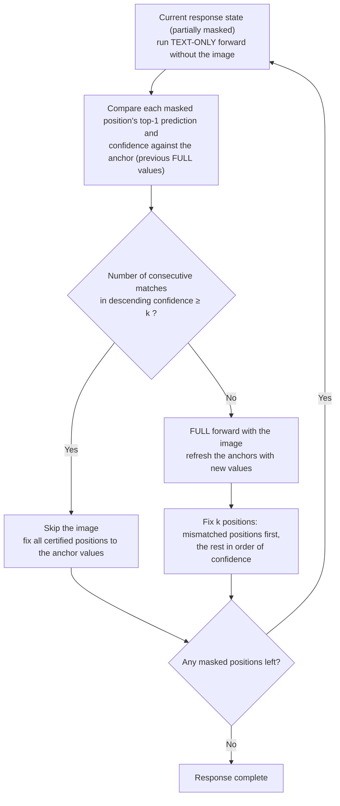

[Paper](https://arxiv.org/abs/2610.36671)
## The problem: re-reading the image at every step

Diffusion language models that answer questions from images do not complete a response in one pass. While filling in the blanks over many steps, they re-read an image that barely changes from the beginning at every step. LOWN asks "does this step really need the image?" every time, and re-reads only when necessary, cutting decoding cost substantially.

Instead of drawing one token at a time from the left like autoregressive models, diffusion language models start with the entire response masked. At each step they examine all remaining blanks and simultaneously resolve the $k$ masks with the highest confidence. This is called "unmask," and $k$ is the response length divided by the number of steps (source: §3.1). In image-input diffusion language models (DVLM, e.g., LLaDA-V), image tokens are fixed in the input sequence rather than the response and enter along with it. An "image token" is a numeric fragment that makes the picture processable by the model.

The share of image tokens is overwhelming. Across the 10 benchmarks evaluated, image tokens account for 89–97% of the total input, and the cost of a single forward pass without the image is only about 3–10% of the original (benchmark averages 2.5–10.1%) (source: §1, Figure 1b, Table 8). Because DVLM uses bidirectional attention, it cannot reuse the key-value cache of autoregressive models as is, and passes the entire input through again at every step. As a result, most of the decoding cost goes into "re-reading an image that does not change."

## When the image is actually needed

Before designing LOWN, we numerically checked whether the image is truly needed at every step. Following the standard decoding path as is, we ran two forward passes side by side at each step. The "FULL forward" computes probabilities with an input that includes image tokens, while the "TEXT-ONLY forward" computes probabilities from the same partial response with only the image tokens removed and the position IDs kept unchanged (source: §3.2, Appendix A). Because the progress state is determined solely by the FULL forward, the decoding path itself is identical to the baseline. The TEXT-ONLY output is only recorded and not reflected in the state.

The comparison results come down to three points:

- For 83.4% of the positions to be unmasked, the two forwards predicted the same token as top-1. For 85.0% of the final tokens, the value had already been predicted as top-1 at the same position before unmasking (source: §3.2, Table 6). Cases where the image flips the decision are rare.
- The top-1 disagreement between the two forwards was largest in the early denoising steps for 8 of the 10 benchmarks, and shrank as the response took shape. There are exceptions such as DeCapBench (source: §3.2, Figure 2a).
- The fraction of steps where the image changed at least one unmask decision—the image-dependent step ratio—varies widely by benchmark.

| Benchmark | Image-dependent step ratio |
|---|---|
| MMBench | 7.9% |
| ScienceQA | 8.2% |
| MME | 10.6% |
| GQA | 10.9% |
| MathVista | 17.9% |
| ChartQA | 24.5% |
| CapArena | 32.7% |
| DeCapBench | 33.4% |
| LLaVA-Bench | 37.8% |
| DocVQA | 43.8% |

The average across the 10 is 22.8% (source: §3.2, Figure 2b, Table 6). Fixing a schedule of "read the image every n steps" cannot track this variation well. The point at which the image is needed depends on the input and the step, so it has to be judged on the fly at each step. Fortunately, the material for that judgment is already there. The TEXT-ONLY forward provides predictions at the same positions at about 3–10% of the cost of the FULL forward (source: §3.2, Table 8).

## LOWN: looking only when the image is needed

LOWN starts from "let us reuse the prediction made the last time we looked at the image." Whenever it runs a FULL forward, it separately stores the top-1 predictions and their confidence for the positions still blank. These stored values are called "anchors." An anchor is just a token value and a few confidence numbers, so LOWN itself does not keep large state like attention keys and values.

Each step first computes predictions for the remaining positions with a TEXT-ONLY forward. If these predictions match the anchors, LOWN certifies the anchor predictions as "predictions likely to remain valid without the image and after the state has changed." Because the two predictions differ in both whether the image was seen and which point in the state they were computed from, a match is used as an approximate signal that both conditions were satisfied together. No absolute confidence threshold is needed (source: §4.1).

Concretely, it lists the blank positions in descending order of anchor confidence and counts from the front the positions where "TEXT-ONLY prediction == anchor" to form a certified prefix. The scan stops at the first mismatch. If the prefix length is at least $k$, it skips the image and unmasks the entire prefix with the anchor values. If it is below $k$, it runs the FULL forward to refresh the anchors, then unmasks $k$ positions—the positions where the two predictions differ first, and the rest in order of FULL confidence (source: §4.2).

Below is an illustrative example. The token split and numbers are constructed independently of the paper's example, and $k=2$ is assumed.

Suppose that at some step the response is in the state "The cat ? ?". Positions 1 and 2 are already fixed, and positions 3 and 4 are still masked. The anchors saved by the previous FULL forward (predictions and confidence for the masked positions) and the predictions of this step's TEXT-ONLY forward are as follows.

| Position | Anchor value (last FULL) | Anchor confidence | TEXT-ONLY prediction | Verdict |
|---|---|---|---|---|
| 3 | sat | 0.92 | sat | certified ✓ |
| 4 | on | 0.81 | mat | mismatch ✗ |

Scanning in descending confidence (position 3 → 4), position 3 matches and position 4 diverges, so the certified prefix is {position 3} with length 1. Because this is less than $k=2$, the image cannot be skipped, so the FULL forward runs. The FULL forward predicts position 3→"sat" and position 4→"on", refreshes the anchors, unmasks position 4 (where the two predictions differed) first, and then unmasks position 3. Output: "The cat sat on".

Conversely, if TEXT-ONLY had matched the anchors at both positions, the prefix length 2 ≥ $k$ would hold, the FULL forward would be skipped, and the two values would be fixed as is. If the certified prefix is longer than $k$, more than $k$ positions are fixed in the same step, reducing the total number of steps as well. Both branches fix at least $k$ positions, so LOWN never uses more steps than the $T$ steps of baseline decoding (source: §4.2).

There is one caveat. Two adjacent positions predicted independently in the same step can receive the same token, and fixing them as is produces a repeated word in the response. To prevent this, the prefix is cut if the token ID equals that of an already fixed neighbor or a neighbor accepted earlier in the same scan (source: §4.1, Appendix B.1).

Cost decomposes as $R = f + \sigma\rho$. $f$ is the fraction of the baseline $T$ steps that run a FULL forward, $\sigma$ is the ratio of the number of steps LOWN runs to the baseline $T$, and $\rho$ is the relative cost of one TEXT-ONLY forward (source: §4.3). Certification lowers $f$, and accepting the whole prefix lowers $\sigma$. $\rho$ is at the 2.5–10.1% level per benchmark depending on the share taken by the image (source: Table 8). Unlike token pruning, which reduces the cost of a single FULL forward, LOWN reduces the number of times the FULL forward runs. The two methods operate on different axes (source: §4.3).

## Performance: how much is saved and how much is kept

### Comparison at the same compute

For competing methods, we chose the cheapest setting in each method's own hyperparameter grid that uses FLOPs at or above LOWN's, so if LOWN scores lower, it does so at equal or higher cost (source: Table 1, §C.3). The table below compares methods at matched compute on LLaDA-V.

| Method | MathVista | ScienceQA | ChartQA | DocVQA | Average (10) |
|---|---|---|---|---|---|
| LLaDA-V (original) | 59.10 | 76.50 | 78.16 | 83.91 | 100.0% |
| RedVTP (token pruning) | 51.70 | 70.70 | 74.32 | 83.39 | 93.0% |
| ZOO-Prune | 53.70 | 73.87 | 76.44 | 78.73 | 94.2% |
| KLASS (schedule) | 56.70 | 75.01 | 73.64 | 75.36 | 91.9% |
| **LOWN** | 56.00 | 78.83 | 78.36 | 82.31 | **99.6%** |

The average column is the mean of normalized scores across all 10 benchmarks. Only CapArena is normalized as $100+\text{score}-\text{baseline score}$ (source: §C.1). LOWN retains 99.6% on average at 0.353× decoding FLOPs and ranks first among acceleration methods on 8 of the 10 benchmarks (source: §5.2). On 4 of the 10 benchmarks, LOWN scores higher than the original. In the table above, ScienceQA (78.83 vs 76.50) and ChartQA (78.36 vs 78.16) are such cases. Clipping the cap at 100% still gives 98.6% (source: §5.2). RedVTP drops more sharply, to 93.0%. Pruning erases visual information permanently, whereas LOWN can look at the full image again at the steps where it is needed (source: §5.3, Figure 6).

### Combining with pruning and caching

Whereas pruning reduces the number of visual tokens processed per forward, LOWN decides at each step whether to process the image. Because the two axes overlap, using them together compounds the savings. Combined with RedVTP (50% retention), it retains 98.3% at 0.223× FLOPs and ranks first on all 10 benchmarks (source: §5.2, Table 1). Combined with the key-value cache (Fast-dLLM), it cuts generation time by an additional 38.1–50.1% relative to Fast-dLLM, saves an additional 44.1–58.9% of FLOPs, and decodes 5.6–7.0× faster than LLaDA-V alone (source: §5.2, Table 2). However, the scores of this combination are lower than Fast-dLLM alone on all three tasks (by 5.0 points on LLaVA-Bench) and within 2.0 points of the original (source: §5.2).

### Wall-clock time and other backbones

The performance table above is based on analytical compute (FLOPs). Actual wall-clock time, measured on an H200 with batch size 1, shows LOWN alone cutting generation time by 57.4% on average and up to 73.2% (source: §5.2, §D.1). The gap from the FLOPs reduction (64.7%) is hard to compare directly because of differences in what is measured. FLOPs is a matrix-multiplication-centric analytical value excluding the vision encoder and non-matrix operations, while time includes multimodal preparation and vision encoding within the execution flow (source: §B.2, §D.1).

The same rule transfers as is to LaViDa, and extends to VidLaDA under a controlled video protocol. On LaViDa it retains 99.7% of the score at 0.174× FLOPs. On the video model VidLaDA-8B, under a controlled 128-token decoding protocol, EgoSchema scores 60.2 at 0.255× FLOPs (original 60.6) and MLVU scores 43.3 at 0.272× (original 41.8) (source: §5.2, Table 3).

### Why adaptive judgment beats a fixed schedule

Compared with "read the image every n steps" or random schedules, adaptive judgment is indeed better. It achieves 4.9–13.0% higher task-normalized quality than random schedules matched on the number of FULL passes, and a period-4 schedule at similar compute is 4.0 points lower on MathVista (source: Table 4). Breaking down the cost contribution, image-access routing alone reduces FLOPs by 27–68%, and adaptive acceptance—consisting of disagreement-first ordering and accepting the whole prefix—reduces it by another 21–43% on top. Adaptive acceptance raises scores on 7 benchmarks, and on the rest the normalized

<!-- verbatim-tables -->

Tables from the paper

> Tables converted mechanically from the arXiv e-print LaTeX source. The numbers are the paper's own and did not pass through a model.

**Table 1. **Performance at matched decoding FLOPs on LLaDA-V**. The upper block compares standalone methods at LOWN's budget, and the lower block at the budget of LOWN with RedVTP ($r{=}50\%$). Competitors run on a discrete hyperparameter grid, so each cell uses the cheapest setting with at least LOWN's FLOPs (Appendix ). Cells show scores with FLOPs relative to LLaDA-V below. Best scores are bold, second best underlined, and lowest FLOPs bold.**

|  | Math | Science | Chart |  | MM | Doc | Cap | LLaVA- |  | DeCap |  |
|---|---|---|---|---|---|---|---|---|---|---|---|
| -2*Method | Vista | QA | QA | -2*MME | Bench | VQA | Arena | Bench | -2*GQA | Bench | -2*Avg. |
| LLaDA-V *(Vanilla)* | 59.10 | 76.50 | 78.16 | 1719.49 | 70.88 | 83.91 | $-$88.67 | 58.20 | 53.31 | 33.18 | 100.0% |
| *FLOPs matched to LOWN* |  |  |  |  |  |  |  |  |  |  |  |
|  | 51.70 | 70.70 | 74.32 | 1469.78 | 56.70 | **83.39** | $-$91.00 | 56.90 | 50.97 | 33.03 | 93.0% |
| -2*RedVTP | 0.354 | 0.286 | 0.641 | 0.256 | 0.280 | 0.520 | 0.411 | 0.505 | 0.260 | 0.411 | 0.392 |
|  | 53.70 | 73.87 | 76.44 | 1582.41 | 67.27 | 78.73 | $-$93.17 | 54.30 | 50.16 | 31.02 | 94.2% |
| -2*ZOO-Prune | 0.403 | 0.348 | 0.641 | 0.299 | 0.317 | 0.483 | 0.417 | 0.490 | 0.238 | 0.411 | 0.405 |
|  | **56.70** | 75.01 | 73.64 | 1641.99 | 68.81 | 75.36 | $-$96.83 | 42.50 | 49.52 | 30.18 | 91.9% |
| -2*KLASS | 0.346 | 0.318 | 0.669 | 0.316 | 0.331 | 0.487 | 0.476 | 0.536 | 0.249 | 0.500 | 0.423 |
|  | 56.00 | **78.83** | **78.36** | **1655.08** | **69.93** | 82.31 | **$-$85.67** | **57.40** | **53.24** | **34.43** | **99.6%** |
| -2*LOWN (Ours) | 0.325 | 0.243 | 0.576 | 0.231 | 0.270 | 0.452 | 0.388 | 0.454 | 0.205 | 0.391 | 0.353 |
| *FLOPs matched to LOWN (Ours) + RedVTP ($r{=}50\%$)* |  |  |  |  |  |  |  |  |  |  |  |
|  | 48.40 | 65.49 | 66.00 | 1275.08 | 56.70 | 81.62 | $-$91.33 | 54.40 | 48.05 | 31.16 | 87.8% |
| -2*RedVTP | 0.268 | 0.202 | 0.400 | 0.171 | 0.280 | 0.299 | 0.232 | 0.278 | 0.175 | 0.231 | 0.253 |
|  | 46.10 | 72.48 | 71.68 | 1487.83 | 64.09 | 68.82 | $-$95.50 | 54.90 | 47.88 | 29.12 | 88.8% |
| -2*ZOO-Prune | 0.208 | 0.224 | 0.418 | 0.214 | 0.205 | 0.282 | 0.268 | 0.287 | 0.152 | 0.265 | 0.252 |
| KLASS | 52.70 | 73.48 | 68.92 | 1584.56 | 65.29 | 76.65 | $-$96.67 | 42.50 | 48.93 | 29.02 | 89.3% |
| + RedVTP *($r{=}50\%$)* | 0.207 | 0.210 | 0.428 | 0.191 | 0.207 | 0.274 | 0.247 | 0.290 | 0.154 | 0.258 | 0.247 |
| LOWN (Ours) | **54.90** | **75.56** | **74.88** | **1709.75** | **69.67** | **82.24** | **$-$85.17** | **55.00** | **53.42** | **33.61** | **98.3%** |
| + RedVTP *($r{=}50\%$)* | 0.195 | 0.186 | 0.375 | 0.166 | 0.200 | 0.265 | 0.219 | 0.256 | 0.150 | 0.218 | 0.223 |

**Table 2. Composition of LOWN and Fast-dLLM on LLaDA-V.**

| Method | MathVista |  |  |  |  | LLaVA-Bench |  |  |  |  | DeCapBench |  |  |  |  |
|---|---|---|---|---|---|---|---|---|---|---|---|---|---|---|---|
|  | Score $\uparrow$ | Time (s) $\downarrow$ |  | FLOPs $\downarrow$ |  | Score $\uparrow$ | Time (s) $\downarrow$ |  | FLOPs $\downarrow$ |  | Score $\uparrow$ | Time (s) $\downarrow$ |  | FLOPs $\downarrow$ |  |
| LLaDA-V | 59.10 | 7.56 |  | 1.0000 |  | 58.20 | 6.99 |  | 1.0000 |  | 33.18 | 14.64 |  | 1.0000 |  |
| Fast-dLLM | 57.30 | 2.14 |  | 0.0856 |  | 63.00 | 2.02 |  | 0.0876 |  | 35.19 | 4.22 |  | 0.1104 |  |
| Fast-dLLM + LOWN | 57.10 | 1.23 | ($-$42.4%) | 0.0457 | ($-$46.6%) | 58.00 | 1.25 | ($-$38.1%) | 0.0489 | ($-$44.1%) | 33.35 | 2.10 | ($-$50.1%) | 0.0453 | ($-$58.9%) |

**Table 3. Video-understanding results of LOWN on VidLaDA-8B.**

|  | EgoSchema |  |  | MLVU |  |  |
|---|---|---|---|---|---|---|
| Method | Score $\uparrow$ | FLOPs $\downarrow$ |  | Score $\uparrow$ | FLOPs $\downarrow$ |  |
| VidLaDA | 60.6 | 1.000 |  | 41.8 | 1.000 |  |
| LOWN (Ours) | 60.2 | 0.255 | ($-$74.5%) | 43.3 | 0.272 | ($-$72.8%) |

**Table 4. Comparison of LOWN with fixed and random image-access schedules on LLaDA-V. Cells report score and relative FLOPs.**

|  | MathVista | LLaVA-Bench | DeCapBench |
|---|---|---|---|
| LOWN (Ours) | 56.00 0.325 | 57.40 0.454 | 34.43 0.391 |
| Period 2 | 57.00 0.541 | 56.10 0.516 | 33.43 0.522 |
| Period 4 | 52.00 0.321 | 49.00 0.274 | 27.79 0.284 |
| Period 8 | 48.50 0.211 | 41.30 0.154 | 19.09 0.164 |
| Random | 53.40 0.349 | 53.80 0.456 | 30.48 0.389 |

**Table 5. Ablation of visual routing and adaptive acceptance on LLaDA-V. Each setting reports scores and, below, relative FLOPs with the reduction from the preceding setting in parentheses.**

|  | Adaptive | Math | Science | Chart |  | MM | Doc | Cap | LLaVA- |  | DeCap |
|---|---|---|---|---|---|---|---|---|---|---|---|
| -2*Visual routing | acceptance | Vista | QA | QA | -2*MME | Bench | VQA | Arena | Bench | -2*GQA | Bench |
| ✗ | ✗ | 59.10 | 76.50 | 78.16 | 1719.5 | 70.88 | 83.91 | $-$88.67 | 58.20 | 53.31 | 33.18 |
| \hdashline[0.5pt/1.5pt] |  | 57.60 | 77.39 | 77.76 | 1624.6 | 68.30 | 83.50 | $-$86.83 | 57.90 | 52.53 | 33.02 |
| -2*{✓} | -2*{✗} | 0.5040 49.6 | 0.3554 64.5 | 0.7330 26.7 | 0.3383 66.2 | 0.3759 62.4 | 0.6743 32.6 | 0.6833 31.7 | 0.7002 30.0 | 0.3203 68.0 | 0.6840 31.6 |
| \hdashline[0.5pt/1.5pt] |  | 56.00 | 78.83 | 78.36 | 1655.1 | 69.93 | 82.31 | $-$85.67 | 57.40 | 53.24 | 34.43 |
| -2*{✓} | -2*{✓} | 0.3252 35.5 | 0.2428 31.7 | 0.5759 21.4 | 0.2307 31.8 | 0.2701 28.1 | 0.4517 33.0 | 0.3885 43.1 | 0.4543 35.1 | 0.2045 36.2 | 0.3909 42.9 |

**Table 6. Per-benchmark observations on LLaDA-V. Visual tokens is their mean percentage of the FULL input. Unchanged decisions is the share of unmasked positions at which the FULL and TEXT-ONLY top-1 predictions agree. Image-dependent steps is the share of steps on which the image changed at least one unmasked decision. Already top-1 is the share of final tokens that were the top-1 prediction at their position before the step that unmasked them. Brackets give 95% confidence intervals, and the last row is the unweighted mean.**

| Benchmark | Visual tokens (%) | Unchanged decisions | Image-dependent steps | Already top-1 |
|---|---|---|---|---|
| MathVista | 89.0 | 89.0 [88.6, 89.3] | 17.9 [17.2, 18.5] | 90.2 [89.9, 90.6] |
| ScienceQA | 91.6 | 91.8 [91.0, 92.5] | 8.2 [7.5, 9.0] | 88.2 [87.2, 89.0] |
| ChartQA | 96.1 | 75.5 [74.2, 76.7] | 24.5 [23.3, 25.8] | 88.4 [87.4, 89.3] |
| MME | 97.0 | 89.4 [88.5, 90.3] | 10.6 [9.7, 11.5] | 89.6 [88.7, 90.4] |
| MMBench | 91.3 | 92.1 [91.3, 92.8] | 7.9 [7.2, 8.7] | 88.6 [87.6, 89.5] |
| DocVQA | 96.6 | 71.8 [70.9, 72.7] | 43.8 [42.4, 45.2] | 86.4 [85.7, 87.1] |
| CapArena | 94.8 | 79.6 [79.1, 80.0] | 32.7 [32.0, 33.5] | 76.9 [76.5, 77.4] |
| LLaVA-Bench | 96.2 | 76.3 [74.9, 77.6] | 37.8 [35.6, 40.0] | 74.0 [72.6, 75.3] |
| GQA | 96.5 | 89.1 [88.2, 90.0] | 10.9 [10.0, 11.8] | 89.4 [88.5, 90.2] |
| DeCapBench | 94.9 | 79.5 [79.1, 79.9] | 33.4 [32.7, 34.1] | 78.0 [77.6, 78.5] |
| Mean | 94.4 | 83.4 | 22.8 | 85.0 |

**Table 7. Per-benchmark observations on LaViDa, in the format of Table , with the response lengths and step counts of the LLaDA-V measurement and over the full evaluation sets. Brackets give 95% confidence intervals, and the last row is the unweighted mean.**

| Benchmark | Visual tokens (%) | Unchanged decisions | Image-dependent steps | Already top-1 |
|---|---|---|---|---|
| MathVista | 71.1 | 94.0 [93.8, 94.1] | 10.4 [10.1, 10.7] | 89.8 [89.6, 90.0] |
| ScienceQA | 76.4 | 98.7 [98.6, 98.8] | 1.3 [1.2, 1.4] | 93.7 [93.5, 94.0] |
| ChartQA | 88.8 | 83.6 [83.2, 84.0] | 16.4 [16.0, 16.8] | 92.6 [92.4, 92.9] |
| MME | 87.9 | 96.1 [95.9, 96.3] | 3.9 [3.7, 4.1] | 93.7 [93.5, 94.0] |
| MMBench | 78.4 | 96.8 [96.6, 96.9] | 3.2 [3.1, 3.4] | 93.7 [93.5, 93.9] |
| DocVQA | 88.3 | 89.4 [89.3, 89.6] | 15.2 [14.9, 15.4] | 91.6 [91.4, 91.7] |
| CapArena | 81.1 | 82.0 [81.7, 82.3] | 29.8 [29.3, 30.2] | 78.6 [78.3, 78.9] |
| LLaVA-Bench | 86.3 | 91.3 [90.4, 92.1] | 13.6 [12.2, 15.1] | 88.1 [87.1, 89.0] |
| GQA | 88.8 | 95.8 [95.7, 95.9] | 4.2 [4.1, 4.3] | 93.1 [92.9, 93.2] |
| DeCapBench | 80.7 | 81.6 [81.2, 81.9] | 30.6 [30.0, 31.2] | 78.6 [78.2, 79.0] |
| Mean | 82.8 | 90.9 | 12.9 | 89.3 |

**Table 8. Mean TEXT-ONLY/FULL forward-cost ratio on LLaDA-V. For each sample, we compute $\rho_i=\mathcal{C}(p_i+o_i)/\mathcal{C}(p_i+v_i+o_i)$ using its prompt length $p_i$, visual-token count $v_i$, and configured response length $o_i$. Each row averages these ratios over the benchmark's samples, and $\mathcal{C}$ is the analytical forward cost in Equation .**

| Benchmark | Samples | Mean $\rho$ (%) |
|---|---|---|
| MathVista | 1,000 | 10.07 |
| ScienceQA | 2,017 | 7.92 |
| ChartQA | 2,500 | 2.54 |
| MME | 2,374 | 3.15 |
| MMBench | 4,329 | 7.04 |
| DocVQA | 5,349 | 3.02 |
| CapArena | 600 | 4.63 |
| LLaVA-Bench | 60 | 3.35 |
| GQA | 12,578 | 3.20 |
| DeCapBench | 400 | 4.49 |

