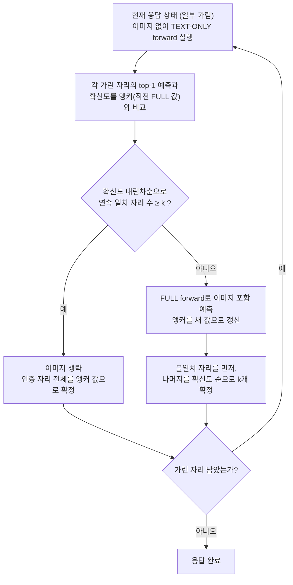

[논문 링크](https://arxiv.org/abs/2610.36671)
## 문제: 매 단계마다 다시 읽는 이미지

이미지로 질문에 답하는 확산 언어 모델은 응답을 한 번에 완성하지 않는다. 여러 단계에 걸쳐 빈 자리를 메우는 동안, 매 단계마다 거의 변하지 않는 이미지를 처음부터 다시 읽는다. LOWN은 “지금 이 단계에 이미지가 정말 필요한가”를 매번 묻고, 필요할 때만 다시 읽어 디코딩 비용을 크게 줄인다.

확산 언어 모델은 자동회귀 모델처럼 왼쪽부터 한 토큰씩 뽑는 대신, 처음에 응답 전체를 가린 채 시작한다. 매 단계에서 남은 빈 자리들을 모두 살펴 가장 확신이 센 $k$개의 가림을 동시에 푼다. 이를 "unmask"하고, $k$는 응답 길이를 단계 수로 나눈 값이다(근거: §3.1). 이미지 입력 확산 언어 모델(DVLM, 예: LLaDA-V)에서는 이미지 토큰이 응답이 아니라 입력 시퀀스에 고정되어 함께 들어간다. “이미지 토큰”은 그림을 모델이 처리할 수 있게 만든 숫자 조각이다.

이미지 토큰의 비중이 압도적이다. 평가한 10개 벤치마크에서 이미지 토큰은 전체 입력의 89~97%를 차지하고, 이미지를 뺀 순방향 한 번의 비용은 원래의 약 3~10%(벤치마크별 평균 2.5~10.1%)에 불과하다(근거: §1, Figure 1b, Table 8). DVLM은 양방향 attention을 쓰므로 자동회귀 모델의 키·밸류 캐시를 그대로 재사용할 수 없고, 매 단계 입력 전체를 다시 통과시킨다. 그 결과 디코딩 비용의 대부분이 “안 바뀌는 이미지를 다시 읽는 일”에 들어간다.

## 이미지가 실제로 언제 필요한가

LOWN을 설계하기 전에, 이미지가 정말 모든 단계에서 필요한지 수치로 확인했다. 표준 디코딩 경로를 그대로 따라가며, 각 단계에서 두 가지 순방향을 나란히 돌렸다. “FULL forward”는 이미지 토큰을 포함한 입력으로 확률을 계산하고, “TEXT-ONLY forward”는 같은 부분 응답에서 이미지 토큰만 빼고 position ID는 그대로 유지한 채 확률을 계산한다(근거: §3.2, Appendix A). 진행 상태는 FULL forward만 결정하므로 디코딩 경로 자체는 baseline과 동일하다. TEXT-ONLY의 출력은 기록만 하고 상태에 반영하지 않는다.

비교 결과는 세 가지로 요약된다:

- unmask 대상 자리의 83.4%는 두 forward가 같은 토큰을 top-1로 예측했다. 최종 토큰의 85.0%는 unmask되기 전 이미 같은 자리에서 top-1로 예측돼 있던 값이었다(근거: §3.2, Table 6). 이미지가 결정을 뒤집는 경우는 드물다.
- 두 순방향의 top-1 불일치는 10개 중 8개 벤치마크에서 초반 디노이징 단계에 가장 컸고, 응답이 갖춰지며 줄었다. DeCapBench 같은 예외도 있다(근거: §3.2, Figure 2a).
- 이미지가 한 개 이상의 unmask 결정을 바꾼 단계의 비율, 즉 이미지 의존 단계 비율은 벤치마크마다 크게 다르다.

| 벤치마크 | 이미지 의존 단계 비율 |
|---|---|
| MMBench | 7.9% |
| ScienceQA | 8.2% |
| MME | 10.6% |
| GQA | 10.9% |
| MathVista | 17.9% |
| ChartQA | 24.5% |
| CapArena | 32.7% |
| DeCapBench | 33.4% |
| LLaVA-Bench | 37.8% |
| DocVQA | 43.8% |

10개 평균은 22.8%다(근거: §3.2, Figure 2b, Table 6). 고정된 주기로 “n단계마다 이미지 읽기”를 정해두면 이 편차를 잘 따라잡지 못한다. 이미지가 필요한 시점은 입력과 단계에 따라 달라지므로, 매 단계에서 그때그때 판단해야 한다. 다행히 판단용 재료가 이미 있다. TEXT-ONLY forward는 FULL forward의 약 3~10% 비용으로 같은 자리의 예측을 제공한다(근거: §3.2, Table 8).

## LOWN: 이미지가 필요할 때만 보기

LOWN은 “직전에 이미지를 보고 내린 예측을 재활용하자”에서 출발한다. FULL forward를 돌릴 때마다, 아직 빈 자리들의 top-1 예측과 그 확신도(confidence)를 따로 저장해둔다. 이 저장값을 “앵커(anchor)”라 부른다. 앵커는 토큰 값과 확신도 몇 개에 불과해, LOWN 자체는 attention의 키·밸류처럼 큰 상태를 보관하지 않는다.

각 단계는 먼저 TEXT-ONLY forward로 남은 자리의 예측을 계산한다. 이 예측이 앵커와 같으면, LOWN은 그 앵커 예측을 “이미지 없이도, 상태가 바뀐 뒤에도 유효할 가능성이 높은 예측”으로 인증(certify)한다. 두 예측은 이미지를 봤는지와 어느 시점 상태에서 계산됐는지가 모두 다르므로, 일치는 두 조건을 함께 통과했다는 근사 신호로 쓰인다. 절대적인 확신도 임계값은 필요 없다(근거: §4.1).

구체적으로는, 앵커의 확신도가 높은 순서대로 빈 자리를 나열하고 “TEXT-ONLY 예측 == 앵커”인 자리를 앞에서부터 세어 인증된 접두사(certified prefix)를 만든다. 첫 불일치에서 스캔을 멈춘다. 접두사 길이가 $k$ 이상이면 이미지를 생략하고, 접두사 전체를 앵커 값으로 unmask한다. $k$ 미만이면 FULL forward를 돌려 앵커를 갱신하고, 두 예측이 다른 자리를 먼저, 나머지는 FULL 확신도 순으로 $k$개를 unmask한다(근거: §4.2).

아래는 설명용 예시다. 토큰 분할·수치는 논문 예시와 무관히 구성한 것이며, $k=2$를 가정한다.

어느 단계에서 응답이 “The cat ? ?” 상태라고 치자. 위치 1,2는 이미 확정됐고, 위치 3,4는 아직 가려 있다. 직전 FULL forward가 저장한 앵커(가린 자리의 예측과 확신도)와, 이번 단계 TEXT-ONLY forward의 예측은 다음과 같다.

| 위치 | 앵커 값 (지난 FULL) | 앵커 확신도 | TEXT-ONLY 예측 | 판정 |
|---|---|---|---|---|
| 3 | sat | 0.92 | sat | 인증 ✓ |
| 4 | on | 0.81 | mat | 불일치 ✗ |

확신도가 높은 순서(위치 3 → 4)로 스캔하면, 3에서 일치하고 4에서 어긋나므로 인증된 접두사는 {위치 3}이고 길이는 1이다. $k=2$보다 작으므로 이미지를 생략할 수 없어 FULL forward를 실행한다. FULL forward는 위치 3→“sat”, 위치 4→“on”을 예측해 앵커를 갱신하고, 두 예측이 달랐던 위치 4를 먼저 unmask한 뒤 위치 3을 unmask한다. 출력: “The cat sat on”.

반대로 TEXT-ONLY가 두 위치 모두 앵커와 일치했다면, 접두사 길이 2 ≥ $k$가 되어 FULL forward를 생략하고 두 값을 그대로 확정했을 것이다. 인증 접두사가 $k$보다 길면 같은 단계에서 $k$개보다 많이 확정해 총 단계 수도 줄어든다. 두 갈래 모두 최소 $k$개를 확정하므로, LOWN이 기준 디코딩의 $T$단계보다 많은 단계를 쓰는 일은 없다(근거: §4.2).

주의할 점이 하나 있다. 같은 단계에서 독립적으로 예측된 인접한 두 자리가 같은 토큰을 받을 수 있는데, 그대로 확정하면 응답에 반복된 단어가 생긴다. 이를 막기 위해, 이미 확정됐거나 같은 스캔에서 먼저 받아들인 이웃과 토큰 ID가 같으면 접두사를 끊는다(근거: §4.1, Appendix B.1).

비용은 $R = f + \sigma\rho$로 분해된다. $f$는 기준 $T$단계 중 FULL forward를 도는 비율, $\sigma$는 기준 $T$ 대비 LOWN이 도는 단계 수 비율, $\rho$는 TEXT-ONLY forward 한 번의 상대 비용이다(근거: §4.3). 인증은 $f$를 낮추고, 접두사 전체 수용은 $\sigma$를 낮춘다. $\rho$는 이미지가 차지하는 비중에 따라 벤치마크별 2.5~10.1% 수준이다(근거: Table 8). 토큰 프루닝이 FULL forward 하나의 비용을 줄이는 것과 달리, LOWN은 FULL forward를 돌리는 횟수를 줄인다. 두 방법은 축이 다르다(근거: §4.3).

## 성능: 얼마나 아끼고 얼마나 지키나

### 같은 연산량에서 비교

경쟁 방법은 각자 하이퍼파라미터 격자에서 LOWN 이상의 FLOPs를 쓰는 가장 싼 설정을 골랐으므로, LOWN보다 점수가 낮으면 같거나 더 비싼 비용에서 낮은 것이다(근거: Table 1, §C.3). 아래 표는 LLaDA-V 위에서 연산량을 맞춰 비교한 결과다.

| 방법 | MathVista | ScienceQA | ChartQA | DocVQA | 평균(10개) |
|---|---|---|---|---|---|
| LLaDA-V (원본) | 59.10 | 76.50 | 78.16 | 83.91 | 100.0% |
| RedVTP (토큰 프루닝) | 51.70 | 70.70 | 74.32 | 83.39 | 93.0% |
| ZOO-Prune | 53.70 | 73.87 | 76.44 | 78.73 | 94.2% |
| KLASS (스케줄) | 56.70 | 75.01 | 73.64 | 75.36 | 91.9% |
| **LOWN** | 56.00 | 78.83 | 78.36 | 82.31 | **99.6%** |

평균 열은 10개 벤치마크 전체의 정규화 점수 평균이다. CapArena만 $100+\text{점수}-\text{기준 점수}$로 정규화한다(근거: §C.1). LOWN은 0.353×의 디코딩 FLOPs로 평균 99.6%를 유지하며, 10개 중 8개 벤치마크에서 가속 방법 중 1위를 기록한다(근거: §5.2). 10개 벤치마크 중 4개에서 LOWN이 원본보다 높은 점수를 낸다. 위 표에서도 ScienceQA(78.83 vs 76.50)와 ChartQA(78.36 vs 78.16)가 그렇다. 상한을 100%로 잘라도 98.6%다(근거: §5.2). RedVTP는 93.0%로 더 크게 떨어진다. 프루닝은 시각 정보를 영구히 지우지만, LOWN은 필요한 단계에서 전체 이미지를 다시 볼 수 있기 때문이다(근거: §5.3, Figure 6).

### 프루닝·캐시와 겹쳐 쓰기

LOWN은 프루닝이 forward마다 처리하는 시각 토큰 수를 줄이는 것과 달리, 각 단계에서 이미지를 처리할지 결정한다. 두 축이 겹치므로 함께 쓰면 절감이 쌓인다. RedVTP(50% 유지)와 결합하면 0.223× FLOPs에서 98.3%를 유지하며 10개 벤치마크 전부 1위다(근거: §5.2, Table 1). 키·밸류 캐시(Fast-dLLM)와 합치면 Fast-dLLM 대비 생성 시간을 추가로 38.1~50.1% 줄이고, FLOPs를 44.1~58.9% 추가 절감하며, LLaDA-V 단독 대비 5.6~7.0× 빠르게 디코딩한다(근거: §5.2, Table 2). 다만 이 조합의 점수는 Fast-dLLM 단독보다 세 태스크 모두 낮고(LLaVA-Bench에서 5.0점), 원본 대비로는 2.0점 이내다(근거: §5.2).

### 실제 시간과 다른 백본

앞의 성능 표는 분석적 연산량(FLOPs) 기준이다. 실제 벽시계 시간은 H200에서 배치 크기 1로 측정했는데, 단독 LOWN이 평균 57.4%, 최대 73.2%의 생성 시간을 줄였다(근거: §5.2, §D.1). FLOPs 절감(64.7%)과의 차이는 측정 범위 때문에 그대로 비교하기 어렵다. FLOPs는 비전 인코더와 비행렬 연산을 제외한 행렬곱 중심의 분석값이고, 시간에는 실행 흐름 안에서 멀티모달 준비와 비전 인코딩까지 포함된다(근거: §B.2, §D.1).

같은 규칙이 LaViDa에는 그대로 이전되고, VidLaDA에는 통제된 비디오 프로토콜에서 확장 적용된다. LaViDa에서는 0.174× FLOPs로 99.7%의 점수를 유지한다. 비디오 모델 VidLaDA-8B에서는 통제된 128토큰 디코딩 프로토콜에서 EgoSchema가 0.255× FLOPs에서 60.2점(원본 60.6), MLVU가 0.272×에서 43.3점(원본 41.8)이다(근거: §5.2, Table 3).

### 적응 판단이 고정 주기보다 나은 이유

“매 n단계마다 이미지 읽기”나 랜덤 스케줄과 비교하면, 적응 판단이 실제로 더 낫다. FULL 횟수를 맞춘 랜덤 스케줄보다 태스크 정규화 품질이 4.9~13.0% 높고, 비슷한 연산의 주기 4 스케줄은 MathVista에서 4.0점 낮다(근거: Table 4). 비용 기여를 나눠 보면, 이미지 접근 라우팅만으로 FLOPs가 27~68% 줄고, disagreement-first 순서와 접두사 전체 수용으로 이루어진 적응적 수용이 그 위에 21~43%를 더 줄인다. 적응적 수용은 7개 벤치마크에서 점수를 높이고, 나머지에서도 정규화

<!-- verbatim-tables -->

논문 원문의 표

> arXiv e-print 의 LaTeX 원본에서 기계적으로 옮긴 표입니다. 숫자는 논문의 값이며 모델을 거치지 않았습니다.

**표 1. **Performance at matched decoding FLOPs on LLaDA-V**. The upper block compares standalone methods at LOWN's budget, and the lower block at the budget of LOWN with RedVTP ($r{=}50\%$). Competitors run on a discrete hyperparameter grid, so each cell uses the cheapest setting with at least LOWN's FLOPs (Appendix ). Cells show scores with FLOPs relative to LLaDA-V below. Best scores are bold, second best underlined, and lowest FLOPs bold.**

|  | Math | Science | Chart |  | MM | Doc | Cap | LLaVA- |  | DeCap |  |
|---|---|---|---|---|---|---|---|---|---|---|---|
| -2*Method | Vista | QA | QA | -2*MME | Bench | VQA | Arena | Bench | -2*GQA | Bench | -2*Avg. |
| LLaDA-V *(Vanilla)* | 59.10 | 76.50 | 78.16 | 1719.49 | 70.88 | 83.91 | $-$88.67 | 58.20 | 53.31 | 33.18 | 100.0% |
| *FLOPs matched to LOWN* |  |  |  |  |  |  |  |  |  |  |  |
|  | 51.70 | 70.70 | 74.32 | 1469.78 | 56.70 | **83.39** | $-$91.00 | 56.90 | 50.97 | 33.03 | 93.0% |
| -2*RedVTP | 0.354 | 0.286 | 0.641 | 0.256 | 0.280 | 0.520 | 0.411 | 0.505 | 0.260 | 0.411 | 0.392 |
|  | 53.70 | 73.87 | 76.44 | 1582.41 | 67.27 | 78.73 | $-$93.17 | 54.30 | 50.16 | 31.02 | 94.2% |
| -2*ZOO-Prune | 0.403 | 0.348 | 0.641 | 0.299 | 0.317 | 0.483 | 0.417 | 0.490 | 0.238 | 0.411 | 0.405 |
|  | **56.70** | 75.01 | 73.64 | 1641.99 | 68.81 | 75.36 | $-$96.83 | 42.50 | 49.52 | 30.18 | 91.9% |
| -2*KLASS | 0.346 | 0.318 | 0.669 | 0.316 | 0.331 | 0.487 | 0.476 | 0.536 | 0.249 | 0.500 | 0.423 |
|  | 56.00 | **78.83** | **78.36** | **1655.08** | **69.93** | 82.31 | **$-$85.67** | **57.40** | **53.24** | **34.43** | **99.6%** |
| -2*LOWN (Ours) | 0.325 | 0.243 | 0.576 | 0.231 | 0.270 | 0.452 | 0.388 | 0.454 | 0.205 | 0.391 | 0.353 |
| *FLOPs matched to LOWN (Ours) + RedVTP ($r{=}50\%$)* |  |  |  |  |  |  |  |  |  |  |  |
|  | 48.40 | 65.49 | 66.00 | 1275.08 | 56.70 | 81.62 | $-$91.33 | 54.40 | 48.05 | 31.16 | 87.8% |
| -2*RedVTP | 0.268 | 0.202 | 0.400 | 0.171 | 0.280 | 0.299 | 0.232 | 0.278 | 0.175 | 0.231 | 0.253 |
|  | 46.10 | 72.48 | 71.68 | 1487.83 | 64.09 | 68.82 | $-$95.50 | 54.90 | 47.88 | 29.12 | 88.8% |
| -2*ZOO-Prune | 0.208 | 0.224 | 0.418 | 0.214 | 0.205 | 0.282 | 0.268 | 0.287 | 0.152 | 0.265 | 0.252 |
| KLASS | 52.70 | 73.48 | 68.92 | 1584.56 | 65.29 | 76.65 | $-$96.67 | 42.50 | 48.93 | 29.02 | 89.3% |
| + RedVTP *($r{=}50\%$)* | 0.207 | 0.210 | 0.428 | 0.191 | 0.207 | 0.274 | 0.247 | 0.290 | 0.154 | 0.258 | 0.247 |
| LOWN (Ours) | **54.90** | **75.56** | **74.88** | **1709.75** | **69.67** | **82.24** | **$-$85.17** | **55.00** | **53.42** | **33.61** | **98.3%** |
| + RedVTP *($r{=}50\%$)* | 0.195 | 0.186 | 0.375 | 0.166 | 0.200 | 0.265 | 0.219 | 0.256 | 0.150 | 0.218 | 0.223 |

**표 2. Composition of LOWN and Fast-dLLM on LLaDA-V.**

| Method | MathVista |  |  |  |  | LLaVA-Bench |  |  |  |  | DeCapBench |  |  |  |  |
|---|---|---|---|---|---|---|---|---|---|---|---|---|---|---|---|
|  | Score $\uparrow$ | Time (s) $\downarrow$ |  | FLOPs $\downarrow$ |  | Score $\uparrow$ | Time (s) $\downarrow$ |  | FLOPs $\downarrow$ |  | Score $\uparrow$ | Time (s) $\downarrow$ |  | FLOPs $\downarrow$ |  |
| LLaDA-V | 59.10 | 7.56 |  | 1.0000 |  | 58.20 | 6.99 |  | 1.0000 |  | 33.18 | 14.64 |  | 1.0000 |  |
| Fast-dLLM | 57.30 | 2.14 |  | 0.0856 |  | 63.00 | 2.02 |  | 0.0876 |  | 35.19 | 4.22 |  | 0.1104 |  |
| Fast-dLLM + LOWN | 57.10 | 1.23 | ($-$42.4%) | 0.0457 | ($-$46.6%) | 58.00 | 1.25 | ($-$38.1%) | 0.0489 | ($-$44.1%) | 33.35 | 2.10 | ($-$50.1%) | 0.0453 | ($-$58.9%) |

**표 3. Video-understanding results of LOWN on VidLaDA-8B.**

|  | EgoSchema |  |  | MLVU |  |  |
|---|---|---|---|---|---|---|
| Method | Score $\uparrow$ | FLOPs $\downarrow$ |  | Score $\uparrow$ | FLOPs $\downarrow$ |  |
| VidLaDA | 60.6 | 1.000 |  | 41.8 | 1.000 |  |
| LOWN (Ours) | 60.2 | 0.255 | ($-$74.5%) | 43.3 | 0.272 | ($-$72.8%) |

**표 4. Comparison of LOWN with fixed and random image-access schedules on LLaDA-V. Cells report score and relative FLOPs.**

|  | MathVista | LLaVA-Bench | DeCapBench |
|---|---|---|---|
| LOWN (Ours) | 56.00 0.325 | 57.40 0.454 | 34.43 0.391 |
| Period 2 | 57.00 0.541 | 56.10 0.516 | 33.43 0.522 |
| Period 4 | 52.00 0.321 | 49.00 0.274 | 27.79 0.284 |
| Period 8 | 48.50 0.211 | 41.30 0.154 | 19.09 0.164 |
| Random | 53.40 0.349 | 53.80 0.456 | 30.48 0.389 |

**표 5. Ablation of visual routing and adaptive acceptance on LLaDA-V. Each setting reports scores and, below, relative FLOPs with the reduction from the preceding setting in parentheses.**

|  | Adaptive | Math | Science | Chart |  | MM | Doc | Cap | LLaVA- |  | DeCap |
|---|---|---|---|---|---|---|---|---|---|---|---|
| -2*Visual routing | acceptance | Vista | QA | QA | -2*MME | Bench | VQA | Arena | Bench | -2*GQA | Bench |
| ✗ | ✗ | 59.10 | 76.50 | 78.16 | 1719.5 | 70.88 | 83.91 | $-$88.67 | 58.20 | 53.31 | 33.18 |
| \hdashline[0.5pt/1.5pt] |  | 57.60 | 77.39 | 77.76 | 1624.6 | 68.30 | 83.50 | $-$86.83 | 57.90 | 52.53 | 33.02 |
| -2*{✓} | -2*{✗} | 0.5040 49.6 | 0.3554 64.5 | 0.7330 26.7 | 0.3383 66.2 | 0.3759 62.4 | 0.6743 32.6 | 0.6833 31.7 | 0.7002 30.0 | 0.3203 68.0 | 0.6840 31.6 |
| \hdashline[0.5pt/1.5pt] |  | 56.00 | 78.83 | 78.36 | 1655.1 | 69.93 | 82.31 | $-$85.67 | 57.40 | 53.24 | 34.43 |
| -2*{✓} | -2*{✓} | 0.3252 35.5 | 0.2428 31.7 | 0.5759 21.4 | 0.2307 31.8 | 0.2701 28.1 | 0.4517 33.0 | 0.3885 43.1 | 0.4543 35.1 | 0.2045 36.2 | 0.3909 42.9 |

**표 6. Per-benchmark observations on LLaDA-V. Visual tokens is their mean percentage of the FULL input. Unchanged decisions is the share of unmasked positions at which the FULL and TEXT-ONLY top-1 predictions agree. Image-dependent steps is the share of steps on which the image changed at least one unmasked decision. Already top-1 is the share of final tokens that were the top-1 prediction at their position before the step that unmasked them. Brackets give 95% confidence intervals, and the last row is the unweighted mean.**

| Benchmark | Visual tokens (%) | Unchanged decisions | Image-dependent steps | Already top-1 |
|---|---|---|---|---|
| MathVista | 89.0 | 89.0 [88.6, 89.3] | 17.9 [17.2, 18.5] | 90.2 [89.9, 90.6] |
| ScienceQA | 91.6 | 91.8 [91.0, 92.5] | 8.2 [7.5, 9.0] | 88.2 [87.2, 89.0] |
| ChartQA | 96.1 | 75.5 [74.2, 76.7] | 24.5 [23.3, 25.8] | 88.4 [87.4, 89.3] |
| MME | 97.0 | 89.4 [88.5, 90.3] | 10.6 [9.7, 11.5] | 89.6 [88.7, 90.4] |
| MMBench | 91.3 | 92.1 [91.3, 92.8] | 7.9 [7.2, 8.7] | 88.6 [87.6, 89.5] |
| DocVQA | 96.6 | 71.8 [70.9, 72.7] | 43.8 [42.4, 45.2] | 86.4 [85.7, 87.1] |
| CapArena | 94.8 | 79.6 [79.1, 80.0] | 32.7 [32.0, 33.5] | 76.9 [76.5, 77.4] |
| LLaVA-Bench | 96.2 | 76.3 [74.9, 77.6] | 37.8 [35.6, 40.0] | 74.0 [72.6, 75.3] |
| GQA | 96.5 | 89.1 [88.2, 90.0] | 10.9 [10.0, 11.8] | 89.4 [88.5, 90.2] |
| DeCapBench | 94.9 | 79.5 [79.1, 79.9] | 33.4 [32.7, 34.1] | 78.0 [77.6, 78.5] |
| Mean | 94.4 | 83.4 | 22.8 | 85.0 |

**표 7. Per-benchmark observations on LaViDa, in the format of Table , with the response lengths and step counts of the LLaDA-V measurement and over the full evaluation sets. Brackets give 95% confidence intervals, and the last row is the unweighted mean.**

| Benchmark | Visual tokens (%) | Unchanged decisions | Image-dependent steps | Already top-1 |
|---|---|---|---|---|
| MathVista | 71.1 | 94.0 [93.8, 94.1] | 10.4 [10.1, 10.7] | 89.8 [89.6, 90.0] |
| ScienceQA | 76.4 | 98.7 [98.6, 98.8] | 1.3 [1.2, 1.4] | 93.7 [93.5, 94.0] |
| ChartQA | 88.8 | 83.6 [83.2, 84.0] | 16.4 [16.0, 16.8] | 92.6 [92.4, 92.9] |
| MME | 87.9 | 96.1 [95.9, 96.3] | 3.9 [3.7, 4.1] | 93.7 [93.5, 94.0] |
| MMBench | 78.4 | 96.8 [96.6, 96.9] | 3.2 [3.1, 3.4] | 93.7 [93.5, 93.9] |
| DocVQA | 88.3 | 89.4 [89.3, 89.6] | 15.2 [14.9, 15.4] | 91.6 [91.4, 91.7] |
| CapArena | 81.1 | 82.0 [81.7, 82.3] | 29.8 [29.3, 30.2] | 78.6 [78.3, 78.9] |
| LLaVA-Bench | 86.3 | 91.3 [90.4, 92.1] | 13.6 [12.2, 15.1] | 88.1 [87.1, 89.0] |
| GQA | 88.8 | 95.8 [95.7, 95.9] | 4.2 [4.1, 4.3] | 93.1 [92.9, 93.2] |
| DeCapBench | 80.7 | 81.6 [81.2, 81.9] | 30.6 [30.0, 31.2] | 78.6 [78.2, 79.0] |
| Mean | 82.8 | 90.9 | 12.9 | 89.3 |

**표 8. Mean TEXT-ONLY/FULL forward-cost ratio on LLaDA-V. For each sample, we compute $\rho_i=\mathcal{C}(p_i+o_i)/\mathcal{C}(p_i+v_i+o_i)$ using its prompt length $p_i$, visual-token count $v_i$, and configured response length $o_i$. Each row averages these ratios over the benchmark's samples, and $\mathcal{C}$ is the analytical forward cost in Equation .**

| Benchmark | Samples | Mean $\rho$ (%) |
|---|---|---|
| MathVista | 1,000 | 10.07 |
| ScienceQA | 2,017 | 7.92 |
| ChartQA | 2,500 | 2.54 |
| MME | 2,374 | 3.15 |
| MMBench | 4,329 | 7.04 |
| DocVQA | 5,349 | 3.02 |
| CapArena | 600 | 4.63 |
| LLaVA-Bench | 60 | 3.35 |
| GQA | 12,578 | 3.20 |
| DeCapBench | 400 | 4.49 |

