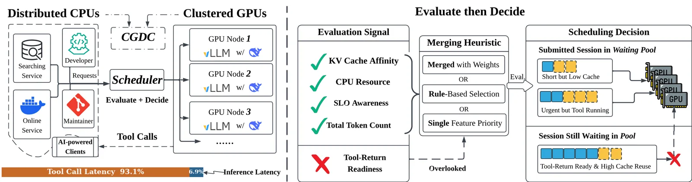
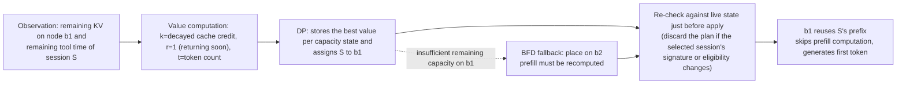
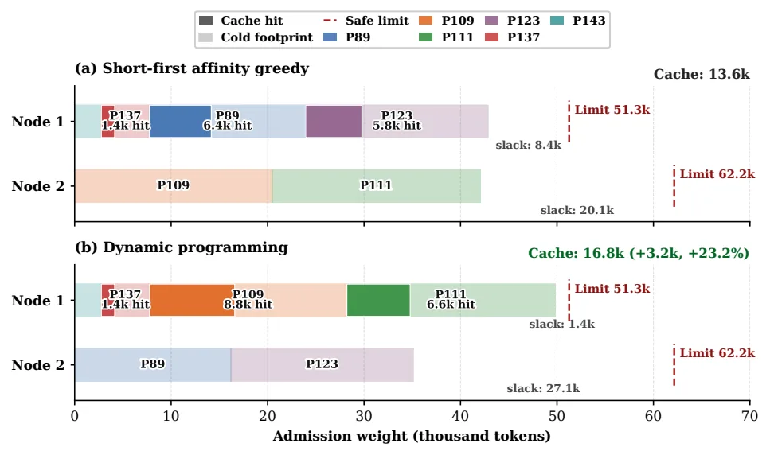
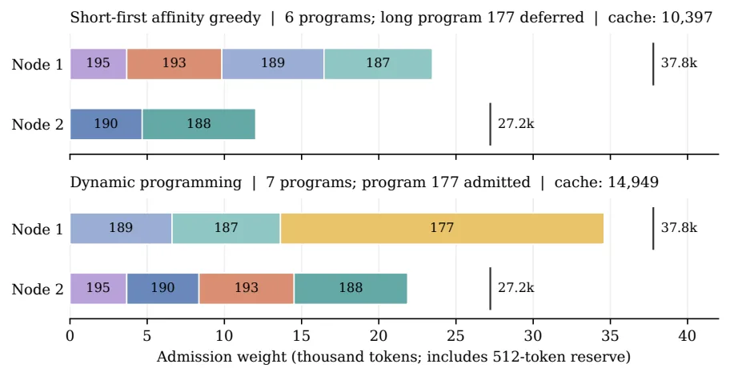
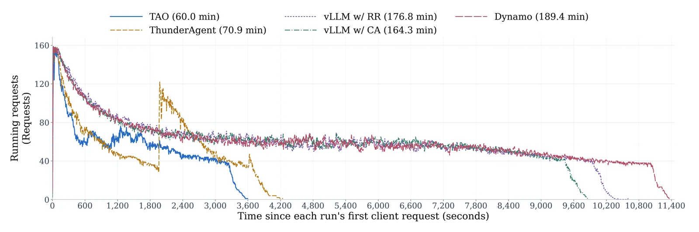

[Paper](https://arxiv.org/abs/2610.37230v1)
## TAO: Tool-Aware Joint Scheduling for LLM-Based Agentic Serving

Original: Shuhuai Li et al., "TAO: Tool-Aware Joint Scheduling for LLM-Based Agentic Serving" (arXiv:2610.37230v1, preprint). The following account is based solely on the attached original text.

## Introduction

Agents alternate between model inference and external tool execution. While a tool runs, that session's GPU demand becomes suspendable; how this gap is used and which node the session is attached to when it returns determine response time. This paper proposes TAO, a framework that binds both problems into a single scheduling problem.

## 1. Problem: GPUs idle while tools run

### 1.1 Sessions and CGDC

Let us call the entire interaction of an agent a **session**. A session is a unit of work that alternates between model requests and tool calls. During a model request, the session occupies one GPU node; during tool execution, it waits for results outside the inference service.

The paper calls this arrangement CGDC (Clustered GPUs with Distributed CPUs). GPUs are clustered in nodes and share inference capacity, tools run on distributed CPUs outside them, and tool CPU/RAM is managed separately from the GPU admission budget. In other words, there is time that does not count against the GPU budget.

Roles are predefined as well. The scheduler records each session's state and controls session admission, while the serving engine manages residency and eviction of physical KV cache (source: §2.1).

### 1.2 The expensive thing is "not being able to reuse the KV cache"

If a session's next request can reuse the **KV prefix** produced by the previous turn, it skips prefill computation entirely. But whether that prefix is still alive is determined by "which node it was attached to" and "how much time has passed." If a session returning after a tool finishes is placed on the same node, the cache is alive and it is fast; if it is sent to another node or pushed out by capacity pressure, prefill must be recomputed.

Conversely, evicting an *active* inference session requires immediate recomputation. When recomputation and restoration repeat, capacity is wasted on state that must be rebuilt (source: §2.1, §2.2).

### 1.3 interrupt and restart

At a tool boundary the scheduler can do two things.

- **interrupt**: release the model admission of a session running a tool and return node resources.
- **restart**: reassign a session whose tool has finished to an appropriate node and continue the existing interaction.

Both actions are just session state transitions, decoupled from the inference engine implementation. The paper's starting point is that these two decisions ultimately reduce to the same session evaluation. Whether to interrupt is decided by ranking session values, and interrupted sessions enter the waiting pool together with newly arriving sessions. The paper handles joint evaluation in this waiting pool and the resume decision together (source: §2.2).

### 1.4 Two things existing schedulers miss

Existing serving systems mostly follow an "evaluate-then-decide" pattern. They evaluate node features at the session level, then decide where and when to serve.

Original Figure 1. The left panel shows the CGDC structure, and the right panel shows the two problems the paper targets.

- **Problem 1 — evaluation misses tool-return readiness.** Tool timing was already used before, but only as a proxy for KV reuse or token count. For example, predicting tool duration to set KV retention time, or discounting a session's token demand over time while a tool runs. These values get mixed into fixed scoring rules or hand-picked thresholds.
- **Problem 2 — decisions are made with per-session heuristics.** The per-session scoring and routing rules of llm-d and SGLang allocate inference opportunities one session at a time. But sessions compete for the same node capacity, so admitting one session can remove the slot where a more valuable combination of other sessions would have fit. Labels in the right panel such as "Short but Low Cache," "Urgent but Tool Running," and "Session Still Waiting in Pool" point to this illusion (source: §1, §2.2).

## 2. A small example: while one session waits 12 seconds

To get the concept, follow a hypothetical coding session `S`. The numbers in this section are a hypothetical example for understanding and are **not reported in the original**.

| Step | What happens on the GPU | State left behind |
| --- | --- | --- |
| Input | `S` sends its first request carrying 8,000 tokens of repository context. | Node `b1` prefills 8,000 tokens and creates a KV cache, and `S` occupies a GPU slot on `b1`. |
| Response | The model generates 200 tokens. | 200 tokens accumulate in `S`'s history. |
| Tool call | `S` calls a test-running tool. The tool runs on CPU for 12 seconds. | `S` returns its GPU slot (interrupt). Another session starts using `b1`'s slot, and `b1`'s KV cache remains but can be evicted under capacity pressure. |
| Value computation | The scheduler computes the value of `S` and each node pair. | The `b1` pair gets cache credit (decayed from the observation), return readiness, and token count. |
| Change, skip, reject | If `b1` has room, DP assigns `S` to `b1`. | Because the cache is alive, **prefill computation is skipped**. If `b1` is full, `S` is assigned to another node `b2` and **prefill is recomputed**. If no node has room, `S` is **rejected and remains in the waiting pool**. |
| Output | After 12 seconds the tool result arrives and `S` requests the GPU again. | If the assigned node's cache is alive, it continues without prefill; otherwise it prefills again. |

Two things emerge from this example. One is that "whether it returns to a node with a live cache" determines response speed, and the other is that "if you know when the tool will finish," you can raise `S` as a GPU placement candidate just before that and eliminate the wait. The paper turns these two into values called 'cache credit' and 'return readiness.'

## 3. Method

### 3.1 Two-stage pipeline: evaluate → decide

TAO operates in two stages. First it attaches a value to each session–node pair in the waiting pool (evaluation), and based on those values a dynamic program selects and places waiting sessions all at once (decision). Because evaluation and decision are separated, changing the value function leaves the scheduling procedure intact (source: §3.1).

The concrete numbers in this diagram, like the example in Section 2, are not reported in the original. Each box is a state change. The first box is the observations (remaining cached token count and remaining tool time), the second is the result of turning them into values, the third is the process of recovering a placement from the values, and the last is what happens in actual execution. The dotted line is the case where capacity is insufficient and it takes another path. The serving engine's role (physical KV allocation, reuse, eviction) does not disappear. The scheduler only reads on top of it "where the cache remains and when it can be reclaimed" as values. What shrinks is prefill recomputation, which disappears through cache reuse, and return waiting, which disappears through readiness.

### 3.2 Three values attached to each session–node pair

For each session `i` and node `b` pair, the paper attaches three values (source: §3.2, Eq. (2)).

$$v_{i,b} = (k_{i,b},\ r_i,\ t_i)$$

- `k_{i,b}` — cache credit of session `i` remaining on node `b`. It shrinks as the observation ages.
- `r_i` — return readiness. A 0/1 signal indicating whether session `i` is likely to request the GPU again soon because its tool is about to finish.
- `t_i` — token count of session `i`. Represents the accumulated context size.

The key design is that these three are compared in **lexicographic order** rather than mixed in a weighted sum. Cache credit is examined first; if equal, readiness; if still equal, token count. The order itself is fixed, and only the values change over time. The paper justifies this order for three reasons (source: §3.2). First, prefix reuse eliminates prefill recomputation outright, so cache credit comes first. Second, when decay makes credits similar, readiness distinguishes sessions that are "returning soon" from those "still far away." Third, when credit and readiness tie, larger accumulated context is preferred, but the optimizer also accounts for the capacity cost that context occupies when determining the overall assignment set.

The assignment constraints are as follows (Eq. (1)). Session `i` can go to only one node ($\sum_b x_{i,b} \le 1$), cannot exceed node `b`'s remaining capacity `C_b` ($\sum_i w_i x_{i,b} \le C_b$), and ineligible pairs cannot be assigned. The goal is the assignment that lexicographically maximizes the sum of values over all pairs (Eq. (3)).

### 3.3 Credit decays with observation age

Using the observed cached token count `k⁰` as-is leaves old observations as a frozen signal. The paper computes credit by multiplying by $2^{-\tau/h}$ according to the time `τ` elapsed since observation (source: §3.3, Eq. (4)).

$$k_{i,b}(t) = k^0_{i,b}\,2^{-\tau/h},\quad \tau = \max(0,\, t - t^{\mathrm{obs}}_{i,b})$$

The half-life `h` is set to 10 seconds, and the computed credit is rounded before being used in evaluation. The basis is measurement. In a DeepSeek-V4 Flash trace on two nodes each with 4×H100, the binned median of observed cached token retention declines clearly over time (original Figure 3). The median was drawn with a technical exponential fit over populated bins, and each point carries a bootstrap 95% confidence interval. Giving large weight to old observations leads to wrong decisions, so decay is necessary.

The half-life is only a scheduler parameter and is distinct from the time constant fitted from the trace. Physical retention and eviction of the actual cache remain the serving engine's responsibility.

### 3.4 Readiness tells "returning soon" as 0/1

Readiness identifies sessions that will need the GPU again soon. If the tool interface exposes progress or a completion deadline, it uses that first. Claude Code's Monitor delivers background task events, and OpenCode reports termination after a Bash timeout (source: §3.4). Without direct timing evidence, it estimates the remaining time from historical tool duration records. The estimation order is per-tool history → global history → 5-second default. It collects the sample count, mean, sample variance, and observed range of completed calls, builds a conservative estimate with a finite-sample margin, subtracts the time already elapsed, and clips at zero (Eq. (5), Appendix A).

When the predicted remaining time enters the horizon `H=1 second`, `r=1`. The decision uses three things together (Eq. (6)). If tool completion has already been observed, `r=1`. If the predicted deadline has passed but completion has not yet been observed, it grants only a temporary probe opportunity instead of remaining "ready" indefinitely. Otherwise, it decides only if the predicted timestamp was updated within 30 seconds. Observed completion takes precedence over prediction.

This signal is tied to the scheduling period (1 second). A session with readiness 1 is raised as a GPU placement candidate and can emit its first token as soon as the tool finishes.

### 3.5 Select and place at once with dynamic programming

Once all values are assigned, the decision problem becomes "dividing items among multiple knapsacks." Each node `b` is a knapsack with remaining capacity `C_b`, and each session `i` is an item with admission cost `w_i` and per-node value `v_{i,b}`.

The problem with existing approaches is that they solved this per session. Putting sessions one by one into the node that looks good in sequence blocks the slot where a more valuable combination could fit later.

The paper splits capacity into fixed units (quantum `Δ`), then, adding candidates one at a time, stores "the best value obtainable at each capacity state with the `j` candidates so far" with a DP that finds the exact optimum **over a frozen, discretized snapshot** (source: §3.5, Eq. (7)).

$$D_j(s) = \operatorname{lexmax}\left\{ D_{j-1}(s),\ \operatorname{lexmax}_{b\,\mathrm{eligible}}\left[ D_{j-1}(s - \bar{w}_j e_b) + u_{j,b} \right] \right\}$$

Here $\bar{w}_i = \lceil w_i/\Delta\rceil$, $\bar{C}_b = \lfloor C_b/\Delta\rfloor$, and $u_{j,b}$ is the term holding the value and count when candidate `j` is put on node `b`. Each candidate tries both "skip" and "assign to `b`," so all feasible solutions are covered. However, because of rounding, a plan that was feasible before discretization may be excluded.

The computation runs in an isolated asynchronous worker, and just before applying, it re-checks against the live state (whether the selected session's signature and eligibility are unchanged), then applies only the longest plan prefix that current capacity allows. If the signature changes, it discards the entire plan. The preparation and pool readiness cost is less than 0.12% of total runtime in the 4-replica sweep (source: §3.5, Appendix I).

Per-node cache observations are decayed with `O(nm)` preprocessing and folded into values, and nodes with the same cache can be grouped into `g ≤ m` capacity dimensions (physical KV blocks are not moved). When the state budget is exhausted, it falls back to best-fit-decreasing (BFD) placement. The admission cost `w_i` is the memory demand of the session's total token count minus shared token capacity, and `C_b` is updated at each scheduling point as the node's remaining capacity (Appendix B.1).

#### What the DP actually chooses differently

Original Figure 10. Each program is distinguished by a different hue, translucent spans are that program's admission weight, and dark overlays are retained cache credit. The horizontal axis is admission weight (thousand tokens), and the height of each node's horizontal bar is that node's limit.

- (a) short-first affinity greedy: node 1 leaves 13.6k cache with 8.4k free, node 2 has 20.1k free.
- (b) dynamic programming: it leaves 16.8k cache (+3.2k, +23.2%), node 1's free space shrinks to 1.4k and node 2's free space grows to 27.1k.

While maintaining the same total safe token retention, the DP preserves more cache credit. The exact values are 16,791 tokens versus 13,624 tokens (source: Appendix H).

Original Figure 11. Each session's width is its admission weight (including the 512-token reserve), and the number beside it is the program ID and cache credit.

- (a) short-first affinity greedy: admits 6 programs and defers program 177, a long-context one. Cache 10,397 tokens.
- (b) dynamic programming: admits 7 including program 177. Cache 14,949 tokens.

That is, the heuristic fills slots with short programs and pushes out a valuable session, while the DP admits that session too (source: Appendix H).

## 4. Results

### 4.1 Metrics and comparison conditions

There are three metrics. **Latency** is the average end-to-end task time (including model inference + tool execution), **TTFT** is the average time to first token, and **decode throughput** is generated tokens per second (TPS). In the component analysis, it additionally measures prefix-cache hit rate, latency from tool completion to first token, and pause wait. Pause wait is the time an interrupted session waited, including tool-call latency.

There are four comparison targets: vLLM's round-robin (RR) and cache-aware (CA) schedulers, the KV-aware scheduler Dynamo, and ThunderAgent, which uses BFD placement with token-count scheduling. Deployments are DeepSeek-V4 Flash on 2 nodes × (4 H100 per node), Qwen3-32B on 4 nodes × (2 H100 per node), and GLM-4.7 on 1 node × 8×H100 (TP8). The workload is SWE-bench Lite (SWE-Lite) using the mini-SWE-agent harness; DeepSeek additionally runs Terminal-Bench 2.0 with Claude Code, and Qwen additionally runs SWE-verified (source: §4.1).

The paper reports up to 26.8% latency reduction, up to 36.3% TTFT reduction, and up to 29.5% decode throughput increase across 12 model–workload–concurrency settings, with the comparison baseline being the **best evaluated baseline per metric** (source: abstract).

### 4.2 Main results: where it won and where it lost

In the DeepSeek-V4 Flash SWE-Lite results, each cell is the improvement over the best competing value for that metric (source: original Table 1).

| Metric (improvement) | 16 workers | 32 workers | 64 workers |
| --- | ---: | ---: | ---: |
| Latency reduction | 2.4% | 5.4% | 26.8% |
| TTFT reduction | 7.4% | 13.3% | 36.3% |
| Decode throughput increase | 5.1% | 6.0% | 29.5% |

The improvement grows with concurrency. At 64 workers, TAO's latency is 185.410 s, far better than the best competing 253.228 s, TTFT is 0.224 s versus 0.351 s, and decode throughput is 2,021.523 versus 1,561.307 tok/s. At 16 workers the gaps are narrower: 113.264 s versus 116.011 s, 0.135 s versus 0.146 s, and 934.967 versus 889.590 tok/s. That is, the more sessions compete for node capacity, the more pronounced the effect of "optimal placement at once" and "valuation reflecting cache and readiness" (source: §4.2).

Looking at the other settings' improvements together makes the overall picture clearer. The values below transcribe the Rel. Imprv. rows of Table 1, and negative numbers are cells where TAO fell behind (source: original Table 1).

| Workload (deployment) | Concurrency | Latency | TTFT | Decode |
| --- | --- | ---: | ---: | ---: |
| DeepSeek Terminal-Bench (2×4×H100) | 16 / 32 / 64 | +2.2 / +11.1 / +3.8 | +21.7 / +20.3 / +16.2 | −8.8 / +1.3 / −6.2 |
| Qwen3-32B SWE-Lite (4×2×H100) | 96 / 128 / 160 | +11.4 / +1.2 / −0.2 | +10.9 / +0.2 / +10.2 | −5.1 / +0.8 / +6.7 |
| Qwen3-32B SWE-verified (4×2×H100) | 96 / 128 / 160 | +8.3 / −2.5 / +9.0 | +29.9 / +12.9 / +18.5 | +7.8 / +4.0 / +4.7 |

In 5 of the 36 cells in Table 1, TAO falls behind the best competing value. DeepSeek Terminal-Bench leads latency and TTFT at all three concurrency levels but trails decode at 16 workers (−8.8%) and 64 workers (−6.2%). Qwen3-32B SWE-Lite trails at 96 workers decode (−5.1%) and 160 workers latency (−0.2%), and SWE-verified trails only at 128 workers latency (−2.5%). The conclusion is closer to "improves several metrics together in most conditions" than "wins every condition on every metric."

The large-model scaling experiment, GLM-4.7 (1 node 8×H100, TP8, 300 tasks), recorded 15.5% latency reduction, 14.1% TTFT reduction, and 20.5% decode increase at SWE-Lite 160 workers, and across all SWE-verified 500 tasks recorded 16.2–18.9% latency reduction, 15.7–38.4% client TTFT reduction, and 22.8–24.7% decode increase. The comparison target is ThunderAgent, the SOTA on each metric (source: original Table 2, §4.2).

### 4.3 Serving dynamics: don't cram everything in at once

Original Figure 4. This is a running-request-count trace when GLM-4.7 runs 300 SWE-Lite tasks at 160 workers (TP8), with each run aligned to zero at the first client request. TAO finished the workload at 60.0 minutes, ThunderAgent at 70.9 minutes, vLLM CA at 164.3 minutes, vLLM RR at 176.8 minutes, and Dynamo at 189.4 minutes. TAO keeps the number of concurrently running requests low throughout the middle of the run while finishing earlier. That is, it stably admits additional sessions while keeping the concurrent request count low. Corresponding traces for 96 and 128 workers (TAO 53.9 and 59.2 minutes, ThunderAgent 60.1 and 66.2 minutes) are in Appendix D (source: §4.2, Appendix D).

### 4.4 Which parts actually contributed

**Component ablation.** The setting is SWE-Lite, DeepSeek-V4 Flash, 2 nodes × 4×H100, 32 workers (source: original Table 4, §4.4).

| Configuration | Decode (tok/s) | Hit (%) | TTFT mean/P90 (s) | Tool end→first token mean/P90 (s) | pause mean/P90 (s) |
| --- | ---: | ---: | ---: | ---: | ---: |
| Full TAO | **1417.97** | **96.31** | **0.154 / 0.241** | **0.203 / 0.299** | **0.972 / 1.051** |
| Without cache value | 1398.35 | 96.24 | 0.157 / 0.246 | 0.209 / 0.309 | 1.028 / 1.047 |
| Without readiness | 1363.06 | 96.16 | 0.161 / 0.253 | 0.227 / 0.358 | 1.067 / 1.079 |
| Without cache value and readiness | 1373.51 | 96.24 | 0.182 / 0.278 | 0.213 / 0.317 | 1.025 / 1.059 |
| Without session evaluation (ThunderAgent's pause ordering) | 1355.20 | 96.20 | 0.162 / 0.257 | 0.226 / 0.350 | 1.025 / 1.061 |
| Without decision (BFD placement) | 1233.72 | 96.05 | 0.195 / 0.300 | 0.235 / 0.354 | 1.081 / 1.119 |

The largest drop is the last row. Reverting the DP to simple BFD placement drops decode from 1417.97 to 1233.72 tok/s and increases mean TTFT from 0.154 to 0.195 s. This means that good valuation alone is not enough if placement is myopic; performance falls sharply, supporting the design rationale that "evaluation" and "decision" play different roles. Removing readiness lowers decode to 1363.06 and increases tool end→first token to 0.227 s. The effect of removing cache value is relatively small (1398.35). It is also notable that the ablation effects are not monotonic. The "without cache value and readiness" row (1373.51) shows higher decode than the "without readiness only" row (1363.06). However, compared with the gap to the last DP→BFD row, this irregularity is not large.

**Cache-aware evaluation.** In a fixed workload replay of 218 tasks, the DP placement was held identical to the ThunderAgent control while only the valuation was changed. Cache token ordering raised prefix-cache hit rate by 0.19%p and reduced mean pause wait by 4.5%. Adding cache credit decay on top raised hit rate by 0.31%p and decode throughput by 1.68%. Figure 5 shows the reduction in physical prefill, TTFT, and pause wait together (source: §4.3, original Figure 5).

**Tool readiness.** In paired 32-worker SWE-Lite runs, enabling readiness raises decode throughput by 4.03%, reduces latency from tool completion to first token by 10.88%, and lowers mean pause wait from 1.067 s to 0.972 s. The left CDF in Figure 6 shows the distribution from tool completion to first output token, and the right shows the prediction error distribution. Across 10,967 completed tool predictions, mean absolute error is 0.410 s and 82.9% are within 0.5 s (the return-latency CDF has 10,481 and 10,673 observations, and the prediction panel has 10,967 predictions) (source: §4.3, original Figure 6).

**Concurrent placement.** Of 23 replay snapshots with multiple candidates, 6 (26.1%) improved the lexicographic objective and the other 17 matched the short-first heuristic. Across all 35 recoverable cases including single-candidate cases, 6 (17.1%) improved and 29 (82.9%) matched. That is, on this criterion the DP was never worse, and it gained on snapshots with severe contention (source: §4.3, Appendix H).

### 4.5 Mixed workloads and supplementary evaluations

**Mixed workload (source: original Table 3).** In a Terminal-Bench + SWE-Lite mix (389 tasks), latency (+12.2/+23.2/+13.8%) and decode (+12.2/+8.6/+4.4%) improved at all of 32, 64, and 128 workers, and only 32-worker TTFT trailed at −5.5%. AutomationBench (800 tasks) improved all three metrics at 32 and 64 workers. At 128 workers, however, all three trailed: latency 563.114 s versus 523.676 s (−7.0%), TTFT 19.123 s versus 3.166 s (−504.0%), and decode 1,013.157 versus 1,140.862 tok/s (−11.2%). The direction of gain and loss varies by workload.

**Low-concurrency fallback (source: Appendix E.1, Table 5).** DeepSeek-V4 Flash was placed on a single TP8 node and swept from 4 to 64 workers. At 4–8 workers, TAO's mean task latency is within 2.3% of the best baseline, decode throughput stays at or above 92% of the best, and mean TTFT is 15–20 ms higher than the best. At 32 and 64 workers, ThunderAgent falls far behind (at 64 workers, latency 475.033 s versus 226.268 s, TTFT 9.332 s versus 0.423 s). This confirms that TAO does not collapse even when scheduling headroom shrinks.

**InferenceX replay (source: Appendix F, Table 7, Figure 9).** DeepSeek serves a fixed corpus consisting of 393 AgentX traces, a 1-million-token context limit, and an 1,800-second profiling window on 2 nodes × 4×H100. TAO ranks first in decode throughput at all of 16, 32, and 64 workers (+4.2/+1.8/+10.1%), and TTFT ranks first only at 16 workers; at 32 and 64 workers the cache-aware scheduler is lower. In Figure 9, TAO's prefix-cache hit rate ranks first at all worker counts.

**Composition with another KV management engine (source: Appendix E.2, Table 6).** Layering TAO on TokenCake increases decode throughput from 785.159 to 886.772 tok/s and from 1,292.584 to 1,347.373 tok/s at 16 and 32 workers, and at 64 workers improves latency from 509.018 to 274.892 s, TTFT from 1.590 to 0.593 s, and decode from 790.491 to 1,414.547 tok/s. However, the authors also report that in this run the program's pause, resume, and migration never occurred, and they acknowledge that attributing the effect to the mechanism requires a separate run.

**Sensitivity to long tool latency (source: Appendix G, Table 8).** SWE-Lite sessions instantiated with MiniSWE (6,995 model requests, 6,942 tool records) were given per-session fixed additional latencies of 1–5 s, 2–10 s, and 4–20 s. Compared with readiness off, TAO reduced makespan by 20.72/16.42/19.28% and mean session latency by 21.57/20.57/17.91%. The longer the latency, the larger the fraction of cases where readiness changes the actual placement decision: 1.65% → 3.94% → 7.93%. Compared with an Oracle that provides the known true time, history-based prediction cuts mean absolute error by 99.53–99.69% (0.025–0.030 s) and approaches Oracle in runtime performance.

## 5. Limitations and applicability judgment

### 5.1 Limitations the paper itself states or that follow structurally

- **Optimality holds only over the discretized snapshot.** The DP is exact on the frozen, discretized snapshot, but rounding can exclude plans that were feasible before discretization (source: §3.5).
- **It does not guarantee global online optimality.** The loss from asynchronous application is presented as a conditional bound in terms of value fluctuation `ε_{s,t}`, opportunities `A_{s,t}` arising from feasibility changes, and execution loss `T_{s,t}` (Eq. (12)).
  $$\max_{x \in X^\Delta_t} U_t(x) - U_t(y_t) \le A_{s,t} + 2\epsilon_{s,t} + T_{s,t}$$
  The comparison point of this bound is not the planning moment but **the fresh snapshot optimum of the same state observed at application time**. It therefore does not guarantee end-to-end latency or regret against a globally optimal online policy. The 0/1 jump in readiness does not automatically fit the exponential-decay assumption, so a separate jump allowance is needed (source: Appendix B.2, Appendix C).
- **Readiness prediction is not a calibrated probability.** It is only a scheduling heuristic with a finite-sample margin and does not provide calibrated coverage for individual calls. If neither per-tool nor global history exists, it relies on the 5-second default (source: Appendix A).
- **Resource boundary assumption.** It assumes that CPU and RAM for external tools are managed separately outside the GPU admission budget. Situations requiring additional resource constraints or interaction-dependent values need an extension of this admission model (source: §2.1, §3.4 — the latter is the reviewer's interpretation).
- **Overhead accounting is partial.** The recorded scheduler work time covers state preparation and completed pools, so failed probes and BFD executions are not in the time account. That ratio is therefore not a measure of CPU utilization or request latency overhead (source: Appendix I).

### 5.2 Points a reviewer would note

- **Scalability was not validated on node count.** The DP's state space grows with the number of nodes and capacity quantization. Nodes with the same cache are grouped into `g ≤ m` capacity dimensions, and when the state budget is exhausted it falls back to BFD. The measured fallback rates are 5.24% for DeepSeek 64 workers and 3.06–8.98% for the Qwen sweep. However, the reported measurements cover deployments up to 4 nodes (TP2×4), and deployments with far more nodes were not validated (source: §3.5, Appendix I, Table 9).
- **Readiness depends entirely on signal quality.** It works best in environments where the tool interface exposes progress and deadlines or where historical statistics are valid. For tools without such signals it relies on the 5-second default, and the accuracy guarantee there is limited (source: §3.4, Appendix A).
- **There is no starvation-avoidance mechanism in the original.** The third coordinate, token count priority, applies only when both cache credit and readiness tie. That a session with a larger token count gains placement priority in that case is shown by the admission of session 177 in Figure 11, but no starvation-prevention mechanism is specified. The fact that the snapshot is re-solved at each scheduling point appears to be a mitigating factor (source: §3.2; the mitigating factor is the reviewer's interpretation).
- **Coupling with the engine is still at the design stage.** The composition with TokenCake worked, but pause, resume, and migration were not triggered, so whether that mechanism actually contributed is unconfirmed (source: Appendix E.2).

### 5.3 Applicability judgment

This design is particularly suited to agent serving with frequent tool calls, many sessions competing for node capacity, and predictable tool durations. SWE-bench-style coding agents, multi-agent orchestration, and Looped Agent are examples. The paper states that it is also compatible with chatbot load.

Conversely, in workloads with few tools or where prediction is difficult without tool signals, the benefit of valuation shrinks. Indeed, at AutomationBench 128 workers all three metrics trailed. In deployments with very many nodes, DP cost and benefit must be validated separately.

<!-- verbatim-tables -->

Tables from the paper

> Tables converted mechanically from the arXiv e-print LaTeX source. The numbers are the paper's own and did not pass through a model.

**Table 1. Main results for DeepSeek-V4 Flash on 2 nodes with $4\times$H100 per node and Qwen3-32B on 4 nodes with $2\times$H100 per node. DeepSeek uses Terminal-Bench to study more demanding tasks at moderate concurrency; Qwen3-32B uses SWE-verified at higher concurrency to exercise the capacity of its smaller model replicas. **Bold** and underline mark the best and second-best distinct values in each concurrency-level/metric column.**

| *DeepSeek-V4 Flash, 2 nodes with $4\times$H100 per node* |  |  |  |  |  |  |  |  |  |  |
|---|---|---|---|---|---|---|---|---|---|---|
|  |  | 16 workers |  |  | 32 workers |  |  | 64 workers |  |  |
| Benchmark | Method | Latency $\downarrow$ | TTFT $\downarrow$ | Decode $\uparrow$ | Latency $\downarrow$ | TTFT $\downarrow$ | Decode $\uparrow$ | Latency $\downarrow$ | TTFT $\downarrow$ | Decode $\uparrow$ |
|  | Dynamo | 121.993 | 0.146 | 874.085 | 152.297 | 0.176 | 1393.267 | 269.801 | 0.351 | 1548.472 |
|  | vLLM Scheduler w/ RR | 122.814 | 0.177 | 888.489 | 158.841 | 0.217 | 1145.560 | 290.686 | 0.508 | 1299.754 |
| SWE-Lite | vLLM Scheduler w/ CA | 116.011 | 0.183 | 889.590 | 150.431 | 0.226 | 1256.064 | 253.228 | 0.410 | 1561.307 |
|  | ThunderAgent | 123.564 | 0.379 | 796.215 | 215.727 | 2.708 | 961.791 | 407.180 | 7.447 | 969.018 |
|  | TAO (Ours) | **113.264** | **0.135** | **934.967** | **142.332** | **0.153** | **1477.463** | **185.410** | **0.224** | **2021.523** |
|  | *Rel. Imprv. (%)* | +2.4 | +7.4 | +5.1 | +5.4 | +13.3 | +6.0 | +26.8 | +36.3 | +29.5 |
|  | Dynamo | 536.600 | 1.371 | 494.866 | 579.650 | 1.252 | 651.151 | 688.531 | 1.315 | 760.736 |
|  | vLLM Scheduler w/ RR | 342.464 | 0.306 | 820.754 | 375.182 | 0.499 | 1071.063 | 467.410 | 0.582 | 1597.497 |
| Terminal-Bench | vLLM Scheduler w/ CA | 304.802 | 0.319 | 723.889 | 394.677 | 0.331 | 1146.434 | 393.065 | 0.387 | **1654.108** |
|  | ThunderAgent | 361.061 | 0.336 | **876.138** | 380.108 | 1.402 | 1053.042 | 391.580 | 1.010 | 1376.539 |
|  | TAO (Ours) | **298.224** | **0.239** | 798.624 | **333.587** | **0.264** | **1161.438** | **376.647** | **0.324** | 1551.387 |
|  | *Rel. Imprv. (%)* | +2.2 | +21.7 | -8.8 | +11.1 | +20.3 | +1.3 | +3.8 | +16.2 | -6.2 |
| *Qwen3-32B, 4 nodes with $2\times$H100 per node* |  |  |  |  |  |  |  |  |  |  |
|  |  | 96 workers |  |  | 128 workers |  |  | 160 workers |  |  |
| Benchmark | Method | Latency $\downarrow$ | TTFT $\downarrow$ | Decode $\uparrow$ | Latency $\downarrow$ | TTFT $\downarrow$ | Decode $\uparrow$ | Latency $\downarrow$ | TTFT $\downarrow$ | Decode $\uparrow$ |
|  | Dynamo | 821.558 | 2.098 | 2074.598 | 857.418 | 7.924 | 1203.708 | 1203.712 | 17.208 | 1239.372 |
|  | vLLM Scheduler w/ RR | 775.303 | 5.109 | 1400.577 | 975.382 | 11.179 | 1359.789 | 1088.036 | 16.645 | 1433.349 |
| SWE-Lite | vLLM Scheduler w/ CA | 811.604 | 5.339 | 1614.671 | 881.068 | 11.707 | 1456.411 | 1179.340 | 18.304 | 1285.413 |
|  | ThunderAgent | 716.272 | 2.051 | **2104.896** | 839.274 | 8.705 | 2036.280 | **1028.478** | 16.209 | 1712.363 |
|  | TAO (Ours) | **634.694** | **1.827** | 1996.793 | **829.361** | **7.907** | **2051.807** | 1030.973 | **14.554** | **1827.561** |
|  | *Rel. Imprv. (%)* | +11.4 | +10.9 | -5.1 | +1.2 | +0.2 | +0.8 | -0.2 | +10.2 | +6.7 |
|  | Dynamo | 736.823 | 1.985 | 1862.845 | 1041.911 | 10.441 | 1820.919 | 1286.167 | 22.469 | 1667.794 |
|  | vLLM Scheduler w/ RR | 777.584 | 5.082 | 1931.333 | 933.347 | 12.586 | 1804.505 | 1244.525 | 24.221 | 1091.002 |
| SWE-verified | vLLM Scheduler w/ CA | 816.201 | 5.731 | 1522.641 | 1016.513 | 14.263 | 1670.856 | 1264.406 | 23.199 | 1619.768 |
|  | ThunderAgent | 699.801 | 2.396 | 2184.933 | **911.097** | 10.500 | 2045.875 | 1202.215 | 21.608 | 1993.620 |
|  | TAO (Ours) | **642.017** | **1.392** | **2354.709** | 933.678 | **9.092** | **2128.599** | **1094.318** | **17.619** | **2087.191** |
|  | *Rel. Imprv. (%)* | +8.3 | +29.9 | +7.8 | -2.5 | +12.9 | +4.0 | +9.0 | +18.5 | +4.7 |

**Table 2. High-concurrency extensibility showcase for a larger model: GLM-4.7 on SWE-Lite and SWE-verified through MiniSWE, one node with $8\times$H100 (TP8), and 300 tasks per run.**

| *GLM-4.7, one node with $8\times$H100 (TP8)* |  |  |  |  |  |  |  |  |  |  |
|---|---|---|---|---|---|---|---|---|---|---|
|  |  | 96 workers |  |  | 128 workers |  |  | 160 workers |  |  |
| Benchmark | Method | Latency $\downarrow$ | TTFT $\downarrow$ | Decode $\uparrow$ | Latency $\downarrow$ | TTFT $\downarrow$ | Decode $\uparrow$ | Latency $\downarrow$ | TTFT $\downarrow$ | Decode $\uparrow$ |
|  | Dynamo | 2870.313 | 21.677 | 290.532 | 3779.196 | 41.865 | 287.844 | 4786.720 | 59.548 | 262.215 |
|  | vLLM Scheduler w/ RR | 2687.766 | 20.927 | 310.800 | 3633.795 | 39.502 | 294.582 | 4390.961 | 53.588 | 272.460 |
| SWE-Lite | vLLM Scheduler w/ CA | 2606.523 | 19.553 | 318.687 | 3435.779 | 37.665 | 307.983 | 4314.458 | 56.326 | 297.280 |
|  | ThunderAgent | 999.624 | 7.014 | 773.250 | 1360.382 | 14.243 | 731.052 | 1747.028 | 23.345 | 668.940 |
|  | TAO (Ours) | **887.663** | **6.777** | **869.628** | **1261.906** | **14.103** | **813.653** | **1476.190** | **20.066** | **805.939** |
|  | *Rel. Imprv. (%)* | +11.2 | +3.4 | +12.5 | +7.2 | +1.0 | +11.3 | +15.5 | +14.1 | +20.5 |
|  | Dynamo | 3164.578 | 26.761 | 286.215 | 4545.301 | 52.588 | 256.606 | 8217.092 | 86.008 | 163.572 |
|  | vLLM Scheduler w/ RR | 2938.216 | 23.967 | 292.731 | 4136.027 | 47.930 | 269.838 | 6149.466 | 71.452 | 214.622 |
| SWE-verified | vLLM Scheduler w/ CA | 2928.613 | 24.505 | 300.339 | 3935.660 | 46.963 | 284.906 | 5989.491 | 71.239 | 220.933 |
|  | ThunderAgent | 1146.121 | 12.590 | 691.506 | 1533.286 | 18.516 | 688.310 | 1846.499 | 26.045 | 683.551 |
|  | TAO (Ours) | **951.720** | **7.752** | **856.764** | **1243.886** | **15.281** | **858.140** | **1548.253** | **21.943** | **839.149** |
|  | *Rel. Imprv. (%)* | +17.0 | +38.4 | +23.9 | +18.9 | +17.5 | +24.7 | +16.2 | +15.7 | +22.8 |

**Table 3. Workload compatibility on mixed workloads with chatbot scenarios. Deployed on DeepSeek-V4 Flash with 2 nodes 4$\times$H100. Latency and TTFT are in seconds, and decode throughput is in token/s.**

| Method | 32 workers Latency $\downarrow$ | 32 workers TTFT $\downarrow$ | 32 workers Decode $\uparrow$ | 64 workers Latency $\downarrow$ | 64 workers TTFT $\downarrow$ | 64 workers Decode $\uparrow$ | 128 workers Latency $\downarrow$ | 128 workers TTFT $\downarrow$ | 128 workers Decode $\uparrow$ |
|---|---|---|---|---|---|---|---|---|---|
| Terminal-Bench + SWE-Lite (389 tasks) |  |  |  |  |  |  |  |  |  |
| Dynamo | 378.542 | **0.524** | 897.840 | 575.024 | 0.786 | 949.396 | 1065.101 | 1.331 | 723.171 |
| vLLM Scheduler w/ RR | 419.926 | 1.088 | 832.544 | 866.508 | 3.511 | 681.442 | 1328.289 | 4.823 | 635.044 |
| vLLM Scheduler w/ CA | 373.900 | 0.707 | 853.498 | 519.631 | 0.911 | 879.750 | 1002.259 | 1.568 | 751.131 |
| ThunderAgent | 361.778 | 1.149 | 908.751 | 535.400 | 4.200 | 1053.911 | 679.212 | 7.235 | 1337.560 |
| TAO (Ours) | **317.476**$^*$ | 0.553$^*$ | **1019.827**$^*$ | **398.911** | **0.609** | **1144.432** | **585.804** | **0.840** | **1396.591** |
| *Rel. Imprv. (%)* | +12.2 | -5.5 | +12.2 | +23.2 | +22.5 | +8.6 | +13.8 | +36.9 | +4.4 |
| AutomationBench (800 tasks) |  |  |  |  |  |  |  |  |  |
| Dynamo | 147.378 | 0.330 | 1174.370 | 593.958 | 1.449 | 574.021 | 1417.212 | **3.166** | 482.381 |
| vLLM Scheduler w/ RR | 293.286 | 1.849 | 555.398 | 691.139 | 3.616 | 468.963 | 1232.168 | 10.884 | 496.417 |
| vLLM Scheduler w/ CA | 129.716 | 0.409 | 1283.423 | 312.150 | 1.046 | 988.401 | 1214.511 | 3.938 | 501.852 |
| ThunderAgent | 107.485 | 0.444 | 1487.097 | 237.577 | 5.368 | 1264.527 | **523.676** | 16.870 | **1140.862** |
| TAO (Ours) | **101.064** | **0.246** | **1604.639** | **197.023** | **0.539** | **1409.613** | 563.114 | 19.123 | 1013.157 |
| *Rel. Imprv. (%)* | +6.0 | +25.6 | +7.9 | +17.1 | +48.5 | +11.5 | -7.0 | -504.0 | -11.2 |

**Table 4. Component variants on SWE-Lite with DeepSeek-V4 Flash, 2 nodes with $4\times$H100 per node, and 32 workers. Each row uses the indicated component variant of TAO. Decode is in tok/s and hit is prefix-cache reuse (%). Mean and P90 timing values are reported separately in seconds. The best results are in **bold** and the second-best results are underlined.**

| Configuration | Decode $\uparrow$ | Hit (%) $\uparrow$ | TTFT $\downarrow$ Mean | TTFT $\downarrow$ P90 | Tool-end$\to$first $\downarrow$ Mean | Tool-end$\to$first $\downarrow$ P90 | Pause $\downarrow$ Mean | Pause $\downarrow$ P90 |
|---|---|---|---|---|---|---|---|---|
| **TAO (Ours)** | **1417.97** | **96.31** | **0.154** | **0.241** | **0.203** | **0.299** | **0.972** | 1.051 |
| *w/o* Cache Value | 1398.35 | 96.24 | 0.157 | 0.246 | 0.209 | 0.309 | 1.028 | **1.047** |
| *w/o* Readiness | 1363.06 | 96.16 | 0.161 | 0.253 | 0.227 | 0.358 | 1.067 | 1.079 |
| *w/o* Cache Value & Readiness | 1373.51 | 96.24 | 0.182 | 0.278 | 0.213 | 0.317 | 1.025 | 1.059 |
| *w/o* Session Evaluation | 1355.20 | 96.20 | 0.162 | 0.257 | 0.226 | 0.350 | 1.025 | 1.061 |
| *w/o* Decision Making | 1233.72 | 96.05 | 0.195 | 0.300 | 0.235 | 0.354 | 1.081 | 1.119 |

**Table 5. Low-concurrency fallback check for DeepSeek-V4 Flash on SWE-Lite, one TP8 node ($8\times$H100), with a 4--64-worker sweep. Each run serves 300 tasks. Latency is the mean task E2E time, TTFT is the mean client time to first token, and decode is aggregate throughput. Boldface and underlining indicate the best and second-best distinct values.**

| Workers | Method | E2E latency (s) | TTFT (s) | Decode (tok/s) |
|---|---|---|---|---|
| 4 | vLLM Scheduler w/ RR | 87.911 | 0.126 | 317.855 |
| 4 | vLLM Scheduler w/ CA | 88.390 | 0.125 | 318.357 |
| 4 | Dynamo | 92.549 | 0.102 | 307.382 |
| 4 | ThunderAgent | 90.099 | 0.120 | 312.368 |
| 4 | TAO (Ours) | 89.479 | 0.117 | 315.629 |
| 8 | vLLM Scheduler w/ RR | 102.868 | 0.139 | 528.074 |
| 8 | vLLM Scheduler w/ CA | 101.698 | 0.142 | 555.818 |
| 8 | Dynamo | 103.813 | 0.112 | 565.893 |
| 8 | ThunderAgent | 100.610 | 0.130 | 527.068 |
| 8 | TAO (Ours) | 102.913 | 0.132 | 522.838 |
| 16 | vLLM Scheduler w/ RR | 121.158 | 0.160 | 831.120 |
| 16 | vLLM Scheduler w/ CA | 126.907 | 0.176 | 861.089 |
| 16 | Dynamo | 126.670 | 0.130 | 884.575 |
| 16 | ThunderAgent | 147.709 | 0.789 | 722.445 |
| 16 | TAO (Ours) | 126.702 | 0.153 | 861.198 |
| 32 | vLLM Scheduler w/ RR | 160.981 | 0.211 | 1085.654 |
| 32 | vLLM Scheduler w/ CA | 166.657 | 0.218 | 1232.259 |
| 32 | Dynamo | 172.228 | 0.171 | 1147.924 |
| 32 | ThunderAgent | 272.845 | 3.919 | 766.776 |
| 32 | TAO (Ours) | 171.389 | 0.195 | 1240.768 |
| 64 | vLLM Scheduler w/ RR | 225.967 | 0.278 | 1788.345 |
| 64 | vLLM Scheduler w/ CA | 225.513 | 0.279 | 1658.347 |
| 64 | Dynamo | 229.670 | 0.231 | 1704.425 |
| 64 | ThunderAgent | 475.033 | 9.332 | 794.991 |
| 64 | TAO (Ours) | 226.268 | 0.423 | 1667.524 |

**Table 6. Frontend composition over TokenCake on DeepSeek-V4 Flash TP4$\times$2, SWE-Lite (300 tasks), with 100 GiB total CPU KV capacity. Consistent-hash rows are retained validated runs; cache-aware and TAO rows are from the later campaign. Bold and underline rank the TokenCake configurations within each worker group. Light-blue rows reproduce the original TAO results from Table for reference and are excluded from ranking and relative-improvement calculations.**

| Workers | Frontend | Latency $\downarrow$ (s) | TTFT $\downarrow$ (s) | Decode $\uparrow$ (tok/s) |
|---|---|---|---|---|
| 16 | TokenCake | 126.891 | 0.178 | 785.159 |
|  | Cache-aware w/ TokenCake | 137.907 | 0.268 | 760.166 |
|  | TAO w/ TokenCake | **122.940** | **0.177** | **886.772** |
|  | Rel. Imprv. (%) | +3.1 | +0.7 | +12.9 |
|  | TAO (Ours) | 113.264 | 0.135 | 934.967 |
| 32 | TokenCake | 162.905 | **0.220** | 1292.584 |
|  | Cache-aware w/ TokenCake | 284.667 | 0.715 | 778.611 |
|  | TAO w/ TokenCake | **159.581** | 0.223 | **1347.373** |
|  | Rel. Imprv. (%) | +2.0 | -1.5 | +4.2 |
|  | TAO (Ours) | 142.332 | 0.153 | 1477.463 |
| 64 | TokenCake | 509.018 | 1.590 | 790.491 |
|  | Cache-aware w/ TokenCake | 695.986 | 3.022 | 613.004 |
|  | TAO w/ TokenCake | **274.892** | **0.593** | **1414.547** |
|  | Rel. Imprv. (%) | +46.0 | +62.7 | +78.9 |
|  | TAO (Ours) | 185.410 | 0.224 | 2021.523 |

**Table 7. InferenceX replay on 2 nodes with $4\times$H100 per node. Latency is reported in seconds per request (s/req). TTFT is recovered client time (s), and decode is node-window decode TPS. These replay measurements use a fixed trace corpus and are reported separately from natural-live task results.**

| Method | 16 workers Latency (s/req) | 16 workers TTFT (s) | 16 workers Decode (tok/s) | 32 workers Latency (s/req) | 32 workers TTFT (s) | 32 workers Decode (tok/s) | 64 workers Latency (s/req) | 64 workers TTFT (s) | 64 workers Decode (tok/s) |
|---|---|---|---|---|---|---|---|---|---|
| Dynamo | 5.545 | 10.844 | 133.158 | 3.234 | 26.542 | 204.257 | 5.154 | 163.674 | 71.085 |
| vLLM Scheduler w/ RR | 7.121 | 10.861 | 107.478 | 5.069 | 23.058 | 127.991 | 4.589 | 45.852 | 87.050 |
| vLLM Scheduler w/ CA | 5.916 | 7.421 | 115.947 | **3.103** | **9.006** | 211.262 | 3.825 | **25.145** | 109.413 |
| TAO (Ours) | **5.382** | **4.756** | **138.701** | 3.234 | 10.302 | **215.075** | **3.532** | 27.190 | **120.469** |
| *Rel. Imprv. (%)* | +2.9 | +35.9 | +4.2 | -4.2 | -14.4 | +1.8 | +7.7 | -8.1 | +10.1 |

**Table 8. Tool-return delay scaling on SWE-Lite replay sessions. Scales 1, 2, and 4 add 1--5, 2--10, and 4--20 s per tool return, respectively. Oracle uses accurate timing supplied by the known replay tool duration. MAE is logged duration-prediction error, including predictions unused by the no-readiness arm. Decision change is the percentage of exact snapshot comparisons whose plan changes when readiness is removed. Rel. Imprv. compares TAO with TAO w/o readiness: positive percentages denote makespan and mean E2E reductions; the last column gives the decision-change difference in percentage points (pp). Oracle results are a timing-information reference.**

| Scale | Prediction arm | Makespan (s) | Mean E2E (s) | MAE (s) | Decision change (%) |
|---|---|---|---|---|---|
| 1 | TAO w/o readiness | 1,919.906 | 229.714 | 6.531 | 0.000 |
| 1 | TAO | 1,522.076 | 180.167 | 9.490 | 1.647 |
| 1 | *Oracle* | 1,523.532 | 180.030 | 0.030 | 4.167 |
|  | Rel. Imprv. | $+20.72\%$ | $+21.57\%$ | -- | $+1.65$ pp |
| 2 | TAO w/o readiness | 2,816.496 | 352.502 | 2.593 | 0.000 |
| 2 | TAO | 2,354.050 | 279.986 | 6.315 | 3.941 |
| 2 | *Oracle* | 2,301.282 | 278.011 | 0.030 | 4.059 |
|  | Rel. Imprv. | $+16.42\%$ | $+20.57\%$ | -- | $+3.94$ pp |
| 4 | TAO w/o readiness | 5,090.251 | 599.155 | 4.512 | 0.000 |
| 4 | TAO | 4,108.865 | 491.829 | 5.837 | 7.933 |
| 4 | *Oracle* | 4,110.209 | 493.595 | 0.025 | 7.398 |
|  | Rel. Imprv. | $+19.28\%$ | $+17.91\%$ | -- | $+7.93$ pp |

> Figures in this post are taken from the original arXiv:2610.37230 (CC BY 4.0). Only size and format were changed.
