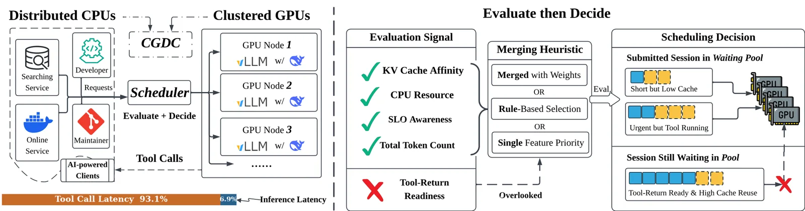
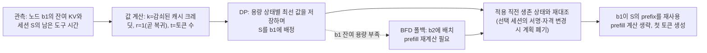
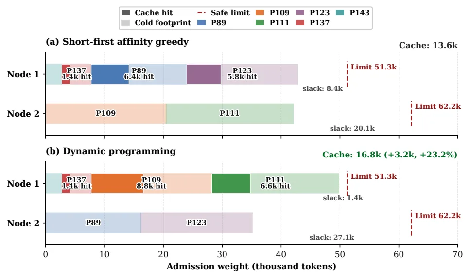
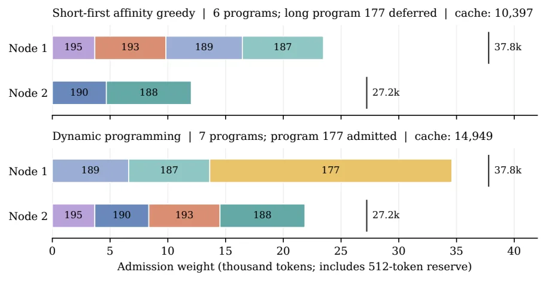
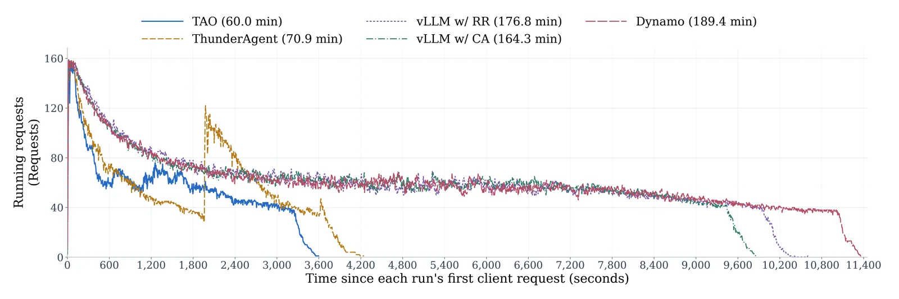

[논문 링크](https://arxiv.org/abs/2610.37230v1)
## TAO: LLM 기반 에이전트 서빙을 위한 도구 인지 통합 스케줄링

원문: Shuhuai Li 외, "TAO: Tool-Aware Joint Scheduling for LLM-Based Agentic Serving" (arXiv:2610.37230v1, preprint). 아래 서술은 첨부된 원문 텍스트만 근거로 한다.

## 도입

에이전트는 모델 추론과 외부 도구 실행을 번갈아 수행한다. 도구가 도는 동안 그 세션의 GPU 수요는 중단 가능해지며, 이 빈 구간을 어떻게 쓰고 세션이 돌아왔을 때 어느 노드에 붙이느냐가 응답 시간을 좌우한다. 이 논문은 두 문제를 하나의 스케줄링 문제로 묶는 프레임워크 TAO를 제안한다.

## 1. 문제: 도구가 도는 사이에는 GPU가 쉰다

### 1.1 세션과 CGDC

에이전트의 상호작용 전체를 하나의 **세션(session)** 으로 부르자. 세션은 모델 요청과 도구 호출을 오가며 이어지는 작업 단위다. 모델 요청 중에는 세션이 GPU 노드 하나를 점유하고, 도구 실행 중에는 추론 서비스 밖에서 결과를 기다린다.

논문은 이런 배치를 CGDC(Clustered GPUs with Distributed CPUs)라고 부른다. GPU는 노드에 몰려(clustered) 추론 용량을 공유하고, 도구는 그 바깥의 분산 CPU에서 돌아가며, 도구의 CPU·RAM은 GPU 수용 예산과 분리해 관리된다. 즉 GPU 예산에 들지 않는 시간이 존재하는 구조다.

역할 분담도 미리 정해져 있다. 스케줄러는 각 세션의 상태를 기록하고 세션 수용을 제어하며, 서빙 엔진은 물리적 KV 캐시의 상주와 evict을 관리한다(근거: §2.1).

### 1.2 비싼 것은 "KV 캐시를 다시 쓰지 못하는 것"

한 세션의 다음 요청은 앞선 턴이 만든 **KV prefix**를 그대로 쓸 수 있으면 prefill 계산을 통째로 건너뛴다. 그런데 그 prefix가 살아 있는지는 "어느 노드에 붙였느냐"와 "얼마나 지났느냐"로 정해진다. 도구가 끝나 돌아온 세션을 같은 노드에 다시 넣으면 캐시가 살아 있어 빠르고, 다른 노드로 보내거나 용량 압박으로 밀려나면 prefill를 다시 계산해야 한다.

반대로 *활성* 추론 세션을 쫓아내면 즉시 재계산이 필요하다. 재계산과 복원이 반복되면 재구축해야 할 상태에 용량을 낭비한다(근거: §2.1, §2.2).

### 1.3 interrupt와 restart

도구 경계에서 스케줄러가 할 수 있는 동작은 두 가지다.

- **interrupt(중단)**: 도구 실행 중인 세션의 모델 수용을 해제해 노드 자원을 돌려준다.
- **restart(재개)**: 도구가 끝난 세션을 적절한 노드에 다시 배정해 기존 상호작용을 이어간다.

두 동작은 세션의 상태 전이일 뿐 추론 엔진 구현과 분리된다. 논문의 출발점은 이 두 판단이 결국 같은 세션 평가로 환원된다는 점이다. interrupt 여부는 세션 값을 정렬해 정하고, interrupt된 세션은 새 도착 세션과 함께 대기 풀에 들어간다. 논문은 이 대기 풀에서의 통합 평가와 재개 결정을 함께 다룬다(근거: §2.2).

### 1.4 기존 스케줄러가 놓치는 두 가지

기존 서빙 시스템은 대체로 "먼저 평가하고 그 다음에 결정한다(evaluate-then-decide)" 패턴을 따른다. 세션 수준에서 노드 특징을 평가한 뒤, 어디에 언제 서빙할지를 정한다.

원문 Figure 1. 왼쪽 패널은 CGDC 구조를, 오른쪽 패널은 논문이 공략하는 두 문제를 보여준다.

- **문제 1 — 평가에서 도구 복귀 준비도를 놓친다.** 도구 타이밍은 기존에도 쓰이지만 KV 재사용이나 토큰 수의 대리값으로만 쓰인다. 도구 소요시간을 예측해 KV 보존 시간을 정하거나, 도구 실행 중 세션의 토큰 수요를 시간에 따라 할인하는 식이다. 이런 값은 고정 점수 규칙이나 손으로 고른 임계값에 섞여 들어간다.
- **문제 2 — 결정을 세션별 휴리스틱으로 내린다.** llm-d와 SGLang의 세션 단위 점수·라우팅 규칙은 개별 세션에게 추론 기회를 하나씩 배정한다. 그런데 세션들은 같은 노드 용량을 놓고 경쟁하므로, 한 세션을 받아들이는 순간 다른 세션들에는 더 값진 조합이 들어갈 자리가 사라질 수 있다. 오른쪽 패널의 "Short but Low Cache", "Urgent but Tool Running", "Session Still Waiting in Pool" 같은 표기가 이 착시를 가리킨다(근거: §1, §2.2).

## 2. 작은 예시: 세션 하나가 12초 동안 기다리는 동안

개념을 잡기 위해 가상의 코딩 세션 `S`를 따라가자. 이 절의 수치는 이해를 위한 가상 예시이며 **원문 미보고**다.

| 단계 | GPU에서 일어나는 일 | 남는 상태 |
| --- | --- | --- |
| 입력 | `S`가 저장소 컨텍스트 8,000토큰을 실은 첫 요청을 보낸다. | 노드 `b1`이 8,000토큰을 prefill해 KV 캐시를 만들고 `S`가 `b1`의 GPU 슬롯을 점유한다. |
| 응답 | 모델이 200토큰을 생성한다. | `S`의 히스토리에 200토큰이 쌓인다. |
| 도구 호출 | `S`가 테스트 실행 도구를 호출한다. 도구가 CPU에서 12초 동안 돈다. | `S`는 GPU 슬롯을 반환한다(interrupt). 다른 세션이 `b1`의 슬롯을 쓰기 시작하고, `b1`의 KV 캐시는 남아 있으나 용량 압박 시 evict될 수 있다. |
| 값 계산 | 스케줄러가 `S`와 각 노드 쌍의 값을 계산한다. | `b1` 쌍에는 캐시 크레딧(관측값에서 감쇠 적용), 복귀 준비도, 토큰 수가 붙는다. |
| 변경·생략·거절 | `b1`에 여유가 있으면 DP가 `S`를 `b1`에 배정한다. | 캐시가 살아 있어 **prefill 계산이 생략**된다. `b1`이 가득 차면 다른 노드 `b2`로 배정되어 **prefill를 재계산**한다. 어느 노드에도 자리 없으면 `S`는 **거절당해 대기 풀에 남는다**. |
| 출력 | 12초 뒤 도구 결과가 도착해 `S`가 GPU를 다시 요구한다. | 배정된 노드의 캐시가 살아 있으면 prefill 없이 이어지고, 없으면 다시 prefill한다. |

이 예에서 두 가지가 드러난다. 하나는 "살아 있는 캐시가 있는 노드로 돌아가느냐"가 응답 속도를 좌우한다는 점이고, 다른 하나는 "도구가 언제 끝나느냐"를 알면 그 직전에 `S`를 GPU 배치 후보로 올려 기다림을 없앨 수 있다는 점이다. 논문은 이 두 가지를 각각 '캐시 크레딧'과 '복귀 준비도'라는 값으로 만든다.

## 3. 방법

### 3.1 두 단계 파이프라인: 평가 → 결정

TAO는 두 단계로 동작한다. 먼저 대기 풀의 각 세션–노드 쌍에 값을 붙이고(평가), 그 값을 근거로 동적 계획법이 대기 중인 세션을 한 번에 선택·배치한다(결정). 평가와 결정을 분리해 둔 덕분에 값 함수를 바꿔도 스케줄링 절차는 그대로 유지된다(근거: §3.1).

이 다이어그램의 구체적 수치는 2절 예시와 마찬가지로 원문 미보고다. 각 상자는 상태 변화다. 첫 상자는 관측값(잔여 캐시 토큰 수와 남은 도구 시간)이고, 두 번째 상자는 그것을 값으로 바꾼 결과이며, 세 번째 상자는 값에서 배정을 복원하는 과정이고, 마지막 상자는 실제 실행에서 일어나는 일이다. 점선은 용량이 부족해 다른 경로로 빠지는 경우다. 서빙 엔진의 역할(물리적 KV 할당·재사용·evict)은 사라지지 않는다. 스케줄러는 그 위에 "캐시가 어디에 남았고 언제 되찾을 수 있는가"를 값으로만 읽는다. 줄어드는 것은 캐시 재사용으로 사라지는 prefill 재계산과, 준비도로 사라지는 복귀 대기다.

### 3.2 세션–노드 쌍에 붙이는 값 세 개

각 세션 `i`와 노드 `b` 쌍에 논문은 세 값을 붙인다(근거: §3.2, 식 (2)).

$$v_{i,b} = (k_{i,b},\ r_i,\ t_i)$$

- `k_{i,b}` — 노드 `b`에 남아 있는 세션 `i`의 캐시 크레딧. 관측이 오래될수록 작아진다.
- `r_i` — 복귀 준비도. 도구가 곧 끝나 세션 `i`가 곧 GPU를 다시 요구할 가능성이 있는지를 나타내는 0/1 신호.
- `t_i` — 세션 `i`의 토큰 수. 누적 컨텍스트 크기를 나타낸다.

핵심 설계는 이 셋을 가중합으로 섞지 않고 **사전식(lexicographic) 순서**로 비교한다는 점이다. 먼저 캐시 크레딧을 보고, 같으면 준비도를, 그것도 같으면 토큰 수를 본다. 순서 자체는 고정돼 있고 값만 시간에 따라 변한다. 논문은 이 순서를 세 가지 이유로 정당화한다(근거: §3.2). 첫째, prefix 재사용은 prefill 재계산을 그대로 없애므로 캐시 크레딧이 최우선이다. 둘째, 감쇠로 크레딧이 비슷해지면 준비도가 '곧 돌아오는 세션'과 '아직 멀리 있는 세션'을 구분한다. 셋째, 크레딧과 준비도가 동률이면 더 큰 누적 컨텍스트를 선호하되, 최적화기가 그 컨텍스트가 차지하는 용량 비용까지 함께 계산해 전체 배정 집합을 정한다.

배정의 제약은 다음과 같다(식 (1)). 세션 `i`는 노드 하나에만 들어갈 수 있고($\sum_b x_{i,b} \le 1$), 노드 `b`의 잔여 용량 `C_b`를 넘을 수 없으며($\sum_i w_i x_{i,b} \le C_b$), 자격이 없는 쌍에는 배정할 수 없다. 목표는 모든 쌍의 값을 사전식으로 합쳐 최대화하는 배정이다(식 (3)).

### 3.3 크레딧은 관측 나이에 따라 감쇠한다

노드가 관측한 캐시 토큰 수 `k⁰`를 그대로 쓰면 오래된 관측이 굳은 신호처럼 남는다. 논문은 관측 후 지난 시간 `τ`에 따라 $2^{-\tau/h}$를 곱해 크레딧을 계산한다(근거: §3.3, 식 (4)).

$$k_{i,b}(t) = k^0_{i,b}\,2^{-\tau/h},\quad \tau = \max(0,\, t - t^{\mathrm{obs}}_{i,b})$$

반감기 `h`는 10초로 두고, 계산한 크레딧은 평가에 쓰기 전에 반올림한다. 근거는 실측이다. 노드당 4×H100을 갖춘 두 노드의 DeepSeek-V4 Flash 트레이스에서 관측된 캐시 토큰 잔존량의 구간별 중앙값이 시간이 갈수록 뚜렷하게 줄어든다(원문 Figure 3). 중앙값은 채워진 구간을 대상으로 한 기술적 지수 적합으로 그려졌고 각 점에는 부트스트랩 95% 신뢰구간이 붙는다. 오래된 관측에 큰 가중치를 주면 틀린 결정을 하게 되므로 감쇠가 필요하다.

반감기는 스케줄러 파라미터일 뿐 트레이스에서 적합한 시간 상수와는 구별된다. 실제 캐시의 물리적 보관과 evict은 서빙 엔진이 그대로 담당한다.

### 3.4 준비도는 "곧 돌아오나"를 0/1로 알려 준다

준비도는 GPU가 곧 다시 필요한 세션을 찾아낸다. 도구 인터페이스가 진행이나 종료 시한을 노출하면 그것을 먼저 쓴다. Claude Code의 Monitor는 백그라운드 작업 이벤트를 전달하고, OpenCode는 Bash 타임아웃 뒤 종료 사실을 보고한다(근거: §3.4). 직접 타이밍 증거가 없으면 과거 도구 소요시간 기록으로 남은 시간을 추정한다. 추정 순서는 도구별 이력 → 전역 이력 → 5초 기본값이다. 완료된 호출들의 표본 수, 평균, 표본 분산, 관측 범위를 모아 유한표본 마진을 얹은 보수적 추정치를 만들고, 여기서 이미 흐른 시간을 빼고 0 이하로 자른다(식 (5), Appendix A).

남은 예측 시간이 수평선 `H=1초` 안으로 들어오면 `r=1`이 된다. 판단은 세 가지를 함께 쓴다(식 (6)). 도구 완료를 이미 관측했다면 `r=1`. 예측 시한이 지났는데 완료가 아직 관측되지 않으면, 무한정 '준비됨'으로 남아 있는 대신 임시 탐색(probe) 기회만 준다. 그 외에는 예측 타임스탬프가 30초 이내에 갱신된 경우에만 판단한다. 관측된 완료를 예측보다 우선한다.

이 신호는 스케줄링 주기(1초)와 연결된다. 준비도 1인 세션은 GPU 배치 후보로 끌어올려지고, 도구가 끝나자마자 첫 토큰을 내보낼 수 있게 된다.

### 3.5 동적 계획법으로 한 번에 선택·배치한다

값을 다 매기면 결정 문제는 "여러 배낭에 물건을 나눠 담는" 문제로 바뀐다. 각 노드 `b`는 잔여 용량 `C_b`를 가진 배낭이고, 각 세션 `i`는 수용 비용 `w_i`와 노드별 값 `v_{i,b}`를 가진 물건이다.

기존 방식의 문제는 이 문제를 세션별로 따로 풀었다는 점이다. 세션 하나하나를 순서대로 좋아 보이는 노드에 넣으면, 먼저 넣은 세션이 나중에 더 값진 조합이 들어갈 자리를 막는다.

논문은 용량을 일정 단위(양자 `Δ`)로 잘게 쪼갠 뒤, 후보를 하나씩 늘려가며 "지금까지 후보 `j`개로 각 용량 상태에서 얻을 수 있는 최선의 값"을 저장하는 DP로 **동결·이산화된 스냅샷 위의** 정확한 최적해를 구한다(근거: §3.5, 식 (7)).

$$D_j(s) = \operatorname{lexmax}\left\{ D_{j-1}(s),\ \operatorname{lexmax}_{b\,\mathrm{eligible}}\left[ D_{j-1}(s - \bar{w}_j e_b) + u_{j,b} \right] \right\}$$

여기서 $\bar{w}_i = \lceil w_i/\Delta\rceil$, $\bar{C}_b = \lfloor C_b/\Delta\rfloor$이고, $u_{j,b}$는 후보 `j`를 노드 `b`에 넣었을 때의 값과 개수를 담은 항이다. 각 후보마다 "건너뛰기"와 "`b`에 배정하기"를 모두 시도하므로 가능해는 빠짐없이 다뤄진다. 다만 반올림 때문에 이산화 전에는 실현 가능했던 계획이 배제될 수 있다.

계산은 격리된 비동기 워커에서 돌아가고, 적용 직전에 살아있는 상태(선택된 세션의 서명과 자격이 그대로인지)와 다시 대조한 뒤, 현재 용량이 허용하는 가장 긴 계획 접두사만 적용한다. 서명이 바뀌면 계획 전체를 버린다. 준비와 풀의 준비 비용은 4-복제 스윕에서 전체 실행 시간의 0.12% 미만이다(근거: §3.5, Appendix I).

노드별 캐시 관측은 `O(nm)` 전처리로 감쇠한 뒤 값에 접어들고, 캐시가 같은 노드들은 `g ≤ m`개의 용량 차원으로 묶을 수 있다(물리적 KV 블록을 옮기지 않는다). 상태 예산이 소진되면 best-fit-decreasing(BFD) 배치로 폴백한다. 수용 비용 `w_i`는 세션의 총 토큰 수에서 공유 토큰 용량을 뺀 메모리 수요로, `C_b`는 노드의 잔여 용량으로 매 스케줄링 시점마다 갱신된다(Appendix B.1).

#### DP가 실제로 다르게 고르는 것

원문 Figure 10. 각 프로그램은 서로 다른 색(hue)으로 구분되고, 반투명 구간은 그 프로그램의 수용 가중치, 진한 오버레이는 보존된 캐시 크레딧이다. 가로 축은 수용 가중치(천 토큰)이고 각 노드의 가로 막대 높이는 그 노드의 한계다.

- (a) short-first affinity greedy: 노드 1이 캐시 13.6k를 남기고 여유 8.4k, 노드 2는 여유 20.1k.
- (b) 동적 계획법: 캐시 16.8k(+3.2k, +23.2%)를 남기며, 노드 1의 여유는 1.4k로 줄고 노드 2의 여유는 27.1k로 늘어난다.

같은 총 안전 토큰 잔량을 유지하면서 DP가 더 많은 캐시 크레딧을 살린다. 정확한 값은 16,791토큰 대 13,624토큰이다(근거: Appendix H).

원문 Figure 11. 각 세션의 폭은 수용 가중치(512-토큰 예비량 포함)이고, 그 옆 숫자는 프로그램 ID와 캐시 크레딧이다.

- (a) short-first affinity greedy: 프로그램 6개를 수용하고, 긴 컨텍스트의 프로그램 177은 미룬다. 캐시 10,397토큰.
- (b) 동적 계획법: 프로그램 177을 포함해 7개를 수용한다. 캐시 14,949토큰.

즉 휴리스틱은 짧은 프로그램으로 자리를 채워 값진 세션을 밀어내는 반면, DP는 그 세션까지 받아들인다(근거: Appendix H).

## 4. 결과

### 4.1 지표와 비교 조건

지표는 셋이다. **지연(latency)** 은 작업 종단 간 평균 시간(모델 추론 + 도구 실행 포함), **TTFT** 는 첫 토큰까지의 평균 시간, **디코드 처리율** 은 초당 생성 토큰 수(TPS)다. 컴포넌트 분석에서는 prefix-cache 히트율, 도구 종료부터 첫 토큰까지의 지연, pause 대기를 추가로 잰다. pause 대기는 interrupt된 세션이 tool call 지연까지 포함해 기다린 시간이다.

비교 대상은 네 가지다. vLLM의 round-robin(RR)과 캐시 인지(CA) 스케줄러, KV 인지 스케줄러 Dynamo, 토큰 수 스케줄링에 BFD 배치를 쓰는 ThunderAgent. 배포는 DeepSeek-V4 Flash가 2노드×(노드당 H100 4장), Qwen3-32B가 4노드×(노드당 H100 2장), GLM-4.7이 1노드×8×H100(TP8)다. 워크로드는 mini-SWE-agent 하네스를 쓴 SWE-bench Lite(SWE-Lite)이며, DeepSeek은 Claude Code로 Terminal-Bench 2.0을, Qwen은 SWE-verified를 추가로 돈다(근거: §4.1).

논문은 12개의 모델–워크로드–동시성 설정에서 지연 최대 26.8% 감소, TTFT 최대 36.3% 감소, 디코드 처리율 최대 29.5% 증가를 보고하며, 비교 기준은 **지표별 최선 평가 baseline**이다(근거: 초록).

### 4.2 메인 결과: 어디서 이겼고 어디서 졌나

DeepSeek-V4 Flash의 SWE-Lite 결과에서 각 칸은 해당 지표의 최선 경쟁치 대비 개선 폭이다(근거: 원문 Table 1).

| 지표(개선 폭) | 16 workers | 32 workers | 64 workers |
| --- | ---: | ---: | ---: |
| 지연 감소 | 2.4% | 5.4% | 26.8% |
| TTFT 감소 | 7.4% | 13.3% | 36.3% |
| 디코드 처리율 증가 | 5.1% | 6.0% | 29.5% |

동시성이 높아질수록 개선 폭이 커진다. 64 workers에서 TAO의 지연은 185.410초로 최선 경쟁치 253.228초를 크게 웃돌고, TTFT는 0.224초 대 0.351초, 디코드 처리율은 2,021.523 대 1,561.307 tok/s다. 16 workers에서 이 격차는 각각 113.264초 대 116.011초, 0.135초 대 0.146초, 934.967 대 889.590 tok/s로 좁다. 즉 세션이 노드 용량을 놓고 경쟁할수록 "한 번에 최적 배치"와 "캐시·준비도를 반영한 값 매기기"의 효과가 두드러진다(근거: §4.2).

나머지 설정의 개선 폭도 함께 보면 전체 그림이 선명해진다. 아래 값은 Table 1의 Rel. Imprv. 행을 그대로 옮긴 것으로, 음수는 TAO가 밀린 칸이다(근거: 원문 Table 1).

| 워크로드 (배치) | 동시성 | 지연 | TTFT | 디코드 |
| --- | --- | ---: | ---: | ---: |
| DeepSeek Terminal-Bench (2×4×H100) | 16 / 32 / 64 | +2.2 / +11.1 / +3.8 | +21.7 / +20.3 / +16.2 | −8.8 / +1.3 / −6.2 |
| Qwen3-32B SWE-Lite (4×2×H100) | 96 / 128 / 160 | +11.4 / +1.2 / −0.2 | +10.9 / +0.2 / +10.2 | −5.1 / +0.8 / +6.7 |
| Qwen3-32B SWE-verified (4×2×H100) | 96 / 128 / 160 | +8.3 / −2.5 / +9.0 | +29.9 / +12.9 / +18.5 | +7.8 / +4.0 / +4.7 |

Table 1의 36개 칸 가운데 5개 칸에서 TAO가 최선 경쟁치에 밀린다. DeepSeek Terminal-Bench는 지연과 TTFT를 세 동시성 모두에서 앞섰지만 디코드는 16 workers(−8.8%)와 64 workers(−6.2%)에서 뒤졌다. Qwen3-32B SWE-Lite는 96 workers 디코드(−5.1%)와 160 workers 지연(−0.2%)에서 밀렸고, SWE-verified는 128 workers 지연(−2.5%)에서만 밀렸다. 결론은 "모든 지표에서 모든 조건을 이긴다"가 아니라 "대부분의 조건에서 여러 지표를 함께 좋게 만든다"에 가깝다.

대형 모델 확장 실험인 GLM-4.7(1노드 8×H100, TP8, 300개 작업)은 SWE-Lite 160 workers에서 지연 15.5% 감소, TTFT 14.1% 감소, 디코드 20.5% 증가를 기록했고, SWE-verified 500개 작업 전 구간에서는 지연 16.2~18.9% 감소, 클라이언트 TTFT 15.7~38.4% 감소, 디코드 22.8~24.7% 증가를 기록했다. 비교 대상은 각 지표에서 SOTA인 ThunderAgent다(근거: 원문 Table 2, §4.2).

### 4.3 서빙 역학: 동시에 몰아넣지 않기

원문 Figure 4. GLM-4.7이 SWE-Lite 300 작업을 160워커(TP8)로 실행할 때의 실행 중 요청 수 추적이며, 각 실행은 첫 클라이언트 요청 시점을 0으로 맞춘다. TAO는 60.0분에 워크로드를 끝냈고 ThunderAgent는 70.9분, vLLM CA는 164.3분, vLLM RR은 176.8분, Dynamo는 189.4분이었다. TAO는 실행 중반 내내 동시 실행 요청 수를 낮게 유지하면서 작업을 더 일찍 끝낸다. 즉 동시 요청 수를 낮게 유지하면서 추가 세션을 안정적으로 받아들이는 방식이다. 96·128워커의 대응 추적(TAO 53.9분·59.2분, ThunderAgent 60.1분·66.2분)은 Appendix D에 있다(근거: §4.2, Appendix D).

### 4.4 어느 부분이 실제로 기여했나

**구성요소 제거 실험.** SWE-Lite, DeepSeek-V4 Flash, 2노드×4×H100, 32 workers 기준이다(근거: 원문 Table 4, §4.4).

| 구성 | 디코드(tok/s) | 히트(%) | TTFT 평균/P90(s) | 도구종료→첫토큰 평균/P90(s) | pause 평균/P90(s) |
| --- | ---: | ---: | ---: | ---: | ---: |
| TAO 전체 | **1417.97** | **96.31** | **0.154 / 0.241** | **0.203 / 0.299** | **0.972 / 1.051** |
| 캐시 값 제거 | 1398.35 | 96.24 | 0.157 / 0.246 | 0.209 / 0.309 | 1.028 / 1.047 |
| 준비도 제거 | 1363.06 | 96.16 | 0.161 / 0.253 | 0.227 / 0.358 | 1.067 / 1.079 |
| 캐시 값·준비도 모두 제거 | 1373.51 | 96.24 | 0.182 / 0.278 | 0.213 / 0.317 | 1.025 / 1.059 |
| 세션 평가 제거 (ThunderAgent의 pause 정렬) | 1355.20 | 96.20 | 0.162 / 0.257 | 0.226 / 0.350 | 1.025 / 1.061 |
| 의사 결정 제거 (BFD 배치) | 1233.72 | 96.05 | 0.195 / 0.300 | 0.235 / 0.354 | 1.081 / 1.119 |

가장 큰 하락은 마지막 줄이다. DP를 단순한 BFD 배치로 되돌리면 디코드가 1417.97 → 1233.72 tok/s로 떨어지고 TTFT 평균은 0.154 → 0.195초로 늘어난다. 값 매기기만 잘해서는 배치가 근시안적이면 성능이 크게 떨어진다는 뜻으로, "평가"와 "결정"이 서로 다른 역할을 한다는 설계 근거를 뒷받침한다. 준비도 제거는 디코드를 1363.06까지 낮추고 도구 종료→첫 토큰을 0.227초로 늘린다. 캐시 값 제거의 효과는 상대적으로 작다(1398.35). 제거 효과가 단조롭지 않은 점도 눈에 띈다. "캐시 값·준비도 모두 제거" 행(1373.51)이 "준비도만 제거" 행(1363.06)보다 디코드가 높게 나온다. 다만 마지막 DP→BFD 행과의 간격에 비하면 이 불규칙성은 크지 않다.

**캐시 인지 평가.** 218개 작업의 고정 워크로드 리플레이에서 DP 배치는 ThunderAgent 대조군과 동일하게 고정한 채 값 매기기만 바꿔 비교했다. 캐시 토큰 정렬은 prefix-cache 히트율을 0.19%p 높이고 평균 pause 대기를 4.5% 줄였다. 여기에 캐시 크레딧 감쇠를 더하면 히트율은 0.31%p, 디코드 처리율은 1.68% 올랐다. Figure 5는 물리적 prefill 감소, TTFT 감소, pause 대기 감소를 함께 보여준다(근거: §4.3, 원문 Figure 5).

**도구 준비도.** 짝을 맞춘 32-워커 SWE-Lite 실행에서 준비도를 켜면 디코드 처리율이 4.03% 오르고, 도구 종료부터 첫 토큰까지의 지연이 10.88% 줄며, 평균 pause 대기가 1.067초에서 0.972초로 내려간다. Figure 6의 왼쪽 CDF는 도구 종료 이후 첫 출력 토큰까지의 분포를, 오른쪽은 예측 오차 분포를 보여준다. 10,967건 완료 도구 예측의 평균 절대 오차는 0.410초이고 오차 0.5초 이내가 82.9%다(복귀 지연 CDF에는 10,481건과 10,673건의 관측이, 예측 패널에는 10,967건의 예측이 들어간다)(근거: §4.3, 원문 Figure 6).

**동시 배치.** 다중 후보가 있는 23개 리플레이 스냅샷 가운데 6개(26.1%)에서 사전식 목적이 개선됐고 나머지 17개는 short-first 휴리스틱과 같았다. 단일 후보 사례를 포함한 복원 가능한 35개 전체에서는 6개(17.1%)가 개선되고 29개(82.9%)가 일치한다. 즉 이 기준에서 DP가 더 나빠진 경우는 없었고, 충돌이 심한 스냅샷에서 이득을 냈다(근거: §4.3, Appendix H).

### 4.5 혼합 워크로드와 보조 평가

**혼합 워크로드(근거: 원문 Table 3).** Terminal-Bench + SWE-Lite 혼합(389개 작업)에서 32·64·128워커 모두 지연(+12.2/+23.2/+13.8%)과 디코드(+12.2/+8.6/+4.4%)가 개선됐고, 32워커 TTFT만 −5.5%로 밀렸다. AutomationBench(800개 작업)는 32·64워커에서 세 지표가 모두 개선됐다. 반면 128워커에서는 세 지표가 모두 뒤졌다. 지연 563.114초 대 523.676초(−7.0%), TTFT 19.123초 대 3.166초(−504.0%), 디코드 1,013.157 대 1,140.862 tok/s(−11.2%)다. 워크로드에 따라 이득과 손실의 방향이 달라진다.

**저동시성 폴백(근거: Appendix E.1, Table 5).** DeepSeek-V4 Flash를 단일 TP8 노드에 두고 4~64워커를 훑었다. 4~8워커에서 TAO의 평균 작업 지연은 최선 baseline의 2.3% 이내로 붙고 디코드 처리율은 최선의 92% 이상을 유지하며, 평균 TTFT는 최선보다 15~20ms 높다. 32·64워커에서는 ThunderAgent가 크게 밀린다(64워커 기준 지연 475.033초 대 226.268초, TTFT 9.332초 대 0.423초). 스케줄링 여지가 적어져도 TAO가 붕괴하지 않는다는 확인이다.

**InferenceX 리플레이(근거: Appendix F, Table 7, Figure 9).** AgentX 트레이스 393개와 100만 토큰 컨텍스트 한도, 1,800초 프로파일링 창으로 구성된 고정 코퍼스를 DeepSeek이 2노드×4×H100에서 서비스한다. TAO는 16·32·64워커 모두 디코드 처리율 1위(+4.2/+1.8/+10.1%)이며 TTFT는 16워커에서만 1위이고 32·64워커에서는 캐시 인지 스케줄러가 더 낮다. Figure 9에서 TAO의 prefix-cache 히트율은 모든 워커 수에서 1위다.

**다른 KV 관리 엔진과의 합성(근거: Appendix E.2, Table 6).** TokenCake 위에 TAO를 얹으면 16·32워커에서 디코드 처리율이 785.159 → 886.772 tok/s, 1,292.584 → 1,347.373 tok/s로 늘고, 64워커에서는 지연 509.018 → 274.892초, TTFT 1.590 → 0.593초, 디코드 790.491 → 1,414.547 tok/s로 개선된다. 다만 저자들은 이 실행에서 프로그램의 pause·resume·migration이 한 번도 발생하지 않았음을 함께 보고하며, 메커니즘에 대한 귀속은 별도 실행이 필요하다고 인정한다.

**긴 도구 지연에 대한 민감도(근거: Appendix G, Table 8).** MiniSWE로 녹인 SWE-Lite 세션(모델 요청 6,995건, 도구 기록 6,942건)에 세션마다 고정 추가 지연 1~5초, 2~10초, 4~20초를 주었다. 준비도를 끈 대비 TAO는 makespan을 20.72/16.42/19.28%, 평균 세션 지연을 21.57/20.57/17.91% 줄였다. 지연이 길수록 준비도가 실제 배치 결정을 바꾸는 비율이 1.65% → 3.94% → 7.93%로 커진다. 이력 기반 예측을 알려진 진실 시간을 주는 Oracle와 비교하면 평균 절대 오차가 99.53~99.69% 줄고(0.025~0.030초) 런타임 성능도 Oracle에 근접했다.

## 5. 한계와 적용 판단

### 5.1 논문 자체가 밝히거나 구조상 따르는 한계

- **최적성은 이산화 스냅샷 위에서만 성립한다.** DP는 동결·이산화된 스냅샷에서 정확하지만, 반올림은 이산화 전에는 실현 가능했던 계획을 배제할 수 있다(근거: §3.5).
- **전역 온라인 최적성을 보장하지 않는다.** 비동기 적용의 손실은 값 변동 `ε_{s,t}`, 실현 가능성 변화로 생기는 기회 `A_{s,t}`, 실행 손실 `T_{s,t}`로 묶어 조건부 상계로 제시된다(식 (12)).
  $$\max_{x \in X^\Delta_t} U_t(x) - U_t(y_t) \le A_{s,t} + 2\epsilon_{s,t} + T_{s,t}$$
  이 상계의 비교 기준은 계획 시점이 아니라 **적용 시점에 관측된 동일 상태의 신선한 스냅샷 최적해**다. 따라서 end-to-end 지연이나 전역 최적 온라인 정책 대비 regret은 보장하지 않는다. 준비도의 0/1 점프는 지수 감쇠 가정에 자동으로 들어맞지 않아 별도의 점프 허용치가 필요하다(근거: Appendix B.2, Appendix C).
- **준비도 예측은 보정된 확률이 아니다.** 유한표본 마진을 얹은 스케줄링 휴리스틱일 뿐 개별 호출에 대한 calibrated coverage를 제공하지 않는다. 도구별·전역 이력이 모두 없으면 5초 기본값에 의존한다(근거: Appendix A).
- **자원 경계 가정.** 외부 도구의 CPU·RAM은 GPU 수용 예산 밖에서 별도로 관리된다고 가정한다. 추가 자원 제약이나 상호작용 의존적 값이 필요한 상황은 이 수용 모델의 확장이 필요하다(근거: §2.1, §3.4 — 후자는 리뷰어 해석).
- **오버헤드 회계는 부분적이다.** 기록된 스케줄러 작업 시간은 상태 준비와 완료된 풀이라 실패한 탐색과 BFD 실행은 시간 계정에 들어 있지 않다. 즉 그 비율은 CPU 이용률이나 요청 지연 오버헤드의 측정값이 아니다(근거: Appendix I).

### 5.2 리뷰어 관점의 짚을 점

- **확장성은 노드 수에서 검증되지 않았다.** DP의 상태 공간은 노드 수와 용량 양자화에 따라 커진다. 캐시가 같은 노드들은 `g ≤ m`개의 용량 차원으로 묶이고, 상태 예산이 소진되면 BFD로 폴백한다. 실측 폴백 비율은 DeepSeek 64 workers 5.24%, Qwen 스윕 3.06~8.98%다. 다만 보고된 실측은 최대 4노드(TP2×4) 배포까지이고, 노드가 훨씬 많은 배포는 검증되지 않았다(근거: §3.5, Appendix I, Table 9).
- **준비도는 신호의 품질에 전적으로 의존한다.** 도구 인터페이스가 진행·시한을 노출하거나 이력 통계가 유효한 환경에서 가장 잘 작동한다. 그런 신호가 없는 도구에서는 5초 기본값에 의존하며, 이때의 정확도 보장은 제한적이다(근거: §3.4, Appendix A).
- **기아 회피 장치는 원문에 없다.** 세 번째 좌표인 토큰 수 우선은 캐시 크레딧과 준비도가 모두 동률일 때만 적용된다. 이때 토큰 수가 큰 세션이 배정 우위를 갖는 것은 Figure 11의 세션 177 수용에서 드러나지만, 기아를 막는 장치는 명시되어 있지 않다. 스냅샷이 매 스케줄링 시점마다 다시 풀린다는 점이 완화 요인으로 보인다(근거: §3.2; 완화 요인은 리뷰어 해석).
- **엔진과의 결합은 아직 설계 단계다.** TokenCake와의 합성은 동작했지만 pause·resume·migration이 발동하지 않아, 그 메커니즘이 실제로 기여했는지는 미확인이다(근거: Appendix E.2).

### 5.3 적용 판단

이 설계는 도구 호출이 잦고, 세션이 많아 노드 용량을 놓고 경쟁하며, 도구 소요시간이 예측 가능한 에이전트 서빙에 특히 적합하다. SWE-bench류 코딩 에이전트, 다중 에이전트 오케스트레이션, Looped Agent가 그 예다. 논문은 챗봇 부하에도 호환된다고 밝힌다.

반대로 도구가 거의 없거나 도구 신호 없이 예측이 어려운 워크로드에서는 값 매기기의 이점이 줄어든다. 실제로 AutomationBench 128 workers에서는 세 지표가 모두 뒤졌다. 노드 수가 매우 많은 배포에서는 DP 비용과 이득을 별도로 검증해야 한다.

<!-- verbatim-tables -->

논문 원문의 표

> arXiv e-print 의 LaTeX 원본에서 기계적으로 옮긴 표입니다. 숫자는 논문의 값이며 모델을 거치지 않았습니다.

**표 1. Main results for DeepSeek-V4 Flash on 2 nodes with $4\times$H100 per node and Qwen3-32B on 4 nodes with $2\times$H100 per node. DeepSeek uses Terminal-Bench to study more demanding tasks at moderate concurrency; Qwen3-32B uses SWE-verified at higher concurrency to exercise the capacity of its smaller model replicas. **Bold** and underline mark the best and second-best distinct values in each concurrency-level/metric column.**

| *DeepSeek-V4 Flash, 2 nodes with $4\times$H100 per node* |  |  |  |  |  |  |  |  |  |  |
|---|---|---|---|---|---|---|---|---|---|---|
|  |  | 16 workers |  |  | 32 workers |  |  | 64 workers |  |  |
| Benchmark | Method | Latency $\downarrow$ | TTFT $\downarrow$ | Decode $\uparrow$ | Latency $\downarrow$ | TTFT $\downarrow$ | Decode $\uparrow$ | Latency $\downarrow$ | TTFT $\downarrow$ | Decode $\uparrow$ |
|  | Dynamo | 121.993 | 0.146 | 874.085 | 152.297 | 0.176 | 1393.267 | 269.801 | 0.351 | 1548.472 |
|  | vLLM Scheduler w/ RR | 122.814 | 0.177 | 888.489 | 158.841 | 0.217 | 1145.560 | 290.686 | 0.508 | 1299.754 |
| SWE-Lite | vLLM Scheduler w/ CA | 116.011 | 0.183 | 889.590 | 150.431 | 0.226 | 1256.064 | 253.228 | 0.410 | 1561.307 |
|  | ThunderAgent | 123.564 | 0.379 | 796.215 | 215.727 | 2.708 | 961.791 | 407.180 | 7.447 | 969.018 |
|  | TAO (Ours) | **113.264** | **0.135** | **934.967** | **142.332** | **0.153** | **1477.463** | **185.410** | **0.224** | **2021.523** |
|  | *Rel. Imprv. (%)* | +2.4 | +7.4 | +5.1 | +5.4 | +13.3 | +6.0 | +26.8 | +36.3 | +29.5 |
|  | Dynamo | 536.600 | 1.371 | 494.866 | 579.650 | 1.252 | 651.151 | 688.531 | 1.315 | 760.736 |
|  | vLLM Scheduler w/ RR | 342.464 | 0.306 | 820.754 | 375.182 | 0.499 | 1071.063 | 467.410 | 0.582 | 1597.497 |
| Terminal-Bench | vLLM Scheduler w/ CA | 304.802 | 0.319 | 723.889 | 394.677 | 0.331 | 1146.434 | 393.065 | 0.387 | **1654.108** |
|  | ThunderAgent | 361.061 | 0.336 | **876.138** | 380.108 | 1.402 | 1053.042 | 391.580 | 1.010 | 1376.539 |
|  | TAO (Ours) | **298.224** | **0.239** | 798.624 | **333.587** | **0.264** | **1161.438** | **376.647** | **0.324** | 1551.387 |
|  | *Rel. Imprv. (%)* | +2.2 | +21.7 | -8.8 | +11.1 | +20.3 | +1.3 | +3.8 | +16.2 | -6.2 |
| *Qwen3-32B, 4 nodes with $2\times$H100 per node* |  |  |  |  |  |  |  |  |  |  |
|  |  | 96 workers |  |  | 128 workers |  |  | 160 workers |  |  |
| Benchmark | Method | Latency $\downarrow$ | TTFT $\downarrow$ | Decode $\uparrow$ | Latency $\downarrow$ | TTFT $\downarrow$ | Decode $\uparrow$ | Latency $\downarrow$ | TTFT $\downarrow$ | Decode $\uparrow$ |
|  | Dynamo | 821.558 | 2.098 | 2074.598 | 857.418 | 7.924 | 1203.708 | 1203.712 | 17.208 | 1239.372 |
|  | vLLM Scheduler w/ RR | 775.303 | 5.109 | 1400.577 | 975.382 | 11.179 | 1359.789 | 1088.036 | 16.645 | 1433.349 |
| SWE-Lite | vLLM Scheduler w/ CA | 811.604 | 5.339 | 1614.671 | 881.068 | 11.707 | 1456.411 | 1179.340 | 18.304 | 1285.413 |
|  | ThunderAgent | 716.272 | 2.051 | **2104.896** | 839.274 | 8.705 | 2036.280 | **1028.478** | 16.209 | 1712.363 |
|  | TAO (Ours) | **634.694** | **1.827** | 1996.793 | **829.361** | **7.907** | **2051.807** | 1030.973 | **14.554** | **1827.561** |
|  | *Rel. Imprv. (%)* | +11.4 | +10.9 | -5.1 | +1.2 | +0.2 | +0.8 | -0.2 | +10.2 | +6.7 |
|  | Dynamo | 736.823 | 1.985 | 1862.845 | 1041.911 | 10.441 | 1820.919 | 1286.167 | 22.469 | 1667.794 |
|  | vLLM Scheduler w/ RR | 777.584 | 5.082 | 1931.333 | 933.347 | 12.586 | 1804.505 | 1244.525 | 24.221 | 1091.002 |
| SWE-verified | vLLM Scheduler w/ CA | 816.201 | 5.731 | 1522.641 | 1016.513 | 14.263 | 1670.856 | 1264.406 | 23.199 | 1619.768 |
|  | ThunderAgent | 699.801 | 2.396 | 2184.933 | **911.097** | 10.500 | 2045.875 | 1202.215 | 21.608 | 1993.620 |
|  | TAO (Ours) | **642.017** | **1.392** | **2354.709** | 933.678 | **9.092** | **2128.599** | **1094.318** | **17.619** | **2087.191** |
|  | *Rel. Imprv. (%)* | +8.3 | +29.9 | +7.8 | -2.5 | +12.9 | +4.0 | +9.0 | +18.5 | +4.7 |

**표 2. High-concurrency extensibility showcase for a larger model: GLM-4.7 on SWE-Lite and SWE-verified through MiniSWE, one node with $8\times$H100 (TP8), and 300 tasks per run.**

| *GLM-4.7, one node with $8\times$H100 (TP8)* |  |  |  |  |  |  |  |  |  |  |
|---|---|---|---|---|---|---|---|---|---|---|
|  |  | 96 workers |  |  | 128 workers |  |  | 160 workers |  |  |
| Benchmark | Method | Latency $\downarrow$ | TTFT $\downarrow$ | Decode $\uparrow$ | Latency $\downarrow$ | TTFT $\downarrow$ | Decode $\uparrow$ | Latency $\downarrow$ | TTFT $\downarrow$ | Decode $\uparrow$ |
|  | Dynamo | 2870.313 | 21.677 | 290.532 | 3779.196 | 41.865 | 287.844 | 4786.720 | 59.548 | 262.215 |
|  | vLLM Scheduler w/ RR | 2687.766 | 20.927 | 310.800 | 3633.795 | 39.502 | 294.582 | 4390.961 | 53.588 | 272.460 |
| SWE-Lite | vLLM Scheduler w/ CA | 2606.523 | 19.553 | 318.687 | 3435.779 | 37.665 | 307.983 | 4314.458 | 56.326 | 297.280 |
|  | ThunderAgent | 999.624 | 7.014 | 773.250 | 1360.382 | 14.243 | 731.052 | 1747.028 | 23.345 | 668.940 |
|  | TAO (Ours) | **887.663** | **6.777** | **869.628** | **1261.906** | **14.103** | **813.653** | **1476.190** | **20.066** | **805.939** |
|  | *Rel. Imprv. (%)* | +11.2 | +3.4 | +12.5 | +7.2 | +1.0 | +11.3 | +15.5 | +14.1 | +20.5 |
|  | Dynamo | 3164.578 | 26.761 | 286.215 | 4545.301 | 52.588 | 256.606 | 8217.092 | 86.008 | 163.572 |
|  | vLLM Scheduler w/ RR | 2938.216 | 23.967 | 292.731 | 4136.027 | 47.930 | 269.838 | 6149.466 | 71.452 | 214.622 |
| SWE-verified | vLLM Scheduler w/ CA | 2928.613 | 24.505 | 300.339 | 3935.660 | 46.963 | 284.906 | 5989.491 | 71.239 | 220.933 |
|  | ThunderAgent | 1146.121 | 12.590 | 691.506 | 1533.286 | 18.516 | 688.310 | 1846.499 | 26.045 | 683.551 |
|  | TAO (Ours) | **951.720** | **7.752** | **856.764** | **1243.886** | **15.281** | **858.140** | **1548.253** | **21.943** | **839.149** |
|  | *Rel. Imprv. (%)* | +17.0 | +38.4 | +23.9 | +18.9 | +17.5 | +24.7 | +16.2 | +15.7 | +22.8 |

**표 3. Workload compatibility on mixed workloads with chatbot scenarios. Deployed on DeepSeek-V4 Flash with 2 nodes 4$\times$H100. Latency and TTFT are in seconds, and decode throughput is in token/s.**

| Method | 32 workers Latency $\downarrow$ | 32 workers TTFT $\downarrow$ | 32 workers Decode $\uparrow$ | 64 workers Latency $\downarrow$ | 64 workers TTFT $\downarrow$ | 64 workers Decode $\uparrow$ | 128 workers Latency $\downarrow$ | 128 workers TTFT $\downarrow$ | 128 workers Decode $\uparrow$ |
|---|---|---|---|---|---|---|---|---|---|
| Terminal-Bench + SWE-Lite (389 tasks) |  |  |  |  |  |  |  |  |  |
| Dynamo | 378.542 | **0.524** | 897.840 | 575.024 | 0.786 | 949.396 | 1065.101 | 1.331 | 723.171 |
| vLLM Scheduler w/ RR | 419.926 | 1.088 | 832.544 | 866.508 | 3.511 | 681.442 | 1328.289 | 4.823 | 635.044 |
| vLLM Scheduler w/ CA | 373.900 | 0.707 | 853.498 | 519.631 | 0.911 | 879.750 | 1002.259 | 1.568 | 751.131 |
| ThunderAgent | 361.778 | 1.149 | 908.751 | 535.400 | 4.200 | 1053.911 | 679.212 | 7.235 | 1337.560 |
| TAO (Ours) | **317.476**$^*$ | 0.553$^*$ | **1019.827**$^*$ | **398.911** | **0.609** | **1144.432** | **585.804** | **0.840** | **1396.591** |
| *Rel. Imprv. (%)* | +12.2 | -5.5 | +12.2 | +23.2 | +22.5 | +8.6 | +13.8 | +36.9 | +4.4 |
| AutomationBench (800 tasks) |  |  |  |  |  |  |  |  |  |
| Dynamo | 147.378 | 0.330 | 1174.370 | 593.958 | 1.449 | 574.021 | 1417.212 | **3.166** | 482.381 |
| vLLM Scheduler w/ RR | 293.286 | 1.849 | 555.398 | 691.139 | 3.616 | 468.963 | 1232.168 | 10.884 | 496.417 |
| vLLM Scheduler w/ CA | 129.716 | 0.409 | 1283.423 | 312.150 | 1.046 | 988.401 | 1214.511 | 3.938 | 501.852 |
| ThunderAgent | 107.485 | 0.444 | 1487.097 | 237.577 | 5.368 | 1264.527 | **523.676** | 16.870 | **1140.862** |
| TAO (Ours) | **101.064** | **0.246** | **1604.639** | **197.023** | **0.539** | **1409.613** | 563.114 | 19.123 | 1013.157 |
| *Rel. Imprv. (%)* | +6.0 | +25.6 | +7.9 | +17.1 | +48.5 | +11.5 | -7.0 | -504.0 | -11.2 |

**표 4. Component variants on SWE-Lite with DeepSeek-V4 Flash, 2 nodes with $4\times$H100 per node, and 32 workers. Each row uses the indicated component variant of TAO. Decode is in tok/s and hit is prefix-cache reuse (%). Mean and P90 timing values are reported separately in seconds. The best results are in **bold** and the second-best results are underlined.**

| Configuration | Decode $\uparrow$ | Hit (%) $\uparrow$ | TTFT $\downarrow$ Mean | TTFT $\downarrow$ P90 | Tool-end$\to$first $\downarrow$ Mean | Tool-end$\to$first $\downarrow$ P90 | Pause $\downarrow$ Mean | Pause $\downarrow$ P90 |
|---|---|---|---|---|---|---|---|---|
| **TAO (Ours)** | **1417.97** | **96.31** | **0.154** | **0.241** | **0.203** | **0.299** | **0.972** | 1.051 |
| *w/o* Cache Value | 1398.35 | 96.24 | 0.157 | 0.246 | 0.209 | 0.309 | 1.028 | **1.047** |
| *w/o* Readiness | 1363.06 | 96.16 | 0.161 | 0.253 | 0.227 | 0.358 | 1.067 | 1.079 |
| *w/o* Cache Value & Readiness | 1373.51 | 96.24 | 0.182 | 0.278 | 0.213 | 0.317 | 1.025 | 1.059 |
| *w/o* Session Evaluation | 1355.20 | 96.20 | 0.162 | 0.257 | 0.226 | 0.350 | 1.025 | 1.061 |
| *w/o* Decision Making | 1233.72 | 96.05 | 0.195 | 0.300 | 0.235 | 0.354 | 1.081 | 1.119 |

**표 5. Low-concurrency fallback check for DeepSeek-V4 Flash on SWE-Lite, one TP8 node ($8\times$H100), with a 4--64-worker sweep. Each run serves 300 tasks. Latency is the mean task E2E time, TTFT is the mean client time to first token, and decode is aggregate throughput. Boldface and underlining indicate the best and second-best distinct values.**

| Workers | Method | E2E latency (s) | TTFT (s) | Decode (tok/s) |
|---|---|---|---|---|
| 4 | vLLM Scheduler w/ RR | 87.911 | 0.126 | 317.855 |
| 4 | vLLM Scheduler w/ CA | 88.390 | 0.125 | 318.357 |
| 4 | Dynamo | 92.549 | 0.102 | 307.382 |
| 4 | ThunderAgent | 90.099 | 0.120 | 312.368 |
| 4 | TAO (Ours) | 89.479 | 0.117 | 315.629 |
| 8 | vLLM Scheduler w/ RR | 102.868 | 0.139 | 528.074 |
| 8 | vLLM Scheduler w/ CA | 101.698 | 0.142 | 555.818 |
| 8 | Dynamo | 103.813 | 0.112 | 565.893 |
| 8 | ThunderAgent | 100.610 | 0.130 | 527.068 |
| 8 | TAO (Ours) | 102.913 | 0.132 | 522.838 |
| 16 | vLLM Scheduler w/ RR | 121.158 | 0.160 | 831.120 |
| 16 | vLLM Scheduler w/ CA | 126.907 | 0.176 | 861.089 |
| 16 | Dynamo | 126.670 | 0.130 | 884.575 |
| 16 | ThunderAgent | 147.709 | 0.789 | 722.445 |
| 16 | TAO (Ours) | 126.702 | 0.153 | 861.198 |
| 32 | vLLM Scheduler w/ RR | 160.981 | 0.211 | 1085.654 |
| 32 | vLLM Scheduler w/ CA | 166.657 | 0.218 | 1232.259 |
| 32 | Dynamo | 172.228 | 0.171 | 1147.924 |
| 32 | ThunderAgent | 272.845 | 3.919 | 766.776 |
| 32 | TAO (Ours) | 171.389 | 0.195 | 1240.768 |
| 64 | vLLM Scheduler w/ RR | 225.967 | 0.278 | 1788.345 |
| 64 | vLLM Scheduler w/ CA | 225.513 | 0.279 | 1658.347 |
| 64 | Dynamo | 229.670 | 0.231 | 1704.425 |
| 64 | ThunderAgent | 475.033 | 9.332 | 794.991 |
| 64 | TAO (Ours) | 226.268 | 0.423 | 1667.524 |

**표 6. Frontend composition over TokenCake on DeepSeek-V4 Flash TP4$\times$2, SWE-Lite (300 tasks), with 100 GiB total CPU KV capacity. Consistent-hash rows are retained validated runs; cache-aware and TAO rows are from the later campaign. Bold and underline rank the TokenCake configurations within each worker group. Light-blue rows reproduce the original TAO results from Table for reference and are excluded from ranking and relative-improvement calculations.**

| Workers | Frontend | Latency $\downarrow$ (s) | TTFT $\downarrow$ (s) | Decode $\uparrow$ (tok/s) |
|---|---|---|---|---|
| 16 | TokenCake | 126.891 | 0.178 | 785.159 |
|  | Cache-aware w/ TokenCake | 137.907 | 0.268 | 760.166 |
|  | TAO w/ TokenCake | **122.940** | **0.177** | **886.772** |
|  | Rel. Imprv. (%) | +3.1 | +0.7 | +12.9 |
|  | TAO (Ours) | 113.264 | 0.135 | 934.967 |
| 32 | TokenCake | 162.905 | **0.220** | 1292.584 |
|  | Cache-aware w/ TokenCake | 284.667 | 0.715 | 778.611 |
|  | TAO w/ TokenCake | **159.581** | 0.223 | **1347.373** |
|  | Rel. Imprv. (%) | +2.0 | -1.5 | +4.2 |
|  | TAO (Ours) | 142.332 | 0.153 | 1477.463 |
| 64 | TokenCake | 509.018 | 1.590 | 790.491 |
|  | Cache-aware w/ TokenCake | 695.986 | 3.022 | 613.004 |
|  | TAO w/ TokenCake | **274.892** | **0.593** | **1414.547** |
|  | Rel. Imprv. (%) | +46.0 | +62.7 | +78.9 |
|  | TAO (Ours) | 185.410 | 0.224 | 2021.523 |

**표 7. InferenceX replay on 2 nodes with $4\times$H100 per node. Latency is reported in seconds per request (s/req). TTFT is recovered client time (s), and decode is node-window decode TPS. These replay measurements use a fixed trace corpus and are reported separately from natural-live task results.**

| Method | 16 workers Latency (s/req) | 16 workers TTFT (s) | 16 workers Decode (tok/s) | 32 workers Latency (s/req) | 32 workers TTFT (s) | 32 workers Decode (tok/s) | 64 workers Latency (s/req) | 64 workers TTFT (s) | 64 workers Decode (tok/s) |
|---|---|---|---|---|---|---|---|---|---|
| Dynamo | 5.545 | 10.844 | 133.158 | 3.234 | 26.542 | 204.257 | 5.154 | 163.674 | 71.085 |
| vLLM Scheduler w/ RR | 7.121 | 10.861 | 107.478 | 5.069 | 23.058 | 127.991 | 4.589 | 45.852 | 87.050 |
| vLLM Scheduler w/ CA | 5.916 | 7.421 | 115.947 | **3.103** | **9.006** | 211.262 | 3.825 | **25.145** | 109.413 |
| TAO (Ours) | **5.382** | **4.756** | **138.701** | 3.234 | 10.302 | **215.075** | **3.532** | 27.190 | **120.469** |
| *Rel. Imprv. (%)* | +2.9 | +35.9 | +4.2 | -4.2 | -14.4 | +1.8 | +7.7 | -8.1 | +10.1 |

**표 8. Tool-return delay scaling on SWE-Lite replay sessions. Scales 1, 2, and 4 add 1--5, 2--10, and 4--20 s per tool return, respectively. Oracle uses accurate timing supplied by the known replay tool duration. MAE is logged duration-prediction error, including predictions unused by the no-readiness arm. Decision change is the percentage of exact snapshot comparisons whose plan changes when readiness is removed. Rel. Imprv. compares TAO with TAO w/o readiness: positive percentages denote makespan and mean E2E reductions; the last column gives the decision-change difference in percentage points (pp). Oracle results are a timing-information reference.**

| Scale | Prediction arm | Makespan (s) | Mean E2E (s) | MAE (s) | Decision change (%) |
|---|---|---|---|---|---|
| 1 | TAO w/o readiness | 1,919.906 | 229.714 | 6.531 | 0.000 |
| 1 | TAO | 1,522.076 | 180.167 | 9.490 | 1.647 |
| 1 | *Oracle* | 1,523.532 | 180.030 | 0.030 | 4.167 |
|  | Rel. Imprv. | $+20.72\%$ | $+21.57\%$ | -- | $+1.65$ pp |
| 2 | TAO w/o readiness | 2,816.496 | 352.502 | 2.593 | 0.000 |
| 2 | TAO | 2,354.050 | 279.986 | 6.315 | 3.941 |
| 2 | *Oracle* | 2,301.282 | 278.011 | 0.030 | 4.059 |
|  | Rel. Imprv. | $+16.42\%$ | $+20.57\%$ | -- | $+3.94$ pp |
| 4 | TAO w/o readiness | 5,090.251 | 599.155 | 4.512 | 0.000 |
| 4 | TAO | 4,108.865 | 491.829 | 5.837 | 7.933 |
| 4 | *Oracle* | 4,110.209 | 493.595 | 0.025 | 7.398 |
|  | Rel. Imprv. | $+19.28\%$ | $+17.91\%$ | -- | $+7.93$ pp |

> 이 글의 그림은 arXiv:2610.37230 원본에서 가져왔습니다 (CC BY 4.0). 크기와 형식만 바꿨습니다.
