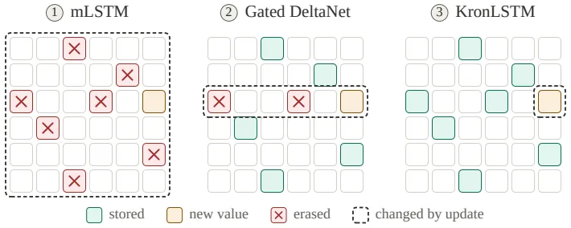
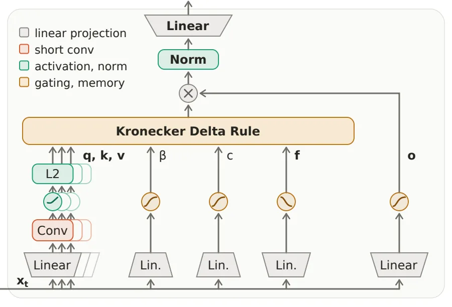
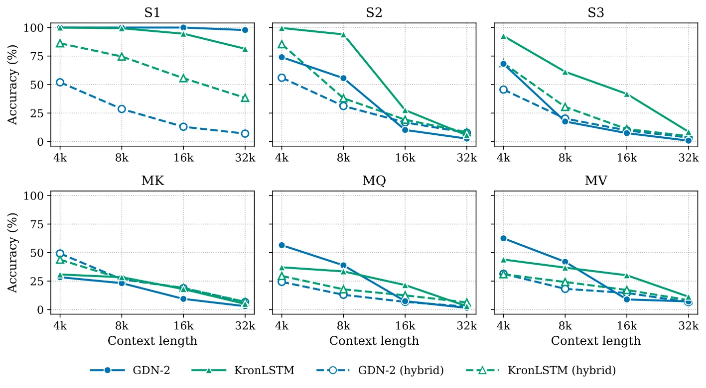

[Paper](https://arxiv.org/abs/2610.26834v1)
## Introduction

As context grows longer, softmax attention's compute grows quadratically with context length, and the key-value cache grows proportionally to context length. Linear attention, which avoids this, compresses context into a fixed-size matrix memory, but the problem remained that editing that memory disturbs other memories already stored. This paper proposes the **Kronecker delta rule**, which narrows the scope touched by a single update, and **KronLSTM**, which implements it as gates.

## Background: How Is a Fixed-Size Memory Rewritten?

For each token, a transformer keeps all key-value pairs of preceding tokens and, when a query arrives, compares against all of them. The number of comparisons becomes the square of context length, and the number of pairs to store grows proportionally to context length. Linear attention folds this part. It folds information from tokens seen so far into a single matrix $S$, and when a query arrives it multiplies that matrix by a vector to retrieve the answer. The cost disappears, but all information is trapped inside the matrix, so **how to later revise information already written** becomes the problem.

The paper organizes this problem into two branches. First, if memory grows without bound, the retrieved values grow with it and training becomes unstable. LSTMs suppress accumulation with a forgetting gate, but to remember long contexts that gate must stay pinned at 1, so information from the beginning of the context is eventually diluted. xLSTM adds normalizer and stabilizer states to curb memory scale, but normalizing by a ratio of large numbers itself creates numerical and optimization instability in large models. Second, DeltaNet-style models using the delta rule keep memory bounded by converging to a stationary distribution, but when stored values are corrected, other stored values are also disturbed. Obtaining both properties at once is the starting point of this paper.

Let's first look at what linear attention stores and how it reads. When token $t$ arrives, it computes key $k_t$ and value $v_t$ and adds their outer product $v_t k_t^\top$ to memory. When query $q_t$ arrives, it multiplies memory by the query to retrieve $h_t = S_t q_t$. This single multiplication reads out a weighted sum of the stored values (§2.1, Eq. 1).

The problem arises when this write is an addition. Continuously adding by the Hebb rule makes memory scale grow proportionally to context length, and later writes bury earlier values. There is no means to correct an association once stored. The delta rule solves this by first subtracting the value stored at the current $k_t$ position and then writing the new value $v_t$ (§2.1, Eq. 2). This takes one step toward making $S_t k_t$ closer to $v_t$, mathematically one gradient descent step on $\tfrac12 \|S_t k_t - v_t\|^2$. However, this correction direction is determined by the current memory content $(S_t k_t - v_t)$. So other values sharing a key with $k_t$ are also disturbed, and the interference accumulates as context grows longer.

## A Small Example: The Trace a Single Update Leaves

The numbers below are not reported values from the paper but made up to illustrate the concept (not reported in the original). Take a 2×2 memory $S$ and set a new key/value, a target association, and a step size. The memory is laid out with values as rows and keys as columns.

| Setting | Value |
|---|---|
| Memory $S$ (rows=values, columns=keys) | `[[0.5, 0.7], [2.0, 0.9]]` |
| New key to write $k$ | `[1, 0]` |
| New value to write $v$ | `[0, 1]` |
| Currently stored association $v^\top S k$ | `2.0` |
| Target association $c$ | `1.0` |
| Step size $\beta$ | `0.5` |
| Other pairs already stored | $(k', v') = ([1,0], [1,0])$, $(k'', v'') = ([0,1], [0,1])$ |

After updating once with each of the two rules and placing the memory and the read results of the three pairs side by side, the difference becomes clear.

| Rule | Memory after update $S'$ | Target pair read $v^\top S' k$ | Key-only overlapping pair $v'^\top S' k'$ | Pair orthogonal in both key and value $v''^\top S' k''$ |
|---|---|---|---|---|
| Delta rule (Eq. 2) | `[[0.25, 0.7], [1.5, 0.9]]` | 2.0 → **1.5** | 0.5 → **0.25** (broken) | 0.9 → 0.9 |
| Kronecker delta rule (Eq. 3) | `[[0.5, 0.7], [1.5, 0.9]]` | 2.0 → **1.5** | 0.5 → **0.5** (preserved) | 0.9 → 0.9 |

The delta rule makes the correction in the direction of the vector $S_t k_t - v_t$ and spreads it across the entire column in the $k$ direction. Thus the target association drops to 1.5, but other memories using the same key (0.5 → 0.25) are also disturbed. The Kronecker delta rule looks only at the single scalar $v^\top S k$ and reverses the error, and the reversal direction $v k^\top$ is, in this example, 1 only in the bottom-left cell of the 2×2 matrix with the rest 0. So only the target association drops to 1.5 and the remaining cells stay as they are. The value $[1,0]$ orthogonal to the new value $[0,1]$ is protected even when keys overlap.

Figure 1 of the original shows this difference across three models at once. The legend distinguishes 'newly stored cells', 'erased cells', and 'cells changed by the update', and a one-line summary sentence draws the conclusion. mLSTM's update affects all stored values, Gated DeltaNet affects stored values with overlapping keys, and KronLSTM affects only stored values where both keys and values overlap. This single sentence is the paper's entire claim.

## Method: The Kronecker Delta Rule

Generalizing the idea from the previous example: read how strongly memory currently associates key $k_t$ with value $v_t$ as a single scalar, and move that scalar toward the target $c_t$. The correction direction is determined solely by the input pair $(k_t, v_t)$, not by the contents stored in memory (§2.1, Eq. 3).

$$
S_{t+1} = S_t - \beta_t \big(v_t^\top S_t k_t - c_t\big)\, v_t k_t^\top
= \underbrace{S_t - \beta_t (v_t^\top S_t k_t) v_t k_t^\top}_{\text{erase}}
+ \underbrace{\beta_t c_t v_t k_t^\top}_{\text{write}}
$$

The amount erased is determined by $\beta_t$ and the amount written by $c_t$. Reparameterizing the target as $\tilde c_t = c_t/\beta_t$ removes the step size from the write term, fully separating the two roles. If $c_t \equiv 1$, the association is stored with unit strength; if $c_t = 0$, only that association is erased.

Two things differ from the delta rule. First, the dimension of the correction target differs. The delta rule corrects a $d_v$-dimensional vector residual $S_t k_t - v_t$ and distributes it across the entire column in the key direction. The Kronecker delta rule corrects a single scalar residual and sends that amount in only one direction, $v_t k_t^\top$. Second, what the interference depends on differs. The change in the association of another stored pair $(k_i, v_i)$ is (§2.1, Eq. 5, Appendix Property A9)

$$
\Delta\big(v_i^\top S k_i\big) = -\beta_t \big(v_t^\top S_t k_t - c_t\big)\,\big(v_i^\top v_t\big)\,\big(k_t^\top k_i\big)
$$

That is, it is proportional to **the product of value overlap and key overlap**. The delta rule's interference is determined by key overlap alone, and Hebbian writes keep accumulating regardless of key or value. So a stored value orthogonal to the new value is protected even if keys overlap. The example above was exactly that case.

The amount of information that can be held also differs. The three elements $(k_t, v_t, c_t)$ impose one linear constraint on the $d_k d_v$ entries of memory. So exactly $d_k d_v$ scalar associations can be stored (Appendix Property A11), compared with the delta rule holding $d_k$ in units of value vectors. A single key can hold multiple mutually orthogonal values, and reading returns their sum.

This minimality is supported by proof, not observation (Appendix A3.4). Choosing the Newton step $\beta = 1/(\|k_t\|^2\|v_t\|^2)$, the correction amount is the smallest among possible corrections, and simultaneously minimal in all unitarily invariant norms such as Frobenius, spectral, and nuclear (Theorem A1, A2). More strongly, the only correction that does not leave the target key direction and target value direction is the one from this step (Theorem A3). And this definition is also the answer to why it disturbs other memories least. When probe pairs are isotropic, the expected interference is $\sigma_k^2\sigma_v^2\|E\|_F^2$, so the correction minimizing $\|E\|_F$ is exactly the one minimizing expected interference (Theorem A4).

Vectorized, this rule takes the same form as Widrow–Hoff online least squares. Using the Kronecker feature $a_t = k_t \otimes v_t$ and the vectorized memory $s = \mathrm{vec}(S)$, we get $v_t^\top S k_t = a_t^\top s$ (Appendix Property A7)

$$
s_{t+1} = \big(I - \beta_t a_t a_t^\top\big) s_t + \beta_t c_t a_t
$$

which reduces to the above. Since the transition factor is a generalized Householder matrix that does not include $c_t$, it can be used as-is in DeltaNet's chunkwise-parallel training scheme by replacing $k_t$ with $a_t$. The target value enters only the driving term. Moreover, when $\beta_t\|a_t\|^2 \in (1,2)$, negative eigenvalues appear in the transition factor, yielding the same state-tracking ability as the delta rule family.

Stability is summarized by two theorems (§2.1, Theorem 1, 2).

- **Expectation and stationary distribution.** Since the update is linear, the expected iteration exactly satisfies $\mathbb{E}[s_{t+1}] = (I - \beta \bar A)\mathbb{E}[s_t] + \beta \bar b$. The unique fixed point of this recurrence is the least-squares memory $s_{LS} = \bar A^{-1}\bar b$, and the expectation converges linearly to it without bias at any order. The iteration sequence forms a time-homogeneous Markov chain on $\mathbb{R}^{d_k d_v}$, has a unique stationary distribution $\pi_\beta$, converges geometrically from any initialization, and the mean of the stationary distribution is exactly $S_{LS}$.
- **Memory norm bound.** The Frobenius norm of the least-squares memory is sandwiched on both sides by the explained target energy. $\frac{\mathbb{E}[c^2]-\mathbb{E}[\rho^2]}{\lambda_{\max}(\bar A)} \le \|S_{LS}\|_F^2 \le \frac{\mathbb{E}[c^2]-\mathbb{E}[\rho^2]}{\lambda_{\min}(\bar A)}$. And in the non-expansive region $\beta\|a_t\|^2 \le 1$, the stationary state and every iteration starting from $S_0=0$ are bounded within $\mathbb{E}[\|S_t\|_F^2] \le 4\,\mathbb{E}[c^2]/\lambda_{\min}(\bar A)$. The 4 in front decays exponentially to 1 after the first step.

There is one point to be honest about here. **The property of a stationary-state bound independent of length is itself a common feature of the delta rule family.** DeltaNet has a corresponding bound (Appendix A4). What sets KronLSTM apart is the form of interference and capacity, not the existence of a bound. Also, this bound is the basis for replacing mLSTM's normalizer and stabilizer states, but the Gated DeltaNet family does not use such states to begin with, so the advantage of 'stable without normalization' is a relative advantage over mLSTM·xLSTM.

## The KronLSTM Block: Separating Forget, Erase, and Write

To lift the rule into an actual layer, each of the three terms in the update equation must be made a gate determined by the input (§2.2, Eq. 10).

$$
S_{t+1} = \underbrace{S_t F_t}_{\text{forget}} - \underbrace{\beta_t \big(v_t^\top S_t F_t k_t\big) v_t k_t^\top}_{\text{erase}} + \underbrace{c_t v_t k_t^\top}_{\text{write}}
$$

- **Forget.** $F_t = \mathrm{diag}(f_t)$ is a diagonal matrix multiplied only along the key dimension, so it keeps or decays the memory of each key direction differently depending on the input. Because the multiplication happens on the right, each column of memory decays independently.
- **Erase.** $\beta_t$ is a per-head scalar gate, determined within (0,1) by feeding a linear projection of the input into a sigmoid (Eq. 11). It sets the degree of erasure.
- **Write.** $c_t$ is also a per-head scalar gate determined within (0,1) (Eq. 11). It sets the degree of new writing.

The forget gate $f_t$ is made by raising a sigmoid to a per-head learned positive exponent: $f_t = (1 - \sigma((s_f)_t))^\alpha$, $\alpha = \exp(a_{\log})$ (Eq. 12). The sigmoid determines the retention rate of each key direction depending on the input, and the exponent readjusts that head's retention time scale. Since $\alpha$ is learned in log space, the baseline retention time scale of each head spreads across different orders of magnitude.

Following the flow in Figure 3 of the original: split input $x_t$ into three linear projections (query, key, value), and pass each through a short causal depthwise convolution, SiLU, and $\ell_2$ normalization. Update memory $S_t$ with key and value, read $S_t q_t$ with the query, and pass through the output gate, per-head RMSNorm, and output projection to the next layer. The only state the block carries is the per-head memory; there are no mLSTM normalizer or stabilizer states. So it can directly replace the attention slot.

Since keys and values are $\ell_2$-normalized and $\beta_t$ is bounded in (0,1) by a sigmoid, $\beta_t \|k_t\|^2 \|v_t\|^2 = \beta_t < 1$. Every update lies in the non-expansive region, so Theorem 2 applies, and the forget gate's entries being less than 1 makes convergence even stronger.

There is one more theoretical bonus (Appendix A5). Comparing how many steps the initial memory remains readable: in a design where keys and values are independent and values are normalized, $\bar A = \bar K \otimes \bar V$, so $\lambda_{\min}(\bar A) = \lambda_{\min}(\bar K)\lambda_{\min}(\bar V)$, and KronLSTM's slowest-decaying mode decays $d$ times slower than DeltaNet's. That is, at the same $\beta$, the retention time scale of initial memory is roughly $d$ times longer. The price, however, is the trade-off that 'adaptation becomes $d$ times slower'. Losing less memory is not free.

## Results

### Experimental Setup

We pretrained a 1.5B parameter model on FineWeb-Edu for 100B tokens at 8k context. Baselines are Gated DeltaNet (GDN), Kimi Delta Attention (KDA), Mamba-3, and Gated DeltaNet-2 (GDN-2). All experiments were run in two settings. One is a pure linear model, and the other is a hybrid mixing sliding window attention (SWA) with window 2048 and linear attention at 5:1. SWA is used so that memory usage stays constant regardless of context length. The 1.5B model has 24 layers, hidden 2048, 16 heads, and $d_{qk} = d_v = 128$, and all comparison models share the corpus, tokenizer, optimizer, schedule, batch, and seed, changing only the sequence mixer. The numbers below are only values quoted from Tables 1–4, Tables A3·A4, and Figs. 5·6 of the original.

### Language Modeling (Table 1)

Evaluated on five commonsense reasoning tasks (HellaSwag, PIQA, ARC-easy, ARC-challenge, WinoGrande) and LAMBADA. Avg-6 is the average accuracy over the six tasks.

| Model | Linear Avg-6 ↑ | Linear LAMBADA ppl ↓ | Hybrid Avg-6 ↑ | Hybrid LAMBADA ppl ↓ |
|---|---|---|---|---|
| GDN | 57.73 | 12.58 | 57.99 | 12.95 |
| Mamba-3 | 57.31 | 12.95 | 58.54 | 13.01 |
| KDA | 58.12 | 12.67 | 57.85 | 12.60 |
| GDN-2 | 57.94 | 12.54 | 58.79 | 11.85 |
| mLSTM | 57.18 | 13.87 | 57.35 | 14.38 |
| **KronLSTM** | **59.72** | **11.72** | **59.56** | **11.18** |

KronLSTM is first on 5 of 6 tasks in the pure linear setting, and its Avg-6 is 1.6 points higher than the second-place KDA. In the hybrid setting it is also first in both Avg-6 and perplexity, but the gap to second-place GDN-2 is 0.8 points, narrower than in the linear setting. Mixing in SWA moves average accuracy by at most about 1 point. mLSTM, Mamba-3, and GDN-2 are most affected by SWA, while GDN and KDA barely change, and KronLSTM stays in the lead regardless of setting.

### Recall Ability (Table 2)

We ran six real-document recall benchmarks at 2k context (SWDE, SQuAD, FDA, TriviaQA, NQ, DROP).

| Model | Linear Avg-6 ↑ | Hybrid Avg-6 ↑ |
|---|---|---|
| GDN | 29.81 | 35.27 |
| Mamba-3 | 28.41 | 36.96 |
| KDA | 29.17 | 36.01 |
| GDN-2 | 29.39 | 35.85 |
| mLSTM | 28.79 | 36.37 |
| **KronLSTM** | **30.31** | **37.40** |

KronLSTM is first on average in both settings and first on 3 of 6 tasks. However, its strengths are concentrated in the early individual tasks. In the linear setting, DROP is 19.31, the lowest of the six models, and NQ is also 15.46, lower than mLSTM (15.11). The SWA hybrid raises overall by 5–9 points.

### RULER Long-Context Retrieval (Table 3)

This task hides one sentence in a long context and asks the model to find it. Models pretrained at 8k are evaluated at 4k, 8k, and 16k, with 16k being extrapolation beyond the pretraining context. Tasks consist of S1–S3 (hiding a unique sentence among natural language sentences), MK, MQ, and MV.

Among linear models, KronLSTM is first or second at every length except S1, and first at every length on S3 and MQ. In the hybrid setting it is first in the length average of every task and first on all tasks at 16k. The widening gap with length is the paper's core evidence, and it shows in the numbers for MQ and MV.

| Linear model | MQ 4k | MQ 8k | MQ 16k | MV 4k | MV 8k | MV 16k |
|---|---|---|---|---|---|---|
| GDN | 44.8 | 21.2 | 8.6 | **46.8** | 23.5 | 13.8 |
| GDN-2 | 28.4 | 13.4 | 2.7 | 38.1 | 21.4 | 5.1 |
| **KronLSTM** | **47.2** | **24.8** | **12.7** | 43.3 | **24.6** | **17.6** |

On MQ, the gap to the leader widens from 2.4 points at 4k to 4.1 points at 16k. On MV, it trails GDN by 3.5 points at 4k, then leads by 1.1 points at 8k and 3.8 points at 16k. This is consistent with the interference analysis (Property A9), which says interference accumulates as context grows and the side with less interference gains the advantage.

S1 goes the opposite way. S1 is the most artificial task, repeating the same noise sentence, and pure linear KronLSTM falls far behind (66.2 at 4k, 11.6 at 16k, whereas GDN is 100.0 at 4k and 99.2 at 16k). The authors interpret this as residuals accumulating on repeated keys. In the hybrid setting, by contrast, KronLSTM is first even on S1 (16.2 at 16k, while baseline models are 12.6 or below). The hybrid's baseline linear models fall on S1 to 51.8 at 4k, 26.6 at 8k, and 12.6 at 16k, which is roughly equal to the fraction of context covered by the window. This means the needle is recovered only when it lies inside the window, showing that they barely rely on recurrent memory.

### 32k Context Extension (§3.3, Table 4)

We branched the 1.5B linear KronLSTM and GDN-2 runs at 75B tokens and continued training the remaining 25B tokens at 32k context. The data is a long-document mixture drawn from ProLong-64K. This makes the token count exactly match the models pretrained at 8k. GDN-2 was chosen as the comparison baseline because it separates erase and write.

| Model | Avg-6 ↑ | LAMBADA ppl ↓ | Recall Avg-6 (2k) ↑ |
|---|---|---|---|
| GDN-2 | 58.75 | 8.36 | 29.95 |
| **KronLSTM** | **60.19** | **7.66** | **31.08** |

Both models benefit from length extension. Recall accuracy rises and perplexity drops by about 4 points. KronLSTM leads in Avg-6 and perplexity and is better on 5 of the 6 recall tasks (only FDA is led by GDN-2: 18.15 vs 19.60).

On RULER NIAH as well (original Table A4), it leads GDN-2 from 16k on five natural-language-based tasks. At 16k, S3 is 41.8 vs 7.4, MV is 30.1 vs 8.9, and S2 is 27.6 vs 10.2; at 32k, S2 is 5.6 vs 2.6, S3 is 8.6 vs 0.8, and MV is 11.3 vs 7.2. The exception is S1 (pure linear 32k: KronLSTM 81.4, GDN-2 97.8).

Figure 4 of the original shows NIAH per-task accuracy from 4k to 32k side by side with GDN-2 in both linear and hybrid settings. Two things to read. First, at short lengths the two models are similar, but as length grows KronLSTM leads on most tasks. Second, at 32k both models' retrieval accuracy drops substantially relative to 16k. It means the gap widens, not that high accuracy is maintained at 32k.

### Effect of Separating Write Rules (Appendix A6.2)

There is a section checking what the design separating forget, erase, and write actually changes. The ablation results on the 1.5B/100B baseline are as follows.

| Variant | Avg-6 ↑ | LAMBADA ppl ↓ | Recall Avg | NIAH 4k | NIAH 8k | NIAH 16k |
|---|---|---|---|---|---|---|
| Default (separated) | 59.72 | 11.716 | 30.3 | **59.5** | 30.5 | **14.3** |
| Apply β to both sides (coupled) | **60.00** | **11.479** | 30.8 | 46.9 | 29.4 | 11.8 |
| Remove value $\ell_2$ normalization | 59.41 | 11.844 | **31.3** | 39.6 | **32.7** | 12.6 |
| Fix target to 1 | 58.17 | 12.495 | 30.1 | 41.9 | 26.2 | 10.1 |

In language modeling the differences are small. The coupled variant is in fact marginally ahead within 0.3 points, and fixing the target to 1 worsens accuracy by 1.6 points and perplexity by 0.8 points. On recall benchmarks the coupled variant leads by 0.5 points and the no-normalization variant by 1.0 point. On NIAH, however, the order reverses. At 4k the default model leads the coupled variant by 12.6 points and the no-normalization variant by 19.9 points, and at 16k the default model leads all three variants. That is, **the learned write gate and separated write matter most for recall within the pretraining context, and have little effect on language modeling.**

### State Tracking (§3.4)

Widening the range to (0,2) with $\beta_t = 2\sigma(w_\beta^\top x_t + b_\beta)$ enables the negative eigenvalue mechanism. We trained on parity, $S_3$ permutation, and modular arithmetic up to training length 128 and evaluated up to 1024. KronLSTM is comparable to GDN on parity and $S_3$ and both lead Mamba-3. On modular arithmetic, Mamba-3 wins.

### Training Throughput (§3.5)

We measure end-to-end throughput of the pure linear 1.5B model on a single NVIDIA H100 (80GB). One step handles 16,384 tokens, and the shape varies from 2K×8 to 16K×1. KronLSTM runs at 36.8–44.5K tokens/s, 11–18% faster than GDN-2 across all batch shapes, and within 4–8% of KDA up to 8K×2. GDN with scalar decay still has the highest speed because its kernel is the cheapest. While a step contains two or more sequences, throughput is almost flat, and all models slow down at 16K×1. This is because the inter-chunk recurrence is parallelized only along the sequence and head directions.

## Limitations and Open Questions

- **It loses on S1 (pure linear).** On the most artificial task, made of repeated noise sentences, pure linear KronLSTM falls far behind GDN·GDN-2. The authors interpret this as residual accumulation on repeated keys. This condition does not apply to natural language retrieval, but the same problem could recur in data with many repeated patterns. In the hybrid setting it actually leads even on S1, so the condition dependence is large.
- **Absolute accuracy drops at 32k.** It is true that KronLSTM leads GDN-2, but both models' retrieval accuracy drops substantially at 32k relative to 16k. It is a relative advantage in 'handling long contexts better', not a claim that high accuracy is maintained at 32k.
- **State tracking is not always the best.** It loses to Mamba-3 on modular arithmetic. It is strong for general-purpose long-term memory, but does not always win on tasks requiring precise tracking of specific state transitions.
- **The speed advantage is relative to a specific kernel implementation.** It is faster than GDN-2 but slower than GDN, whose kernel is the simplest. This is a metric whose ranking could flip depending on the level of kernel optimization.
- **The validation scale is small.** The main experiment is 1.5B/100B tokens, and the 400M results are in the appendix. At 400M/40B, KronLSTM is also first with an average of 48.43, raising the average by 2.1 points over mLSTM and lowering LAMBADA perplexity from 43.40 to 28.28, but both scales are small. The authors leave 'scaling up and mixing with full softmax attention in a hybrid' as future work (§4).
- **The stability guarantee does not hold under all conditions.** The norm bound is a result in the non-expansive region $\beta\|a_t\|^2 \le 1$, and this property is common to the delta rule family that KronLSTM shares with DeltaNet (Appendix A4). The $d$ times longer retention time scale is the trade-off that 'adaptation becomes $d$ times slower' (Appendix A5.5). Also, this analysis rests on the assumption that inputs are i.i.d.
- **The scale at which it can be used in practice has not been reported.** There is no result in the original reproducing the advantage at 1.5B/100B with larger models and longer contexts (not reported in the original).

In summary, KronLSTM is particularly suited to environments **where context is long, many keys overlap, and natural-language-oriented information must be stored for a long time rather than repeated noise**. Its value is that it narrows the scope touched by a single update, that this narrowness is guaranteed mathematically, and that the path from that guarantee to actual recall performance is connected end to end within the paper. Conversely, the advantage shrinks for inputs with many repeated patterns, for cases where a kernel fast enough with a simple recurrent structure is already available, and for tasks requiring precise state transitions such as modular arithmetic. The S1, modular, and 32k drops above are all results the paper reports itself, but any other judgment about applicability is the reviewer's interpretation and not reported in the original.

<!-- verbatim-tables -->

Tables from the paper

> Tables converted mechanically from the arXiv e-print LaTeX source. The numbers are the paper's own and did not pass through a model.

**Table 1. Notation used throughout the paper and the appendix.**

| **Definition** | **Symbol** | **Type** |
|---|---|---|
| **Scalars and dimensions** |  |  |
| time step (token index) | $t$ | $\mathbb{N}$ |
| key and query dimension per head | $d_k$ | $\mathbb{N}$ |
| value dimension per head | $d_v$ | $\mathbb{N}$ |
| layer input dimension | $d$ | $\mathbb{N}$ |
| number of stored associations (App.) | $n$ | $\mathbb{N}$ |
| step size / erase gate | $\beta_t$ | $(0,1)$ |
| fixed step size (theory) | $\beta$ | $\mathbb{R}_{>0}$ |
| target / write gate | $c_t$ | $(0,1)$ in Sec. , $\mathbb{R}$ in Sec. |
| decoupled target | $\tilde{c}_t = c_t / \beta_t$ | $\mathbb{R}_{>0}$ (unbounded) |
| normalized step size | $\kappa = \beta \max_i \left\lVert\bm{a}_i\right\rVert^2$ | $(0,2)$ |
| irreducible residual | $\rho = c - \bm{a}^\top \bm{s}^{\mathrm{L}\mathrm{S}}$ | $\mathbb{R}$ |
| contraction factor of the mean | $r$ | $[0,1)$ |
| second-moment contraction factor | $q_\beta = 1 - \beta(2-\kappa)\lambda_{\min}(\bar{\bm{A}})$ | $[0,1)$ |
| extreme eigenvalues of $\bar{\bm{A}}$ | $\lambda_{\min}, \lambda_{\max}$ | $\mathbb{R}_{>0}$ |
| forget-gate exponent | $\alpha = \exp(a_{\log})$ | $\mathbb{R}_{>0}$ |
| scalar read-out | $h_t = \bm{v}_t^\top \bm{S}_t \bm{k}_t$ | $\mathbb{R}$ |
| residual | $\psi_t = y_t - c_t$ | $\mathbb{R}$ |
| relaxation | $\omega = \beta \left\lVert\bm{k}_t\right\rVert^2 \left\lVert\bm{v}_t\right\rVert^2$ | $(0,2)$ |
| driving-noise energy | $\sigma^2 = \mathbf{\mathrm{E}}\big[\rho^2 \left\lVert\bm{a}\right\rVert^2\big]$ | $\mathbb{R}_{\ge 0}$ |
| **Vectors** |  |  |
| layer input | $\bm{x}_t$ | $\mathbb{R}^{d}$ |
| query, key | $\bm{q}_t, \bm{k}_t$ | $\mathbb{R}^{d_k}$ |
| value | $\bm{v}_t$ | $\mathbb{R}^{d_v}$ |
| Kronecker feature | $\bm{a}_t = \bm{k}_t \otimes \bm{v}_t = \operatorname{vec}(\bm{v}_t \bm{k}_t^\top)$ | $\mathbb{R}^{d_k d_v}$ |
| vectorized memory | $\bm{s}_t = \operatorname{vec}(\bm{S}_t)$ | $\mathbb{R}^{d_k d_v}$ |
| least-squares memory (vectorized) | $\bm{s}^{\mathrm{L}\mathrm{S}} = \bar{\bm{A}}^{-1} \bar{\bm{b}}$ | $\mathbb{R}^{d_k d_v}$ |
| cross moment | $\bar{\bm{b}} = \mathbf{\mathrm{E}}[c\, \bm{a}]$ | $\mathbb{R}^{d_k d_v}$ |
| forget-gate vector | $\mathbf{f}_t$ | $(0,1)^{d_k}$ |
| forget-gate pre-activation | $(\bm{s}_{\mathrm{f}})_t$ | $\mathbb{R}^{d_k}$ |
| output gate | $\mathbf{o}_t$ | $(0,1)^{d_v}$ |
| memory read-out | $\bm{h}_t = \bm{S}_t \bm{q}_t$ | $\mathbb{R}^{d_v}$ |
| block output | $\bm{y}_t$ | $\mathbb{R}^{d}$ |
| **Matrices** |  |  |
| memory matrix | $\bm{S}_t$ | $\mathbb{R}^{d_v \times d_k}$ |
| forget gate | $\bm{F}_t = \operatorname{diag}(\mathbf{f}_t)$ | $\mathbb{R}^{d_k \times d_k}$ |
| feature second moment | $\bar{\bm{A}} = \mathbf{\mathrm{E}}[\bm{a} \bm{a}^\top]$ | $\mathbb{R}^{d_k d_v \times d_k d_v}$, $\succ \bm{0}$ |
| least-squares memory | $\bm{S}^{\mathrm{L}\mathrm{S}}$ | $\mathbb{R}^{d_v \times d_k}$ |
| stationary covariance (App.) | $\bm{V}_\beta$ | $\mathbb{R}^{d_k d_v \times d_k d_v}$ |
| transition factor (App.) | $\bm{M}_i = \bm{I} - \beta \bm{a}_i \bm{a}_i^\top$ | $\mathbb{R}^{d_k d_v \times d_k d_v}$ |
| **Parameters** |  |  |
| erase-gate weights and bias | $\bm{w}_\beta, b_\beta$ | $\mathbb{R}^{d}, \mathbb{R}$ |
| write-gate weights and bias | $\bm{w}_{\mathrm{c}}, b_{\mathrm{c}}$ | $\mathbb{R}^{d}, \mathbb{R}$ |
| forget-gate weights and bias | $\bm{W}_{\mathrm{f}}, \bm{b}_{\mathrm{f}}$ | $\mathbb{R}^{d_k \times d}, \mathbb{R}^{d_k}$ |
| output-gate weights and bias | $\bm{W}_{\mathrm{o}}, \bm{b}_{\mathrm{o}}$ | $\mathbb{R}^{d_v \times d}, \mathbb{R}^{d_v}$ |
| output projection | $\bm{W}_{\text{out}}$ | $\mathbb{R}^{d \times H d_v}$ ($H$ undefined) |
| log forget exponent | $a_{\log}$ | $\mathbb{R}$ (per head) |
| **Distributions and operators** |  |  |
| distribution of triples $(\bm{k}, \bm{v}, c)$ | $p$ | distribution |
| stationary distribution | $\pi_\beta$ | law on $\mathbb{R}^{d_k d_v}$ |
| logistic sigmoid | $\sigma(\cdot)$ | $\mathbb{R} \to (0,1)$ |
| Kronecker product, vectorization | $\otimes$, $\operatorname{vec}$ |  |
| element-wise product | $\odot$ |  |

**Table 2. Downstream performance of 400M/40B linear models. Avg-6 is the mean accuracy over the five commonsense reasoning tasks and LAMBADA. Best per column in **bold**, second best underlined.**

| Model | Hella | PIQA | ARC-e | ARC-c | Wino | LMB acc | Avg-6 $\uparrow$ | LMB ppl $\downarrow$ |
|---|---|---|---|---|---|---|---|---|
| GDN | 41.28 | 66.05 | 57.87 | 31.48 | 49.64 | 32.31 | 46.44 | 34.36 |
| Mamba-3 | 41.89 | **67.25** | 60.82 | 31.23 | 52.33 | 35.11 | 48.10 | 29.51 |
| KDA | 42.08 | 66.16 | 60.48 | 31.40 | 51.30 | **36.70** | 48.02 | **27.84** |
| GDN-2 | 42.33 | 66.87 | 60.23 | 29.69 | **52.41** | 33.84 | 47.56 | 29.14 |
| mLSTM | 40.29 | 67.19 | 60.77 | 29.78 | 50.75 | 29.87 | 46.29 | 43.40 |
| KronLSTM | **43.09** | 67.03 | **61.03** | **32.00** | **52.41** | 35.05 | **48.43** | 28.28 |

**Table 3. Write-rule ablation at 1.5B/100B, relative to KronLSTM. Avg-6 is the mean of the five commonsense reasoning tasks plus LAMBADA accuracy. Recall is the six-task real-world recall suite at 2k context. RULER is averaged at each evaluation length. Best per column in **bold**, second best underlined.**

| Ablations | Avg-6 $\uparrow$ | LMB ppl $\downarrow$ | Recall $\uparrow$ | NIAH-Avg@4k | @8k | @16k |
|---|---|---|---|---|---|---|
| base | 59.72 | 11.716 | 30.3 | **59.5** | 30.5 | **14.3** |
| no $\ell_2$-norm on $\bm{v}_t$ | 59.41 | 11.844 | **31.3** | 39.6 | **32.7** | 12.6 |
| $\beta$ on both sides | **60.00** | **11.479** | 30.8 | 46.9 | 29.4 | 11.8 |
| non-learnable target | 58.17 | 12.495 | 30.1 | 41.9 | 26.2 | 10.1 |

**Table 4. RULER NIAH for the 32k-context-extended linear models, evaluated on identical documents. Better of the two per task and length in **bold**.**

| Model | Len. | S1 | S2 | S3 | MK | MQ | MV |
|---|---|---|---|---|---|---|---|
| *Linear models* |  |  |  |  |  |  |  |
| GDN-2 | 4k | **100.0** | 74.0 | 68.2 | 28.4 | **56.5** | **62.5** |
|  | 8k | **100.0** | 55.6 | 17.6 | 23.2 | **38.8** | **41.9** |
|  | 16k | **100.0** | 10.2 | 7.4 | 9.4 | 7.4 | 8.9 |
|  | 32k | **97.8** | 2.6 | 0.8 | 3.0 | 1.5 | 7.2 |
| KronLSTM | 4k | **100.0** | **99.6** | **92.6** | **30.8** | 37.1 | 43.9 |
|  | 8k | 99.4 | **94.0** | **61.2** | **28.4** | 33.5 | 36.8 |
|  | 16k | 94.6 | **27.6** | **41.8** | **18.0** | **21.5** | **30.1** |
|  | 32k | 81.4 | **5.6** | **8.6** | **5.0** | **3.0** | **11.3** |
| *Hybrid models* |  |  |  |  |  |  |  |
| GDN-2 | 4k | 52.0 | 56.0 | 45.6 | **49.2** | 24.3 | **31.4** |
|  | 8k | 28.6 | 31.2 | 20.2 | 26.6 | 13.0 | 18.2 |
|  | 16k | 13.0 | 16.8 | 9.8 | 18.8 | 6.8 | 14.6 |
|  | 32k | 7.0 | 7.8 | 3.6 | 6.6 | 2.6 | 6.6 |
| KronLSTM | 4k | **86.2** | **85.4** | **68.8** | 43.8 | **29.5** | 31.0 |
|  | 8k | **74.6** | **38.0** | **30.4** | **27.0** | **17.8** | **24.2** |
|  | 16k | **55.6** | **19.2** | **11.0** | **19.0** | **12.5** | **17.2** |
|  | 32k | **38.4** | **8.2** | **4.8** | **6.8** | **6.3** | **8.3** |

**Table 5. Chunkwise forms of delta-rule memories and of KronLSTM, in the orientation $\bm{S} \in \mathbb{R}^{d_v \times d_k}$ of this paper. $\bm{\Lambda}$ is the inverse of the unit lower triangular matrix $\bm{I} + \bm{N}$ built from the listed Gram; ``coupling'' is the term through which the incoming memory $\bm{S}_0$ enters the write of token $r$; $\operatorname{stril}$ is the strictly lower triangular part. For KDA and Gated DeltaNet-2 the decay-weighted key Gram is $\bm{G}^{kk}$ of ; for Gated DeltaNet-2, $\bm{b}_r \in [0,1]^{d_k}$ and $\bm{w}_r \in [0,1]^{d_v}$ are its channel-wise erase and write gates.**

|  | Gram in the solve | right-hand side | coupling to $\bm{S}_0$ | write of token $r$ |
|---|---|---|---|---|
| DeltaNet | $\operatorname{diag}(\bm{\beta})\operatorname{stril}(\bm{K}\bm{K}^\top)$ | $\operatorname{diag}(\bm{\beta})\bm{V}$ | $\bm{S}_0 \bm{w}_r$, $\;\bm{W} = \bm{\Lambda}\operatorname{diag}(\bm{\beta})\bm{K}$ | $(\bm{u}_r - \bm{S}_0 \bm{w}_r)\,\bm{k}_r^\top$ |
| Gated DeltaNet | same, $\times\, \gamma_r/\gamma_s$ (scalar) | same | same, decayed | same, decayed |
| KDA | $\operatorname{diag}(\bm{\beta})\,\bm{G}^{kk}$ | $\operatorname{diag}(\bm{\beta})\bm{V}$ | $\bm{S}_0 \bm{w}_r$, $\;\bm{W} = \bm{\Lambda}\operatorname{diag}(\bm{\beta})\widehat{\bm{K}}$ | $(\bm{u}_r - \bm{S}_0 \bm{w}_r)\,\breve{\bm{k}}_r^\top$ |
| Gated DeltaNet-2 | $\operatorname{stril}\big((\bm{\gamma} \odot \bm{B} \odot \bm{K})\bar{\bm{K}}^\top\big)$ | $\bm{W} \odot \bm{V}$ | $\bm{S}_0 \bm{y}_r$, $\;\bm{Y} = \bm{\Lambda}(\bm{\gamma} \odot \bm{B} \odot \bm{K})$ | $(\bm{u}_r - \bm{S}_0 \bm{y}_r)\,\breve{\bm{k}}_r^\top$ |
| KronLSTM | $\operatorname{diag}(\bm{\beta})\,(\bm{G}^{kk} \odot \bm{G}^{vv})$ | $\bm{c}$ | $\big(\bm{\Lambda}\operatorname{diag}(\bm{\beta})\bm{p}\big)_r$, $\;p_r = \bm{v}_r^\top\bm{S}_0\widehat{\bm{k}}_r$ | $u_r\, \bm{v}_r \breve{\bm{k}}_r^\top$ |

**Table 6. Downstream performance of 1.5B/100B models. Avg-6 is the mean accuracy over the five commonsense reasoning tasks and LAMBADA. Best per column in **bold**, second best underlined, separately for linear and hybrid models.**

| Model | Hella | PIQA | ARC-e | ARC-c | Wino | LMB acc | Avg-6 $\uparrow$ | LMB ppl $\downarrow$ |
|---|---|---|---|---|---|---|---|---|
| *Linear models* |  |  |  |  |  |  |  |  |
| GDN | 57.00 | **73.61** | 70.54 | 41.04 | 57.22 | 46.94 | 57.73 | 12.58 |
| Mamba-3 | 57.30 | 73.01 | 70.29 | 40.19 | 57.46 | 45.64 | 57.31 | 12.95 |
| KDA | 57.48 | 73.39 | 71.84 | 41.55 | 57.14 | 47.35 | 58.12 | 12.67 |
| GDN-2 | 57.45 | 72.96 | 71.13 | 41.89 | 57.30 | 46.92 | 57.94 | 12.54 |
| mLSTM | 56.05 | 73.07 | 71.30 | 41.30 | 56.99 | 44.38 | 57.18 | 13.87 |
| KronLSTM | **59.19** | 73.45 | **74.03** | **43.60** | **60.06** | **47.97** | **59.72** | **11.72** |
| *Hybrid models* |  |  |  |  |  |  |  |  |
| GDN | 58.46 | 72.74 | 70.54 | 42.58 | 56.99 | 46.63 | 57.99 | 12.95 |
| Mamba-3 | 58.14 | **74.10** | 72.22 | 43.09 | 57.30 | 46.38 | 58.54 | 13.01 |
| KDA | 57.93 | 72.74 | 71.04 | 41.21 | 56.99 | 47.22 | 57.85 | 12.60 |
| GDN-2 | 58.35 | 72.91 | **72.64** | 42.75 | 58.88 | 47.18 | 58.79 | 11.85 |
| mLSTM | 56.63 | 72.80 | 69.74 | 42.58 | 57.06 | 45.29 | 57.35 | 14.38 |
| KronLSTM | **59.80** | 73.78 | 71.93 | **44.11** | **58.96** | **48.77** | **59.56** | **11.18** |

**Table 7. Results for 1.5B models on the real-world recall suite, given in accuracies for 2k context length. Best per column in **bold**, second best underlined.**

| Model | SWDE | SQD | FDA | TQA | NQ | DROP | Avg-6 $\uparrow$ |
|---|---|---|---|---|---|---|---|
| *Linear models* |  |  |  |  |  |  |  |
| GDN | 28.62 | 37.33 | 14.79 | 60.49 | **16.47** | **21.18** | 29.81 |
| Mamba-3 | 27.54 | 35.86 | 11.43 | 59.18 | 15.39 | 21.03 | 28.41 |
| KDA | 25.83 | 37.30 | 12.98 | **62.14** | 16.31 | 20.46 | 29.17 |
| GDN-2 | 29.70 | 36.29 | 14.43 | 60.07 | 15.90 | 19.93 | 29.39 |
| mLSTM | 27.54 | 36.96 | 11.98 | 59.77 | 15.11 | 21.37 | 28.79 |
| KronLSTM | **30.87** | **39.28** | **15.34** | 61.61 | 15.46 | 19.31 | **30.31** |
| *Hybrid models* |  |  |  |  |  |  |  |
| GDN | 43.20 | 40.58 | 23.59 | 61.91 | 17.90 | **24.44** | 35.27 |
| Mamba-3 | 42.84 | **44.67** | 29.22 | 63.92 | 17.26 | 23.86 | 36.96 |
| KDA | 42.30 | 42.79 | **30.04** | 61.02 | 18.12 | 21.80 | 36.01 |
| GDN-2 | 43.38 | 42.19 | 28.31 | 60.84 | 17.36 | 23.05 | 35.85 |
| mLSTM | 46.08 | 43.47 | 27.77 | 59.66 | 17.29 | 23.96 | 36.37 |
| KronLSTM | **46.89** | 43.57 | 27.86 | **64.51** | **18.82** | 22.76 | **37.40** |

**Table 8. Results of 1.5B models on the NIAH tasks for 8k pretraining context and 4k, 8k, and 16k evaluation context. S1--S3: S-NIAH-1/2/3; MK: MK-NIAH-1; MQ: MQ-NIAH; MV: MV-NIAH. Best per task and length in **bold**, second best underlined, separately for linear and hybrid models.**

| Model | Len. | *Linear models* S1 | *Linear models* S2 | *Linear models* S3 | *Linear models* MK | *Linear models* MQ | *Linear models* MV | *Hybrid models* S1 | *Hybrid models* S2 | *Hybrid models* S3 | *Hybrid models* MK | *Hybrid models* MQ | *Hybrid models* MV |
|---|---|---|---|---|---|---|---|---|---|---|---|---|---|
| GDN | 4k | **100.0** | 96.0 | 54.8 | 28.0 | 44.8 | **46.8** | 51.8 | 52.6 | 21.8 | 31.0 | **40.6** | 38.3 |
|  | 8k | **100.0** | 45.6 | 13.0 | 24.0 | 21.2 | 23.5 | 26.6 | 31.2 | **22.2** | 24.6 | 17.8 | 18.8 |
|  | 16k | 99.2 | 17.8 | 5.4 | **17.8** | 8.6 | 13.8 | 12.6 | 16.8 | 3.6 | 18.4 | 6.9 | 8.8 |
| Mamba-3 | 4k | 92.0 | 68.2 | 26.4 | 26.8 | 20.0 | 18.4 | 51.6 | 56.0 | 30.2 | 34.4 | 19.1 | 21.3 |
|  | 8k | 59.0 | 27.0 | 5.4 | 20.6 | 4.2 | 3.6 | 26.6 | 31.2 | 15.0 | 24.2 | 10.7 | 22.4 |
|  | 16k | 28.0 | 13.6 | 3.0 | 13.4 | 5.3 | 4.5 | 0.0 | 0.0 | 0.0 | 0.0 | 0.0 | 0.0 |
| KDA | 4k | 99.8 | 89.4 | 12.0 | 20.8 | 18.4 | 19.1 | 51.8 | 55.8 | 31.4 | 44.8 | 33.0 | 42.5 |
|  | 8k | 99.0 | 35.4 | 11.6 | 15.8 | 13.3 | 13.3 | 26.6 | 31.2 | 5.0 | 22.8 | 16.3 | 22.8 |
|  | 16k | 93.6 | 14.2 | 1.6 | 11.8 | 3.1 | 5.7 | 12.6 | 16.8 | 4.4 | 17.2 | 3.1 | 11.7 |
| GDN-2 | 4k | **100.0** | 72.8 | 50.2 | 26.6 | 28.4 | 38.1 | 51.8 | 56.0 | 45.6 | **51.8** | 33.2 | 40.5 |
|  | 8k | 99.8 | 44.6 | 15.4 | 17.6 | 13.4 | 21.4 | 26.6 | 31.2 | 18.8 | 25.4 | **23.2** | 22.7 |
|  | 16k | **99.6** | 8.2 | 4.2 | 7.2 | 2.7 | 5.1 | 7.4 | 16.6 | 6.0 | 17.6 | 3.0 | 12.8 |
| mLSTM | 4k | 92.4 | 89.2 | 1.4 | 27.0 | 22.5 | 19.7 | 51.8 | 56.0 | 30.6 | 49.0 | 21.9 | 38.0 |
|  | 8k | 41.6 | 49.4 | 2.4 | **26.2** | 5.7 | 12.4 | 26.6 | 31.2 | 16.8 | 26.8 | 14.9 | **24.6** |
|  | 16k | 17.8 | **22.6** | 2.0 | 15.4 | 5.0 | 6.9 | 12.6 | 0.6 | 0.0 | 0.0 | 0.4 | 0.8 |
| KronLSTM | 4k | 66.2 | **98.2** | **73.4** | **28.2** | **47.2** | 43.3 | **64.8** | **71.2** | **51.2** | 51.0 | 38.8 | **44.5** |
|  | 8k | 29.4 | **60.4** | **20.4** | 23.4 | **24.8** | **24.6** | **33.6** | **35.0** | 17.4 | **28.6** | 23.1 | 21.8 |
|  | 16k | 11.6 | 16.0 | **11.8** | 16.0 | **12.7** | **17.6** | **16.2** | **17.4** | **7.0** | **21.0** | **12.2** | **13.2** |

> Figures in this post are taken from the original arXiv:2610.26834 (CC BY 4.0). Only size and format were changed.
