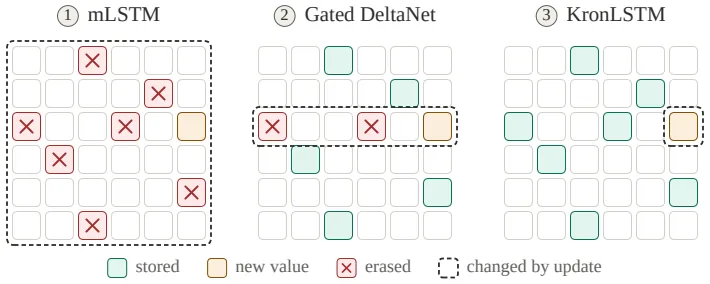
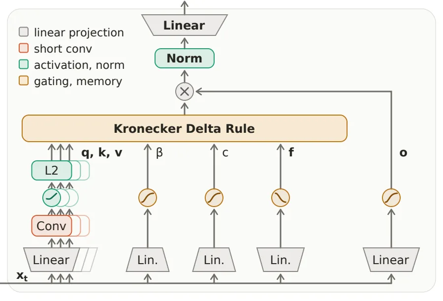
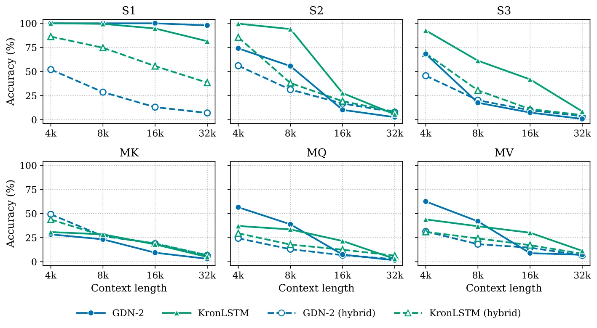

[논문 링크](https://arxiv.org/abs/2610.26834v1)
## 도입

문맥이 길어지면 softmax 어텐션은 계산량이 문맥 길이의 제곱으로 늘고, 키·값 캐시도 문맥 길이에 비례해 커진다. 이를 피하는 선형 어텐션은 문맥을 고정 크기 행렬 메모리에 압축해 보관하지만, 그 메모리를 고칠 때 이미 저장된 다른 기억까지 흔들리는 문제가 남아 있었다. 이 논문은 한 번의 수정이 건드리는 범위를 좁힌 **크로네커 델타 규칙**과, 이를 게이트로 구현한 **KronLSTM**을 제안한다.

## 배경: 고정 크기 메모리는 어떻게 고쳐 쓰는가

트랜스포머는 각 토큰마다 앞서 나온 토큰들의 키·값 쌍을 전부 보관해 두고, 질의가 오면 그 쌍들을 전부 비교한다. 비교 횟수가 문맥 길이의 제곱이 되고, 보관해야 할 쌍의 수는 문맥 길이에 비례해 늘어난다. 선형 어텐션은 이 부분을 접는다. 지금까지 본 토큰들의 정보를 하나의 행렬 $S$에 접어 넣어 보관하고, 질의가 오면 그 행렬과 벡터 하나를 곱해 답을 꺼낸다. 대가가 사라지는 대신 모든 정보가 행렬 안에 갇혀 있으므로, **이미 넣은 정보를 나중에 고치는 법**이 문제가 된다.

논문은 이 문제를 두 갈래로 정리한다. 첫째, 메모리가 끝없이 크면 읽어 낸 값도 함께 커져 학습이 불안정해진다. LSTM 계열은 forgetting 게이트로 누적을 억제하지만, 긴 문맥을 기억하려면 그 게이트를 1에 붙여 둬야 하므로 문맥 앞부분의 정보가 결국 희석된다. xLSTM은 normalizer·stabilizer 상태를 추가해 메모리 규모를 억제하지만, 큰 수끼리의 비율로 정규화하는 방식 자체가 큰 모델에서 수치적·최적화적 불안정을 만든다. 둘째, 델타 규칙을 쓰는 DeltaNet 계열은 메모리가 정상 분포로 수렴해 유계로 유지되지만, 저장된 값을 고칠 때 다른 저장값까지 흔들린다. 두 성질을 동시에 얻는 것이 이 논문의 출발점이다.

선형 어텐션이 무엇을 저장하고 어떻게 읽는지 먼저 보자. 토큰 $t$가 오면 키 $k_t$와 값 $v_t$를 계산해 메모리에 그 외적 $v_t k_t^\top$을 더한다. 질의 $q_t$가 오면 메모리와 질의를 곱해 $h_t = S_t q_t$를 꺼낸다. 이 한 번의 곱으로 저장된 값들의 가중 합을 읽어내는 셈이다(§2.1, Eq. 1).

문제는 이 쓰기가 덧셈일 때 생긴다. 헵 규칙으로 계속 더하면 메모리 규모가 문맥 길이에 비례해 커지고, 나중에 쓴 값이 앞선 값을 덮어 묻어 버린다. 한 번 저장한 연관을 정정할 수단이 없다. 델타 규칙은 이 문제를 해결하려고, 현재 $k_t$ 자리에 저장돼 있는 값을 먼저 빼고 새 값 $v_t$를 쓴다(§2.1, Eq. 2). 그러면 $S_t k_t$가 $v_t$에 가까워지는 방향으로 한 걸음 내려가는 것이고, 수학적으로는 $\tfrac12 \|S_t k_t - v_t\|^2$에 대한 그래디언트 하강 한 걸음이다. 그런데 이 정정 방향은 현재 메모리 내용 $(S_t k_t - v_t)$으로 정해진다. 그래서 $k_t$와 키가 겹치는 다른 값들까지 함께 흔들리고, 문맥이 길어질수록 그 간섭이 누적된다.

## 작은 예시: 한 번의 수정이 남기는 흔적

아래 수치는 논문 보고값이 아니라 개념을 보여주기 위해 지어낸 값이다(원문 미보고). 2×2 메모리 $S$를 두고 새 키·값, 목표 연관, 스텝 크기를 정한다. 메모리는 값이 세로, 키가 가로인 배열이다.

| 설정 항목 | 값 |
|---|---|
| 메모리 $S$ (행=값, 열=키) | `[[0.5, 0.7], [2.0, 0.9]]` |
| 새로 쓸 키 $k$ | `[1, 0]` |
| 새로 쓸 값 $v$ | `[0, 1]` |
| 현재 저장된 연관 $v^\top S k$ | `2.0` |
| 목표 연관 $c$ | `1.0` |
| 스텝 크기 $\beta$ | `0.5` |
| 이미 저장돼 있던 다른 쌍 | $(k', v') = ([1,0], [1,0])$, $(k'', v'') = ([0,1], [0,1])$ |

두 규칙으로 한 번씩 갱신한 뒤, 메모리와 세 쌍의 읽기 결과를 나란히 놓으면 차이점이 드러난다.

| 규칙 | 갱신 후 메모리 $S'$ | 대상 쌍 읽기 $v^\top S' k$ | 키만 겹친 쌍 $v'^\top S' k'$ | 키·값 모두 직교한 쌍 $v''^\top S' k''$ |
|---|---|---|---|---|
| 델타 규칙 (Eq. 2) | `[[0.25, 0.7], [1.5, 0.9]]` | 2.0 → **1.5** | 0.5 → **0.25** (깨짐) | 0.9 → 0.9 |
| 크로네커 델타 규칙 (Eq. 3) | `[[0.5, 0.7], [1.5, 0.9]]` | 2.0 → **1.5** | 0.5 → **0.5** (유지) | 0.9 → 0.9 |

델타 규칙은 정정분을 벡터 $S_t k_t - v_t$ 방향으로 만들어 $k$ 방향 열 전체에 걸쳐 펼친다. 그래서 대상 연관은 1.5로 내려가지만, 같은 키를 쓰는 다른 기억(0.5 → 0.25)까지 함께 흔들린다. 크로네커 델타 규칙은 $v^\top S k$라는 스칼라 하나만 보고 오차를 되돌리며, 되돌리는 방향 $v k^\top$는 이 예에서 2×2 행렬의 왼쪽 아래 한 칸만 1이고 나머지가 0이다. 그래서 대상 연관만 1.5로 낮아지고, 나머지 칸은 그대로 남는다. 새 값 $[0,1]$과 직교하는 값 $[1,0]$은 키가 겹쳐도 보호된다.

원문 Fig. 1은 이 차이를 세 모델에서 한 번에 보여 준다. 그림 범례는 '새 값이 저장된 칸', '지워진 칸', '갱신으로 바뀐 칸'을 구분하고, 요약 문장이 한 줄로 결론을 내린다. mLSTM의 갱신은 모든 저장값에 영향을 주고, Gated DeltaNet은 키가 겹치는 저장값에, KronLSTM은 키와 값이 모두 겹치는 저장값에만 영향을 준다. 이 한 구절이 논문 전체의 주장이다.

## 방법: 크로네커 델타 규칙

앞 예시의 아이디어를 일반화하면 이렇다. 메모리가 현재 키 $k_t$와 값 $v_t$를 얼마나 강하게 연관짓는지를 스칼라 하나로 읽고, 그 스칼라를 목표 $c_t$ 쪽으로 옮긴다. 정정 방향은 입력 쌍 $(k_t, v_t)$만으로 정하고, 메모리에 저장된 내용으로는 정하지 않는다(§2.1, Eq. 3).

$$
S_{t+1} = S_t - \beta_t \big(v_t^\top S_t k_t - c_t\big)\, v_t k_t^\top
= \underbrace{S_t - \beta_t (v_t^\top S_t k_t) v_t k_t^\top}_{\text{지우기}}
+ \underbrace{\beta_t c_t v_t k_t^\top}_{\text{쓰기}}
$$

지우는 양은 $\beta_t$가 정하고 쓰는 양은 $c_t$가 정한다. 목표를 $\tilde c_t = c_t/\beta_t$로 다시 매개화하면 스텝 크기가 쓰기 항에서 빠져 두 역할을 완전히 분리할 수 있다. $c_t \equiv 1$이면 연관을 단위 강도로 저장하고, $c_t = 0$이면 그 연관만 지운다.

델타 규칙과 다른 점은 두 가지다. 첫째, 정정 대상의 차원이 다르다. 델타 규칙은 $d_v$차원 벡터 잔차 $S_t k_t - v_t$를 정정해 키 방향 열 전체에 분산시킨다. 크로네커 델타 규칙은 스칼라 잔차 하나만 정정하고 그 분량을 $v_t k_t^\top$ 한 방향으로만 보낸다. 둘째, 간섭이 무엇에 의존하는지가 다르다. 다른 저장 쌍 $(k_i, v_i)$의 연관이 받는 변화는(§2.1, Eq. 5, 부록 Property A9)

$$
\Delta\big(v_i^\top S k_i\big) = -\beta_t \big(v_t^\top S_t k_t - c_t\big)\,\big(v_i^\top v_t\big)\,\big(k_t^\top k_i\big)
$$

즉 **값 겹침과 키 겹침의 곱**에 비례한다. 델타 규칙의 간섭은 키 겹침 하나로 결정되고, 헵 쓰기는 키·값을 가리지 않고 계속 쌓는다. 그래서 새 값과 직교하는 저장값은 키가 겹치더라도 보호된다. 위 예시가 정확히 그 경우였다.

담을 수 있는 정보의 양도 달라진다. 세 요소 $(k_t, v_t, c_t)$는 메모리의 $d_k d_v$개 원소에 대한 선형 제약 하나를 건다. 그래서 $d_k d_v$개의 스칼라 연관을 정확히 저장할 수 있고(부록 Property A11), 델타 규칙이 값 벡터 단위로 $d_k$개를 담는 것과 비교된다. 하나의 키가 여러 개의 서로 직교하는 값을 담을 수 있으며, 읽을 때 그 합으로 돌아온다.

이 최소성이 관찰이 아니라 증명으로 뒷받침된다(부록 A3.4). 뉴턴 스텝 $\beta = 1/(\|k_t\|^2\|v_t\|^2)$를 택하면 정정량은 가능한 정정 중 가장 작고, 프로베니우스·스펙트럴·nuclear 등 모든 유니타리 불변 노름에서 동시에 최소다(Theorem A1, A2). 더 강하게, 대상 키 방향과 대상 값 방향 밖으로 나가지 않는 정정은 이 스텝의 것 하나뿐이다(Theorem A3). 그리고 이 정의는 왜 다른 기억을 가장 적게 흔드는가에 대한 답이기도 하다. 탐침 쌍이 등방(isotropic)일 때 기대 간섭량은 $\sigma_k^2\sigma_v^2\|E\|_F^2$로, $\|E\|_F$를 최소화하는 정정이 곧 기대 간섭을 최소화하는 정정이다(Theorem A4).

벡터화하면 이 규칙은 Widrow–Hoff 온라인 최소제곱과 같은 꼴이 된다. 크로네커 피처 $a_t = k_t \otimes v_t$와 벡터화 메모리 $s = \mathrm{vec}(S)$를 쓰면 $v_t^\top S k_t = a_t^\top s$가 되어(부록 Property A7)

$$
s_{t+1} = \big(I - \beta_t a_t a_t^\top\big) s_t + \beta_t c_t a_t
$$

로 떨어진다. 전이 인자가 $c_t$를 포함하지 않는 일반화 Householder 행렬이므로, DeltaNet의 chunkwise-parallel 학습 방식에서 $k_t$ 자리에 $a_t$를 넣어 그대로 쓸 수 있다. 목표값은 구동항에만 들어간다. 게다가 $\beta_t\|a_t\|^2 \in (1,2)$이면 전이 인자에 음의 고윳값이 생겨 델타 규칙 계열과 같은 상태 추적 능력을 얻는다.

안정성은 두 정리로 정리된다(§2.1, Theorem 1, 2).

- **기대값과 정상 분포.** 갱신이 선형이므로 기대 반복은 $\mathbb{E}[s_{t+1}] = (I - \beta \bar A)\mathbb{E}[s_t] + \beta \bar b$를 정확히 만족한다. 이 점화식의 유일한 고정점은 최소제곱 메모리 $s_{LS} = \bar A^{-1}\bar b$이고, 기대값은 어느 차수에서도 편향 없이 그곳으로 선형 수렴한다. 반복열은 $\mathbb{R}^{d_k d_v}$ 위의 시간 균일 마르코프 체인을 이루며, 고유한 정상 분포 $\pi_\beta$가 있어 임의의 초기화에서 기하급수적으로 수렴하고, 정상 분포의 평균은 정확히 $S_{LS}$다.
- **메모리 노름 상한.** 최소제곱 메모리의 프로베니우스 노름은 설명된 목표 에너지로 양쪽에서 끼워진다. $\frac{\mathbb{E}[c^2]-\mathbb{E}[\rho^2]}{\lambda_{\max}(\bar A)} \le \|S_{LS}\|_F^2 \le \frac{\mathbb{E}[c^2]-\mathbb{E}[\rho^2]}{\lambda_{\min}(\bar A)}$. 그리고 비확장 영역 $\beta\|a_t\|^2 \le 1$에서는 정상 상태와 $S_0=0$에서 시작한 모든 반복이 $\mathbb{E}[\|S_t\|_F^2] \le 4\,\mathbb{E}[c^2]/\lambda_{\min}(\bar A)$ 안에서 묶인다. 앞의 4는 첫 단계 이후 기하급수적으로 1로 내려간다.

여기서 정직해야 할 점 하나가 있다. **길이와 무관한 정상 상태 상한이라는 성질 자체는 델타 규칙 계열의 공통 특징이다.** DeltaNet에도 대응하는 상한이 존재한다(부록 A4). KronLSTM을 따로 세우는 지점은 간섭의 형태와 용량이지 상한의 존재가 아니다. 또한 이 상한은 mLSTM의 normalizer·stabilizer 상태를 대체하는 근거지만, Gated DeltaNet 계열은 원래 그런 상태를 쓰지 않으므로 '정규화 없이 안정'이라는 장점은 mLSTM·xLSTM에 대한 상대적 우위다.

## KronLSTM 블록: 잊기·지우기·쓰기를 분리한다

규칙을 실제 층으로 올리려면 갱신식의 세 항을 각각 입력이 결정하는 게이트로 만들어야 한다(§2.2, Eq. 10).

$$
S_{t+1} = \underbrace{S_t F_t}_{\text{잊기}} - \underbrace{\beta_t \big(v_t^\top S_t F_t k_t\big) v_t k_t^\top}_{\text{지우기}} + \underbrace{c_t v_t k_t^\top}_{\text{쓰기}}
$$

- **잊기.** $F_t = \mathrm{diag}(f_t)$는 키 차원에만 곱해지는 대각 행렬이라 각 키 방향의 기억을 입력에 따라 서로 다르게 유지하거나 쇠시킨다. 곱이 오른쪽에서 일어나므로 메모리의 각 열이 독립적으로 감쇠한다.
- **지우기.** $\beta_t$는 헤드당 스칼라 게이트로, 입력의 선형 투영을 시그모이드에 넣어 (0,1) 안에서 정해진다(Eq. 11). 지우는 정도를 정한다.
- **쓰기.** $c_t$도 헤드당 스칼라 게이트로 (0,1) 안에서 정해진다(Eq. 11). 새로 쓰는 정도를 정한다.

잊기 게이트 $f_t$는 시그모이드를 헤드마다 학습된 양의 지수로 올려 만든다: $f_t = (1 - \sigma((s_f)_t))^\alpha$, $\alpha = \exp(a_{\log})$ (Eq. 12). 시그모이드가 입력에 따라 각 키 방향의 유지율을 정하고, 지수가 그 헤드의 유지 시간대를 다시 조절한다. $\alpha$를 로그 공간에서 학습하므로 헤드마다 기준 유지 시간대가 서로 다른 자릿수에 걸쳐 퍼진다.

원문 Fig. 3의 흐름을 따라가면 이렇다. 입력 $x_t$를 선형 투영 셋(질의·키·값)으로 나누고, 각각 짧은 인과 깊이 컨볼루션과 SiLU, $\ell_2$ 정규화를 통과시킨다. 키·값으로 메모리 $S_t$를 갱신하고, 질의로 $S_t q_t$를 읽어 출력 게이트와 헤드별 RMSNorm, 출력 투영을 거쳐 다음 층으로 넘긴다. 블록이 들고 있는 상태는 헤드별 메모리뿐이고 mLSTM의 normalizer·stabilizer 상태는 없다. 그래서 어텐션 자리를 그대로 대체할 수 있다.

키와 값이 $\ell_2$ 정규화되어 있고 $\beta_t$가 시그모이드로 (0,1)에 묶여 있으므로 $\beta_t \|k_t\|^2 \|v_t\|^2 = \beta_t < 1$이다. 모든 갱신이 비확장 영역에 있어 Theorem 2가 적용되고, 잊기 게이트의 항목이 1보다 작아 수렴은 더 강해진다.

여기에 이론적 보너스가 하나 더 있다(부록 A5). 초기 메모리가 몇 step 뒤까지 읽히는지를 비교하면, 키와 값이 독립이고 값이 정규화된 설계에서 $\bar A = \bar K \otimes \bar V$이므로 $\lambda_{\min}(\bar A) = \lambda_{\min}(\bar K)\lambda_{\min}(\bar V)$이고, KronLSTM의 가장 느리게 지는 모드는 DeltaNet의 것보다 $d$배 느리게 지는다. 즉 같은 $\beta$에서 초기 기억의 유지 시간대가 대략 $d$배 길다. 다만 그 대가는 '적응이 $d$배 느려진다'라는 교환이다. 기억을 덜 잃는 것이 공짜가 아니다.

## 결과

### 실험 설정

1.5B 파라미터 모델을 FineWeb-Edu로 100B 토큰, 8k 문맥에서 사전학습했다. 비교 대상은 Gated DeltaNet(GDN), Kimi Delta Attention(KDA), Mamba-3, Gated DeltaNet-2(GDN-2)다. 모든 실험을 두 설정으로 돌렸다. 하나는 순수 선형 모델이고, 다른 하나는 윈도 2048의 슬라이딩 윈도우 어텐션(SWA)을 선형 어텐션과 5:1로 섞은 하이브리드다. SWA를 쓰는 이유는 메모리 사용량이 문맥 길이에 무관하게 일정하게 유지되도록 하기 위해서다. 1.5B 모델은 24층, 은닉 2048, 헤드 16개, $d_{qk} = d_v = 128$이고 모든 비교 모델이 코퍼스·토크나이저·옵티마이저·스케줄·배치·시드를 공유하고 시퀀스 믹서만 바꿨다. 아래 수치는 원문의 Table 1~4, Table A3·A4, Fig. 5·6에서 인용한 값만 적었다.

### 언어 모델링 (Table 1)

5개 상식 추론 과제(HellaSwag, PIQA, ARC-easy, ARC-challenge, WinoGrande)와 LAMBADA로 평가했다. Avg-6은 6개 과제 정확도의 평균이다.

| 모델 | 선형 Avg-6 ↑ | 선형 LAMBADA ppl ↓ | 하이브리드 Avg-6 ↑ | 하이브리드 LAMBADA ppl ↓ |
|---|---|---|---|---|
| GDN | 57.73 | 12.58 | 57.99 | 12.95 |
| Mamba-3 | 57.31 | 12.95 | 58.54 | 13.01 |
| KDA | 58.12 | 12.67 | 57.85 | 12.60 |
| GDN-2 | 57.94 | 12.54 | 58.79 | 11.85 |
| mLSTM | 57.18 | 13.87 | 57.35 | 14.38 |
| **KronLSTM** | **59.72** | **11.72** | **59.56** | **11.18** |

KronLSTM은 순수 선형 설정에서 6개 과제 중 5개에서 1위이고, Avg-6은 두 번째인 KDA보다 1.6포인트 높다. 하이브리드에서도 Avg-6과 perplexity가 모두 1위지만, 2위인 GDN-2와의 차이는 0.8포인트로 선형 설정보다 좁다. SWA를 섞으면 평균 정확도는 최대 약 1포인트만 움직인다. mLSTM·Mamba-3·GDN-2가 SWA의 영향을 가장 많이 받는 반면 GDN과 KDA는 거의 변하지 않고, KronLSTM은 설정을 바꿔도 선두를 유지한다.

### 회상 능력 (Table 2)

2k 문맥의 실제 문서 회상 벤치마크 6종(SWDE, SQuAD, FDA, TriviaQA, NQ, DROP)을 돌렸다.

| 모델 | 선형 Avg-6 ↑ | 하이브리드 Avg-6 ↑ |
|---|---|---|
| GDN | 29.81 | 35.27 |
| Mamba-3 | 28.41 | 36.96 |
| KDA | 29.17 | 36.01 |
| GDN-2 | 29.39 | 35.85 |
| mLSTM | 28.79 | 36.37 |
| **KronLSTM** | **30.31** | **37.40** |

KronLSTM은 두 설정 모두 평균 1위이고 6과제 중 3개에서 1위다. 다만 개별 과제 앞부분에 강점이 집중돼 있다. 선형 설정에서 DROP은 19.31로 6개 모델 중 가장 낮고, NQ도 15.46으로 mLSTM(15.11)보다 낮다. SWA 하이브리드는 전체적으로 5~9포인트 올라간다.

### RULER 긴 문맥 검색 (Table 3)

긴 문맥에 문장 하나를 숨겨 두고 찾게 하는 과제다. 8k로 사전학습한 모델을 4k·8k·16k에서 평가하며 16k는 사전학습 문맥을 넘어선 외삽이다. 과제는 S1~S3(자연어 문장에 유일한 문장을 숨김), MK, MQ, MV로 구성된다.

선형 모델 중 KronLSTM은 S1을 빼면 모든 길이에서 1위 또는 2위이고, S3와 MQ에서는 모든 길이에서 1위다. 하이브리드에서는 모든 과제의 길이 평균이 1위이고 16k에서 전 과제 1위다. 격차가 길이와 함께 벌어지는 모습이 이 논문의 핵심 증거인데, MQ와 MV에서 수치로 보인다.

| 선형 모델 | MQ 4k | MQ 8k | MQ 16k | MV 4k | MV 8k | MV 16k |
|---|---|---|---|---|---|---|
| GDN | 44.8 | 21.2 | 8.6 | **46.8** | 23.5 | 13.8 |
| GDN-2 | 28.4 | 13.4 | 2.7 | 38.1 | 21.4 | 5.1 |
| **KronLSTM** | **47.2** | **24.8** | **12.7** | 43.3 | **24.6** | **17.6** |

MQ에서 선두와의 격차가 4k의 2.4포인트에서 16k의 4.1포인트로 벌어진다. MV에서는 4k에서 GDN보다 3.5포인트 뒤처졌다가 8k에서 1.1포인트, 16k에서 3.8포인트 앞서게 된다. 문맥이 길수록 간섭이 누적되고 간섭이 적은 쪽이 유리해진다는 간섭 분석(Property A9)과 부합한다.

S1은 반대 방향이다. S1은 같은 노이즈 문장을 반복하는 가장 인위적인 과제로, 순수 선형 KronLSTM은 크게 밀린다(4k 66.2, 16k 11.6인 반면 GDN는 4k 100.0, 16k 99.2). 저자들은 반복되는 키에서 잔차가 누적되기 때문이라고 해석한다. 반면 하이브리드에서는 KronLSTM이 S1에서도 1위다(16k 16.2, 기준 모델들은 12.6 이하). 하이브리드의 기준 선형 모델들은 S1에서 4k 51.8, 8k 26.6, 16k 12.6로 떨어지는데, 이는 윈도가 덮는 문맥 비율과 거의 같다. 바늘이 윈도 안에 있을 때만 회수된다는 뜻이고, 순환 메모리에 거의 의존하지 않음을 보여 준다.

### 32k 문맥 확장 (§3.3, Table 4)

1.5B 선형 KronLSTM과 GDN-2 실행을 75B 토큰에서 분기해 남은 25B 토큰을 32k 문맥으로 계속 학습시켰다. 데이터는 ProLong-64K에서 뽑은 긴 문서 혼합이다. 이렇게 하면 8k로 사전학습한 모델과 토큰 수가 정확히 맞는다. GDN-2는 erase와 write를 분리한다는 점에서 비교 기준으로 골랐다.

| 모델 | Avg-6 ↑ | LAMBADA ppl ↓ | 회상 Avg-6 (2k) ↑ |
|---|---|---|---|
| GDN-2 | 58.75 | 8.36 | 29.95 |
| **KronLSTM** | **60.19** | **7.66** | **31.08** |

두 모델 모두 길이 확장으로 이득을 얻는다. 회상 정확도가 오르고 perplexity가 약 4포인트 낮아진다. KronLSTM은 Avg-6과 perplexity에서 앞서고 회상 6과제 중 5개에서 우세하다(FDA만 GDN-2가 앞선다: 18.15 대 19.60).

RULER NIAH에서도(원문 Table A4) 16k부터 자연어 기반 5개 과제에서 GDN-2를 앞선다. 16k에서 S3는 41.8 대 7.4, MV는 30.1 대 8.9, S2는 27.6 대 10.2이고, 32k에서 S2는 5.6 대 2.6, S3는 8.6 대 0.8, MV는 11.3 대 7.2다. 예외는 S1이다(순수 선형 32k: KronLSTM 81.4, GDN-2 97.8).

원문 Fig. 4는 4k~32k의 NIAH 과제별 정확도를 선형·하이브리드 두 설정에서 GDN-2와 나란히 보여준다. 읽을 것은 두 가지다. 첫째, 짧은 길이에서는 두 모델이 비슷한데 길이가 늘면 대부분의 과제에서 KronLSTM이 앞선다. 둘째, 32k에서 두 모델 모두 16k 대비 검색 정확도가 크게 떨어진다. 격차가 벌어지는 것이지 32k에서도 높은 정확도를 유지한다는 뜻은 아니다.

### 쓰기 규칙 분리의 효과 (부록 A6.2)

잊기·지우기·쓰기를 분리한 설계가 실제로 무엇을 바꾸는지 확인한 절이 있다. 1.5B/100B 기준의 ablation 결과는 이렇다.

| 변형 | Avg-6 ↑ | LAMBADA ppl ↓ | 회상 Avg | NIAH 4k | NIAH 8k | NIAH 16k |
|---|---|---|---|---|---|---|
| 기본(분리) | 59.72 | 11.716 | 30.3 | **59.5** | 30.5 | **14.3** |
| β를 양쪽에 적용(결합) | **60.00** | **11.479** | 30.8 | 46.9 | 29.4 | 11.8 |
| 값의 $\ell_2$ 정규화 제거 | 59.41 | 11.844 | **31.3** | 39.6 | **32.7** | 12.6 |
| 목표를 1로 고정 | 58.17 | 12.495 | 30.1 | 41.9 | 26.2 | 10.1 |

언어 모델링에서는 차이가 작다. 결합 변형은 오히려 0.3포인트 안에서 미세하게 앞서고, 목표를 1로 고정하면 정확도가 1.6포인트, perplexity가 0.8포인트 나빠진다. 회상 벤치마크에서는 결합 변형이 0.5포인트, 정규화 제거 변형이 1.0포인트 앞선다. 그러나 NIAH에서는 순서가 뒤집힌다. 4k에서 기본 모델은 결합 변형보다 12.6포인트, 정규화 제거 변형보다 19.9포인트 앞서고, 16k에서 기본 모델이 세 변형 모두를 앞선다. 즉 **학습된 쓰기 게이트와 분리된 쓰기는 사전학습 문맥 안에서의 회상에 가장 크게 작용하고, 언어 모델링에는 영향이 작다.**

### 상태 추적 (§3.4)

$\beta_t = 2\sigma(w_\beta^\top x_t + b_\beta)$로 범위를 (0,2)로 넓히면 음의 고윳값 메커니즘을 쓸 수 있다. 패리티, $S_3$ 순열, 모듈러 연산을 학습 길이 128까지 훈련하고 최대 1024까지 평가했다. KronLSTM은 패리티와 $S_3$에서 GDN과 비슷한 수준이고 둘 다 Mamba-3를 앞선다. 모듈러 연산에서는 Mamba-3가 이긴다.

### 훈련 처리량 (§3.5)

단일 NVIDIA H100(80GB)에서 순수 선형 1.5B 모델의 end-to-end 처리량을 잰다. 한 step이 16,384 토큰을 다루고 형태는 2K×8에서 16K×1까지 바꾼다. KronLSTM은 36.8~44.5K tokens/s로, 모든 배치 형태에서 GDN-2보다 11~18% 빠르고 8K×2까지는 KDA보다 4~8% 안에 든다. 스칼라 감쇠를 쓰는 GDN은 커널이 가장 싸서 여전히 최고 속도다. 한 step이 두 시퀀스 이상을 담는 동안 처리량은 거의 평평하고 16K×1에서는 모든 모델이 느려진다. 구간 간 재귀가 시퀀스와 헤드 방향으로만 병렬화되기 때문이다.

## 한계와 아직 남은 질문

- **S1에서 진다(순수 선형).** 반복 노이즈 문장으로 구성된 가장 인위적인 과제에서 순수 선형 KronLSTM은 GDN·GDN-2에 크게 뒤처진다. 저자들은 반복되는 키에 대한 잔차 누적으로 해석한다. 자연어 검색에는 해당하지 않는 조건이지만, 반복 패턴이 많은 데이터에서는 같은 문제가 재현될 수 있다. 하이브리드에서는 오히려 S1에서도 선두라 조건 의존성이 크다.
- **32k에서 절대 정확도가 떨어진다.** KronLSTM이 GDN-2를 앞서는 것은 사실이지만, 두 모델 모두 16k 대비 32k에서 검색 정확도가 크게 하락한다. '긴 문맥을 더 잘 처리한다'는 상대 우위이지 32k에서도 높은 정확도를 유지한다는 뜻이 아니다.
- **상태 추적이 항상 최고는 아니다.** 모듈러 연산에서는 Mamba-3에 밀린다. 범용 장기 기억에는 강하지만 특정 상태 전이를 정밀하게 추적해야 하는 과제에서 항상 이기지는 않는다.
- **속도 우위는 특정 커널 구현 기준이다.** GDN-2보다는 빠르지만 커널이 가장 단순한 GDN보다는 느리다. 커널 최적화 수준에 따라 순위가 뒤바뀔 수 있는 지표다.
- **검증 규모가 작다.** 주 실험은 1.5B/100B 토큰이고 400M 결과는 부록에 있다. 400M/40B에서도 KronLSTM은 평균 48.43으로 1위이고 mLSTM 대비 평균을 2.1포인트 올리며 LAMBADA perplexity를 43.40에서 28.28로 낮췄지만, 두 규모 모두 소형이다. 저자들은 '규모를 키우고 전체 softmax 어텐션을 섞은 하이브리드'를 미래 과제로 남겼다(§4).
- **안정성 보장이 모든 조건에 걸리는 것은 아니다.** 노름 상계는 $\beta\|a_t\|^2 \le 1$인 비확장 영역의 결과이고, 이 성질은 KronLSTM이 DeltaNet와 공유하는 델타 규칙 계열의 공통점이다(부록 A4). 유지 시간대가 $d$배 긴 것은 '적응이 $d$배 느려진다'는 교환이다(부록 A5.5). 또한 이 분석은 입력들이 i.i.d.라는 가정 위에 서 있다.
- **실전에 어느 규모까지 쓸 수 있는가는 보고되지 않았다.** 1.5B/100B에서의 우위를 더 큰 모델과 더 긴 문맥으로 재현한다는 결과는 원문에 없다(원문 미보고).

종합하면 KronLSTM은 **문맥이 길고, 겹치는 키가 많으며, 반복 노이즈보다 자연어 위주의 정보를 오래 보관해야 하는** 환경에 특히 적합하다. 한 번의 수정이 건드리는 범위를 좁히고, 그 좁음이 수학적으로 보장되며, 그 보장이 실제 회상 성능으로 이어지는 경로가 논문 안에서 끝까지 연결되어 있는 점이 이 논문의 값이다. 반대로 반복 패턴이 많은 입력, 단순한 순환 구조로도 충분히 빠른 커널이 이미 갖춰진 경우, 그리고 모듈러 연산처럼 정밀한 상태 전이가 필요한 과제에서는 이점이 줄어든다. 위의 S1·모듈러·32k 하락은 모두 논문이 스스로 보고한 결과지만, 그 밖의 적용 판단은 리뷰어의 해석이며 원문 미보고다.

<!-- verbatim-tables -->

논문 원문의 표

> arXiv e-print 의 LaTeX 원본에서 기계적으로 옮긴 표입니다. 숫자는 논문의 값이며 모델을 거치지 않았습니다.

**표 1. Notation used throughout the paper and the appendix.**

| **Definition** | **Symbol** | **Type** |
|---|---|---|
| **Scalars and dimensions** |  |  |
| time step (token index) | $t$ | $\dN$ |
| key and query dimension per head | $d_k$ | $\dN$ |
| value dimension per head | $d_v$ | $\dN$ |
| layer input dimension | $d$ | $\dN$ |
| number of stored associations (App.) | $n$ | $\dN$ |
| step size / erase gate | $\beta_t$ | $(0,1)$ |
| fixed step size (theory) | $\beta$ | $\dR_{>0}$ |
| target / write gate | $c_t$ | $(0,1)$ in Sec. , $\dR$ in Sec. |
| decoupled target | $\tilde{c}_t = c_t / \beta_t$ | $\dR_{>0}$ (unbounded) |
| normalized step size | $\kappa = \beta \max_i \norm{\Ba_i}^2$ | $(0,2)$ |
| irreducible residual | $\rho = c - \Ba^\top \Bs^{\rL\rS}$ | $\dR$ |
| contraction factor of the mean | $r$ | $[0,1)$ |
| second-moment contraction factor | $q_\beta = 1 - \beta(2-\kappa)\lambda_{\min}(\bar{\BA})$ | $[0,1)$ |
| extreme eigenvalues of $\bar{\BA}$ | $\lambda_{\min}, \lambda_{\max}$ | $\dR_{>0}$ |
| forget-gate exponent | $\alpha = \exp(a_{\log})$ | $\dR_{>0}$ |
| scalar read-out | $h_t = \Bv_t^\top \BS_t \Bk_t$ | $\dR$ |
| residual | $\psi_t = y_t - c_t$ | $\dR$ |
| relaxation | $\omega = \beta \norm{\Bk_t}^2 \norm{\Bv_t}^2$ | $(0,2)$ |
| driving-noise energy | $\sigma^2 = \EXP\big[\rho^2 \norm{\Ba}^2\big]$ | $\dR_{\ge 0}$ |
| **Vectors** |  |  |
| layer input | $\Bx_t$ | $\dR^{d}$ |
| query, key | $\Bq_t, \Bk_t$ | $\dR^{d_k}$ |
| value | $\Bv_t$ | $\dR^{d_v}$ |
| Kronecker feature | $\Ba_t = \Bk_t \otimes \Bv_t = \vecop(\Bv_t \Bk_t^\top)$ | $\dR^{d_k d_v}$ |
| vectorized memory | $\Bs_t = \vecop(\BS_t)$ | $\dR^{d_k d_v}$ |
| least-squares memory (vectorized) | $\Bs^{\rL\rS} = \bar{\BA}^{-1} \bar{\Bb}$ | $\dR^{d_k d_v}$ |
| cross moment | $\bar{\Bb} = \EXP[c\, \Ba]$ | $\dR^{d_k d_v}$ |
| forget-gate vector | $\bff_t$ | $(0,1)^{d_k}$ |
| forget-gate pre-activation | $(\Bs_{\Rf})_t$ | $\dR^{d_k}$ |
| output gate | $\bfo_t$ | $(0,1)^{d_v}$ |
| memory read-out | $\Bh_t = \BS_t \Bq_t$ | $\dR^{d_v}$ |
| block output | $\By_t$ | $\dR^{d}$ |
| **Matrices** |  |  |
| memory matrix | $\BS_t$ | $\dR^{d_v \times d_k}$ |
| forget gate | $\BF_t = \diag(\bff_t)$ | $\dR^{d_k \times d_k}$ |
| feature second moment | $\bar{\BA} = \EXP[\Ba \Ba^\top]$ | $\dR^{d_k d_v \times d_k d_v}$, $\succ \BZe$ |
| least-squares memory | $\BS^{\rL\rS}$ | $\dR^{d_v \times d_k}$ |
| stationary covariance (App.) | $\BV_\beta$ | $\dR^{d_k d_v \times d_k d_v}$ |
| transition factor (App.) | $\BM_i = \BI - \beta \Ba_i \Ba_i^\top$ | $\dR^{d_k d_v \times d_k d_v}$ |
| **Parameters** |  |  |
| erase-gate weights and bias | $\Bw_\beta, b_\beta$ | $\dR^{d}, \dR$ |
| write-gate weights and bias | $\Bw_{\Rc}, b_{\Rc}$ | $\dR^{d}, \dR$ |
| forget-gate weights and bias | $\BW_{\Rf}, \Bb_{\Rf}$ | $\dR^{d_k \times d}, \dR^{d_k}$ |
| output-gate weights and bias | $\BW_{\Ro}, \Bb_{\Ro}$ | $\dR^{d_v \times d}, \dR^{d_v}$ |
| output projection | $\BW_{\text{out}}$ | $\dR^{d \times H d_v}$ ($H$ undefined) |
| log forget exponent | $a_{\log}$ | $\dR$ (per head) |
| **Distributions and operators** |  |  |
| distribution of triples $(\Bk, \Bv, c)$ | $p$ | distribution |
| stationary distribution | $\pi_\beta$ | law on $\dR^{d_k d_v}$ |
| logistic sigmoid | $\sigma(\cdot)$ | $\dR \to (0,1)$ |
| Kronecker product, vectorization | $\otimes$, $\vecop$ |  |
| element-wise product | $\odot$ |  |

**표 2. Downstream performance of 400M/40B linear models. Avg-6 is the mean accuracy over the five commonsense reasoning tasks and LAMBADA. Best per column in **bold**, second best underlined.**

| Model | Hella | PIQA | ARC-e | ARC-c | Wino | LMB acc | Avg-6 $\uparrow$ | LMB ppl $\downarrow$ |
|---|---|---|---|---|---|---|---|---|
| GDN | 41.28 | 66.05 | 57.87 | 31.48 | 49.64 | 32.31 | 46.44 | 34.36 |
| Mamba-3 | 41.89 | **67.25** | 60.82 | 31.23 | 52.33 | 35.11 | 48.10 | 29.51 |
| KDA | 42.08 | 66.16 | 60.48 | 31.40 | 51.30 | **36.70** | 48.02 | **27.84** |
| GDN-2 | 42.33 | 66.87 | 60.23 | 29.69 | **52.41** | 33.84 | 47.56 | 29.14 |
| mLSTM | 40.29 | 67.19 | 60.77 | 29.78 | 50.75 | 29.87 | 46.29 | 43.40 |
| KronLSTM | **43.09** | 67.03 | **61.03** | **32.00** | **52.41** | 35.05 | **48.43** | 28.28 |

**표 3. Write-rule ablation at 1.5B/100B, relative to KronLSTM. Avg-6 is the mean of the five commonsense reasoning tasks plus LAMBADA accuracy. Recall is the six-task real-world recall suite at 2k context. RULER is averaged at each evaluation length. Best per column in **bold**, second best underlined.**

| Ablations | Avg-6 $\uparrow$ | LMB ppl $\downarrow$ | Recall $\uparrow$ | NIAH-Avg@4k | @8k | @16k |
|---|---|---|---|---|---|---|
| base | 59.72 | 11.716 | 30.3 | **59.5** | 30.5 | **14.3** |
| no $\ell_2$-norm on $\Bv_t$ | 59.41 | 11.844 | **31.3** | 39.6 | **32.7** | 12.6 |
| $\beta$ on both sides | **60.00** | **11.479** | 30.8 | 46.9 | 29.4 | 11.8 |
| non-learnable target | 58.17 | 12.495 | 30.1 | 41.9 | 26.2 | 10.1 |

**표 4. RULER NIAH for the 32k-context-extended linear models, evaluated on identical documents. Better of the two per task and length in **bold**.**

| Model | Len. | S1 | S2 | S3 | MK | MQ | MV |
|---|---|---|---|---|---|---|---|
| *Linear models* |  |  |  |  |  |  |  |
| GDN-2 | 4k | **100.0** | 74.0 | 68.2 | 28.4 | **56.5** | **62.5** |
|  | 8k | **100.0** | 55.6 | 17.6 | 23.2 | **38.8** | **41.9** |
|  | 16k | **100.0** | 10.2 | 7.4 | 9.4 | 7.4 | 8.9 |
|  | 32k | **97.8** | 2.6 | 0.8 | 3.0 | 1.5 | 7.2 |
| KronLSTM | 4k | **100.0** | **99.6** | **92.6** | **30.8** | 37.1 | 43.9 |
|  | 8k | 99.4 | **94.0** | **61.2** | **28.4** | 33.5 | 36.8 |
|  | 16k | 94.6 | **27.6** | **41.8** | **18.0** | **21.5** | **30.1** |
|  | 32k | 81.4 | **5.6** | **8.6** | **5.0** | **3.0** | **11.3** |
| *Hybrid models* |  |  |  |  |  |  |  |
| GDN-2 | 4k | 52.0 | 56.0 | 45.6 | **49.2** | 24.3 | **31.4** |
|  | 8k | 28.6 | 31.2 | 20.2 | 26.6 | 13.0 | 18.2 |
|  | 16k | 13.0 | 16.8 | 9.8 | 18.8 | 6.8 | 14.6 |
|  | 32k | 7.0 | 7.8 | 3.6 | 6.6 | 2.6 | 6.6 |
| KronLSTM | 4k | **86.2** | **85.4** | **68.8** | 43.8 | **29.5** | 31.0 |
|  | 8k | **74.6** | **38.0** | **30.4** | **27.0** | **17.8** | **24.2** |
|  | 16k | **55.6** | **19.2** | **11.0** | **19.0** | **12.5** | **17.2** |
|  | 32k | **38.4** | **8.2** | **4.8** | **6.8** | **6.3** | **8.3** |

**표 5. Chunkwise forms of delta-rule memories and of KronLSTM, in the orientation $\BS \in \dR^{d_v \times d_k}$ of this paper. $\BLa$ is the inverse of the unit lower triangular matrix $\BI + \BN$ built from the listed Gram; ``coupling'' is the term through which the incoming memory $\BS_0$ enters the write of token $r$; $\operatorname{stril}$ is the strictly lower triangular part. For KDA and Gated DeltaNet-2 the decay-weighted key Gram is $\BG^{kk}$ of ; for Gated DeltaNet-2, $\Bb_r \in [0,1]^{d_k}$ and $\Bw_r \in [0,1]^{d_v}$ are its channel-wise erase and write gates.**

|  | Gram in the solve | right-hand side | coupling to $\BS_0$ | write of token $r$ |
|---|---|---|---|---|
| DeltaNet | $\diag(\Bbe)\operatorname{stril}(\BK\BK^\top)$ | $\diag(\Bbe)\BV$ | $\BS_0 \Bw_r$, $\;\BW = \BLa\diag(\Bbe)\BK$ | $(\Bu_r - \BS_0 \Bw_r)\,\Bk_r^\top$ |
| Gated DeltaNet | same, $\times\, \gamma_r/\gamma_s$ (scalar) | same | same, decayed | same, decayed |
| KDA | $\diag(\Bbe)\,\BG^{kk}$ | $\diag(\Bbe)\BV$ | $\BS_0 \Bw_r$, $\;\BW = \BLa\diag(\Bbe)\widehat{\BK}$ | $(\Bu_r - \BS_0 \Bw_r)\,\breve{\Bk}_r^\top$ |
| Gated DeltaNet-2 | $\operatorname{stril}\big((\Bga \odot \BB \odot \BK)\bar{\BK}^\top\big)$ | $\BW \odot \BV$ | $\BS_0 \By_r$, $\;\BY = \BLa(\Bga \odot \BB \odot \BK)$ | $(\Bu_r - \BS_0 \By_r)\,\breve{\Bk}_r^\top$ |
| KronLSTM | $\diag(\Bbe)\,(\BG^{kk} \odot \BG^{vv})$ | $\Bc$ | $\big(\BLa\diag(\Bbe)\Bp\big)_r$, $\;p_r = \Bv_r^\top\BS_0\widehat{\Bk}_r$ | $u_r\, \Bv_r \breve{\Bk}_r^\top$ |

**표 6. Downstream performance of 1.5B/100B models. Avg-6 is the mean accuracy over the five commonsense reasoning tasks and LAMBADA. Best per column in **bold**, second best underlined, separately for linear and hybrid models.**

| Model | Hella | PIQA | ARC-e | ARC-c | Wino | LMB acc | Avg-6 $\uparrow$ | LMB ppl $\downarrow$ |
|---|---|---|---|---|---|---|---|---|
| *Linear models* |  |  |  |  |  |  |  |  |
| GDN | 57.00 | **73.61** | 70.54 | 41.04 | 57.22 | 46.94 | 57.73 | 12.58 |
| Mamba-3 | 57.30 | 73.01 | 70.29 | 40.19 | 57.46 | 45.64 | 57.31 | 12.95 |
| KDA | 57.48 | 73.39 | 71.84 | 41.55 | 57.14 | 47.35 | 58.12 | 12.67 |
| GDN-2 | 57.45 | 72.96 | 71.13 | 41.89 | 57.30 | 46.92 | 57.94 | 12.54 |
| mLSTM | 56.05 | 73.07 | 71.30 | 41.30 | 56.99 | 44.38 | 57.18 | 13.87 |
| KronLSTM | **59.19** | 73.45 | **74.03** | **43.60** | **60.06** | **47.97** | **59.72** | **11.72** |
| *Hybrid models* |  |  |  |  |  |  |  |  |
| GDN | 58.46 | 72.74 | 70.54 | 42.58 | 56.99 | 46.63 | 57.99 | 12.95 |
| Mamba-3 | 58.14 | **74.10** | 72.22 | 43.09 | 57.30 | 46.38 | 58.54 | 13.01 |
| KDA | 57.93 | 72.74 | 71.04 | 41.21 | 56.99 | 47.22 | 57.85 | 12.60 |
| GDN-2 | 58.35 | 72.91 | **72.64** | 42.75 | 58.88 | 47.18 | 58.79 | 11.85 |
| mLSTM | 56.63 | 72.80 | 69.74 | 42.58 | 57.06 | 45.29 | 57.35 | 14.38 |
| KronLSTM | **59.80** | 73.78 | 71.93 | **44.11** | **58.96** | **48.77** | **59.56** | **11.18** |

**표 7. Results for 1.5B models on the real-world recall suite, given in accuracies for 2k context length. Best per column in **bold**, second best underlined.**

| Model | SWDE | SQD | FDA | TQA | NQ | DROP | Avg-6 $\uparrow$ |
|---|---|---|---|---|---|---|---|
| *Linear models* |  |  |  |  |  |  |  |
| GDN | 28.62 | 37.33 | 14.79 | 60.49 | **16.47** | **21.18** | 29.81 |
| Mamba-3 | 27.54 | 35.86 | 11.43 | 59.18 | 15.39 | 21.03 | 28.41 |
| KDA | 25.83 | 37.30 | 12.98 | **62.14** | 16.31 | 20.46 | 29.17 |
| GDN-2 | 29.70 | 36.29 | 14.43 | 60.07 | 15.90 | 19.93 | 29.39 |
| mLSTM | 27.54 | 36.96 | 11.98 | 59.77 | 15.11 | 21.37 | 28.79 |
| KronLSTM | **30.87** | **39.28** | **15.34** | 61.61 | 15.46 | 19.31 | **30.31** |
| *Hybrid models* |  |  |  |  |  |  |  |
| GDN | 43.20 | 40.58 | 23.59 | 61.91 | 17.90 | **24.44** | 35.27 |
| Mamba-3 | 42.84 | **44.67** | 29.22 | 63.92 | 17.26 | 23.86 | 36.96 |
| KDA | 42.30 | 42.79 | **30.04** | 61.02 | 18.12 | 21.80 | 36.01 |
| GDN-2 | 43.38 | 42.19 | 28.31 | 60.84 | 17.36 | 23.05 | 35.85 |
| mLSTM | 46.08 | 43.47 | 27.77 | 59.66 | 17.29 | 23.96 | 36.37 |
| KronLSTM | **46.89** | 43.57 | 27.86 | **64.51** | **18.82** | 22.76 | **37.40** |

**표 8. Results of 1.5B models on the NIAH tasks for 8k pretraining context and 4k, 8k, and 16k evaluation context. S1--S3: S-NIAH-1/2/3; MK: MK-NIAH-1; MQ: MQ-NIAH; MV: MV-NIAH. Best per task and length in **bold**, second best underlined, separately for linear and hybrid models.**

| Model | Len. | *Linear models* S1 | *Linear models* S2 | *Linear models* S3 | *Linear models* MK | *Linear models* MQ | *Linear models* MV | *Hybrid models* S1 | *Hybrid models* S2 | *Hybrid models* S3 | *Hybrid models* MK | *Hybrid models* MQ | *Hybrid models* MV |
|---|---|---|---|---|---|---|---|---|---|---|---|---|---|
| GDN | 4k | **100.0** | 96.0 | 54.8 | 28.0 | 44.8 | **46.8** | 51.8 | 52.6 | 21.8 | 31.0 | **40.6** | 38.3 |
|  | 8k | **100.0** | 45.6 | 13.0 | 24.0 | 21.2 | 23.5 | 26.6 | 31.2 | **22.2** | 24.6 | 17.8 | 18.8 |
|  | 16k | 99.2 | 17.8 | 5.4 | **17.8** | 8.6 | 13.8 | 12.6 | 16.8 | 3.6 | 18.4 | 6.9 | 8.8 |
| Mamba-3 | 4k | 92.0 | 68.2 | 26.4 | 26.8 | 20.0 | 18.4 | 51.6 | 56.0 | 30.2 | 34.4 | 19.1 | 21.3 |
|  | 8k | 59.0 | 27.0 | 5.4 | 20.6 | 4.2 | 3.6 | 26.6 | 31.2 | 15.0 | 24.2 | 10.7 | 22.4 |
|  | 16k | 28.0 | 13.6 | 3.0 | 13.4 | 5.3 | 4.5 | 0.0 | 0.0 | 0.0 | 0.0 | 0.0 | 0.0 |
| KDA | 4k | 99.8 | 89.4 | 12.0 | 20.8 | 18.4 | 19.1 | 51.8 | 55.8 | 31.4 | 44.8 | 33.0 | 42.5 |
|  | 8k | 99.0 | 35.4 | 11.6 | 15.8 | 13.3 | 13.3 | 26.6 | 31.2 | 5.0 | 22.8 | 16.3 | 22.8 |
|  | 16k | 93.6 | 14.2 | 1.6 | 11.8 | 3.1 | 5.7 | 12.6 | 16.8 | 4.4 | 17.2 | 3.1 | 11.7 |
| GDN-2 | 4k | **100.0** | 72.8 | 50.2 | 26.6 | 28.4 | 38.1 | 51.8 | 56.0 | 45.6 | **51.8** | 33.2 | 40.5 |
|  | 8k | 99.8 | 44.6 | 15.4 | 17.6 | 13.4 | 21.4 | 26.6 | 31.2 | 18.8 | 25.4 | **23.2** | 22.7 |
|  | 16k | **99.6** | 8.2 | 4.2 | 7.2 | 2.7 | 5.1 | 7.4 | 16.6 | 6.0 | 17.6 | 3.0 | 12.8 |
| mLSTM | 4k | 92.4 | 89.2 | 1.4 | 27.0 | 22.5 | 19.7 | 51.8 | 56.0 | 30.6 | 49.0 | 21.9 | 38.0 |
|  | 8k | 41.6 | 49.4 | 2.4 | **26.2** | 5.7 | 12.4 | 26.6 | 31.2 | 16.8 | 26.8 | 14.9 | **24.6** |
|  | 16k | 17.8 | **22.6** | 2.0 | 15.4 | 5.0 | 6.9 | 12.6 | 0.6 | 0.0 | 0.0 | 0.4 | 0.8 |
| KronLSTM | 4k | 66.2 | **98.2** | **73.4** | **28.2** | **47.2** | 43.3 | **64.8** | **71.2** | **51.2** | 51.0 | 38.8 | **44.5** |
|  | 8k | 29.4 | **60.4** | **20.4** | 23.4 | **24.8** | **24.6** | **33.6** | **35.0** | 17.4 | **28.6** | 23.1 | 21.8 |
|  | 16k | 11.6 | 16.0 | **11.8** | 16.0 | **12.7** | **17.6** | **16.2** | **17.4** | **7.0** | **21.0** | **12.2** | **13.2** |

> 이 글의 그림은 arXiv:2610.26834 원본에서 가져왔습니다 (CC BY 4.0). 크기와 형식만 바꿨습니다.
