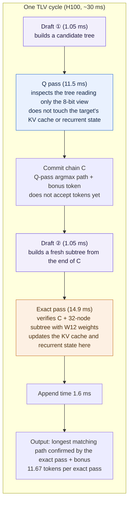

[Paper](https://arxiv.org/abs/2611.02501)
## Introduction

Speculative decoding is a technique that commits multiple tokens together when a large model is invoked once, accelerating language model decoding where memory bandwidth is the bottleneck. This paper points out that public implementations of this technique fail to capture much of the permissible speedup, and has a coding agent re-measure the bottleneck for each deployment environment and discover optimizations on its own. The result is a large increase in speedup for both single requests and batching, without training or loss of output quality.

## 1. Background: what you need before reading

### 1.1 What speculative decoding does

When a **drafter** (a small model that proposes) proposes multiple tokens after a prefix, the **target** (the large model that verifies) verifies those tokens in a single forward pass. Each token uses one row. In greedy decoding, it accepts the longest prefix matching the target's argmax and appends that argmax as a bonus. This paper calls the number of tokens accepted in one pass $\tau$, where $\tau \in [1, m+1]$.

Here, the "published baseline implementation" is called **stock**; stock supports both the drafter drawing tokens one at a time sequentially (EAGLE-3) and drawing an entire block of 8–16 positions in a single pass (DFlash2, DSpark). The parallel drafter outputs the top 16 candidates and their scores at each position. DSpark adds a Markov head on top, conditioning the score on the previous token.

$$\ell_s(y) = \mathrm{bases}(y) + \left[W_1[x_{s-1}],\, W_2[y]\right]$$

In other words, DSpark takes the "immediately preceding token" as input when scoring candidates (Equation 1 in the original).

### 1.2 'Lossless' and 'exact pass'

In this paper, an **exact pass** means a pass that verifies once with the target's exact weights. **Lossless** is defined as "every accepted token lies on a path verified by an exact pass and equals that pass's argmax." However, even an exact pass can differ slightly from its own earlier AR result due to floating-point operation order such as GEMM tiling order, and this happens only for tokens whose logits are nearly tied. In practice, when stock first diverges from AR, the log-probability difference between the two tokens was at most 0.232 nat. A low-precision verification pass, by contrast, can change even tokens far from a tie. So checking losslessness would require outputs to be exactly identical, which would then reject even lossless systems.

### 1.3 Terminology

| Term | Meaning | Why it was needed in this article |
|---|---|---|
| Speculative decoding | A technique where a small model proposes tokens and a large model verifies them at once, committing multiple tokens together | The paper's starting point |
| Drafter / target | The small proposing model / the large verifying model | To separate "proposal" from "verification" |
| stock | The baseline implementation published by each project | The baseline the paper compares against |
| $\tau$ | The number of tokens accepted per step | To decompose speed into "token count × step cost" |
| Exact pass | A pass that verifies with exact target weights | The reference for defining losslessness |
| Lossless | A state where every accepted token is on an exact-pass path and equals its argmax | What guarantees "output unchanged" |
| exact replay | A method that re-executes recorded draft lattices and target outputs offline, recomputing only tree selection and verification | To reproduce metrics like $\tau$ without timing noise |
| paired run | A measurement method that runs the same request on two GPUs and compares the times of the two systems | To distinguish a few-percent gain from noise |

## 2. Problem: why public implementations are slow

### 2.1 For a single request, step time is "reading weights"

When there is one request, adding more candidate rows to verify barely increases time. Before the first round, GEMM time was 17.88 ms verifying one row and 18.58 ms for 64 rows. Increasing rows 64× added only 0.7 ms.

The reason is that most of the step time goes to reading target weights from memory. Of the 23.61 ms single step measured after the first round, 80% went to reading target weights (linear layers and LM head). At H100's peak bandwidth of 3.35 TB/s, reading these weights takes 92% of the time needed to read all bytes in the step.

So for a single request, "the cost of reading weights" is effectively fixed, and adding verification rows on top is nearly free. Yet stock does not use that free region. Among candidates the drafter sorted by score at each position, it picks only the single highest-scoring one and verifies it as one chain. The other candidates are discarded, and those discarded candidates often contain the next token the target actually wants.

### 2.2 In batching, each request adds row cost

Once batching kicks in, the order flips. Each request takes its share of attention, recurrent state updates, and prefill computation, and prefilling a new prompt re-reads the weight stream. So weight reading no longer dominates the step. stock's speedup over AR is 3.40× at 1 request and drops to 1.89× at 24 requests on FP8 Qwen3.8-27B, and from 3.73× to 1.49× at 32 requests on Qwen3.5-4B (BF16).

The "verify more" optimization that was a gain for a single request turns into a straight loss under batching, because each verification row now costs real time.

### 2.3 The same technique cuts both ways across deployments

The optimal choice depends on serving shape (single request/batching), drafter, target, and GPU. The original gives three cases.

- **Checking first with a low-precision target copy**: Fast for a single request, but in BF16 Qwen3.8-27B batching the extra check approaches the cost of a whole step, making it 13% slower.
- **Draft tree ignoring parent conditioning**: Because DSpark scores conditioned on the previous token, a tree that ignores this conditioning accepts only half the tokens a conditioned tree accepts.
- **Hybrid target and a different GPU**: In Qwen3.8-27B, 48 of 64 layers are Gated DeltaNet (GDN), so the recurrent state must be updated separately for each tree node. Meanwhile, RTX PRO 6000 lacks Hopper's `wgmma` instruction, so kernels must be rewritten.

There is no universal optimization. The more per-deployment manual tuning people do, the harder it becomes to sustain.

### 2.4 A small example: candidates discarded in one step

The table below is an illustrative example built to explain the structure and is **not from the original paper**. The paper's $\tau$ measurements are presented separately later.

**Input** — After the prefix "The cat sat on the", DFlash2 proposed 4 positions in one pass. The candidates and scores at each position, and the token stock picked for its chain, are as follows.

| Position | Drafter candidates and scores | Token stock put in the chain |
|---|---|---|
| 1 | mat(.40) > rug(.25) > floor(.20) | mat |
| 2 | is(.55) > was(.30) | is |
| 3 | soft(.30) > warm(.28) > **a(.25)** | soft |
| 4 | bed(.35) > **place(.30)** | bed |

**Change, omission, rejection** — stock hands this chain to the target at once and verifies it in positional order.

| Verification order | Prefix verified | Target argmax at that prefix | Chain token | Verdict | What remains |
|---|---|---|---|---|---|
| 1 | The cat sat on the | mat | mat | match → accept | 3 candidates at position 2 |
| 2 | … mat | is | is | match → accept | 3 candidates at position 3 |
| 3 | … mat is | a | soft | **mismatch → verification stops** | target argmax `a` added as bonus |
| 4 | — | — | bed | **omitted (unverified)** | 2 candidates at position 4 unverified |

**Output** — stock commits three tokens `mat is a` in one step.

**What remains** — At the point where verification broke off, the drafter already had the token the target wanted among its candidates. That is `a` at position 3 and `place` at position 4 that follows. stock discards this branch, but in tree verification that keeps candidates as branches, `mat → is → a → place` survives and can accept up to four tokens in one step.

The original quantifies the size of this structure with exact replay. stock's 8-position chain accepts only $\tau = 4.25$ tokens, whereas the oracle that keeps accepting as long as the target's greedy token is within the drafter's top 16 gives 6.42 at 8 positions and 8.20 at 16 positions. That is, reviving discarded candidates nearly doubles tokens accepted per step.

## 3. Method: SpecPilot's search loop

SpecPilot has a coding agent iterate in rounds to find "it depends on the deployment" without manual tuning. Each round starts from the previous round's final system, and a new deployment starts from stock plus the verified entries in memory.

### 3.1 The flow of one round

| Phase | Reads | Does | State left behind |
|---|---|---|---|
| Phase 0 cost model | Last round's draft lattice, kernel profile, measured step time | Recomputes $\tau$ and $c$ and picks the largest gap among the ceiling's three factors to set direction | One gap for the next round to attack |
| Phase 1 exploration | The chosen gap | Gives one direction to one GPU and a sub-agent implements it as a patch. The sub-agent first measures headroom with the cheapest evidence (exact replay, microbenchmark, 1-GPU timing), and builds a new algorithm only when headroom after subtracting runtime overhead is at least 3% | Patch candidates per direction and estimated gains |
| Phase 2 integration | Per-direction patches | An integration sub-agent stacks patches on the current best system and times them under the same approval rule | A new system if approved |
| Phase 3 kernel tuning | Profile of the new system | A kernel sub-agent starts with the kernel farthest from its byte floor | Tuned kernels |
| Phase 4 seal check | Unseen requests, up to 4096-token outputs | Compares time against stock (paired run) and reruns token forcing to decide | A sealed final system if it passes |
| Memory distill | Passed mechanisms | Stores code delta, variant registry, correctness contract, and a summary of evidence, limits, and unverified areas as one entry | A memory entry that new deployments and the next round draw on again |

### 3.2 The cost model computes "remaining speed"

The cost model decomposes speedup over AR into two terms.

$$S(N) = \frac{\tau(N)}{c(N)}, \qquad c(N) = \frac{T_{\text{step}}(N)}{T_{\text{AR}}}$$

$\tau(N)$ is the number of tokens a step accepts when verifying $N$ rows, $T_{\text{step}}(N)$ is step time including drafting, $T_{\text{AR}}$ is AR step time in the same engine, and $c(N)$ is the relative cost. Because it separates whether the speed is lacking due to small $\tau$ or large $c$, each round can choose which of the two to attack.

It also computes a ceiling to compare how far it can go. The "byte floor" for each kernel type is the larger of the time to process FLOPs at 60% of peak dense throughput and the time to read bytes at 90% of peak bandwidth. The ceiling decomposes into the product of three factors.

$$\frac{\tau_{\text{best}}}{\tau} \cdot \frac{T_{\text{prof}}}{T_{\text{floor}}} \cdot \frac{T_{\text{step}}}{T_{\text{prof}}}$$

The first is "if the tree is built better" ($\tau$ that any tree could accept), the second is "if kernels are made faster" (the gap between profiled step time and the byte floor), and the third is "if time outside the profile is reduced" (the gap between the profile and actual step time). Each round attacks the largest factor.

### 3.3 Agents propose, the controller approves

The key is separating the agent that modifies the system from the controller that measures performance. A master agent plans directions, each direction occupies one GPU and a sub-agent implements it as a patch. The controller is a script that agents can only call and cannot modify. It runs two systems on two GPUs with the same requests to make a paired run, running twice and swapping the GPUs.

The approval criteria are strict. The 95% confidence lower bound of the gain must exceed "1% + twice stock's own noise" (stock noise is below 0.1% for a single request on H100), and a patch that also changes the output must exceed about 3%, because patches that change output carry the possibility of loss.

### 3.4 Token forcing: checking output against stock too

There are two risks here. A few-percent gain can be buried in timing noise, and more dangerously, **an agent rewarded only for speed can take a shortcut that slightly changes the output**. The authors built a defective system with a bias planted in the logits and measured accuracy. The defective system's accuracy change fell in an interval containing zero (lossless −0.3 points [−1.6, +0.7], defective −1.6 points [−3.6, +0.3]), so accuracy could not catch the defect.

So they inspect output directly with **token forcing**. They pass the system's output tokens one by one through a scorer (the target of a stock engine using an FP32 LM head) via teacher forcing, and count it as a mismatch when a system token differs from the scorer's argmax. The margin of a mismatch is the log-probability difference to that argmax. stock itself shows mismatches on 0.72% of tokens due to kernel rounding, almost all of them ties.

There are two decision rules. Reject if the mismatch rate is 0.5%p higher than stock, or if large mismatches (events) with margin at least $2\delta$ are more frequent than stock. Here $\delta$ is the near-tie threshold that Phase 0 sets by rounding "the maximum margin when stock first diverges from AR" up to a multiple of 1/8.

The results were clear. The lossless systems' mismatch rates were 0.73% and 0.52%, keeping to stock's 0.72% and 0.53%, while the defective system was filtered out at 2.0% and 2.4%. Of the defective system's 200 large-mismatch events, 192 and 191 were unexplained.

### 3.5 Verified optimizations accumulate in memory

A passed mechanism is stored as one memory entry. An entry contains a code delta relative to the other entries it requires, a variant registry, correctness contracts and options, and a summary of evidence, limits, and unverified areas. An entry survives only "when applying it to stock together with its required entries exactly reproduces the original system's code." Reused entries are retuned and remeasured in a new deployment and are not counted as new discoveries. Memory currently has 140 entries, each with up to 12 requirements. These 140 entries cover every evaluated configuration, and 15 of them are specific to sm 120 (RTX PRO 6000).

### 3.6 What actually changed across three rounds

Three rounds on single-request Qwen3.8-27B (DFlash2, H100) are a good example. Throughput went from stock's 184 tokens/s to 416 tokens/s in three rounds. Each round the cost model recomputed the ceiling and changed the target.

| Round | Gap indicated by the ceiling | What the agent built | Throughput | Evidence |
|---|---|---|---|---|
| 1 | $\tau$ (token count) | best-first tree verification | 184 → 270 tokens/s | Extra rows are nearly free, so the tree's effect dominates. Exact replay showed there were few better trees for this lattice, moving the next gap to step cost |
| 2 | Step cost (weight bytes) | W12 12-bit weights | 270 → 370 tokens/s | Weight reading is 80% of the step. Byte arithmetic identified 25% of the 15.30 ms weight read as headroom, and a denser 11-bit variant was rejected because a microbenchmark showed 3× slower decoding |
| 3 | Unit of the step | TLV (two drafts per exact pass) | 370 → 416 tokens/s | The W12 single-pass step is about 25% above the byte floor and the tree had hit the lattice limit, so the remaining gain lay in the ceiling's assumption itself, "one exact pass per draft" |

Approvals came in pieces per round. In round 2, the first patch was approved at 1.076× in a paired run and the revised kernel at 1.063×, and W12 was sustained through three approvals across two rounds. Round 3's approvals were tail-step skip 1.010×, INT4 drafter 1.022×, W12 layout/boundary correction 1.045×, TLV 1.037×, prefill graph/Q-pass gate 1.015×, and draft-exact-pass fusion 1.010×.

**There is an experiment comparing the effect of the cost model.** In the same environment, a single-agent loop with only the cost model removed reached just 1.34× over stock after three rounds. SpecPilot reached 2.13×. The difference lay in the kind of bottleneck. The loop without the cost model dug only into the visible metric "tokens per step," adding a 24-node tree, longer drafter blocks, and cheaper drafter weights. It did not touch target weight reading, which was 80% of the step.

## 4. Four techniques the agent found

All discovered mechanisms are lossless. As defined earlier, every accepted token is on an exact pass and matches that pass's argmax. Approaches that do not keep snapshots or that rewind the recurrent state only change the exact pass's own rounding, so losslessness is preserved.

### 4.1 W12: a 12-bit lossless weight format

If the bottleneck for a single request is weight reading, the direct approach is to reduce the number of bytes read. A **binade** is an interval divided by powers of two ($2^e$ or more and less than $2^{e+1}$). For each output channel, W12 picks a 16-binade window $[E_n-15, E_n]$ covering most of that channel's weights and stores the weights inside the window in 12 bits.

| Plane | Bits | Value stored | In the 8-bit view |
|---|---|---|---|
| A | 1 + 3 | Sign + top 3 mantissa bits | Included |
| E | 4 | Exponent offset $e-(E_n-15)$ | Included |
| B | 4 | Bottom 4 mantissa bits | Excluded |

That is, A+E is the "8-bit view," and that is what the Q pass reads. Weights outside the window, or that are zero or denormal, go into a per-channel sparse escape list and are restored exactly. The escape rate is only $7.33\times10^{-5}$ on Qwen3.8-27B, and across 8 models it compresses to 12.013–12.020 bits/weight. Converted-layer weights shrank from 44.67 GB to 33.58 GB, and total weight memory from 51.1 GB to 39.8 GB (Tables A2, A6). At load time the server checks the restored tensors bit-for-bit against the checkpoint.

More important than the format is the kernel. W12 GEMM restores 12 KB records (a 128×64 weight tile, the first 8 KB the 8-bit view and the last 4 KB the low mantissa bits) in registers and passes them as `wgmma` register operands. The restore arithmetic hides behind memory reads and effectively disappears. Because the stream-K kernel splits the reduction loop across thread blocks in a fixed order, GEMM is deterministic.

Performance must be viewed at two levels. **At the kernel level**, W12 GEMM beat cuBLAS on every projection layer of Qwen3.8-27B: 1.19–1.47× at 1 row and 1.17–1.35× at 32 rows. However, the first W12 kernel only reached 0.80–0.89× of cuBLAS time at 32 rows, i.e. it was slower. On RTX PRO 6000, with no `wgmma`, it was ported to `mma.sync` and achieved 1.18–1.68× across all 13 tile shapes. The 128-byte swizzled activation layout enables 48-row tiles, so W12 GEMM time stays flat as rows grow, while cuBLAS slows from 8 rows onward.

**The LM head is handled separately.** On H100, W12 leaves the LM head in BF16 but uses an INT8 copy that discards "tokens proven unable to be the argmax" via a per-row Cauchy–Schwarz error bound, then exactly rescores only the surviving tokens. The argmax never changes. LM head latency dropped from 878 µs to 482 µs. On RTX PRO 6000 this certified head was slower than BF16 (2598 µs vs. 1750 µs), so there it was converted to W12.

### 4.2 Best-first tree verification for hybrid targets

From the candidate lattice produced by the parallel drafter, stock verifies only one high-scoring chain. SpecPilot's tree scores each edge with the log-softmax score "given the parent," producing a best-first tree that keeps the $N$ nodes with the highest path score $\sum \log p(\text{child} \mid \text{parent})$. Unlike DDTree's marginal scores, it includes parent conditioning, so the same builder runs unchanged on DSpark lattices.

The drafter draws 16 positions, twice the training block size, and the tree verifies 32 nodes to depth 15 (verifying more nodes than draft positions).

The problem is recurrent layers. A GDN head updates a fixed-size state $h$ at each token.

$$h_t = \alpha_t\left(I - \beta_t k_t k_t^\top\right) h_{t-1} + \beta_t k_t v_t^\top, \qquad o_t = h_t^\top q_t$$

stock verification snapshots $h$ at each verification position, so using a tree requires **one snapshot per node**. At $N=24$, per-node snapshots need about 18 GB. SpecPilot drops snapshots and recomputes the state along each root path. A path-verification kernel walks each path from the committed state, and a commit kernel replays accepted paths through all 48 GDN layers, matching stock kernels and chains bit-for-bit.

A faster kernel is the WY verification kernel. Following TreeWY, it turns the chain of rank-one updates into matrix products and solves all paths at once on tensor cores. It splits an FP32 state into three BF16 pieces that together represent the full 24-bit mantissa exactly, and tensor-core products accumulate in FP32, staying within one BF16 ulp of the path-kernel output. Across 48 GDN layers on H100, verification dropped from 1485 µs with the path kernel to 542 µs with the WY kernel, and commit from 208 µs to 119 µs.

The tree effect itself is reproduced with exact replay. On an 8-position lattice, $\tau$ rose from stock's chain 4.25 to 5.38 for a 32-node best-first tree, and drafting 16 positions reaches 5.85 at 32 nodes and 6.25 at 63 nodes. At 16 nodes, the best-first tree matches an EAGLE-2-style top-4 tree (5.03 vs. 5.02) and beats the Sequoia tree (4.71). Wider trees are a loss. In the W12 system, one node above 32 costs about 0.17 ms per step, not 0.063 ms.

### 4.3 TLV: two-stage verification that rations exact passes

TLV breaks the ceiling's assumption, "one exact pass per draft." One cycle consists of two drafts and two passes.

The colors mean three things. **Purple** is the stage where the drafter builds candidates, independent of target state. **Blue** is a pass that only inspects without changing the target's KV cache and recurrent state. **Orange** is the only pass that actually updates target state. This color boundary is exactly the boundary of losslessness, because only the orange pass accepts tokens.

The Q pass truncates the subtree redrawn from the end of C to $N-|C|$ nodes and attaches it under C, and one exact pass verifies the combined 32-node tree and accepts the longest matching path. In TLV, $\tau$ means tokens accepted per exact pass, and $T_{\text{step}}$ is the time of the two-pass cycle including both drafts.

The key is that the Q pass does not use a separate low-precision target model. It reads the 8-bit view already nested in the W12 record (the first 2/3 of the record) as-is. With discarded mantissa bits set to the midpoint, the Q pass matches the exact pass's top-1 token at 98.7% of positions. So the Q pass only "pre-selects the path the exact pass will accept."

The result is that tokens accepted per exact pass rose from 6.16 to 11.67 (Figure A3). The final H100 system's cycle is about 30 ms, the sum of 2×1.05 ms drafting, 11.5 ms Q pass, 14.9 ms exact pass, and 1.6 ms appending.

### 4.4 Three choices for batching

In batching, every row is a cost. So these three mechanisms only choose "which rows to draft and verify." Because they only choose, they are lossless.

**Shared node budget.** Instead of dividing a budget among requests, the whole step shares one node budget and fills nodes starting from the highest path log-probability. A best-first tree is prefix-closed, so each request's share is also a valid tree. At 24 requests on an FP8 target, a 192-node budget sits in the flat region of target GEMM cost, so cost does not grow until the next tile. On DSpark, this approach accepted 6–14% more tokens than giving each request an equally sized tree.

**Per-request drafter block.** Each request chooses its number of draft positions from 16, 12, and 8 based on recent acceptance rate and draft confidence on the GPU, with tree depth limited accordingly. This keeps the FP8 target's drafter within 256 rows, which is the end of the drafter GEMM's flat region and holds 17–24 requests. The measured gain is 1.040×.

**Prompt admission.** Prompt rows for a new prompt are merged into the verification step, so one weight stream handles the prompt and generation together. This pays off only when computation is hidden behind weight reads, so the scheduler admits only prompts it would have made wait anyway. On FP8 targets, prompts up to 384 tokens enter as chains of prompt rows, and both FP8 final systems use this approach. In BF16 Qwen3.8-27B batching, prompts enter in a 128-row region that shares the verification step's projection and MLP GEMMs. Admitting only waiting prompts gave a 3.5% gain at 24 requests (a non-paired measurement), and admitting all short prompts was a loss.

## 5. Results

### 5.1 Measurement conditions

Four targets (Qwen3.8-27B, Qwen3.5-4B, Gemma-4-12B, Muse-Glimmer-30B), three drafters (DFlash2, DSpark, EAGLE-3), two GPUs (H100 SXM5, RTX PRO 6000 Blackwell Server Edition, sm 120, measured bandwidth 1.51 TB/s), and five benchmarks (GSM8K, MATH500, HumanEval, MBPP, MT-Bench). The server uses a fixed SGLang v0.5.20 build. All single-request runs are BF16, and batching ran only on H100 with FP8 (Qwen3.8-27B) and BF16 (Qwen3.5-4B, Gemma-4-12B). Decoding is fixed to greedy with thinking enabled. The agent is Claude Opus 5.5 in Claude Code.

The gain is defined as the geometric mean of the output-speed ratio across benchmarks and batch sizes. All gains over stock come from sealed final systems obtained through two paired runs, and every final system passed token forcing. Speedup over AR is measured by interleaving AR, stock, and SpecPilot.

The stock baselines were also tuned per GPU and serving shape. On H100, DFlash2 runs with its training block size and deployment settings as-is. RTX PRO 6000's best stock is block 12 + Triton attention, 9.9% faster than the H100 setting. No EAGLE-3 configuration beat the default by more than 2.4%. On H100 single request, stock DFlash2 using a DDTree tree was 4.82× over AR as a stronger baseline.

### 5.2 Speedup

| Condition | stock (vs. AR) | SpecPilot (vs. AR) | Sealed gain (vs. stock) | Tokens per step |
|---|---|---|---|---|
| Single request, Qwen3.8-27B + DFlash2, H100 | 3.95× (τ 4.65) | 8.86× (τ 13.08) | 2.13× | 4.65 → 13.08 |
| Single request, Qwen3.8-27B + DSpark, H100 | 3.74× (τ 4.42) | 9.41× (τ 12.85) | 2.38× | 4.42 → 12.85 |
| Single request, Qwen3.8-27B + DFlash2, PRO 6000 | 4.46× (τ 5.23) | 10.87× (τ 12.80) | 2.44× | 5.23 → 12.80 |
| Single request, Muse-Glimmer-30B + DFlash2, PRO 6000 | 4.69× (τ 5.16) | 10.63× (τ 12.64) | 2.21× | 5.16 → 12.64 |
| Batching, Qwen3.8-27B FP8 + DFlash2 | 2.02× (τ 4.56) | 3.90× (τ 5.39) | 1.85× | 4.56 → 5.39 |
| Batching, Qwen3.8-27B FP8 + DSpark | 1.94× (τ 4.37) | 3.93× (τ 5.42) | 1.94× | 4.37 → 5.42 |
| Batching, Qwen3.5-4B + DFlash2 | 1.51× (τ 6.58) | 3.77× (τ 6.97) | 2.39× | 6.58 → 6.97 |
| Batching, Gemma-4-12B + EAGLE-3 | 0.68× (τ 2.04) | 2.09× (τ 2.54) | 3.11× | 2.04 → 2.54 |

For single requests, most of the gain comes from $\tau$. stock verifies only one chain and $\tau$ stays around 4–5, whereas SpecPilot raises tokens accepted per exact pass from 6.16 to 11.67 with TLV (Figure A3) and $\tau$ in Table 1 rises to 12.64–13.08. The weaker stock is, the larger the gain. Gemma-4-12B has stock slower than AR (0.68×) and uses the sequential drafter EAGLE-3, and its most improved batch was 3.11×.

Absolute speedup in batching is lower than for single requests. Because row costs are real in batching, doubling $\tau$ does not translate into as much gain as for a single request. On FP8 Qwen3.8-27B it is 4.16× vs. AR at 16 requests (stock 2.20×) and 3.72× at 24 requests (stock 1.89×). BF16 Qwen3.8-27B is 5.94× at 6 requests and 5.39× at 10 requests. $\tau$ itself also rose in batching: 5.2–5.6 on FP8 targets (stock 4.5–4.6) and 5.7–6.0 on BF16 (stock about 4.6).

The sealed final systems beat stock on every benchmark and every batch size. Single-request gains ranged from 2.08× on MT-Bench (H100, DFlash2) to 2.55× on MATH500 (PRO 6000, DFlash2). Gemma-4-12B's gain grew with batch size, from 2.80× at 16 requests to 3.43× at 48 requests.

### 5.3 Don't mix absolute throughput with kernel performance

| Configuration | AR | stock | SpecPilot |
|---|---|---|---|
| Single request, Qwen3.8-27B, DFlash2, H100 | 49.9 tok/s | 183.9 tok/s | 416.1 tok/s |
| Single request, Qwen3.8-27B, DSpark, H100 | 49.9 tok/s | 172.7 tok/s | 435.3 tok/s |
| Single request, Qwen3.8-27B, DFlash2, PRO 6000 | 26.9 tok/s | 108.2 tok/s | 272.3 tok/s |
| Single request, Muse-Glimmer-30B, DFlash2, PRO 6000 | 25.7 tok/s | 110.6 tok/s | 255.6 tok/s |
| 16 requests, Qwen3.8-27B FP8, DFlash2, H100 | 64.6 tok/s | 135 tok/s | 243 tok/s |
| 24 requests, Qwen3.8-27B FP8, DFlash2, H100 | 61.4 tok/s | 115 tok/s | 215 tok/s |

All are output token speeds per request. The "1.17–1.47×" for W12 GEMM seen earlier is a kernel-level number. No matter how fast a kernel is, it translates into system speed only if that kernel is the bottleneck.

### 5.4 When memory moves to a new deployment

Memory did real work when moving to different drafters and models on the same GPU.

**To DSpark.** Applying the tree, W12, and TLV entries to the new DSpark lattice in a single approval produced a sealed 2.110×, and an INT6 copy for the Q pass was added.

**To EAGLE-3.** In a new deployment attaching the sequential drafter EAGLE-3 to Gemma-4-12B, the agent reimplemented two designs from memory (W12 on the MLP, prompt admission). The first round's seal check gave 2.67×, and afterward acceptance-probability-calibrated node selection, prompt admission, an n-gram chain attached to the EAGLE tree, and a single-KV-head attention kernel brought it to a final 3.11×.

**To a new GPU platform.** RTX PRO 6000 has 99 KB of shared memory per thread block and no `wgmma`. Porting H100's tree and W12 entries (W12 to `mma.sync`, tree verification to a Triton attention backend) gave a sealed 1.92× by itself. Adding split-KV verify attention (splitting a request's KV sequence across thread blocks) and INT6/INT8 Q-pass copies brought it to 2.44×. This exceeds that deployment's ceiling of 2.12×, which TLV could do because the ceiling assumes "one draft per pass."

**To a new model family.** Muse-Glimmer-30B, a dense model without recurrent layers, reused memory except for the GDN entries. The first approval applied the tree, W12, TLV, and INT6/INT8 copies at once, and added exact sliding-window attention to a 32-node tree. Kernel fusion including L2 prefetching brought it to a final 2.21×.

**Beyond speculative decoding.** W12 is a format independent of speculative decoding. Running only AR decoding in SGLang is 1.19–1.28× faster for a single request (Muse-Glimmer-30B, Qwen3.8-27B, Gemma-4-12B, Llama-3.1-8B) and 1.13–1.20× faster at 32 requests. With 14–22% less weight, the KV cache pool grows 2.03× on Qwen3.8-27B and 2.54× on Muse-Glimmer-30B. It is not tied to the engine either. In Hugging Face Transformers with static cache and CUDA graphs, Llama-3.1-8B decodes 1.12× faster for a single request.

## 6. Limitations

**Scope stated by the authors.** A mechanism's gain depends on serving shape. Wide tree, W12, and TLV were all gains in three single-request Qwen3.8-27B deployments, but in batching a 24-node tree was a 14.9% loss on FP8 targets, a 24-position block was a 9.9% loss on BF16, and TLV was a 13% loss. TLV's Q pass reduces only attention and recurrent-layer bytes, so when the Q pass accounts for 0.80–0.88 of the step, one cycle must accept nearly twice the tokens of a single-pass step just to break even. Conversely, the "choose rows" family (shared node budget, per-request block, prompt admission) is a gain in batching.

The ceiling's assumptions are also not exact. The byte floor is set by the 60%/90% rule, and the ceiling assumes "one exact pass per draft." After TLV broke that assumption, it actually exceeded the ceiling (2.12×).

The loop is expensive. One round takes 7–20 hours and 20–86 GPU-hours. The 13 completed rounds total 164 hours and 530 GPU-hours, and only 54 of the 486 code changes the agent made led to approval. The agent API cost itself is not quantitatively reported in the original (not reported in the original).

The definition of losslessness also includes stock's own floating-point rounding. For tokens whose logits are nearly tied, it can differ from AR.

**A judgment the reader adds.** The evaluation is limited to greedy decoding (thinking mode), and whether the same gains hold under sampling or beam search has not been verified (not reported in the original). GPUs are also only the two platforms H100 and RTX PRO 6000, so transfer to other generations and vendors is unknown. The evaluated mechanisms were measured on a fixed SGLang v0.5.20 build, and only W12 has engine-independent results. The verification that agent-written code receives still needs a human to read it.

## 7. Summary

The substance of this paper is not a particular kernel but a procedure. SpecPilot first measures "where speed is leaking" with a cost model, hands the gap to agents, has a controller approve with paired runs and seal checks, and keeps passed mechanisms in memory to carry to the next deployment. This procedure led to weight compression (W12), tree verification, and exact-pass rationing (TLV) for single requests, and to row-selection rules for batching.

In practice, two things must come together. One is an artifact usable on its own, like W12, and the other is the procedure "re-measure that environment's bottleneck before applying." W12 gives 1.19–1.28× beyond speculative decoding and grows the KV cache pool up to 2×. Trees and TLV, by contrast, are mechanisms that become losses when the serving shape changes, so it is better to rerun the cost model from scratch than to copy them as-is.

<!-- verbatim-tables -->

Tables from the paper

> Tables converted mechanically from the arXiv e-print LaTeX source. The numbers are the paper's own and did not pass through a model.

**Table 1. Speedup over AR and $\tau$, the tokens accepted per exact target pass, with one request on BF16 targets. SpecPilot uses two-level verification, so each exact pass verifies two chained drafts and accepts far more tokens than stock.**

| Model | Method | Math |  |  |  | Code |  |  |  | Chat |  |  |  |
|---|---|---|---|---|---|---|---|---|---|---|---|---|---|
|  |  | GSM8K |  | MATH500 |  | HumanEval |  | MBPP |  | MT-Bench |  | *Avg.* |  |
| *H100 SXM5* |  | Speedup | $\tau$ | Speedup | $\tau$ | Speedup | $\tau$ | Speedup | $\tau$ | Speedup | $\tau$ | Speedup | $\tau$ |
|  | DFlash2 | 4.47$\times$ | 5.82 | 4.31$\times$ | 5.26 | 3.86$\times$ | 4.69 | 3.83$\times$ | 4.71 | 3.36$\times$ | 3.84 | 3.95$\times$ | 4.65 |
|  | +SpecPilot | 10.33$\times$ | 16.69 | 10.00$\times$ | 15.46 | 8.49$\times$ | 13.05 | 8.24$\times$ | 12.66 | 7.55$\times$ | 10.81 | 8.86$\times$ | 13.08 |
|  | DSpark | 4.43$\times$ | 5.87 | 4.15$\times$ | 5.11 | 3.57$\times$ | 4.39 | 3.50$\times$ | 4.45 | 3.17$\times$ | 3.61 | 3.74$\times$ | 4.42 |
| -4*Qwen3.8-27B | +SpecPilot | 11.01$\times$ | 16.67 | 10.69$\times$ | 15.66 | 8.86$\times$ | 12.72 | 9.02$\times$ | 12.79 | 7.85$\times$ | 10.17 | 9.41$\times$ | 12.85 |
| *RTX PRO 6000* |  | Speedup | $\tau$ | Speedup | $\tau$ | Speedup | $\tau$ | Speedup | $\tau$ | Speedup | $\tau$ | Speedup | $\tau$ |
|  | DFlash2 | 5.23$\times$ | 6.82 | 4.81$\times$ | 6.07 | 4.47$\times$ | 5.62 | 4.24$\times$ | 5.25 | 3.72$\times$ | 4.06 | 4.46$\times$ | 5.23 |
| -2*Qwen3.8-27B | +SpecPilot | 12.83$\times$ | 16.75 | 11.99$\times$ | 15.02 | 10.47$\times$ | 13.24 | 10.55$\times$ | 12.98 | 8.93$\times$ | 10.25 | 10.87$\times$ | 12.80 |
|  | DFlash2 | 5.08$\times$ | 5.31 | 5.64$\times$ | 6.70 | 4.91$\times$ | 5.77 | 4.59$\times$ | 5.51 | 3.50$\times$ | 3.76 | 4.69$\times$ | 5.16 |
| -2*Muse-Glimmer-30B | +SpecPilot | 11.47$\times$ | 13.24 | 12.85$\times$ | 16.02 | 10.75$\times$ | 13.69 | 10.25$\times$ | 13.08 | 8.34$\times$ | 9.80 | 10.63$\times$ | 12.64 |

**Table 2. Speedup over AR and $\tau$ with batching on H100, averaged over 16/20/24 requests on Qwen3.8-27B in FP8, and over 24/28/32 on Qwen3.5-4B and 16/32/48 on Gemma-4-12B, both in BF16.**

| Model | Method | Math |  |  |  | Code |  |  |  | Chat |  |  |  |
|---|---|---|---|---|---|---|---|---|---|---|---|---|---|
|  |  | GSM8K |  | MATH500 |  | HumanEval |  | MBPP |  | MT-Bench |  | *Avg.* |  |
| *H100 SXM5* |  | Speedup | $\tau$ | Speedup | $\tau$ | Speedup | $\tau$ | Speedup | $\tau$ | Speedup | $\tau$ | Speedup | $\tau$ |
|  | DFlash2 | 2.11$\times$ | 5.02 | 2.19$\times$ | 5.03 | 2.05$\times$ | 4.56 | 2.12$\times$ | 5.03 | 1.69$\times$ | 3.80 | 2.02$\times$ | 4.56 |
|  | +SpecPilot | 4.39$\times$ | 6.14 | 4.33$\times$ | 5.95 | 3.81$\times$ | 5.38 | 4.07$\times$ | 6.20 | 3.07$\times$ | 4.33 | 3.90$\times$ | 5.39 |
|  | DSpark | 2.12$\times$ | 5.00 | 2.16$\times$ | 4.87 | 1.95$\times$ | 4.38 | 1.96$\times$ | 4.81 | 1.56$\times$ | 3.58 | 1.94$\times$ | 4.37 |
| -4*Qwen3.8-27B | +SpecPilot | 4.60$\times$ | 6.28 | 4.39$\times$ | 6.11 | 3.82$\times$ | 5.45 | 3.97$\times$ | 6.07 | 3.05$\times$ | 4.32 | 3.93$\times$ | 5.42 |
|  | DFlash2 | 1.62$\times$ | 6.82 | 1.88$\times$ | 8.17 | 1.60$\times$ | 7.15 | 1.27$\times$ | 5.88 | 1.25$\times$ | 5.16 | 1.51$\times$ | 6.58 |
| -2*Qwen3.5-4B | +SpecPilot | 4.04$\times$ | 7.30 | 4.61$\times$ | 8.60 | 4.00$\times$ | 7.42 | 3.30$\times$ | 6.31 | 3.11$\times$ | 5.49 | 3.77$\times$ | 6.97 |
|  | EAGLE-3 | 0.69$\times$ | 2.00 | 0.79$\times$ | 2.36 | 0.66$\times$ | 1.97 | 0.69$\times$ | 2.08 | 0.61$\times$ | 1.78 | 0.68$\times$ | 2.04 |
| -2*Gemma-4-12B | +SpecPilot | 2.28$\times$ | 2.82 | 2.41$\times$ | 2.94 | 2.22$\times$ | 2.64 | 1.88$\times$ | 2.28 | 1.74$\times$ | 2.02 | 2.09$\times$ | 2.54 |

**Table 3. Sealed gains over stock on unseen requests, and tokens per step from Tables and .**

| Target | Drafter | Gain | Tokens/step |
|---|---|---|---|
| *Single request, H100 SXM5* |  |  |  |
| Qwen3.8-27B | DFlash2 | 2.13$\times$ | 4.65 $\to$ 13.08 |
| Qwen3.8-27B | DSpark | 2.38$\times$ | 4.42 $\to$ 12.85 |
| *Single request, RTX PRO 6000* |  |  |  |
| Qwen3.8-27B | DFlash2 | 2.44$\times$ | 5.23 $\to$ 12.80 |
| Muse-Glimmer-30B | DFlash2 | 2.21$\times$ | 5.16 $\to$ 12.64 |
| *Batching, H100 SXM5* |  |  |  |
| Qwen3.8-27B (FP8) | DFlash2 | 1.85$\times$ | 4.56 $\to$ 5.39 |
| Qwen3.8-27B (FP8) | DSpark | 1.94$\times$ | 4.37 $\to$ 5.42 |
| Qwen3.5-4B | DFlash2 | 2.39$\times$ | 6.58 $\to$ 6.97 |
| Gemma-4-12B | EAGLE-3 | 3.11$\times$ | 2.04 $\to$ 2.54 |

**Table 4. Decoding rates on the interleaved bench, in output tokens per second per request. Batched rows use Qwen3.8-27B in FP8 with DFlash2 on H100.**

| Setting | AR | Stock | SpecPilot |
|---|---|---|---|
| % *Single request* |  |  |  |
| % Qwen3.8-27B, DFlash2, H100 | 49.9 | 183.9 | 416.1 |
| % Qwen3.8-27B, DSpark, H100 | 49.9 | 172.7 | 435.3 |
| % Qwen3.8-27B, DFlash2, PRO 6000 | 26.9 | 108.2 | 272.3 |
| % Muse-Glimmer-30B, PRO 6000 | 25.7 | 110.6 | 255.6 |
| % *Batching* |  |  |  |
| % 16 requests | 64.6 | 135 | 243 |
| % 20 requests | 63.4 | 121 | 224 |
| % 24 requests | 61.4 | 115 | 215 |
| % |  |  |  |

**Table 5. Every promotion in the final lineage of single-request DFlash2 on Qwen3.8-27B (H100), in order, with its paired gain over the system it replaced. The sealed final is 2.13$\times$ over stock.**

| Round | Change | Gain |
|---|---|---|
| % 1 | FP8 drafter, block-12 chain | 1.160$\times$ |
| % 1 | Tree verification (16 nodes) | 1.160$\times$ |
| % 1 | Wide tree (32 nodes) | 1.065$\times$ |
| % 2 | Skinny GEMM and fusion | 1.031$\times$ |
| % 2 | Certified LM head | 1.017$\times$ |
| % 2 | Kernel pre-staging | 1.023$\times$ |
| % 2 | GDN tree kernels (WY) | 1.030$\times$ |
| % 2 | W12 | 1.076$\times$ |
| % 2 | W12 pipeline tuning | 1.063$\times$ |
| % 3 | Tail-step skip | 1.010$\times$ |
| % 3 | INT4 drafter, fast accept | 1.022$\times$ |
| % 3 | W12 layout, edge calibration | 1.045$\times$ |
| % 3 | Two-level verification | 1.037$\times$ |
| % 3 | Prefill graphs, Q-pass gate | 1.015$\times$ |
| % 3 | Fused draft-to-exact hand-off | 1.010$\times$ |
| % |  |  |

**Table 6. Weights read by the TLV Q pass: top-1 agreement with the exact pass over 104k teacher-forced positions on Qwen3.8-27B, and the paired gain when each view was promoted.**

| Q view | Agreement | Deployment | Gain |
|---|---|---|---|
| % Nested 8-bit (W12) | 0.983 | H100, DFlash2 | 1.037$\times$ |
| % INT6 copy | 0.981 | H100, DSpark | 1.067$\times$ |
| % INT6/INT8 copy | 0.984 | PRO 6000, DFlash2 | 1.081$\times$ |
| % |  |  |  |

**Table 7. Directions closed on a measured bound, single-request DFlash2 on Qwen3.8-27B on H100.**

| Direction | Evidence | Result |
|---|---|---|
| % *Weights and kernels* |  |  |
| % 11-bit weights | microbench. | 3$\times$ slower decode |
| % Persistent cross-GEMM W12 | microbench. | 196 vs 172 $\mu$s/layer |
| % One-kernel GDN layer | microbench. | 32.3 vs 17.3 $\mu$s/layer |
| % *Width and verification* |  |  |
| % 48-node trees on W12 | timed | $-$4.3% |
| % Three-level verification | replay | $-$2 to $-$12% |
| % 7-bit nested Q view | replay | $-$3.8% |
| % 6-bit nested Q view | replay | $-$17.5% |
| % |  |  |

