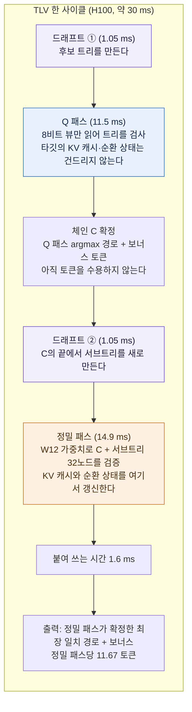

[논문 링크](https://arxiv.org/abs/2611.02501)
## 도입

추측 디코딩은 큰 모델이 한 번 호출될 때 여러 토큰을 함께 확정해, 메모리 대역폭이 병목인 언어 모델 디코딩을 가속하는 기법이다. 이 논문은 이 기법의 공개 구현이 허용된 속도 향상의 상당 부분을 얻지 못했다고 지적하고, 코딩 에이전트가 배포 환경마다 병목을 다시 재서 최적화를 스스로 찾게 한다. 그 결과는 학습이나 출력 품질 손실 없이 단일 요청과 배칭 양쪽에서 속도 향상이 크게 늘었다.

## 1. 배경: 읽기 전에 필요한 것들

### 1.1 추측 디코딩이 하는 일

접두사 뒤에 여러 토큰을 **드래프터**(제안하는 작은 모델)가 제안하면, **타깃**(검증하는 큰 모델)이 그 토큰들을 한 번의 forward pass로 검증한다. 토큰 하나당 행(row) 하나를 쓴다. greedy 디코딩에서는 타깃의 argmax와 일치하는 가장 긴 접두사까지 받아들이고, 그 argmax를 보너스로 하나 더 붙인다. 한 패스에서 수용되는 토큰 수를 이 논문은 $\tau$라 부르며, $\tau \in [1, m+1]$이다.

여기서 "공개된 기본 구현"을 **stock**이라 부르는데, stock은 드래프터가 순차적으로 토큰을 하나씩 뽑는 방식(EAGLE-3)과, 한 pass에서 8~16개 위치의 블록을 통째로 뽑는 방식(DFlash2, DSpark)을 모두 지원한다. 병렬 드래프터는 위치마다 상위 16개 후보와 점수를 함께 내놓는다. DSpark는 여기에 마르코프 헤드를 얹어 직전 토큰을 조건으로 점수를 더한다.

$$\ell_s(y) = \mathrm{bases}(y) + \left[W_1[x_{s-1}],\, W_2[y]\right]$$

즉 DSpark는 후보를 매길 때 "바로 앞 토큰"을 입력으로 받는다(원문 식 1).

### 1.2 '무손실'과 '정밀 패스'

이 논문에서 <strong>정밀 패스(exact pass)</strong>는 타깃의 정확한 가중치로 한 번 검증하는 패스를 뜻한다. <strong>무손실(lossless)</strong>은 "수용된 모든 토큰이 정밀 패스로 검증된 경로 위에 있고, 그 패스의 argmax와 같다"는 정의다. 다만 정밀 패스도 GEMM 타일링 순서 같은 부동소수점 연산 순서 때문에 자기 자신의 앞선 AR 결과와 미세하게 다를 수 있고, 이는 로깃이 거의 동점인 토큰에서만 일어난다. 실제로 stock이 AR과 처음 갈라질 때 두 토큰의 로그확률 차이는 최대 0.232 nat였다. 반면 저정밀 검증 패스는 동점에서 멀리 떨어진 토큰까지 바꿀 수 있다. 그래서 무손실을 검사하려면 출력이 완전히 같아야 하는데, 그러면 무손실 시스템까지 거부하게 된다.

### 1.3 용어 정리

| 용어 | 뜻 | 이 글에서 왜 필요했나 |
|---|---|---|
| 추측 디코딩 | 작은 모델이 토큰을 제안하고 큰 모델이 한 번에 검증해 여러 토큰을 함께 확정하는 기법 | 논문의 출발점 |
| 드래프터 / 타깃 | 제안하는 작은 모델 / 검증하는 큰 모델 | "제안"과 "검증"을 분리해서 보려면 |
| stock | 각 프로젝트가 공개한 기본 구현 | 논문이 비교하는 기준선 |
| $\tau$ | 한 스텝이 수용하는 토큰 수 | 속도를 "토큰 수 × 스텝 비용"으로 분해하려면 |
| 정밀 패스 | 정확한 타깃 가중치로 검증하는 패스 | 무손실의 정의 기준 |
| 무손실 | 수용된 모든 토큰이 정밀 패스 경로 위에서 그 argmax와 같은 상태 | "출력이 바뀌지 않음"을 무엇으로 보증할지 |
| exact replay | 기록된 드래프트 격자와 타깃 출력을 오프라인으로 재실행해 트리 선택·검증만 다시 계산하는 방법 | 타이밍 노이즈 없이 $\tau$ 같은 지표를 재현하려고 |
| paired run | 같은 요청을 두 GPU에서 돌려 두 시스템의 시간을 비교하는 측정 방식 | 몇 %짜리 이득을 노이즈와 구분하려고 |

## 2. 문제: 공개 구현은 왜 느린가

### 2.1 단일 요청에서는 스텝 시간이 "가중치 읽기"다

요청이 하나일 때 검증할 후보를 몇 개 늘려도 시간이 거의 늘지 않는다. 1차 라운드 전 GEMM 시간은 행 1개를 검증할 때 17.88ms, 행 64개일 때 18.58ms였다. 행 수를 64배 늘려도 시간이 0.7ms 늘어났을 뿐이다.

이유는 스텝 시간의 대부분이 타깃 가중치를 메모리에서 읽는 데 쓰이기 때문이다. 1차 라운드 뒤 측정한 단일 스텝 23.61ms 중 타깃 가중치(linear 계층과 LM head)를 읽는 데 80%가 들었다. H100의 최대 대역폭 3.35TB/s 기준으로, 이 가중치를 읽는 데 스텝의 모든 바이트를 읽는 데 필요한 시간의 92%가 든다.

즉 단일 요청에서는 "가중치를 읽는 비용"이 사실상 고정값이고, 그 위에 검증 행을 얹는 일은 거의 공짜다. 그런데 stock은 그 공짜 영역을 쓰지 않는다. 드래프터가 각 위치에서 점수순으로 정렬해 온 후보 중, 점수가 가장 높은 하나씩만 골라 하나의 체인으로 검증한다. 다른 후보들은 버려지는데, 버려진 후보들 중에는 타깃이 실제로 원하는 다음 토큰이 자주 들어 있다.

### 2.2 배칭에서는 요청마다 행 비용이 붙는다

배칭이 되면 순서가 뒤집힌다. 각 요청이 attention, 순환 상태 갱신, prefill 계산을 자기 몫으로 가져가고, 새 프롬프트의 prefill은 가중치 스트림을 다시 읽는다. 그래서 가중치 읽기가 스텝을 지배하지 못한다. stock의 AR 대비 속도 향상은 FP8 Qwen3.8-27B에서 요청 1개일 때 3.40배였다가 24개일 때 1.89배로 떨어지고, Qwen3.5-4B(BF16)에서는 3.73배에서 32개일 때 1.49배로 떨어진다.

단일 요청에서 이득이던 "검증을 더 많이 하는" 최적화가 배칭에서는 그대로 손해로 바뀐다. 검증 행 하나하나에 실제 시간이 붙기 때문이다.

### 2.3 같은 기법이 배포마다 정반대로 먹힌다

최적의 선택은 서빙 형태(단일 요청/배칭), 드래프터, 타깃, GPU에 모두 의존한다. 원문은 세 경우를 든다.

- **저정밀 타깃 사본으로 먼저 검사하기**: 단일 요청에서는 빠르지만, BF16 Qwen3.8-27B 배칭에서는 추가 검사가 스텝 하나에 가까워 13% 느려진다.
- **부모 조건을 무시한 드래프트 트리**: DSpark는 직전 토큰을 조건으로 점수를 매기므로, 이 조건을 무시한 트리는 조건을 반영한 트리가 받아들이는 토큰의 절반만 받아들인다.
- **하이브리드 타깃과 다른 GPU**: Qwen3.8-27B는 64개 레이어 중 48개가 Gated DeltaNet(GDN)이라 트리의 노드마다 순환 상태를 따로 갱신해야 한다. 반면 RTX PRO 6000에는 Hopper의 `wgmma` 명령이 없어 커널을 다시 옮겨 적어야 한다.

범용 최적화는 존재하지 않는다. 사람이 배포마다 손보는 일은 늘수록 감당하기 어렵다.

### 2.4 작은 예시: 한 스텝에서 버려지는 후보

아래 표는 구조를 이해하기 위해 만든 예시이며 **원문 수치가 아니다**. 원문의 $\tau$ 측정치는 뒤에서 별도로 제시한다.

**입력** — 접두사 "The cat sat on the" 뒤에 DFlash2가 4개 위치를 한 pass에서 제안했다. 각 위치의 후보와 점수, 그리고 stock이 체인으로 고른 토큰은 다음과 같다.

| 위치 | 드래프터의 후보와 점수 | stock이 체인에 넣은 토큰 |
|---|---|---|
| 1 | mat(.40) > rug(.25) > floor(.20) | mat |
| 2 | is(.55) > was(.30) | is |
| 3 | soft(.30) > warm(.28) > **a(.25)** | soft |
| 4 | bed(.35) > **place(.30)** | bed |

**변경·생략·거절** — stock은 이 체인을 타깃에 한 번에 넘겨 위치 순서로 검증한다.

| 검증 순서 | 검증한 접두사 | 그 접두사에서 타깃의 argmax | 체인의 토큰 | 판정 | 남는 것 |
|---|---|---|---|---|---|
| 1 | The cat sat on the | mat | mat | 일치 → 수용 | 위치 2의 후보 3개 |
| 2 | … mat | is | is | 일치 → 수용 | 위치 3의 후보 3개 |
| 3 | … mat is | a | soft | **불일치 → 검증 종료** | 타깃 argmax `a`를 보너스로 추가 |
| 4 | — | — | bed | **생략(미검증)** | 위치 4의 후보 2개가 검증되지 않음 |

**출력** — stock은 `mat is a` 세 토큰을 한 스텝에 확정한다.

**남는 상태** — 검증이 끊긴 자리에는 드래프터가 이미 타깃이 원하는 토큰을 후보로 갖고 있었다. 위치 3의 `a`와, 이어지는 위치 4의 `place`가 그렇다. stock은 이 갈래를 버리지만, 후보들을 갈래째로 남겨 두는 트리 검증에서는 `mat → is → a → place`가 살아남아 한 스텝에 네 토큰까지 수용할 수 있다.

원문이 이 구조의 크기를 exact replay로 정량화한다. stock의 8-위치 체인은 $\tau = 4.25$ 토큰만 받아들이지만, 타깃의 greedy 토큰이 드래프터 상위 16개 안에 있는 동안 계속 받아들이는 오라클은 8위치에서 6.42, 16위치에서 8.20이다. 즉 버려진 후보를 살리면 한 스텝 수용 토큰이 거의 두 배 늘어난다.

## 3. 방법: SpecPilot의 탐색 루프

SpecPilot은 "배포마다 다르다"를 사람이 손보지 않고 코딩 에이전트가 라운드 단위로 반복해 찾게 한다. 각 라운드는 이전 라운드의 최종 시스템에서 시작하고, 새 배포는 stock에 메모리의 검증된 항목을 더한 상태에서 시작한다.

### 3.1 한 라운드의 흐름

| 단계 | 읽는 것 | 하는 일 | 남기는 상태 |
|---|---|---|---|
| Phase 0 비용 모델 | 지난 라운드의 드래프트 격자, 커널 프로파일, 측정된 스텝 시간 | $\tau$와 $c$를 재계산하고 상한의 세 요인 중 가장 큰 갭을 골라 방향을 정한다 | 다음 라운드가 공격할 갭 하나 |
| Phase 1 탐색 | 고른 갭 | GPU 하나에 방향 하나를 내주고 서브 에이전트가 패치로 구현한다. 서브 에이전트는 먼저 가장 싼 증거(exact replay, 마이크로벤치, 1 GPU 타이밍)로 여유분을 재고, 런타임 오버헤드를 뺀 여유분이 3% 이상일 때만 새 알고리즘을 만든다 | 방향별 패치 후보와 추정 이득 |
| Phase 2 통합 | 방향별 패치 | 통합 서브 에이전트가 현재 최선 시스템 위에 패치를 쌓아 같은 승인 규칙으로 시간을 잰다 | 승인되면 새 시스템 |
| Phase 3 커널 튜닝 | 새 시스템의 프로파일 | 커널 서브 에이전트가 바이트 하한에서 가장 멀리 떨어진 커널부터 손본다 | 튜닝된 커널 |
| Phase 4 봉인 검사 | 못 본 요청, 최대 4096토큰 출력 | stock과 시간을 비교하고(paired run) 토큰 강제를 다시 돌려 판정한다 | 통과하면 봉인된 최종 시스템 |
| 메모리 distill | 통과한 메커니즘 | 코드 델타, 변형 레지스트리, 정확성 계약, 근거·한계·미검증 영역을 항목 하나로 정리해 저장한다 | 새 배포와 다음 라운드가 다시 꺼내 쓰는 메모리 항목 |

### 3.2 비용 모델은 "남는 속도"를 계산한다

비용 모델은 AR 대비 속도 향상을 두 항으로 분해한다.

$$S(N) = \frac{\tau(N)}{c(N)}, \qquad c(N) = \frac{T_{\text{step}}(N)}{T_{\text{AR}}}$$

$\tau(N)$은 $N$개 행을 검증할 때 한 스텝이 수용하는 토큰 수, $T_{\text{step}}(N)$은 드래프팅을 포함한 스텝 시간, $T_{\text{AR}}$은 같은 엔진에서 AR 한 스텝 시간, $c(N)$은 그 상대 비용이다. 속도가 안 나는 이유가 $\tau$가 작아서인지 $c$가 커서인지가 갈리므로, 라운드마다 둘 중 어느 쪽을 공격할지 고를 수 있다.

여기에 상한(ceiling)을 계산해 어디까지 갈 수 있는지 비교한다. 각 커널 종류의 "바이트 하한"은 최대 dense 처리량의 60%로 FLOP를 처리하는 시간과 최대 대역폭의 90%로 바이트를 읽는 시간 중 큰 쪽이다. 상한은 세 요인의 곱으로 분해된다.

$$\frac{\tau_{\text{best}}}{\tau} \cdot \frac{T_{\text{prof}}}{T_{\text{floor}}} \cdot \frac{T_{\text{step}}}{T_{\text{prof}}}$$

첫 번째는 "트리를 더 잘 짜면"(어떤 트리를 짜도 수용할 수 있는 $\tau$), 두 번째는 "커널을 더 빠르게 하면"(프로파일된 스텝 시간과 바이트 하한의 차), 세 번째는 "프로파일 밖 시간을 줄이면"(프로파일과 실제 스텝 시간의 차)이다. 매 라운드 가장 큰 요인을 공략한다.

### 3.3 에이전트는 제안하고 컨트롤러는 승인한다

시스템을 고치는 에이전트와 성능을 측정하는 컨트롤러를 분리한 것이 핵심이다. 마스터 에이전트가 방향을 계획하고, 각 방향은 GPU 하나를 차지해 서브 에이전트가 패치로 구현한다. 컨트롤러는 에이전트가 호출만 하고 수정할 수 없는 스크립트다. 두 시스템을 두 GPU에서 같은 요청으로 돌려 paired run을 만들고, 두 번 실행하며 GPU를 서로 바꾼다.

승인 기준은 까다롭다. 이득의 95% 신뢰 하한이 "1% + stock 자체 노이즈의 2배"를 넘어야 하고(H100 단일 요청에서 stock 노이즈는 0.1% 미만), 출력 자체가 현재 최선과 달라지면 약 3%를 넘어야 한다. 출력도 바뀌는 패치는 손실 가능성을 내포하기 때문이다.

### 3.4 토큰 강제: 출력까지 stock과 대조한다

여기서 두 가지 위험이 있다. 몇 %짜리 이득은 타이밍 노이즈에 묻힐 수 있고, 더 위험하게는 **속도만 보상받는 에이전트가 출력을 살짝 바꾸는 지름길**을 택할 수 있다. 저자들은 로짓에 편향을 심은 결함 시스템을 만들어 정확도를 재봤다. 결함 시스템의 정확도 변화는 0을 포함한 구간(무손실 −0.3점 [−1.6, +0.7], 결함 −1.6점 [−3.6, +0.3])에 들어와서, 정확도로는 결함을 잡지 못했다.

그래서 <strong>토큰 강제(token forcing)</strong>로 출력을 직접 검사한다. 시스템의 출력 토큰을 하나씩 teacher forcing으로 스코어러(FP32 LM head를 쓴 stock 엔진의 타깃)에 통과시켜, 시스템 토큰이 스코어러 argmax와 다르면 불일치로 친다. 불일치의 margin은 그 argmax까지의 로그확률 차이다. stock 자체도 커널 반올림 때문에 0.72%의 토큰에서 불일치가 나는데, 거의 전부 동점이다.

판정 규칙은 둘이다. 불일치율이 stock보다 0.5%p 높거나, margin이 $2\delta$ 이상인 큰 불일치(이벤트)가 stock보다 잦으면 기각한다. 여기서 $\delta$는 Phase 0이 "stock이 AR과 처음 갈라질 때의 최대 margin"을 1/8의 배수로 올림해 정한 근접 동점 임계값이다.

결과는 명확했다. 무손실 시스템의 불일치율은 0.73%와 0.52%로 stock의 0.72%와 0.53% 수준을 유지했고, 결함 시스템은 2.0%와 2.4%로 걸러졌다. 결함 시스템의 큰 불일치 이벤트 200개 중 192개와 191개는 설명되지 않았다.

### 3.5 검증된 최적화는 메모리에 쌓인다

통과한 메커니즘은 메모리 항목 하나로 저장된다. 항목은 자신이 요구하는 다른 항목에 대한 코드 델타, 변형 레지스트리, 정확성 계약과 옵션, 그리고 근거·한계·미검증 영역의 요약을 담는다. 항목은 "요구 항목과 함께 stock에 적용했을 때 원래 시스템의 코드가 그대로 재현될 때"만 남는다. 재사용된 항목은 새 배포에서 다시 튜닝되고 다시 측정되며, 새로운 발견으로 세지지 않는다. 현재 메모리는 140개 항목을 갖고 각 항목은 최대 12개 요구사항을 가진다. 이 140개 항목이 평가된 모든 설정을 덮고, 그중 15개는 sm 120(RTX PRO 6000) 전용이다.

### 3.6 세 라운드에서 진짜로 바뀐 것

단일 요청 Qwen3.8-27B(DFlash2, H100)의 세 라운드가 좋은 예다. 처리량은 stock의 184 tokens/s에서 세 라운드 만에 416 tokens/s가 됐다. 라운드마다 비용 모델이 상한을 다시 계산해 공격 대상을 바꿨다.

| 라운드 | 상한이 가리킨 갭 | 에이전트가 만든 것 | 처리량 | 근거 |
|---|---|---|---|---|
| 1 | $\tau$ (토큰 수) | best-first 트리 검증 | 184 → 270 tokens/s | 추가 행이 거의 공짜라 트리의 효과가 지배적. exact replay은 이 격자에서 더 나은 트리가 거의 없다고 보여 다음 갭이 스텝으로 이동함 |
| 2 | 스텝 비용(가중치 바이트) | W12 12비트 가중치 | 270 → 370 tokens/s | 가중치 읽기가 스텝의 80%를 차지. 바이트 산술로 15.30ms 가중치 읽기의 25%를 여유분으로 잡았고, 더 조밀한 11비트 변형은 마이크로벤치에서 3배 느린 디코딩을 내어 기각됨 |
| 3 | 스텝의 단위 | TLV(정밀 패스당 드래프트 2회) | 370 → 416 tokens/s | W12 단일 패스 스텝은 바이트 하한보다 약 25% 높고 트리도 격자 한계에 닿아, 남은 이득은 "드래프트당 정밀 패스 하나"라는 상한의 가정 자체에 있었음 |

승인은 라운드별로 나뉘어 나온다. 2라운드에서는 첫 패치가 paired run에서 1.076×, 개정한 커널이 1.063×로 승인됐고, W12는 두 라운드에 걸쳐 세 번의 승인으로 유지됐다. 3라운드의 승인은 tail-step skip 1.010×, INT4 드래프터 1.022×, W12 레이아웃·경계 보정 1.045×, TLV 1.037×, prefill 그래프·Q 패스 게이트 1.015×, 드래프트-정밀 패스 결합 1.010×였다.

**비용 모델의 효과를 비교한 실험이 있다.** 같은 환경에서 비용 모델만 뺀 단일 에이전트 루프는 세 라운드 후 stock 대비 1.34배에 그쳤다. SpecPilot은 2.13배였다. 차이는 병목의 종류에 있었다. 비용 모델 없는 루프는 눈에 보이는 지표인 "스텝당 토큰 수"만 파고들어 24노드 트리, 더 긴 드래프터 블록, 더 싼 드래프터 가중치를 넣었다. 스텝의 80%를 차지하던 타깃 가중치 읽기는 손대지 않았다.

## 4. 에이전트가 찾아낸 네 가지 기법

발견된 메커니즘은 모두 무손실이다. 앞서 정의한 대로, 수용된 모든 토큰이 정밀 패스 위에 있고 그 패스의 argmax와 일치한다. 스냅샷을 남기지 않거나 순환 상태를 되감는 방식은 정밀 패스 자체의 반올림만 바꾸므로 무손실이 유지된다.

### 4.1 W12: 12비트 무손실 가중치 형식

단일 요청의 병목이 가중치 읽기라면 읽는 바이트 수를 줄이는 것이 정공법이다. **binade**란 2의 거듭제곱으로 나뉜 구간($2^e$ 이상 $2^{e+1}$ 미만)이다. W12는 출력 채널마다 그 채널의 가중치 대부분을 덮는 16-binade 창 $[E_n-15, E_n]$을 고르고, 창 안의 가중치를 12비트로 저장한다.

| 평면 | 비트 | 담는 값 | 8비트 뷰 |
|---|---|---|---|
| A | 1 + 3 | 부호 + 가수 상위 3비트 | 포함 |
| E | 4 | 지수 오프셋 $e-(E_n-15)$ | 포함 |
| B | 4 | 가수 하위 4비트 | 제외 |

즉 A+E가 "8비트 뷰"이고, Q 패스가 읽는 것은 이 8비트다. 창 밖에 있거나 0, denormal인 가중치는 채널별 희소 목록(escape list)에 넣어 정확히 복원한다. 탈출 비율은 Qwen3.8-27B에서 $7.33\times10^{-5}$에 불과하고, 8개 모델에서 12.013~12.020비트/가중치로 압축된다. 변환된 계층의 가중치는 44.67GB에서 33.58GB로 줄었고, 전체 가중치 메모리는 51.1GB에서 39.8GB가 됐다(표 A2, A6). 로드 시점에 서버는 복원된 텐서를 체크포인트와 비트 단위로 대조한다.

형식보다 중요한 것은 커널이다. W12 GEMM은 12KB 레코드(128×64 가중치 타일, 앞 8KB가 8비트 뷰, 뒤 4KB가 가수 하위 비트)를 레지스터에서 복원해 `wgmma`의 레지스터 피연산자로 넘긴다. 복원 연산이 메모리 읽기 뒤에 숨어서 결과적으로 사라진다. 스트림-K 커널이 reduction loop을 thread block 단위로 고정 순서로 쪼개므로 GEMM은 결정적이다.

성능은 두 층위에서 봐야 한다. **커널 단위**로 W12 GEMM은 Qwen3.8-27B의 모든 투영 계층에서 cuBLAS를 이겼다. 1행일 때 1.19~1.47배, 32행일 때 1.17~1.35배다. 다만 첫 W12 커널은 32행에서 cuBLAS 시간의 0.80~0.89배에 그쳐 더 느렸다. RTX PRO 6000에서는 `wgmma`가 없어 `mma.sync`로 옮겼고, 13개 타일 모양 모두에서 1.18~1.68배가 났다. 128바이트 swizzled activation 레이아웃이 48행 타일을 가능하게 해, 행 수가 늘어도 W12 GEMM 시간이 평평하게 유지되는 반면 cuBLAS는 8행부터 느려진다.

**LM head는 별도 처리다.** H100에서는 W12가 LM head를 BF16로 남긴 채, 행별 Cauchy–Schwarz 오차 한계로 "argmax일 수 없음이 증명되는 토큰"을 버리는 INT8 사본을 쓴 뒤 살아남은 토큰만 정확히 재채점한다. argmax는 절대 바뀌지 않는다. LM head 지연이 878µs에서 482µs로 줄었다. RTX PRO 6000에서는 이 certified head가 BF16보다 느렸다(2598µs 대 1750µs)라서 그쪽은 W12로 변환했다.

### 4.2 하이브리드 타깃을 위한 best-first 트리 검증

병렬 드래프터가 내놓는 후보 격자(lattice)에서 stock은 점수 높은 체인 하나만 검증한다. SpecPilot의 트리는 각 간선을 "부모가 주어졌을 때"의 log softmax 점수로 매겨, 경로 점수 $\sum \log p(\text{child} \mid \text{parent})$가 높은 $N$개 노드를 남기는 best-first 트리를 만든다. DDTree의 한계 점수와 달리 부모 조건을 넣기 때문에 DSpark 격자에서도 같은 빌더가 그대로 돌아간다.

드래프터는 훈련 블록 크기의 2배인 16개 위치를 뽑고, 트리는 깊이 15까지 32개 노드를 검증한다(드래프트 위치보다 많은 노드를 검증한다).

문제는 재귀 레이어다. GDN 헤드는 토큰마다 고정 크기 상태 $h$를 갱신한다.

$$h_t = \alpha_t\left(I - \beta_t k_t k_t^\top\right) h_{t-1} + \beta_t k_t v_t^\top, \qquad o_t = h_t^\top q_t$$

stock 검증은 검증 위치마다 $h$를 스냅샷으로 남기므로, 트리를 쓰면 **노드마다 스냅샷 하나**가 필요하다. $N=24$에서 노드별 스냅샷은 약 18GB가 필요하다. SpecPilot은 스냅샷을 버리고 각 루트 경로를 따라 상태를 다시 계산한다. 경로 검증 커널은 커밋된 상태에서 각 경로를 걸어가고, 커밋 커널은 수용된 경로를 48개 GDN 레이어 전체에 재생해 stock 커널과 체인에서 비트 단위로 같아진다.

더 빠른 커널은 WY 검증 커널이다. TreeWY를 따라 rank-one 갱신의 연쇄를 행렬 곱으로 바꿔 모든 경로를 텐서 코어에서 한 번에 푼다. FP32 상태를 24비트 가수 전체를 정확히 표현하는 세 조각의 BF16로 쪼개고 텐서 코어 곱은 FP32로 누적해 경로 커널 출력의 한 BF16 ulp 안에 머문다. 48개 GDN 레이어 기준 H100에서 검증은 경로 커널 1485µs에서 WY 커널 542µs, 커밋은 208µs에서 119µs로 줄었다.

트리 효과 자체는 exact replay로 재현된다. 8-위치 격자에서 $\tau$는 stock 체인의 4.25에서 32노드 best-first 트리의 5.38로 올랐고, 16개 위치를 드래프트하면 32노드에서 5.85, 63노드에서 6.25까지 간다. 16노드에서 best-first 트리는 EAGLE-2식 top-4 트리(5.03 대 5.02)와 맞고 Sequoia 트리(4.71)를 이겼다. 트리는 더 넓힐수록 손해다. W12 시스템에서는 32노드 위의 노드 하나가 스텝당 약 0.063ms가 아니라 0.17ms를 쓴다.

### 4.3 TLV: 정밀 패스를 아껴 쓰는 두 단계 검증

TLV는 상한의 가정, "드래프트당 정밀 패스 하나"를 깬다. 한 사이클은 두 번의 드래프트와 두 번의 패스로 이뤄진다.

색의 뜻은 세 가지다. **보라색**은 드래프터가 후보를 만드는 단계고 타깃 상태와 무관하다. **파란색**은 타깃의 KV 캐시와 순환 상태를 바꾸지 않고 검사만 하는 패스다. **주황색**은 타깃 상태를 실제로 갱신하는 유일한 패스다. 이 색 경계가 곧 무손실의 경계다. 토큰을 수용하는 일은 주황색 패스만 하기 때문이다.

Q 패스는 C의 끝에서 다시 뽑은 서브트리를 $N-|C|$노드로 잘라 C 아래에 붙이고, 정밀 패스 한 번이 합쳐진 32노드 트리를 검증해 가장 긴 일치 경로를 받아들인다. TLV에서 $\tau$는 정밀 패스당 수용 토큰 수를 뜻하고, $T_{\text{step}}$은 드래프팅 두 번을 포함한 두 패스 사이클의 시간이다.

Q 패스가 별도의 저정밀 타깃 모델을 쓰지 않는 것이 핵심이다. W12 레코드에 이미 중첩된 8비트 뷰(레코드의 앞 2/3)를 그대로 읽는다. 버려진 가수 비트를 중점으로 두면 Q 패스는 정밀 패스의 top-1 토큰과 98.7% 위치에서 일치한다. 그래서 Q 패스는 "정밀 패스가 받아들일 경로를 미리 골라주는" 역할만 한다.

결과는 정밀 패스당 수용 토큰이 6.16에서 11.67로 늘어난 것이다(그림 A3). 최종 H100 시스템의 사이클은 약 30ms로, 드래프트 2×1.05ms, Q 패스 11.5ms, 정밀 패스 14.9ms, 붙여 쓰기 1.6ms의 합이다.

### 4.4 배칭을 위한 세 가지 선택

배칭에서는 모든 행이 비용이다. 그래서 이 세 메커니즘은 "어떤 행을 드래프트하고 검증할지"만 고른다. 고르기만 하므로 무손실이다.

**공유 노드 예산.** 각 요청에 예산을 나눠 주는 대신, 스텝 전체가 하나의 노드 예산을 공유해 경로 로그확률이 높은 노드부터 채운다. best-first 트리는 prefix-closed라 요청별 몫도 각각 유효한 트리가 된다. FP8 타깃의 24요청에서 192노드 예산은 타깃 GEMM 비용의 평탄 구간에 앉아 다음 타일까지 비용이 늘지 않는다. DSpark에서 이 방식은 요청별로 같은 크기의 트리를 준 경우보다 6~14% 많은 토큰을 수용했다.

**요청별 드래프터 블록.** 각 요청이 GPU에서 최근 수용률과 드래프트 신뢰도를 보고 드래프트 위치 수를 16, 12, 8 중에서 고르고, 트리 깊이도 거기에 맞춰 제한한다. 이렇게 하면 FP8 타깃의 드래프터가 256행 안에 갇히는데, 그 256행이 드래프터 GEMM 평탄 구간의 끝이고, 그 구간에는 요청 17~24개가 들어간다. 측정 이득은 1.040×다.

**프롬프트 입장.** 새 프롬프트의 행을 검증 스텝에 합쳐, 가중치 스트림 하나가 프롬프트와 생성을 함께 처리하게 한다. 계산이 가중치 읽기에 가려질 때만 이득이므로 스케줄러가 어차피 대기시킬 프롬프트만 들인다. FP8 타깃에서는 최대 384토큰짜리 프롬프트가 프롬프트 행의 체인으로 들어가며, 두 FP8 최종 시스템이 모두 이 방식을 쓴다. BF16 Qwen3.8-27B 배칭에서는 프롬프트가 검증 스텝의 projection·MLP GEMM을 공유하는 128행 구간으로 들어간다. 대기 중인 프롬프트만 입장했을 때 24요청에서 3.5% 이득(paired가 아닌 측정)이었고, 짧은 프롬프트를 전부 넣으면 손해였다.

## 5. 결과

### 5.1 측정 조건

타깃 4종(Qwen3.8-27B, Qwen3.5-4B, Gemma-4-12B, Muse-Glimmer-30B), 드래프터 3종(DFlash2, DSpark, EAGLE-3), GPU 2종(H100 SXM5, RTX PRO 6000 Blackwell Server Edition, sm 120, 측정 대역폭 1.51TB/s), 벤치마크 5종(GSM8K, MATH500, HumanEval, MBPP, MT-Bench)이다. 서버는 SGLang의 고정 v0.5.20 빌드를 쓴다. 단일 요청은 모두 BF16이고, 배칭은 H100에서만 FP8(Qwen3.8-27B)와 BF16(Qwen3.5-4B, Gemma-4-12B)로 돌았다. 디코딩은 thinking을 켠 greedy로 고정했다. 에이전트는 Claude Code의 Claude Opus 5.5다.

이득은 벤치마크·배치 크기별 출력 속도 비율의 기하평균으로 정의한다. stock 대비 이득은 모두 두 번의 paired run으로 얻은 봉인된 최종 시스템에서 나오고, 모든 최종 시스템은 토큰 강제를 통과했다. AR 대비 속도는 AR·stock·SpecPilot을 교차 실행해 잰 값이다.

비교 대상 stock도 GPU와 서빙 형태별로 튜닝했다. H100에서는 DFlash2가 훈련 블록 크기 그대로, 배포 설정 그대로 동작한다. RTX PRO 6000의 최선 stock은 블록 12 + Triton attention으로 H100 설정보다 9.9% 빠르다. EAGLE-3는 기본값을 2.4% 넘게 이긴 설정이 없다. H100 단일 요청에서 DDTree 트리를 쓰는 stock DFlash2는 더 강한 기준선으로 AR 대비 4.82×였다.

### 5.2 속도 향상

| 조건 | stock (AR 대비) | SpecPilot (AR 대비) | 봉인 이득 (stock 대비) | 스텝당 토큰 |
|---|---|---|---|---|
| 단일 요청, Qwen3.8-27B + DFlash2, H100 | 3.95× (τ 4.65) | 8.86× (τ 13.08) | 2.13× | 4.65 → 13.08 |
| 단일 요청, Qwen3.8-27B + DSpark, H100 | 3.74× (τ 4.42) | 9.41× (τ 12.85) | 2.38× | 4.42 → 12.85 |
| 단일 요청, Qwen3.8-27B + DFlash2, PRO 6000 | 4.46× (τ 5.23) | 10.87× (τ 12.80) | 2.44× | 5.23 → 12.80 |
| 단일 요청, Muse-Glimmer-30B + DFlash2, PRO 6000 | 4.69× (τ 5.16) | 10.63× (τ 12.64) | 2.21× | 5.16 → 12.64 |
| 배칭, Qwen3.8-27B FP8 + DFlash2 | 2.02× (τ 4.56) | 3.90× (τ 5.39) | 1.85× | 4.56 → 5.39 |
| 배칭, Qwen3.8-27B FP8 + DSpark | 1.94× (τ 4.37) | 3.93× (τ 5.42) | 1.94× | 4.37 → 5.42 |
| 배칭, Qwen3.5-4B + DFlash2 | 1.51× (τ 6.58) | 3.77× (τ 6.97) | 2.39× | 6.58 → 6.97 |
| 배칭, Gemma-4-12B + EAGLE-3 | 0.68× (τ 2.04) | 2.09× (τ 2.54) | 3.11× | 2.04 → 2.54 |

단일 요청에서 이득의 대부분은 $\tau$에서 나온다. stock은 체인 하나만 검증해 $\tau$가 4~5 수준에 머무는 반면, SpecPilot은 TLV로 정밀 패스당 수용 토큰을 6.16에서 11.67로 늘리고(그림 A3) 표 1의 $\tau$는 12.64~13.08까지 오른다. stock이 약한 곳일수록 이득이 크다. Gemma-4-12B는 stock이 AR보다 느린(0.68×)데다가 순차 드래프터 EAGLE-3를 쓰고, 가장 크게 개선된 배치는 3.11×였다.

배칭의 절대 속도 향상은 단일 요청보다 낮다. 배칭에서는 행 비용이 실제로 붙기 때문에 $\tau$를 두 배로 올려도 단일 요청만큼의 이득으로 번역되지 않는다. FP8 Qwen3.8-27B에서는 16요청에서 AR 대비 4.16×(stock 2.20×), 24요청에서 3.72×(stock 1.89×)다. BF16 Qwen3.8-27B는 6요청 5.94×, 10요청 5.39×. 배칭에서도 $\tau$ 자체는 늘었다. FP8 타깃에서 5.2~5.6(stock 4.5~4.6), BF16에서 5.7~6.0(stock 약 4.6)이다.

봉인된 최종 시스템은 모든 벤치마크와 모든 배치 크기에서 stock을 이겼다. 단일 요청 이득은 MT-Bench의 2.08×(H100, DFlash2)부터 MATH500의 2.55×(PRO 6000, DFlash2)까지였다. Gemma-4-12B의 이득은 배치 크기에 따라 16요청 2.80×에서 48요청 3.43×로 커졌다.

### 5.3 절대 처리량과 커널 성능을 섞지 말 것

| 설정 | AR | stock | SpecPilot |
|---|---|---|---|
| 단일 요청, Qwen3.8-27B, DFlash2, H100 | 49.9 tok/s | 183.9 tok/s | 416.1 tok/s |
| 단일 요청, Qwen3.8-27B, DSpark, H100 | 49.9 tok/s | 172.7 tok/s | 435.3 tok/s |
| 단일 요청, Qwen3.8-27B, DFlash2, PRO 6000 | 26.9 tok/s | 108.2 tok/s | 272.3 tok/s |
| 단일 요청, Muse-Glimmer-30B, DFlash2, PRO 6000 | 25.7 tok/s | 110.6 tok/s | 255.6 tok/s |
| 16요청, Qwen3.8-27B FP8, DFlash2, H100 | 64.6 tok/s | 135 tok/s | 243 tok/s |
| 24요청, Qwen3.8-27B FP8, DFlash2, H100 | 61.4 tok/s | 115 tok/s | 215 tok/s |

모두 요청당 출력 토큰 속도다. 앞서 본 W12 GEMM의 "1.17~1.47배"는 커널 단위 수치다. 커널을 아무리 빠르게 해도 그 커널이 병목이어야 시스템 속도로 번역된다.

### 5.4 메모리가 새 배포로 옮겨갈 때

같은 GPU에서 다른 드래프터·모델로 옮길 때 메모리가 실제로 일을 했다.

**DSpark로.** 트리·W12·TLV 항목을 한 번의 승인으로 새 DSpark 격자에 적용해 봉인 2.110×를 냈고, Q 패스를 위한 INT6 사본을 더했다.

**EAGLE-3로.** Gemma-4-12B에 순차 드래프터 EAGLE-3를 붙이는 새 배포에서 에이전트는 메모리의 두 설계를(W12를 MLP에, 프롬프트 입장) 재구현했다. 첫 라운드 봉인 검사에서 2.67×를 얻었고, 이후 수용 확률로 보정된 노드 선택, 프롬프트 입장, EAGLE 트리에 붙인 n-gram 체인, 단일 KV head attention 커널을 얹어 최종 3.11×에 이르렀다.

**새 GPU 플랫폼으로.** RTX PRO 6000은 thread block당 shared memory 99KB에 `wgmma`가 없다. H100의 트리·W12 항목을 이식하고(W12는 `mma.sync`로, 트리 검증은 Triton attention 백엔드로) 그 자체로 봉인 1.92×를 얻었다. 여기다 split-KV verify attention(요청의 KV 시퀀스를 thread block에 나눠 처리)과 INT6/INT8 Q 패스 사본을 얹어 2.44×가 됐다. 이는 그 배포의 상한 2.12×를 넘는데, 상한이 "패스당 드래프트 한 번"을 가정하기 때문에 TLV가 넘을 수 있었다.

**새 모델 계열로.** 순환 레이어가 없는 dense 모델인 Muse-Glimmer-30B는 GDN 항목을 제외한 메모리를 재사용했다. 첫 승인은 트리·W12·TLV·INT6/INT8 사본을 한꺼번에 적용했고, 32노드 트리에 정확한 sliding-window attention을 붙였다. L2 prefetching을 포함한 커널 융합으로 최종 2.21×가 됐다.

**추측 디코딩 밖에서도.** W12는 추측 디코딩과 무관한 형식이다. SGLang에서 AR 디코딩만 돌리면 단일 요청에서 1.19~1.28×(Muse-Glimmer-30B, Qwen3.8-27B, Gemma-4-12B, Llama-3.1-8B), 32요청에서 1.13~1.20×가 빠르다. 가중치가 14~22% 줄어서 KV 캐시 풀이 Qwen3.8-27B에서 2.03×, Muse-Glimmer-30B에서 2.54× 커진다. 엔진에도 묶이지 않는다. Hugging Face Transformers에서 static cache와 CUDA graph로 Llama-3.1-8B를 단일 요청으로 1.12× 빠르게 디코드한다.

## 6. 한계

**저자가 밝힌 범위.** 메커니즘의 이득은 서빙 형태에 의존한다. wide tree·W12·TLV는 단일 요청 Qwen3.8-27B 세 배포에서 모두 이득이었지만, 배칭에서는 24노드 트리가 FP8 타깃에서 14.9% 손해, BF16에서는 24위치 블록이 9.9%, TLV가 13% 손해였다. TLV의 Q 패스는 attention·순환 계층의 바이트만 줄이므로, Q 패스가 스텝의 0.80~0.88을 차지하는 상황에서는 한 사이클이 단일 패스 스텝의 거의 두 배 토큰을 받아들여야 본전이다. 반대로 "행을 고르는" 계열(공유 노드 예산, 요청별 블록, 프롬프트 입장)은 배칭에서 이득이다.

상한의 가정도 정확하지 않다. 바이트 하한은 60%/90% 규칙으로 정해졌고, 상한은 "드래프트당 정밀 패스 하나"를 가정한다. TLV가 이 가정을 깬 뒤 실제로 상한(2.12×)을 넘었다.

루프는 비싸다. 라운드 하나에 7~20시간과 20~86 GPU-시간이 든다. 완료된 13개 라운드 합계는 164시간과 530 GPU-시간이고, 에이전트가 만든 코드 변경 486건 중 54건만 승인으로 이어졌다. 에이전트 API 비용 자체는 원문에 정량 보고되어 있지 않다(원문 미보고).

무손실의 정의도 stock 자체의 부동소수점 반올림 범위까지 포함한다. 로깃이 거의 동점인 토큰에서는 AR과 다를 수 있다.

**독자가 덧붙이는 판단.** 평가는 greedy 디코딩(thinking 모드)에 국한돼 샘플링이나 beam 검색에서 같은 이득이 유지되는지는 검증되지 않았다(원문 미보고). GPU도 H100과 RTX PRO 6000 두 플랫폼뿐이라 다른 세대·벤더로의 전이는 미지수다. 평가된 메커니즘들은 SGLang v0.5.20 고정 빌드에서 측정되었고, W12만 엔진 비종속 결과가 있다. 에이전트가 만든 코드가 받는 검증은 여전히 사람이 읽어야 한다.

## 7. 정리

이 논문의 실질은 특정 커널이 아니라 절차다. SpecPilot은 비용 모델로 "어디서 속도가 새는지"를 먼저 재고, 그 갭을 에이전트에게 맡기며, 컨트롤러가 paired run과 봉인 검사로 승인하고, 통과한 메커니즘을 메모리에 남겨 다음 배포로 옮긴다. 이 절차 덕분에 단일 요청에서는 가중치 압축(W12), 트리 검증, 정밀 패스 절약(TLV)이 발견되었고, 배칭에서는 행 선택 규칙이 발견됐다.

실무적으로는 두 가지를 함께 가져야 한다. 하나는 W12처럼 단독으로도 쓸 수 있는 결과물이고, 다른 하나는 "적용 전에 그 환경의 병목을 다시 재라"는 절차다. W12는 추측 디코딩 밖에서 1.19~1.28×를 주고 KV 캐시 풀이 2배까지 커진다. 반면 트리와 TLV은 서빙 형태가 바뀌면 손해가 되는 메커니즘이라, 그대로 복사해 쓰는 것보다 비용 모델부터 다시 돌리는 편이 낫다.

<!-- verbatim-tables -->

논문 원문의 표

> arXiv e-print 의 LaTeX 원본에서 기계적으로 옮긴 표입니다. 숫자는 논문의 값이며 모델을 거치지 않았습니다.

**표 1. Speedup over AR and $\tau$, the tokens accepted per exact target pass, with one request on BF16 targets. SpecPilot uses two-level verification, so each exact pass verifies two chained drafts and accepts far more tokens than stock.**

| Model | Method | Math |  |  |  | Code |  |  |  | Chat |  |  |  |
|---|---|---|---|---|---|---|---|---|---|---|---|---|---|
|  |  | GSM8K |  | MATH500 |  | HumanEval |  | MBPP |  | MT-Bench |  | *Avg.* |  |
| *H100 SXM5* |  | Speedup | $\tau$ | Speedup | $\tau$ | Speedup | $\tau$ | Speedup | $\tau$ | Speedup | $\tau$ | Speedup | $\tau$ |
|  | DFlash2 | 4.47$\times$ | 5.82 | 4.31$\times$ | 5.26 | 3.86$\times$ | 4.69 | 3.83$\times$ | 4.71 | 3.36$\times$ | 3.84 | 3.95$\times$ | 4.65 |
|  | +SpecPilot | 10.33$\times$ | 16.69 | 10.00$\times$ | 15.46 | 8.49$\times$ | 13.05 | 8.24$\times$ | 12.66 | 7.55$\times$ | 10.81 | 8.86$\times$ | 13.08 |
|  | DSpark | 4.43$\times$ | 5.87 | 4.15$\times$ | 5.11 | 3.57$\times$ | 4.39 | 3.50$\times$ | 4.45 | 3.17$\times$ | 3.61 | 3.74$\times$ | 4.42 |
| -4*Qwen3.8-27B | +SpecPilot | 11.01$\times$ | 16.67 | 10.69$\times$ | 15.66 | 8.86$\times$ | 12.72 | 9.02$\times$ | 12.79 | 7.85$\times$ | 10.17 | 9.41$\times$ | 12.85 |
| *RTX PRO 6000* |  | Speedup | $\tau$ | Speedup | $\tau$ | Speedup | $\tau$ | Speedup | $\tau$ | Speedup | $\tau$ | Speedup | $\tau$ |
|  | DFlash2 | 5.23$\times$ | 6.82 | 4.81$\times$ | 6.07 | 4.47$\times$ | 5.62 | 4.24$\times$ | 5.25 | 3.72$\times$ | 4.06 | 4.46$\times$ | 5.23 |
| -2*Qwen3.8-27B | +SpecPilot | 12.83$\times$ | 16.75 | 11.99$\times$ | 15.02 | 10.47$\times$ | 13.24 | 10.55$\times$ | 12.98 | 8.93$\times$ | 10.25 | 10.87$\times$ | 12.80 |
|  | DFlash2 | 5.08$\times$ | 5.31 | 5.64$\times$ | 6.70 | 4.91$\times$ | 5.77 | 4.59$\times$ | 5.51 | 3.50$\times$ | 3.76 | 4.69$\times$ | 5.16 |
| -2*Muse-Glimmer-30B | +SpecPilot | 11.47$\times$ | 13.24 | 12.85$\times$ | 16.02 | 10.75$\times$ | 13.69 | 10.25$\times$ | 13.08 | 8.34$\times$ | 9.80 | 10.63$\times$ | 12.64 |

**표 2. Speedup over AR and $\tau$ with batching on H100, averaged over 16/20/24 requests on Qwen3.8-27B in FP8, and over 24/28/32 on Qwen3.5-4B and 16/32/48 on Gemma-4-12B, both in BF16.**

| Model | Method | Math |  |  |  | Code |  |  |  | Chat |  |  |  |
|---|---|---|---|---|---|---|---|---|---|---|---|---|---|
|  |  | GSM8K |  | MATH500 |  | HumanEval |  | MBPP |  | MT-Bench |  | *Avg.* |  |
| *H100 SXM5* |  | Speedup | $\tau$ | Speedup | $\tau$ | Speedup | $\tau$ | Speedup | $\tau$ | Speedup | $\tau$ | Speedup | $\tau$ |
|  | DFlash2 | 2.11$\times$ | 5.02 | 2.19$\times$ | 5.03 | 2.05$\times$ | 4.56 | 2.12$\times$ | 5.03 | 1.69$\times$ | 3.80 | 2.02$\times$ | 4.56 |
|  | +SpecPilot | 4.39$\times$ | 6.14 | 4.33$\times$ | 5.95 | 3.81$\times$ | 5.38 | 4.07$\times$ | 6.20 | 3.07$\times$ | 4.33 | 3.90$\times$ | 5.39 |
|  | DSpark | 2.12$\times$ | 5.00 | 2.16$\times$ | 4.87 | 1.95$\times$ | 4.38 | 1.96$\times$ | 4.81 | 1.56$\times$ | 3.58 | 1.94$\times$ | 4.37 |
| -4*Qwen3.8-27B | +SpecPilot | 4.60$\times$ | 6.28 | 4.39$\times$ | 6.11 | 3.82$\times$ | 5.45 | 3.97$\times$ | 6.07 | 3.05$\times$ | 4.32 | 3.93$\times$ | 5.42 |
|  | DFlash2 | 1.62$\times$ | 6.82 | 1.88$\times$ | 8.17 | 1.60$\times$ | 7.15 | 1.27$\times$ | 5.88 | 1.25$\times$ | 5.16 | 1.51$\times$ | 6.58 |
| -2*Qwen3.5-4B | +SpecPilot | 4.04$\times$ | 7.30 | 4.61$\times$ | 8.60 | 4.00$\times$ | 7.42 | 3.30$\times$ | 6.31 | 3.11$\times$ | 5.49 | 3.77$\times$ | 6.97 |
|  | EAGLE-3 | 0.69$\times$ | 2.00 | 0.79$\times$ | 2.36 | 0.66$\times$ | 1.97 | 0.69$\times$ | 2.08 | 0.61$\times$ | 1.78 | 0.68$\times$ | 2.04 |
| -2*Gemma-4-12B | +SpecPilot | 2.28$\times$ | 2.82 | 2.41$\times$ | 2.94 | 2.22$\times$ | 2.64 | 1.88$\times$ | 2.28 | 1.74$\times$ | 2.02 | 2.09$\times$ | 2.54 |

**표 3. Sealed gains over stock on unseen requests, and tokens per step from Tables and .**

| Target | Drafter | Gain | Tokens/step |
|---|---|---|---|
| *Single request, H100 SXM5* |  |  |  |
| Qwen3.8-27B | DFlash2 | 2.13$\times$ | 4.65 $\to$ 13.08 |
| Qwen3.8-27B | DSpark | 2.38$\times$ | 4.42 $\to$ 12.85 |
| *Single request, RTX PRO 6000* |  |  |  |
| Qwen3.8-27B | DFlash2 | 2.44$\times$ | 5.23 $\to$ 12.80 |
| Muse-Glimmer-30B | DFlash2 | 2.21$\times$ | 5.16 $\to$ 12.64 |
| *Batching, H100 SXM5* |  |  |  |
| Qwen3.8-27B (FP8) | DFlash2 | 1.85$\times$ | 4.56 $\to$ 5.39 |
| Qwen3.8-27B (FP8) | DSpark | 1.94$\times$ | 4.37 $\to$ 5.42 |
| Qwen3.5-4B | DFlash2 | 2.39$\times$ | 6.58 $\to$ 6.97 |
| Gemma-4-12B | EAGLE-3 | 3.11$\times$ | 2.04 $\to$ 2.54 |

**표 4. Decoding rates on the interleaved bench, in output tokens per second per request. Batched rows use Qwen3.8-27B in FP8 with DFlash2 on H100.**

| Setting | AR | Stock | SpecPilot |
|---|---|---|---|
| % *Single request* |  |  |  |
| % Qwen3.8-27B, DFlash2, H100 | 49.9 | 183.9 | 416.1 |
| % Qwen3.8-27B, DSpark, H100 | 49.9 | 172.7 | 435.3 |
| % Qwen3.8-27B, DFlash2, PRO 6000 | 26.9 | 108.2 | 272.3 |
| % Muse-Glimmer-30B, PRO 6000 | 25.7 | 110.6 | 255.6 |
| % *Batching* |  |  |  |
| % 16 requests | 64.6 | 135 | 243 |
| % 20 requests | 63.4 | 121 | 224 |
| % 24 requests | 61.4 | 115 | 215 |
| % |  |  |  |

**표 5. Every promotion in the final lineage of single-request DFlash2 on Qwen3.8-27B (H100), in order, with its paired gain over the system it replaced. The sealed final is 2.13$\times$ over stock.**

| Round | Change | Gain |
|---|---|---|
| % 1 | FP8 drafter, block-12 chain | 1.160$\times$ |
| % 1 | Tree verification (16 nodes) | 1.160$\times$ |
| % 1 | Wide tree (32 nodes) | 1.065$\times$ |
| % 2 | Skinny GEMM and fusion | 1.031$\times$ |
| % 2 | Certified LM head | 1.017$\times$ |
| % 2 | Kernel pre-staging | 1.023$\times$ |
| % 2 | GDN tree kernels (WY) | 1.030$\times$ |
| % 2 | W12 | 1.076$\times$ |
| % 2 | W12 pipeline tuning | 1.063$\times$ |
| % 3 | Tail-step skip | 1.010$\times$ |
| % 3 | INT4 drafter, fast accept | 1.022$\times$ |
| % 3 | W12 layout, edge calibration | 1.045$\times$ |
| % 3 | Two-level verification | 1.037$\times$ |
| % 3 | Prefill graphs, Q-pass gate | 1.015$\times$ |
| % 3 | Fused draft-to-exact hand-off | 1.010$\times$ |
| % |  |  |

**표 6. Weights read by the TLV Q pass: top-1 agreement with the exact pass over 104k teacher-forced positions on Qwen3.8-27B, and the paired gain when each view was promoted.**

| Q view | Agreement | Deployment | Gain |
|---|---|---|---|
| % Nested 8-bit (W12) | 0.983 | H100, DFlash2 | 1.037$\times$ |
| % INT6 copy | 0.981 | H100, DSpark | 1.067$\times$ |
| % INT6/INT8 copy | 0.984 | PRO 6000, DFlash2 | 1.081$\times$ |
| % |  |  |  |

**표 7. Directions closed on a measured bound, single-request DFlash2 on Qwen3.8-27B on H100.**

| Direction | Evidence | Result |
|---|---|---|
| % *Weights and kernels* |  |  |
| % 11-bit weights | microbench. | 3$\times$ slower decode |
| % Persistent cross-GEMM W12 | microbench. | 196 vs 172 $\mu$s/layer |
| % One-kernel GDN layer | microbench. | 32.3 vs 17.3 $\mu$s/layer |
| % *Width and verification* |  |  |
| % 48-node trees on W12 | timed | $-$4.3% |
| % Three-level verification | replay | $-$2 to $-$12% |
| % 7-bit nested Q view | replay | $-$3.8% |
| % 6-bit nested Q view | replay | $-$17.5% |
| % |  |  |

