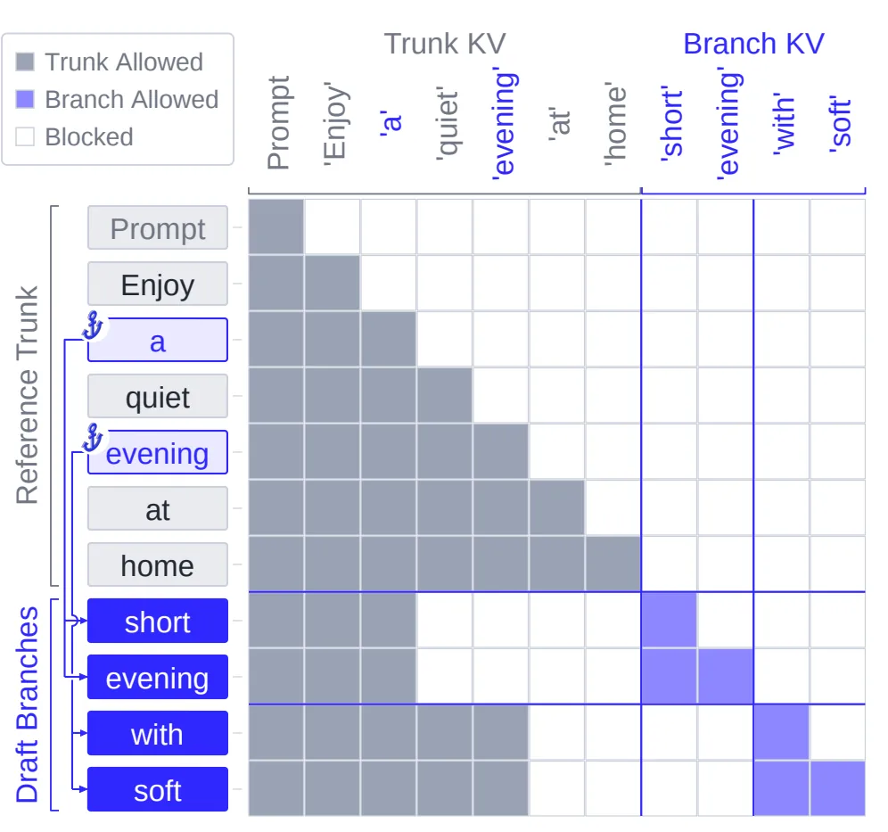
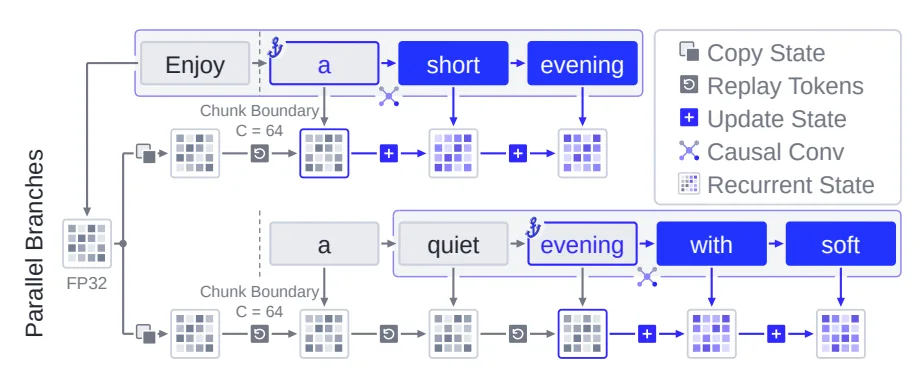
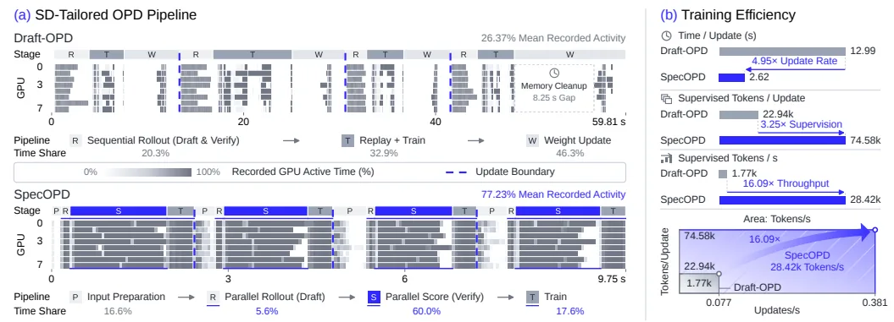
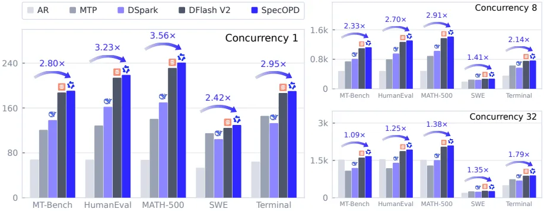
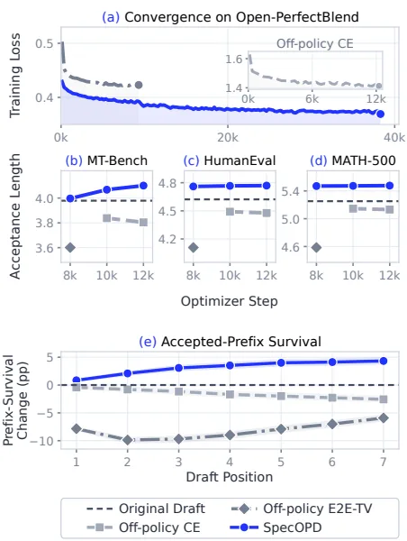

[Paper](https://arxiv.org/abs/2611.02846)
## SpecOPD: Training Speculative Decoding Drafters with Branch Parallelism

## Introduction

Speculative decoding speeds up generation by having a small drafter propose multiple tokens that a large target verifies in a single pass. But the ceiling on that speed is set by how many tokens the drafter can get right in a row, and on-policy distillation, the approach aimed at this problem, is tied to sequential draft-verify rollouts while collecting its training signal. SpecOPD starts from the observation that this sequential dependence is not essential to on-policy learning.

## 1. Background: speed is bound to a number called "acceptance length"

### 1.1 Terms we need first

A **drafter** is a small model that does the same job far more cheaply, and the **target** is the large model responsible for the final answer. In this paper, DFlash and DFlash V2 are parallel drafters that extract an entire candidate block in a single forward pass, and DSpark is a structure that layers light sequential modeling on top of a parallel backbone. These parallel drafters lower proposal cost, but overall speedup still hinges on **acceptance length (AL)**. That is the average length of completed tokens advanced in one verification round, including the bonus token and averaged per request.

The **bonus token** is the single token the target draws itself and inserts as a substitute at the rejection point. Even if not a single drafter token passes, every round advances by at least one token. So the more accurate the drafter, the further each round travels, and the fewer sequential rounds are needed to produce the same response, which lowers overall latency.

There is one more important fact here. Under the rejection sampling rule that draws exactly one sample, the probability that a drafter token is accepted is the degree to which the two distributions overlap, and this overlap is expressed as total variation distance (TV) (Appendix C.2, Eqs. 11–12). In other words, **it is not per-token accuracy but distribution overlap that determines AL.** This fact carries through to the loss design later on.

### 1.2 A small example: what survives a round

The following is an illustrative example for drawing out the concepts above; it is not a paper experiment.

| Verification position | Token produced by drafter | Target's verdict | Response when the round ends | Cumulative passes |
|---|---|---|---|---|
| 1 | `quiet` | pass | "Enjoy a quiet" | 1 |
| 2 | `evening` | pass | "Enjoy a quiet evening" | 2 |
| 3 | `with` | reject — distribution mismatch | Stops here at "Enjoy a quiet evening" | 2 |
| 4 | `music` | not verified (already stopped earlier) | — | 2 |

- **Input**: the drafter proposes the block `[quiet, evening, with, music]`.
- **Surviving state**: the target trusts only the passing prefix "Enjoy a quiet evening".
- **Change/rejection**: at the third token `with`, the drafter and target distributions diverge, so it is rejected.
- **Output**: two passing tokens plus one bonus token advances 3 tokens. **Acceptance length = 3**. If all four tokens had passed, it would be 4 + 1 = 5.

This example shows two things. First, AL is distribution overlap translated directly into a number, and the number of rounds needed to produce a response is roughly "response length divided by AL." Second, to raise AL, the drafter's distribution must be narrowed toward the target's distribution.

### 1.3 Why the drafter must be trained on "its own outputs, not the target's"

The simplest approach is to supervise with correct responses the target generated in advance (off-policy supervision, i.e. using the correct tokens directly as labels). This makes the drafter follow **tokens the target produced**, and at serving time it falls into states it never saw during training once it samples tokens its own way. Proposal quality drops in those states.

On-policy distillation (OPD) closes this gap by supervising the target's distribution over the history the drafter **actually sampled**. The paper reports that this approach broke past the acceptance-length plateau of correct-response supervision (SFT) (§1). The table below is an illustrative example summarizing the difference.

| Source of supervision signal | History the drafter learns on | History the target supplies a distribution for | Focus at serving time |
|---|---|---|---|
| Fixed response (off-policy) | "Enjoy a quiet" | "Enjoy a quiet" | If the drafter emits `short`, it lands in a state it has never seen |
| On-policy | "Enjoy a short" | "Enjoy a short" | Matches the distribution directly on its own history, so it trains the divergent segment |

## 2. Problem: the loop that collects on-policy learning signals is sequential

### 2.1 Where the sequential dependence arises

On-policy distillation for SD uses the following loop to collect supervision signals (§1). The drafter proposes a block, the target verifies it, and **the passing prefix determines the starting position of the next round.** In other words, new training context depends on the preceding verification result. The drafter update cannot begin until this collection finishes, so response collection and training stack up serially.

### 2.2 How expensive that loop is

These are the paper's actual profiling results (Figure 1a).

| Item | Value | Meaning |
|---|---|---|
| Draft-OPD mean recorded GPU activity | 26.37% | The GPU was idle most of the time |
| Share of sequential rollout (propose + verify) | 20.3% | A fifth of the time went to collection |
| Draft-OPD phase breakdown | rollout 20.3% / replay + training 32.9% / weight update 46.3% | Collection and updates alternate |
| Memory-cleanup gap shown in the profile | 8.25 s | A cleanup interval separately noted in Figure 1a |
| SpecOPD mean recorded GPU activity | 77.23% | The GPU keeps working after parallel collection and scoring |
| SpecOPD phase breakdown | input preparation 16.6% / parallel rollout 5.6% / parallel scoring 60.0% / training 17.6% | Collection overlaps the training interval |

The calculation that collecting 2,048-length responses at an average advance of 4 tokens requires about 512 dependent rounds is **an example value from the analytical model, not a measurement** (Appendix E.1). Also, 26.37% and 77.23% are "recorded activity," not SM occupancy. Intervals missing from the capture (white regions) do not prove hardware idleness, and the Draft-OPD instrumentation does not separately isolate the input preparation phase (Appendix B.2).

### 2.3 Key observation: the on-policy signal does not require a "fully verified response"

The question the paper poses is this. *Does on-policy learning need to inherit the sequential dependence of draft-verify rollouts?*

The answer is no. To supervise one position in a drafter block, two things suffice.

1. The **reference prefix** up to that position (the prompt and the target's correct tokens up to the anchor)
2. **Tokens sampled earlier in the same branch**

Whether "that token was finally accepted by the target" is not needed to produce the training signal. So if you sample **independent branches** at multiple points in the reference response, you can produce supervision signals in parallel without waiting on each other's verification results. This observation is the starting point of SpecOPD.

## 3. Method: SpecOPD

### 3.1 Building the proposal tree

First, the terms. The **trunk** is the entire reference response including the prompt, the **anchor** is one of B positions drawn at random from the response portion, and a **branch** is the W tokens the current drafter continues with after an anchor.

The paper's procedure has three steps (Figure 2).

1. Draw anchors at random from the reference response and compute the target context features up to each anchor.
2. The current drafter samples the tokens continuing from each anchor **in parallel**. The condition at position i is as follows: $h_{b,i}=(x_{\le a_b}, y_{b,\lt i})$, $y_{b,i}\sim q_\theta(\cdot\mid h_{b,i})$. That is, the condition is only the reference prefix up to the anchor and the earlier samples in the same branch.
3. Attach the sampled continuations to the anchors, forming a tree of branches separated from the shared trunk.

Because branches use independent sampling streams, the joint distribution of the whole sample factorizes into a product over branches (Eq. 2).

$$Q_\theta(Y\mid x,A)=\prod_{b=1}^{B}\prod_{i=1}^{W} q_\theta(y_{b,i}\mid h_{b,i})$$

Thanks to this factorization, branches can be collected without waiting on each other, while dependence within a branch is preserved. Here, "on-policy" means continuations **newly drawn by the current drafter** from a fixed reference context.

The table below reproduces the example used by Figures 2–3 of the original and Appendix C.1. The reference response is "Enjoy a quiet evening at home" and the anchors are `a` and `evening`.

| Anchor | Prefix shared by the trunk | Branch sampled by the drafter | History the target must read when scoring the next branch token | Shared state that remains |
|---|---|---|---|---|
| `a` | "Enjoy a" | "short evening walk" | "Enjoy a **short**" | Trunk K/V shared; post-anchor owned by the branch |
| `evening` | "Enjoy a quiet evening" | "with soft music" | "Enjoy a quiet evening **with**" | Same trunk K/V reused; branch history stored separately |

The key is the first row. Because the branch diverged to `short` instead of the reference's `quiet`, the target must read "**Enjoy a short**", not "Enjoy a quiet", when scoring that branch's next token. These two histories can yield different target distributions even when the drafter assigns the same probability to the next token (Appendix C.1). Note that departing from the reference is not necessarily an error. Sampling can produce other legitimate continuations, and this paper supervises **even such sampled counterfactual histories**. However, since the serving verifier may reject `short`, whether supervision beyond the rejection point actually helps is still an open comparison against "a baseline that keeps only accepted positions and the first rejection position" (the unfinished comparison posed by Appendix C.1).

### 3.2 Branch-parallel scoring: each attention type needs different handling

Scoring only the trunk erases the sampled history after a branch diverges. Scoring each branch separately keeps the history accurate but sends short requests sequentially, and batching them without a cache repeats computation of overlapping prefixes. The solution is to **share computation of the common prefix while preserving the post-divergence history separately**. The implementation differs depending on which attention the target uses.

**(a) Full attention — e.g. GQA.** This structure keeps a per-token K/V cache as is. SpecOPD computes the trunk K/V once and puts it in the cache, then attaches each branch's queries to that cache and passes them through as one batch. It applies a tree attention mask so that each query reads **only itself and its ancestors** (Eq. 5).

$$M_{u,v}=\begin{cases}0 & v\in \mathrm{Anc}(u)\cup\{u\}\\ -\infty & \text{otherwise}\end{cases}$$

Each row of the packed batch reads only its own reference prefix and the sampled history of the same branch, while sibling branches and future reference tokens are blocked by the mask. Rotary position embeddings (RoPE) use each token's logical position, not the packing order.

A **score-row reading rule** goes with this. The anchor row scores the first token, and each preceding row scores the next token. The mask allows the row itself, but the logits come from the output of the predictor, so the answer for the token being scored does not leak.

| Token to score | Row read | Context that row holds |
|---|---|---|
| `short` (first branch token) | anchor `a` row | "Enjoy a" |
| `evening` | `short` row | "Enjoy a short" |
| `walk` | `evening` row | "Enjoy a short evening" |

Reading the row itself would leak the answer being scored, so it is excluded from the reading rule. This rule means a W-token branch needs only W−1 new score rows, and B branches combine into **B(W−1) new rows**. The last sample has no subsequent prediction to supply, so it needs no query row.

Figure 3 (Fig. 3 in the original) shows branch-parallel scoring under full attention. Blue arrows connect each anchor to all query rows of its branch, and the cropped cells are masked portions that are not read. `Prompt` groups the shared prompt prefix. The terminal samples `walk` and `music` use the predictor row, so they need no query row.

**(b) Sparse attention — e.g. QSA.** This structure selects token blocks (groups of 4 tokens) with a compressed indexer key and reads the top-$k$. Reusing groups that straddle an anchor as is would let future reference tokens leak into block selection. SpecOPD **reuses the cached trunk group keys as is for groups fully completed before the anchor**, and re-compresses only the incomplete group at the boundary and the groups after the branch according to the branch history (mean pooling, RMSNorm, rotary transform at the group's first position). Four slots of raw indexer reservation per branch fill the remainder of the boundary group.

Reading the example from Figure 4 of the original gives the following.

| Token to predict | Query used | Span read from the reference history | Complete? | Handling |
|---|---|---|---|---|
| `with` | `evening` row | [a, quiet, evening] | 3/4 | Read as an incomplete causal tail, bypassing the top-$k$ |
| `soft` | `with` row | [a, quiet, evening, with] | 4/4 | The group is complete, so build a **branch-specific indexer group key** and select with top-$k$ |

In other words, block selection (which group to choose) is separated from actual attention reading (the selected K/V plus the incomplete causal tail that bypasses the top-$k$), and the shared trunk K/V is reused without duplication.

**(c) Linear attention — e.g. GDN.** This structure compresses history into a single recurrent state. So a mask cannot rewind to a previous anchor state, nor can per-branch states be separated. SpecOPD saves the trunk every fixed interval (checkpoint interval $C=64$ tokens) as **immutable FP32 state checkpoints**, and when an anchor state is needed it restores it by <strong>replaying only the remaining suffix</strong> from the nearest checkpoint, then advances the branch state separately. Each thread block (CTA) copies the checkpoint tile into private registers, so the shared checkpoint is not modified, and both the recurrent path and the convolution history follow only the branch ancestors.

Figure 5 (Fig. 5 in the original) shows GDN state replay. The shared trunk pass saves an FP32 state after `Enjoy` (at the $C=64$ boundary; the 63 prompt tokens are omitted), and each CTA copies this checkpoint and replays only a suffix such as `a` or `a→quiet→evening` to restore the anchor state. `Update State` then processes the branch tokens, updating and reading the state. This is where "restoring a prior state," which a mask cannot do, is solved by checkpoint replay.

**[Maintaining numerical consistency.]** So that loss weights do not change when the number of scored positions differs per rank in distributed training, numerators and counts are gathered separately per rank and normalized (Eq. 18). Also, enabling deterministic target inference makes the logit differences zero among full-prefix recomputation (R), single/batched cached scoring (C1/CB), and merged tree execution (T). In Table 4 for 125B, with it disabled the maximum absolute difference reaches 4.2539 (4.1094 for C1/R), and with it enabled every comparison becomes 0. That is, parallel scoring yields the same supervision signal for the same history.

### 3.3 A loss aimed directly at acceptance length

Let the drafter distribution be $q$ and the target distribution be $p$. For a fixed history, the probability that the token at exactly one position is accepted is the overlap of the two distributions, expressed as total variation distance (Eq. 8).

$$\alpha_{b,i}=\sum_v \min\{q(v\mid h_{b,i}),\,p(v\mid h_{b,i})\}=1-\mathrm{TV}(q,p)$$

SpecOPD adopts Bebop's E2E-TV objective (Eq. 9). The loss is the average over branches of the sum of prefix products within each branch.

$$\mathcal{L}=1-\frac{1}{BW}\sum_{b=1}^{B}\sum_{j=1}^{W}\prod_{i=1}^{j}\alpha_{b,i}$$

The key point is that products are involved. A mismatch at an earlier token affects every subsequent prefix term, so this loss distinguishes **where** the error occurred. The example from Appendix C.2 is as follows.

| Overlap column | Mean TV | Prefix products | Loss |
|---|---|---|---|
| (0.9, 0.6, 0.9) | 0.2 | (0.9, 0.54, 0.486) | 0.358 |
| (0.6, 0.9, 0.9) | 0.2 | (0.6, 0.54, 0.486) | 0.458 |

Even with the same per-token error, the loss is larger for the case that errs earlier.

Procedurally, branches are freshly sampled at every update, and the drafter probabilities and prefix products are differentiated with the sampled tokens and target distribution held fixed. The gradient differentiates only the overlap over the fixed sampled history and does not carry a score-function term for the sampling distribution. There is one more design choice. Target mass that falls outside the drafter's candidate set is also retained in the loss (Eq. 13). With $q=(0.5,0.5,0)$ and $p=(0.4,0.4,0.2)$, TV is 0.2 and overlap is 0.8, but renormalizing $p$ over $\{X,Y\}$ makes the overlap 1, which looks like a "perfect match." But the drafter cannot propose $Z$.

### 3.4 How little scoring computes (analytical model)

With trunk length $L$, number of branches $K$, and branch width $W$, the first prediction of a width-$W$ branch is read from the anchor, so there are $P=W-1$ new score rows. The row counts for cacheless independent scoring and shared execution are as follows (Eq. 20).

$$N_{\text{independent}}=L+\sum_{b=1}^{K}\ell_b+KP,\qquad N_{\text{shared}}=L+KP$$

For a uniform batch of anchors with $L=2048$, $W=7$, $K=512$, the estimated projection and MLP rows drop from 529,664 rows to 5,120 rows (**103.45×**, 103.5× in Figure 13a). Under the same conditions, the reduction for causal attention pairs and for GDN updates including replay is computed at 69.2× and 24.9× respectively. However, these are **savings from the analytical model, not measured speed**, with the caveat that a cached baseline can already reuse some prefix computation.

Moreover, wall-clock time is a separate matter. The conditional upper bound in Appendix E.3 is $S=1/((1-f)+f/r+\delta)$, where $f$ is the share of time that is accelerable, $r$ is the acceleration factor, and $\delta$ is additional overhead. Even with zero overhead, the limit is at most 2× at $f=0.5$ and 4× at $f=0.75$. Analytical figures and measured throughput should not be equated outright.

## 4. Results

### 4.1 Acceptance length

Mean AL (equal weight across 5 benchmarks, including the bonus token) rose in every setting (Table 1).

| Target (attention) | Drafter | T | Baseline mean AL | SpecOPD mean AL |
|---|---|---|---|---|
| 8B (GQA, full) | DFlash | 0 | 2.649 | 3.747 |
| 8B (GQA, full) | DFlash | 1 | 2.441 | 3.331 |
| 8B (GQA, full) | DSpark | 0 | 3.674 | 4.439 |
| 8B (GQA, full) | DSpark | 1 | 3.419 | 4.191 |
| 27B (GQA–GDN) | DFlash V2 | 0 | 5.103 | 5.242 |
| 27B (GQA–GDN) | DFlash V2 | 1 | 4.717 | 4.881 |
| 125B (QSA–GDN) | DFlash V2§ | 0 | 3.941 | 4.122 |
| 125B (QSA–GDN) | DFlash V2§ | 1 | 3.621 | 3.802 |

§ The 125B baseline is a DFlash V2 pretrained in-house on Open-PerfectBlend with the LK loss and D-PACE (Appendix A.4).

The largest gains come at 8B. The paper improved DFlash's 8B mean AL by 41.45% (81.51% on Terminal), and both DFlash and DSpark gained on all workloads at both temperatures. Gains shrink on hybrid targets, by contrast, and the paper reports improvements of up to 3.48% at 27B and up to 5.01% at 125B. At 27B, agentic results barely move. At $T=0$, Terminal goes 5.319→5.322 and SWE 5.653→5.655, effectively identical, and at $T=1$, SWE rises 0.40% while Terminal drops slightly by 1.02% (Appendix A.3). The 125B drafter received in-house pretraining without agentic data, and the authors acknowledge the coverage gap that adaptation to agentic histories may be limited (§3.2).

There are three pieces of supporting evidence. Mean AL on the three standard 27B tasks rose from 4.8477 to 5.0784, +4.76% (Appendix A.3). A separate study comparing an 8B DFlash drafter with window sizes of 8 and 16 saw AL rise 18.67–30.57% at window 8 and 22.87–37.97% at window 16, with throughput rising 21.33–34.58% and 20.04–35.41% respectively (Appendix A.7). Another separate study training an FP8 Flash-Next target from the public DFlash V2 initialization observed AL improvements of up to 7.72% at block size 4 and up to 15.57% at block size 8 (Appendix A.5).

### 4.2 Training throughput

These are measured values from running Qwen3.8-27B / DFlash V2 on 8 high-performance GPUs (Figure 1b, Figure 7).

| Metric | Draft-OPD | SpecOPD | Multiple |
|---|---|---|---|
| Updates/sec | 0.077 | 0.381 | 4.95× |
| Supervised tokens per update | 22.94k | 74.58k | 3.25× |
| Supervised tokens/sec | 1.77k | 28.42k | 16.09× |
| Time per update | 12.99 s | 2.62 s | — |

The product of the two multiples gives the supervised-token throughput of 16.09×. The improvement comes from two directions. Branch parallelism cuts collection time, and at the same time supplies more supervised positions per update. The execution profile (§2.2) points the same way.

Figure 1 (Fig. 1 in the original) shows training throughput under the same conditions. (a) places sequential rollout and SpecOPD's parallel drafting and target scoring on separate time axes, contrasting the low GPU utilization during the rollout collection interval with SpecOPD's continuous GPU use. (b) uses rectangle width as update throughput and height as supervised tokens per update, so the area is supervised-token throughput.

The measurement conditions, stated precisely, are as follows. Unprofiled timings were collected from two runs per method and measured over updates 17–32, while Figure 1a uses a separate profiling window (updates 17–20, separate time axis). Offline reference preparation time is excluded, and this measurement does not measure "the time to reach a particular acceptance-length threshold" (Appendix B.2).

### 4.3 Serving throughput

Figure 6 shows 27B output throughput measured under BF16, TP=1, FA3, CUDA Graphs, $T=1$. SpecOPD reaches up to 3.56× versus AR, with geometric-mean speedups across five workloads of 2.97×, 2.23×, and 1.35× at concurrency 1, 8, and 32 respectively. The per-workload multiple ranges are 2.42×–3.56× at concurrency 1, 1.41×–2.91× at concurrency 8, and 1.09×–1.79× at concurrency 32.

Figure 6 (Fig. 6 in the original) compares tokens/sec by method across concurrency levels. SpecOPD shows large gains versus AR, but the gap narrows as concurrency rises. Even compared with the original DFlash V2, geometric-mean throughput is higher by 2.83%, 2.20%, and 1.21% at each concurrency level (the original DFlash V2's geometric means versus AR are 2.89×, 2.19×, and 1.34×). However, there is per-workload variation, and SWE is 4.46% slower than the original drafter at concurrency 32 (Appendix A.8).

The protocol is as follows. SGLang, seed 42, 128 requests at concurrency 1, 1,024 requests at concurrency 8 and 32, top-$p$=0.95 / top-$k$=20, a completion cap of 4,096 tokens, context 40,960, KV capacity 131,072, speculative block 7 tokens with 8 verification positions. After warmup the radix cache is cleared, and loading, warmup, tokenizer initialization, and artifact logging are excluded from timing. **Each condition is a single full run**, and this TP=1/BF16-head protocol differs from the main acceptance-length experiment (TP=2/FP32-head) (Appendix A.8).

### 4.4 Is on-policy learning actually better?

These are results compared at the same optimization step and with the same batch of reference sequences (Table 2). Conditions are $T=1$, top-$p$=0.95, top-$k$=20, a completion cap of 4,096 tokens, and concurrency 8 per replica.

| Step | Training method | MT-Bench | HumanEval | MATH-500 | Mean AL |
|---|---|---|---|---|---|
| 0 | Original drafter | 3.9787 | 4.6225 | 5.2519 | 4.6177 |
| 8k | Off-policy E2E-TV | 3.6011 | 4.1086 | 4.5854 | 4.0983 |
| 8k | **SpecOPD** | 3.9966 | 4.7602 | 5.4699 | **4.7422** |
| 10k | Off-policy CE | 3.8377 | 4.4905 | 5.1448 | 4.4910 |
| 10k | **SpecOPD** | 4.0675 | 4.7668 | 5.4726 | **4.7690** |
| 12k | Off-policy CE | 3.8042 | 4.4771 | 5.1311 | 4.4708 |
| 12k | **SpecOPD** | 4.1005 | 4.7696 | 5.4764 | **4.7822** |

The paper reports that SpecOPD raises mean AL by up to 15.71% over off-policy E2E-TV and up to 6.96% over off-policy CE. Both off-policy methods fall below the common initialization (4.6177).

The key point of Figure 8 (Fig. 8 in the original) is that "the loss goes down" and "acceptance length grows" are not the same statement. All three runs lower the training loss, yet the acceptance length of off-policy CE falls as training proceeds while SpecOPD's rises. In prefix survival (relative to the common initialization, excluding the bonus token), SpecOPD rises at all seven draft positions while both off-policy methods fall. At the seventh position, SpecOPD rises 4.33 percentage points and off-policy CE falls 2.57 percentage points. The figure also plots 95% question-level cluster bootstrap intervals over 824 paired requests.

## 5. Limitations and when to apply it

### 5.1 Limitations the authors state

- **Gains depend heavily on structure.** They rise to 41.45% on pure full-attention 8B, but reach only up to 3.48% and 5.01% on hybrid 27B and 125B. The 27B agentic results barely change, and at $T=1$ Terminal drops slightly by 1.02%.
- **Coverage gap of the 125B drafter.** It received in-house pretraining without agentic data, so adaptation to agentic histories may be limited. Extending pretraining with agentic trajectories is the next step the authors propose.
- **E2E-TV is a proxy objective.** For a conditional drafter, the prefix product does not coincide with an unbiased estimator of the actual acceptance length (the counterexample in Appendix C.2: with $q_1=(0.9,0.1)$ and $p_1=(0.1,0.9)$, $\alpha_1=0.2$ while the exact joint acceptance probability is 0.1 and the expected product is 0.18). Final quality is always validated with the actual serving AL.
- **Supervision at positions after a rejection.** Because everything beyond the rejection point within a branch is also supervised, whether that supervision actually helps requires comparison against "a baseline that keeps only accepted positions and the first rejection position" (the unfinished comparison left by Appendix C.1).
- **Reproducibility.** The source of reference responses, the retained subset, and exact checkpoint identifiers are not yet documented per run (Appendix B).

### 5.2 Conditions a reviewer would add (not specified by the authors)

- **Definition of 16.09×.** This is throughput per unit time under the "native setting" and excludes offline reference preparation time. "The time to reach a particular acceptance-length threshold" was not measured. So how much total training wall-clock time was cut cannot be read directly from this 16.09× (not reported in the original).
- **The off-policy comparison is not a single-variable control.** The three recipes matched the same step and the same reference batch, but differ in compute allocation (16 GPUs for off-policy vs 32 GPUs for SpecOPD) and in gradient path. It should be read as a recipe-level comparison (Appendix A.6).
- **Higher acceptance length does not always translate into higher throughput.** SWE is 4.46% slower than the original drafter at concurrency 32.
- **Nature of the evaluation workloads.** SWE and Terminal are fixed replays of recorded trajectories that use no tools and do not score success rates. The 64 original Terminal trajectories are flagged as potentially overlapping the training data, and membership in the official SWE-bench Verified or Terminal-Bench 2.0 was not confirmed (Appendix A.1).
- **No serving-side repetition.** Each condition is a single full run, and the serving protocol differs from the main acceptance-length experiment without caveat about coverage (TP=1/BF16-head vs TP=2/FP32-head).

### 5.3 When to use it

SpecOPD fits **speculative decoding systems with parallel drafters (DFlash, DSpark, DFlash V2) that are trying to get past an acceptance-length plateau**. Reference responses must be obtainable offline, either from target generation or from a dataset, and the measured gains were largest on small, pure-attention targets. Conversely, on large hybrid targets, in domains without agentic histories, and for goals that require cutting "training wall-clock time itself," gains are limited or need separate validation.

In summary, SpecOPD's contribution is not a new drafter architecture but **a change in the order in which training signals are collected**. On-policy supervision needs only "a reference prefix and its own sampled history," not "a fully verified response," and that is why branches could be detached independently and handled in parallel. The proposal tree is the device for scoring these branches all at once while reusing computation of the common prefix, and only the storage and restoration scheme changes with the attention type.
<!-- verbatim-tables -->

Tables from the paper

> Tables converted mechanically from the arXiv e-print LaTeX source. The numbers are the paper's own and did not pass through a model.

**Table 1. Mean acceptance length ($\uparrow$), including bonus tokens. Darker blue indicates longer Mean AL.**

| Setup Temp. | Setup Target | Setup Draft | Dialogue MT-Bench | Coding HumanEval | Math MATH-500 | Agentic SWE | Agentic Terminal | Average |
|---|---|---|---|---|---|---|---|---|
|  |  | DFlash | 2.764 | 3.262 | 3.453 | 2.147 | 1.620 | 2.649 |
|  | -2*8B | \(\hookrightarrow\) SpecOPD | 3.432 | 4.177 | 4.571 | 3.617 | 2.940 | 3.747 |
|  |  | DSpark | 3.495 | 3.879 | 4.153 | 3.707 | 3.135 | 3.674 |
|  | -2*8B | \(\hookrightarrow\) SpecOPD | 4.121 | 4.876 | 5.223 | 4.301 | 3.676 | 4.439 |
|  |  | DFlash V2 | 4.143 | 4.845 | 5.555 | 5.653 | 5.319 | 5.103 |
|  | -2*27B | \(\hookrightarrow\) SpecOPD | 4.317 | 5.077 | 5.841 | 5.655 | 5.322 | 5.242 |
|  |  | DFlash V2\S | 3.728 | 4.284 | 5.271 | 3.557 | 2.866 | 3.941 |
| -8*{90$T=0$} | -2*125B | \(\hookrightarrow\) SpecOPD | 3.907 | 4.514 | 5.458 | 3.723 | 3.006 | 4.122 |
|  |  | DFlash | 2.521 | 2.930 | 3.269 | 1.891 | 1.596 | 2.441 |
|  | -2*8B | \(\hookrightarrow\) SpecOPD | 3.067 | 3.597 | 4.150 | 3.048 | 2.794 | 3.331 |
|  |  | DSpark | 3.330 | 3.641 | 3.997 | 3.197 | 2.929 | 3.419 |
|  | -2*8B | \(\hookrightarrow\) SpecOPD | 3.950 | 4.552 | 5.053 | 3.846 | 3.554 | 4.191 |
|  |  | DFlash V2 | 3.977 | 4.384 | 5.235 | 5.095 | 4.895 | 4.717 |
|  | -2*27B | \(\hookrightarrow\) SpecOPD | 4.115 | 4.820 | 5.511 | 5.116 | 4.845 | 4.881 |
|  |  | DFlash V2\S | 3.503 | 3.857 | 4.887 | 3.168 | 2.689 | 3.621 |
| -8*{90$T=1$} | -2*125B | \(\hookrightarrow\) SpecOPD | 3.634 | 4.017 | 5.116 | 3.386 | 2.858 | 3.802 |

**Table 2. On-policy and off-policy training on Qwen3.8-27B / DFlash V2 at matched optimizer steps and reference-sequence batches. AL includes bonus tokens ($\uparrow$).**

| Steps | Training method | MT-Bench | HumanEval | MATH-500 | Average |
|---|---|---|---|---|---|
| 0 | Original draft | 3.9787 | 4.6225 | 5.2519 | 4.6177 |
| 8k | Off-policy E2E-TV | 3.6011 | 4.1086 | 4.5854 | 4.0983 |
| 8k | SpecOPD\ | 3.9966 | 4.7602 | 5.4699 | 4.7422 |
| 10k | Off-policy CE | 3.8377 | 4.4905 | 5.1448 | 4.4910 |
| 10k | SpecOPD\ | 4.0675 | 4.7668 | 5.4726 | 4.7690 |
| 12k | Off-policy CE | 3.8042 | 4.4771 | 5.1311 | 4.4708 |
| 12k | SpecOPD\ | 4.1005 | 4.7696 | 5.4764 | 4.7822 |

**Table 3. Common-anchor effects on $S_7$, in accepted draft tokens. $\Delta_W$ is window 16 minus 8; $\Delta_{\rm train}$ is step 10,000 minus initialization. Interaction is $\Delta_W(10{,}000)-\Delta_W(0)$.**

| $T$ | Task | $\Delta_W(0)$ | $\Delta_W(10{,}000)$ | $\Delta_{\rm train}(8)$ | $\Delta_{\rm train}(16)$ | Interaction |
|---|---|---|---|---|---|---|
| 0 | MT-Bench | 0.0604 | 0.6896 | 1.6417 | 2.2708 | 0.6292 |
| 0 | HumanEval | 0.3455 | 0.6524 | 1.9004 | 2.2073 | 0.3069 |
| 0 | MATH-500 | 0.0780 | 0.4560 | 2.3867 | 2.7647 | 0.3780 |
| 1 | MT-Bench | 0.0729 | 0.5708 | 1.5312 | 2.0292 | 0.4979 |
| 1 | HumanEval | 0.2866 | 0.6748 | 1.6992 | 2.0874 | 0.3882 |
| 1 | MATH-500 | 0.0973 | 0.3167 | 2.2967 | 2.5160 | 0.2193 |

**Table 4. 125B target-logit differences across execution layouts. A/B compares candidate A against reference B; KL is the prediction-position mean of $D_{\rm KL}(p_B\Vert p_A)$. The largest listed error occurs at the first draft prediction after the three-token prefix in the first sample.**

| Comparison | Determinism disabled Max. abs. | Determinism disabled Rel. L2 (%) | Determinism disabled Mean KL | Determinism enabled Max. abs. | Determinism enabled Rel. L2 (%) | Determinism enabled Mean KL |
|---|---|---|---|---|---|---|
| C1/R | 4.1094 | 14.25 | 0.05840 | 0 | 0 | 0 |
| CB/R | 3.4414 | 14.82 | 0.04958 | 0 | 0 | 0 |
| T/R | 3.7695 | 15.01 | 0.05192 | 0 | 0 | 0 |
| CB/C1 | 3.0625 | 11.35 | 0.02743 | 0 | 0 | 0 |
| T/CB | 4.2539 | 14.69 | 0.04382 | 0 | 0 | 0 |

> Figures in this post are taken from the original arXiv:2611.02846 (CC BY 4.0). Only size and format were changed.
