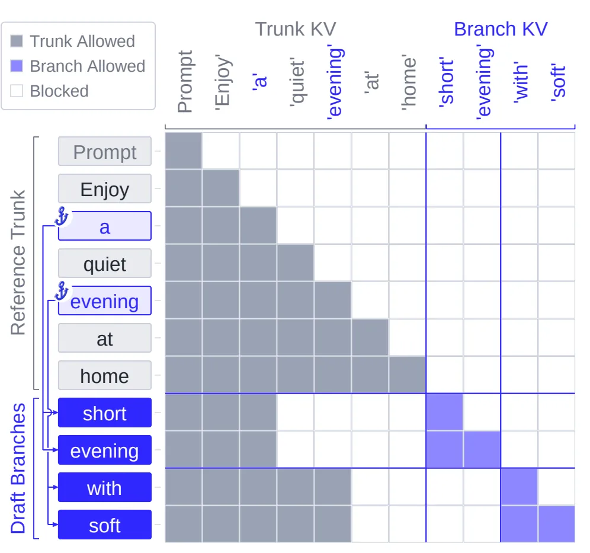
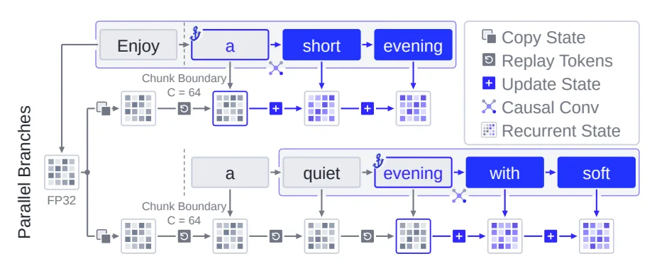
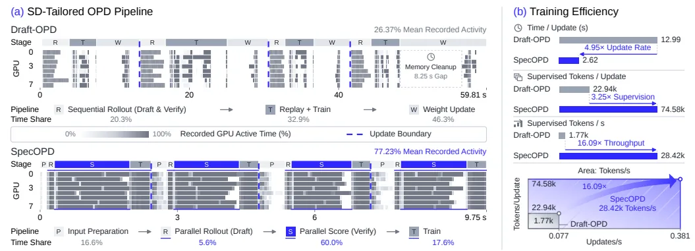
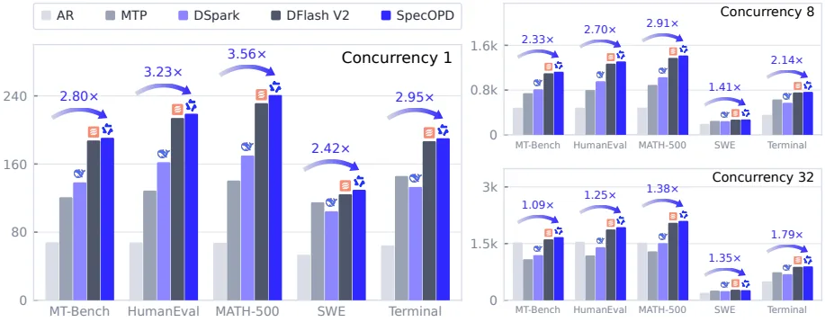
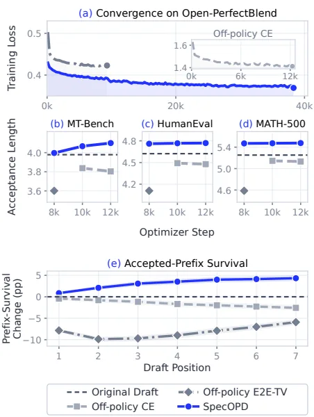

[논문 링크](https://arxiv.org/abs/2611.02846)
## SpecOPD: 추측 디코딩 드래프터를 분기 병렬로 학습시키기

## 도입

추측 디코딩은 작은 드래프터가 제안한 여러 토큰을 큰 타깃이 한 번에 검증해 생성 속도를 높이는 기법이다. 그런데 속도의 상한은 드래프터가 몇 토큰을 연속으로 맞히느냐로 정해지고, 이를 해결하려는 온폴리시 증류는 학습 신호를 모으는 과정에서 순차 드래프트-검증 롤아웃에 묶여 있다. SpecOPD는 이 순차 의존이 온폴리시 학습에 필수는 아니라는 관찰에서 출발한다.

## 1. 배경: 속도는 "수용 길이"라는 숫자에 묶여 있다

### 1.1 먼저 필요한 용어

**드래프터(drafter)** 는 같은 일을 훨씬 싸게 해 주는 작은 모델이고, **타깃(target)** 은 최종 답을 책임지는 큰 모델이다. 이 논문에서 DFlash와 DFlash V2는 후보 블록 전체를 한 번의 순방향 통과로 뽑아 내는 평행 드래프터고, DSpark는 평행 백본 위에 가벼운 순차 모델링을 얹은 구조다. 이런 평행 드래프터는 제안 비용을 낮췄지만, 전체 가속도는 여전히 **수용 길이(acceptance length, AL)** 에 달려 있다. 한 번의 검증 라운드에서 완료 토큰으로 진행하는 평균 길이로, 보너스 토큰까지 포함하고 요청별로 평균한 값이다.

**보너스 토큰** 은 거절 지점에서 타깃이 직접 뽑아 대신 끼워 넣는 토큰 하나다. 드래프터 토큰이 하나도 통과하지 못해도 라운드마다 최소 한 토큰은 전진한다. 그래서 드래프터가 정확할수록 한 라운드가 더 멀리 나아가고, 같은 응답을 만드는 데 필요한 순차 라운드 수가 줄어 전체 지연이 줄어든다.

여기서 중요한 사실이 하나 더 있다. 정확히 하나의 샘플을 뽑는 거부 샘플링 규칙에서 드래프터 토큰이 받아들여질 확률은 두 분포가 겹치는 정도이고, 이 겹침이 총 변동 거리(TV)로 표현된다(부록 C.2, 식 11–12). 즉 **토큰별 정확도가 아니라 분포 겹침이 AL을 결정한다.** 이 사실이 뒤의 손실 설계까지 이어진다.

### 1.2 작은 예시: 한 라운드에서 무엇이 남는가

아래는 위 개념을 그리기 위한 설명용 예시로, 논문 실험이 아니다.

| 검증 위치 | 드래프터가 낸 토큰 | 타깃의 판단 | 라운드가 끝난 시점의 응답 | 누적 통과 |
|---|---|---|---|---|
| 1 | `quiet` | 통과 | "Enjoy a quiet" | 1 |
| 2 | `evening` | 통과 | "Enjoy a quiet evening" | 2 |
| 3 | `with` | 거절 — 분포 불일치 | "Enjoy a quiet evening" 여기서 중단 | 2 |
| 4 | `music` | 검증 대상이 아님 (앞에서 이미 중단) | — | 2 |

- **입력**: 드래프터가 블록 `[quiet, evening, with, music]`을 제안한다.
- **남는 상태**: 타깃은 통과한 접두사 "Enjoy a quiet evening"까지만 신뢰한다.
- **변경·거절**: 세 번째 토큰 `with`에서 드래프터 분포와 타깃 분포가 어긋나 거절한다.
- **출력**: 통과한 2토큰에 보너스 토큰 1개를 더해 3토큰 전진. **수용 길이 = 3**. 네 토큰이 모두 통과했다면 4 + 1 = 5가 된다.

이 예시가 보여 주는 건 두 가지다. 첫째, AL은 분포 겹침을 그대로 숫자로 옮긴 값이며, 응답을 만드는 라운드 수는 대략 "응답 길이를 AL로 나눈 값"이다. 둘째, AL을 높이려면 드래프터의 분포를 타깃의 분포 쪽으로 좁혀야 한다.

### 1.3 왜 드래프터를 "타깃이 아니라 자기 출력으로" 학습해야 하나

가장 단순한 방법은 타깃이 미리 생성해 둔 정답 응답으로 지도하는 것이다(오프폴리시 지도, 즉 정답 토큰을 그대로 라벨로 쓰는 방식). 이 방식은 드래프터가 **타깃이 낸 토큰**을 따라가게 만들고, 서빙 시점에 드래프터가 자기 방식으로 샘플한 토큰 위에서는 학습 때 보지 못한 상태에 빠진다. 제안 품질이 그 상태에서 떨어진다.

온폴리시 증류(OPD)는 드래프터가 **실제로 샘플한 이력** 위에서 타깃의 분포를 지도해 이 간극을 메운다. 논문은 이 방식이 정답 응답 지도(SFT)의 수용 길이 정체를 넘어섰다고 보고한다(§1). 아래 표는 그 차이를 정리한 설명용 예시다.

| 지도 신호의 출처 | 드래프터가 학습하는 이력 | 타깃이 분포를 주는 이력 | 서빙 시점의 초점 |
|---|---|---|---|
| 고정 응답 (오프폴리시) | "Enjoy a quiet" | "Enjoy a quiet" | 드래프터가 `short`를 내면 처음 보는 상태에 놓인다 |
| 온폴리시 | "Enjoy a short" | "Enjoy a short" | 자기 이력 위에서 직접 분포를 맞추므로 어긋난 구간을 훈련한다 |

## 2. 문제: 온폴리시 학습의 신호를 모으는 루프가 순차적이다

### 2.1 순차 의존이 생기는 지점

SD용 온폴리시 증류는 지도 신호를 모으기 위해 다음 루프를 쓴다(§1). 드래프터가 블록을 제안하고, 타깃이 그 블록을 검증하고, **통과한 접두사가 다음 라운드의 시작 위치를 결정한다.** 즉 새 훈련 문맥이 앞선 검증 결과에 종속된다. 이 수집이 끝나야 드래프터 갱신이 시작되므로, 응답 수집과 학습이 직렬로 쌓인다.

### 2.2 그 루프가 얼마나 비싼가

논문이 실제로 프로파일링한 결과(Figure 1a)다.

| 항목 | 수치 | 의미 |
|---|---|---|
| Draft-OPD 평균 기록 GPU 활동률 | 26.37% | GPU가 대부분의 시간을 놀고 있었다 |
| 그중 순차 롤아웃(제안+검증) 비중 | 20.3% | 시간의 5분의 1이 수집에 쓰였다 |
| Draft-OPD 단계 구성 | 롤아웃 20.3% / 리플레이+학습 32.9% / 가중치 갱신 46.3% | 수집과 갱신이 번갈아 온다 |
| 프로파일에 표시된 메모리 정리 격차 | 8.25 s | Figure 1a에 별도로 적힌 정리 구간 |
| SpecOPD 평균 기록 GPU 활동률 | 77.23% | 병렬 수집·점수화 뒤에는 GPU가 계속 일한다 |
| SpecOPD 단계 구성 | 입력 준비 16.6% / 병렬 롤아웃 5.6% / 병렬 점수 60.0% / 학습 17.6% | 수집이 학습 구간에 겹친다 |

길이 2,048 응답을 평균 4토큰씩 전진하며 모으면 약 512회의 의존 라운드가 필요하다는 계산은 **분석 모델의 예시 값이지 측정값이 아니다**(부록 E.1). 또한 26.37%·77.23%는 "기록된 활동"이지 SM 점유율이 아니다. 캡처가 누락된 구간(흰 영역)이 하드웨어 유휴를 증명하지 않으며, Draft-OPD 쪽 계측은 입력 준비 단계를 따로 분리해 내지 못한다(부록 B.2).

### 2.3 핵심 관찰: 온폴리시 신호는 "끝까지 검증된 응답"을 필요로 하지 않는다

논문이 던지는 질문은 이렇다. *온폴리시 학습은 드래프트-검증 롤아웃의 순차 의존을 물려받을 필요가 있는가?*

답은 아니오다. 드래프터 블록의 한 위치를 지도하려면 두 가지면 충분하다.

1. 그 위치까지의 **참조 접두사** (프롬프트와 앵커까지의 타깃 정답 토큰들)
2. **같은 분기에서 앞서 샘플한 토큰들**

"그 토큰이 타깃에 의해 최종 수용됐는가"는 학습 신호를 만드는 데 필요하지 않다. 그래서 참조 응답의 여러 지점에서 **독립적인 분기**를 샘플하면, 서로의 검증 결과를 기다리지 않고 병렬로 지도 신호를 만들 수 있다. 이 관찰이 SpecOPD의 출발점이다.

## 3. 방법: SpecOPD

### 3.1 제안 트리 만들기

용어를 먼저 정리하면 이렇다. **줄기(trunk)** 는 프롬프트를 포함한 참조 응답 전체이고, **앵커(anchor)** 는 응답 부분에서 무작위로 뽑는 B개의 위치이며, **분기(branch)** 는 앵커 뒤를 현재 드래프터가 이어 쓴 W개 토큰이다.

논문의 절차는 세 단계다(Figure 2).

1. 참조 응답에서 앵커를 무작위로 뽑고, 각 앵커까지의 타깃 컨텍스트 특징을 계산한다.
2. 현재 드래프터가 각 앵커에서 이어지는 토큰을 **병렬로** 샘플한다. 위치 i의 조건은 다음과 같다. $h_{b,i}=(x_{\le a_b}, y_{b,\lt i})$, $y_{b,i}\sim q_\theta(\cdot\mid h_{b,i})$. 즉 앵커까지의 참조 접두사와 같은 분기의 앞선 샘플만 조건으로 삼는다.
3. 샘플한 이어쓰기를 앵커에 붙여, 공유 줄기와 분리된 분기로 이루어진 트리를 만든다.

분기들은 독립적인 샘플링 스트림을 쓰기 때문에, 샘플 전체의 결합 분포는 분기별 곱으로 분해된다(식 2).

$$Q_\theta(Y\mid x,A)=\prod_{b=1}^{B}\prod_{i=1}^{W} q_\theta(y_{b,i}\mid h_{b,i})$$

이 분해 덕분에 분기들은 서로를 기다리지 않고 모을 수 있고, 분기 내부의 의존만 유지된다. 여기서 "온폴리시"는 고정된 참조 문맥에서 **현재 드래프터가 새로 뽑은** 이어쓰기를 뜻한다.

아래 표는 원문 Figure 2·3과 부록 C.1이 쓰는 예시를 그대로 옮긴 것이다. 참조 응답은 "Enjoy a quiet evening at home"이고, 앵커는 `a`와 `evening` 두 곳이다.

| 앵커 | 줄기가 공유하는 접두사 | 드래프터가 샘플한 분기 | 다음 분기 토큰을 채점할 때 타깃이 읽어야 할 이력 | 남는 공유 상태 |
|---|---|---|---|---|
| `a` | "Enjoy a" | "short evening walk" | "Enjoy a **short**" | 줄기 K/V는 공유, 앵커 이후는 분기 소유 |
| `evening` | "Enjoy a quiet evening" | "with soft music" | "Enjoy a quiet evening **with**" | 같은 줄기 K/V 재사용, 분기 이력은 별도 보관 |

핵심은 첫째 행이다. 분기가 참조의 `quiet` 대신 `short`로 갈라졌으므로, 그 분기의 다음 토큰을 채점할 때 타깃은 "Enjoy a quiet"가 아니라 "**Enjoy a short**"를 읽어야 한다. 두 이력은 드래프터가 다음 토큰에 주는 확률이 같더라도 타깃의 분포를 다르게 만들 수 있다(부록 C.1). 참고로 참조에서 벗어나는 것은 반드시 오류가 아니다. 샘플링이 다른 정당한 이어쓰기를 낼 수 있고, 이 논문은 그런 **샘플된 반사실적 이력까지** 지도한다. 다만 서빙 검증기는 `short`를 거절할 수 있으므로, 거절 지점 너머까지 지도가 실제로 도움이 되는지는 "수용된 위치와 최초 거절 위치만 남긴 baseline"과의 비교가 남아 있다(부록 C.1이 제시한 미완 비교).

### 3.2 분기 병렬 점수 매기기: 어텐션 종류마다 다른 처리가 필요하다

줄기만 점수 매기면 분기가 갈라진 뒤의 샘플 이력이 사라진다. 분기마다 따로 점수 매기면 이력은 정확하지만 짧은 요청을 순차로 보내게 되고, 캐시 없이 배치를 묶으면 겹치는 접두사 계산을 반복한다. 해법은 **공통 접두사의 계산은 공유하되, 갈라진 뒤의 이력은 각자 보존하는 것**이다. 이를 위해 타깃이 어떤 어텐션을 쓰느냐에 따라 구현이 달라진다.

**(a) 전체 어텐션 — 예: GQA.** 이 구조는 토큰별 K/V 캐시를 그대로 보관한다. SpecOPD는 줄기 K/V를 한 번 계산해 캐시에 넣고, 각 분기의 쿼리를 그 캐시에 붙여 한 배치로 통과시킨다. 각 쿼리가 **자기와 조상만** 읽도록 트리 어텐션 마스크를 건다(식 5).

$$M_{u,v}=\begin{cases}0 & v\in \mathrm{Anc}(u)\cup\{u\}\\ -\infty & \text{그 외}\end{cases}$$

패킹된 배치의 각 행은 자신의 참조 접두사와 같은 분기의 샘플 이력만 읽고, 형제 분기나 미래의 참조 토큰은 마스킹으로 차단된다. 회전 위치 임베딩(RoPE)은 패킹 순서가 아니라 각 토큰의 논리 위치를 쓴다.

여기에 **점수 행 읽기 규칙**이 붙는다. 앵커 행이 첫 토큰을 점수하고, 각 이전 행이 그다음 토큰을 점수한다. 마스크는 자기 자신을 허용하지만, 로짓은 예측자의 출력을 쓰므로 채점 대상 토큰의 정답이 새지 않는다.

| 점수할 토큰 | 읽는 행 | 그 행이 가진 컨텍스트 |
|---|---|---|
| `short` (분기 첫 토큰) | 앵커 `a` 행 | "Enjoy a" |
| `evening` | `short` 행 | "Enjoy a short" |
| `walk` | `evening` 행 | "Enjoy a short evening" |

자기 행을 그대로 읽으면 채점하려는 정답이 새므로 읽기 규칙에서 제외된다. 이 규칙 덕분에 W개 토큰 분기에는 새 점수 행이 W−1개만 필요하고, 분기 B개는 **B(W−1)개의 새 행**으로 합쳐진다. 마지막 샘플은 뒤따를 예측을 공급할 일이 없으므로 쿼리 행이 필요 없다.

Figure 3(원문 Fig. 3)은 전체 어텐션에서의 분기 병렬 점수를 보여준다. 파란 화살표는 각 앵커를 그 분기의 모든 쿼리 행에 연결하고, 잘려 표시된 칸은 마스킹되어 읽히지 않는 부분이다. `Prompt`는 공유되는 프롬프트 접두사를 묶는다. 종단 샘플 `walk`·`music`은 예측자 행을 쓰므로 쿼리 행이 필요 없다.

**(b) 희소 어텐션 — 예: QSA.** 이 구조는 압축된 인덱서 키로 토큰 블록(4토큰 그룹)을 골라 top-$k$로 읽는다. 앵커를 가로지르는 그룹을 그대로 재사용하면 미래 참조 토큰이 블록 선택에 새어 들어온다. SpecOPD는 **앵커 이전에 완전히 끝난 그룹은 캐시된 줄기 그룹 키를 그대로 재사용**하고, 경계의 불완전한 그룹과 분기 이후의 그룹만 분기 이력에 따라 다시 압축한다(평균 풀링, RMSNorm, 그룹 첫 위치의 회전 변환). 분기당 4슬롯의 원시 인덱서 예약이 경계 그룹의 나머지를 채운다.

원문 Figure 4의 예로 읽으면 다음과 같다.

| 예측할 토큰 | 사용하는 쿼리 | 참조 이력에서 읽는 구간 | 완료 여부 | 처리 방식 |
|---|---|---|---|---|
| `with` | `evening` 행 | [a, quiet, evening] | 3/4 | 불완전 인과 꼬리로 읽어 top-$k$를 우회한다 |
| `soft` | `with` 행 | [a, quiet, evening, with] | 4/4 | 그룹이 완성되었으므로 **분기 전용 인덱서 그룹 키**를 새로 만들어 top-$k$로 고른다 |

즉 블록 선택(어떤 그룹을 고를지)과 실제 어텐션 읽기(선택된 K/V와 top-$k$를 우회하는 미완성 인과 꼬리)를 분리하고, 공유 줄기 K/V는 복제 없이 재사용한다.

**(c) 선형 어텐션 — 예: GDN.** 이 구조는 이력을 순환 상태 하나로 압축한다. 그래서 마스크로 이전 앵커 상태를 되돌릴 수도, 분기별 상태를 분리할 수도 없다. SpecOPD는 줄기를 일정 간격(체크포인트 간격 $C=64$토큰)마다 **불변의 FP32 상태 체크포인트**로 저장해 두고, 앵커 상태가 필요하면 가장 가까운 체크포인트에서 <strong>남은 접미사만 재생(replay)</strong>해 복원한 뒤 분기 상태를 따로 전진시킨다. 각 스레드 블록(CTA)은 체크포인트 타일을 사설 레지스터로 복사하므로 공유 체크포인트는 수정되지 않고, 순환 경로와 합성곱 히스토리는 모두 분기 조상만 따른다.

Figure 5(원문 Fig. 5)는 GDN 상태 재생을 보여준다. 공유 줄기 패스가 `Enjoy` 뒤($C=64$ 경계, 프롬프트 63토큰은 생략)에 FP32 상태를 저장해 두고, 각 CTA가 이 체크포인트를 복사한 뒤 `a` 또는 `a→quiet→evening` 같은 접미사만 재생해 앵커 상태를 복원한다. 이후 `Update State`가 분기 토큰을 처리하며 상태를 갱신·읽는다. 마스크로는 불가능한 "이전 상태 복원"을 체크포인트 재생으로 해결하는 지점이다.

**[수치 일관성 유지.]** 분산 학습에서 순위별 점수 위치 수가 달라 손실 가중치가 바뀌지 않도록, 순위별 분자·개수를 따로 모아 정규화한다(식 18). 또한 결정적 타깃 추론을 켜면, 전체 접두사 재계산(R)·단일/배치 캐시 점수(C1/CB)·병합 트리 실행(T) 사이의 로짓 차이가 0이 된다. 125B 대상 Table 4에서 비활성 시 최대 절댓값 차이는 4.2539(C1/R은 4.1094)까지 나오고, 활성 시 모든 비교가 0이 된다. 즉 병렬 점수화는 같은 이력에 대해 같은 지도 신호를 낸다.

### 3.3 수용 길이를 직접 겨냥한 손실

드래프터 분포를 $q$, 타깃 분포를 $p$라 하자. 고정된 이력에서 정확히 한 위치의 토큰이 수용될 확률은 두 분포의 겹침이며, 총 변동 거리로 표현된다(식 8).

$$\alpha_{b,i}=\sum_v \min\{q(v\mid h_{b,i}),\,p(v\mid h_{b,i})\}=1-\mathrm{TV}(q,p)$$

SpecOPD는 Bebop의 E2E-TV 목적(식 9)을 채택한다. 각 분기의 접두사 곱을 모두 더한 뒤 평균을 낸 값을 손실로 삼는다.

$$\mathcal{L}=1-\frac{1}{BW}\sum_{b=1}^{B}\sum_{j=1}^{W}\prod_{i=1}^{j}\alpha_{b,i}$$

곱이 들어간다는 점이 핵심이다. 앞쪽 토큰의 불일치는 뒤의 모든 접두사 항에 영향을 주므로, 이 손실은 **어디서 틀렸는지**까지 구분한다. 부록 C.2의 예시는 다음과 같다.

| 겹침 열 | 평균 TV | 접두사 곱 | 손실 |
|---|---|---|---|
| (0.9, 0.6, 0.9) | 0.2 | (0.9, 0.54, 0.486) | 0.358 |
| (0.6, 0.9, 0.9) | 0.2 | (0.6, 0.54, 0.486) | 0.458 |

토큰별 오차가 같아도 앞쪽에서 틀린 쪽의 손실이 더 크다.

절차상으로는 매 업데이트마다 분기를 새로 샘플하고, 샘플한 토큰과 타깃 분포를 고정한 채 드래프터 확률과 접두사 곱에 미분한다. 그래디언트는 고정된 샘플 이력 위의 겹침만 미분하고, 샘플링 분포의 score-function 항은 담지 않는다. 한 가지 설계 선택이 더 있다. 드래프터의 후보 집합 밖으로 나간 타깃의 질량도 손실에 남긴다(식 13). $q=(0.5,0.5,0)$, $p=(0.4,0.4,0.2)$에서 TV는 0.2, 겹침은 0.8인데, $p$를 $\{X,Y\}$로 재정규화하면 겹침이 1이 되어 "완벽한 일치"처럼 보인다. 하지만 드래프터는 $Z$를 제안할 수 없다.

### 3.4 점수 매김이 얼마나 적게 계산하는가 (분석 모델)

줄기 길이를 $L$, 분기 수를 $K$, 분기 폭을 $W$라 하면, 분기 폭 $W$의 첫 예측은 앵커에서 읽으므로 새 점수 행은 $P=W-1$개다. 캐시 없는 독립 점수화와 공유 실행의 행 수는 다음과 같다(식 20).

$$N_{\text{independent}}=L+\sum_{b=1}^{K}\ell_b+KP,\qquad N_{\text{shared}}=L+KP$$

$L=2048$, $W=7$, $K=512$인 균등 배치 앵커에서 예상 투영·MLP 행은 529,664행에서 5,120행으로 줄어든다(**103.45×**, Figure 13a의 103.5×). 같은 조건에서 인과 어텐션 쌍과 재생 포함 GDN 업데이트의 감소 폭은 각각 69.2×, 24.9× 수준으로 계산된다. 다만 이는 **측정 속도가 아니라 분석 모델의 절감량**이며, 캐시된 baseline은 이미 일부 접두사 계산을 재사용할 수 있다는 단서가 붙는다.

게다가 벽시계 시간은 별개의 문제다. 부록 E.3의 조건부 상한은 $S=1/((1-f)+f/r+\delta)$로, $f$는 가속 가능한 시간 비중, $r$은 가속 계수, $\delta$는 추가 오버헤드다. 오버헤드가 전혀 없더라도 $f=0.5$에서 최대 2×, $f=0.75$에서 4×가 한계다. 분석 수치와 실측 처리량을 그대로 등치하지 말아야 한다.

## 4. 결과

### 4.1 수용 길이

평균 AL(5개 벤치마크 동등 가중, 보너스 토큰 포함)은 모든 설정에서 올랐다(Table 1).

| 타깃 (어텐션) | 드래프터 | T | baseline 평균 AL | SpecOPD 평균 AL |
|---|---|---|---|---|
| 8B (GQA, 전체) | DFlash | 0 | 2.649 | 3.747 |
| 8B (GQA, 전체) | DFlash | 1 | 2.441 | 3.331 |
| 8B (GQA, 전체) | DSpark | 0 | 3.674 | 4.439 |
| 8B (GQA, 전체) | DSpark | 1 | 3.419 | 4.191 |
| 27B (GQA–GDN) | DFlash V2 | 0 | 5.103 | 5.242 |
| 27B (GQA–GDN) | DFlash V2 | 1 | 4.717 | 4.881 |
| 125B (QSA–GDN) | DFlash V2§ | 0 | 3.941 | 4.122 |
| 125B (QSA–GDN) | DFlash V2§ | 1 | 3.621 | 3.802 |

§ 125B baseline은 사내에서 Open-PerfectBlend로 LK 손실과 D-PACE를 사용해 사전학습한 DFlash V2다(부록 A.4).

가장 큰 이득은 8B에서 나온다. 논문은 DFlash의 8B 평균 AL을 41.45% 개선했고(Terminal은 81.51%), DFlash·DSpark 모두 두 온도에서 모든 워크로드에서 이득을 냈다. 반면 하이브리드 타깃에서는 이득이 줄고, 논문은 27B에서 최대 3.48%, 125B에서 최대 5.01% 개선을 보고한다. 27B는 에이전틱 결과가 거의 움직이지 않는다. $T=0$에서는 Terminal 5.319→5.322, SWE 5.653→5.655로 사실상 동일하고, $T=1$에서는 SWE가 +0.40% 오르는 반면 Terminal은 −1.02% 소폭 하락한다(부록 A.3). 125B 드래프터는 에이전틱 데이터 없이 사내 사전학습을 받아, 에이전틱 이력에 대한 적응이 제한될 수 있다는 커버리지 공백을 저자도 인정한다(§3.2).

보조 증거도 세 가지다. 27B 표준 3개 태스크 평균 AL은 4.8477→5.0784로 +4.76% 올랐다(부록 A.3). 8B DFlash 드래프터의 추론 창(window) 크기를 8과 16으로 나눠 비교한 별도 연구에서는, AL이 창 8에서 18.67–30.57%, 창 16에서 22.87–37.97% 올랐고 처리량도 각각 21.33–34.58%, 20.04–35.41% 올랐다(부록 A.7). 공개 DFlash V2 초기화로 FP8 Flash-Next 타깃을 학습한 별도 연구에서는 블록 크기 4에서 최대 7.72%, 블록 크기 8에서 최대 15.57% AL 개선을 관찰했다(부록 A.5).

### 4.2 학습 처리량

Qwen3.8-27B / DFlash V2를 8대의 고성능 GPU로 돌렸을 때의 측정값이다(Figure 1b, Figure 7).

| 지표 | Draft-OPD | SpecOPD | 배수 |
|---|---|---|---|
| 업데이트/초 | 0.077 | 0.381 | 4.95× |
| 업데이트당 지도 토큰 | 22.94k | 74.58k | 3.25× |
| 지도 토큰/초 | 1.77k | 28.42k | 16.09× |
| 업데이트당 소요 시간 | 12.99 s | 2.62 s | — |

두 배수를 곱한 16.09배가 지도 토큰 처리량이다. 개선은 두 갈래로 온다. 분기 병렬이 수집 시간을 줄이고, 동시에 업데이트마다 더 많은 지도 위치를 공급한다. 실행 프로파일(§2.2)도 같은 방향을 가리킨다.

Figure 1(원문 Fig. 1)은 같은 조건의 학습 처리량을 보여준다. (a)는 순차 롤아웃과 SpecOPD의 병렬 드래프팅·타깃 점수를 별도 시간축에 놓고, 롤아웃 수집 구간에서 GPU 활용이 낮았던 것과 달리 SpecOPD가 GPU를 계속 쓴다는 것을 대비한다. (b)는 사각형 너비를 업데이트 처리량, 높이를 업데이트당 지도 토큰으로 삼아 면적이 지도 토큰 처리량임을 나타낸다.

측정 조건을 정확히 적으면 이렇다. 프로파일 없는(Unprofiled) 타이밍은 방법별로 두 번씩 실행을 모아 업데이트 17–32구간에서 측정했고, Figure 1a는 별도의 프로파일 창(업데이트 17–20, 별도 시간축)을 쓴다. 오프라인 참조 준비 시간은 제외되며, 이 측정은 "특정 수용 길이 임계값에 도달하는 데 걸리는 시간"을 재지 않는다(부록 B.2).

### 4.3 서빙 처리량

Figure 6은 BF16, TP=1, FA3, CUDA Graphs, $T=1$ 조건에서 측정한 27B 출력 처리량이다. SpecOPD는 AR 대비 최대 3.56배이며, 다섯 워크로드 기하평균 속도는 동시성 1·8·32에서 각각 2.97배·2.23배·1.35배다. 워크로드별 배수 범위는 동시성 1에서 2.42×–3.56×, 동시성 8에서 1.41×–2.91×, 동시성 32에서 1.09×–1.79×다.

Figure 6(원문 Fig. 6)은 방법별 토큰/초를 동시성별로 비교한다. SpecOPD가 AR 대비 큰 이득을 보이되 동시성이 올라가면 격차가 줄어든다. 원본 DFlash V2와 비교해도 기하평균 처리량이 동시성별로 2.83%·2.20%·1.21% 높다(원본 DFlash V2의 AR 대비 기하평균은 2.89배·2.19배·1.34배). 다만 워크로드별 편차가 있어 SWE는 동시성 32에서 원본 드래프터보다 4.46% 느리다(부록 A.8).

프로토콜은 이렇다. SGLang, 시드 42, 동시성 1에서 128요청, 동시성 8·32에서 1,024요청, top-$p$=0.95 / top-$k$=20, 완료 상한 4,096토큰, 컨텍스트 40,960, KV 용량 131,072, 추론 블록 7토큰·검증 위치 8개. 웜업 후 radix 캐시를 비우고, 로딩·웜업·토크나이저 초기화·아티팩트 기록은 시간에서 제외한다. **각 조건은 한 번의 완전 실행**이고, 이 TP=1/BF16-head 프로토콜은 수용 길이 주 실험(TP=2/FP32-head)과 다르다(부록 A.8).

### 4.4 온폴리시 학습이 실제로 더 나은가

같은 최적화 스텝과 같은 참조 시퀀스 배치로 비교한 결과다(Table 2). $T=1$, top-$p$=0.95, top-$k$=20, 완료 상한 4,096토큰, 복제당 동시성 8 조건이다.

| 스텝 | 학습 방법 | MT-Bench | HumanEval | MATH-500 | 평균 AL |
|---|---|---|---|---|---|
| 0 | 원본 드래프터 | 3.9787 | 4.6225 | 5.2519 | 4.6177 |
| 8k | 오프폴리시 E2E-TV | 3.6011 | 4.1086 | 4.5854 | 4.0983 |
| 8k | **SpecOPD** | 3.9966 | 4.7602 | 5.4699 | **4.7422** |
| 10k | 오프폴리시 CE | 3.8377 | 4.4905 | 5.1448 | 4.4910 |
| 10k | **SpecOPD** | 4.0675 | 4.7668 | 5.4726 | **4.7690** |
| 12k | 오프폴리시 CE | 3.8042 | 4.4771 | 5.1311 | 4.4708 |
| 12k | **SpecOPD** | 4.1005 | 4.7696 | 5.4764 | **4.7822** |

논문은 SpecOPD가 오프폴리시 E2E-TV보다 평균 AL을 최대 15.71%, 오프폴리시 CE보다 최대 6.96% 높인다고 보고한다. 두 오프폴리시 방식 모두 공통 초기화(4.6177) 아래로 내려간다.

Figure 8(원문 Fig. 8)의 핵심은 "손실이 내려간다"와 "수용 길이가 길어진다"가 같은 말이 아니라는 점이다. 세 실행 모두 학습 손실을 낮추는데, 오프폴리시 CE의 수용 길이는 학습이 진행될수록 떨어지고 SpecOPD는 오른다. 접두사 생존율(공통 초기화 대비, 보너스 토큰 제외)에서는 SpecOPD가 7개 드래프트 위치 전부에서 상승하고 두 오프폴리시 방식은 하락한다. 일곱째 자리에서 SpecOPD는 4.33%포인트 오르고, 오프폴리시 CE는 2.57%포인트 떨어진다. 이 그림은 824개 짝 요청에 대한 질문 단위 클러스터 부트스트랩 95% 구간을 함께 그린다.

## 5. 한계와 적용 판단

### 5.1 저자가 직접 밝힌 한계

- **이득이 구조에 크게 의존한다.** 순수 전체 어텐션 8B에서 41.45%까지 오르지만, 하이브리드 27B·125B에서는 최대 3.48%·5.01%에 그친다. 27B의 에이전틱 결과는 거의 변하지 않고, $T=1$에서 Terminal은 −1.02% 소폭 하락한다.
- **125B 드래프터의 커버리지 공백.** 에이전틱 데이터 없이 사내 사전학습을 받아 에이전틱 이력에 대한 적응이 제한될 수 있다. 에이전틱 궤적으로 사전학습을 연장하는 것이 저자가 제시한 다음 단계다.
- **E2E-TV는 대리 목표다.** 조건부 드래프터에서는 접두사 곱이 실제 수용 길이의 불편 추정량과 일치하지 않는다(부록 C.2의 반례: $q_1=(0.9,0.1)$, $p_1=(0.1,0.9)$일 때 $\alpha_1=0.2$인데, 정확한 결합 수용 확률은 0.1인 반면 기대 곱은 0.18이다). 최종 품질은 항상 실제 서빙 AL로 검증한다.
- **거절 이후 위치의 Supervision.** 분기에서 거절 지점 너머까지 모두 지도하므로, 그 부분의 지도가 실제로 도움이 되는지는 "수용된 위치와 최초 거절 위치만 남긴 baseline"과의 비교가 필요하다(부록 C.1이 남긴 미완 비교).
- **재현성.** 참조 응답의 출처, 보존 서브셋, 정확한 체크포인트 식별자가 실행별로 아직 문서화되지 않았다(부록 B).

### 5.2 리뷰어가 덧붙일 조건 (저자 미명시)

- **16.09×의 정의.** 이것은 "native 설정"의 단위 시간당 처리량이며 오프라인 참조 준비 시간을 제외한다. "특정 수용 길이 임계값에 도달하는 데 걸리는 시간"은 측정하지 않았다. 따라서 총 학습 벽시계 시간이 얼마나 줄었는지는 이 16.09×에서 직접 읽을 수 없다(원문 미보고).
- **오프폴리시 비교는 단일 변수 통제가 아니다.** 세 레시피가 같은 스텝·같은 참조 배치를 맞췄지만 계산 할당(오프폴리시 16 GPU 대 SpecOPD 32 GPU)과 그래디언트 경로가 다르다. 레시피 수준 비교로 읽어야 한다(부록 A.6).
- **수용 길이 증가가 처리량 증가로 항상 이어지지는 않는다.** 원본 드래프터 대비 SWE는 동시성 32에서 4.46% 느리다.
- **평가 워크로드의 성격.** SWE와 Terminal은 기록된 궤적의 고정 재생이며 도구를 쓰지 않고 성공률 채점을 하지 않는다. Terminal의 64개 원본 궤적은 학습 데이터와 겹칠 수 있다고 표시되어 있고, 공식 SWE-bench Verified·Terminal-Bench 2.0 소속 여부는 확인되지 않았다(부록 A.1).
- **서빙 측 반복이 없다.** 각 조건이 한 번의 완전 실행이며, 커버리지 주의 없이 서빙 프로토콜은 수용 길이 주 실험과 다른 설정(TP=1/BF16-head vs TP=2/FP32-head)이다.

### 5.3 언제 쓰는가

SpecOPD는 **병렬 드래프터(DFlash·DSpark·DFlash V2)를 쓰는 추측 디코딩 시스템에서 수용 길이 정체를 넘기려 할 때** 적합하다. 참조 응답을 오프라인 타깃 생성이나 데이터셋으로 확보할 수 있어야 하고, 실측 이득은 소형·순수 어텐션 타깃에서 가장 컸다. 반대로 대형 하이브리드 타깃, 에이전틱 이력이 없는 도메인, 그리고 "학습 벽시계 시간 자체"를 줄여야 하는 목표에서는 이득이 제한적이거나 별도 검증이 필요하다.

정리하면, SpecOPD의 기여는 새 드래프터 구조가 아니라 **학습 신호를 모으는 순서를 바꾼 것**이다. 온폴리시 지도에 필요한 것은 "끝까지 검증된 응답"이 아니라 "참조 접두사와 자기 샘플 이력"뿐이고, 그래서 분기를 독립적으로 떼어 병렬로 다룰 수 있었다. 제안 트리는 이 분기들을 공통 접두사 계산 재사용과 함께 한 번에 점수 매기기 위한 장치이며, 어텐션 종류가 달라질 때마다 저장·복원 방식만 달라진다.

<!-- verbatim-tables -->

논문 원문의 표

> arXiv e-print 의 LaTeX 원본에서 기계적으로 옮긴 표입니다. 숫자는 논문의 값이며 모델을 거치지 않았습니다.

**표 1. Mean acceptance length ($\uparrow$), including bonus tokens. Darker blue indicates longer Mean AL.**

| Setup Temp. | Setup Target | Setup Draft | Dialogue MT-Bench | Coding HumanEval | Math MATH-500 | Agentic SWE | Agentic Terminal | Average |
|---|---|---|---|---|---|---|---|---|
|  |  | DFlash | 2.764 | 3.262 | 3.453 | 2.147 | 1.620 | 2.649 |
|  | -2*8B | \(\hookrightarrow\) SpecOPD | 3.432 | 4.177 | 4.571 | 3.617 | 2.940 | 3.747 |
|  |  | DSpark | 3.495 | 3.879 | 4.153 | 3.707 | 3.135 | 3.674 |
|  | -2*8B | \(\hookrightarrow\) SpecOPD | 4.121 | 4.876 | 5.223 | 4.301 | 3.676 | 4.439 |
|  |  | DFlash V2 | 4.143 | 4.845 | 5.555 | 5.653 | 5.319 | 5.103 |
|  | -2*27B | \(\hookrightarrow\) SpecOPD | 4.317 | 5.077 | 5.841 | 5.655 | 5.322 | 5.242 |
|  |  | DFlash V2\S | 3.728 | 4.284 | 5.271 | 3.557 | 2.866 | 3.941 |
| -8*{90$T=0$} | -2*125B | \(\hookrightarrow\) SpecOPD | 3.907 | 4.514 | 5.458 | 3.723 | 3.006 | 4.122 |
|  |  | DFlash | 2.521 | 2.930 | 3.269 | 1.891 | 1.596 | 2.441 |
|  | -2*8B | \(\hookrightarrow\) SpecOPD | 3.067 | 3.597 | 4.150 | 3.048 | 2.794 | 3.331 |
|  |  | DSpark | 3.330 | 3.641 | 3.997 | 3.197 | 2.929 | 3.419 |
|  | -2*8B | \(\hookrightarrow\) SpecOPD | 3.950 | 4.552 | 5.053 | 3.846 | 3.554 | 4.191 |
|  |  | DFlash V2 | 3.977 | 4.384 | 5.235 | 5.095 | 4.895 | 4.717 |
|  | -2*27B | \(\hookrightarrow\) SpecOPD | 4.115 | 4.820 | 5.511 | 5.116 | 4.845 | 4.881 |
|  |  | DFlash V2\S | 3.503 | 3.857 | 4.887 | 3.168 | 2.689 | 3.621 |
| -8*{90$T=1$} | -2*125B | \(\hookrightarrow\) SpecOPD | 3.634 | 4.017 | 5.116 | 3.386 | 2.858 | 3.802 |

**표 2. On-policy and off-policy training on Qwen3.8-27B / DFlash V2 at matched optimizer steps and reference-sequence batches. AL includes bonus tokens ($\uparrow$).**

| Steps | Training method | MT-Bench | HumanEval | MATH-500 | Average |
|---|---|---|---|---|---|
| 0 | Original draft | 3.9787 | 4.6225 | 5.2519 | 4.6177 |
| 8k | Off-policy E2E-TV | 3.6011 | 4.1086 | 4.5854 | 4.0983 |
| 8k | SpecOPD\ | 3.9966 | 4.7602 | 5.4699 | 4.7422 |
| 10k | Off-policy CE | 3.8377 | 4.4905 | 5.1448 | 4.4910 |
| 10k | SpecOPD\ | 4.0675 | 4.7668 | 5.4726 | 4.7690 |
| 12k | Off-policy CE | 3.8042 | 4.4771 | 5.1311 | 4.4708 |
| 12k | SpecOPD\ | 4.1005 | 4.7696 | 5.4764 | 4.7822 |

**표 3. Common-anchor effects on $S_7$, in accepted draft tokens. $\Delta_W$ is window 16 minus 8; $\Delta_{\rm train}$ is step 10,000 minus initialization. Interaction is $\Delta_W(10{,}000)-\Delta_W(0)$.**

| $T$ | Task | $\Delta_W(0)$ | $\Delta_W(10{,}000)$ | $\Delta_{\rm train}(8)$ | $\Delta_{\rm train}(16)$ | Interaction |
|---|---|---|---|---|---|---|
| 0 | MT-Bench | 0.0604 | 0.6896 | 1.6417 | 2.2708 | 0.6292 |
| 0 | HumanEval | 0.3455 | 0.6524 | 1.9004 | 2.2073 | 0.3069 |
| 0 | MATH-500 | 0.0780 | 0.4560 | 2.3867 | 2.7647 | 0.3780 |
| 1 | MT-Bench | 0.0729 | 0.5708 | 1.5312 | 2.0292 | 0.4979 |
| 1 | HumanEval | 0.2866 | 0.6748 | 1.6992 | 2.0874 | 0.3882 |
| 1 | MATH-500 | 0.0973 | 0.3167 | 2.2967 | 2.5160 | 0.2193 |

**표 4. 125B target-logit differences across execution layouts. A/B compares candidate A against reference B; KL is the prediction-position mean of $D_{\rm KL}(p_B\Vert p_A)$. The largest listed error occurs at the first draft prediction after the three-token prefix in the first sample.**

| Comparison | Determinism disabled Max. abs. | Determinism disabled Rel. L2 (%) | Determinism disabled Mean KL | Determinism enabled Max. abs. | Determinism enabled Rel. L2 (%) | Determinism enabled Mean KL |
|---|---|---|---|---|---|---|
| C1/R | 4.1094 | 14.25 | 0.05840 | 0 | 0 | 0 |
| CB/R | 3.4414 | 14.82 | 0.04958 | 0 | 0 | 0 |
| T/R | 3.7695 | 15.01 | 0.05192 | 0 | 0 | 0 |
| CB/C1 | 3.0625 | 11.35 | 0.02743 | 0 | 0 | 0 |
| T/CB | 4.2539 | 14.69 | 0.04382 | 0 | 0 | 0 |

> 이 글의 그림은 arXiv:2611.02846 원본에서 가져왔습니다 (CC BY 4.0). 크기와 형식만 바꿨습니다.
