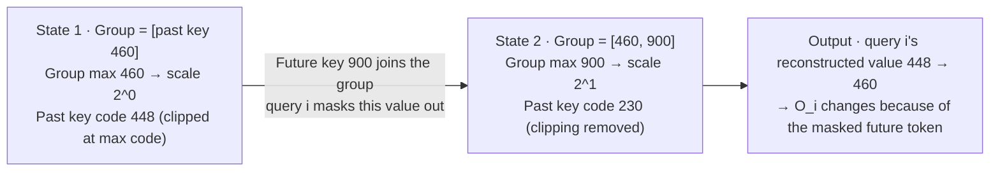

[Paper](https://arxiv.org/abs/2611.03344v1)
## Introduction

Blackwell GPUs execute FP8 and FP4 matrix multiplies 2x and 4x faster than BF16, respectively. To bring that speed to attention, the first problem to solve is not precision loss but whether "a quantized value is reconstructed identically in the forward and backward computations." FLAMIA designs this condition inside a low-bit attention kernel and turns it into training calls that are actually faster on Blackwell.

> **Paper**: FLAMIA: FLAsh MIcroscaling Attention for Fast and Causally Safe Training on Blackwell (Yandex Research), arXiv:2611.03344
> **Code**: https://github.com/yandex-research/flamia-blackwell-attention

This post proceeds from problem → small example → method → results. It first uses numbers to show what low precision breaks in attention, then explains how the design closes that problem, what was actually measured, and what remains unverified.

---

## 1. Problem: three walls between hardware speed and attention

### 1.1 Why low precision is necessary

The FlashAttention family made attention fast by reducing memory traffic through tile-wise computation and online softmax. Among these, FlashAttention-4 (FA4) was designed for Blackwell, but its implementation is BF16, so it cannot use the lower-precision throughput offered by Blackwell tensor cores (§1). Blackwell tensor cores execute FP8 matrix multiplies 2x faster than BF16 and FP4 4x faster (§1). Attention therefore has to drop to 8-bit and 4-bit as well for that gain to materialize.

Three terms need to be defined first.

| Term | Meaning | Why it matters |
| --- | --- | --- |
| **Block scaling** | Stores values as a "low-bit code + block-wide scale." The actual value = code × scale. The scale is determined by the block maximum, so it depends on the values inside the block | Tensor cores apply the scale multiplication directly to accumulation, so each format's fixed block size must be followed. In the MXFP family, 32 elements share one scale; in NVFP4, 16 elements share one scale (§2) |
| **E4M3** | An 8-bit sign, exponent, and mantissa format. The maximum value considered in the paper is 448 | This is the storage format used by the MXFP8 path, and the fact that the "maximum code" is 448 keeps appearing in the leakage discussion later |
| **Contraction axis** | The axis summed over in dot products in a matrix multiply | Block-scaled hardware requires scale groups along this axis. Attention contracts the same operand along different axes, which is where the problem starts (§3.1) |

### 1.2 Wall 1: the same operand must be stored twice, once per axis

In the forward pass, FlashAttention computes $\mathbf{S}=\mathbf{Q}\mathbf{K}^{\top}/\sqrt{d}$, $\mathbf{P}=\mathrm{softmax}(\mathbf{S})$, and $\mathbf{O}=\mathbf{P}\mathbf{V}$. In the backward pass, it does not store $\mathbf{P}$ but recomputes it from $\mathbf{Q},\mathbf{K}$ and saved row statistics. The backward pass then produces $\mathbf{dV}=\mathbf{P}^{\top}\mathbf{dO}$, $\mathbf{dP}=\mathbf{dO}\mathbf{V}^{\top}$, $\mathbf{dS}=\mathbf{P}\circ(\mathbf{dP}-\mathbf{D})$, $\mathbf{dQ}=\mathbf{dS}\mathbf{K}$, and $\mathbf{dK}=\mathbf{dS}^{\top}\mathbf{Q}$ (§2).

Each operand then **contracts along two different axes**. For example, $\mathbf{Q}$ contracts along the head dimension in score computation $\mathbf{Q}\mathbf{K}^{\top}$, but along the query axis in the gradient $\mathbf{dK}=\mathbf{dS}^{\top}\mathbf{Q}$. The axes for the six logical operands are as follows (§3.1).

| Operand | Contraction axis in one product | Contraction axis in the other product |
| --- | --- | --- |
| $\mathbf{Q}$ | Head dimension ($\mathbf{Q}\mathbf{K}^{\top}$) | Query ($\mathbf{dK}$) |
| $\mathbf{K}$ | Head dimension ($\mathbf{Q}\mathbf{K}^{\top}$) | Key ($\mathbf{dQ}$) |
| $\mathbf{V}$ | Key ($\mathbf{P}\mathbf{V}$) | Head dimension ($\mathbf{dP}$) |
| $\mathbf{dO}$ | Head dimension ($\mathbf{dP}$) | Query ($\mathbf{dV}$) |
| $\mathbf{P}$ | Key ($\mathbf{P}\mathbf{V}$) | Query ($\mathbf{dV}$) |
| $\mathbf{dS}$ | Key ($\mathbf{dQ}$) | Query ($\mathbf{dK}$) |

Typical one-dimensional block scaling requires two quantized representations per operand. The two copies require separate codes and separate scales, and the quantization pass must reread the source tensor. The backward representations of $\mathbf{Q},\mathbf{K},\mathbf{V}$ must remain in memory after the forward pass finishes. Quantization is a memory-read-bound operation, so this duplication consumes a substantial fraction of attention training time (§3.1).

### 1.3 Wall 2: sharing a scale lets masked future tokens change earlier results

When multiple positions share one scale, changing the maximum of that group alone changes the reconstructed values of other elements. The causal mask blocks the attention weight computation, but **the quantizer has already read the future value before producing codes.** A situation therefore arises in which a "value that is not read" changes "the representation of values that are read," and a dependency that should be causally erased remains in earlier outputs (§3.2). The next section works through this situation numerically.

### 1.4 Wall 3: if forward and backward do not see the same values, training becomes unstable

If the backward pass cannot reconstruct the forward pass's quantized intermediates in the same way, training can diverge even when one-step gradient cosine similarity is high. If any one of the quantization scheme, tiling, or exponential evaluation differs between the two passes, structural error appears, and that error accumulates across steps (§1, §3.3).

---

## 2. A small example: a masked future token changes a past output

The paper's Fig. 1 illustrates this situation. **The example below is illustrative and constructed for understanding; it is not a measurement from the paper.**

- **Input**: the past key visible to query i has value 460. The same scale group also contains a future key with value 900 that is masked by the causal mask.
- **Scale determined by the group**: the reference microscaling conversion sets the group exponent to $e=\lfloor\log_2(\text{group max})\rfloor-e_{max}$ (§3.2). Since the maximum value in E4M3 is 448, any scale-applied value above 448 is clipped.
- **Change and exclusion**: query i **excludes** the future key 900 via the mask. But 900 was already used in the group maximum calculation, and as a result the code for the past key 460 **changes** from 448 to 230. 460 no longer exceeds 448, so clipping is removed.

| State | Key values in the group | Group scale | Code for past key 460 | Reconstructed value | Query i output |
| --- | --- | --- | --- | --- | --- |
| Without the future key (input) | [460] | $2^{0}=1$ | 448 (460 > 448, so clipped) | 448 | $O_i$ based on 448 |
| After the future key joins (after change and exclusion) | [460, 900] | $2^{1}=2$ | 230 (460 / 2, clipping removed) | 460 | $O_i$ based on 460 |

In the diagram, each box denotes the stored state at that point (group contents → scale → code for the past key), and arrows denote state transitions. The final box is the crux. A value query i never read changed the representation of a value it did read, and thereby changed the output.

**When is this a problem?** A 2x scale change is usually harmless at 8 bits. The exponent drops by one and the mantissa stays the same, so the represented values are preserved. Failures occur at two boundaries (§3.2).

1. When the scale-applied maximum exceeds the maximum code 448 and **clips**: if a future key raises the maximum, the scale becomes 2x, earlier elements no longer clip, and their codes change.
2. When values fall below the normal range and **lose mantissa bits**.

Using wide-range statistics such as a tensor-wide maximum spreads this phenomenon to the extreme. A single later token can change all earlier outputs (§3.2).

**How is leakage verified?** The paper points out that "validation loss measured only through the kernel" cannot catch leakage. A model trained with a leaking kernel shows low loss when evaluated with that kernel, but degrades when evaluated with exact causal attention. Leakage experiments therefore always compare the two evaluation methods side by side (§3.2, §4.5).

---

## 3. Method: a design that handles the three walls

### 3.1 Reduce quantization duplication with token-block scales

FLAMIA provides two basic training paths (§3.4).

- **MXFP8 path**: stores $\mathbf{Q},\mathbf{K},\mathbf{V},\mathbf{dO}$ as E4M3 codes, but groups scales into one power-of-two exponent per **32 consecutive tokens × full head dimension**.
- **Mixed NVFP4/FP8 path**: stores only $\mathbf{Q},\mathbf{K}$, used for score computation and its recomputation, in NVFP4 (one scale per 16 head-dimension elements within each token). The remaining matrix multiplies stay 8-bit.
- **Common**: $\mathbf{V}$, $\mathbf{dO}$, and the $\mathbf{Q},\mathbf{K}$ used in gradient computation use the E4M3 token-block representation, $\mathbf{dS}$ has one scale per 32×32 block, and probability operands are E4M3. Outputs and returned gradients are BF16, and $\mathbf{dQ}$ partial sums are accumulated in FP16.

Duplication is reduced because scales are laid out in a way that remains valid under transpose. The scale of a 32-token block is constant across the full head dimension, so the same codes and scales remain valid after a transpose. 8-bit matrix multiplies support both row-major (K-major) and transposed (MN-major) layouts, so no requantized copy is needed for a transpose. $\mathbf{dS}$ is a 32×32 square block, so one copy is reused on both the query and key axes (§3.1). In contrast, 4-bit matrix-multiply instructions have no MN-major form, so each direction needs a copy. This is one reason the all-4-bit path is slow (§3.4).

The fact that scales are constant also simplifies score computation. Using the stored codes and exponents, the reconstructed score is

$$\widetilde{S}_{ij}=2^{e_Q(i)+e_K(j)}\sum_k q_{Q,ik}\,q_{K,jk}/\sqrt{d}$$

so row and column scales can be applied separately from the dot product (§3.5.1). The MXFP8 path uses an unscaled E4M3 matrix multiply and applies the row factor to the softmax scale and the column factor separately. However, bitwise identity also depends on value range and accumulation order.

### 3.2 Block leaking paths or confine them within 32 tokens

The paper's line of defense is the rule that "a scale never spans more than 32 positions, no matter how far it reaches" (§3.2).

- **Token-block scales** are grouped only within 32 tokens, and the NVFP4 scales of $\mathbf{Q},\mathbf{K}$ are grouped only within one token (16 head-dimension elements), so they cannot leak across tokens at all. All a future token can change is the re-rounding of codes in the lower part of the normal range within its own block (up to 32 tokens).
- **Rounding exponents up** so that the scale-applied maximum does not exceed the maximum code 448 prevents earlier elements from clipping and eliminates leakage through the clamp path.
- **4-bit $\mathbf{V}$** groups scales along the key direction, which creates groups that cross the causal boundary in diagonal tiles. In that case, only the diagonal tiles get one power-of-two scale per key, and that scale is folded into $\hat{\mathbf{P}}$. A scale that depends on only one key cannot leak. Outside the diagonal tiles, the cheaper group scale is used as is.
- **The two backward leaks** — $\mathbf{V}$ in $\mathbf{dP}$ and $\mathbf{K}$ in $\mathbf{dQ}=\mathbf{dS}\mathbf{K}$ — are also blocked by folding scales into the opposite operand in the same way. The latter is called K fold.
- **Accumulator leakage**: $\mathbf{dQ}$ partial sums are reduced in FP16, which has only 5 exponent bits and therefore a narrow range. The partial sums are therefore pre-multiplied by a power of two to keep them in range, and by default that magnitude is set from the **sequence-wide maximum** of $\lVert\mathbf{dO}\rVert$, $\lVert\mathbf{V}\rVert$, and $|\mathbf{K}|$. A later token then changes the rounding of all earlier rows, and the impact can reach $5\times10^{-4}$ of the largest element in that row (Appendix A.4). **Causal $\mathbf{dQ}$ scaling** sets the magnitude from only the keys visible to each query row, removing this dependence.

To fully close the residual leakage that remains inside blocks, per-token operand scales and query-row-wise $\mathbf{dS}$ exponents must additionally be enabled. These are options, not defaults, and they did not change training results while costing backward time (Appendix A.3).

### 3.3 Make forward and backward see the same intermediates

FlashAttention does not store the probability matrix $\mathbf{P}$ during backward; it recomputes it from $\mathbf{Q},\mathbf{K}$ and saved row statistics. $\mathbf{D}$ is also computed from the saved output as $\mathbf{D}_i=\mathbf{dO}_i\cdot\mathbf{O}_i$. In exact arithmetic, when $\mathbf{O}=\mathbf{P}\mathbf{V}$ and $\mathbf{dP}=\mathbf{dO}\mathbf{V}^{\top}$, this value equals $\sum_j P_{ij}\,dP_{ij}$. With quantization, this identity can break (§3.3).

FLAMIA makes the two directions use **the same quantized operands** (§3.3).

- Score recomputation uses the same $\mathbf{Q},\mathbf{K}$ representation as the forward pass.
- It reproduces tiling, diagonal decisions, exponential computation, and row-max-based scaling in the same way as the forward pass.
- $\mathbf{D}$ is computed with the same quantized $\mathbf{dO}$ used for $\mathbf{dP}$.

This alignment alone does not restore the exact identity. Quantized probabilities may not sum to 1, and output rounding and accumulation error add on top. It does, however, remove one source of mismatch at the representation level. And this alone does not guarantee training stability. If tiling or exponential evaluation differs between the two passes, training can diverge even when one-step gradient cosine similarity is high (§3.3, §4.5).

One more point. $\mathbf{dS}$ has a wide dynamic range, and if its scale is set poorly, small elements round to zero. In the paper's ablation, the fraction rounded to zero tracked training degradation better than the reported norm error. The $\mathbf{dS}$ scale is therefore taken from the maximum absolute value of the 32×32 block that the kernel already holds (§3.3).

### 3.4 Kernel optimizations, backward pass, packed documents, and scheduling

**Quantization fusion (§3.5.1).** For each input tensor, Hadamard rotation, block statistics, code generation, and scale generation are combined into **a single kernel launch**, so inputs are not reread during preprocessing. Outputs and returned gradients are BF16, so no output scale correction pass is needed. Scales are computed directly from the current tensor, so there is no separate correction pass either.

**Hadamard rotation (§3.4, Appendix A.2).** The head-dimension channels of $\mathbf{Q},\mathbf{K}$ are mixed with a normalized orthogonal transform, mitigating the problem in which an outlier in one channel determines the scale of the entire block. In exact arithmetic, dot products are preserved and positions are not mixed, so no new causal dependencies are created. Rounding and quantization can, however, change the scores. At head dimension 128 it is enabled by default in both basic paths.

**Softmax throughput (§3.5.2).** Exponential evaluation is the forward-pass bottleneck. A 128×128 tile needs 16384 exponentials, which is 1024 cycles at B200's MUFU throughput. The paper addresses this in three ways. First, it approximates a fixed fraction of exponentials with a clamped polynomial on the FMA pipeline, as FA4, FlashInfer, and Low Precision FA4 do. B300 has 2x B200's exponential throughput, so in the pure E4M3 configuration this approximation becomes a loss and is disabled. Second, the NVFP4 path quantizes probability operands in the log domain. Since $\max_j 2^{x_j}=2^{\max_j x_j}$, computing the maximum of a 32-key group before exponentiation and subtracting it from the exponent factor eliminates elementwise division and the subsequent scaling pass. Third, on B300, `tcgen05.ld.red` combines row-max reduction and TMEM score loads for fully unmasked tiles. In causal calls, off-diagonal tiles qualify.

**MMA scheduling (§3.5.2).** The MMA warp splits the next tile's $\mathbf{Q}\mathbf{K}^{\top}$ into two 64-key operations and issues them before and after the current tile's $\hat{\mathbf{P}}\mathbf{V}$, respectively. Tensor cores stay busy while the softmax warp processes the current tile. In backward, approximate exponentials are distributed in a checkerboard arrangement so that warps sharing an SM subpartition use different execution pipelines.

**Backward pass (§3.5.3).** FA4's 2-CTA backward mode forms a cluster of two cooperative thread arrays (CTAs) and splits 256 keys between them. The evaluated FA4 implementation provided this mode only in BF16. In FA4's accumulator layout, all 512 TMEM columns are occupied when $\mathbf{dP}$ is issued, leaving no room for block-scaled operands. FLAMIA's token-block scales let compute warps apply factors outside the matrix multiply, operating at low precision without storing scales for $\mathbf{dP}$ in TMEM. $\mathbf{dQ}$ partial sums are accumulated in FP16 via bulk reduce-add, halving reduction traffic, using a data-dependent power-of-two prescale. The choice between 1-CTA and 2-CTA follows rules tuned to measurements by shape and format. MHA and GQA are both supported on batched and packed inputs.

**Packed documents (§3.6.1).** Pretraining concatenates documents into a single row. Tying independent documents under shared scales can blur one document's large activations into another document's representation, and document starts may not align with the 128×4 scale atom boundaries required by block-scaled matrix multiplies. Aligning with padding incurs the alignment cost plus copies of $\mathbf{Q},\mathbf{K},\mathbf{V}$ and gradients in every layer. FLAMIA's quantizer reads the packed layout directly, groups operand token blocks and statistics only within document boundaries, and uses a dense scale table with one entry per token. Tile boundaries vary with document length and offset, so load warps assemble the tile's 128×4 atoms in shared memory. Keys outside a document are masked, and invalid query rows get an infinite log-sum-exp sentinel so that their probability and gradient contributions vanish. Outputs and gradients are written directly to the packed buffer.

**Work scheduling (§3.6.2).** Document lengths vary, so tile costs differ widely. The evaluated FA4 schedule processes tiles in longest-first order but visits sequences in input order, so later long documents delay completion. FLAMIA builds the schedule only once per micro-batch on the GPU (no host synchronization). A work item corresponds to 256 consecutive queries in one document (two CTA tiles), and its cost is estimated by the number of key blocks it visits. Items are sorted by descending cost and assigned in alternating directions across a persistent grid to interleave long and short items. It switches to dynamic assignment (Cluster Launch Control, CLC) for causal calls and for non-causal calls where the longest document is at least 4x the average. Requests are appended after the current item's last K/V load to avoid premature reservation cost. The backward pass also orders key tiles by descending cost and groups heads for L2 locality.

---

## 4. Results: speed, accuracy, causal safety, and training quality

### 4.1 Training-call latency (Table 1)

Training-call time is measured on nine causal workloads with documents packed into one row (16 heads, head dimension 128), **including forward, backward, and quantization**. Speedup is "fastest supported baseline time ÷ FLAMIA time." The following are representative values for four workloads on two GPUs (full results in Table 1, units ms).

| Workload | GPU | FLAMIA MXFP8 | FLAMIA NVFP4 | cuDNN FP8 | FA4 BF16 | Speedup |
| --- | --- | --- | --- | --- | --- | --- |
| 4×4096 | B200 | **0.89** | 0.92 | 1.06 | 1.08 | 1.18× |
| 4×4096 | B300 | **0.79** | 0.84 | 0.90 | 0.99 | 1.14× |
| 16×4096 | B200 | **3.53** | 3.64 | 3.90 | 4.24 | 1.10× |
| 16×4096 | B300 | **3.17** | 3.28 | 3.35 | 3.99 | 1.06× |
| 8192 + 224×256 | B200 | **1.80** | 1.99 | 3.03 | 2.52 | 1.40× |
| 8192 + 224×256 | B300 | **1.67** | 1.84 | 2.81 | 2.37 | 1.42× |
| log-uniform 64k | B200 | **3.61** | 3.70 | 4.15 | 4.32 | 1.15× |
| log-uniform 64k | B300 | **3.23** | 3.35 | 3.60 | 4.11 | 1.11× |

MXFP8 recorded the lowest training-call latency on all nine causal workloads on both B200 and B300. The overall ranges are 1.10x–1.40x on B200 and 1.06x–1.42x on B300 (§4.1).

The largest gain comes from `8192 + 224×256`, where document lengths are extremely skewed. Training calls are 1.40x–1.42x faster, and backward alone is 2.00x–2.01x faster. On the same workload, training-call time is about 1.68x FLAMIA for cuDNN FP8, 1.40x–1.42x for FA4 BF16, and 3.7x–3.9x for cuDNN BF16 (§4.1). As the paper also notes, however, this workload's "skew" is not separated from other shape differences.

**Measurement caveats (Appendix E).** Appendix E collects pitfalls that silently invalidate low-precision attention benchmarks. cuDNN BF16 ragged backward produces incorrect gradients when softmax statistics are padded to the batched shape (causal dQ cosine 0.62, non-causal 0.93). The Low Precision FA4 harness does not apply the causal FLOP discount, so under that convention causal throughput is reported as 2x the actual value. The cuDNN MXFP8 graph has only one V input, but the forward pass requires key-direction blocks and the backward pass requires head-dimension blocks; feeding the forward layout into backward drops dQ/dK cosine to 0.947–0.962. The same kernel source measured 18.6–20.6% differently across CuTe DSL versions while outputs were bitwise identical. For this reason, FLAMIA gates speed changes per path with bitwise checks.

### 4.2 Kernel-only measurements change the ordering (Tables 2–3, 12–13)

Measuring kernels alone and excluding quantization changes the picture (§4.1).

- **Backward**: NVFP4 is fastest on all causal workloads. B200 1.22x–2.01x, B300 1.17x–2.00x.
- **Forward**: MXFP8 leads on all 9 B200 cases and 8 of 9 B300 cases. B200 1.07x–1.72x, B300 0.98x–1.69x.
- **Full training call**: MXFP8 leads. This result includes quantization cost.

In other words, 4-bit is faster in the backward kernel, but 8-bit leads for the full training call. Kernel-only measurements exclude quantization and use 128-aligned document starts, whereas training calls use the packed layout as is, so the difference between the two results cannot be attributed solely to quantization overhead. The paper explains that NVFP4 forward is slower than MXFP8 because the additional softmax work outweighs the $\mathbf{Q}\mathbf{K}^{\top}$ savings.

### 4.3 Ablation: where the gains come from (§4.3)

Individual optimizations do not add up independently. Below are ablation results on B200 (other GPUs only where noted).

| Change | Measured effect |
| --- | --- |
| Quantization fusion | MXFP8 preprocessing 789 → 261 µs, NVFP4 0.64 → 0.11 ms (4×4096 tokens). Kernel launches 17 → 1, 11 → 1 |
| Log-domain probability quantization | NVFP4 forward +14–19% |
| Next-tile $\mathbf{Q}\mathbf{K}^{\top}$ split | +4.7% |
| Score-scale folding (MXFP8) | +4% |
| Removing exponential polynomial approximation (B300, pure E4M3) | +17–33% |
| `ld.red` fusion (B300, fully unmasked tiles) | Causal NVFP4 forward +18–20% |
| FP16 $\mathbf{dQ}$ partial sums + data-dependent scaling | Backward +23.8% |
| 2-CTA backward | +2.3–6.4% (32k keys and above) |
| Removing longest-first sorting | Causal forward 10–65% penalty |
| Merge-sort work-list construction | 0.26 ms for 131072 one-token documents (reference construction 50.5 ms) |
| Just-in-time CLC acquisition | 1.7–5.7% improvement in 13 of 16 causal configurations; early acquisition costs 6–14.5% |
| Deriving $\mathbf{dS}$ scales from 32×32 block maxima | Training call +9–12% cost |
| Causal $\mathbf{dQ}$ scaling | Backward 8–11%, training call 6–9% cost |

Scheduling gains grow as the document-length distribution becomes more skewed. FLAMIA always uses CLC for causal calls, but for non-causal calls it enables CLC only when the longest document is at least 4x the average. In non-causal settings, CLC gives a 4.1–9.7% gain on the two skewed workloads but is a loss on equal-length workloads (§4.3).

The paper reports that a diagnostic forward pass with exponential evaluation removed reaches 2608 TFLOP/s, while stating that this 45% estimate is diagnostic only: removing the exponentials changes the overlap structure and invalidates attention, so it cannot be attributed directly to runtime performance. Removing the polynomial clamp also drops output cosine to −0.012 on activation captures from a trained model (§4.3).

### 4.4 Numerical accuracy (Table 4)

Measured by cosine similarity to an FP32 reference on the same inputs. 4×4096 tokens, 16 heads, d=128, B200.

| Path | Causal O / dQ | Non-causal O / dQ |
| --- | --- | --- |
| FLAMIA MXFP8 (token block) | 0.9988 / 0.9979 | 0.9985 / 0.9978 |
| FLAMIA mixed NVFP4/FP8 | 0.9920 / 0.9906 | 0.9899 / 0.9890 |
| FLAMIA all-4-bit | 0.9810 / 0.9456 | 0.9800 / 0.9509 |
| cuDNN FP8 | 0.9985 / 0.9975 | 0.9982 / 0.9974 |
| cuDNN MXFP8 (1×32) | 0.9988 / 0.9978 | 0.9985 / 0.9978 |
| FlashInfer NVFP4 KV cache | 0.9909 / no backward | 0.9895 / no backward |
| HW-FP4 FA4, Direct-P | Causal mask unsupported | 0.9435 / no backward |
| Low Precision FA4 (1×32) | Causal mask unsupported | 0.9986 / 0.9978 |

The 8-bit configurations all have output cosine around 0.998–0.999 under per-tensor, per-32-element, and token-block scaling. On non-causal inputs, mixed NVFP4/FP8 reaches 0.9899, higher than FlashInfer's NVFP4 KV cache path at 0.9895 and higher than the Direct-P forward pass of HW-FP4 FA4 with MXFP4 $\mathbf{P}\mathbf{V}$ at 0.9435 (§4.2).

The comparison has two pitfalls. Operands and scaling schemes differ, so it is not a comparison of bit width alone, and **these numbers do not guarantee training stability**. The paper emphasizes both points.

### 4.5 Causal leakage measurements (Table 5)

The experiment perturbs future-key-position inputs in the activations of a trained model to raise the scale-group maximum, then observes how much earlier outputs change. The reported value is the maximum relative change in earlier outputs.

| Scaling scheme | O change | dQ change |
| --- | --- | --- |
| Per-tensor | 9.8e−2 / 7.9e−2 | 2.8e−1 / 1.1e−1 |
| 4-bit $\mathbf{V}$ grouped along the key direction | 2.2e−1 | Below noise |
| cuDNN MXFP8, default | 6.9e−6 | 1.1e−5 |
| cuDNN MXFP8, downward exponent rounding | 1.1e−1 | 1.1e−1 |
| Low Precision FA4, default | 6.8e−6 | 8.5e−4 |
| Low Precision FA4, downward exponent rounding | 1.0e−1 | 8.3e−2 |
| HW-FP4 FA4 (causal path) | 1.7e−1 | No backward |
| FlashInfer NVFP4 KV | 2.6e−1 | No backward |
| **FLAMIA (precision options + causal $\mathbf{dQ}$ scaling)** | **0 / 0** | **0 / 0** |

Where both 8-bit and 4-bit paths are reported, values are listed in "8-bit / 4-bit" order. "Below noise" means smaller than the run-to-run variation of the 4-bit backward pass. This variation exists because $\mathbf{dQ}$ is accumulated with atomic operations and stochastic rounding is used.

The mechanism is clearest here. cuDNN MXFP8 and Low Precision FA4, which round exponents **up**, avoid the saturation mechanism and reduce changes to around 1e−5 for O and 1e−5–1e−4 for dQ. But the change is not exactly zero. Rounding exponents **down** brings changes back to around 1e−1 in the same implementations. This is exactly the clamp leakage shown in the example in Section 2. Of all the rows in the table, only FLAMIA's precision options plus causal $\mathbf{dQ}$ scaling leave earlier outputs completely unchanged (§4.5).

As a side measurement, applying per-key $\mathbf{V}$ scales only to diagonal tiles gives forward latency of 1.17x at 4096 tokens and 1.04x at 32768 tokens. Applying them to all tiles gives 2.33x and 2.83x, respectively. K fold uses 2.7–4.0% of the training call.

### 4.6 Training stability and pretraining quality

**Controlled experiment with a small model.** A 6-layer, width-1024 byte-level GPT is trained on enwik8 with a 1024-byte context for 6000 steps (§4.5).

| Model | Validation loss under its own kernel | Evaluated with exact causal attention |
| --- | --- | --- |
| Trained with leaking 4-bit kernel | 0.811–0.827 | 0.888–0.940 |
| BF16 | 0.852 | 0.862 |
| Trained without leakage | — | 0.862 |

The leaking kernel achieves lower loss under its own kernel than BF16, but is worse when evaluated with exact causal attention. Good own-kernel loss does not mean the model is causally correct.

**Failures caused by forward/backward mismatch (§4.5).** The value of these experiments is that they support the claim that "one-step similarity cannot prove stability."

- Using different $\mathbf{dO}$ representations for $\mathbf{D}$ and $\mathbf{dP}$ diverges within 500 steps.
- Using 4-bit probabilities in the forward pass and 8-bit probabilities in the backward pass makes attention overly concentrated.
- Handling the diagonal differently in the forward pass (256 queries) and the backward pass (128 queries) makes the gradient norm jump from 0.5 to $2\cdot10^{5}$. Even so, the one-step $\mathbf{dQ}$ cosine is 0.945.
- Applying the exponential approximation only in the forward pass diverges by 500 steps.

**$\mathbf{dS}$ scale ablation.** When the scale is set too large and the fraction rounded to zero rises from 0.4% to 29%, the validation-loss gap versus BF16 also grows from 0.0008 to 0.049. The reported norm error was nearly the same. Preserving small gradient terms therefore matters. This does not mean, however, that underflow is the sole cause.

**1B pretraining (§4.6).** A 1B-parameter Llama-3-style Transformer is pretrained on 100B tokens of FineWeb-Edu with a 2k-token context on 8 B300 GPUs (TorchTitan integration). Loss is averaged over the last 1000 steps.

| Metric | BF16 | FLAMIA MXFP8 | FLAMIA NVFP4 |
| --- | --- | --- | --- |
| Training loss (↓) | 2.392 | 2.397 | 2.406 |
| ARC Challenge (↑) | 0.3925 | 0.3618 | 0.3677 |
| ARC Easy (↑) | 0.6481 | 0.6460 | 0.6557 |
| HellaSwag (↑) | 0.5711 | 0.5650 | 0.5610 |
| PIQA (↑) | 0.7280 | 0.7323 | 0.7258 |
| WinoGrande (↑) | 0.5762 | 0.5635 | 0.5967 |
| Average of 5 tasks | 0.5832 | 0.5737 | 0.5814 |

The loss increase is small, and downstream task scores are close to the baseline (§4.6). The paper does not, however, report the statistical significance of these differences or run-to-run variance.

### 4.7 Memory and throughput (§4.1)

At a document row length of 131072, the peak measured memory per attention call is 2.7 GB for packed input and 16.8 GB when alignment and padding buffers are used. In full 1B model training, packing on a single B200 processes 84.6k and 96.8k tokens/s at row lengths of 16k and 64k, respectively, while padding processes 68.8k and 84.3k. The padding configuration exceeds memory at 128k tokens. The effect of scales that do not cross document boundaries is also visible here. When the activations of one document are increased by $10^{4}$x, the $\mathbf{dK}$ cosine for the remaining documents is 0.99805 with local scales and 0.99151 with per-tensor scales.

### 4.8 Batched and non-causal paths (Appendix J, §4.1)

On non-causal packed workloads, MXFP8 leads on all 9 B200 cases (1.04x–1.30x). On B300 it has 5 wins, 2 ties (by displayed precision), and 2 losses, so it is not a clean sweep. For batched sequences, comparing more than 30 packed and batched configurations, it is 7.4% faster than cuDNN FP8 at the median (when all scales are pre-calibrated), 10.3% faster (when only input scales are computed inside the call), and 112% faster (when all scales are computed inside the call, because that requires a second forward and backward pass). For batched kernels alone, backward is fastest with FLAMIA in all 12 B200 rows and leads in 6 of 12 on B300 (cuDNN FP8 is 3–8% faster in the other 6). Forward leads in only 3 B200 rows and wins no B300 row (Appendix J).

---

## 5. Limitations and when to use it

### 5.1 Limitations explicitly acknowledged by the authors

- **Default scales retain residual leakage.** Small leakage within a block (up to 32 tokens) and the sequence-wide dependence of the $\mathbf{dQ}$ accumulator remain in the defaults.
- **The precision options have narrow coverage.** The three options that remove this residual leakage (per-token operand scales, query-row-wise $\mathbf{dS}$ exponents, and causal $\mathbf{dQ}$ scaling) currently work only on **batched causal calls**. Packed documents, windowed, and all-4-bit backward use the default scales (§5, Appendix A.3, A.4). The paper also summarizes the quality benefit of the precision options only as "did not change training results."
- **The precision options are not free.** Causal $\mathbf{dQ}$ scaling slows backward by 8–11% and training calls by 6–9%. The main cost comes from reading row scales during reduction (§4.3).
- **The all-4-bit path is not the default.** It is slower and has slightly higher loss. The backward-pass geometric mean is 1329 TFLOP/s for the mixed NVFP4/FP8 path, compared with 571 for all-4-bit and 1015 for BF16. Six quantization copies account for 45–52% of all-4-bit backward time, and validation loss is 0.012 higher than BF16 (§3.4, §4.3).
- **Completeness differs on non-causal and batched paths.** On non-causal workloads it has 5 wins, 2 ties, and 2 losses on B300, and cuDNN FP8 generally leads on batched forward kernels.

### 5.2 What remains unverified from a review perspective

- **The 1B quality validation covers only one setting.** It was checked with only one 1B model, 100B tokens, and 2k context. Generalization to larger models, longer contexts, and other architectures is **not reported in the paper**.
- **The effect of residual leakage on quality in large-scale pretraining is not reported in the paper.** Leakage checks were performed mainly on activation captures from trained models and on a small byte-level GPT (enwik8); at the 100B-token pretraining stage, the actual contribution of in-block leakage and the default $\mathbf{dQ}$ accumulator dependence to training quality was not isolated.
- **Cosine similarity is not a proof of stability.** The paper itself says that "a one-step comparison cannot establish training stability." The numbers in Section 4.4 should not be read as evidence of stability. For the same reason, the per-task score differences in Section 4.6 cannot be treated as conclusive.
- **The scope of the leakage measurements is narrow.** The leakage check is a causal-safety experiment that observes whether earlier outputs change when future keys raise the scale-group maximum, and Table 5 does not separately indicate the mask setting for the FLAMIA entry. Residual leakage on the non-causal path is not reported separately.

### 5.3 When to use it

FLAMIA is best suited to **environments that train long-context, packed documents at low precision on Blackwell**. Full causal training calls become faster (1.10x–1.40x / 1.06x–1.42x), and packing without copies also greatly reduces memory (2.7 GB versus 16.8 GB peak per call at 131072-token rows). Conversely, if a workload cannot tolerate even residual leakage, you must accept the cost of the precision options, and you should also remember that those options are still limited to batched causal calls.

---

## Conclusion

This paper's contribution is not new attention mathematics. Its core is first exposing what actually breaks in low-precision attention (causal leakage caused by shared scales, and representation mismatch between forward and backward), then addressing those two problems directly through hardware and scaling-layout design. The result is a speedup of 1.10x–1.40x (B200) and 1.06x–1.42x (B300) over the best per-workload baseline on Blackwell causal training calls, along with causal safety in which perturbing future tokens leaves earlier outputs unchanged (0) under the precision options, and only a small loss increase in 1B pretraining. The remaining work is clear: residual leakage under default scales, the absence of precision options on batched and non-causal paths, and validation at scales beyond the single 1B model and 100B-token setting.
<!-- verbatim-tables -->

Tables from the paper

> Tables converted mechanically from the arXiv e-print LaTeX source. The numbers are the paper's own and did not pass through a model.

**Table 1. Training call on packed documents (forward and backward, quantization included), causal, 16 heads, $d = 128$: time in ms (fastest in bold), TFLOP/s in small type; Speedup: the fastest baseline's time over ours.**

| **GPU** | **Documents** | **Ours** MXFP8 | **Ours** NVFP4 | **cuDNN** FP8 | **FA4** BF16 | **cuDNN** BF16 | **SDPA** BF16 | **SDPA** **Speedup** |
|---|---|---|---|---|---|---|---|---|
| B200 | $4{\times}4096$ | **0.89** 1079 | 0.92 1049 | 1.06 912 | 1.08 889 | 1.28 751 | 6.30 153 | 1.18$\times$ |
|  | $16{\times}4096$ | **3.53** 1090 | 3.64 1058 | 3.90 986 | 4.24 907 | 4.88 790 | 13.4 288 | 1.10$\times$ |
|  | $16{\times}1024$ | **0.44** 542 | 0.49 492 | 0.53 456 | 0.50 478 | 0.55 440 | 5.94 41 | 1.14$\times$ |
|  | $64{\times}1024$ | **1.66** 579 | 1.82 530 | 1.85 521 | 2.00 482 | 2.25 427 | 5.79 166 | 1.11$\times$ |
|  | $8192 + 32{\times}256$ | **0.91** 1095 | 0.94 1059 | 1.25 793 | 1.10 898 | 1.55 639 | 5.36 185 | 1.22$\times$ |
|  | $8192 + 224{\times}256$ | **1.80** 650 | 1.99 589 | 3.03 387 | 2.52 466 | 6.71 175 | 7.62 154 | 1.40$\times$ |
|  | log-unif.\ 16k | **0.71** 885 | 0.75 838 | 0.89 706 | 0.85 738 | 1.00 631 | 6.31 100 | 1.20$\times$ |
|  | log-unif.\ 16k, GQA | **0.71** 881 | 0.73 860 | 0.99 637 | 0.85 740 | 1.02 618 | `no GQA` | 1.19$\times$ |
|  | log-unif.\ 64k | **3.61** 1061 | 3.70 1034 | 4.15 922 | 4.32 886 | 5.12 748 | 13.8 277 | 1.15$\times$ |
| B300 | $4{\times}4096$ | **0.79** 1220 | 0.84 1141 | 0.90 1065 | 0.99 968 | 1.15 840 | 8.87 99 | 1.14$\times$ |
|  | $16{\times}4096$ | **3.17** 1212 | 3.28 1175 | 3.35 1147 | 3.99 965 | 4.45 865 | 13.4 289 | 1.06$\times$ |
|  | $16{\times}1024$ | **0.41** 588 | 0.45 532 | 0.48 507 | 0.47 518 | 0.51 469 | 9.41 26 | 1.14$\times$ |
|  | $64{\times}1024$ | **1.52** 635 | 1.68 573 | 1.67 578 | 1.83 527 | 2.08 462 | 8.62 112 | 1.10$\times$ |
|  | $8192 + 32{\times}256$ | **0.82** 1210 | 0.87 1146 | 1.07 926 | 1.04 954 | 1.41 703 | 8.04 114 | 1.27$\times$ |
|  | $8192 + 224{\times}256$ | **1.67** 705 | 1.84 636 | 2.81 418 | 2.37 495 | 6.47 181 | 9.45 124 | 1.42$\times$ |
|  | log-unif.\ 16k | **0.64** 985 | 0.69 911 | 0.77 814 | 0.78 810 | 0.91 696 | 8.62 73 | 1.21$\times$ |
|  | log-unif.\ 16k, GQA | **0.67** 943 | 0.68 925 | 0.87 728 | 0.78 810 | 0.93 680 | `no GQA` | 1.16$\times$ |
|  | log-unif.\ 64k | **3.23** 1186 | 3.35 1144 | 3.60 1063 | 4.11 932 | 4.70 816 | 14.2 264 | 1.11$\times$ |

**Table 2. Forward kernel on packed documents, causal, 16 heads, $d = 128$: time in ms (fastest in bold), TFLOP/s in small type; Speedup: the fastest baseline's time over ours on B200 GPU. cuDNN MX: cuDNN MXFP8; FlashInfer: its fastest backend.**

| **GPU** | **Documents** | **Ours** MXFP8 | **Ours** NVFP4 | **8-bit** cuDNN FP8 | **8-bit** cuDNN MX | **8-bit** FA4 FP8 | **8-bit** Flash Infer | **4-bit** Flash Infer | **BF16** FA4 | **BF16** cuDNN | **BF16** Flash Infer | **BF16** SDPA | **BF16** **Speedup** |
|---|---|---|---|---|---|---|---|---|---|---|---|---|---|
| B200 | $4{\times}4096$ | **0.17**\{ 1616} | 0.21\{ 1293} | 0.24\{ 1137} | 0.40\{ 682} | 0.27\{ 1018} | 0.25\{ 1104} | 0.24\{ 1138} | 0.24\{ 1153} | 0.42\{ 658} | 0.28\{ 993} | 1.99\{ 138} | 1.40$\times$ |
|  | $16{\times}4096$ | **0.70**\{ 1569} | 0.82\{ 1340} | 0.75\{ 1468} | 1.50\{ 733} | 1.06\{ 1038} | 0.91\{ 1211} | 0.85\{ 1300} | 0.98\{ 1121} | 1.50\{ 733} | 1.15\{ 956} | 3.96\{ 278} | 1.07$\times$ |
|  | $16{\times}1024$ | **0.07**\{ 1011} | 0.07\{ 916} | 0.11\{ 621} | 0.26\{ 264} | 0.12\{ 593} | 0.15\{ 455} | 0.10\{ 715} | 0.10\{ 652} | 0.22\{ 308} | 0.16\{ 433} | 1.92\{ 36} | 1.41$\times$ |
|  | $64{\times}1024$ | **0.24**\{ 1158} | 0.27\{ 1035} | 0.34\{ 804} | 1.15\{ 240} | 0.45\{ 612} | 0.53\{ 515} | 0.34\{ 811} | 0.41\{ 665} | 1.05\{ 262} | 0.61\{ 448} | 2.06\{ 134} | 1.42$\times$ |
|  | $8192 + 32{\times}256$ | **0.18**\{ 1598} | 0.22\{ 1279} | 0.30\{ 957} | 0.42\{ 667} | 0.28\{ 1023} | 0.37\{ 772} | 0.29\{ 978} | 0.24\{ 1172} | 0.44\{ 644} | 0.42\{ 681} | 1.92\{ 147} | 1.37$\times$ |
|  | $8192 + 224{\times}256$ | **0.28**\{ 1204} | 0.32\{ 1045} | 0.48\{ 698} | 3.70\{ 91} | 0.59\{ 564} | 0.67\{ 500} | 0.84\{ 397} | 0.55\{ 613} | 3.61\{ 93} | 0.77\{ 438} | 2.51\{ 134} | 1.72$\times$ |
|  | log-unif.\ 16k | **0.13**\{ 1360} | 0.16\{ 1112} | 0.20\{ 890} | 0.35\{ 509} | 0.22\{ 831} | 0.23\{ 799} | 0.19\{ 969} | 0.18\{ 977} | 0.34\{ 537} | 0.24\{ 736} | 2.02\{ 89} | 1.39$\times$ |
|  | log-unif.\ 16k, GQA | **0.13**\{ 1357} | 0.16\{ 1111} | 0.20\{ 886} | 0.34\{ 526} | 0.16\{ 1147} | 0.32\{ 570} | 0.18\{ 976} | 0.16\{ 1095} | 0.33\{ 546} | 0.38\{ 469} | `no GQA` | 1.18$\times$ |
|  | log-unif.\ 64k | **0.73**\{ 1505} | 0.86\{ 1269} | 0.82\{ 1341} | 1.68\{ 650} | 1.10\{ 995} | 1.01\{ 1087} | 0.91\{ 1204} | 1.03\{ 1063} | 1.65\{ 665} | 1.22\{ 894} | 4.15\{ 263} | 1.12$\times$ |

**Table 3. B200. Backward kernels on packed documents, causal, 16 heads, $d = 128$: time in ms (fastest in bold), TFLOP/s in small type; Speedup: the fastest baseline's time over ours.**

| **GPU** | **Documents** | **Ours** MXFP8 | **Ours** NVFP4 | **FP8** cuDNN | **BF16** FA4 | **BF16** cuDNN | **BF16** SDPA | **BF16** **Speedup** |
|---|---|---|---|---|---|---|---|---|
| B200 | $4{\times}4096$ | 0.52 1312 | **0.51** 1354 | 0.69 993 | 0.73 944 | 0.79 867 | 2.56 269 | 1.36$\times$ |
|  | $16{\times}4096$ | 2.14 1286 | **2.08** 1324 | 2.65 1039 | 3.09 890 | 3.31 831 | 9.20 299 | 1.27$\times$ |
|  | $16{\times}1024$ | 0.23 748 | **0.23** 755 | 0.30 572 | 0.37 467 | 0.32 543 | 2.56 67 | 1.32$\times$ |
|  | $64{\times}1024$ | 0.88 779 | **0.88** 785 | 1.07 642 | 1.47 468 | 1.24 553 | 3.04 226 | 1.22$\times$ |
|  | $8192 + 32{\times}256$ | 0.53 1333 | **0.52** 1377 | 0.83 851 | 0.75 944 | 1.09 651 | 2.88 246 | 1.46$\times$ |
|  | $8192 + 224{\times}256$ | 0.98 852 | **0.97** 860 | 2.12 395 | 1.96 427 | 3.11 269 | 4.92 170 | 2.01$\times$ |
|  | log-unif.\ 16k | 0.41 1096 | **0.40** 1132 | 0.57 790 | 0.57 788 | 0.60 749 | 2.48 182 | 1.43$\times$ |
|  | log-unif.\ 16k, GQA | 0.47 968 | **0.46** 986 | 0.70 640 | 0.60 749 | 0.64 708 | `no GQA` | 1.32$\times$ |
|  | log-unif.\ 64k | 2.21 1241 | **2.13** 1281 | 2.79 980 | 3.14 872 | 3.39 808 | 9.48 289 | 1.31$\times$ |

**Table 4. Cosine to an FP32 reference on the same inputs, $\mathbf{O}$ / $\mathbf{dQ}$, $4 \times 4096$ tokens, 16 heads, $d = 128$ (B200). `no bwd`: the system has no backward; `no causal mask`: the system supports only non-causal attention.**

| **System** | **causal** | **non-causal** |
|---|---|---|
| Ours, MXFP8 (token-block) | 0.9988 / 0.9979 | 0.9985 / 0.9978 |
| Ours, NVFP4 | 0.9920 / 0.9906 | 0.9899 / 0.9890 |
| Ours, all-4-bit | 0.9810 / 0.9456 | 0.9800 / 0.9509 |
| cuDNN FP8 | 0.9985 / 0.9975 | 0.9982 / 0.9974 |
| cuDNN MXFP8 (1$\times$32) | 0.9988 / 0.9978 | 0.9985 / 0.9978 |
| LP-FA4 (1$\times$32) | `no causal mask` | 0.9986 / 0.9978 |
| FlashInfer NVFP4 KV cache | 0.9909 / `no bwd` | 0.9895 / `no bwd` |
| HW-FP4 FA4, Direct-P | `no causal mask` | 0.9435 / `no bwd` |

**Table 5. Largest relative change of earlier outputs when a future token raises the maximum of its scale group, on activations of a trained model, 8-bit / 4-bit route. The change spreads only within the group that shares the scale: the whole tensor, a 32-token block, or a group of 16 or 32 keys. `below noise`: smaller than the run-to-run variation of the 4-bit backward, which accumulates $\mathbf{dQ}$ with atomics and rounds stochastically.**

| **Scaling** | $\mathbf{O}$ | $\mathbf{dQ}$ |
|---|---|---|
| Per-tensor | $9.8\mathrm{e}{-2}$ / $7.9\mathrm{e}{-2}$ | $2.8\mathrm{e}{-1}$ / $1.1\mathrm{e}{-1}$ |
| 4-bit $\mathbf{V}$ by keys | $2.2\mathrm{e}{-1}$ | `below noise` |
| cuDNN MXFP8, default | $6.9\mathrm{e}{-6}$ | $1.1\mathrm{e}{-5}$ |
| cuDNN MXFP8, floor exp. | $1.1\mathrm{e}{-1}$ | $1.1\mathrm{e}{-1}$ |
| LP-FA4, default | $6.8\mathrm{e}{-6}$ | $8.5\mathrm{e}{-4}$ |
| LP-FA4, floor exp. | $1.0\mathrm{e}{-1}$ | $8.3\mathrm{e}{-2}$ |
| HW-FP4 FA4 (causal) | $1.7\mathrm{e}{-1}$ | `no bwd` |
| FlashInfer NVFP4 KV | $2.6\mathrm{e}{-1}$ | `no bwd` |
| Ours | 0 / 0 | 0 / 0 |

**Table 6. Training loss averaged over the final 1,000 steps and downstream evaluation of the final checkpoints.**

| **Task** | **BF16** | **MXFP8** | **NVFP4** |
|---|---|---|---|
|  | Baseline | Ours | Ours |
| Training loss $\downarrow$ | 2.392 | 2.397 | 2.406 |
| ARC Challenge $\uparrow$ | 0.3925 | 0.3618 | 0.3677 |
| ARC Easy $\uparrow$ | 0.6481 | 0.6460 | 0.6557 |
| HellaSwag $\uparrow$ | 0.5711 | 0.5650 | 0.5610 |
| PIQA $\uparrow$ | 0.7280 | 0.7323 | 0.7258 |
| WinoGrande $\uparrow$ | 0.5762 | 0.5635 | 0.5967 |
| **Mean** | **0.5832** | **0.5737** | **0.5814** |

**Table 7. Inference call on packed documents with the bit-level exponentials (B200, 16 heads, $d = 128$): time in ms. Schraudolph: our MXFP8 route with Schraudolph's exponential, change against MXFP8 in small type; Mitchell-P: the 4-bit $\hat{\mathbf{P}}$ route with Mitchell-P, change against our NVFP4 route. Output cosine: 0.9985--0.9990 for MXFP8 with or without Schraudolph's exponential, 0.980--0.982 for Direct-P against 0.990--0.993 for NVFP4.**

| **Documents** | **Causal** MXFP8 | **Causal** Schraudolph | **Causal** NVFP4 | **Causal** Mitchell-P | **Non-causal** MXFP8 | **Non-causal** Schraudolph | **Non-causal** NVFP4 | **Non-causal** Mitchell-P |
|---|---|---|---|---|---|---|---|---|
| $16{\times}1024$ | 0.159 | 0.154 +3 % | 0.182 | 0.312 $-$42 % | 0.183 | 0.169 +8 % | 0.221 | 0.210 +5 % |
| $64{\times}1024$ | 0.527 | 0.514 +3 % | 0.627 | 1.109 $-$43 % | 0.640 | 0.591 +8 % | 0.793 | 0.737 +8 % |
| $4{\times}4096$ | 0.261 | 0.244 +7 % | 0.318 | 0.419 $-$24 % | 0.399 | 0.345 +16 % | 0.507 | 0.419 +21 % |
| $16{\times}4096$ | 1.033 | 0.943 +10 % | 1.178 | 1.542 $-$24 % | 1.632 | 1.429 +14 % | 1.935 | 1.574 +23 % |
| $8192 + 32{\times}256$ | 0.269 | 0.248 +8 % | 0.329 | 0.429 $-$23 % | 0.448 | 0.383 +17 % | 0.570 | 0.467 +22 % |
| $8192 + 224{\times}256$ | 0.567 | 0.549 +3 % | 0.676 | 1.142 $-$41 % | 0.745 | 0.682 +9 % | 0.919 | 0.843 +9 % |
| log-unif.\ 16k | 0.226 | 0.214 +6 % | 0.272 | 0.401 $-$32 % | 0.318 | 0.283 +12 % | 0.398 | 0.342 +16 % |
| log-unif.\ 16k, GQA | 0.193 | 0.181 +7 % | 0.232 | 0.289 $-$20 % | 0.285 | 0.250 +14 % | 0.358 | 0.297 +21 % |
| log-unif.\ 64k | 1.063 | 0.993 +7 % | 1.224 | 1.626 $-$25 % | 1.692 | 1.516 +12 % | 1.983 | 1.629 +22 % |

**Table 8. Training hyperparameters shared by all attention variants.**

| **Hyperparameter** | **Value** |
|---|---|
| Global batch size | $2^{20}$ tokens |
| Training steps | 100,000 |
| Optimizer | AdamW |
| Weight decay | 0.1 |
| Peak learning rate | $3 \times 10^{-4}$ |
| Warmup steps | 300 |
| Learning-rate decay | Linear to zero |

