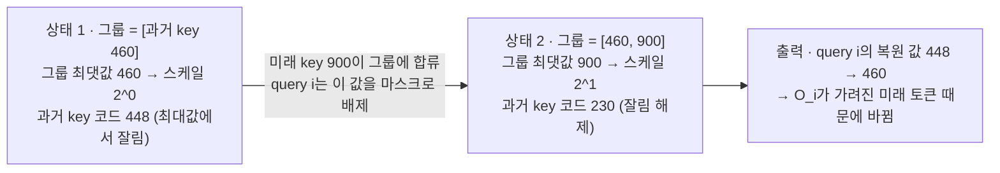

[논문 링크](https://arxiv.org/abs/2611.03344v1)
## 들어가며

Blackwell GPU는 FP8·FP4 행렬곱을 BF16보다 각각 2배·4배 빠르게 처리한다. 그 속도를 어텐션에 쓰려면, 정밀도 손실보다 "양자화한 값이 앞·뒤 계산에서 똑같이 복원되는가"가 먼저 해결되어야 한다. FLAMIA는 이 조건을 낮은 비트 어텐션 커널 안에서 설계해, Blackwell에서 실제로 더 빠른 학습 호출을 만든 작업이다.

> **논문**: FLAMIA: FLAsh MIcroscaling Attention for Fast and Causally Safe Training on Blackwell (Yandex Research), arXiv:2611.03344
> **코드**: https://github.com/yandex-research/flamia-blackwell-attention

이 글은 문제 → 작은 예시 → 방법 → 결과 순서로 진행한다. 먼저 낮은 정밀도가 어텐션에서 무엇을 망가뜨리는지 숫자로 확인한 뒤, 그 문제를 설계로 어떻게 닫았는지, 무엇이 실제로 측정되었는지, 무엇이 아직 검증되지 않았는지 정리한다.

---

## 1. 문제: 하드웨어 속도를 어텐션에 옮기려면 넘어야 할 세 벽

### 1.1 낮은 정밀도가 왜 필요한가

FlashAttention 계열은 타일 단위 계산과 온라인 softmax로 메모리 트래픽을 줄여 어텐션을 빠르게 만들었다. 그중 FlashAttention-4(FA4)는 Blackwell용으로 설계됐지만 구현이 BF16이라, Blackwell 텐서 코어가 제공하는 더 낮은 정밀도의 처리량을 쓰지 못한다(§1). Blackwell 텐서 코어는 FP8 행렬곱을 BF16의 2배, FP4를 4배 속도로 처리한다(§1). 그러니 어텐션도 8비트·4비트로 내려야 그 이득이 실린다.

여기서부터 용어 세 개를 먼저 정리해야 한다.

| 용어 | 뜻 | 왜 필요한가 |
| --- | --- | --- |
| **블록 스케일링(block scaling)** | 값을 "낮은 비트 코드 + 블록 공통 스케일"로 저장한다. 실제 값 = 코드 × 스케일. 스케일은 블록 최댓값에서 정해지므로 블록 안 값에 의존한다 | 텐서 코어가 스케일 곱을 누적에 직접 적용하기 때문에, 포맷마다 정해진 블록 크기를 따라야 한다. MXFP 계열은 32개 원소가 스케일 하나를 공유하고, NVFP4는 16개 원소가 스케일 하나를 공유한다(§2) |
| **E4M3** | 8비트 부호·지수·가수 포맷. 논문에서 다루는 최대값은 448 | MXFP8 경로가 쓰는 저장 포맷이고, "최대 코드"가 448이라는 사실이 뒤의 누수 논의에 계속 등장한다 |
| **수축 축(contraction axis)** | 행렬곱에서 내적으로 합쳐지는 축 | 블록 스케일링 하드웨어는 이 축을 따라 스케일 그룹을 요구한다. 어텐션은 같은 피연산자를 서로 다른 축으로 수축시키므로 여기서 문제가 시작된다(§3.1) |

### 1.2 벽 1: 같은 피연산자를 축마다 두 벌로 저장해야 한다

FlashAttention은 순전파에서 $\mathbf{S}=\mathbf{Q}\mathbf{K}^{\top}/\sqrt{d}$, $\mathbf{P}=\mathrm{softmax}(\mathbf{S})$, $\mathbf{O}=\mathbf{P}\mathbf{V}$를 계산하고, 역전파에서는 $\mathbf{P}$를 저장하지 않고 $\mathbf{Q},\mathbf{K}$와 저장해 둔 행 통계로 다시 계산한다. 그때 역전파는 $\mathbf{dV}=\mathbf{P}^{\top}\mathbf{dO}$, $\mathbf{dP}=\mathbf{dO}\mathbf{V}^{\top}$, $\mathbf{dS}=\mathbf{P}\circ(\mathbf{dP}-\mathbf{D})$, $\mathbf{dQ}=\mathbf{dS}\mathbf{K}$, $\mathbf{dK}=\mathbf{dS}^{\top}\mathbf{Q}$를 만든다(§2).

이때 각 피연산자는 **서로 다른 두 축으로 수축**한다. 예를 들어 $\mathbf{Q}$는 점수 계산 $\mathbf{Q}\mathbf{K}^{\top}$에서 헤드 차원으로 수축하지만, 기울기 $\mathbf{dK}=\mathbf{dS}^{\top}\mathbf{Q}$에서는 쿼리 축으로 수축한다. 여섯 논리 피연산자의 축은 다음과 같다(§3.1).

| 피연산자 | 한 곱에서의 수축 축 | 다른 곱에서의 수축 축 |
| --- | --- | --- |
| $\mathbf{Q}$ | 헤드 차원 ($\mathbf{Q}\mathbf{K}^{\top}$) | 쿼리 ($\mathbf{dK}$) |
| $\mathbf{K}$ | 헤드 차원 ($\mathbf{Q}\mathbf{K}^{\top}$) | 키 ($\mathbf{dQ}$) |
| $\mathbf{V}$ | 키 ($\mathbf{P}\mathbf{V}$) | 헤드 차원 ($\mathbf{dP}$) |
| $\mathbf{dO}$ | 헤드 차원 ($\mathbf{dP}$) | 쿼리 ($\mathbf{dV}$) |
| $\mathbf{P}$ | 키 ($\mathbf{P}\mathbf{V}$) | 쿼리 ($\mathbf{dV}$) |
| $\mathbf{dS}$ | 키 ($\mathbf{dQ}$) | 쿼리 ($\mathbf{dK}$) |

전형적인 1차원 블록 스케일링은 피연산자마다 두 벌의 양자화 표현을 요구한다. 두 벌은 코드를 따로 쓰고 스케일을 따로 적어야 하고, 양자화 패스가 원본 텐서를 다시 읽어야 한다. $\mathbf{Q},\mathbf{K},\mathbf{V}$의 역전파용 표현은 순전파가 끝난 뒤에도 메모리에 남아 있어야 한다. 양자화는 메모리 읽기에 지배되는 작업이라, 이 중복이 어텐션 학습 시간의 상당 부분을 먹는다(§3.1).

### 1.3 벽 2: 스케일을 공유하면 가려진 미래 토큰이 앞선 결과를 바꾼다

여러 위치가 하나의 스케일을 공유하면, 그 그룹의 최댓값을 바꾸는 것만으로 다른 원소의 복원값이 바뀐다. 인과 마스크는 어텐션의 가중치 계산을 막지만, **양자화기는 이미 그 미래 값을 읽은 뒤에 코드로 만든다.** 그래서 "읽지 않는 값"이 "읽은 값의 표현"을 바꾸는 상황이 생기고, 인과적으로 지워져야 할 의존성이 앞선 출력에 남는다(§3.2). 다음 절이 이 상황을 숫자로 풀어 보인다.

### 1.4 벽 3: 앞·뒤 계산이 같은 값을 보지 못하면 학습이 흔들린다

역전파가 순전파의 양자화된 중간값을 같은 방식으로 재구성하지 못하면, 한 스텝의 기울기 코사인 유사도가 높아도 학습이 발산할 수 있다. 양자화 방식, 타일링, 지수 평가 중 무엇 하나라도 앞뒤로 달라지면 구조적 오차가 생기고, 그 오차가 스텝을 넘어 쌓인다(§1, §3.3).

---

## 2. 작은 예시: 가려진 미래 토큰이 과거 출력을 바꾼다

논문 Fig. 1은 이 상황을 그린다. **아래는 이해를 위해 만든 설명용 예시이며, 논문의 측정 결과가 아니다.**

- **입력**: query i가 볼 수 있는 과거 key의 값이 460이다. 같은 스케일 그룹에는 인과 마스크로 가려진 미래 key의 값 900도 들어 있다.
- **그룹이 정하는 스케일**: 참고 마이크로스케일링 변환은 그룹 지수를 $e=\lfloor\log_2(\text{그룹 최댓값})\rfloor-e_{max}$로 잡는다(§3.2). E4M3의 최대값이 448이므로, 스케일을 적용한 값이 448을 넘으면 잘린다.
- **변경·배제**: query i는 미래 key 900을 마스크로 **배제**한다. 그런데 900은 그룹 최댓값 계산에 이미 쓰였고, 그 결과 과거 key 460의 코드가 448에서 230으로 **변경**된다. 460은 이제 448을 넘지 않아 잘림이 풀린다.

| 상태 | 그룹에 들어 있는 키 값 | 그룹 스케일 | 과거 key 460의 코드 | 복원된 값 | query i의 출력 |
| --- | --- | --- | --- | --- | --- |
| 미래 key가 없을 때 (입력) | [460] | $2^{0}=1$ | 448 (460 > 448이라 잘림) | 448 | 448 기준의 $O_i$ |
| 미래 key가 합류한 뒤 (변경·배제 후) | [460, 900] | $2^{1}=2$ | 230 (460 / 2, 잘림 해제) | 460 | 460 기준의 $O_i$ |

도식에서 각 상자는 그 시점의 저장 상태(그룹 내용 → 스케일 → 과거 key의 코드)를, 화살표는 상태 전이를 뜻한다. 마지막 상자가 문제의 핵심이다. query i가 읽지 않은 값이, 읽은 값의 표현을 바꾸어 출력을 바꿨다.

**언제 문제가 되는가.** 스케일이 2배가 되는 것 자체는 8비트에서는 대개 무해하다. 지수가 하나 줄고 가수는 그대로라 표현하는 값이 유지되기 때문이다. 실패는 두 경계에서 생긴다(§3.2).

1. 스케일 적용 최댓값이 최대 코드 448을 넘어 **잘리는 경우**: 미래 key가 최댓값을 올리면 스케일이 두 배가 되어 앞선 원소가 더 이상 잘리지 않고, 코드가 바뀐다.
2. 값이 정규 범위 아래로 내려가 **가수 비트를 잃는 경우**.

텐서 전체 최댓값처럼 넓은 범위의 통계를 쓰면 이 현상이 극단으로 번진다. 뒤의 토큰 하나가 모든 앞선 출력을 바꿀 수 있다(§3.2).

**누수는 어떻게 검증하는가.** 논문은 "커널을 통해서만 잰 검증 손실"로는 누수를 잡을 수 없다고 지적한다. 새는 커널로 학습한 모델은 그 커널로 평가하면 손실이 낮게 나오지만, 정확한 인과 어텐션으로 평가하면 성능이 떨어진다. 그래서 누수 실험은 두 평가 방식을 항상 나란히 비교한다(§3.2, §4.5).

---

## 3. 방법: 세 벽을 다루는 설계

### 3.1 토큰 블록 스케일로 양자화 복제를 줄인다

FLAMIA는 두 가지 기본 학습 경로를 제공한다(§3.4).

- **MXFP8 경로**: $\mathbf{Q},\mathbf{K},\mathbf{V},\mathbf{dO}$를 E4M3 코드로 저장하되, 스케일은 **32개 연속 토큰 × 전체 헤드 차원**에 하나의 2의 거듭제곱 지수로 묶는다.
- **혼합 NVFP4/FP8 경로**: 점수 계산과 그 재계산에 쓰이는 $\mathbf{Q},\mathbf{K}$만 NVFP4로 저장한다(각 토큰 안에서 헤드 차원 16원소마다 스케일 하나). 나머지 행렬곱은 8비트로 둔다.
- **공통**: $\mathbf{V}$, $\mathbf{dO}$, 기울기 계산의 $\mathbf{Q},\mathbf{K}$는 E4M3 토큰 블록 표현, $\mathbf{dS}$는 32×32 블록당 스케일 하나, 확률 피연산자는 E4M3. 출력과 반환 기울기는 BF16이고 $\mathbf{dQ}$ 부분합은 FP16으로 누적한다.

복제가 줄어드는 이유는 스케일이 전치해도 유효한 방식으로 배치되기 때문이다. 32토큰 블록의 스케일은 헤드 차원 전체에 걸쳐 일정하므로, 전치해도 같은 코드·같은 스케일이 유효하다. 8비트 행렬곱은 행 우선(K-major)과 전치(MN-major) 레이아웃을 모두 지원하기 때문에, 전치해 다시 양자화한 복사본이 필요 없다. $\mathbf{dS}$는 32×32 정사각 블록이라 쿼리 축과 키 축 양쪽에서 한 벌을 재사용한다(§3.1). 반대로 4비트 행렬곱 명령에는 MN-major 형태가 없어 방향마다 복사본이 필요하다. 이것이 전부 4비트 경로가 느린 이유 중 하나다(§3.4).

스케일이 상수라는 사실은 점수 계산까지 단순하게 만든다. 저장된 코드와 지수를 쓰면 복원된 점수는

$$\widetilde{S}_{ij}=2^{e_Q(i)+e_K(j)}\sum_k q_{Q,ik}\,q_{K,jk}/\sqrt{d}$$

가 되어, 행·열 스케일을 점곱과 분리해 적용할 수 있다(§3.5.1). MXFP8 경로는 스케일 없는 E4M3 행렬곱을 쓰고 행 인자를 softmax 스케일에, 열 인자를 따로 적용한다. 다만 비트 단위 동일성은 값의 범위와 누적 순서에도 의존한다.

### 3.2 새는 경로를 막거나 32토큰 안으로 가둔다

논문의 방어선은 "스케일이 아무리 멀리도 32개 위치를 넘지 않는다"는 규칙이다(§3.2).

- **토큰 블록 스케일**은 32토큰 안에서만 묶이고, $\mathbf{Q},\mathbf{K}$의 NVFP4 스케일은 한 토큰 안(헤드 차원 16원소)에서만 묶여 토큰 간으로는 아예 샐 수 없다. 미래 토큰이 바꿀 수 있는 것은 자기 블록(최대 32토큰) 안, 정규 범위 아래쪽 코드의 재반올림뿐이다.
- **지수를 올림**해서 스케일 적용 최댓값이 최대 코드 448을 넘지 않게 하면 앞선 원소가 잘리지 않아 클램프 경로의 누수가 사라진다.
- <strong>4비트 $\mathbf{V}$</strong>는 키 방향으로 스케일을 묶다 보니 대각선 타일에서 인과 경계를 가로지르는 그룹이 생긴다. 이때는 대각선 타일에만 key마다 2의 거듭제곱 스케일을 하나씩 주고, 그 스케일을 $\hat{\mathbf{P}}$에 접어 넣는다. key 하나에만 의존하는 스케일은 샐 수 없다. 대각선 타일 밖에서는 더 저렴한 그룹 스케일을 그대로 쓴다.
- **역방향의 두 누수** — $\mathbf{dP}$의 $\mathbf{V}$, 그리고 $\mathbf{dQ}=\mathbf{dS}\mathbf{K}$의 $\mathbf{K}$ — 도 같은 방식으로 반대쪽 피연산자에 스케일을 접어 막는다. 후자를 K fold라고 부른다.
- **누적기 누수**: $\mathbf{dQ}$ 부분합은 FP16으로 줄이는데, 지수 비트가 5개라 범위가 좁다. 그래서 부분합을 2의 거듭제곱으로 미리 곱해 범위 안에 두는데, 기본값은 이 크기를 $\lVert\mathbf{dO}\rVert$, $\lVert\mathbf{V}\rVert$, $|\mathbf{K}|$의 **시퀀스 전체 최댓값**으로 정한다. 그러면 뒤의 토큰이 모든 앞선 행의 반올림을 바꾸며, 그 영향은 해당 행의 가장 큰 원소의 $5\times10^{-4}$까지 갈 수 있다(Appendix A.4). **인과 $\mathbf{dQ}$ 스케일**은 각 쿼리 행이 볼 수 있는 키만으로 크기를 정해 이 의존을 없앤다.

블록 안에 남는 잔여 누수까지 완전히 닫으려면 per-token 피연산자 스케일과 쿼리 행별 $\mathbf{dS}$ 지수를 추가로 켜야 한다. 이들은 기본값이 아니라 옵션이고, 역전파 시간을 쓰면서도 학습 결과를 바꾸지 않았다(Appendix A.3).

### 3.3 앞·뒤 계산이 같은 중간값을 보게 만든다

FlashAttention은 역전파에서 확률 행렬 $\mathbf{P}$를 저장하지 않고 $\mathbf{Q},\mathbf{K}$와 저장한 행 통계로 다시 계산한다. $\mathbf{D}$도 저장된 출력에서 $\mathbf{D}_i=\mathbf{dO}_i\cdot\mathbf{O}_i$로 계산한다. 정확한 산술에서는 $\mathbf{O}=\mathbf{P}\mathbf{V}$, $\mathbf{dP}=\mathbf{dO}\mathbf{V}^{\top}$일 때 이 값이 $\sum_j P_{ij}\,dP_{ij}$와 같다. 양자화가 끼면 이 항등식이 깨질 수 있다(§3.3).

FLAMIA는 두 방향이 **같은 양자화된 피연산자**를 쓰게 한다(§3.3).

- 점수 재계산은 순전파와 같은 $\mathbf{Q},\mathbf{K}$ 표현을 쓴다.
- 타일링, 대각선 결정, 지수 계산, 행 최댓값 기준 스케일링까지 순전파와 같은 방식으로 재현한다.
- $\mathbf{D}$는 $\mathbf{dP}$에 쓴 것과 같은 양자화된 $\mathbf{dO}$로 계산한다.

이 정렬만으로 정확한 항등식이 복원되는 것은 아니다. 양자화된 확률은 1을 합으로 갖지 않을 수 있고, 출력 반올림과 누적 오차가 더해진다. 다만 표현 차원에서 오는 불일치 하나를 없앤다. 그리고 이것만으로 학습 안정성이 보장되지는 않는다. 타일링이나 지수 평가가 앞뒤로 다르면 한 스텝의 기울기 코사인 유사도가 높아도 발산할 수 있다(§3.3, §4.5).

한 가지 더. $\mathbf{dS}$는 동적 범위가 넓어 스케일을 잘못 잡으면 작은 원소가 0으로 반올림된다. 논문의 절제 실험에서는 0으로 반올림되는 비율이 학습 열화를 보고된 노름 오차보다 잘 따라갔다. 그래서 $\mathbf{dS}$의 스케일은 커널이 이미 들고 있는 32×32 블록의 최대 절댓값에서 뽑는다(§3.3).

### 3.4 커널 최적화, 역전파, 패킹 문서와 스케줄링

**양자화 융합(§3.5.1).** 각 입력 텐서에 대해 하다마드 회전, 블록 통계, 코드 생성, 스케일 생성을 **한 번의 커널 실행**으로 합쳐 전처리 중 입력을 다시 읽지 않는다. 출력과 반환 기울기는 BF16이라 출력 스케일 보정 패스가 필요 없다. 스케일은 현재 텐서에서 직접 계산되므로 별도 보정 패스도 없다.

**하다마드 회전(§3.4, Appendix A.2).** $\mathbf{Q},\mathbf{K}$의 헤드 차원 채널을 정규화된 직교 변환으로 섞어, 한 채널의 이상값이 그 블록 전체의 스케일을 결정하는 문제를 완화한다. 정확 산술에서 점곱은 보존되고 위치는 섞지 않으므로 인과적 의존성을 새로 만들지 않는다. 다만 반올림과 양자화는 점수를 바꿀 수 있다. 헤드 차원 128에서 두 기본 경로 모두 기본으로 켜진다.

**softmax 처리량(§3.5.2).** 지수 평가가 순전파의 병목이다. 128×128 타일에는 지수 16384개가 필요해 B200의 MUFU 처리량으로는 1024 사이클이다. 논문은 세 갈래로 대응한다. 첫째, FA4·FlashInfer·Low Precision FA4처럼 일정 비율의 지수를 FMA 파이프라인 위에서 클램프 다항식으로 근사한다. B300은 지수 처리량이 B200의 2배라, 순수 E4M3 구성에서는 이 근사가 오히려 손해가 되어 끈다. 둘째, NVFP4 경로는 확률 피연산자를 로그 영역에서 양자화한다. $\max_j 2^{x_j}=2^{\max_j x_j}$이므로 32-key 그룹의 최댓값을 지수화 전에 계산해 지수 인자에서 빼면, 원소별 나눗셈과 뒤따르는 스케일 패스가 사라진다. 셋째, B300에서는 `tcgen05.ld.red`로 행 최댓값 축약과 TMEM 점수 로드를 합쳐, 완전히 마스크되지 않은 타일에 쓴다. 인과 호출에서는 오프대각 타일이 여기에 해당한다.

**MMA 스케줄링(§3.5.2).** MMA 워프가 다음 타일의 $\mathbf{Q}\mathbf{K}^{\top}$를 64-key 두 연산으로 나누고, 현재 타일의 $\hat{\mathbf{P}}\mathbf{V}$ 앞뒤로 각각 발행한다. softmax 워프가 현재 타일을 처리하는 동안 텐서 코어가 쉬지 않는다. 역전파에서는 체커보드 배치로 근사 지수를 나눠, SM 서브파티션을 공유하는 워프가 서로 다른 실행 파이프라인을 쓰게 한다.

**역전파(§3.5.3).** FA4의 2-CTA 역전파 모드는 두 개의 협력 스레드 배열(CTA)로 클러스터를 이루어 256개 키를 나눠 처리한다. 평가된 FA4 구현은 이 모드를 BF16로만 제공했다. FA4의 누적기 구성에서는 $\mathbf{dP}$가 발행될 때 TMEM 512열이 모두 차 있어 블록 스케일 피연산자를 더 둘 자리가 없다. FLAMIA는 토큰 블록 스케일이 컴퓨트 워프에서 행렬곱 밖으로 인자를 적용하게 해, $\mathbf{dP}$용 TMEM 스케일 저장 없이 낮은 정밀도로 동작한다. $\mathbf{dQ}$ 부분합은 bulk reduce-add로 FP16에서 누적해 축소 트래픽을 절반으로 줄이고, 데이터에 의존하는 2의 거듭제곱 프리스케일을 쓴다. 1-CTA와 2-CTA의 선택은 형태·포맷별로 측정에 맞춰 세운 규칙으로 한다. MHA와 GQA를 배치·패킹 입력에서 모두 지원한다.

**패킹 문서(§3.6.1).** 사전학습은 문서를 한 행에 이어 붙인다. 공유 스케일이 서로 독립인 문서를 엮으면 한 문서의 큰 활성값이 다른 문서의 표현을 뭉갤 수 있고, 문서 시작점이 블록 스케일 행렬곱이 요구하는 128×4 스케일 원자 경계에 맞지 않을 수 있다. 패딩으로 정렬하면 정렬 비용과 함께 $\mathbf{Q},\mathbf{K},\mathbf{V}$와 기울기의 복사가 매 층마다 발생한다. FLAMIA의 양자화기는 패킹 레이아웃을 그대로 읽고, 피연산자 토큰 블록과 통계를 문서 경계 안에서만 묶으며, 토큰마다 한 항목짜리 조밀 스케일 테이블을 쓴다. 타일 경계는 문서 길이와 오프셋에 따라 달라지므로, 로드 워프가 타일의 128×4 원자를 공유 메모리에서 조립한다. 문서 밖 키는 마스킹하고, 유효하지 않은 쿼리 행에는 무한 log-sum-exp 센티널을 넣어 확률과 기울기 기여가 사라지게 한다. 출력과 기울기는 패킹 버퍼에 직접 쓴다.

**작업 스케줄링(§3.6.2).** 문서 길이가 제각각이라 타일 비용이 크게 다르다. 평가된 FA4 스케줄은 타일을 긴 것부터 순서대로 처리하지만 시퀀스는 입력 순서로 방문하므로, 뒤쪽의 긴 문서가 완료를 늦춘다. FLAMIA는 마이크로배치마다 GPU 위에서 한 번만 스케줄을 만든다(호스트 동기화 없음). 작업 항목은 한 문서에서 연속한 쿼리 256개(CTA의 두 타일)에 대응하고, 비용은 방문하는 키 블록 수로 추산한다. 항목을 비용 내림차순으로 정렬해 지속 그리드에 번갈아 방향으로 배정해 긴 항목과 짧은 항목을 섞는다. 인과 호출과, 최장 문서가 평균 4배 이상인 비인과 호출은 동적 할당(Cluster Launch Control, CLC)으로 전환한다. 요청은 현재 항목의 마지막 K·V 로드 뒤에 이어 붙여, 너무 이른 예약 비용을 피한다. 역전파에서도 키 타일을 비용 내림차순으로 배치하고 헤드를 L2 지역성을 위해 묶는다.

---

## 4. 결과: 속도, 정확도, 인과 안전, 학습 품질

### 4.1 학습 호출 지연 (Table 1)

문서를 한 행에 패킹한 9가지 인과 작업(16 헤드, 헤드 차원 128)에서 **순전파 + 역전파 + 양자화가 모두 포함된** 학습 호출 시간을 잰다. Speedup은 "가장 빠른 지원 baseline의 시간 ÷ FLAMIA의 시간"이다. 다음은 대표 4개 작업을 두 GPU에서 잰 값이다(전체는 Table 1, 단위 ms).

| 워크로드 | GPU | FLAMIA MXFP8 | FLAMIA NVFP4 | cuDNN FP8 | FA4 BF16 | 속도 향상 |
| --- | --- | --- | --- | --- | --- | --- |
| 4×4096 | B200 | **0.89** | 0.92 | 1.06 | 1.08 | 1.18× |
| 4×4096 | B300 | **0.79** | 0.84 | 0.90 | 0.99 | 1.14× |
| 16×4096 | B200 | **3.53** | 3.64 | 3.90 | 4.24 | 1.10× |
| 16×4096 | B300 | **3.17** | 3.28 | 3.35 | 3.99 | 1.06× |
| 8192 + 224×256 | B200 | **1.80** | 1.99 | 3.03 | 2.52 | 1.40× |
| 8192 + 224×256 | B300 | **1.67** | 1.84 | 2.81 | 2.37 | 1.42× |
| log-uniform 64k | B200 | **3.61** | 3.70 | 4.15 | 4.32 | 1.15× |
| log-uniform 64k | B300 | **3.23** | 3.35 | 3.60 | 4.11 | 1.11× |

MXFP8은 B200·B300 모두에서 9개 인과 작업 전부에서 가장 낮은 학습 호출 지연을 기록했다. 전체 범위는 B200 1.10~1.40배, B300 1.06~1.42배다(§4.1).

가장 큰 이득은 문서 길이가 극단적으로 치우친 `8192 + 224×256`에서 나온다. 학습 호출은 1.40~1.42배 빨라지고, 역전파만 보면 2.00~2.01배다. 같은 작업에서 학습 호출 시간은 cuDNN FP8이 FLAMIA의 약 1.68배, FA4 BF16이 1.40~1.42배, cuDNN BF16이 3.7~3.9배다(§4.1). 다만 논문도 짚듯이, 이 작업의 "치우침"은 다른 형태 차이와 분리되지 않는다.

**측정 방법 주의(Appendix E).** 부록 E는 저정밀 어텐션 벤치마크를 조용히 무효화하는 함정들을 정리한다. cuDNN BF16 ragged backward는 softmax 통계를 배치 모양으로 패딩하면 잘못된 기울기를 준다(인과 dQ 코사인 0.62, 비인과 0.93). Low Precision FA4의 하네스는 인과 FLOP 할인을 적용하지 않아, 그 관례에서 인과 처리량이 실제의 두 배로 표기된다. cuDNN MXFP8 그래프는 V 입력이 하나뿐인데 순전파는 키 방향 블록을, 역전파는 헤드 차원 블록을 요구하므로 순전파 레이아웃을 역전파에 먹이면 dQ·dK 코사인이 0.947~0.962로 떨어진다. 같은 커널 소스가 다른 CuTe DSL 버전에서 18.6~20.6% 다르게 측정되면서 출력은 비트 단위로 동일했다. FLAMIA는 이 때문에 속도 변화를 경로별로 비트 단위 게이트로 확인한다.

### 4.2 커널만 떼어 보면 순서가 달라진다(Table 2·3, 12·13)

커널만 재고 양자화를 제외하면 이야기가 달라진다(§4.1).

- **역전파**: NVFP4가 모든 인과 작업에서 가장 빠르다. B200 1.22~2.01배, B300 1.17~2.00배.
- **순전파**: MXFP8이 B200 9개 전부, B300 9개 중 8개에서 앞선다. B200 1.07~1.72배, B300 0.98~1.69배.
- **전체 학습 호출**: MXFP8이 앞선다. 양자화 비용까지 포함한 결과다.

즉 4비트는 역전파 커널에서 더 빠르지만, 학습 호출 전체에서는 8비트가 앞선다. 커널 단독 측정은 양자화를 제외하고 128 정렬 문서 시작을 쓰는 반면 학습 호출은 패킹 레이아웃을 그대로 쓰므로, 두 결과의 차이를 양자화 오버헤드 하나로 귀속할 수는 없다. 논문은 NVFP4 순전파가 MXFP8보다 느린 이유를 추가 softmax 작업이 $\mathbf{Q}\mathbf{K}^{\top}$ 절감보다 크다고 설명한다.

### 4.3 절제 실험: 이득이 어디서 왔나(§4.3)

개별 최적화는 서로 더해지지 않는다. 아래는 B200 기준(명시된 경우에만 다른 GPU)의 절제 결과다.

| 변경 | 측정된 효과 |
| --- | --- |
| 양자화 융합 | MXFP8 전처리 789 → 261 µs, NVFP4 0.64 → 0.11 ms (4×4096 토큰). 커널 실행 횟수 17 → 1, 11 → 1 |
| 로그 영역 확률 양자화 | NVFP4 순전파 +14~19% |
| 다음 타일 $\mathbf{Q}\mathbf{K}^{\top}$ 분할 | +4.7% |
| 점수 스케일 접기 (MXFP8) | +4% |
| 지수 다항식 근사 제거 (B300, 순수 E4M3) | +17~33% |
| `ld.red` 융합 (B300, 완전히 비마스크 타일) | 인과 NVFP4 순전파 +18~20% |
| FP16 $\mathbf{dQ}$ 부분합 + 데이터 의존 스케일 | 역전파 +23.8% |
| 2-CTA 역전파 | +2.3~6.4% (32k 키 이상) |
| 최장 우선 정렬 제거 | 인과 순전파 10~65% 손해 |
| 머지 소트 작업 목록 구성 | 131072개 1토큰 문서에서 0.26 ms (참조 구성 50.5 ms) |
| just-in-time CLC 획득 | 16개 인과 구성 중 13개에서 1.7~5.7% 개선, 조기 획득은 6~14.5% 손해 |
| $\mathbf{dS}$ 스케일을 32×32 블록 최댓값에서 산출 | 학습 호출 +9~12% 비용 |
| 인과 $\mathbf{dQ}$ 스케일 | 역전파 8~11%, 학습 호출 6~9% 비용 |

스케줄링 이득은 문서 길이 분포가 치우칠수록 커진다. FLAMIA는 인과 호출에서 항상 CLC를 쓰지만, 비인과에서는 최장 문서가 평균 4배 이상일 때만 켠다. 비인과에서 CLC는 두 치우친 작업에서 4.1~9.7% 이득을 주지만 동일 길이 작업에서는 손해다(§4.3).

논문은 지수 평가를 제거한 진단 순전파가 2608 TFLOP/s에 도달한다고 보고하면서, 이 45% 추정치는 진단용일 뿐 제거가 겹침 구조를 바꾸고 어텐션을 무효화하므로 런타임 성능에 직접 귀속할 수 없다고 명시한다. 또 다항식 클램프를 빼면 학습된 모델의 활성값 캡처에서 출력 코사인이 −0.012까지 떨어진다(§4.3).

### 4.4 수치 정확도 (Table 4)

같은 입력에 대한 FP32 참조와의 코사인 유사도로 잰다. 4×4096 토큰, 16 헤드, d=128, B200.

| 경로 | 인과 O / dQ | 비인과 O / dQ |
| --- | --- | --- |
| FLAMIA MXFP8 (토큰 블록) | 0.9988 / 0.9979 | 0.9985 / 0.9978 |
| FLAMIA 혼합 NVFP4/FP8 | 0.9920 / 0.9906 | 0.9899 / 0.9890 |
| FLAMIA 전부 4비트 | 0.9810 / 0.9456 | 0.9800 / 0.9509 |
| cuDNN FP8 | 0.9985 / 0.9975 | 0.9982 / 0.9974 |
| cuDNN MXFP8 (1×32) | 0.9988 / 0.9978 | 0.9985 / 0.9978 |
| FlashInfer NVFP4 KV 캐시 | 0.9909 / 역전파 없음 | 0.9895 / 역전파 없음 |
| HW-FP4 FA4, Direct-P | 인과 마스크 미지원 | 0.9435 / 역전파 없음 |
| Low Precision FA4 (1×32) | 인과 마스크 미지원 | 0.9986 / 0.9978 |

8비트 구성들은 텐서 전체·32원소별·토큰 블록 스케일링 모두에서 출력 코사인이 약 0.998~0.999다. 비인과 입력에서 혼합 NVFP4/FP8은 0.9899로, FlashInfer의 NVFP4 KV 캐시 경로 0.9895보다 높고, MXFP4 $\mathbf{P}\mathbf{V}$를 쓰는 HW-FP4 FA4의 Direct-P 순전파 0.9435보다 높다(§4.2).

비교에는 두 가지 함정이 있다. 피연산자와 스케일링 방식이 서로 달라 비트 폭만의 비교가 아니라는 점, 그리고 **이 수치가 학습 안정성을 보장하지 않는다는 점**이다. 논문은 두 점을 모두 강조한다.

### 4.5 인과 누수 측정 (Table 5)

훈련된 모델의 활성값에서 미래 키 위치 입력을 섭동해 스케일 그룹 최댓값을 올리고, 앞선 위치의 출력이 얼마나 변하는지 본다. 보고되는 값은 앞선 출력의 최대 상대 변화다.

| 스케일 방식 | O 변화 | dQ 변화 |
| --- | --- | --- |
| 텐서 전체(per-tensor) | 9.8e−2 / 7.9e−2 | 2.8e−1 / 1.1e−1 |
| 4비트 $\mathbf{V}$를 키 방향으로 그룹화 | 2.2e−1 | 잡음 이하 |
| cuDNN MXFP8, 기본 | 6.9e−6 | 1.1e−5 |
| cuDNN MXFP8, 지수 내림 | 1.1e−1 | 1.1e−1 |
| Low Precision FA4, 기본 | 6.8e−6 | 8.5e−4 |
| Low Precision FA4, 지수 내림 | 1.0e−1 | 8.3e−2 |
| HW-FP4 FA4 (인과 경로) | 1.7e−1 | 역전파 없음 |
| FlashInfer NVFP4 KV | 2.6e−1 | 역전파 없음 |
| **FLAMIA (정밀 옵션 + 인과 $\mathbf{dQ}$ 스케일)** | **0 / 0** | **0 / 0** |

8비트/4비트 경로가 모두 보고된 항목은 "8비트 / 4비트" 순서로 적었다. "잡음 이하"는 4비트 역전파의 실행 간 변동보다 작다는 뜻이다. 원자적 연산으로 $\mathbf{dQ}$를 누적하고 확률적 반올림을 쓰기 때문에 이 변동이 존재한다.

여기서 메커니즘이 선명하게 드러난다. 지수를 **올림**하는 cuDNN MXFP8과 Low Precision FA4는 포화 메커니즘을 피해 변화가 O 1e−5 수준, dQ 1e−5~1e−4 수준으로 작아진다. 하지만 완전히 0은 아니다. 반면 지수를 **내림**하면 같은 구현에서 변화가 1e−1 수준으로 되돌아간다. 즉 2절의 예시에서 본 클램프 누수가 그대로 드러나는 것이다. 표의 모든 행 가운데 앞선 출력을 아예 바꾸지 않는 것은 FLAMIA의 정밀 옵션과 인과 $\mathbf{dQ}$ 스케일뿐이다(§4.5).

부수 측정으로, 대각선 타일에만 per-key $\mathbf{V}$ 스케일을 적용하면 순전파 지연은 4096 토큰에서 1.17배, 32768 토큰에서 1.04배다. 모든 타일에 적용하면 각각 2.33배, 2.83배다. K fold는 학습 호출의 2.7~4.0%를 쓴다.

### 4.6 학습 안정성과 사전학습 품질

**작은 모델로 만든 통제 실험.** 6층, 폭 1024의 byte-level GPT를 enwik8에서 1024바이트 컨텍스트로 6000스텝 학습한다(§4.5).

| 모델 | 자기 커널 기준 검증 손실 | 정확한 인과 어텐션으로 평가 |
| --- | --- | --- |
| 새는 4비트 커널로 학습 | 0.811 ~ 0.827 | 0.888 ~ 0.940 |
| BF16 | 0.852 | 0.862 |
| 누수 없이 학습 | — | 0.862 |

새는 커널은 자기 커널 기준으로는 BF16보다 낮은 손실을 얻지만, 정확한 인과 어텐션으로 평가하면 오히려 나빠진다. 자기 커널 기준 손실이 좋다고 인과적으로 올바르다는 뜻은 아니다.

**앞·뒤 불일치가 만드는 실패(§4.5).** 이 실험들의 가치는 "한 스텝 유사도로는 안정성을 증명할 수 없다"는 주장을 뒷받침한다는 데 있다.

- $\mathbf{D}$와 $\mathbf{dP}$에 서로 다른 $\mathbf{dO}$ 표현을 쓰면 500스텝 이내에 발산한다.
- 순전파에서 4비트 확률, 역전파에서 8비트 확률을 쓰면 어텐션이 지나치게 집중된다.
- 대각선 처리를 순전파에서 쿼리 256개, 역전파에서 128개로 다르게 하면 기울기 노름이 0.5에서 $2\cdot10^{5}$로 치솟는다. 그럼에도 한 스텝 $\mathbf{dQ}$ 코사인은 0.945다.
- 지수 근사를 순전파에만 적용하면 500스텝까지 발산한다.

**$\mathbf{dS}$ 스케일 절제.** 스케일을 크게 잡아 0으로 반올림되는 비율이 0.4%에서 29%로 오르면, BF16 대비 검증 손실 격차도 0.0008에서 0.049로 커진다. 보고된 노름 오차는 거의 비슷했다. 즉 작은 기울기 항을 지키는 것이 중요하다. 다만 언더플로가 유일한 원인이라는 뜻은 아니다.

**1B 사전학습(§4.6).** 1B 파라미터 Llama-3 스타일 Transformer를 100B 토큰의 FineWeb-Edu로, 2k 토큰 컨텍스트로, 8장 B300에서 사전학습한다(TorchTitan 통합). 손실은 마지막 1000스텝 평균이다.

| 지표 | BF16 | FLAMIA MXFP8 | FLAMIA NVFP4 |
| --- | --- | --- | --- |
| 학습 손실 (↓) | 2.392 | 2.397 | 2.406 |
| ARC Challenge (↑) | 0.3925 | 0.3618 | 0.3677 |
| ARC Easy (↑) | 0.6481 | 0.6460 | 0.6557 |
| HellaSwag (↑) | 0.5711 | 0.5650 | 0.5610 |
| PIQA (↑) | 0.7280 | 0.7323 | 0.7258 |
| WinoGrande (↑) | 0.5762 | 0.5635 | 0.5967 |
| 5개 태스크 평균 | 0.5832 | 0.5737 | 0.5814 |

손실 증가는 미미하고, 하위 태스크 점수도 baseline에 가깝다(§4.6). 다만 논문은 이 차이의 통계적 유의성이나 실행 간 변동을 보고하지 않는다.

### 4.7 메모리와 처리량(§4.1)

문서 행 길이 131072에서 어텐션 호출당 측정 최대 메모리는 패킹 입력 2.7 GB, 정렬·패딩 버퍼를 쓴 경우 16.8 GB다. 1B 모델 전체 학습에서 패킹은 B200 한 장에서 행 길이 16k·64k에 각각 84.6k·96.8k 토큰/초를 처리하고, 패딩은 68.8k·84.3k다. 패딩 구성은 128k 토큰에서 메모리를 초과한다. 문서 경계를 넘지 않는 스케일의 효과도 여기서 읽힌다. 한 문서의 활성값을 $10^{4}$배로 늘렸을 때, 로컬 스케일에서는 나머지 문서의 $\mathbf{dK}$ 코사인이 0.99805, 텐서 전체 스케일에서는 0.99151이다.

### 4.8 배치·비인과 경로(Appendix J, §4.1)

비인과 패킹 작업에서는 B200 9개 전부에서 MXFP8이 앞선다(1.04~1.30배). B300에서는 5승·2무(표시 정밀도 기준)·2패로, 완승이 아니다. 배치 시퀀스에서는 30개 이상의 packed·batched 형태를 비교해, cuDNN FP8보다 중앙값으로 7.4% 빠르다(모든 스케일을 사전 보정한 경우), 10.3% 빠르다(입력 스케일만 호출 안에서 계산), 112% 빠르다(모든 스케일을 호출 안에서 계산할 때는 두 번째 순·역전파가 필요하기 때문). 반면 배치 커널만 보면, 역전파는 B200 12개 행 전부에서 FLAMIA가 가장 빠르고 B300에서는 12개 중 6개에서 앞선다(cuDNN FP8이 나머지 6개에서 3~8% 빠르다). 순전파는 B200 3개 행에서만 앞서고 B300에서는 한 행도 이기지 못한다(Appendix J).

---

## 5. 한계와 적용 판단

### 5.1 저자가 명시적으로 인정한 한계

- **기본 스케일에는 잔여 누수가 남는다.** 블록 안(최대 32토큰)의 작은 누수와, 시퀀스 전체 $\mathbf{dQ}$ 누적기 의존이 기본값에 남는다.
- **정밀 옵션의 적용 범위가 좁다.** 이 잔여 누수를 없애는 세 옵션(per-token 피연산자 스케일, 쿼리 행별 $\mathbf{dS}$ 지수, 인과 $\mathbf{dQ}$ 스케일)은 현재 **배치 인과 호출**에서만 동작한다. 패킹 문서·윈도우·전부 4비트 역전파는 기본 스케일을 쓴다(§5, Appendix A.3·A.4). 정밀 옵션의 품질 이득도 논문은 "학습 결과를 바꾸지 않았다"로만 요약한다.
- **정밀 옵션은 공짜가 아니다.** 인과 $\mathbf{dQ}$ 스케일은 역전파를 8~11%, 학습 호출을 6~9% 느리게 한다. 주된 비용은 축소 과정에서 행 스케일을 읽는 데서 나온다(§4.3).
- **전부 4비트 경로는 기본값이 아니다.** 느리고 손실도 약간 높다. 혼합 NVFP4/FP8 경로의 역전파 기하평균은 1329 TFLOP/s인 반면, 전부 4비트는 571, BF16는 1015다. 6벌의 양자화가 전부 4비트 역전파 시간의 45~52%를 차지하고, 검증 손실은 BF16보다 0.012 높다(§3.4, §4.3).
- **비인과·배치 경로의 완전성은 다르다.** 비인과에서 B300 기준 5승·2무·2패이며, 배치 순전파 커널은 cuDNN FP8이 대체로 앞선다.

### 5.2 리뷰 관점에서 아직 확인되지 않은 것

- **1B 품질 검증은 한 가지 설정뿐이다.** 1B 모델·100B 토큰·2k 컨텍스트 하나로만 확인했다. 더 큰 모델, 더 긴 컨텍스트, 다른 구조로의 일반화는 **원문 미보고**다.
- **대규모 사전학습에서 잔여 누수가 품질에 미치는 영향은 원문 미보고다.** 누수 검사는 훈련된 모델의 활성값 캡처와 작은 byte-level GPT(enwik8) 위주에서 이뤄졌고, 100B 토큰 사전학습 단계에서 블록 안 누수와 기본 $\mathbf{dQ}$ 누적기 의존이 학습 품질에 실제로 얼마나 기여하는지는 분리되지 않았다.
- **코사인 유사도는 안정성 증명이 아니다.** 논문 스스로 "한 스텝 비교로 학습 안정성을 세울 수 없다"고 말한다. 4.4절의 수치를 안정성 근거로 읽으면 안 된다. 같은 이유로 4.6절의 태스크별 점수 차이도 단정할 수 없다.
- **누수 측정의 범위가 좁다.** 누수 검사는 미래 키가 스케일 그룹 최댓값을 올릴 때 앞선 출력이 변하는지를 보는 인과 안전성 실험이며, 표 5에는 FLAMIA 항목의 마스크 설정이 따로 표시되어 있지 않다. 비인과 경로의 잔여 누수는 별도로 보고되지 않는다.

### 5.3 적용 판단

FLAMIA는 **Blackwell에서 긴 문맥·패킹 문서를 저정밀로 학습하는 환경**에 가장 잘 맞는다. 인과 학습 호출 전체가 빨라지고(1.10~1.40배 / 1.06~1.42배), 패킹을 복사 없이 처리해 메모리도 크게 줄어든다(131072 토큰 행에서 호출당 최대 2.7 GB 대 16.8 GB). 반대로 잔여 누수조차 허용하지 못하는 작업이면 정밀 옵션의 비용을 감수해야 하고, 그 옵션은 아직 배치 인과 호출로 한정된다는 점을 함께 기억해야 한다.

---

## 정리

이 논문의 기여는 새로운 어텐션 수학이 아니다. 저정밀도 어텐션에서 무엇이 실제로 망가지는지(스케일 공유가 만드는 인과 누수, 앞·뒤 계산의 표현 불일치)를 먼저 드러내고, 그 두 문제를 하드웨어와 스케일링 배치의 설계로 직접 다룬 것이 핵심이다. 그 결과는 Blackwell 인과 학습 호출에서 작업별 최고 baseline 대비 1.10~1.40배(B200), 1.06~1.42배(B300)의 속도이며, 정밀 옵션에서는 미래 토큰을 섭동해도 앞선 출력 변화가 0인 인과 안전성과 1B 사전학습에서의 미미한 손실 증가로 이어진다. 남은 숙제는 분명하다. 기본 스케일의 잔여 누수, 배치·비인과 경로의 정밀 옵션 부재, 그리고 1B·100B 토큰이라는 단일 설정 밖의 규모 검증이다.

<!-- verbatim-tables -->

논문 원문의 표

> arXiv e-print 의 LaTeX 원본에서 기계적으로 옮긴 표입니다. 숫자는 논문의 값이며 모델을 거치지 않았습니다.

**표 1. Training call on packed documents (forward and backward, quantization included), causal, 16 heads, $d = 128$: time in ms (fastest in bold), TFLOP/s in small type; Speedup: the fastest baseline's time over ours.**

| **GPU** | **Documents** | **Ours** MXFP8 | **Ours** NVFP4 | **cuDNN** FP8 | **FA4** BF16 | **cuDNN** BF16 | **SDPA** BF16 | **SDPA** **Speedup** |
|---|---|---|---|---|---|---|---|---|
| B200 | $4{\times}4096$ | **0.89** 1079 | 0.92 1049 | 1.06 912 | 1.08 889 | 1.28 751 | 6.30 153 | 1.18$\times$ |
|  | $16{\times}4096$ | **3.53** 1090 | 3.64 1058 | 3.90 986 | 4.24 907 | 4.88 790 | 13.4 288 | 1.10$\times$ |
|  | $16{\times}1024$ | **0.44** 542 | 0.49 492 | 0.53 456 | 0.50 478 | 0.55 440 | 5.94 41 | 1.14$\times$ |
|  | $64{\times}1024$ | **1.66** 579 | 1.82 530 | 1.85 521 | 2.00 482 | 2.25 427 | 5.79 166 | 1.11$\times$ |
|  | $8192 + 32{\times}256$ | **0.91** 1095 | 0.94 1059 | 1.25 793 | 1.10 898 | 1.55 639 | 5.36 185 | 1.22$\times$ |
|  | $8192 + 224{\times}256$ | **1.80** 650 | 1.99 589 | 3.03 387 | 2.52 466 | 6.71 175 | 7.62 154 | 1.40$\times$ |
|  | log-unif.\ 16k | **0.71** 885 | 0.75 838 | 0.89 706 | 0.85 738 | 1.00 631 | 6.31 100 | 1.20$\times$ |
|  | log-unif.\ 16k, GQA | **0.71** 881 | 0.73 860 | 0.99 637 | 0.85 740 | 1.02 618 | `no GQA` | 1.19$\times$ |
|  | log-unif.\ 64k | **3.61** 1061 | 3.70 1034 | 4.15 922 | 4.32 886 | 5.12 748 | 13.8 277 | 1.15$\times$ |
| B300 | $4{\times}4096$ | **0.79** 1220 | 0.84 1141 | 0.90 1065 | 0.99 968 | 1.15 840 | 8.87 99 | 1.14$\times$ |
|  | $16{\times}4096$ | **3.17** 1212 | 3.28 1175 | 3.35 1147 | 3.99 965 | 4.45 865 | 13.4 289 | 1.06$\times$ |
|  | $16{\times}1024$ | **0.41** 588 | 0.45 532 | 0.48 507 | 0.47 518 | 0.51 469 | 9.41 26 | 1.14$\times$ |
|  | $64{\times}1024$ | **1.52** 635 | 1.68 573 | 1.67 578 | 1.83 527 | 2.08 462 | 8.62 112 | 1.10$\times$ |
|  | $8192 + 32{\times}256$ | **0.82** 1210 | 0.87 1146 | 1.07 926 | 1.04 954 | 1.41 703 | 8.04 114 | 1.27$\times$ |
|  | $8192 + 224{\times}256$ | **1.67** 705 | 1.84 636 | 2.81 418 | 2.37 495 | 6.47 181 | 9.45 124 | 1.42$\times$ |
|  | log-unif.\ 16k | **0.64** 985 | 0.69 911 | 0.77 814 | 0.78 810 | 0.91 696 | 8.62 73 | 1.21$\times$ |
|  | log-unif.\ 16k, GQA | **0.67** 943 | 0.68 925 | 0.87 728 | 0.78 810 | 0.93 680 | `no GQA` | 1.16$\times$ |
|  | log-unif.\ 64k | **3.23** 1186 | 3.35 1144 | 3.60 1063 | 4.11 932 | 4.70 816 | 14.2 264 | 1.11$\times$ |

**표 2. Forward kernel on packed documents, causal, 16 heads, $d = 128$: time in ms (fastest in bold), TFLOP/s in small type; Speedup: the fastest baseline's time over ours on B200 GPU. cuDNN MX: cuDNN MXFP8; FlashInfer: its fastest backend.**

| **GPU** | **Documents** | **Ours** MXFP8 | **Ours** NVFP4 | **8-bit** cuDNN FP8 | **8-bit** cuDNN MX | **8-bit** FA4 FP8 | **8-bit** Flash Infer | **4-bit** Flash Infer | **BF16** FA4 | **BF16** cuDNN | **BF16** Flash Infer | **BF16** SDPA | **BF16** **Speedup** |
|---|---|---|---|---|---|---|---|---|---|---|---|---|---|
| B200 | $4{\times}4096$ | **0.17**\{ 1616} | 0.21\{ 1293} | 0.24\{ 1137} | 0.40\{ 682} | 0.27\{ 1018} | 0.25\{ 1104} | 0.24\{ 1138} | 0.24\{ 1153} | 0.42\{ 658} | 0.28\{ 993} | 1.99\{ 138} | 1.40$\times$ |
|  | $16{\times}4096$ | **0.70**\{ 1569} | 0.82\{ 1340} | 0.75\{ 1468} | 1.50\{ 733} | 1.06\{ 1038} | 0.91\{ 1211} | 0.85\{ 1300} | 0.98\{ 1121} | 1.50\{ 733} | 1.15\{ 956} | 3.96\{ 278} | 1.07$\times$ |
|  | $16{\times}1024$ | **0.07**\{ 1011} | 0.07\{ 916} | 0.11\{ 621} | 0.26\{ 264} | 0.12\{ 593} | 0.15\{ 455} | 0.10\{ 715} | 0.10\{ 652} | 0.22\{ 308} | 0.16\{ 433} | 1.92\{ 36} | 1.41$\times$ |
|  | $64{\times}1024$ | **0.24**\{ 1158} | 0.27\{ 1035} | 0.34\{ 804} | 1.15\{ 240} | 0.45\{ 612} | 0.53\{ 515} | 0.34\{ 811} | 0.41\{ 665} | 1.05\{ 262} | 0.61\{ 448} | 2.06\{ 134} | 1.42$\times$ |
|  | $8192 + 32{\times}256$ | **0.18**\{ 1598} | 0.22\{ 1279} | 0.30\{ 957} | 0.42\{ 667} | 0.28\{ 1023} | 0.37\{ 772} | 0.29\{ 978} | 0.24\{ 1172} | 0.44\{ 644} | 0.42\{ 681} | 1.92\{ 147} | 1.37$\times$ |
|  | $8192 + 224{\times}256$ | **0.28**\{ 1204} | 0.32\{ 1045} | 0.48\{ 698} | 3.70\{ 91} | 0.59\{ 564} | 0.67\{ 500} | 0.84\{ 397} | 0.55\{ 613} | 3.61\{ 93} | 0.77\{ 438} | 2.51\{ 134} | 1.72$\times$ |
|  | log-unif.\ 16k | **0.13**\{ 1360} | 0.16\{ 1112} | 0.20\{ 890} | 0.35\{ 509} | 0.22\{ 831} | 0.23\{ 799} | 0.19\{ 969} | 0.18\{ 977} | 0.34\{ 537} | 0.24\{ 736} | 2.02\{ 89} | 1.39$\times$ |
|  | log-unif.\ 16k, GQA | **0.13**\{ 1357} | 0.16\{ 1111} | 0.20\{ 886} | 0.34\{ 526} | 0.16\{ 1147} | 0.32\{ 570} | 0.18\{ 976} | 0.16\{ 1095} | 0.33\{ 546} | 0.38\{ 469} | `no GQA` | 1.18$\times$ |
|  | log-unif.\ 64k | **0.73**\{ 1505} | 0.86\{ 1269} | 0.82\{ 1341} | 1.68\{ 650} | 1.10\{ 995} | 1.01\{ 1087} | 0.91\{ 1204} | 1.03\{ 1063} | 1.65\{ 665} | 1.22\{ 894} | 4.15\{ 263} | 1.12$\times$ |

**표 3. B200. Backward kernels on packed documents, causal, 16 heads, $d = 128$: time in ms (fastest in bold), TFLOP/s in small type; Speedup: the fastest baseline's time over ours.**

| **GPU** | **Documents** | **Ours** MXFP8 | **Ours** NVFP4 | **FP8** cuDNN | **BF16** FA4 | **BF16** cuDNN | **BF16** SDPA | **BF16** **Speedup** |
|---|---|---|---|---|---|---|---|---|
| B200 | $4{\times}4096$ | 0.52 1312 | **0.51** 1354 | 0.69 993 | 0.73 944 | 0.79 867 | 2.56 269 | 1.36$\times$ |
|  | $16{\times}4096$ | 2.14 1286 | **2.08** 1324 | 2.65 1039 | 3.09 890 | 3.31 831 | 9.20 299 | 1.27$\times$ |
|  | $16{\times}1024$ | 0.23 748 | **0.23** 755 | 0.30 572 | 0.37 467 | 0.32 543 | 2.56 67 | 1.32$\times$ |
|  | $64{\times}1024$ | 0.88 779 | **0.88** 785 | 1.07 642 | 1.47 468 | 1.24 553 | 3.04 226 | 1.22$\times$ |
|  | $8192 + 32{\times}256$ | 0.53 1333 | **0.52** 1377 | 0.83 851 | 0.75 944 | 1.09 651 | 2.88 246 | 1.46$\times$ |
|  | $8192 + 224{\times}256$ | 0.98 852 | **0.97** 860 | 2.12 395 | 1.96 427 | 3.11 269 | 4.92 170 | 2.01$\times$ |
|  | log-unif.\ 16k | 0.41 1096 | **0.40** 1132 | 0.57 790 | 0.57 788 | 0.60 749 | 2.48 182 | 1.43$\times$ |
|  | log-unif.\ 16k, GQA | 0.47 968 | **0.46** 986 | 0.70 640 | 0.60 749 | 0.64 708 | `no GQA` | 1.32$\times$ |
|  | log-unif.\ 64k | 2.21 1241 | **2.13** 1281 | 2.79 980 | 3.14 872 | 3.39 808 | 9.48 289 | 1.31$\times$ |

**표 4. Cosine to an FP32 reference on the same inputs, $\mathbf{O}$ / $\mathbf{dQ}$, $4 \times 4096$ tokens, 16 heads, $d = 128$ (B200). `no bwd`: the system has no backward; `no causal mask`: the system supports only non-causal attention.**

| **System** | **causal** | **non-causal** |
|---|---|---|
| Ours, MXFP8 (token-block) | 0.9988 / 0.9979 | 0.9985 / 0.9978 |
| Ours, NVFP4 | 0.9920 / 0.9906 | 0.9899 / 0.9890 |
| Ours, all-4-bit | 0.9810 / 0.9456 | 0.9800 / 0.9509 |
| cuDNN FP8 | 0.9985 / 0.9975 | 0.9982 / 0.9974 |
| cuDNN MXFP8 (1$\times$32) | 0.9988 / 0.9978 | 0.9985 / 0.9978 |
| LP-FA4 (1$\times$32) | `no causal mask` | 0.9986 / 0.9978 |
| FlashInfer NVFP4 KV cache | 0.9909 / `no bwd` | 0.9895 / `no bwd` |
| HW-FP4 FA4, Direct-P | `no causal mask` | 0.9435 / `no bwd` |

**표 5. Largest relative change of earlier outputs when a future token raises the maximum of its scale group, on activations of a trained model, 8-bit / 4-bit route. The change spreads only within the group that shares the scale: the whole tensor, a 32-token block, or a group of 16 or 32 keys. `below noise`: smaller than the run-to-run variation of the 4-bit backward, which accumulates $\mathbf{dQ}$ with atomics and rounds stochastically.**

| **Scaling** | $\mathbf{O}$ | $\mathbf{dQ}$ |
|---|---|---|
| Per-tensor | $9.8\mathrm{e}{-2}$ / $7.9\mathrm{e}{-2}$ | $2.8\mathrm{e}{-1}$ / $1.1\mathrm{e}{-1}$ |
| 4-bit $\mathbf{V}$ by keys | $2.2\mathrm{e}{-1}$ | `below noise` |
| cuDNN MXFP8, default | $6.9\mathrm{e}{-6}$ | $1.1\mathrm{e}{-5}$ |
| cuDNN MXFP8, floor exp. | $1.1\mathrm{e}{-1}$ | $1.1\mathrm{e}{-1}$ |
| LP-FA4, default | $6.8\mathrm{e}{-6}$ | $8.5\mathrm{e}{-4}$ |
| LP-FA4, floor exp. | $1.0\mathrm{e}{-1}$ | $8.3\mathrm{e}{-2}$ |
| HW-FP4 FA4 (causal) | $1.7\mathrm{e}{-1}$ | `no bwd` |
| FlashInfer NVFP4 KV | $2.6\mathrm{e}{-1}$ | `no bwd` |
| Ours | 0 / 0 | 0 / 0 |

**표 6. Training loss averaged over the final 1,000 steps and downstream evaluation of the final checkpoints.**

| **Task** | **BF16** | **MXFP8** | **NVFP4** |
|---|---|---|---|
|  | Baseline | Ours | Ours |
| Training loss $\downarrow$ | 2.392 | 2.397 | 2.406 |
| ARC Challenge $\uparrow$ | 0.3925 | 0.3618 | 0.3677 |
| ARC Easy $\uparrow$ | 0.6481 | 0.6460 | 0.6557 |
| HellaSwag $\uparrow$ | 0.5711 | 0.5650 | 0.5610 |
| PIQA $\uparrow$ | 0.7280 | 0.7323 | 0.7258 |
| WinoGrande $\uparrow$ | 0.5762 | 0.5635 | 0.5967 |
| **Mean** | **0.5832** | **0.5737** | **0.5814** |

**표 7. Inference call on packed documents with the bit-level exponentials (B200, 16 heads, $d = 128$): time in ms. Schraudolph: our MXFP8 route with Schraudolph's exponential, change against MXFP8 in small type; Mitchell-P: the 4-bit $\hat{\mathbf{P}}$ route with Mitchell-P, change against our NVFP4 route. Output cosine: 0.9985--0.9990 for MXFP8 with or without Schraudolph's exponential, 0.980--0.982 for Direct-P against 0.990--0.993 for NVFP4.**

| **Documents** | **Causal** MXFP8 | **Causal** Schraudolph | **Causal** NVFP4 | **Causal** Mitchell-P | **Non-causal** MXFP8 | **Non-causal** Schraudolph | **Non-causal** NVFP4 | **Non-causal** Mitchell-P |
|---|---|---|---|---|---|---|---|---|
| $16{\times}1024$ | 0.159 | 0.154 +3 % | 0.182 | 0.312 $-$42 % | 0.183 | 0.169 +8 % | 0.221 | 0.210 +5 % |
| $64{\times}1024$ | 0.527 | 0.514 +3 % | 0.627 | 1.109 $-$43 % | 0.640 | 0.591 +8 % | 0.793 | 0.737 +8 % |
| $4{\times}4096$ | 0.261 | 0.244 +7 % | 0.318 | 0.419 $-$24 % | 0.399 | 0.345 +16 % | 0.507 | 0.419 +21 % |
| $16{\times}4096$ | 1.033 | 0.943 +10 % | 1.178 | 1.542 $-$24 % | 1.632 | 1.429 +14 % | 1.935 | 1.574 +23 % |
| $8192 + 32{\times}256$ | 0.269 | 0.248 +8 % | 0.329 | 0.429 $-$23 % | 0.448 | 0.383 +17 % | 0.570 | 0.467 +22 % |
| $8192 + 224{\times}256$ | 0.567 | 0.549 +3 % | 0.676 | 1.142 $-$41 % | 0.745 | 0.682 +9 % | 0.919 | 0.843 +9 % |
| log-unif.\ 16k | 0.226 | 0.214 +6 % | 0.272 | 0.401 $-$32 % | 0.318 | 0.283 +12 % | 0.398 | 0.342 +16 % |
| log-unif.\ 16k, GQA | 0.193 | 0.181 +7 % | 0.232 | 0.289 $-$20 % | 0.285 | 0.250 +14 % | 0.358 | 0.297 +21 % |
| log-unif.\ 64k | 1.063 | 0.993 +7 % | 1.224 | 1.626 $-$25 % | 1.692 | 1.516 +12 % | 1.983 | 1.629 +22 % |

**표 8. Training hyperparameters shared by all attention variants.**

| **Hyperparameter** | **Value** |
|---|---|
| Global batch size | $2^{20}$ tokens |
| Training steps | 100,000 |
| Optimizer | AdamW |
| Weight decay | 0.1 |
| Peak learning rate | $3 \times 10^{-4}$ |
| Warmup steps | 300 |
| Learning-rate decay | Linear to zero |

