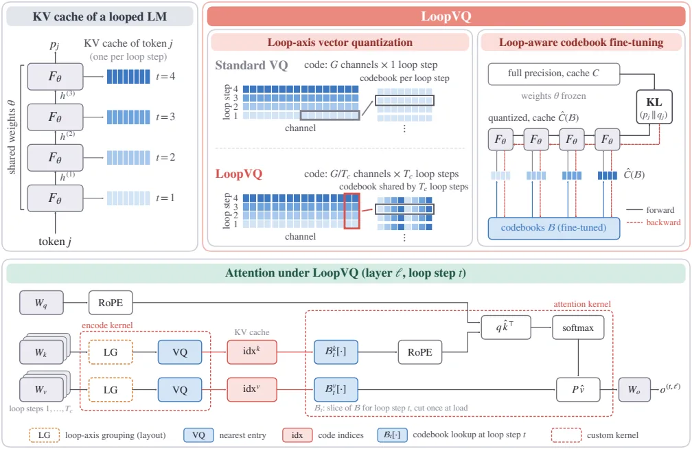
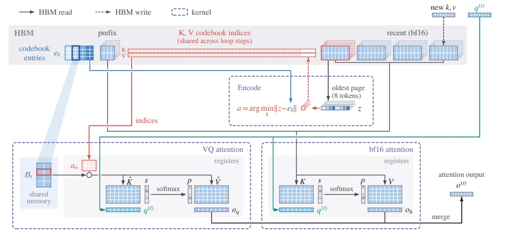
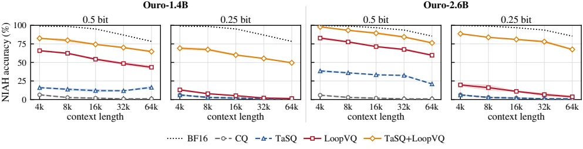
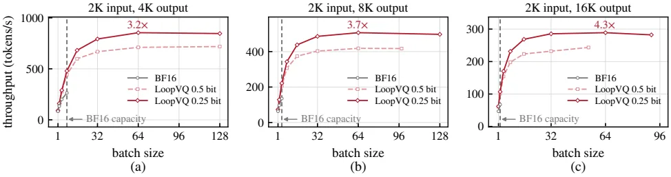

[Paper](https://arxiv.org/abs/2611.05304v1)
## Introduction

A looped transformer is a model that reuses the same group of layers several times. It saves parameters, but each iteration step has to keep its own key/value cache, so the serving bottleneck shifts from the weights to the cache. This post summarizes the observations, design, and measured results of LoopVQ, a method that compresses that cache to under 1 bit per element.

## Terms to know first

**Looped transformer.** An architecture that reuses the same $L_b$ decoder layers $T$ times. The $t$-th loop step takes the previous step's output $h^{(t-1)}_{1:N}$ as input and computes $h^{(t)}_{1:N} = F_\theta(h^{(t-1)}_{1:N})$, and the final output distribution $p_j$ is read from the hidden state $h^{(T)}_j$ of the last step. Only one thing matters here. **Each loop step leaves its own keys and values in the cache, so the cache is $T$ times larger than in a non-looped model that uses the same weights.** The evaluated models Ouro-1.4B and 2.6B use $T=4$, and Huginn-3.5B runs 32 iterations.

**KV cache.** Memory that stores the keys and values of past tokens during autoregressive generation and uses them to compute attention for the next token. The paper defines that token $j$ produces a key $k^{(t,\ell)}_{j,h}\in\mathbb{R}^D$ and a value $v^{(t,\ell)}_{j,h}\in\mathbb{R}^D$ for each loop step $t$, layer $\ell$, and KV head $h$. The longer the context, the more heads and layers, and, as noted above, the more loop steps, the larger this memory grows.

**Quantization.** Compression that stores values at lower precision to reduce memory. The paper emphasizes that quantization does not discard tokens; it only shrinks the cache.

**Vector quantization.** A method that splits a $D$-channel vector into $D/G$ chunks of $G$ consecutive channels and stores each chunk as the index of the nearest entry in a codebook $\mathcal{B}=\{e_1,\dots,e_K\}\subset\mathbb{R}^G$. Following equation (2) of the paper exactly, the index is chosen by $a(z)=\arg\min_{r\le K}\|z-e_r\|_2^2$ and reconstruction is $\hat z = e_{a(z)}$. If the codebook size is $K=2^b$, each chunk costs $b$ bits, that is, **$b/G$ bits per element**. In the sub-1-bit regime this post targets, existing vector quantization loses a great deal of accuracy.

**Bits per element.** The number of bits used to store one channel in the cache. At 0.5 bits, that is 0.5 bits per element, a 32x compression relative to 16 bits (bf16).

**Codebook and calibration.** The codebook is initially built from offline calibration data. The paper summarizes that prior work uses $k$-means weighted by each chunk's importance $\omega_n=\|\partial L/\partial z_n\|_2^2$ (equation 3). $\omega_n$ is the squared gradient norm with respect to the next-token loss $L$ and equals the diagonal trace of the empirical Fisher information. What matters here is that this weight alone cannot capture the problems that arise in a looped architecture.

**RoPE (rotary position embedding).** A technique that applies a position-dependent rotation to key vectors to represent relative positions. The paper quantizes keys **before** applying RoPE, reconstructs them in attention, and then applies RoPE. The reason is in Appendix C. RoPE rotates keys in the same channel group differently at each position, so a single code group tied together before rotation scatters across many entries in the codebook.

**SGLang.** A serving framework that executes structured LLM programs efficiently. This paper attaches a LoopVQ-specific attention kernel to it and measures efficiency.

## 1. Problem: the cache is the bottleneck, and redundancy remains along the loop axis

### 1.1 Saving parameters makes the cache larger

Figure 1a of the paper plots each model as a point. The horizontal axis is KV cache size per token (8KB–2MB), and the vertical axis is bf16 weight memory (2GB–32GB). Ouro-1.4B has **6x the KV cache per token** of the non-looped Llama-3.1-8B, and at moderate context lengths its cache memory already exceeds its weights. In other words, when serving a looped model, the real bottleneck is the cache, not the weights.

Figure 1b of the paper plots GSM8K accuracy against bits per element (0.25–4), showing that existing vector quantization (CQ, TaSQ) collapses sharply once it goes below 1 bit (bf16 baseline 86.1, Ouro-2.6B).

### 1.2 The iteration axis still holds untapped redundancy

The $T$ caches of one layer are computed by applying the same projection weights to the hidden states of the same token. So the keys and values across steps resemble each other.

- **Fig. 2a**: Pre-RoPE keys of one attention head in Ouro-1.4B are plotted across four steps, and the four steps show nearly identical channel patterns. Across all of Ouro-1.4B, the correlation between adjacent steps rises from 0.69 between the first two steps to 0.94 between the last two.
- **Fig. 2b**: Color shows the mean $|r|$ over all (loop step, channel) coordinate pairs within a 16-channel group. The parts connecting the same channel across adjacent steps form bright lines, while different channels in the same group are dark. Numerically, **the mean $|r|$ between adjacent steps of the same channel is 0.85, while between different channels in the same 16-channel group it is 0.16**, and the gap is even wider for values.
- **Fig. 2c**: With bit width and codebook size fixed, it compares the reconstruction error (NMSE) of $k$-means under two grouping schemes: "$G$ channels of one step" and "$G/4$ channels across four steps." Grouping along the loop axis reduces the error to **roughly half** at 0.5 bits on Ouro-1.4B, and reduces it substantially at every bit width on both Ouro and Huginn (§3, Fig. 2 of the paper).

The axis existing vector quantization uses is the "channel axis." A looped model's cache has one more redundancy axis next to it: the "iteration axis."

### 1.3 But the perceived quantization error differs by step

When one grouped vector represents several steps together, it matters which step inside it incurred the error. An error introduced early propagates through all later steps, while an error in the last step stays confined to that step.

Table 1 of the paper quantizes only one step while keeping the others at full precision, then measures the KL divergence between the full-precision output and the quantized output (loop-axis grouping + Fisher-weighted $k$-means codebook, measured on sequences not used for calibration).

| Quantized step | 0.5-bit KL | 0.25-bit KL |
|---|---|---|
| 1 | 0.069 | 0.123 |
| 2 | 0.018 | 0.029 |
| 3 | 0.013 | 0.026 |
| 4 | 0.030 | 0.065 |

Quantizing the first step is the most harmful, and the third step the least. The gap between the two steps is about 5x.

## 2. A small example: one index stands in for four steps

Below is an illustrative example built from Ouro-1.4B's actual settings ($D=128$ channels, $T=4$ steps, 8-bit code $K=256$, $G=16$ at 0.5 bits). It is a construction for explaining the mechanism, not measured values from the paper.

| Stage | Existing vector quantization (CQ) | LoopVQ |
|---|---|---|
| Input | The key of one token, one layer, one head. A 128-channel key is computed separately across four loop steps, leaving four copies in the cache | Same |
| Retained state | Each step's 128 channels are split into eight 16-channel chunks, and an 8-bit index is stored per chunk. Eight per step, 32 indices total. The codebook is built separately per step, so there are four copies | The same 128 channels are split into 32 chunks of 4 channels, but one chunk ties together 4 channels from each of steps 1–4 (16 channels total). The index count is the same at 32, and the codebook is a single copy shared by the four steps |
| Change / omission / rejection | Ignores inter-step correlation (adjacent-step $|r|=0.85$ for the same channel) and picks the nearest entry per step | Because the same channel in adjacent steps resembles itself, it groups them and picks once. No tokens are discarded; the number of steps, bit count, and storage stay the same, and only the reconstruction error shrinks |
| Output | Reconstructs four copies of keys for the four steps. Reconstruction error is large | Reconstructs the same four copies of keys. Grouping along the loop axis reduces the 0.5-bit reconstruction error to roughly half (Fig. 2c of the paper, general $k$-means) |

In other words, LoopVQ does not use more memory. It keeps the same number of storage slots and **puts similar values together** in those slots to reduce reconstruction error.

## 3. Method

### 3.1 Loop-axis vector quantization

The authors split the $T$ steps into consecutive blocks of $T_c$ steps (Ouro has $T=T_c=4$, so one block; Huginn has 32 steps in 8 blocks). One code covers **$c=G/T_c$ channels in each of the $T_c$ steps** within the block. Equation (4) of the paper defines this combined vector, and equation (5) is the rule by which each step slices out its own share (coordinate $iT_c+m$ of the combined vector) from that index for reconstruction.

- Because one code represents $T_c$ steps at once, **bits per element stay at $b/G$**. Memory does not grow.
- Keys are quantized before RoPE, reconstructed in attention, and then RoPE is applied (§2, Appendix C).
- The codebook is initialized with Fisher-weighted $k$-means. Here $\omega_n$ **sums the squared gradients over all $T_c$ steps** covered by the combined vector (§4.1).

### 3.2 Loop-aware codebook fine-tuning

Fisher-weighted $k$-means misses something. Because this objective penalizes each code vector's error independently, it cannot express the cross terms that arise when an earlier step's error propagates to later steps. Appendix A.1 shows that for small errors the objective can be approximated as $J(B)\approx\frac{1}{2}\mathbb{E}_s[\delta^\top F\delta]$, and that weighted $k$-means only matches the diagonal blocks $F_{nn}$ and always discards cross terms of the form $F_{nn'}$. No reweighting removes this limitation. Moreover, it allocates precision equally to every step inside the combined vector.

So the authors fix the model weights and fit the output directly. For a calibration sequence $s$, they take the full-precision cache $C$ and its output distribution $p_j$, compute the output $q_j(\mathcal{B})$ when **all $T_c$ steps attend to $\hat C(\mathcal{B})$**, the cache reconstructed from the codebook $\mathcal{B}$, and minimize $J(\mathcal{B})=\mathbb{E}_s[\frac{1}{N}\sum_j \mathrm{KL}(p_j\|q_j(\mathcal{B}))]$ from equation (6). The sum runs over the $N$ positions after the bf16 sink tokens. This objective captures both error propagation across steps and per-step sensitivity differences.

- Codebook entries are updated directly by backprop through this objective. The arg min selection does not need to be differentiated, so codebook entries receive exact gradients and no straight-through estimator is needed (Appendix A.2).
- Assignments are recomputed with the current codebook at every iteration, so the encoder at training time and the encoder at inference time do not diverge.
- As a result, KL divergence relative to the full-precision output drops to **roughly half** on Ouro-1.4B (Fig. 4 of the paper: starting from a $k$-means codebook and repeating fine-tuning).
- Training setup: fine-tune on 12 of the 16 calibration sequences (Adam, learning rate $10^{-3}$, one sequence per iteration, 4 epochs), then pick the epoch with the lowest KL on the remaining 4 (§5.1).

### 3.3 Combining with TaSQ

TaSQ handles the **channel axis**. Equation (10) in Appendix B is a transform that multiplies the key's channels by weights $w$, divides by a per-token scale $\sigma$, and rearranges them with a permutation $P$. The goal is to make channels that share a code more correlated. LoopVQ handles the **loop axis**, so the two are orthogonal. TaSQ+LoopVQ applies the TaSQ transform first and then groups along the loop axis, so one code covers (the $c$ channels chosen on the channel axis) × (the $T_c$ steps on the loop axis).

The permutation $P$ is obtained from the $T_cD\times T_cD$ covariance matrix formed by stacking the $T_c$ step keys of a block, tying each step's RoPE pair $\{i,i+D/2\}$ together so that a group has $G=cT_c$ coordinates. The only cost is storing the per-token key scale $\sigma$ in fp16, which is 16/(HD) bits per key element, about 0.008 bits for Ouro and 0.003 bits for Huginn. That is why Table 2 shows key bit widths of 0.508/0.5 (Ouro) and 0.503/0.5 (Huginn).

Huginn has segments without a loop axis. The two-layer prelude and coda are encoded separately per layer, like CQ. For reference, Huginn-3.5B runs 32 iterations of a four-layer core block and adds the prelude and coda, producing 132 KV caches per token.

### 3.4 SGLang implementation: when indices are created and how they are read

The flow in Fig. 3 of the paper is as follows. Each loop step writes its own cache, but in the encoding stage $c=G/T_c$ channels are grouped across $T_c$ steps to produce one index. That index is shared by the $T_c$ steps, and at inference each step $t$ reads the same index as its own key and value through its own codebook slice $\mathcal{B}_t$.

The storage and lookup structure in Fig. 5 of the paper reads in three stages.

1. **Storage layout.** The first $n_s$ tokens (sink) and the most recent $n_r$ tokens stay in bf16 across all steps, and only the tokens in between are stored as codebook indices. The cache is paged in units of 8 tokens, and $n_s$ and $n_r$ are multiples of 8, so a page is entirely bf16 or entirely quantized. Because one index is shared by $T_c$ steps, a quantized page has only one index row per step block, giving **the same memory per token** as encoding separately per step at the same $G$. The experiments use 8/64 for general benchmarks and 64/256 for reasoning and long-context benchmarks.
2. **When indices are created.** A combined vector can be encoded only after all $T_c$ steps of the block have been computed. So in prefill, each step's keys and values are held until the last step of that block, then distances to all codebook entries are computed with tensor-core matrix multiplication and encoded in one go. In decode, the new token's keys and values are written to the bf16 recent region (once the forward pass finishes, all steps for that token are present), and every 8 generated tokens the oldest page is converted to indices across all layers and steps, keeping the recent region at $n_r$–$n_r$+7 tokens.
3. **How attention reads.** At loop step $t$, the dedicated kernel loads the codebook slice $\mathcal{B}_t$ into shared memory once and looks up keys and values from registers using each token's index. bf16 pages are read by SGLang's Triton decoding kernel, and the two results are merged in Flash-Decoding style by combining the logsumexp of the splits. Quantized keys are reconstructed, after which the kernel applies RoPE using precomputed per-position sine and cosine tables. The number of indices read per head per token is $D/c$.

The implementation is available at https://github.com/mscheong01/LoopVQ.

## 4. Results

### 4.1 General benchmarks

The evaluated models are Ouro-1.4B, Ouro-2.6B, and Huginn-3.5B, and the metric is average accuracy (%) on GSM8K, MATH500, HumanEval, and MBPP. All use greedy decoding (Table 2 of the paper). CQ is the baseline vector quantization that uses a separate codebook per loop step and layer.

**0.5 bits**

| Model | BF16 | CQ | TaSQ | LoopVQ | TaSQ+LoopVQ |
|---|---|---|---|---|---|
| Ouro-1.4B | 75.7 | 32.3 | 43.6 | 68.3 | 73.6 |
| Ouro-2.6B | 81.5 | 37.7 | 52.7 | 77.7 | 80.3 |
| Huginn-3.5B | 25.0 | 13.7 | 14.8 | 22.4 | 23.5 |

**0.25 bits**

| Model | BF16 | CQ | TaSQ | LoopVQ | TaSQ+LoopVQ |
|---|---|---|---|---|---|
| Ouro-1.4B | 75.7 | 28.2 | 29.6 | 45.1 | 62.3 |
| Ouro-2.6B | 81.5 | 32.1 | 35.2 | 52.7 | 70.7 |
| Huginn-3.5B | 25.0 | 12.9 | 13.0 | 18.6 | 21.0 |

CQ and TaSQ already show a large gap from BF16 at 0.5 bits, and the gap is wider on math and code tasks. For Ouro-1.4B, MATH500 is 17.8 for CQ, 38.8 for TaSQ, and 69.4 for LoopVQ, and HumanEval is 14.6 for CQ, 24.4 for TaSQ, and 63.4 for LoopVQ. LoopVQ's large lead over both baselines holds at 0.25 bits as well as 0.5 bits, TaSQ+LoopVQ approaches BF16 at 0.5 bits, and the additional gain grows at 0.25 bits. On Huginn-3.5B as well, LoopVQ and TaSQ+LoopVQ are higher than both baselines according to Table 2.

### 4.2 Long chain-of-thought (CoT) reasoning

Averages of the Thinking variants evaluated on AIME'24, AIME'25, GPQA-Diamond, HumanEval+, and MBPP+ (temperature 1.0, top-p 0.7, max 32,768 generated tokens per model card settings, averaged over 3 seeds, Table 3 of the paper).

**0.5 bits**

| Model | BF16 | CQ | TaSQ | LoopVQ | TaSQ+LoopVQ |
|---|---|---|---|---|---|
| Ouro-1.4B-Thinking | 56.4 | 15.7 | 19.5 | 50.8 | 54.9 |
| Ouro-2.6B-Thinking | 64.9 | 16.6 | 28.3 | 58.1 | 63.8 |

**0.25 bits**

| Model | BF16 | CQ | TaSQ | LoopVQ | TaSQ+LoopVQ |
|---|---|---|---|---|---|
| Ouro-1.4B-Thinking | 56.4 | 14.4 | 14.8 | 20.0 | 48.1 |
| Ouro-2.6B-Thinking | 64.9 | 16.7 | 18.1 | 24.1 | 56.0 |

The gaps are larger than on general benchmarks. At 0.5 bits, CQ drops to about a quarter of BF16 and TaSQ to a third to a half, but LoopVQ preserves most of the accuracy, and combined with TaSQ it narrows the gap to 1.1–1.6 points from BF16. At 0.25 bits, TaSQ+LoopVQ substantially outperforms LoopVQ alone and is the best quantization method on every task for both models.

### 4.3 Long-context retrieval

Fig. 6 of the paper is split into four panels (Ouro-1.4B and Ouro-2.6B × 0.5 bits and 0.25 bits). The horizontal axis is context length (4K–64K), the vertical axis is accuracy (%) averaged over RULER's 8 NIAH tasks with 3 seeds, and the curves are BF16, CQ, TaSQ, LoopVQ, and TaSQ+LoopVQ. CQ and TaSQ stay well below BF16 at all lengths, while LoopVQ finds a considerable number of needles at 0.5 bits, and TaSQ+LoopVQ is highest at every length and bit width.

LongBench (16 English tasks) in Appendix D.5 follows the same order. In average accuracy, CQ and TaSQ are 7–13 points below BF16, LoopVQ is higher than both baselines in every setting, and TaSQ+LoopVQ comes within 1.5 points of BF16 at 0.5 bits.

### 4.4 When quantization lengthens reasoning, the per-token latency gain also fades

Fig. 10 of the paper shows the distribution of tokens generated by Ouro-1.4B-Thinking at 0.5 bits on GPQA-Diamond. The horizontal axis is the number of generated tokens (0–32K), the vertical axis is the fraction of problems (%), and the bars show the shares of 32K cap hits, early failures, and non-terminations. CQ and TaSQ exhaust the 32K budget on most problems, generating about 2x as many tokens as BF16. LoopVQ and TaSQ+LoopVQ, by contrast, follow BF16's length distribution at 0.5 bits, and at 0.25 bits only TaSQ+LoopVQ still does (Appendix D.4).

Appendix D.4 measures the opposite direction as well: early termination. On BF16, the fraction of generations finishing within 2K tokens is 16% and 22% for Ouro-1.4B-Thinking and Ouro-2.6B-Thinking, while at 0.25 bits it rises to 33% and 59% for CQ and 30% and 47% for TaSQ. LoopVQ and TaSQ+LoopVQ stay at or below 30% in every setting. In other words, the per-token throughput gain carries through to actual time to complete an answer.

### 4.5 System efficiency

The measurement environment is a single RTX 6000 Ada 48GB, the target is Ouro-1.4B-Thinking, and sink and recent were kept in bf16 at 8 and 64 tokens (§5.3).

**Kernel and latency.** The decode kernel reads only $D/c$ indices per head per token, so it reads **8x (0.5 bits) to 16x (0.25 bits) fewer bytes** than bf16 keys and values. Long-context decode is bound by cache reads, so this saving grows with context length (Fig. 8b of the paper, batch 1).

| Context length | 1K | 8K | 32K |
|---|---|---|---|
| 0.5-bit decode latency | +3% | −17% | −47% |
| 0.25-bit decode latency | +3% | −18% | −49% |

Prefill, by contrast, **gets slightly slower** because block-wise encoding cost is added. On Ouro-1.4B at context lengths 4K, 16K, and 32K, it is +9%, +7%, and +5% at 0.5 bits and +8%, +6%, and +4% at 0.25 bits, with the overhead shrinking as context grows (Fig. 8a). On Ouro-2.6B it is 5–9% slower. The time breakdown in Appendix D.3 reports that with batch 16 and 2K input prompts, attention time per generated token falls from 1.87ms for bf16 to 0.63ms (0.5 bits) and 0.54ms (0.25 bits) for LoopVQ, and that encoding accounts for under 1% of decode time and 5–7% of prefill time. At batch 1, attention dominates decode time at 32K for bf16, but for LoopVQ attention stays smaller than the linear layers.

**Throughput.** For long generations, the KV cache limits batch size.

In Fig. 7 of the paper, the horizontal axis is batch size (up to 128), the vertical axis is throughput (tok/s), and the three panels are for output lengths 4K, 8K, and 16K (all with 2K inputs). The gaps between the vertical line at bf16's maximum batch and the LoopVQ curve are shown as 3.2x, 3.7x, and 4.3x. On Ouro-2.6B-Thinking, whose cache is heavier, they are 5.0x, 5.2x, and 6.1x, and on an A100 (40GB) they are 2.8x–3.7x (Appendix D.1, D.2). On the A100, 32K decode latency drops to −51% at 0.5 bits and −56% at 0.25 bits relative to bf16.

### 4.6 Effect of each design element and calibration data

Looking at the two elements separately (Table 4 of the paper, Ouro-1.4B), **loop-axis grouping produces most of the gain.** Adding fine-tuning (FT) on top has little effect on GSM8K, raises accuracy on HumanEval, and is most pronounced when added to TaSQ. Using both together gives the best or tied-best result in every setting. At 0.25 bits, grouping gives a larger gain over CQ when applied to TaSQ.

Calibration data also influences the results. Fig. 9 of the paper recalibrates while swapping the calibration corpus among WikiText-2, C4, and SlimPajama. CQ varies by up to 11 points on GSM8K, whereas TaSQ+LoopVQ varies by up to 4 points (GSM8K) and 1 point (HumanEval) and stays best on every corpus. Increasing the number of calibration sequences consistently raises accuracy (Table 5 of the paper, at 0.25 bits LoopVQ GSM8K 57.5→60.8, HumanEval 22.6→28.0, from 8 to 32 sequences).

Calibration cost is modest. On a single RTX 6000 Ada, Ouro-1.4B takes 6.1 min for $k$-means plus 2.3 min for fine-tuning, and Ouro-2.6B takes 14.3 min plus 5.9 min (on an A100, 5.5+2.0 min and 11.2+4.6 min), and even with more sequences the cost stays in the minutes range.

## 5. Limitations and when to apply it

**Limitations stated by the authors.** First, the efficiency comparison is only against BF16 serving. The serving efficiency of each method depends on kernels optimized for its own cache format, and since it is hard to match all methods to an equal level of optimization, they state that they avoided a comparison that would favor the most heavily optimized method. Second, they did not compare accuracy against FlashLoop and ResidualQuant, KV cache quantization methods designed for looped transformers. Both use scalar quantization at a minimum of 1 bit per element and target 2–4 bits, and they do not present settings below that, so they cannot be matched at the same bit width in the sub-1-bit regime LoopVQ targets.

**Conditions for application.** This technique assumes a loop axis, so it cannot be used as-is on ordinary LLMs without an iterative structure. Even with an iterative structure like Huginn, segments that are not looped, such as the prelude and coda, must be encoded separately in the existing way. The gain is pronounced for long contexts and long generations, and for short contexts or prefill-heavy workloads it can actually be slower because of encoding cost. The codebook must be calibrated per model and separately for the Thinking variants (depending on the calibration corpus, CQ varies by up to 11 points on GSM8K), and although calibration cost is in minutes, it must be redone each time.

**Assessment.** For serving looped models that have few parameters but are cache-bound, over long contexts and long generations, LoopVQ is a better option than existing vector quantization in the sub-1-bit regime. However, the efficiency comparison was against BF16 serving, and comparisons under kernel optimization equal to other quantization methods, as well as accuracy comparisons with FlashLoop and ResidualQuant, remain open.

<!-- verbatim-tables -->

Tables from the paper

> Tables converted mechanically from the arXiv e-print LaTeX source. The numbers are the paper's own and did not pass through a model.

**Table 1. KL divergence from the full-precision output of Ouro-1.4B when only one loop step is quantized (loop-axis grouping, Fisher-weighted $k$-means codebooks, sequences not used for calibration).**

| Bitwidth | Quantized loop step 1 | Quantized loop step 2 | Quantized loop step 3 | Quantized loop step 4 |
|---|---|---|---|---|
| 0.5 bit | 0.069 | 0.018 | 0.013 | 0.030 |
| 0.25 bit | 0.123 | 0.029 | 0.026 | 0.065 |

**Table 2. General performance under low-bit KV cache quantization. All results use greedy decoding. Bold denotes the best quantized result; higher is better.**

| Model | Bitwidth | Method | Bits (K/V) | GSM8K | MATH500 | HumanEval | MBPP | Avg. |
|---|---|---|---|---|---|---|---|---|
| Ouro-1.4B |  | BF16 | 16/16 | 78.77 | 77.20 | 73.17 | 73.54 | 75.67 |
|  | 0.5 bit | CQ | 0.5/0.5 | 46.78 | 17.80 | 14.63 | 50.00 | 32.30 |
|  |  | TaSQ | 0.508/0.5 | 57.32 | 38.80 | 24.39 | 53.97 | 43.62 |
|  |  | **LoopVQ** | 0.5/0.5 | 75.82 | 69.40 | 63.41 | 64.55 | 68.29 |
|  |  | TaSQ+**LoopVQ** | 0.508/0.5 | **77.56** | **75.20** | **70.12** | **71.43** | **73.58** |
|  | 0.25 bit | CQ | 0.25/0.25 | 42.99 | 12.20 | 10.98 | 46.56 | 28.18 |
|  |  | TaSQ | 0.258/0.25 | 44.88 | 12.80 | 12.20 | 48.41 | 29.57 |
|  |  | **LoopVQ** | 0.25/0.25 | 58.91 | 41.20 | 25.61 | 54.50 | 45.05 |
|  |  | TaSQ+**LoopVQ** | 0.258/0.25 | **70.96** | **63.40** | **55.49** | **59.26** | **62.28** |
| Ouro-2.6B |  | BF16 | 16/16 | 86.13 | 77.40 | 81.10 | 81.22 | 81.46 |
|  | 0.5 bit | CQ | 0.5/0.5 | 54.06 | 24.60 | 14.63 | 57.41 | 37.67 |
|  |  | TaSQ | 0.508/0.5 | 69.07 | 49.20 | 31.10 | 61.38 | 52.69 |
|  |  | **LoopVQ** | 0.5/0.5 | 85.22 | 74.60 | 75.00 | 75.93 | 77.69 |
|  |  | TaSQ+**LoopVQ** | 0.508/0.5 | **85.37** | **78.60** | **78.66** | **78.57** | **80.30** |
|  | 0.25 bit | CQ | 0.25/0.25 | 47.46 | 14.60 | 12.80 | 53.70 | 32.14 |
|  |  | TaSQ | 0.258/0.25 | 52.99 | 17.60 | 14.02 | 56.08 | 35.18 |
|  |  | **LoopVQ** | 0.25/0.25 | 70.20 | 52.00 | 28.66 | 60.05 | 52.73 |
|  |  | TaSQ+**LoopVQ** | 0.258/0.25 | **81.80** | **68.60** | **62.80** | **69.58** | **70.70** |
| Huginn-3.5B |  | BF16 | 16/16 | 34.04 | 12.80 | 17.07 | 35.98 | 24.97 |
|  | 0.5 bit | CQ | 0.5/0.5 | 19.03 | 5.40 | 6.71 | 23.54 | 13.67 |
|  |  | TaSQ | 0.503/0.5 | 19.11 | 5.80 | 10.37 | 23.81 | 14.77 |
|  |  | **LoopVQ** | 0.5/0.5 | 32.37 | 9.40 | **12.80** | 34.92 | 22.37 |
|  |  | TaSQ+**LoopVQ** | 0.503/0.5 | **33.13** | **12.20** | 12.20 | **36.51** | **23.51** |
|  | 0.25 bit | CQ | 0.25/0.25 | 19.11 | 7.20 | 4.27 | 21.16 | 12.93 |
|  |  | TaSQ | 0.253/0.25 | 19.18 | 6.60 | 4.88 | 21.16 | 12.96 |
|  |  | **LoopVQ** | 0.25/0.25 | 25.02 | 8.20 | **13.41** | 27.78 | 18.60 |
|  |  | TaSQ+**LoopVQ** | 0.253/0.25 | **28.13** | **9.80** | **13.41** | **32.54** | **20.97** |

**Table 3. Long CoT reasoning performance under low-bit KV cache quantization. All results are averaged over three sampling seeds (mean $\pm$ std). Bold denotes the best quantized result; higher is better.**

| Model | Bitwidth | Method | Bits (K/V) | AIME'24 | AIME'25 | GPQA-D | HumanEval+ | MBPP+ | Avg. |
|---|---|---|---|---|---|---|---|---|---|
| Ouro-1.4B-Thinking |  | BF16 | 16/16 | 47.78$\pm$5.09 | 32.22$\pm$5.09 | 45.12$\pm$2.28 | 84.55$\pm$0.70 | 72.49$\pm$1.32 | 56.43$\pm$1.54 |
|  | 0.5 bit | CQ | 0.5/0.5 | 1.11$\pm$1.92 | 2.22$\pm$1.92 | 11.78$\pm$1.05 | 27.85$\pm$0.70 | 35.27$\pm$2.31 | 15.65$\pm$0.76 |
|  |  | TaSQ | 0.508/0.5 | 4.44$\pm$1.92 | 5.56$\pm$1.92 | 12.12$\pm$2.31 | 35.16$\pm$2.14 | 40.12$\pm$2.72 | 19.48$\pm$0.99 |
|  |  | **LoopVQ** | 0.5/0.5 | 38.89$\pm$5.09 | 31.11$\pm$3.85 | 40.57$\pm$1.27 | 75.81$\pm$1.27 | 67.64$\pm$1.19 | 50.80$\pm$1.35 |
|  |  | TaSQ+**LoopVQ** | 0.508/0.5 | **45.56$\pm$8.39** | **34.44$\pm$5.09** | **42.76$\pm$3.04** | **81.50$\pm$1.53** | **70.11$\pm$0.70** | **54.87$\pm$2.08** |
|  | 0.25 bit | CQ | 0.25/0.25 | 0.00$\pm$0.00 | 1.11$\pm$1.92 | 11.62$\pm$3.07 | 25.61$\pm$2.79 | 33.86$\pm$0.00 | 14.44$\pm$0.92 |
|  |  | TaSQ | 0.258/0.25 | 2.22$\pm$1.92 | 1.11$\pm$1.92 | 11.45$\pm$3.79 | 27.03$\pm$2.82 | 32.01$\pm$0.26 | 14.76$\pm$1.09 |
|  |  | **LoopVQ** | 0.25/0.25 | 7.78$\pm$3.85 | 8.89$\pm$3.85 | 14.48$\pm$4.08 | 31.50$\pm$1.27 | 37.13$\pm$1.46 | 19.95$\pm$1.41 |
|  |  | TaSQ+**LoopVQ** | 0.258/0.25 | **36.67$\pm$3.33** | **26.67$\pm$5.77** | **36.53$\pm$4.58** | **76.63$\pm$2.31** | **63.84$\pm$0.85** | **48.07$\pm$1.69** |
| Ouro-2.6B-Thinking |  | BF16 | 16/16 | 57.78$\pm$11.71 | 51.11$\pm$5.09 | 54.04$\pm$3.31 | 86.18$\pm$0.93 | 75.49$\pm$0.81 | 64.92$\pm$2.65 |
|  | 0.5 bit | CQ | 0.5/0.5 | 3.33$\pm$0.00 | 5.56$\pm$1.92 | 7.24$\pm$3.04 | 30.08$\pm$2.75 | 36.68$\pm$1.10 | 16.58$\pm$0.93 |
|  |  | TaSQ | 0.508/0.5 | 10.00$\pm$3.33 | 12.22$\pm$1.92 | 22.73$\pm$3.31 | 43.90$\pm$2.79 | 52.73$\pm$1.99 | 28.32$\pm$1.23 |
|  |  | **LoopVQ** | 0.5/0.5 | 47.78$\pm$5.09 | 35.56$\pm$1.92 | 47.81$\pm$2.04 | 84.76$\pm$1.61 | 74.34$\pm$1.32 | 58.05$\pm$1.24 |
|  |  | TaSQ+**LoopVQ** | 0.508/0.5 | **61.11$\pm$3.85** | **43.33$\pm$5.77** | **51.01$\pm$4.63** | **88.21$\pm$0.93** | **75.49$\pm$1.50** | **63.83$\pm$1.71** |
|  | 0.25 bit | CQ | 0.25/0.25 | 2.22$\pm$1.92 | 3.33$\pm$3.33 | 8.25$\pm$1.54 | 30.89$\pm$1.96 | 38.80$\pm$2.90 | 16.70$\pm$1.09 |
|  |  | TaSQ | 0.258/0.25 | 1.11$\pm$1.92 | 5.56$\pm$1.92 | 10.94$\pm$0.77 | 33.33$\pm$0.93 | 39.42$\pm$0.26 | 18.07$\pm$0.60 |
|  |  | **LoopVQ** | 0.25/0.25 | 10.00$\pm$3.33 | 5.56$\pm$1.92 | 13.13$\pm$3.31 | 43.50$\pm$2.14 | 48.50$\pm$1.25 | 24.14$\pm$1.13 |
|  |  | TaSQ+**LoopVQ** | 0.258/0.25 | **43.33$\pm$3.33** | **34.44$\pm$5.09** | **48.15$\pm$1.27** | **82.72$\pm$0.35** | **71.43$\pm$1.15** | **56.02$\pm$1.27** |

**Table 4. Loop-axis coupling and loop-aware fine-tuning (FT) applied to CQ and TaSQ on Ouro-1.4B at 0.5 and 0.25 bits per element. With both, CQ and TaSQ become LoopVQ and TaSQ+LoopVQ. BF16: 78.8 (GSM8K) and 73.2 (HumanEval).**

| Base | + Coupling | + FT | GSM8K 0.5 | GSM8K 0.25 | HumanEval 0.5 | HumanEval 0.25 |
|---|---|---|---|---|---|---|
| CQ |  |  | 46.8 | 43.0 | 14.6 | 11.0 |
|  | ✓ |  | 75.4 | 57.5 | 61.6 | 23.8 |
|  |  | ✓ | 48.7 | 42.5 | 14.6 | 11.0 |
|  | ✓ | ✓ | **75.8** | **58.9** | **63.4** | **25.6** |
| TaSQ |  |  | 57.3 | 44.9 | 24.4 | 12.2 |
|  | ✓ |  | 77.5 | 68.7 | **70.1** | 50.6 |
|  |  | ✓ | 59.7 | 47.1 | 31.7 | 14.0 |
|  | ✓ | ✓ | **77.6** | **71.0** | **70.1** | **55.5** |

**Table 5. Accuracy of Ouro-1.4B at 0.25 bit versus the number of 2,048-token GPQA calibration sequences (16 in the main experiments).**

| Sequences | GSM8K 8 | GSM8K 16 | GSM8K 32 | HumanEval 8 | HumanEval 16 | HumanEval 32 |
|---|---|---|---|---|---|---|
| LoopVQ | 57.5 | 58.9 | 60.8 | 22.6 | 25.6 | 28.0 |
| TaSQ+LoopVQ | 69.3 | 71.0 | 71.9 | 49.4 | 55.5 | 59.8 |

**Table 6. LongBench performance of Ouro-1.4B and Ouro-2.6B under low-bit KV cache quantization on the 16 English tasks, with the official metric of each task. All results use greedy decoding. Bold denotes the best quantized result; higher is better.**

| Model | Bitwidth | Method | Single-doc QA 60NrtvQA | Single-doc QA 60Qasper | Single-doc QA 60MF-en | Multi-doc QA 60HotpotQA | Multi-doc QA 602WikiMQA | Multi-doc QA 60Musique | Summarization 60GovReport | Summarization 60QMSum | Summarization 60MultiNews | Few-shot 60TREC | Few-shot 60TriviaQA | Few-shot 60SAMSum | Synthetic 60PCount | Synthetic 60PRe | Code 60Lcc | Code 60RB-P | Avg. |
|---|---|---|---|---|---|---|---|---|---|---|---|---|---|---|---|---|---|---|---|
| Ouro-1.4B |  | BF16 | 7.81 | 23.56 | 34.75 | 33.17 | 19.75 | 13.15 | 26.94 | 20.52 | 23.08 | 64.50 | 88.57 | 36.18 | 1.50 | 32.50 | 19.99 | 28.72 | 29.67 |
|  | 0.5 bit | CQ | 4.93 | 10.38 | 22.10 | 20.18 | 16.35 | 8.08 | 16.88 | 17.44 | 15.72 | 44.00 | 79.12 | 33.07 | 1.50 | 4.50 | 19.68 | 27.95 | 21.37 |
|  |  | TaSQ | 7.02 | 13.39 | 25.05 | 24.90 | 17.46 | 9.22 | 18.38 | 17.88 | 16.58 | 47.00 | 81.79 | 34.07 | 1.00 | 4.50 | 21.85 | 27.87 | 23.00 |
|  |  | **LoopVQ** | 7.31 | 19.29 | 30.71 | 32.63 | **19.23** | **12.82** | 23.73 | 18.94 | 21.06 | 58.50 | 87.80 | 35.61 | **2.00** | 16.00 | 22.09 | 29.60 | 27.33 |
|  |  | TaSQ+**LoopVQ** | **8.11** | **22.84** | **33.34** | **34.56** | 18.89 | 12.60 | **26.07** | **19.68** | **22.15** | **64.00** | **89.03** | **36.09** | 1.50 | **23.00** | **22.16** | **30.55** | **29.04** |
|  | 0.25 bit | CQ | 4.29 | 9.22 | 21.13 | 20.51 | 16.83 | 7.17 | 15.79 | 17.11 | 14.96 | 44.50 | 78.44 | 33.01 | 1.00 | 4.50 | 20.55 | 28.45 | 21.09 |
|  |  | TaSQ | 5.69 | 10.46 | 21.65 | 20.73 | 16.56 | 6.76 | 16.50 | 17.22 | 15.69 | 45.00 | 79.20 | 31.98 | 1.00 | 4.50 | 20.54 | 27.69 | 21.32 |
|  |  | **LoopVQ** | 5.81 | 13.18 | 22.98 | 24.18 | 17.05 | 9.30 | 19.16 | 17.79 | 17.00 | 45.00 | 82.50 | 34.21 | **1.50** | 4.50 | 21.69 | 28.97 | 22.80 |
|  |  | TaSQ+**LoopVQ** | **6.40** | **19.61** | **30.48** | **32.57** | **18.71** | **12.67** | **22.88** | **18.36** | **19.77** | **56.50** | **87.09** | **34.39** | 1.00 | **6.50** | **22.05** | **29.69** | **26.17** |
| Ouro-2.6B |  | BF16 | 9.90 | 31.54 | 47.80 | 42.38 | 39.16 | 28.00 | 28.08 | 23.53 | 25.73 | 72.00 | 88.76 | 13.50 | 0.00 | 70.00 | 36.95 | 37.46 | 37.18 |
|  | 0.5 bit | CQ | 7.49 | 15.86 | 31.73 | 26.29 | 31.49 | 13.42 | 17.58 | 19.18 | 16.70 | 48.50 | 81.28 | 12.04 | 0.00 | 7.00 | 38.91 | 33.60 | 25.07 |
|  |  | TaSQ | 8.41 | 17.82 | 35.24 | 32.51 | 33.24 | 20.24 | 19.03 | 19.17 | 17.74 | 52.00 | 85.74 | 11.25 | 0.00 | 9.00 | **40.47** | 35.81 | 27.35 |
|  |  | **LoopVQ** | **10.21** | 25.53 | 45.30 | 41.84 | 35.03 | 23.20 | 22.61 | 21.32 | 22.39 | 62.00 | 88.93 | **13.21** | 0.00 | 27.00 | 40.38 | 39.22 | 32.39 |
|  |  | TaSQ+**LoopVQ** | 9.83 | **29.41** | **48.46** | **43.18** | **38.93** | **26.11** | **25.80** | **22.38** | **24.39** | **72.00** | **89.01** | 12.87 | 0.00 | **49.00** | 39.73 | **39.93** | **35.69** |
|  | 0.25 bit | CQ | 7.48 | 15.22 | 31.20 | 25.60 | 30.73 | 12.91 | 16.84 | 18.84 | 15.17 | 47.00 | 81.12 | 12.07 | 0.00 | 7.50 | 38.51 | 33.85 | 24.63 |
|  |  | TaSQ | 6.93 | 15.19 | 31.54 | 26.27 | 31.36 | 14.86 | 17.13 | 18.66 | 15.96 | 47.50 | 82.37 | 11.04 | 0.00 | 7.50 | 39.37 | 34.48 | 25.01 |
|  |  | **LoopVQ** | **8.93** | 18.13 | 35.29 | 30.69 | 32.35 | 16.59 | 19.27 | 19.49 | 18.64 | 50.50 | 86.14 | **12.56** | 0.00 | 8.00 | 38.81 | 36.40 | 26.99 |
|  |  | TaSQ+**LoopVQ** | 8.90 | **23.42** | **43.60** | **41.73** | **34.72** | **25.40** | **21.62** | **20.29** | **20.93** | **66.50** | **88.51** | 12.24 | 0.00 | **28.50** | **40.64** | **38.56** | **32.22** |

> Figures in this post are taken from the original arXiv:2611.05304 (CC BY 4.0). Only size and format were changed.
