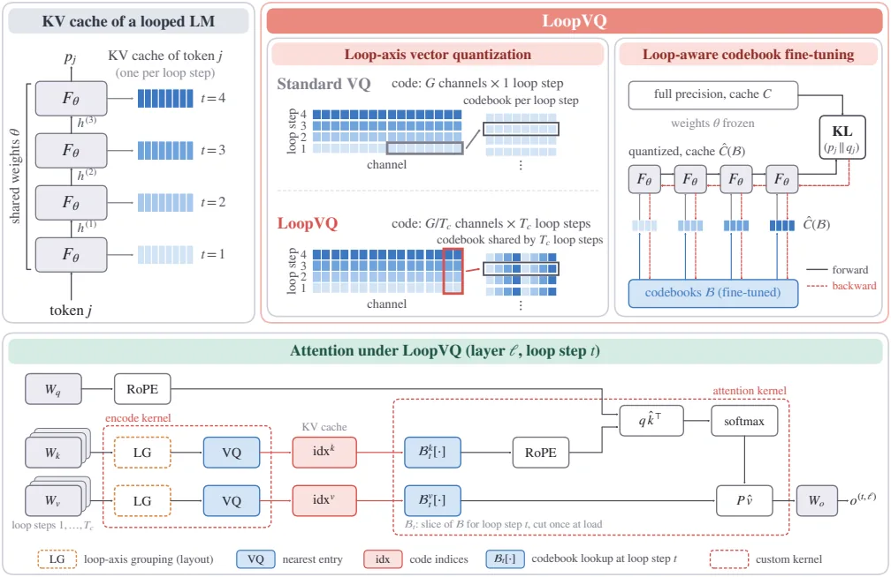
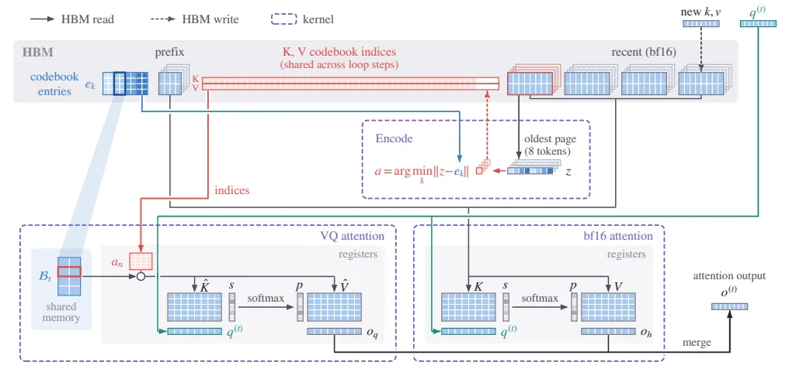
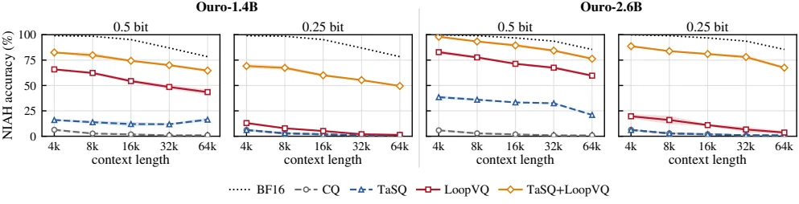
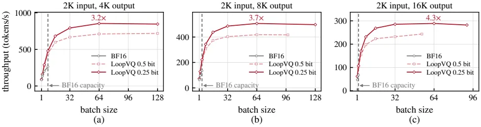

[논문 링크](https://arxiv.org/abs/2611.05304v1)
## 도입

루프 트랜스포머는 같은 레이어 묶음을 여러 번 반복해서 쓰는 모델이다. 파라미터를 아끼는 대신 반복 단계마다 키·값 캐시를 따로 저장해야 해서, 서빙의 병목이 가중치에서 캐시로 옮겨 간다. 이 글은 그 캐시를 원소당 1비트 미만으로 압축하는 방법(LoopVQ)의 관찰과 설계, 실측 결과를 정리한다.

## 먼저 읽어야 할 용어

**루프 트랜스포머(looped transformer).** 같은 $L_b$개의 디코더 레이어를 $T$번 되돌려 쓰는 구조다. $t$번째 루프 스텝은 이전 스텝의 출력 $h^{(t-1)}_{1:N}$를 입력으로 받아 $h^{(t)}_{1:N} = F_\theta(h^{(t-1)}_{1:N})$를 계산하고, 최종 출력 분포 $p_j$는 마지막 스텝의 은닉 상태 $h^{(T)}_j$에서 읽는다. 여기서 중요한 점은 하나뿐이다. **루프 스텝마다 자기만의 키와 값을 캐시에 남기므로, 같은 가중치를 쓰는 비루프 모델보다 캐시가 $T$배로 커진다.** 평가 대상인 Ouro-1.4B·2.6B는 $T=4$, Huginn-3.5B는 32번 반복한다.

**KV 캐시.** 자기 회귀 생성에서 지난 토큰의 키와 값을 저장해 두고, 다음 토큰의 어텐션을 계산하는 메모리다. 원문은 토큰 $j$가 루프 스텝 $t$, 레이어 $\ell$, KV 헤드 $h$마다 키 $k^{(t,\ell)}_{j,h}\in\mathbb{R}^D$와 값 $v^{(t,\ell)}_{j,h}\in\mathbb{R}^D$를 만든다고 정의한다. 문맥이 길수록, 헤드와 레이어가 많을수록, 그리고 위에서 말한 대로 루프 스텝이 많을수록 이 메모리가 커진다.

**양자화(quantization).** 값을 낮은 정밀도로 바꿔 저장해 메모리를 줄이는 압축이다. 원문은 양자화가 토큰을 버리지 않고 캐시만 줄인다는 점을 강조한다.

**벡터 양자화(vector quantization).** $D$채널짜리 벡터를 연속된 $G$채널씩 $D/G$개 조각으로 나누고, 각 조각을 코드북 $\mathcal{B}=\{e_1,\dots,e_K\}\subset\mathbb{R}^G$에서 가장 가까운 항목의 번호로 저장하는 방법이다. 원문의 식 (2) 그대로, $a(z)=\arg\min_{r\le K}\|z-e_r\|_2^2$로 인덱스를 고르고 $\hat z = e_{a(z)}$로 복원한다. 코드북 크기가 $K=2^b$이면 조각당 $b$비트, 즉 **원소당 $b/G$비트**가 든다. 이 글의 대상인 1비트 미만 구간에서는 기존 벡터 양자화가 정확도를 크게 잃는다.

**비트/원소(bits per element).** 캐시에서 채널 하나를 저장하는 데 쓰는 비트 수다. 0.5비트면 원소당 0.5비트, 즉 16비트(bf16) 대비 32배 압축이다.

**코드북과 보정(calibration).** 코드북은 처음에 오프라인 보정 데이터에서 만들어진다. 원문은 이전 연구들이 각 조각의 중요도 $\omega_n=\|\partial L/\partial z_n\|_2^2$로 가중한 $k$-means(식 3)를 쓴다고 정리한다. $\omega_n$은 다음 토큰 손실 $L$에 대한 그레이디언트 제곱노름이며 empirical Fisher 정보의 대각합과 같다. 이 글에서 중요한 건 이 가중치만으로는 루프 구조에서 생기는 문제를 잡지 못한다는 점이다.

**RoPE(회전 위치 임베딩).** 키 벡터에 위치마다 다른 회전을 걸어 상대 위치를 표현하는 기법이다. 원문은 키를 RoPE 적용 **전에** 양자화하고, 어텐션에서 복원한 뒤 RoPE를 적용한다. 이유는 부록 C에 있다. RoPE는 위치마다 같은 채널 그룹의 키를 다르게 회전시키므로, 회전 전에 묶어 둔 하나의 코드 그룹이 코드북의 수많은 항목으로 흩어지게 된다.

**SGLang.** 구조화된 LLM 프로그램을 효율적으로 실행하는 서빙 프레임워크다. 이 논문은 여기에 LoopVQ 전용 어텐션 커널을 붙여 효율을 측정한다.

## 1. 문제: 캐시가 병목이고, 루프 축에 중복이 남아 있다

### 1.1 파라미터를 아끼면 캐시가 커진다

원문 Fig. 1a는 모델 하나를 점 하나로 그린다. 가로축은 토큰당 KV 캐시 크기(8KB~2MB), 세로축은 bf16 가중치 메모리(2GB~32GB)다. Ouro-1.4B는 비루프 모델인 Llama-3.1-8B보다 **토큰당 KV 캐시가 6배**이고, 중간 정도 문맥 길이에서 이미 캐시 메모리가 가중치를 넘는다. 즉 루프 모델을 서빙할 때 실제 병목은 가중치가 아니라 캐시다.

원문 Fig. 1b는 원소당 비트 수(0.25~4)에 따른 GSM8K 정확도를 그려, 기존 벡터 양자화(CQ, TaSQ)가 1비트 아래로 내려가면 정확도가 크게 무너지는 양상을 보여준다(bf16 기준선 86.1, Ouro-2.6B).

### 1.2 반복 축에는 아직 쓰지 않은 중복이 있다

한 레이어의 $T$개 캐시는 같은 토큰의 은닉 상태에 같은 투영 가중치를 적용해 계산된다. 그래서 스텝 사이의 키·값은 서로 닮아 있다.

- **Fig. 2a**: Ouro-1.4B 한 어텐션 헤드의 RoPE 전 키를 네 스텝에 대해 그렸는데, 네 스텝이 거의 같은 채널 패턴을 보인다. Ouro-1.4B 전체에서 인접 스텝의 상관은 첫 두 스텝 사이 0.69, 마지막 두 스텝 사이 0.94로 증가한다.
- **Fig. 2b**: 16채널 묶음 안의 모든 (루프 스텝, 채널) 좌표 쌍에 대한 평균 $|r|$을 색으로 보여준다. 같은 채널을 인접 스텝으로 잇는 부분이 밝게 이어지고, 같은 묶음 안의 다른 채널끼리는 어둡다. 수치로 따지면 **같은 채널의 인접 스텝 간 $|r|$는 평균 0.85, 같은 16채널 묶음 안의 다른 채널끼리는 0.16**이고, 값에서는 격차가 더 벌어진다.
- **Fig. 2c**: 비트폭과 코드북 개수를 고정한 채 "한 스텝의 $G$채널"과 "네 스텝에 걸친 $G/4$채널" 두 묶음 방식의 $k$-means 복원 오차(NMSE)를 비교한다. 루프 축으로 묶으면 Ouro-1.4B의 0.5비트에서 오차가 **대략 절반**으로 줄고, Ouro와 Huginn 두 모델의 모든 비트폭에서 크게 감소한다(§3, 원문 Fig. 2).

기존 벡터 양자화가 쓰는 축은 '채널 축'이다. 루프 모델의 캐시에는 그 옆에 '반복 축'이라는 중복 축이 하나 더 있는 셈이다.

### 1.3 그런데 스텝마다 양자화 오차의 체감 정도가 다르다

묶은 벡터 하나가 여러 스텝을 함께 대표하게 되면, 그 안의 어느 스텝에서 오차가 났는지가 중요해진다. 일찍 나온 오차는 이후 모든 스텝으로 전파되고, 마지막 스텝의 오차는 그 스텝에만 남는다.

원문 Table 1은 한 스텝만 양자화하고 나머지는 정밀도를 유지한 뒤, 전체 정밀 출력과 양자화 출력의 KL 발산을 잰 결과다(루프 축 묶음 + Fisher 가중 $k$-means 코드북, 보정에 쓰지 않은 시퀀스로 측정).

| 양자화한 스텝 | 0.5비트 KL | 0.25비트 KL |
|---|---|---|
| 1 | 0.069 | 0.123 |
| 2 | 0.018 | 0.029 |
| 3 | 0.013 | 0.026 |
| 4 | 0.030 | 0.065 |

첫 스텝을 양자화했을 때가 가장 해롭고 세 번째 스텝이 가장 덜 해롭다. 두 스텝의 차이는 약 다섯 배에 이른다.

## 2. 작은 예시: 하나의 인덱스가 네 스텝을 대신한다

아래는 Ouro-1.4B의 실제 설정($D=128$채널, $T=4$스텝, 8비트 코드 $K=256$, 0.5비트라서 $G=16$)을 조합한 설명용 예시다. 논문의 실측값이 아니라 동작 설명용 구성이다.

| 단계 | 기존 벡터 양자화(CQ) | LoopVQ |
|---|---|---|
| 입력 | 토큰 1개, 레이어 1개, 헤드 1개의 키. 채널 128개짜리 키가 루프 스텝 4개에 걸쳐 따로 계산되어 캐시에 4벌이 남는다 | 같음 |
| 남는 상태 | 각 스텝의 128채널을 16채널 조각 8개로 나눈 뒤, 조각마다 8비트 인덱스를 저장한다. 스텝당 8개, 전체 32개 인덱스. 코드북은 스텝별로 따로 만들어 4벌이 있다 | 같은 128채널을 4채널씩 32조각으로 나누되, 한 조각이 스텝 1~4에서 각각 4채널씩(총 16채널)을 함께 묶는다. 인덱스는 총 32개로 같고, 코드북은 네 스텝이 공유하는 1벌이다 |
| 변경·생략·거절 | 스텝 간 상관(같은 채널 기준 인접 스텝 $|r|=0.85$)을 무시하고, 스텝별로 가장 가까운 항목을 고른다 | 인접 스텝의 같은 채널이 서로 닮았으므로 묶은 뒤 한 번에 고른다. 버리는 토큰은 없고 스텝 수·비트 수·저장량은 그대로이며, 줄어드는 것은 복원 오차뿐이다 |
| 출력 | 네 스텝의 키 4벌을 복원한다. 복원 오차가 크다 | 같은 4벌의 키를 복원한다. 루프 축으로 묶으면 0.5비트 복원 오차가 대략 절반이 된다(원문 Fig. 2c, 일반 $k$-means 기준) |

즉 LoopVQ는 메모리를 더 쓰지 않는다. 저장하는 칸 수는 그대로 두고, 그 칸에 **서로 닮은 값을 함께 넣어** 복원 오차를 줄이는 방식이다.

## 3. 방법

### 3.1 루프 축 벡터 양자화

저자들은 $T$개의 스텝을 $T_c$개씩 연속된 블록으로 나눈다(Ouro는 $T=T_c=4$라 블록 하나, Huginn은 32스텝이 8블록). 하나의 코드가 블록 안 **$T_c$개 스텝에 걸쳐 각각 $c=G/T_c$개 채널**을 덮는다. 원문의 식 (4)는 이 결합 벡터를 정의하고, 식 (5)는 각 스텝이 그 인덱스에서 자기 몫(결합 벡터의 $iT_c+m$번 좌표)만 잘라 복원하는 규칙이다.

- 코드 하나가 $T_c$개 스텝을 동시에 대표하므로 **원소당 비트 수는 $b/G$ 그대로**다. 메모리는 늘지 않는다.
- 키는 RoPE 적용 전에 양자화하고, 어텐션에서 복원한 뒤 RoPE를 적용한다(§2, 부록 C).
- 코드북은 Fisher 가중 $k$-means로 초기화한다. 이때 $\omega_n$은 그 결합 벡터가 덮는 **모든 $T_c$개 스텝의 제곱 그레이디언트를 합산**한다(§4.1).

### 3.2 루프 인지 코드북 미세조정

Fisher 가중 $k$-means가 놓치는 것이 있다. 이 목적은 각 코드 벡터의 오차를 독립적으로만 벌점 주기 때문에, 앞 스텝의 오차가 뒤 스텝으로 전파되며 생기는 교차항을 표현할 수 없다. 부록 A.1은 오차가 작을 때 $J(B)\approx\frac{1}{2}\mathbb{E}_s[\delta^\top F\delta]$로 근사해 보이며, 가중 $k$-means는 대각 블록 $F_{nn}$만 맞추고 $F_{nn'}$ 형태의 교차항을 항상 버린다고 보인다. 가중치를 어떻게 고쳐도 이 한계는 남는다. 게다가 결합 벡터 안에서 스텝마다 정밀도를 똑같이 배분해 버린다.

그래서 저자들은 모델 가중치를 고정한 채, 출력 자체를 직접 맞춘다. 보정 시퀀스 $s$에 대해 정밀 캐시 $C$와 그 출력 분포 $p_j$, 코드북 $\mathcal{B}$로 복원한 캐시 $\hat C(\mathcal{B})$에서 **모든 $T_c$개 스텝이 $\hat C(\mathcal{B})$에 어텐션했을 때**의 출력 $q_j(\mathcal{B})$를 구하고, 식 (6)의 $J(\mathcal{B})=\mathbb{E}_s[\frac{1}{N}\sum_j \mathrm{KL}(p_j\|q_j(\mathcal{B}))]$를 최소화한다. 합은 bf16 sink 토큰 뒤의 $N$개 위치에 대해 더한다. 이 목적은 스텝 간 오차 전파와 스텝별 민감도 차이를 함께 담는다.

- 코드북 항목은 이 목적의 backprop으로 직접 갱신한다. arg min 선택은 미분할 필요가 없어서 코드북 항목이 정확한 그라디언트를 받으며, straight-through 추정기가 필요 없다(부록 A.2).
- 매 반복마다 배정을 현재 코드북으로 다시 계산하므로, 학습 때의 인코더와 추론 때의 인코더가 어긋나지 않는다.
- 결과적으로 Ouro-1.4B에서 정밀 출력 대비 KL 발산을 **대략 절반**으로 줄인다(원문 Fig. 4: $k$-means 코드북에서 시작한 뒤 미세조정을 반복한다).
- 학습 설정은 보정 시퀀스 16개 중 12개로 미세조정(Adam, 학습률 $10^{-3}$, 한 반복당 시퀀스 1개, 4 epoch)하고, 남은 4개에서 KL이 가장 낮은 epoch를 고른다(§5.1).

### 3.3 TaSQ와의 결합

TaSQ는 **채널 축**을 다룬다. 부록 B의 식 (10)은 키의 채널에 가중치 $w$를 곱하고 토큰별 스케일 $\sigma$로 나눈 뒤 순열 $P$로 재배열하는 변환이다. 같은 코드를 쓰는 채널끼리 상관이 높아지도록 만드는 것이 목적이다. LoopVQ는 **루프 축**을 다루므로 둘은 직교한다. TaSQ+LoopVQ는 TaSQ 변환을 먼저 적용한 뒤 루프 축으로 묶어서, 한 코드가 (채널 축에서 고른 $c$개 채널) × (루프 축의 $T_c$개 스텝)을 함께 덮게 한다.

순열 $P$는 블록의 $T_c$개 스텝 키를 쌓아 만든 $T_cD\times T_cD$ 공분산 행렬에서 구하고, 각 스텝의 RoPE 짝 $\{i,i+D/2\}$을 함께 묶어 그룹이 $G=cT_c$개 좌표를 갖게 한다. 비용은 토큰별 키 스케일 $\sigma$를 fp16으로 저장하는 것뿐이며, 키 원소당 16/(HD)비트, 즉 Ouro에서 약 0.008비트, Huginn에서 0.003비트다. 그래서 Table 2의 키 비트폭이 0.508/0.5(Ouro), 0.503/0.5(Huginn)로 표시된다.

Huginn에는 루프 축이 없는 구간이 있다. 2개 레이어의 prelude와 coda는 CQ처럼 레이어별로 따로 부호화한다. 참고로 Huginn-3.5B는 4개 레이어 코어 블록을 32번 반복하고 prelude·coda를 더해 토큰당 132개의 KV 캐시를 만든다.

### 3.4 SGLang 구현: 인덱스를 언제 만들고 어떻게 읽는가

원문 Fig. 3의 흐름은 이렇다. 각 루프 스텝은 자기 캐시를 쓰지만, 부호화 단계에서 $c=G/T_c$개 채널을 $T_c$개 스텝에 걸쳐 묶어 인덱스 하나를 만든다. 그 인덱스를 $T_c$개 스텝이 공유하고, 추론 때 각 스텝 $t$는 자기 코드북 슬라이스 $\mathcal{B}_t$를 통해 같은 인덱스를 각자의 키·값으로 읽어낸다.

원문 Fig. 5의 저장·조회 구조는 세 단계로 읽는다.

1. **저장 배치.** 처음 $n_s$개 토큰(sink)과 가장 최근 $n_r$개 토큰은 모든 스텝에서 bf16로 남기고, 그 사이 토큰만 코드북 인덱스로 저장한다. 캐시는 8토큰짜리 페이지 단위이고 $n_s$, $n_r$은 8의 배수이므로 페이지가 통째로 bf16이거나 통째로 양자화된다. 한 인덱스가 $T_c$개 스텝을 공유하므로 양자화된 페이지는 스텝 블록마다 인덱스 행 하나만 갖고, 같은 $G$에서 스텝별로 따로 부호화하는 것과 **토큰당 메모리가 같다**. 실험에서는 일반 벤치마크에 8/64, 추론·장문맥 벤치마크에 64/256을 쓴다.
2. **언제 인덱스를 만드는가.** 결합 벡터는 블록의 $T_c$개 스텝이 모두 계산되어야 부호화할 수 있다. 그래서 프리필에서는 각 스텝의 키·값을 그 블록의 마지막 스텝까지 들고 있다가, 코드북 전체 항목과의 거리를 텐서 코어 행렬곱으로 계산해 한 번에 부호화한다. 디코드에서는 새 토큰의 키·값을 bf16 최근 구간에 쓰고(forward pass가 끝나면 그 토큰의 모든 스텝이 모인다), 8개 토큰이 생성될 때마다 가장 오래된 페이지 하나를 모든 레이어·스텝에 걸쳐 인덱스로 바꿔 최근 구간이 $n_r$~$n_r$+7 토큰을 유지하게 한다.
3. **어텐션이 어떻게 읽는가.** 루프 스텝 $t$에서 전용 커널이 코드북 슬라이스 $\mathcal{B}_t$를 공유 메모리에 한 번 올리고, 각 토큰의 인덱스로 키·값을 레지스터에서 조회한다. bf16 페이지는 SGLang의 Triton 디코딩 커널이 읽고, 두 결과는 Flash-Decoding 방식으로 나눈 스플릿들의 logsumexp를 합쳐 병합한다. 양자화된 키는 복원 뒤 커널이 RoPE를 적용하며, 위치별 사인·코사인 표를 미리 계산해 읽는다. 헤드·토큰당 읽는 인덱스 수는 $D/c$개다.

구현 코드는 https://github.com/mscheong01/LoopVQ 에 공개되어 있다.

## 4. 결과

### 4.1 일반 벤치마크

평가 대상은 Ouro-1.4B, Ouro-2.6B, Huginn-3.5B이고, 지표는 GSM8K·MATH500·HumanEval·MBPP의 평균 정확도(%)다. 모두 greedy 디코딩이다(원문 Table 2). CQ는 루프 스텝·레이어마다 별도 코드북을 쓰는 기준 벡터 양자화다.

**0.5비트**

| 모델 | BF16 | CQ | TaSQ | LoopVQ | TaSQ+LoopVQ |
|---|---|---|---|---|---|
| Ouro-1.4B | 75.7 | 32.3 | 43.6 | 68.3 | 73.6 |
| Ouro-2.6B | 81.5 | 37.7 | 52.7 | 77.7 | 80.3 |
| Huginn-3.5B | 25.0 | 13.7 | 14.8 | 22.4 | 23.5 |

**0.25비트**

| 모델 | BF16 | CQ | TaSQ | LoopVQ | TaSQ+LoopVQ |
|---|---|---|---|---|---|
| Ouro-1.4B | 75.7 | 28.2 | 29.6 | 45.1 | 62.3 |
| Ouro-2.6B | 81.5 | 32.1 | 35.2 | 52.7 | 70.7 |
| Huginn-3.5B | 25.0 | 12.9 | 13.0 | 18.6 | 21.0 |

CQ와 TaSQ는 0.5비트에서 이미 BF16과 큰 격차를 보이고, 그 간격은 수학·코드 과제에서 더 크다. Ouro-1.4B 기준으로 MATH500은 CQ 17.8, TaSQ 38.8, LoopVQ 69.4, HumanEval은 CQ 14.6, TaSQ 24.4, LoopVQ 63.4다. LoopVQ가 두 기준 방법을 크게 앞서는 지점은 0.5비트뿐 아니라 0.25비트에서도 유지되고, TaSQ+LoopVQ는 0.5비트에서 BF16에 근접하며 0.25비트에서 추가 이득이 더 커진다. Huginn-3.5B에서도 Table 2 기준으로 LoopVQ와 TaSQ+LoopVQ가 두 기준 방법보다 높다.

### 4.2 긴 사고 사슬(CoT) 추론

Thinking 변형 모델을 AIME'24·AIME'25, GPQA-Diamond, HumanEval+, MBPP+로 평가한 평균이다(모델 카드 설정대로 temperature 1.0, top-p 0.7, 최대 32,768 생성 토큰, 3개 시드 평균, 원문 Table 3).

**0.5비트**

| 모델 | BF16 | CQ | TaSQ | LoopVQ | TaSQ+LoopVQ |
|---|---|---|---|---|---|
| Ouro-1.4B-Thinking | 56.4 | 15.7 | 19.5 | 50.8 | 54.9 |
| Ouro-2.6B-Thinking | 64.9 | 16.6 | 28.3 | 58.1 | 63.8 |

**0.25비트**

| 모델 | BF16 | CQ | TaSQ | LoopVQ | TaSQ+LoopVQ |
|---|---|---|---|---|---|
| Ouro-1.4B-Thinking | 56.4 | 14.4 | 14.8 | 20.0 | 48.1 |
| Ouro-2.6B-Thinking | 64.9 | 16.7 | 18.1 | 24.1 | 56.0 |

일반 벤치마크보다 격차가 더 벌어진다. 0.5비트에서 CQ는 BF16의 4분의 1 안팎, TaSQ는 3분의 1~절반 수준까지 내려가지만 LoopVQ는 대부분의 정확도를 지키고, TaSQ와 합치면 BF16과 1.1~1.6점 차이까지 좁힌다. 0.25비트에서는 TaSQ+LoopVQ가 LoopVQ 단독보다 훨씬 앞서며, 두 모델의 모든 과제에서 양자화 방법 중 최고다.

### 4.3 긴 문맥 검색

원문 Fig. 6은 4개 패널(Ouro-1.4B·Ouro-2.6B × 0.5비트·0.25비트)로 나뉜다. 가로축은 문맥 길이(4K~64K), 세로축은 RULER의 8개 NIAH 태스크를 3개 시드로 평균한 정확도(%)이고, 곡선은 BF16, CQ, TaSQ, LoopVQ, TaSQ+LoopVQ다. CQ와 TaSQ는 모든 길이에서 BF16보다 훨씬 아래에 머물지만, LoopVQ는 0.5비트에서 상당히 많은 바늘을 찾아내고, TaSQ+LoopVQ가 모든 길이와 비트폭에서 가장 높다.

부록 D.5의 LongBench(16개 영어 태스크)도 같은 순서다. 평균 정확도에서 CQ와 TaSQ는 BF16보다 7~13점 낮고, LoopVQ는 모든 설정에서 두 기준 방법보다 높으며, TaSQ+LoopVQ는 0.5비트에서 BF16보다 1.5점 이내에 들어온다.

### 4.4 양자화가 추론을 길게 만들면 토큰당 지연 이득도 흐려진다

원문 Fig. 10은 GPQA-Diamond에서 Ouro-1.4B-Thinking이 0.5비트 설정에서 생성한 토큰 수의 분포다. 가로축은 생성 토큰 수(0~32K), 세로축은 문제 비율(%), 막대는 32K 예산 소진(cap hit), 조기 종료(early failure), 미종료(non-termination) 비중이다. CQ와 TaSQ는 대부분 문제에서 32K 예산을 소진하면서 BF16의 약 두 배 토큰을 생성한다. 반면 LoopVQ와 TaSQ+LoopVQ는 0.5비트에서 BF16의 길이 분포를 따르고, 0.25비트에서는 TaSQ+LoopVQ만 여전히 그렇다(부록 D.4).

부록 D.4는 반대 방향, 즉 조기 종료도 잰다. BF16에서 2K 토큰 이내로 끝나는 생성의 비율이 Ouro-1.4B·2.6B-Thinking에서 각각 16%·22%인데, 0.25비트에서는 CQ가 33%·59%, TaSQ가 30%·47%로 오른다. LoopVQ와 TaSQ+LoopVQ는 모든 설정에서 30% 이하를 유지한다. 즉 토큰당 처리량 이득이 실제 답변 완료 시간으로도 이어진다.

### 4.5 시스템 효율

측정 환경은 RTX 6000 Ada 48GB 한 장, 대상은 Ouro-1.4B-Thinking이며 sink·recent는 8·64 토큰을 bf16로 유지했다(§5.3).

**커널과 지연.** 디코드 커널은 헤드·토큰당 $D/c$개의 인덱스만 읽으므로 bf16 키·값보다 **8배(0.5비트)~16배(0.25비트) 적은 바이트**를 읽는다. 긴 문맥의 디코드는 캐시 읽기에 묶여 있어서, 이 절감은 문맥이 길수록 크게 나타난다(원문 Fig. 8b, 배치 1).

| 문맥 길이 | 1K | 8K | 32K |
|---|---|---|---|
| 0.5비트 디코드 지연 | +3% | −17% | −47% |
| 0.25비트 디코드 지연 | +3% | −18% | −49% |

반면 프리필은 블록 단위 부호화 비용이 더해져 **조금 느려진다**. Ouro-1.4B에서 문맥 4K·16K·32K 기준 0.5비트 +9%·+7%·+5%, 0.25비트 +8%·+6%·+4%이며 문맥이 길수록 부담이 줄어든다(Fig. 8a). Ouro-2.6B에서는 5~9% 느리다. 부록 D.3의 시간 분해는 배치 16·2K 입력 프롬프트에서 생성 토큰당 어텐션 시간이 bf16 1.87ms에서 LoopVQ 0.63ms(0.5비트)·0.54ms(0.25비트)로 줄어든다고 하고, 부호화는 디코드 시간의 1% 미만, 프리필 시간의 5~7%만 차지한다고 밝힌다. 배치 1에서 bf16에서는 32K에서 어텐션이 디코드 시간의 대부분을 차지하지만 LoopVQ에서는 어텐션이 선형 레이어보다 작게 유지된다.

**처리량.** 긴 생성에서는 KV 캐시가 배치 크기를 제한한다.

원문 Fig. 7에서 가로축은 배치 크기(최대 128), 세로축은 초당 처리량(tok/s)이고, 세 패널은 출력 길이(4K·8K·16K)별이다(입력은 모두 2K). bf16의 최대 배치에 해당하는 수직선과 LoopVQ 곡선의 차이가 3.2배·3.7배·4.3배로 표시된다. 캐시가 더 무거운 Ouro-2.6B-Thinking에서는 5.0배·5.2배·6.1배, A100(40GB)에서는 2.8배~3.7배다(부록 D.1, D.2). A100에서는 32K 디코드 지연이 bf16 대비 0.5비트 −51%, 0.25비트 −56%까지 낮아진다.

### 4.6 각 설계 요소와 보정 데이터의 영향

두 요소를 따로 떼어 보면(원문 Table 4, Ouro-1.4B), **루프 축 묶음이 이득의 대부분을 만든다.** 그 위에 미세조정(FT)을 얹으면 GSM8K에서는 효과가 거의 없고, HumanEval에서 정확도가 오르며 TaSQ에 얹었을 때 가장 뚜렷하다. 둘을 함께 쓰면 모든 설정에서 최고 또는 공동최고가 된다. 0.25비트에서는 묶음이 CQ보다 TaSQ에 더 큰 이득을 준다.

보정 데이터도 결과를 좌우한다. 원문 Fig. 9는 보정 말뭉치를 WikiText-2, C4, SlimPajama로 바꿔가며 다시 보정한 결과다. CQ는 GSM8K에서 최대 11점 편차를 보이지만, TaSQ+LoopVQ는 최대 4점(GSM8K)·1점(HumanEval)이고 모든 말뭉치에서 최고를 유지한다. 보정 시퀀스 개수를 늘리면 정확도는 일관되게 오른다(원문 Table 5, 0.25비트에서 LoopVQ GSM8K 57.5→60.8, HumanEval 22.6→28.0, 8→32개).

보정 비용은 크지 않다. RTX 6000 Ada 한 장에서 Ouro-1.4B는 $k$-means 6.1분 + 미세조정 2.3분, Ouro-2.6B는 14.3분 + 5.9분이 걸리고(A100에서는 5.5+2.0분, 11.2+4.6분), 시퀀스를 늘려도 비용은 분 단위다.

## 5. 한계와 적용 판단

**저자가 밝힌 한계.** 첫째, 효율 비교의 기준이 BF16 서빙뿐이다. 각 방법의 서빙 효율은 자기 캐시 형식에 맞춰 최적화한 커널에 달려 있고, 모든 방법에 동등한 최적화 수준을 맞추기 어려워 가장 많이 최적화한 방법에 유리해지는 비교를 피했다고 밝힌다. 둘째, 루프 트랜스포머 전용 KV 캐시 양자화 방법인 FlashLoop·ResidualQuant와는 정확도를 비교하지 않았다. 둘은 스칼라 양자화로 원소당 최소 1비트를 쓰고 2~4비트를 목표로 하며, 그 이하 비트폭 설정을 제시하지 않아 LoopVQ가 노리는 1비트 미만 구간에서 같은 비트폭으로 맞출 수 없기 때문이다.

**적용 조건.** 이 기법은 루프 축을 전제로 하므로 반복 구조가 없는 일반 LLM에는 그대로 쓸 수 없다. Huginn처럼 반복 구조가 있어도 prelude·coda처럼 루프가 아닌 구간은 기존 방식대로 따로 부호화해야 한다. 이득은 긴 문맥과 긴 생성에서 두드러지며, 짧은 문맥이나 프리필 위주 워크로드에서는 부호화 비용 때문에 오히려 느릴 수 있다. 코드북은 모델마다, Thinking 변형까지 따로 보정해야 하며(보정 말뭉치에 따라 CQ는 GSM8K에서 최대 11점 편차), 보정 비용은 분 단위지만 매번 다시 해야 한다.

**판단.** 파라미터는 작지만 캐시가 병목인 루프 모델을 긴 문맥·긴 생성으로 서빙할 때, LoopVQ는 1비트 미만 구간에서 기존 벡터 양자화보다 나은 선택지다. 다만 효율 비교는 BF16 서빙을 기준으로 했고, 다른 양자화 방법과 동등한 커널 최적화 조건에서의 비교 및 FlashLoop·ResidualQuant와의 정확도 비교는 남아 있다.

<!-- verbatim-tables -->

논문 원문의 표

> arXiv e-print 의 LaTeX 원본에서 기계적으로 옮긴 표입니다. 숫자는 논문의 값이며 모델을 거치지 않았습니다.

**표 1. KL divergence from the full-precision output of Ouro-1.4B when only one loop step is quantized (loop-axis grouping, Fisher-weighted $k$-means codebooks, sequences not used for calibration).**

| Bitwidth | Quantized loop step 1 | Quantized loop step 2 | Quantized loop step 3 | Quantized loop step 4 |
|---|---|---|---|---|
| 0.5 bit | 0.069 | 0.018 | 0.013 | 0.030 |
| 0.25 bit | 0.123 | 0.029 | 0.026 | 0.065 |

**표 2. General performance under low-bit KV cache quantization. All results use greedy decoding. Bold denotes the best quantized result; higher is better.**

| Model | Bitwidth | Method | Bits (K/V) | GSM8K | MATH500 | HumanEval | MBPP | Avg. |
|---|---|---|---|---|---|---|---|---|
| Ouro-1.4B |  | BF16 | 16/16 | 78.77 | 77.20 | 73.17 | 73.54 | 75.67 |
|  | 0.5 bit | CQ | 0.5/0.5 | 46.78 | 17.80 | 14.63 | 50.00 | 32.30 |
|  |  | TaSQ | 0.508/0.5 | 57.32 | 38.80 | 24.39 | 53.97 | 43.62 |
|  |  | **LoopVQ** | 0.5/0.5 | 75.82 | 69.40 | 63.41 | 64.55 | 68.29 |
|  |  | TaSQ+**LoopVQ** | 0.508/0.5 | **77.56** | **75.20** | **70.12** | **71.43** | **73.58** |
|  | 0.25 bit | CQ | 0.25/0.25 | 42.99 | 12.20 | 10.98 | 46.56 | 28.18 |
|  |  | TaSQ | 0.258/0.25 | 44.88 | 12.80 | 12.20 | 48.41 | 29.57 |
|  |  | **LoopVQ** | 0.25/0.25 | 58.91 | 41.20 | 25.61 | 54.50 | 45.05 |
|  |  | TaSQ+**LoopVQ** | 0.258/0.25 | **70.96** | **63.40** | **55.49** | **59.26** | **62.28** |
| Ouro-2.6B |  | BF16 | 16/16 | 86.13 | 77.40 | 81.10 | 81.22 | 81.46 |
|  | 0.5 bit | CQ | 0.5/0.5 | 54.06 | 24.60 | 14.63 | 57.41 | 37.67 |
|  |  | TaSQ | 0.508/0.5 | 69.07 | 49.20 | 31.10 | 61.38 | 52.69 |
|  |  | **LoopVQ** | 0.5/0.5 | 85.22 | 74.60 | 75.00 | 75.93 | 77.69 |
|  |  | TaSQ+**LoopVQ** | 0.508/0.5 | **85.37** | **78.60** | **78.66** | **78.57** | **80.30** |
|  | 0.25 bit | CQ | 0.25/0.25 | 47.46 | 14.60 | 12.80 | 53.70 | 32.14 |
|  |  | TaSQ | 0.258/0.25 | 52.99 | 17.60 | 14.02 | 56.08 | 35.18 |
|  |  | **LoopVQ** | 0.25/0.25 | 70.20 | 52.00 | 28.66 | 60.05 | 52.73 |
|  |  | TaSQ+**LoopVQ** | 0.258/0.25 | **81.80** | **68.60** | **62.80** | **69.58** | **70.70** |
| Huginn-3.5B |  | BF16 | 16/16 | 34.04 | 12.80 | 17.07 | 35.98 | 24.97 |
|  | 0.5 bit | CQ | 0.5/0.5 | 19.03 | 5.40 | 6.71 | 23.54 | 13.67 |
|  |  | TaSQ | 0.503/0.5 | 19.11 | 5.80 | 10.37 | 23.81 | 14.77 |
|  |  | **LoopVQ** | 0.5/0.5 | 32.37 | 9.40 | **12.80** | 34.92 | 22.37 |
|  |  | TaSQ+**LoopVQ** | 0.503/0.5 | **33.13** | **12.20** | 12.20 | **36.51** | **23.51** |
|  | 0.25 bit | CQ | 0.25/0.25 | 19.11 | 7.20 | 4.27 | 21.16 | 12.93 |
|  |  | TaSQ | 0.253/0.25 | 19.18 | 6.60 | 4.88 | 21.16 | 12.96 |
|  |  | **LoopVQ** | 0.25/0.25 | 25.02 | 8.20 | **13.41** | 27.78 | 18.60 |
|  |  | TaSQ+**LoopVQ** | 0.253/0.25 | **28.13** | **9.80** | **13.41** | **32.54** | **20.97** |

**표 3. Long CoT reasoning performance under low-bit KV cache quantization. All results are averaged over three sampling seeds (mean $\pm$ std). Bold denotes the best quantized result; higher is better.**

| Model | Bitwidth | Method | Bits (K/V) | AIME'24 | AIME'25 | GPQA-D | HumanEval+ | MBPP+ | Avg. |
|---|---|---|---|---|---|---|---|---|---|
| Ouro-1.4B-Thinking |  | BF16 | 16/16 | 47.78$\pm$5.09 | 32.22$\pm$5.09 | 45.12$\pm$2.28 | 84.55$\pm$0.70 | 72.49$\pm$1.32 | 56.43$\pm$1.54 |
|  | 0.5 bit | CQ | 0.5/0.5 | 1.11$\pm$1.92 | 2.22$\pm$1.92 | 11.78$\pm$1.05 | 27.85$\pm$0.70 | 35.27$\pm$2.31 | 15.65$\pm$0.76 |
|  |  | TaSQ | 0.508/0.5 | 4.44$\pm$1.92 | 5.56$\pm$1.92 | 12.12$\pm$2.31 | 35.16$\pm$2.14 | 40.12$\pm$2.72 | 19.48$\pm$0.99 |
|  |  | **LoopVQ** | 0.5/0.5 | 38.89$\pm$5.09 | 31.11$\pm$3.85 | 40.57$\pm$1.27 | 75.81$\pm$1.27 | 67.64$\pm$1.19 | 50.80$\pm$1.35 |
|  |  | TaSQ+**LoopVQ** | 0.508/0.5 | **45.56$\pm$8.39** | **34.44$\pm$5.09** | **42.76$\pm$3.04** | **81.50$\pm$1.53** | **70.11$\pm$0.70** | **54.87$\pm$2.08** |
|  | 0.25 bit | CQ | 0.25/0.25 | 0.00$\pm$0.00 | 1.11$\pm$1.92 | 11.62$\pm$3.07 | 25.61$\pm$2.79 | 33.86$\pm$0.00 | 14.44$\pm$0.92 |
|  |  | TaSQ | 0.258/0.25 | 2.22$\pm$1.92 | 1.11$\pm$1.92 | 11.45$\pm$3.79 | 27.03$\pm$2.82 | 32.01$\pm$0.26 | 14.76$\pm$1.09 |
|  |  | **LoopVQ** | 0.25/0.25 | 7.78$\pm$3.85 | 8.89$\pm$3.85 | 14.48$\pm$4.08 | 31.50$\pm$1.27 | 37.13$\pm$1.46 | 19.95$\pm$1.41 |
|  |  | TaSQ+**LoopVQ** | 0.258/0.25 | **36.67$\pm$3.33** | **26.67$\pm$5.77** | **36.53$\pm$4.58** | **76.63$\pm$2.31** | **63.84$\pm$0.85** | **48.07$\pm$1.69** |
| Ouro-2.6B-Thinking |  | BF16 | 16/16 | 57.78$\pm$11.71 | 51.11$\pm$5.09 | 54.04$\pm$3.31 | 86.18$\pm$0.93 | 75.49$\pm$0.81 | 64.92$\pm$2.65 |
|  | 0.5 bit | CQ | 0.5/0.5 | 3.33$\pm$0.00 | 5.56$\pm$1.92 | 7.24$\pm$3.04 | 30.08$\pm$2.75 | 36.68$\pm$1.10 | 16.58$\pm$0.93 |
|  |  | TaSQ | 0.508/0.5 | 10.00$\pm$3.33 | 12.22$\pm$1.92 | 22.73$\pm$3.31 | 43.90$\pm$2.79 | 52.73$\pm$1.99 | 28.32$\pm$1.23 |
|  |  | **LoopVQ** | 0.5/0.5 | 47.78$\pm$5.09 | 35.56$\pm$1.92 | 47.81$\pm$2.04 | 84.76$\pm$1.61 | 74.34$\pm$1.32 | 58.05$\pm$1.24 |
|  |  | TaSQ+**LoopVQ** | 0.508/0.5 | **61.11$\pm$3.85** | **43.33$\pm$5.77** | **51.01$\pm$4.63** | **88.21$\pm$0.93** | **75.49$\pm$1.50** | **63.83$\pm$1.71** |
|  | 0.25 bit | CQ | 0.25/0.25 | 2.22$\pm$1.92 | 3.33$\pm$3.33 | 8.25$\pm$1.54 | 30.89$\pm$1.96 | 38.80$\pm$2.90 | 16.70$\pm$1.09 |
|  |  | TaSQ | 0.258/0.25 | 1.11$\pm$1.92 | 5.56$\pm$1.92 | 10.94$\pm$0.77 | 33.33$\pm$0.93 | 39.42$\pm$0.26 | 18.07$\pm$0.60 |
|  |  | **LoopVQ** | 0.25/0.25 | 10.00$\pm$3.33 | 5.56$\pm$1.92 | 13.13$\pm$3.31 | 43.50$\pm$2.14 | 48.50$\pm$1.25 | 24.14$\pm$1.13 |
|  |  | TaSQ+**LoopVQ** | 0.258/0.25 | **43.33$\pm$3.33** | **34.44$\pm$5.09** | **48.15$\pm$1.27** | **82.72$\pm$0.35** | **71.43$\pm$1.15** | **56.02$\pm$1.27** |

**표 4. Loop-axis coupling and loop-aware fine-tuning (FT) applied to CQ and TaSQ on Ouro-1.4B at 0.5 and 0.25 bits per element. With both, CQ and TaSQ become LoopVQ and TaSQ+LoopVQ. BF16: 78.8 (GSM8K) and 73.2 (HumanEval).**

| Base | + Coupling | + FT | GSM8K 0.5 | GSM8K 0.25 | HumanEval 0.5 | HumanEval 0.25 |
|---|---|---|---|---|---|---|
| CQ |  |  | 46.8 | 43.0 | 14.6 | 11.0 |
|  | ✓ |  | 75.4 | 57.5 | 61.6 | 23.8 |
|  |  | ✓ | 48.7 | 42.5 | 14.6 | 11.0 |
|  | ✓ | ✓ | **75.8** | **58.9** | **63.4** | **25.6** |
| TaSQ |  |  | 57.3 | 44.9 | 24.4 | 12.2 |
|  | ✓ |  | 77.5 | 68.7 | **70.1** | 50.6 |
|  |  | ✓ | 59.7 | 47.1 | 31.7 | 14.0 |
|  | ✓ | ✓ | **77.6** | **71.0** | **70.1** | **55.5** |

**표 5. Accuracy of Ouro-1.4B at 0.25 bit versus the number of 2,048-token GPQA calibration sequences (16 in the main experiments).**

| Sequences | GSM8K 8 | GSM8K 16 | GSM8K 32 | HumanEval 8 | HumanEval 16 | HumanEval 32 |
|---|---|---|---|---|---|---|
| LoopVQ | 57.5 | 58.9 | 60.8 | 22.6 | 25.6 | 28.0 |
| TaSQ+LoopVQ | 69.3 | 71.0 | 71.9 | 49.4 | 55.5 | 59.8 |

**표 6. LongBench performance of Ouro-1.4B and Ouro-2.6B under low-bit KV cache quantization on the 16 English tasks, with the official metric of each task. All results use greedy decoding. Bold denotes the best quantized result; higher is better.**

| Model | Bitwidth | Method | Single-doc QA 60NrtvQA | Single-doc QA 60Qasper | Single-doc QA 60MF-en | Multi-doc QA 60HotpotQA | Multi-doc QA 602WikiMQA | Multi-doc QA 60Musique | Summarization 60GovReport | Summarization 60QMSum | Summarization 60MultiNews | Few-shot 60TREC | Few-shot 60TriviaQA | Few-shot 60SAMSum | Synthetic 60PCount | Synthetic 60PRe | Code 60Lcc | Code 60RB-P | Avg. |
|---|---|---|---|---|---|---|---|---|---|---|---|---|---|---|---|---|---|---|---|
| Ouro-1.4B |  | BF16 | 7.81 | 23.56 | 34.75 | 33.17 | 19.75 | 13.15 | 26.94 | 20.52 | 23.08 | 64.50 | 88.57 | 36.18 | 1.50 | 32.50 | 19.99 | 28.72 | 29.67 |
|  | 0.5 bit | CQ | 4.93 | 10.38 | 22.10 | 20.18 | 16.35 | 8.08 | 16.88 | 17.44 | 15.72 | 44.00 | 79.12 | 33.07 | 1.50 | 4.50 | 19.68 | 27.95 | 21.37 |
|  |  | TaSQ | 7.02 | 13.39 | 25.05 | 24.90 | 17.46 | 9.22 | 18.38 | 17.88 | 16.58 | 47.00 | 81.79 | 34.07 | 1.00 | 4.50 | 21.85 | 27.87 | 23.00 |
|  |  | **LoopVQ** | 7.31 | 19.29 | 30.71 | 32.63 | **19.23** | **12.82** | 23.73 | 18.94 | 21.06 | 58.50 | 87.80 | 35.61 | **2.00** | 16.00 | 22.09 | 29.60 | 27.33 |
|  |  | TaSQ+**LoopVQ** | **8.11** | **22.84** | **33.34** | **34.56** | 18.89 | 12.60 | **26.07** | **19.68** | **22.15** | **64.00** | **89.03** | **36.09** | 1.50 | **23.00** | **22.16** | **30.55** | **29.04** |
|  | 0.25 bit | CQ | 4.29 | 9.22 | 21.13 | 20.51 | 16.83 | 7.17 | 15.79 | 17.11 | 14.96 | 44.50 | 78.44 | 33.01 | 1.00 | 4.50 | 20.55 | 28.45 | 21.09 |
|  |  | TaSQ | 5.69 | 10.46 | 21.65 | 20.73 | 16.56 | 6.76 | 16.50 | 17.22 | 15.69 | 45.00 | 79.20 | 31.98 | 1.00 | 4.50 | 20.54 | 27.69 | 21.32 |
|  |  | **LoopVQ** | 5.81 | 13.18 | 22.98 | 24.18 | 17.05 | 9.30 | 19.16 | 17.79 | 17.00 | 45.00 | 82.50 | 34.21 | **1.50** | 4.50 | 21.69 | 28.97 | 22.80 |
|  |  | TaSQ+**LoopVQ** | **6.40** | **19.61** | **30.48** | **32.57** | **18.71** | **12.67** | **22.88** | **18.36** | **19.77** | **56.50** | **87.09** | **34.39** | 1.00 | **6.50** | **22.05** | **29.69** | **26.17** |
| Ouro-2.6B |  | BF16 | 9.90 | 31.54 | 47.80 | 42.38 | 39.16 | 28.00 | 28.08 | 23.53 | 25.73 | 72.00 | 88.76 | 13.50 | 0.00 | 70.00 | 36.95 | 37.46 | 37.18 |
|  | 0.5 bit | CQ | 7.49 | 15.86 | 31.73 | 26.29 | 31.49 | 13.42 | 17.58 | 19.18 | 16.70 | 48.50 | 81.28 | 12.04 | 0.00 | 7.00 | 38.91 | 33.60 | 25.07 |
|  |  | TaSQ | 8.41 | 17.82 | 35.24 | 32.51 | 33.24 | 20.24 | 19.03 | 19.17 | 17.74 | 52.00 | 85.74 | 11.25 | 0.00 | 9.00 | **40.47** | 35.81 | 27.35 |
|  |  | **LoopVQ** | **10.21** | 25.53 | 45.30 | 41.84 | 35.03 | 23.20 | 22.61 | 21.32 | 22.39 | 62.00 | 88.93 | **13.21** | 0.00 | 27.00 | 40.38 | 39.22 | 32.39 |
|  |  | TaSQ+**LoopVQ** | 9.83 | **29.41** | **48.46** | **43.18** | **38.93** | **26.11** | **25.80** | **22.38** | **24.39** | **72.00** | **89.01** | 12.87 | 0.00 | **49.00** | 39.73 | **39.93** | **35.69** |
|  | 0.25 bit | CQ | 7.48 | 15.22 | 31.20 | 25.60 | 30.73 | 12.91 | 16.84 | 18.84 | 15.17 | 47.00 | 81.12 | 12.07 | 0.00 | 7.50 | 38.51 | 33.85 | 24.63 |
|  |  | TaSQ | 6.93 | 15.19 | 31.54 | 26.27 | 31.36 | 14.86 | 17.13 | 18.66 | 15.96 | 47.50 | 82.37 | 11.04 | 0.00 | 7.50 | 39.37 | 34.48 | 25.01 |
|  |  | **LoopVQ** | **8.93** | 18.13 | 35.29 | 30.69 | 32.35 | 16.59 | 19.27 | 19.49 | 18.64 | 50.50 | 86.14 | **12.56** | 0.00 | 8.00 | 38.81 | 36.40 | 26.99 |
|  |  | TaSQ+**LoopVQ** | 8.90 | **23.42** | **43.60** | **41.73** | **34.72** | **25.40** | **21.62** | **20.29** | **20.93** | **66.50** | **88.51** | 12.24 | 0.00 | **28.50** | **40.64** | **38.56** | **32.22** |

> 이 글의 그림은 arXiv:2611.05304 원본에서 가져왔습니다 (CC BY 4.0). 크기와 형식만 바꿨습니다.
