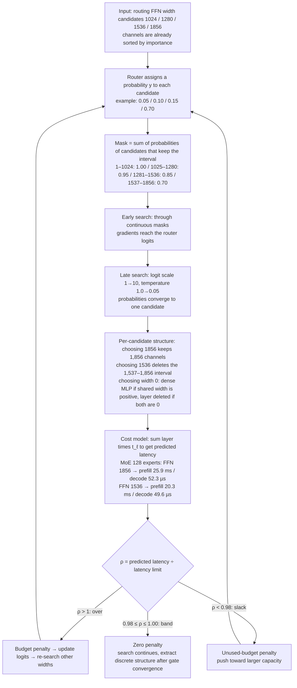

[Paper](https://arxiv.org/abs/2611.08290v1)
## AutoCompress: Model Compression That Puts Serving Constraints Directly into the Search Objective

## Introduction

When engineers deploy a large language model to a real service, the first question they hit is not "how much should we shrink it?" but "which axis should we shrink, and by how much, to survive on this device and this workload?" AutoCompress (NVIDIA, arXiv:2611.08290) turns that question into a cost model measured directly in the serving engine, and finds the answer by putting latency, throughput, and memory limits into the architecture search objective. This post starts from the problem that "parameter count alone cannot predict serving cost," then covers examples of what remains and what disappears when one axis is narrowed, each step of the method, and results from three deployment scenarios and the 120B single-GPU case, in that order.

## 1. Problem: Parameter Count Alone Cannot Predict Serving Cost

### 1.1 Terms We Need First

Reading a compression paper requires distinguishing the components that make up serving cost.

| Term | Meaning | Why it matters |
| --- | --- | --- |
| latency | time for a single request to finish | key metric for services where a human waits each turn, such as game NPCs |
| throughput | tokens processed per unit time | on servers with bursty requests, total volume determines serving cost |
| GPU memory | device memory where weights and per-request state reside | exceeding the limit means the model itself will not fit |
| MoE (Mixture of Experts) | layer that uses only some of several small FFN experts | many parameters but little compute → compression axes appear in expert count and width |
| Mamba / SSM | layer that keeps past information in a recurrent state | uses a state cache instead of a KV cache → this state size also enters the memory calculation |
| FFN width | intermediate hidden size inside an expert | shrinking it reduces parameters and compute together |
| top-k routing | activates only the top k experts | reducing the expert count changes this selection rule itself |
| knowledge distillation | method that uses a large model's output probabilities as the training target for a smaller model | standard means of recovering quality lost to compression |
| supernet / router | a bundle of candidates sharing weights, plus a decision network choosing which size to use | allows searching combinations on the order of $10^{42}$–$10^{52}$ without training each one |

### 1.2 Same Parameter Count, Different Latency

The paper's first figure shows where the problem starts. On an RTX 5070, running two architectures with the same total parameter count of 3.61B (1.26B active), the wider and shallower one recorded 674 ms and the narrower and deeper one 911 ms. The narrower, deeper one is 35% slower (Figure 1a). Conversely, on an H100, two architectures producing the same throughput (~7,355 and ~7,375 tok/s) had 8.8B and 19.3B parameters, one 2.2x the other (Figure 1b).

In other words, parameter count alone cannot predict serving cost. The cost of processing one request depends jointly on the architecture's shape (width, depth, expert count), the workload (batch size, context length), the hardware, and which kernels the serving engine chooses.

### 1.3 Three Services Require Different Limits

| | Game NPC | Local coding agent | Data center inference |
| --- | --- | --- | --- |
| Hardware | 1× RTX 5070 (12 GB) | 1× RTX 5080 (16 GB) | 8× H100 (TP1 × DP8) |
| Parent model | Nemotron Nano 3 Elastic 12B (12.4B / 2.1B active) | Nemotron 3.5 Lightning (31.6B / 3.6B active) | Nemotron 3.5 Lightning (31.6B / 3.6B active) |
| Workload | batch 1, input 2,048 + output 256 tokens | batch 1, cache 262,144 + input 16,384 + output 1,024 tokens | batch 128 per GPU, input 8,192 + output 65,536 tokens |
| Limit | latency ≤ 750 ms, memory ≤ 4.0 GiB | latency ≤ 11.5 s, memory ≤ 13.96 GiB | ≥ 7,330 tok/s per GPU (+50% vs. parent) |
| Parent measured | 1,147 ms, 8.76 GiB | 12.44 s, 23.67 GiB | 4,922 tok/s per GPU |

The rationale for each limit is as follows. The 4 GiB in the game scenario leaves 8 GiB for rendering, the 750 ms follows voice-agent standards, and the workload length comes from the upper bound on sample length in the NPC Dialogue V2 dataset (§4.1). The 11.5 s in the local coding scenario is the average time for one LLM step in a real production coding-agent trace (TraceLab), and 13.96 GiB is the limit vLLM sets with its default memory utilization on an RTX 5080. The TP1×DP8, batch-128 combination for the data center was chosen by sweeping parallel layouts and batch sizes to the point where whole-node throughput is maximized.

The parent model fails to meet the target in every scenario. In other words, the fact that "we must compress" is already settled, and the remaining question was "what shape should the reduction take?"

### 1.4 Memory Prediction Is Also Wrong When Approximate

Apart from parameter count, the memory estimation method itself also misses serving cost by a wide margin. The paper's appendix reports that the conventional approach—weights (at deployment precision) + per-request KV cache + recurrent state + MoE activation buffers—underestimates vLLM memory by 31%–43% on six real RTX serving models (Appendix B.1).

Two examples in Figure 12 show the gap. For the 3.6B model (39 layers) on an RTX 5070, the conventional formula gave 2.58 GiB, the paper's cost model 3.99 GiB, and the measurement 3.93 GiB (limit 4.0 GiB). For the 13.6B model (52 layers) on an RTX 5080, the values were 9.36, 13.95, and 13.61 GiB, respectively (limit 13.96 GiB). Breaking down the composition of measured memory, in the RTX 5070 example the parameter formula accounted for 66%, "workspace sized by the widest layer" for 15%, and the remaining 19% for page-cache rounding plus CUDA context, graph pools, and non-PyTorch memory. In the RTX 5080 example the shares were 69%, 24%, and 7%.

Breaking the calculation into explicit terms cut the error by about an order of magnitude. This error shows that the convention of adding weights, KV cache, recurrent state, and MoE activation buffers misses serving memory, which means that without a cost model it is hard to set a compression target.

## 2. A Small Example: What Remains and What Disappears When One Axis Is Narrowed

### 2.1 The Mask Determines the "Surviving Channels"

Consider an axis with only two candidates, width 64 and width 128. If channels are sorted by importance, which candidate you pick determines which channels survive. The paper states the rule as follows (§2.3).

- Channels 1–64: both candidates keep them, so the mask value is always 1
- Channels 65–128: they survive only when the width-128 candidate is chosen, so the mask value is $y_{128}$

The mask value is "the sum of probabilities of the candidates that keep that component." This one line is AutoCompress's unit of search.

Applying the same rule to the routing FFN width candidate set in Table 2 (1856, 1536, 1280, 1024), suppose the router gives probabilities $y_{1024}=0.05$, $y_{1280}=0.10$, $y_{1536}=0.15$, $y_{1856}=0.70$, as in an illustrative example (not experimental numbers from the paper).

| Channel interval | Survival condition | Mask value | Remaining state |
| --- | --- | --- | --- |
| 1–1024 | all candidates include it | 1.00 | always remains in the computation |
| 1025–1280 | width 1280 or larger chosen | 0.95 | 5% diluted |
| 1281–1536 | width 1536 or larger chosen | 0.85 | 15% diluted |
| 1537–1856 | width 1856 chosen | 0.70 | 30% diluted |

Early in the search these values move continuously between 0 and 1, and gradients reach the router logits through the mask. As the search proceeds, the logit scale $\kappa_t$ increases linearly from 1 to 10 and the temperature $\tau_t$ drops geometrically from 1.0 to 0.05 (§4.4), so the probabilities converge to one candidate. Once converged, the mask hardens into a deterministic choice that keeps only the top widths by importance (Figure 3b).

### 2.2 The Limit Forces This Choice

The structure determined by the mask goes straight into the cost model. In the profiling table of Figure 4, narrowing the FFN width of the same MoE layer (128 experts) from 1856 to 1536 lowers that layer's prefill time from 25.9 ms to 20.3 ms and its decode step from 52.3 µs to 49.6 µs. In the same table, reducing Mamba heads from 64 to 48 takes prefill from 6.1 ms to 4.5 ms and decode from 42.8 µs to 31.9 µs.

Summing the per-layer times obtained this way produces the predicted latency T, and the decision uses the ratio $\rho$ of T to the limit. If $\rho > 1$, the budget is exceeded and incurs a penalty; if $\rho < 0.98$, the search is seen as "leaving capacity unused by saving too much of the limit" and a penalty pushes it toward larger capacity. Only in the 98%–100% band is the penalty zero (§2.3). Allowing a width-0 candidate expresses layer removal within this framework. If the routing width is 0 and the shared width is positive, the layer becomes a dense MLP; if both widths are 0, the layer itself disappears (§2.2). The layer time of a removed layer is treated as 0.

The $\rho$ branch in the diagram has three paths: over ($\rho>1$), slack ($\rho<0.98$), and the 98%–100% band. Both over and slack update the router logits through penalties, and in the band the penalty is zero. The mask values 0.95, 0.85, and 0.70 are probability sums, so during the search they are continuous values between 0 and 1; when the probabilities converge to one candidate, they harden to 1 or 0.

## 3. Method

### 3.1 Deployment Target and Four-Step Procedure

AutoCompress takes a "deployment target $\mathcal{D}$" as input. $\mathcal{D}$ specifies the hardware, serving configuration, precision, and workload, including batch size, cached prefix length, and input/output lengths. On top of that sit a memory limit, a latency limit, or a throughput requirement (or a combination) (§2.1).

The overall procedure has four steps.

1. Build a cost model tailored to the target deployment environment (§3).
2. Sort the parent model's components by importance and reorder the weights to initialize a supernet in which candidates share weights (§2.2).
3. Train the architecture router and the supernet together, using a distillation loss from the frozen parent plus resource penalties (§2.3).
4. Detach the selected architecture from the parent weights and recover quality through distillation (§2.4).

### 3.2 Search Space and Shared Weights

The search axes split into global and per-layer axes. Hidden size is global; the Mamba head count is treated as a global candidate set (64, 56, 48, 40, 32) for Lightning 3.5 and per layer as "keep 64 or remove" for Nano 3 12B. The per-layer axes are the routing expert count $E_\ell$, routing FFN width $F_\ell$, and shared FFN width $S_\ell$, each with its own logits per layer. Candidate values are determined by the parent model and the deployment target.

| Axis | Nemotron 3.5 Lightning (RTX 5080 / H100) | Nemotron Nano 3 12B (RTX 5070) |
| --- | --- | --- |
| Hidden size | 2688, 2432, 2176, 1920, 1664, 1408 | 1920, 1792, 1664, 1536, 1408, 1280 |
| Mamba head count | 64, 56, 48, 40, 32 (global) | 64 or removed (per layer) |
| Routing expert count | 128, 112, 96, 80, 64 | 128, 96, 64, 32 |
| Routing FFN width | 1856, 1536, 1280, 1024 | 960, 704, 448, 192, 0 |
| Shared FFN width | 3712, 2816, 1920 | 3712, 2688, 1856, 1024, 0 |
| Depth | fixed (Mamba and MoE layers removable) | same |

Before deployment constraints are applied, the number of candidate combinations is about $2.37\times10^{42}$ for Lightning 3.5 and about $1.20\times10^{52}$ for Nano 3 12B (§4.2). These combinations cannot be profiled one by one or distilled one by one. So the method uses two devices.

First, **weight sharing**. For candidates of different widths to use the same weights, there must be an order of "which channel to keep first." AutoCompress ranks the parent's components (residual channels, Mamba heads within a head group, experts, routing and shared FFN channels) by activation-based importance, then reorders the weights so that higher-ranked ones come first (§2.2, a procedure taken from Minitron's importance-based pruning). A width-1856 candidate uses the first 1,856 of this order, and a width-1536 candidate uses only the first 1,536. Thus every candidate shares the prefix of the same supernet weights.

### 3.3 The Router Draws a Probability per Candidate to Build a Soft Mask

For each axis, the router learns a logit $z_c$ for each candidate value. The choice is sampled with Gumbel-softmax (Equation 1).

$$y_c=\frac{\exp((\kappa_t z_c+g_c)/\tau_t)}{\sum_j \exp((\kappa_t z_j+g_j)/\tau_t)}$$

$z_c$ is the logit of choice $c$, $g_c$ is independent standard Gumbel noise, and the sum in the denominator runs over all choices on that axis. $\kappa_t$ (logit scale) sets how strongly the learned preference is reflected relative to the noise, and $\tau_t$ (temperature) sets how close the relaxed choice gets to one-hot. The process seen earlier, where "the mask hardens from continuous values to a decision," is driven by tuning these two scales.

The sampled probabilities turn directly into the soft masks from §2.1. Thanks to these masks, gradients reach the architecture choices, continuously tuning the relaxed choice instead of scoring candidates discretely. One batch of 2,048 sequences (8,192 tokens each) is split evenly into 32 independently sampled configurations (§4.4).

### 3.4 Cost Model: Latency and Throughput

Instead of profiling the whole architecture directly, **measure per-layer times and add them up** (§3.1).

$$\hat{T}^{(a|\mathcal{D})}=T_0(d|\mathcal{D})+\sum_{\ell=1}^{L} t_\ell(a_\ell; d|\mathcal{D})$$

$d$ is the global hidden size, $L$ is the parent's layer count, $a_\ell$ is the configuration of layer $\ell$, $t_\ell$ is the measured GPU time of that layer (0 for removed layers), and $T_0$ is a fixed term combining embedding, LM head, sampling, and serving-engine overhead.

The measurement procedure is summarized in Figure 4. About 10 different layer configurations are placed into one short model filled with dummy weights and run in the actual serving engine, and an Nsight Systems trace is cut at layer boundaries to read prefill and decode separately. A single run fills in measurements for multiple layers. Example rows from Figure 4 are as follows (profiling model, hidden size 1408).

| Hidden size | Layer configuration | Prefill (ms) | Decode (µs) |
| --- | --- | --- | --- |
| 1408 | Mamba, 64 heads | 6.1 | 42.8 |
| 1408 | Mamba, 48 heads | 4.5 | 31.9 |
| 1408 | MoE, 128 experts, FFN width 1856 | 25.9 | 52.3 |
| 1408 | MoE, 128 experts, FFN width 1536 | 20.3 | 49.6 |
| 1408 | MoE, 96 experts, FFN width 1856 | 25.6 | 51.8 |
| 1408 | Attention, 32 heads | 857.1 | 213.5 |
| 1408 | non-layer (embedding, head, overhead) | 685.0 | 262.0 |

What this table shows is that the cost of an individual layer varies greatly by structure. Reducing MoE FFN width from 1856 to 1536 (5.6 ms) has a larger effect than reducing Mamba heads from 64 to 48 (1.6 ms), and attention layers and non-layer overhead account for a large share of prefill time in this profile. The savings vary widely by layer, showing that which axis to shrink is an important question in the search.

Note that a throughput requirement is expressed as an "upper bound on serving time" under a fixed workload (§2.3, Appendix C).

### 3.5 Cost Model: Memory

Memory is computed in five terms (§3.2).

$$\hat{M}^{(a|\mathcal{D})}=W+C+P+R+\epsilon_{\mathcal{D}}$$

- $W$: weights, computed from tensor shapes and deployment precision.
- $C$: request cache, the sum of the attention KV cache and the Mamba convolution/SSM cache, sized by the target sequence length and batch size.
- $P$: prefill workspace, governed by the query-head configuration and prefill chunk size.
- $R$: runtime buffers, including the MoE matmul workspace and the Mamba projection workspace, sized by the widest of the relevant layers.
- $\epsilon_{\mathcal{D}}$: the rest that cannot be modeled, such as CUDA context and graph allocations. It is set to the maximum difference between measured memory and $W+C+P+R$ across several server startups.

The slack term $\epsilon_{\mathcal{D}}$ is collected during latency profiling without extra runs (Figure 4). Deployment precision is summarized in Appendix C. Experts, shared experts, and the LM head are stored in NVFP4, Mamba projections in FP8, attention in BF16, the KV cache in FP8, and the Mamba state in FP32. In other words, "what is stored in which number format" is the backbone of the memory-limit calculation.

### 3.6 The Objective Mixes Quality and Budget into One Equation

The router and supernet are trained together, and the objective is the sum of the distillation loss and resource penalties (§2.3, Equation 2).

$$\mathcal{L}=\mathcal{L}_{\mathrm{KD}}+\alpha\sum_r\left[\max(0,\rho_r-1)+\max(0,\,1-\delta-\rho_r)\right]$$

$\mathcal{L}_{\mathrm{KD}}$ is the forward KL from the frozen parent's token distribution to the sampled supernet's distribution. $\rho_r$ is the predicted cost under the soft architecture divided by that resource's budget. If the latency cap is $T_{\max}$, then $\rho_T=T/T_{\max}$. $\alpha$ balances resource constraints against distillation, and $\delta$ is the allowed unused budget. The paper uses $\delta=0.02$, so the penalty is zero only in the 98%–100% band of each cap. $\alpha$ was chosen as 0.3 from an H100 sweep and reused on the RTX 5080, while 1 was used on the tighter RTX 5070 (§4.4).

### 3.7 Extraction and Recovery

When the search converges (each gate gives the leading candidate a probability of at least 0.95), the candidate with the largest logit at each router gate is chosen to fix a discrete architecture, and that structure is re-evaluated with the cost model. Then the corresponding slice is cut from the importance-sorted parent weights for initialization, and quality is recovered through logit distillation (§2.4). Recovery **starts from the parent's sorted weights, not from the trained supernet weights.** The student receives only the parent's output logits as a supervision signal, and both methods are trained on the same data in the same order with the same batch size and learning-rate schedule (batch 2,048 sequences × 8,192 tokens, max learning rate $4\times10^{-5}$, min $5\times10^{-6}$) (§4.5).

### 3.8 Baseline: Minitron++

Existing pruning techniques do not directly support AutoCompress's combined search space and deployment constraints. So the paper adapts Minitron's pruning and screening procedure to its own cost model to build a baseline called **Minitron++** (§4.3). The conditions are as follows.

- It uses the same cost model, the same importance-sorted parent, and the same deployment budget.
- However, **per-layer widths must be uniform** and all layers are kept.
- Candidates are drawn from the combinations in Table 2, but only for the RTX 5070 are Mamba head counts allowed from 64 down to 8 in steps of 8, and width-0 candidates are excluded.
- Only candidates that reach at least 95% of each resource cap and cannot increase any axis further without shrinking another axis or violating a constraint are kept → 6, 11, and 95 candidates on the RTX 5070/5080/H100, respectively. The reason for using a wider band than AutoCompress's 2% band is that with a 2% band only one candidate survives at most on the RTX 5080.
- Each candidate receives 100 distillation iterations (about 1.7B tokens), and the candidate with the lowest average loss over iterations 76–100 is chosen. On the H100, the 95 candidates are first sorted by loss and only the top 5 are trained.
- The final selected architecture receives the same recovery training as the AutoCompress student.

In short, the key difference in the comparison is whether per-layer widths are uniform and all layers are kept, or whether width and expert count are searched differently per layer.

## 4. Results

### 4.1 Accuracy Under the Same Budget

These are the results in Table 3. Avg8 is the unweighted average of scores on eight benchmarks: AIME25, LiveCodeBench v5, MMLU-Pro, MATH-500, GSM8K, IFEval, IFBench, and GPQA-Diamond. IFEval and IFBench use prompt-level strict accuracy, and the rest use pass@1 (§4.6). Search tokens are the amount used for structure selection, KD tokens are the amount used for recovery training, and KD loss is the average over the last 25 iterations.

| Scenario | Method | Search tokens | KD tokens | KD loss | AIME25 | LCB v5 | MMLU-Pro | MATH-500 | GSM8K | IFEval | IFBench | GPQA | Avg8 |
| --- | --- | --- | --- | --- | --- | --- | --- | --- | --- | --- | --- | --- | --- |
| RTX 5070 | AutoCompress | 4.18B | 30B | 0.1909 | 0.42 | 1.11 | 26.46 | 36.40 | 47.54 | 55.13 | 24.49 | 21.78 | **26.67** |
| RTX 5070 | Minitron++ | 8.49B | 30B | 0.2366 | 0.00 | 0.48 | 19.76 | 29.90 | 34.29 | 43.76 | 17.43 | 15.21 | 20.10 |
| RTX 5080 | AutoCompress | 2.85B | 10B | 0.1637 | 52.71 | 49.44 | 67.45 | 93.60 | 92.87 | 83.64 | 55.61 | 55.87 | **68.90** |
| RTX 5080 | Minitron++ | 8.57B | 10B | 0.1710 | 48.75 | 43.81 | 67.89 | 92.70 | 92.93 | 79.57 | 49.83 | 56.94 | 66.55 |
| 8×H100 | AutoCompress | 3.00B | 10B | 0.1809 | 55.42 | 48.02 | 64.80 | 92.80 | 92.49 | 82.53 | 53.74 | 53.09 | **67.86** |
| 8×H100 | Minitron++ | 9.98B | 10B | 0.1820 | 53.54 | 47.78 | 64.43 | 92.85 | 92.72 | 81.38 | 52.04 | 53.60 | 67.29 |

Across the three scenarios, the Avg8 differences are 6.57, 2.35, and 0.57 percentage points, and the final distillation losses are 19.3%, 4.3%, and 0.6% lower (§5.1). Of the three results, the gain is largest on the RTX 5070 and smallest on the H100.

Search cost also dropped. The architecture-selection tokens used by Minitron++ are about 2.0x, 3.0x, and 3.3x those of AutoCompress (§5.2), in the order RTX 5070, RTX 5080, H100. Recovery training tokens are identical for both methods, so this saving belongs to the structure-selection stage. Search tokens can be seen as the amount consumed up to the point where the structure is fixed out of 250 steps (batch 2,048×8,192 tokens). The fixing points are step 170 on the RTX 5080, step 249 on the RTX 5070, and step 179 on the H100, which correspond to 2.85B, 4.18B, and 3.00B, respectively (§4.4).

### 4.2 Budget Compliance Confirmed by Measurement

Figure 5 shows how full each resource is relative to the latency and memory limits or the H100 throughput target. The denominator of each ratio is the corresponding limit or target.

| Resource utilization (vs. limit/target) | Parent | AutoCompress | Minitron++ |
| --- | --- | --- | --- |
| RTX 5070 · latency | 152.9% | 98.6% | 95.4% |
| RTX 5070 · memory | 218.9% | 98.3% | 99.2% |
| RTX 5080 · latency | 108.2% | 96.6% | 94.9% |
| RTX 5080 · memory | 169.5% | 97.5% | 98.7% |
| 8×H100 · throughput per GPU | 67.2% | 101.0% | 102.1% |

In both RTX scenarios, the AutoCompress student measured 739.7 ms and 3.93 GiB (RTX 5070), and 11.1 s and 13.61 GiB (RTX 5080), meeting both latency and memory limits, and on the H100 it exceeded the throughput target (Figure 2, §5.1). The exact absolute latency and memory values of the Minitron++ student are not reported in the paper; only the ratios in Figure 5 are given.

### 4.3 Scaling: 120B on a Single B200

The estimated BF16 serving memory of Nemotron 3.5 Super (120B) is about 280 GB, which exceeds the 180 GB capacity of a B200. This case was not a matter of slightly exceeding the budget; without compression, the goal of single-B200 BF16 serving could not be met at all. The model selected by AutoCompress supports a maximum batch of 16 at a 131,072-token context and uses a measured 178 GB (Figure 6a). Parameters dropped from 120B to about 74B, a 38.3% reduction.

The selected structure has per-layer MoE routing expert counts of 240–496 and MoE intermediate sizes of 1536–2560 (the parent has 512 and 2688, respectively), and keeps 88 backbone layers, a hidden size of 4096, and a shared-expert intermediate size of 5376 (Appendix D). The search converged within 4B tokens, and recovery used 68B tokens at 8,192 context and 48B tokens at 131,072 context, for 120B tokens in total. Search and recovery used 32 GB200 nodes (128 GPUs) for about 64 hours.

Quality is 54.74 as the unweighted average of nine metrics (GDPval-AA v2 as an index, the other eight as percentages), 2.85 points below the parent's 57.58. It is also 9.30 points above the 45.44 average of the 120B reference model Nemotron 3 Super (Figure 6b, Figure 14). In this case the Minitron++ baseline was not run because of training cost, so the improvement over the existing method is not reported in the paper.

### 4.4 Why the Search Chose That Structure

In the diagnostic record of the RTX 5080 search (Figure 9, §6.3), the shared-expert intermediate size settled first and stayed at its maximum size. Mamba heads and hidden size settled next (the main text §6.3 says iterations 41 and 50; the Figure 9 labels say 42 and 52), and routing width (iteration 129) and expert count (iteration 155) settled last. The distillation gradient norm was large for shared and global choices, while the budget gradient norm was large for the remaining MoE choices.

The choice to keep the shared experts is consistent with relatively low serving cost. At hidden size 2688, cutting the shared-expert intermediate size nearly in half saves only 7.5 ms and 5 MiB per layer, whereas cutting the MoE intermediate size similarly saves 33.7 ms and 307 MiB per layer. Even for the same width reduction, axes with large and small savings are clearly distinct, and keeping the shared experts reads as a choice that preserved the low-cost axis.

On the H100, AutoCompress and Minitron++ chose the same hidden size and Mamba head count. The difference came on the MoE side. Minitron++ keeps the routing expert count and intermediate size the same across layers, while AutoCompress chose both differently per layer. Under the same throughput target, AutoCompress's distillation loss was 0.6% lower and its Avg8 was 0.57 percentage points higher (§6.3).

### 4.5 Effect of Two Design Choices

The configuration that initializes the router output layer to zero and removes router warmup produced a distillation loss 10.9% lower than the random-initialization + warmup configuration (Figure 7, §6.1). Random initialization creates a selection bias, and learning-rate warmup limits the early updates that would correct that bias before the distribution sharpens.

The MoE expert masking method is also compared. Top-k score masking reduces traffic to experts that survive only in larger architecture candidates, nearly eliminating the gradient those experts give the router. In contrast, output masking, which applies the mask after selection, keeps access to those experts during the search. Output masking distributes experts evenly, keeps distillation gradients stable, and lowered distillation loss by 23% (Figure 8, §6.2). In the KD gradient graph of Figure 8, the difference between the two methods is shown as ≈430x.

## 5. Limitations and When to Apply It

I start with the limitations visible in the paper.

**The additive assumption of the cost model.** Because it predicts total latency by summing per-layer measured times, predictions can miss when kernel selection, cache behavior, or overhead changes as the architecture changes (§3.1). The paper validates predictions on held-out architectures not used to build the timing table. The median absolute error was 0.6% for RTX 5070 latency, 1.7% for RTX 5080 latency, and 1.6% for H100 throughput (Figure 11). However, validation was done within the target serving engine and hardware. Also, variance across repeated runs and error bars are not reported in the paper, so the benchmark scores in Table 3 should be read as point estimates from the final checkpoint.

**Tied to a single serving engine.** All serving was done in vLLM 0.27.1, and the cost model is built by profiling directly on the target hardware, workload, and precision (§4.1, Appendix C). If the engine or hardware changes, profiling must be redone. This cost is not negligible (Table 4).

| Deployment target | Number of runs | Timing table entries | GPU hours |
| --- | --- | --- | --- |
| Local coding (RTX 5080) | 60 | 468 | 3.5 |
| Data center throughput (H100) | 180 | 408 | 24.8 |
| On-device NPC (RTX 5070) | 96 | 660 | 4.5 |

Building a cost model for just one H100 data-center target took 180 runs and 24.8 GPU hours. This value is separate from search tokens and is a fixed cost of preparing a cost model for each deployment target.

**A comparison gap in the scaling case.** The 120B→74B case did not run Minitron++, so this paper alone cannot show the improvement over the existing method.

**Narrow evaluation scope.** Avg8 is the unweighted average of eight benchmark scores; IFEval and IFBench use prompt-level strict accuracy, and the rest use pass@1. Results were obtained on Nemotron-family parent models with hybrid Mamba, attention, and MoE structures. Generalization to models with other structures was not validated, and because this paper deals with compression of a pretrained parent, it does not evaluate pretraining convergence itself.

From a reviewer's perspective, the fact that the cost model is measurement-based is both an accuracy advantage and an operational burden. The profiling pipeline must be maintained whenever the deployment environment changes. In addition, because the cost model is calibrated to the fixed workloads in Table 1, cost accuracy when real traffic departs from the assumed batch and length distribution is not validated in the paper. The comparison is also limited to a deployment-adapted Minitron++, so there is no comparison with other per-layer search tools in the paper.

In summary, AutoCompress fits best teams that have fixed deployment hardware and workload, have the resources to profile a cost model in that environment, and can perform distillation recovery after compression. Its value is especially high in cases like on-device game NPCs or compressing a 120B model to 74B to fit on a single B200, where it removes the manual work of translating deployment requirements into a parameter budget. Conversely, if the serving engine or hardware changes often, profiling cost grows, and generalization to other structures or other baselines is not confirmed in the paper.

<!-- verbatim-tables -->

Tables from the paper

> Tables converted mechanically from the arXiv e-print LaTeX source. The numbers are the paper's own and did not pass through a model.

**Table 1. Deployment settings.**

|  | **On-device game NPC** | **Local coding agent** | **Datacenter inference** |
|---|---|---|---|
| Hardware | 1$\times$ RTX 5070 (12 GB) | 1$\times$ RTX 5080 (16 GB) | 8$\times$ H100, TP1 $\times$ DP8 |
| Parent | Nemotron Nano 3 Elastic 12B (12.4B / 2.1B active) | Nemotron 3.5 Lightning (31.6B / 3.6B active) | Nemotron 3.5 Lightning (31.6B / 3.6B active) |
| Workload | batch size 1; 2,048 input + 256 output tokens | batch size 1; 262,144 cached + 16,384 input + 1,024 output tokens | batch size 128 per GPU; 8,192 input + 65,536 output tokens |
| Latency / throughput target | latency $\le$ 750 ms | latency $\le$ 11.5 s | throughput $\ge$7,330 tok/s per GPU (+50% over the parent) |
| Memory target | $\le$4.0 GiB | $\le$13.96 GiB | -- |
| Parent cost | 1,147 ms, 8.76 GiB | 12.44 s, 23.67 GiB | 4,922 tok/s per GPU |

**Table 2. Candidate values for learned architecture search. Hidden size is global; expert counts and FFN widths vary by layer.**

| **Dimension** | **Lightning 3.5: RTX 5080 / H100** | **Nano 3 12B: RTX 5070** |
|---|---|---|
| Hidden size $d$ | 2688, 2432, 2176, 1920, 1664, 1408 | 1920, 1792, 1664, 1536, 1408, 1280 |
| Mamba $H$ | 64, 56, 48, 40, 32 (global) | 64 or remove (per layer) |
| Routed experts $E_\ell$ | 128, 112, 96, 80, 64 | 128, 96, 64, 32 |
| Routed FFN width $F_\ell$ | 1856, 1536, 1280, 1024 | 960, 704, 448, 192, 0 |
| Shared FFN width $S_\ell$ | 3712, 2816, 1920 | 3712, 2688, 1856, 1024, 0 |
| Depth | Fixed | Mamba and MoE layers may be removed |

**Table 3. **Accuracy and architecture-selection tokens under matched deployment budgets.** Search tokens count architecture selection; KD tokens count recovery training. KD loss is averaged over the final 25 iterations on matched batches. Benchmark scores are final-checkpoint pass@1 (%), with prompt-level strict accuracy for IFEval and IFBench. Evaluation follows \S; Avg$_8$ averages the eight benchmarks.**

| Contract | Method | Search tokens $\downarrow$ | KD tokens | KD loss $\downarrow$ | AIME25 | LiveCodeBench | MMLU-Pro | MATH-500 | GSM8K | IFEval | IFBench | GPQA | Avg$_8$ |
|---|---|---|---|---|---|---|---|---|---|---|---|---|---|
| RTX 5070 |  | **4.18B** | 30B | **0.1909** | **0.42** | **1.11** | **26.46** | **36.40** | **47.54** | **55.13** | **24.49** | **21.78** | **26.67** |
|  | Minitron++ | 8.49B | 30B | 0.2366 | 0.00 | 0.48 | 19.76 | 29.90 | 34.29 | 43.76 | 17.43 | 15.21 | 20.10 |
| RTX 5080 |  | **2.85B** | 10B | **0.1637** | **52.71** | **49.44** | 67.45 | **93.60** | 92.87 | **83.64** | **55.61** | 55.87 | **68.90** |
|  | Minitron++ | 8.57B | 10B | 0.1710 | 48.75 | 43.81 | **67.89** | 92.70 | **92.93** | 79.57 | 49.83 | **56.94** | 66.55 |
| 8$\times$H100 |  | **3.00B** | 10B | **0.1809** | **55.42** | **48.02** | **64.80** | 92.80 | 92.49 | **82.53** | **53.74** | 53.09 | **67.86** |
|  | Minitron++ | 9.98B | 10B | 0.1820 | 53.54 | 47.78 | 64.43 | **92.85** | **92.72** | 81.38 | 52.04 | **53.60** | 67.29 |

**Table 4. Measurement cost of each contract's latency cost model (Table ).**

| **Contract** | **Runs** | **Table entries** | **GPU-h** |
|---|---|---|---|
| Local coding (RTX 5080) | 60 | 468 | 3.5 |
| Datacenter throughput (H100) | 180 | 408 | 24.8 |
| On-device NPC (RTX 5070) | 96 | 660 | 4.5 |

