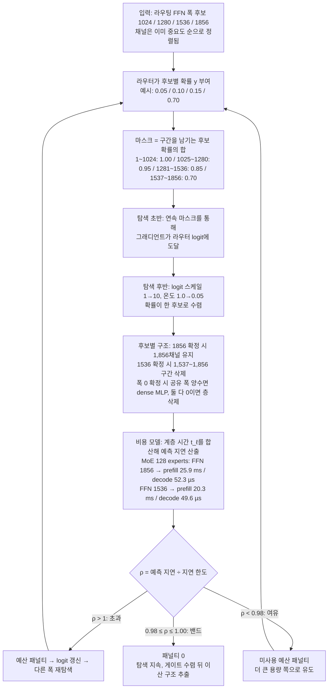

[논문 링크](https://arxiv.org/abs/2611.08290v1)
## AutoCompress: 서빙 제약을 탐색 목적함수에 직접 넣는 모델 압축

## 들어가며

대형 언어 모델을 실제 서비스에 올릴 때 엔지니어가 제일 먼저 부딪히는 질문은 "얼마나 줄여야 하지?"가 아니라 "어느 축을 얼마나 줄여야 이 기기와 이 워크로드에서 버틸까?"다. AutoCompress(NVIDIA, arXiv:2611.08290)는 이 질문을 서빙 엔진에서 직접 측정한 비용 모델로 바꾸고, 지연·처리량·메모리 한도를 아키텍처 탐색의 목적함수에 넣어 답을 찾는다. 이 글은 "파라미터 수만으로는 서빙 비용을 예측할 수 없다"는 문제에서 출발해, 한 축을 좁혔을 때 남는 것과 사라지는 것의 예시, 방법의 각 단계, 세 배포 시나리오와 120B 단일 GPU 사례의 결과 순으로 정리한다.

## 1. 문제: 파라미터 수만으로는 서빙 비용을 예측할 수 없다

### 1.1 먼저 필요한 용어

압축 논문을 읽으려면 서빙 비용을 구성하는 항목을 구분해 두어야 한다.

| 용어 | 뜻 | 왜 필요한가 |
| --- | --- | --- |
| 지연 시간(latency) | 요청 하나가 끝날 때까지 걸리는 시간 | 게임 NPC처럼 사람이 매 턴 기다리는 서비스의 핵심 지표 |
| 처리량(throughput) | 단위 시간당 처리하는 토큰 수 | 요청이 몰리는 서버에서는 총량으로 서비스 비용이 결정됨 |
| GPU 메모리 | 가중치와 요청별 상태가 상주하는 장치 메모리 | 한도를 넘으면 모델 자체가 올라가지 않음 |
| MoE(전문가 혼합) | 여러 작은 FFN 전문가 중 일부만 골라 쓰는 계층 | 파라미터는 많지만 계산은 적은 구조 → 압축 축이 전문가 수와 폭으로 생김 |
| Mamba / SSM | 순환 상태로 과거 정보를 유지하는 계층 | KV 캐시 대신 상태 캐시를 씀 → 이 상태 크기도 메모리 계산에 들어감 |
| FFN 폭 | 전문가 내부의 중간 은닉 크기 | 줄이면 파라미터와 연산량이 함께 줄어듦 |
| top-k 라우팅 | 전문가 중 상위 k개만 활성화 | 전문가 수를 줄이면 이 선택 규칙 자체가 달라짐 |
| 증류(knowledge distillation) | 큰 모델의 출력 확률을 작은 모델의 학습 목표로 삼는 방법 | 압축으로 잃은 품질을 되찾는 표준 수단 |
| 슈퍼넷 / 라우터 | 후보들이 가중치를 공유하는 묶음과, 그중 어느 크기를 쓸지 고르는 결정망 | 후보 조합이 $10^{42}$~$10^{52}$ 규모여도 개별 학습 없이 탐색하게 해 줌 |

### 1.2 같은 파라미터 수, 다른 지연

논문의 첫 그림이 문제의 출발점을 보여준다. RTX 5070에서 전체 파라미터 3.61B(활성 1.26B)로 파라미터 수가 같은 두 아키텍처를 돌렸을 때, 폭이 넓고 얕은 쪽은 674ms, 폭이 좁고 깊은 쪽은 911ms를 기록했다. 좁고 깊은 쪽의 지연이 35% 크다(Figure 1a). 반대로 H100에서 같은 처리량(~7,355와 ~7,375 tok/s)을 내는 두 아키텍처의 파라미터 수는 8.8B와 19.3B로, 한쪽이 다른 쪽의 2.2배였다(Figure 1b).

즉 파라미터 수만으로는 서빙 비용을 예측할 수 없다. 요청 하나를 처리하는 비용은 아키텍처의 모양(폭·깊이·전문가 수), 워크로드(배치 크기, 컨텍스트 길이), 하드웨어, 그리고 서빙 엔진이 어떤 커널을 고르는지에 함께 달려 있다.

### 1.3 세 가지 서비스는 서로 다른 한도를 요구한다

| | 게임 NPC | 로컬 코딩 에이전트 | 데이터센터 추론 |
| --- | --- | --- | --- |
| 하드웨어 | 1× RTX 5070 (12 GB) | 1× RTX 5080 (16 GB) | 8× H100 (TP1 × DP8) |
| 부모 모델 | Nemotron Nano 3 Elastic 12B (12.4B / 활성 2.1B) | Nemotron 3.5 Lightning (31.6B / 활성 3.6B) | Nemotron 3.5 Lightning (31.6B / 활성 3.6B) |
| 워크로드 | 배치 1, 입력 2,048 + 출력 256 토큰 | 배치 1, 캐시 262,144 + 입력 16,384 + 출력 1,024 토큰 | GPU당 배치 128, 입력 8,192 + 출력 65,536 토큰 |
| 한도 | 지연 ≤ 750 ms, 메모리 ≤ 4.0 GiB | 지연 ≤ 11.5 s, 메모리 ≤ 13.96 GiB | GPU당 ≥ 7,330 tok/s(부모 대비 +50%) |
| 부모 실측 | 1,147 ms, 8.76 GiB | 12.44 s, 23.67 GiB | GPU당 4,922 tok/s |

각 한도의 근거는 다음과 같다. 게임 시나리오의 4 GiB는 렌더링에 쓸 8 GiB를 남기기 위한 값이고, 750ms는 보이스 에이전트 표준에 맞춘 것이며, 워크로드 길이는 NPC Dialogue V2 데이터셋의 표본 길이 상한에서 가져왔다(§4.1). 로컬 코딩 시나리오의 11.5초는 실제 프로덕션 코딩 에이전트 트레이스(TraceLab)에서 LLM 한 스텝이 걸린 평균 시간이고, 13.96 GiB는 vLLM이 RTX 5080에서 기본 메모리 사용률로 잡는 한도다. 데이터센터의 TP1×DP8·배치 128 조합은 병렬 레이아웃과 배치 크기를 훑어 노드 전체 처리량이 최대가 되는 지점으로 골랐다.

부모 모델은 어느 시나리오에서도 목표를 충족하지 못한다. 즉 "압축해야 한다"는 사실은 이미 정해져 있고, 남은 문제는 "어떤 모양으로 줄일 것인가"였다.

### 1.4 메모리 예측도 대략으로는 틀린다

파라미터 수와 별개로, 메모리 산정 방식 자체도 서빙 비용을 크게 놓친다. 논문 부록은 가중치(배포 정밀도 기준) + 요청 KV 캐시 + 순환 상태 + MoE 활성화 버퍼로만 계산하는 기존 방식이, 여섯 개의 실제 RTX 서빙 모델에서 vLLM 메모리를 31~43% 과소평가한다고 보고한다(Appendix B.1).

Figure 12의 두 예가 그 차이를 보여준다. RTX 5070의 3.6B 모델(39층)에서 기존 공식은 2.58 GiB, 논문의 비용 모델은 3.99 GiB, 실측은 3.93 GiB였다(한도 4.0 GiB). RTX 5080의 13.6B 모델(52층)에서는 각각 9.36, 13.95, 13.61 GiB였다(한도 13.96 GiB). 실측 메모리의 구성 비율을 뜯어보면, RTX 5070 예시에서 파라미터 공식이 차지한 몫은 66%, "가장 넓은 계층 기준으로 잡은 워크스페이스"가 15%, 나머지 19%는 페이지 캐시 라운딩과 CUDA 컨텍스트·그래프 풀·비-PyTorch 메모리였다. RTX 5080 예시에서는 각각 69%, 24%, 7%였다.

명시적인 항으로 쪼개 계산하면 오차가 약 한 자릿수 줄었다. 이 오차는 가중치·KV 캐시·순환 상태·MoE 활성화 버퍼를 더하는 관습으로는 서빙 메모리를 놓친다는 사실을 보여 주며, 비용 모델 없이는 압축 목표를 정하기 어렵다는 뜻이다.

## 2. 작은 예시: 한 축을 좁히면 무엇이 남고 무엇이 사라지는가

### 2.1 마스크는 "살아남는 채널"을 정한다

후보가 폭 64와 128 두 개뿐인 축을 생각하자. 채널이 중요도 순으로 정렬돼 있다면, 어떤 후보를 골랐느냐에 따라 살아남는 채널이 달라진다. 논문은 이 규칙을 이렇게 표현한다(§2.3).

- 채널 1~64: 두 후보가 모두 유지하므로 마스크 값은 항상 1
- 채널 65~128: 폭 128 후보를 골랐을 때만 살아남으므로 마스크 값은 $y_{128}$

마스크 값은 "그 구성요소를 유지하는 후보들의 확률 합"이다. 이 한 줄이 AutoCompress의 탐색 단위다.

논문 표 2의 라우팅 FFN 폭 후보 집합(1856, 1536, 1280, 1024)에 같은 규칙을 적용해 보면, 설명용 예시(논문의 실험 수치가 아니다)처럼 라우터가 확률 $y_{1024}=0.05$, $y_{1280}=0.10$, $y_{1536}=0.15$, $y_{1856}=0.70$을 주었다고 하자.

| 채널 구간 | 살아남는 조건 | 마스크 값 | 남아 있는 상태 |
| --- | --- | --- | --- |
| 1~1024 | 모든 후보가 포함 | 1.00 | 항상 계산에 남음 |
| 1025~1280 | 폭 1280 이상 선택 | 0.95 | 5%가 희석됨 |
| 1281~1536 | 폭 1536 이상 선택 | 0.85 | 15%가 희석됨 |
| 1537~1856 | 폭 1856 선택 | 0.70 | 30%가 희석됨 |

탐색 초반에는 이 값들이 0과 1 사이에서 연속적으로 움직이고, 마스크를 통해 그래디언트가 라우터 logit에 도달한다. 탐색이 진행되면 logit 스케일 $\kappa_t$가 1에서 10으로 선형 증가하고 온도 $\tau_t$가 1.0에서 0.05로 기하급수적으로 내려가면서(§4.4), 확률이 한 후보로 수렴한다. 수렴하면 마스크는 중요도 순 상위 폭만 남기는 결정적 선택으로 굳는다(Figure 3b).

### 2.2 한도가 이 선택을 강제한다

마스크로 정해진 구조는 곧바로 비용 모델에 들어간다. Figure 4의 프로파일링 표에서 같은 MoE 층(128 experts)의 FFN 폭을 1856에서 1536으로 좁히면, 해당 층의 prefill 시간이 25.9ms에서 20.3ms로, decode 스텝이 52.3µs에서 49.6µs로 내려간다. 같은 표에서 Mamba 헤드를 64에서 48로 줄이면 prefill 6.1ms→4.5ms, decode 42.8µs→31.9µs다.

이렇게 얻은 계층별 시간을 합해 예측 지연 T를 만들고, 이를 한도로 나눈 비율 $\rho$로 판단한다. $\rho > 1$이면 예산 초과로 패널티를 받고, $\rho < 0.98$이면 "한도를 너무 아껴 남는 용량이 있다"고 보고 패널티로 더 큰 용량을 유도한다. 오직 98~100% 구간에서만 패널티가 0이다(§2.3). 폭 0 후보를 허용하면 이 틀 안에서 계층 제거까지 표현된다. 라우팅 폭이 0이고 공유 폭이 양수면 그 층은 밀집 MLP가 되고, 두 폭이 모두 0이면 층 자체가 사라진다(§2.2). 사라진 층의 계층 시간은 0으로 처리된다.

도식의 $\rho$ 분기는 초과($\rho>1$), 여유($\rho<0.98$), 98~100% 밴드의 세 경로다. 초과와 여유는 모두 패널티를 통해 라우터 logit을 갱신하고, 밴드에서는 패널티가 0이다. 마스크 0.95·0.85·0.70은 확률의 합이므로 탐색 중에는 0과 1 사이의 연속값이고, 확률이 한 후보로 수렴하면 1 또는 0으로 굳는다.

## 3. 방법

### 3.1 배포 대상과 네 단계 절차

AutoCompress는 "배포 대상 $\mathcal{D}$"를 입력으로 받는다. $\mathcal{D}$는 하드웨어, 서빙 설정, 정밀도, 그리고 배치 크기·캐시된 접두사 길이·입출력 길이를 포함한 워크로드를 규정한다. 그 위에 메모리 한도, 지연 한도 또는 처리량 요구(또는 조합)가 얹힌다(§2.1).

전체 절차는 네 단계다.

1. 대상 배포 환경에 맞는 비용 모델을 만든다(§3).
2. 부모 모델의 구성요소를 중요도 순으로 정렬하고 가중치를 재배열해, 후보들이 가중치를 공유하는 슈퍼넷을 초기화한다(§2.2).
3. 아키텍처 라우터와 슈퍼넷을, 동결된 부모로부터의 증류 손실과 자원 패널티를 함께 써서 학습한다(§2.3).
4. 선택된 아키텍처를 부모 가중치에서 떼어내고 증류로 품질을 복구한다(§2.4).

### 3.2 탐색 공간과 공유 가중치

탐색 축은 전역 축과 계층별 축으로 나뉜다. 은닉 크기는 전역이고, Mamba 헤드 수는 Lightning 3.5에서 전역 후보(64, 56, 48, 40, 32)로, Nano 3 12B에서는 층별로 "64 유지 또는 제거"로 다뤄진다. 층마다 다른 축에는 라우팅 전문가 수 $E_\ell$, 라우팅 FFN 폭 $F_\ell$, 공유 FFN 폭 $S_\ell$이 있으며, 이 축에는 층마다 별도 logit이 생긴다. 후보 값은 부모 모델과 배포 대상에 따라 정해진다.

| 축 | Nemotron 3.5 Lightning (RTX 5080 / H100) | Nemotron Nano 3 12B (RTX 5070) |
| --- | --- | --- |
| 은닉 크기 | 2688, 2432, 2176, 1920, 1664, 1408 | 1920, 1792, 1664, 1536, 1408, 1280 |
| Mamba 헤드 수 | 64, 56, 48, 40, 32 (전역) | 64 또는 제거 (층별) |
| 라우팅 전문가 수 | 128, 112, 96, 80, 64 | 128, 96, 64, 32 |
| 라우팅 FFN 폭 | 1856, 1536, 1280, 1024 | 960, 704, 448, 192, 0 |
| 공유 FFN 폭 | 3712, 2816, 1920 | 3712, 2688, 1856, 1024, 0 |
| 깊이 | 고정 (Mamba·MoE 층은 제거 가능) | 동일 |

후보 조합 수는 배포 제약을 적용하기 전에 Lightning 3.5에서 약 $2.37\times10^{42}$, Nano 3 12B에서 약 $1.20\times10^{52}$개다(§4.2). 이 조합을 하나씩 프로파일링하거나 하나씩 증류할 수는 없다. 그래서 두 가지 장치를 쓴다.

첫째, **가중치 공유**다. 서로 다른 폭의 후보가 같은 가중치를 쓰려면 "어느 채널을 먼저 살릴지" 순서가 있어야 한다. AutoCompress는 부모의 구성요소(잔차 채널, 헤드 그룹 내부의 Mamba 헤드, 전문가, 라우팅·공유 FFN 채널)를 활성화 기반 중요도로 랭킹한 뒤, 순위가 높은 것이 앞에 오도록 가중치를 재배열한다(§2.2, Minitron의 중요도 기반 가지치기에서 가져온 절차). 폭이 1856인 후보는 이 순서의 앞 1,856개를, 폭이 1536인 후보는 앞 1,536개만 쓴다. 그래서 모든 후보가 같은 슈퍼넷 가중치의 앞부분을 공유한다.

### 3.3 라우터는 후보마다 확률을 뽑아 소프트 마스크를 만든다

라우터는 각 축에 대해 후보 값별 logit $z_c$를 학습한다. 선택은 Gumbel-softmax로 샘플링한다(Equation 1).

$$y_c=\frac{\exp((\kappa_t z_c+g_c)/\tau_t)}{\sum_j \exp((\kappa_t z_j+g_j)/\tau_t)}$$

$z_c$는 선택 $c$의 logit, $g_c$는 독립 표준 Gumbel 노이즈, 분모의 합은 그 축의 모든 선택에 걸친다. $\kappa_t$(logit 스케일)는 노이즈에 비해 학습된 선호를 얼마나 강하게 반영할지 정하고, $\tau_t$(온도)는 완화된 선택이 one-hot에 얼마나 가까워질지를 정한다. 앞서 예시에서 본 "마스크가 연속값에서 결정으로 굳는" 과정이 이 두 스케일의 조종으로 이뤄진다.

샘플링된 확률은 곧바로 §2.1에서 본 소프트 마스크로 바뀐다. 이 마스크 덕분에 그래디언트가 아키텍처 선택까지 도달해, 후보를 이산적으로 점수 매기는 대신 완화된 선택을 연속적으로 조율한다. 한 배치의 2,048 시퀀스(각 8,192 토큰)는 32개의 독립 샘플링 구성으로 균등하게 나뉜다(§4.4).

### 3.4 비용 모델: 지연과 처리량

전체 아키텍처를 직접 프로파일링하는 대신, **층 단위 시간을 측정해 더한다**(§3.1).

$$\hat{T}^{(a|\mathcal{D})}=T_0(d|\mathcal{D})+\sum_{\ell=1}^{L} t_\ell(a_\ell; d|\mathcal{D})$$

$d$는 전역 은닉 크기, $L$은 부모의 층 수, $a_\ell$는 $\ell$번째 층의 구성, $t_\ell$는 해당 층의 측정 GPU 시간(제거된 층은 0), $T_0$는 임베딩·LM 헤드·샘플링·서빙 엔진 오버헤드를 합친 고정항이다.

측정 절차는 Figure 4에 정리돼 있다. 더미(dummy) 가중치로 채운 짧은 모델 하나에 서로 다른 층 구성 약 10개를 넣어 실제 서빙 엔진에서 돌리고, Nsight Systems 트레이스를 층 경계에서 잘라 prefill과 decode를 따로 읽는다. 한 번의 실행이 여러 층의 측정치를 채운다. Figure 4에 실린 예시 행은 다음과 같다(프로파일링용 모델, 은닉 크기 1408).

| 은닉 크기 | 층 구성 | Prefill (ms) | Decode (µs) |
| --- | --- | --- | --- |
| 1408 | Mamba, 64 헤드 | 6.1 | 42.8 |
| 1408 | Mamba, 48 헤드 | 4.5 | 31.9 |
| 1408 | MoE, 128 experts, FFN 폭 1856 | 25.9 | 52.3 |
| 1408 | MoE, 128 experts, FFN 폭 1536 | 20.3 | 49.6 |
| 1408 | MoE, 96 experts, FFN 폭 1856 | 25.6 | 51.8 |
| 1408 | Attention, 32 헤드 | 857.1 | 213.5 |
| 1408 | 비계층(임베딩·헤드·오버헤드) | 685.0 | 262.0 |

이 표가 보여 주는 건 개별 층의 비용이 구조마다 크게 다르다는 사실이다. Mamba 헤드를 64에서 48로 줄이는 효과(1.6ms)보다 MoE FFN 폭을 1856에서 1536으로 줄이는 효과(5.6ms)가 크고, 어텐션 층과 비계층 오버헤드가 이 프로파일에서는 prefill 시간의 큰 몫을 차지한다. 층마다 절감 폭이 크게 달라, 어느 축을 줄일지가 탐색에서 중요한 문제임을 보여 준다.

단, 처리량 요구는 고정 워크로드에서 "서빙 시간의 상한"으로 바꿔 표현한다(§2.3, Appendix C).

### 3.5 비용 모델: 메모리

메모리는 다섯 항으로 나눠 계산한다(§3.2).

$$\hat{M}^{(a|\mathcal{D})}=W+C+P+R+\epsilon_{\mathcal{D}}$$

- $W$: 가중치. 텐서 모양과 배포 정밀도에서 계산한다.
- $C$: 요청 캐시. 어텐션 KV 캐시와 Mamba 컨볼루션·SSM 캐시를 합친 값이며, 목표 시퀀스 길이와 배치 크기로 크기를 정한다.
- $P$: prefill 워크스페이스. 쿼리 헤드 구성과 prefill 청크 크기에 좌우된다.
- $R$: 런타임 버퍼. MoE 행렬곱 워크스페이스와 Mamba 투영 워크스페이스를 포함하며, 관련 층 중 가장 넓은 층 기준으로 크기를 잡는다.
- $\epsilon_{\mathcal{D}}$: CUDA 컨텍스트, 그래프 할당 등 모델링하지 못한 나머지. 여러 서버 기동에서 측정 메모리와 $W+C+P+R$의 차이를 구한 뒤 그 최댓값으로 잡는다.

여유항 $\epsilon_{\mathcal{D}}$은 지연 프로파일링 과정에서 추가 실행 없이 함께 수집된다(Figure 4). 배포 정밀도는 Appendix C에 정리돼 있다. 전문가·공유 전문가·LM 헤드는 NVFP4, Mamba 투영은 FP8, 어텐션은 BF16, KV 캐시는 FP8, Mamba 상태는 FP32로 저장한다. 즉 "무엇을 어떤 숫자로 저장하는지"가 메모리 한계 계산의 뼈대다.

### 3.6 목적함수는 품질과 예산을 한 식으로 섞는다

라우터와 슈퍼넷은 함께 학습되며, 목적함수는 증류 손실과 자원 패널티의 합이다(§2.3, Equation 2).

$$\mathcal{L}=\mathcal{L}_{\mathrm{KD}}+\alpha\sum_r\left[\max(0,\rho_r-1)+\max(0,\,1-\delta-\rho_r)\right]$$

$\mathcal{L}_{\mathrm{KD}}$는 동결된 부모의 토큰 분포에서 샘플링된 슈퍼넷의 분포로 가는 forward KL이다. $\rho_r$는 소프트 아키텍처에서 예측한 비용을 그 자원의 예산으로 나눈 값이다. 지연 상한이 $T_{\max}$이면 $\rho_T=T/T_{\max}$로 정의된다. $\alpha$는 자원 제약과 증류 사이의 균형, $\delta$는 허용되는 미사용 예산이다. 논문은 $\delta=0.02$를 써서 각 상한의 98~100% 구간에서만 패널티가 0이 되게 한다. $\alpha$는 H100 스윕으로 0.3을 골라 RTX 5080에 재사용했고, 한도가 더 빡빡한 RTX 5070에서는 1을 썼다(§4.4).

### 3.7 추출과 복구

탐색이 수렴하면(각 게이트가 선두 후보에 0.95 이상의 확률을 주면) 각 라우터 게이트에서 logit이 가장 큰 후보를 골라 이산적인 아키텍처를 확정하고, 그 구조를 비용 모델로 다시 평가한다. 이어서 중요도 정렬된 부모 가중치에서 해당 부분을 잘라 초기화하고 로짓 증류로 품질을 복구한다(§2.4). 복구는 **학습된 슈퍼넷 가중치가 아니라 부모의 정렬된 가중치에서 시작한다.** 학생은 부모의 출력 로짓만을 감독 신호로 받고, 두 방법 모두 같은 데이터를 같은 순서, 같은 배치 크기와 학습률 일정으로 훈련받는다(배치 2,048 시퀀스 × 8,192 토큰, 최대 학습률 $4\times10^{-5}$, 최소 $5\times10^{-6}$)(§4.5).

### 3.8 비교 대상: Minitron++

기존 가지치기 기법은 AutoCompress의 결합 탐색 공간과 배포 제약을 그대로 지원하지 않는다. 그래서 논문은 Minitron의 가지치기·스크리닝 절차를 자기 비용 모델에 맞게 고쳐 **Minitron++** 라는 기준선을 만든다(§4.3). 조건은 다음과 같다.

- 같은 비용 모델, 같은 중요도 정렬 부모, 같은 배포 예산을 쓴다.
- 대신 **층별 폭이 균일**해야 하고 모든 층을 유지한다.
- 후보는 표 2의 조합에서 뽑되, RTX 5070만 Mamba 헤드 수를 64부터 8까지 8 간격으로 허용하고 폭 0 후보를 제외한다.
- 각 자원 상한의 95% 이상이면서, 어떤 축도 다른 축을 줄이거나 제약을 위반하지 않고는 더 키울 수 없는 후보만 남긴다 → RTX 5070/5080/H100에서 각각 6, 11, 95개. AutoCompress가 쓰는 2% 밴드보다 넓은 이유는, 2% 밴드로는 RTX 5080에서 최대 후보가 하나만 남아서다.
- 각 후보에 100회의 증류 반복(약 1.7B 토큰)을 돌리고, 반복 76~100의 평균 손실이 가장 낮은 후보를 고른다. H100에서는 95개 후보를 손실로 먼저 정렬해 상위 5개만 훈련한다.
- 최종 선택된 아키텍처는 AutoCompress 학생과 동일한 복구 훈련을 받는다.

즉 비교의 핵심 차이는 층별 폭을 균일하게 두고 모든 층을 유지하는지, 계층별로 폭과 전문가 수를 다르게 탐색하는지에 있다.

## 4. 결과

### 4.1 같은 예산 아래에서의 정확도

표 3의 결과다. Avg8은 AIME25, LiveCodeBench v5, MMLU-Pro, MATH-500, GSM8K, IFEval, IFBench, GPQA-Diamond 여덟 벤치마크 점수의 비가중 평균이다. IFEval·IFBench는 프롬프트 수준 strict accuracy, 나머지는 pass@1이다(§4.6). 탐색 토큰은 구조 선택, KD 토큰은 복구 훈련에 쓰인 양이고, KD 손실은 마지막 25회 반복의 평균이다.

| 시나리오 | 방법 | 탐색 토큰 | KD 토큰 | KD 손실 | AIME25 | LCB v5 | MMLU-Pro | MATH-500 | GSM8K | IFEval | IFBench | GPQA | Avg8 |
| --- | --- | --- | --- | --- | --- | --- | --- | --- | --- | --- | --- | --- | --- |
| RTX 5070 | AutoCompress | 4.18B | 30B | 0.1909 | 0.42 | 1.11 | 26.46 | 36.40 | 47.54 | 55.13 | 24.49 | 21.78 | **26.67** |
| RTX 5070 | Minitron++ | 8.49B | 30B | 0.2366 | 0.00 | 0.48 | 19.76 | 29.90 | 34.29 | 43.76 | 17.43 | 15.21 | 20.10 |
| RTX 5080 | AutoCompress | 2.85B | 10B | 0.1637 | 52.71 | 49.44 | 67.45 | 93.60 | 92.87 | 83.64 | 55.61 | 55.87 | **68.90** |
| RTX 5080 | Minitron++ | 8.57B | 10B | 0.1710 | 48.75 | 43.81 | 67.89 | 92.70 | 92.93 | 79.57 | 49.83 | 56.94 | 66.55 |
| 8×H100 | AutoCompress | 3.00B | 10B | 0.1809 | 55.42 | 48.02 | 64.80 | 92.80 | 92.49 | 82.53 | 53.74 | 53.09 | **67.86** |
| 8×H100 | Minitron++ | 9.98B | 10B | 0.1820 | 53.54 | 47.78 | 64.43 | 92.85 | 92.72 | 81.38 | 52.04 | 53.60 | 67.29 |

세 시나리오에서 Avg8 차이는 각각 6.57, 2.35, 0.57%포인트, 최종 증류 손실은 19.3%, 4.3%, 0.6% 낮다(§5.1). 세 결과 중 RTX 5070의 이득이 가장 크고 H100의 이득이 가장 작았다.

탐색 비용도 줄었다. Minitron++가 사용한 아키텍처 선택 토큰은 AutoCompress의 약 2.0배, 3.0배, 3.3배다(§5.2). 이는 RTX 5070, RTX 5080, H100 순이다. 복구 훈련 토큰은 두 방법이 동일하므로, 이 절감은 구조 선택 단계에 해당한다. 탐색 토큰은 250스텝(배치 2,048×8,192 토큰) 중 구조를 확정한 시점까지 소비한 양으로 볼 수 있다. 확정 시점은 RTX 5080 170스텝, RTX 5070 249스텝, H100 179스텝이고, 이는 각각 2.85B, 4.18B, 3.00B와 맞는다(§4.4).

### 4.2 실측으로 확인된 예산 준수

Figure 5는 각 자원이 지연·메모리 한도 또는 H100 처리량 목표에 대해 어느 정도 채워졌는지를 보여준다. 비율의 분모는 해당 한도 또는 목표다.

| 자원 사용률(한도·목표 대비) | 부모 | AutoCompress | Minitron++ |
| --- | --- | --- | --- |
| RTX 5070 · 지연 | 152.9% | 98.6% | 95.4% |
| RTX 5070 · 메모리 | 218.9% | 98.3% | 99.2% |
| RTX 5080 · 지연 | 108.2% | 96.6% | 94.9% |
| RTX 5080 · 메모리 | 169.5% | 97.5% | 98.7% |
| 8×H100 · GPU당 처리량 | 67.2% | 101.0% | 102.1% |

두 RTX 시나리오에서 AutoCompress 학생은 실측으로 739.7ms·3.93GiB(RTX 5070), 11.1s·13.61GiB(RTX 5080)를 기록해 지연·메모리 한도를 함께 지켰고, H100에서는 목표 처리량을 넘겼다(Figure 2, §5.1). Minitron++ 학생의 정확한 절대 지연·메모리 값은 원문 미보고이고, Figure 5의 비율만 제시된다.

### 4.3 규모 확장: 120B를 단일 B200에

Nemotron 3.5 Super(120B)의 BF16 서빙 예상 메모리는 약 280GB로, B200의 180GB 용량을 넘는다. 이 사례는 예산을 조금 넘긴 수준이 아니라, 압축 없이는 단일 B200 BF16 서빙 목표를 충족할 수 없는 문제였다. AutoCompress로 선택한 모델은 131,072 토큰 컨텍스트에서 최대 배치 16을 지원하며 실측 178GB를 쓴다(Figure 6a). 파라미터는 120B에서 약 74B로 38.3% 줄었다.

선택된 구조는 계층별로 MoE 라우팅 전문가 수 240~496, MoE 중간 크기 1536~2560이고(부모는 각각 512와 2688), 88개의 백본 층과 은닉 크기 4096, 공유 전문가 중간 크기 5376은 유지했다(Appendix D). 탐색은 4B 토큰 안에 수렴했고, 복구는 8,192 컨텍스트로 68B 토큰, 131,072 컨텍스트로 48B 토큰, 총 120B 토큰을 썼다. 탐색과 복구에는 32개의 GB200 노드(128 GPU)를 약 64시간 사용했다.

품질은 아홉 개 지표(GDPval-AA v2는 지수, 나머지 여덟 개는 백분율)의 비가중 평균으로 54.74이며, 부모의 57.58보다 2.85포인트 낮다. 또한 120B 참조 모델인 Nemotron 3 Super의 평균 45.44보다 9.30포인트 높다(Figure 6b, Figure 14). 이 케이스에서는 훈련 비용 때문에 Minitron++ 기준선을 돌리지 않았으므로, 기존 방법 대비 개선폭은 원문 미보고다.

### 4.4 탐색은 왜 그런 구조를 골랐는가

RTX 5080 탐색의 진단 기록(Figure 9, §6.3)에서 공유 전문가 중간 크기가 가장 먼저 정착해 최대 크기 그대로 유지됐다. 이어 Mamba 헤드와 은닉 크기가 정착했고(본문 §6.3은 41·50회차, Figure 9 라벨은 42·52회차로 적는다), 라우팅 폭(129회차)과 전문가 수(155회차)가 가장 늦게 정착했다. 증류 그래디언트 norm은 공유·전역 선택에서 크고, 예산 그래디언트 norm은 나머지 MoE 선택에서 컸다.

공유 전문가를 남긴 선택은 상대적으로 낮은 서빙 비용과 일관된다. 은닉 크기 2688에서 공유 전문가 중간 크기를 거의 절반으로 줄여도 층당 7.5ms와 5MiB만 절약되지만, MoE 중간 크기를 비슷하게 줄이면 층당 33.7ms와 307MiB가 절약된다. 같은 폭 감소라도 절감 효과가 큰 축과 작은 축이 뚜렷하며, 공유 전문가 유지는 비용이 낮은 축을 남긴 선택으로 읽힌다.

H100에서는 AutoCompress와 Minitron++가 같은 은닉 크기와 Mamba 헤드 수를 골랐다. 차이는 MoE 쪽에서 났다. Minitron++는 라우팅 전문가 수와 중간 크기를 층마다 같게 두지만, AutoCompress는 둘 다 층별로 다르게 골랐다. 같은 처리량 목표에서 AutoCompress의 증류 손실은 0.6% 낮고 Avg8은 0.57%포인트 높았다(§6.3).

### 4.5 두 가지 설계 선택의 효과

라우터 출력층을 0으로 초기화하고 라우터 warmup을 제거하는 구성은, 랜덤 초기화 + warmup 구성보다 10.9% 낮은 증류 손실을 냈다(Figure 7, §6.1). 랜덤 초기화는 선택 편향을 만들고, 학습률 warmup은 분포가 뾰족해지기 전에 그 편향을 교정할 초기 업데이트를 제한하기 때문이다.

MoE 전문가 마스킹 방식도 비교 대상이다. top-k 점수 마스킹은 더 큰 아키텍처 후보에서만 살아남는 전문가로 보내는 트래픽을 줄여, 그 전문가가 라우터에 주는 그래디언트를 거의 없앤다. 반대로 선택 이후에 마스크를 적용하는 출력 마스킹은 탐색 중에도 해당 전문가에 접근을 유지한다. 출력 마스킹은 전문가가 고르게 분배되고 증류 그래디언트가 안정적으로 유지되며, 증류 손실을 23% 낮췄다(Figure 8, §6.2). Figure 8의 KD 그래디언트 그래프에는 두 방식의 차이가 ≈430배로 표시돼 있다.

## 5. 한계와 적용 판단

원문에 드러난 한계부터 정리한다.

**비용 모델의 가법 가정이다.** 층별 측정 시간을 더해 전체 지연을 예측하기 때문에, 아키텍처가 바뀌면서 커널 선택이나 캐시 동작, 오버헤드가 달라지면 예측이 빗나갈 수 있다(§3.1). 논문은 타이밍 표를 만들 때 쓰지 않은 held-out 아키텍처로 예측을 검증한다. 중앙 절대 오차는 RTX 5070 지연 0.6%, RTX 5080 지연 1.7%, H100 처리량 1.6%였다(Figure 11). 다만 검증은 대상 서빙 엔진과 하드웨어 안에서 이뤄졌다. 또한 반복 실행의 분산이나 오차막대는 원문 미보고라, 표 3의 벤치마크 점수는 최종 체크포인트의 점 추정치로 읽어야 한다.

**단일 서빙 엔진에 묶여 있다.** 모든 서빙은 vLLM 0.27.1에서 이뤄졌고, 비용 모델은 목표 하드웨어·워크로드·정밀도에서 직접 프로파일링해 만든다(§4.1, Appendix C). 엔진이나 하드웨어가 바뀌면 프로파일링을 다시 해야 한다. 이 비용은 무시할 만하지 않다(Table 4).

| 배포 대상 | 실행 횟수 | 타이밍 표 항목 | GPU 시간 |
| --- | --- | --- | --- |
| 로컬 코딩 (RTX 5080) | 60 | 468 | 3.5 |
| 데이터센터 처리량 (H100) | 180 | 408 | 24.8 |
| 온디바이스 NPC (RTX 5070) | 96 | 660 | 4.5 |

H100 데이터센터 대상 하나에만 비용 모델을 만드는 데 180회 실행과 24.8 GPU시간이 들었다. 이 값은 탐색 토큰과 별개로, 배포 대상마다 비용 모델을 준비하는 고정 비용이다.

**규모 확장 케이스의 비교 공백이다.** 120B→74B 케이스에서는 Minitron++를 돌리지 않았고, 그 결과 이 논문만으로 기존 방법 대비 개선 폭은 알 수 없다.

**평가 범위가 좁다.** Avg8은 여덟 벤치마크 점수의 비가중 평균이며, IFEval·IFBench는 프롬프트 수준 strict accuracy, 나머지는 pass@1이다. 결과는 하이브리드 Mamba·어텐션·MoE 구조의 Nemotron 계열 부모 모델에서 얻었다. 다른 구조의 모델에 대한 일반화는 검증되지 않았고, 이 논문은 사전학습된 부모의 압축을 다루므로 사전학습 수렴 자체를 평가하지 않는다.

리뷰어 관점에서 보태면, 비용 모델이 측정 기반이라는 사실은 정확성의 장점이 동시에 운영 부담이다. 배포 환경이 바뀔 때마다 프로파일링 파이프라인을 유지해야 한다. 또한 비용 모델은 표 1의 고정 워크로드로 보정되므로, 실제 트래픽이 가정한 배치·길이 분포를 벗어날 때의 비용 정확도는 원문에서 검증되지 않는다. 비교 대상도 deployment-adapted Minitron++로 한정되므로, 다른 계층별 탐색 도구와의 비교는 원문에 없다.

정리하면, AutoCompress는 배포 하드웨어와 워크로드가 확정돼 있고, 그 환경에서 비용 모델을 프로파일링할 여력이 있으며, 압축 후 증류 복구가 가능한 팀에 가장 잘 맞는다. 특히 온디바이스 게임 NPC나 120B 모델을 74B로 압축해 단일 B200에 올리는 사례처럼, 배포 요구를 파라미터 예산으로 번역하는 수작업을 없애는 가치가 크다. 반대로 서빙 엔진·하드웨어가 자주 바뀌면 프로파일링 비용이 커지고, 다른 구조나 다른 기준선에 대한 일반화는 원문에서 확인되지 않았다.

<!-- verbatim-tables -->

논문 원문의 표

> arXiv e-print 의 LaTeX 원본에서 기계적으로 옮긴 표입니다. 숫자는 논문의 값이며 모델을 거치지 않았습니다.

**표 1. Deployment settings.**

|  | **On-device game NPC** | **Local coding agent** | **Datacenter inference** |
|---|---|---|---|
| Hardware | 1$\times$ RTX 5070 (12 GB) | 1$\times$ RTX 5080 (16 GB) | 8$\times$ H100, TP1 $\times$ DP8 |
| Parent | Nemotron Nano 3 Elastic 12B (12.4B / 2.1B active) | Nemotron 3.5 Lightning (31.6B / 3.6B active) | Nemotron 3.5 Lightning (31.6B / 3.6B active) |
| Workload | batch size 1; 2,048 input + 256 output tokens | batch size 1; 262,144 cached + 16,384 input + 1,024 output tokens | batch size 128 per GPU; 8,192 input + 65,536 output tokens |
| Latency / throughput target | latency $\le$ 750 ms | latency $\le$ 11.5 s | throughput $\ge$7,330 tok/s per GPU (+50% over the parent) |
| Memory target | $\le$4.0 GiB | $\le$13.96 GiB | -- |
| Parent cost | 1,147 ms, 8.76 GiB | 12.44 s, 23.67 GiB | 4,922 tok/s per GPU |

**표 2. Candidate values for learned architecture search. Hidden size is global; expert counts and FFN widths vary by layer.**

| **Dimension** | **Lightning 3.5: RTX 5080 / H100** | **Nano 3 12B: RTX 5070** |
|---|---|---|
| Hidden size $d$ | 2688, 2432, 2176, 1920, 1664, 1408 | 1920, 1792, 1664, 1536, 1408, 1280 |
| Mamba $H$ | 64, 56, 48, 40, 32 (global) | 64 or remove (per layer) |
| Routed experts $E_\ell$ | 128, 112, 96, 80, 64 | 128, 96, 64, 32 |
| Routed FFN width $F_\ell$ | 1856, 1536, 1280, 1024 | 960, 704, 448, 192, 0 |
| Shared FFN width $S_\ell$ | 3712, 2816, 1920 | 3712, 2688, 1856, 1024, 0 |
| Depth | Fixed | Mamba and MoE layers may be removed |

**표 3. **Accuracy and architecture-selection tokens under matched deployment budgets.** Search tokens count architecture selection; KD tokens count recovery training. KD loss is averaged over the final 25 iterations on matched batches. Benchmark scores are final-checkpoint pass@1 (%), with prompt-level strict accuracy for IFEval and IFBench. Evaluation follows \S; Avg$_8$ averages the eight benchmarks.**

| Contract | Method | Search tokens $\downarrow$ | KD tokens | KD loss $\downarrow$ | AIME25 | LiveCodeBench | MMLU-Pro | MATH-500 | GSM8K | IFEval | IFBench | GPQA | Avg$_8$ |
|---|---|---|---|---|---|---|---|---|---|---|---|---|---|
| RTX 5070 |  | **4.18B** | 30B | **0.1909** | **0.42** | **1.11** | **26.46** | **36.40** | **47.54** | **55.13** | **24.49** | **21.78** | **26.67** |
|  | Minitron++ | 8.49B | 30B | 0.2366 | 0.00 | 0.48 | 19.76 | 29.90 | 34.29 | 43.76 | 17.43 | 15.21 | 20.10 |
| RTX 5080 |  | **2.85B** | 10B | **0.1637** | **52.71** | **49.44** | 67.45 | **93.60** | 92.87 | **83.64** | **55.61** | 55.87 | **68.90** |
|  | Minitron++ | 8.57B | 10B | 0.1710 | 48.75 | 43.81 | **67.89** | 92.70 | **92.93** | 79.57 | 49.83 | **56.94** | 66.55 |
| 8$\times$H100 |  | **3.00B** | 10B | **0.1809** | **55.42** | **48.02** | **64.80** | 92.80 | 92.49 | **82.53** | **53.74** | 53.09 | **67.86** |
|  | Minitron++ | 9.98B | 10B | 0.1820 | 53.54 | 47.78 | 64.43 | **92.85** | **92.72** | 81.38 | 52.04 | **53.60** | 67.29 |

**표 4. Measurement cost of each contract's latency cost model (Table ).**

| **Contract** | **Runs** | **Table entries** | **GPU-h** |
|---|---|---|---|
| Local coding (RTX 5080) | 60 | 468 | 3.5 |
| Datacenter throughput (H100) | 180 | 408 | 24.8 |
| On-device NPC (RTX 5070) | 96 | 660 | 4.5 |

