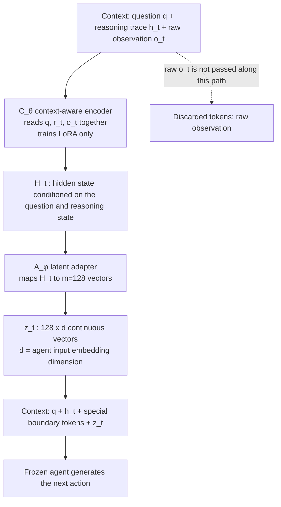

[Paper](https://arxiv.org/abs/2611.06500)
## Long tool observations make agents slow and blur their judgment

The longer tool observations get, the more the context costs to compute and the more judgment wavers. This paper proposes compressing tool results not into text but into continuous vectors, keeping only the information the agent needs to decide its next action. The code is released at <https://github.com/THU-Agent/Coca-cola>.

---

### 1. Terms to read first

| Term | Meaning | Why it matters |
|---|---|---|
| context | All tokens the model has received as input so far, concatenated | The agent chooses its next action from the context alone. The longer it is, the more compute it costs, and irrelevant content creeps in and blurs judgment. |
| tool observation | The result a tool call returns (e.g., web search results) | The length of the raw observation determines the context cost. |
| latent token | A single continuous vector in embedding space, not text | A candidate for packing more information into the same number of input slots. |
| compression rate (Comp_rate) | The reduction ratio of total tokens (input+output) before and after compression | It gives a single number for comparing "how much was cut." |
| EM / F1 | Exact match rate / token-level partial match rate | They show together whether the answer was exactly right or only partially right. |
| KL divergence / cross entropy | Difference between two action distributions / probability loss on the correct action token | The loss that trains the compressor so the latent representation produces "the same action as seeing the raw text." |
| LoRA | A method that trains only a few added weights while keeping a large model frozen | Needed to train only the compressor without touching the agent backbone. |

In this paper, **Coca-Cola** (Context Compression via Continuous Latent Tokens) is a compressor that turns tool observations into latent tokens, and it does not touch the agent backbone.

---

### 2. Problem: context gets eaten by observations

The agent operates in a ReAct fashion. Given a question, it reasons, calls a tool, appends the returned observation to the context, and reasons again. Each step adds reasoning text, tool calls, and observations to the context, so the context length after the `t`-th call is roughly

$$K_t \approx |q| + \sum_{i=1}^{t}\bigl(|r_i| + |a_i| + |o_i|\bigr)$$

Here $|q|$ is the question length, $|r_i|$ the reasoning, $|a_i|$ the tool call, and $|o_i|$ the number of observation tokens. Because search returns several document chunks whole, it is the accumulated observations that grow long.

The result is Fig. 1 (left). In a web search agent that ran up to 4 steps, tool results accounted for **96.7%** of all tokens. A single observation is long as well (median 1,352 tokens, p90 1,776, p95 1,861).

The cost splits two ways: computation, and a drop in accuracy. The question in Fig. 1 (right) is "the birth year of the winner of the 2016 Marrakesh ePrix." A single line in the search results confirming that the winner is Sébastien Buemi is enough to fix the next search ("Sébastien Buemi birth date"). Yet the same results are stuffed with details such as track length, lap count, pole position, and fastest lap, and the model has to read this irrelevant content too.

---

### 3. A small example: what is kept and what is discarded

The observation lengths and latent token counts in the table below come from the paper; the remaining items are organized here for understanding.

| Step | Input | Retained state | What changes or drops | Output |
|---|---|---|---|---|
| ① Search call | question `q` = "What year was the winner of the 2016 Marrakesh ePrix born?" | `q` | — | query "winner of the 2016 Marrakesh ePrix" |
| ② Observation arrives | observation `o_t` = long search results (median 1,352 tokens) | `q`, reasoning trace `r_t` = "winner confirmed as Buemi" | Vanilla appends the entire raw `o_t` to the context (racing details included) | Vanilla: reads `o_t` and picks out only the winner's name |
| ③ Vanilla continues | `[q ; r_t ; o_t]` | `q`, `r_t`, `o_t` | none | next search "Sébastien Buemi birth date" — the evidence is buried in 1,352 tokens |
| ④ Coca-Cola continues | `[q ; r_t ; o_t]` (same) | `q`, `r_t`, and `z_t` = 128 latent tokens | **the raw `o_t` does not enter the context** | the agent reads only `z_t` and chooses the next search or the final answer |

The key is the difference in the last line of ③ and ④. The raw text is not reconstructed. Latent tokens do not need to be readable by humans, so a single token is not constrained to "picking one symbol from a vocabulary list."

---

### 4. Where existing approaches get stuck

There are two families of methods for shrinking observations. **Token pruning** selects and deletes less useful tokens (LLMLingua, LLMLingua-2, LongLLMLingua). **Text summarization** uses an auxiliary LLM to turn observations or dialogue history into a short summary (RECOMP, Search-o1, ACON).

The shared ceiling of both is that the output is still a "human-readable sequence of discrete tokens." Because it has to form sentences, there is a structural limit on how much can be cut. What sets Coca-Cola apart is that it removes this constraint entirely.

The paper quantifies this difference in terms of capacity. Capacity is defined as the log of the number of distinguishable codewords. With vocabulary size $|\mathcal V|$, `n` text tokens give at most $|\mathcal V|^n$ possibilities, so

$$\mathcal{C}_{\text{text}}(n) = n\log_2|\mathcal V|$$

By contrast, for `m` latent tokens of dimension `d`, assuming each token has $d_{\text{eff}} \le d$ effective coordinates and each coordinate carries a value distinguishable at finite precision `B`,

$$\mathcal{C}_{\text{latent}}(m) = m\,d_{\text{eff}}\log_2 B$$

bits. That is, if $d_{\text{eff}}\log_2 B > \log_2|\mathcal V|$, the latent representation has larger capacity at the same number of input slots. The paper, however, adds its own caveat. This is a **maximum capacity** calculation under the assumption that "all coordinate combinations are realizable and distinguishable at finite precision," and the authors state that the amount of information actually usable depends on the encoding ability of the compressor and the utilization ability of the agent.

---

### 5. Method: turning an observation into a few vectors

At the end of every tool call, Coca-Cola takes three inputs and turns them into a **fixed number of latent tokens**: the question `q`, the reasoning trace of the current step `r_t`, and the tool observation `o_t`. The architecture solves two difficulties in order.

**First, make the compression result something the agent can actually read.** The agent accepts tokens by turning them into input embeddings, and the vectors the compressor produces do not belong to that space. So the architecture splits into two parts.

- **Context-aware encoder** $C_\theta$: a small language model that reads `q`, `r_t`, and `o_t` **together** and produces a hidden state. $H_t = C_\theta(q, r_t, o_t)$. The reason for not looking at the observation alone is that which part of the observation is needed depends on the question and the current reasoning state.
- **Latent adapter** $A_\phi$: converts the hidden state into $m$ vectors matched to the agent's embedding dimension. $z_t = A_\phi(H_t) \in \mathbb{R}^{m \times d}$.

These vectors are wrapped in special boundary tokens and inserted into the agent's input embedding sequence.

$$X_t = \bigl[E_\psi(q, h_t);\ E_\psi(\langle \text{latent\_obs}\rangle);\ z_t;\ E_\psi(\langle /\text{latent\_obs}\rangle)\bigr]$$

**Second, keep only the information needed for decision-making within a limited number of slots.** Here the authors exploit in training the fact that the goal is not "reconstructing the raw text." With the agent frozen, they extract the **next-action distribution** for the same question twice: once with the raw text and once with the latent tokens.

$$p_{\text{full}} = p_\psi(\cdot \mid q, h_t, o_t), \qquad p_{\text{latent}} = p_\psi(\cdot \mid q, h_t, z_t)$$

Matching the two distributions is **Action-Preserving Training**, and the loss is the sum of two terms.

$$\mathcal{L} = \lambda_{\mathrm{KL}}\,D_{\mathrm{KL}}(p_{\text{full}} \Vert p_{\text{latent}}) + \lambda_{\mathrm{CE}}\,\mathrm{CE}(y_{t+1},\,p_{\text{latent}})$$

The KL term reduces the difference between "the action chosen when seeing the raw text" and "the action chosen when seeing only the latent tokens," and the cross-entropy term is an auxiliary loss that fits the actually recorded next-action token. Because the latent tokens are continuous vectors and thus differentiable, gradients flow back through the frozen agent into the compressor. $\nabla_{\theta,\phi}\mathcal{L} = \left(\partial z_t/\partial(\theta,\phi)\right)^{\top}\nabla_{z_t}\mathcal{L}$. Only the encoder's LoRA parameters and the adapter are updated.

The training setup in Appendix A is as follows. From 4,188 tasks they built 4,363 (observation, action) pairs, held out 10% for validation, and trained on 3,927 pairs. LoRA rank 16, scaling factor 32, dropout 0.05, 8-bit AdamW (paged), learning rate linearly decayed from 1.5×10⁻⁴ to 5×10⁻⁵, $\lambda_{\mathrm{KL}}=0.3$, $\lambda_{\mathrm{CE}}=1.0$, with the KL weight warmed up over the first 20% of training steps.

**At inference time**, the raw observation is replaced by latent tokens at every tool call, and the agent sees only those vectors. Each observation is compressed into 128 continuous vectors, and web search was limited to at most 5 results per call and at most 5 calls per task.

The full flow, showing what goes where, is as follows.

In the figure, each value means the following. `h_t` is the trace prefix made of the reasoning, calls, and observations so far, `m=128` is the number of latent vectors, and `d` is the input embedding dimension of the target agent. What the arrows carry is the state compressed from `q`, `r_t`, `o_t` into `H_t`, then compressed again into `z_t`. The diagonal dotted line is the **discarded path**: the raw observation does not cross over to the agent. In other words, the compute that shrinks is the "observation tokens" the agent must read at every step, while the compressor itself is newly added compute.

---

### 6. Experimental setup

The evaluation was conducted on a web search agent. The two model pairs are Qwen3.5-35B-A3B + Qwen3.5-4B and GLM-4.7-Flash + GLM-Z1-9B, and the benchmarks are two single-hop (NQ, TriviaQA) and two multi-hop (2Wiki, HotpotQA).

There are four baselines. **Vanilla** (uses the raw text as is), **LongLLMLingua** (token pruning), **LLMSummary** (text summarization), and **ICAE** (the same architecture with only the training objective changed to raw-text reconstruction). Because the authors did not build search-specific designs into Coca-Cola, they argue it can be applied to other tools without architectural changes.

The metrics are accuracy (EM, F1) and system efficiency (average input tokens, output tokens, compression rate, end-to-end runtime), with the compression rate defined as

$$\text{Comp\_rate} = 1 - \frac{I_{\text{latent}} + O_{\text{latent}}}{I_{\text{raw}} + O_{\text{raw}}}$$

Because it sums input and output, the compression rate comes out slightly smaller than the reduction rate seen for input tokens alone. This is why NQ+Qwen cuts input tokens by 87.7% but has a compression rate of 85.78%.

---

### 7. Results

#### 7.1 Tokens and runtime

Qwen pair (Table 1):

| Dataset | Vanilla input/output tokens | Coca-Cola input/output tokens | Compression rate | Vanilla time (s) | Coca-Cola time (s) | Time reduction |
|---|---|---|---|---|---|---|
| NQ | 14,362 / 993 | 1,767 / 418 | 85.78% | 96.19 | 64.64 | 32.8% |
| TriviaQA | 10,023 / 779 | 1,413 / 349 | 83.68% | 73.30 | 55.38 | 24.4% |
| 2Wiki | 37,427 / 1,510 | 10,745 / 933 | 70.01% | 164.99 | 119.91 | 27.3% |
| HotpotQA | 42,724 / 1,560 | 9,429 / 831 | 76.83% | 161.39 | 120.88 | 25.1% |

GLM pair (Table 2):

| Dataset | Vanilla input/output tokens | Coca-Cola input/output tokens | Compression rate | Vanilla time (s) | Coca-Cola time (s) | Time reduction |
|---|---|---|---|---|---|---|
| NQ | 17,389 / 888 | 4,265 / 536 | 73.73% | 89.29 | 42.17 | 52.8% |
| TriviaQA | 11,177 / 739 | 2,595 / 413 | 74.75% | 91.36 | 41.97 | 54.1% |
| 2Wiki | 31,693 / 976 | 3,003 / 511 | 89.24% | 106.37 | 46.83 | 56.0% |
| HotpotQA | 28,782 / 834 | 4,041 / 610 | 84.30% | 84.55 | 49.37 | 41.6% |

Two levels must be distinguished here. **Token savings (70.01%–89.24%) and runtime savings (24.45%–55.97%) differ in magnitude.** The paper does not directly explain why time does not fall as much as the compression rate (not reported in the original). Our inference is that running the compressor (encoder and adapter) at every step accounts for part of it. There is also no separately reported runtime for the compressor alone, nor a reason for the larger savings in the GLM pair (not reported in the original).

Still, runtime was shorter than Vanilla in every setting, by 24.45%–32.80% for the Qwen pair and 41.61%–55.97% for the GLM pair.

#### 7.2 Accuracy does not drop

Reducing Table 3 to Vanilla and Coca-Cola only:

| Model pair | Dataset | Vanilla EM / F1 | Coca-Cola EM / F1 |
|---|---|---|---|
| Qwen | NQ | 23.67 / 33.17 | 24.78 / 37.33 |
| Qwen | TriviaQA | 56.10 / 62.87 | 59.20 / 67.07 |
| Qwen | 2Wiki | 17.30 / 26.94 | 24.00 / 32.34 |
| Qwen | HotpotQA | 11.00 / 16.41 | 25.70 / 33.75 |
| GLM | NQ | 21.50 / 26.08 | 23.50 / 31.45 |
| GLM | TriviaQA | 41.50 / 44.57 | 51.50 / 59.41 |
| GLM | 2Wiki | 26.50 / 31.29 | 28.00 / 36.20 |
| GLM | HotpotQA | 20.50 / 25.89 | 23.50 / 30.76 |

Coca-Cola has higher EM and F1 than Vanilla in all eight settings. It produced the best score in 13 of 16 dataset-metric pairs, and took both EM and F1 in six of the eight model-dataset combinations, including all four GLM combinations. Even with compression of up to 89.24%, answers improved. The authors interpret this as "filtering out irrelevant content in long observations can mitigate the attention dilution problem." The largest gain is Qwen HotpotQA, where EM jumps from 11.00 to 25.70 and F1 from 16.41 to 33.75.

Against the baselines, two patterns appear.

- **ICAE** (same architecture, with only the training objective changed to reconstruction) loses to Coca-Cola on compression rate. Coca-Cola is higher in all eight settings (2Wiki+GLM: 89.24% vs 74.12%). ICAE also trailed in all four GLM settings on accuracy. The exception is Qwen+TriviaQA, where ICAE scored EM 61.80 / F1 69.27, higher than Coca-Cola (59.20 / 67.07). ICAE's compression rate, however, is 66.92%, far below Coca-Cola's 83.68%.
- **LLMSummary** had slightly higher compression rates in three settings: 2Wiki+Qwen (71.30% vs 70.01%), HotpotQA+Qwen (78.90% vs 76.83%), and NQ+GLM (74.62% vs 73.73%). But in all three, EM and F1 were lower than Coca-Cola's (NQ+GLM: EM 16.00% vs 23.50%). Also, on Qwen+2Wiki, LongLLMLingua's F1 of 34.25 edged out Coca-Cola (32.34), while its compression rate was 41.96% vs 70.01%.

The point of this comparison is that the criterion for "what to keep," rather than "how much to cut," is what preserves accuracy.

#### 7.3 What drives performance

**Number of latent tokens `m`** (Fig. 3, NQ+GLM). As `m` increases from 8 to 128, F1 keeps rising: 26.34 → 27.79 → 28.81 → 29.96 → 31.45. The compression rate fluctuates between 78.83% and 82.56% for `m ≤ 64` (81.27 / 82.56 / 78.83 / 80.99) and then falls to 73.73% at `m = 128`. The authors set the default to 128 because preliminary experiments showed it to be the best efficiency-performance trade-off. Within the tested range F1 is still rising, so whether another trade-off point is possible has not been tested further (not reported in the original).

**Conditioning inputs** (Table 4, NQ+GLM, `m = 128`).

| Condition | EM (%) | Compression rate (%) |
|---|---|---|
| Full: `q`, `r_t`, `o_t` | 23.50 | 73.73 |
| w/o Reasoning State: `q`, `o_t` | 21.45 | 80.43 |
| w/o Task Goal: `r_t`, `o_t` | 20.02 | 78.38 |
| Observation-only: `o_t` | 18.34 | 79.94 |

Removing the reasoning state drops EM by 2.05 points, removing the question (task goal) drops it by 3.48 points, and removing both drops it by 5.16 points. This means "the observation alone cannot determine the information needed for decision-making." The reason the drop is smaller when the reasoning state is removed, the authors explain, is that in single-hop NQ the current subgoal almost overlaps with the original question. The ablated versions actually have higher compression rates, 78.38%–80.43%, but they lose EM in exchange. The interesting part is the bottom row: the observation-only version, with all conditioning inputs removed, still beats the compression baselines' best on NQ+GLM with EM 18.34% (best 17.00%) and compression rate 79.94% (best 74.62%), ICAE included. The paper's interpretation is that even without conditioning, action-preserving training is what beat the baselines.

#### 7.4 Case study: where latent tokens change the judgment

The question in HotpotQA #377 is "Jens Risom introduced what type of design, characterized by minimalism and functionality?" Both approaches issued the same first search and received 5 URLs, sharing 3 of them.

- **Vanilla**: Rank 1 is ABT Modern ("… played a pivotal role in shaping Mid-Century Modern furniture design") and Rank 3 is Chairish ("one of the first designers to introduce Scandinavian design to the United States"). Unable to tell the two apart, it took Mid-Century Modern as the answer, and a confirming search did not change it.
- **Coca-Cola**: Chairish is at Rank 1 and ABT Modern at Rank 2. By keeping the evidence directly tied to the question (Scandinavian design) in the front, it reached the correct answer (Scandinavian design) with fewer searches.

In other words, compression does not carry "more" information; it keeps "what will be used for the next decision."

---

### 8. Limitations and when to apply it

First, the constraints the authors state directly or that emerge from the experimental design.

- **The validation scope is limited to web search QA.** The authors argue that "there are no search-specific designs, so it can be applied to other tools without architectural changes," but the actual experiments cover only four QA benchmarks on a web search agent. Whether the same gains appear with other tools such as code execution or API calls was not measured (not reported in the original).
- **The information capacity analysis is only an upper bound.** The authors themselves add the caveat that "the information actually usable depends on the encoding ability of the compressor and the utilization ability of the agent."
- **Training and use require the agent to be frozen.** During training the agent is frozen and only the LoRA and the adapter are updated, and the adapter is trained to match the input embedding dimension `d` of a specific agent. Changing the agent model would presumably require redesigning and retraining the compressor (not reported in the original).
- **`m = 128` is a trade-off, not the F1 optimum.** Within the tested range (8–128) F1 kept rising, while the compression rate fell at `m = 128`. The authors state it is the trade-off point from preliminary experiments.
- **The compressor training data is 4,363 pairs.** Whether this scale is sufficient when extending to tools and domains with long observations and very different characteristics has not been validated (not reported in the original).

Next, constraints that follow from the design even though the authors do not list them as "limitations."

- **When observations are short, the gain may shrink or reverse.** If observations are short, the cost of one more pass through the compressor may exceed the savings. The paper shows gains under the premise of long, highly redundant web search observations, and did not measure the cost-benefit for scenarios with only short observations (not reported in the original).
- **Generalization to other model scales and agent architectures is open.** The experiments are limited to two model pairs. Whether accuracy holds for agents using function-calling APIs or for much larger models has not been confirmed.
- **Long horizons were examined only to a limited extent.** Search was limited to at most 5 results per call and at most 5 calls per task. Whether compression error accumulates in much longer multi-step interactions needs separate validation.

---

### 9. Takeaways

The core of this technique is not "how much to compress" but "what to keep." The evidence is the comparison: ICAE, aiming at raw-text reconstruction, had a lower compression rate in the same architecture, while Coca-Cola, aiming at action preservation, gained both compression rate and accuracy.

When to apply it: it suits multi-step agents whose tool observations are long and highly redundant, in environments where a compressor can be additionally trained and operated while the agent backbone stays frozen. At inference the agent always ran on a single GPU, and in settings that used additional GPUs, only the compression model was placed on that GPU (4×A100-80GB; during training the agent was placed on 3 GPUs and the encoder and adapter on 1). Conversely, when observations are short, when the agent model changes often, or when non-search tools dominate, it has not yet been validated, so a trial application is needed.

The paper's more fundamental message is this: the interaction between tools and agents does not need to rely on explicit text tokens. Tools only need to pass, as a compressed latent representation, the information sufficient for subsequent decisions.

<!-- verbatim-tables -->

Tables from the paper

> Tables converted mechanically from the arXiv e-print LaTeX source. The numbers are the paper's own and did not pass through a model.

**Table 1. **Efficiency comparison** across four web-search QA datasets using Qwen3.5-35B-A3B and Qwen3.5-4B. Best results are in bold. Blue annotations under \name\ indicate reductions (%) relative to Vanilla in token usage and runtime.**

|  | \strut**NQ** Vanilla | \strut**NQ** LongLLM Lingua | \strut**NQ** LLM Summary | \strut**NQ** ICAE | \strut**NQ** \name | \strut**TriviaQA** Vanilla | \strut**TriviaQA** LongLLM Lingua | \strut**TriviaQA** LLM Summary | \strut**TriviaQA** ICAE | \strut**TriviaQA** \name |
|---|---|---|---|---|---|---|---|---|---|---|
| $I_{\mathrm{token}}\,\downarrow$ | 14362.12 | 8607.04 | 6099.83 | 5926.23 | 1766.5387.7 | 10022.93 | 5445.57 | 3791.53 | 3038.35 | 1413.1285.9 |
| $O_{\mathrm{token}}\,\downarrow$ | 992.69 | 1232.61 | 1080.51 | 665.57 | 417.6957.9 | 779.34 | 1048.02 | 679.36 | 535.42 | 349.3655.2 |
| $\mathrm{Comp_rate}\,\uparrow$ | -- | 35.92% | 53.24% | 57.07% | **85.78%** | -- | 39.89% | 58.61% | 66.92% | **83.68%** |
| *Time (s)* $\downarrow$ | 96.19 | 109.48 | 121.02 | 87.06 | 64.6432.8 | 73.30 | 86.91 | 91.67 | 64.89 | 55.3824.4 |
|  | \strut**2Wiki** |  |  |  |  | \strut**HotpotQA** |  |  |  |  |
|  | Vanilla | LongLLM Lingua | LLM Summary | ICAE | \name | Vanilla | LongLLM Lingua | LLM Summary | ICAE | \name |
| $I_{\mathrm{token}}\,\downarrow$ | 37427.21 | 21110.06 | **10011.31** | 12268.64 | 10744.5171.3 | 42723.75 | 21241.95 | **8088.21** | 15763.53 | 9429.0477.9 |
| $O_{\mathrm{token}}\,\downarrow$ | 1510.37 | 1488.63 | 1163.11 | 1080.53 | 932.5738.3 | 1560.28 | 1596.04 | 1253.70 | 1035.63 | 831.4346.7 |
| $\mathrm{Comp_rate}\,\uparrow$ | -- | 41.96% | **71.30%** | 65.72% | 70.01% | -- | 48.43% | **78.90%** | 62.06% | 76.83% |
| *Time (s)* $\downarrow$ | 164.99 | 137.22 | 175.97 | 142.18 | 119.9127.3 | 161.39 | 145.83 | 160.24 | 139.04 | 120.8825.1 |

**Table 2. **Efficiency comparison** across four web-search QA datasets using GLM-4.7-Flash and GLM-Z1-9B. Best results are in bold. Blue annotations under \name\ indicate reductions (%) relative to Vanilla in token usage and runtime.**

|  | \strut**NQ** Vanilla | \strut**NQ** LongLLM Lingua | \strut**NQ** LLM Summary | \strut**NQ** ICAE | \strut**NQ** \name | \strut**TriviaQA** Vanilla | \strut**TriviaQA** LongLLM Lingua | \strut**TriviaQA** LLM Summary | \strut**TriviaQA** ICAE | \strut**TriviaQA** \name |
|---|---|---|---|---|---|---|---|---|---|---|
| $I_{\mathrm{token}}\,\downarrow$ | 17388.56 | 5779.61 | **3903.19** | 5068.65 | 4265.4275.5 | 11176.91 | 4689.20 | 2842.51 | 3510.28 | 2595.0076.8 |
| $O_{\mathrm{token}}\,\downarrow$ | 887.74 | 797.81 | 734.77 | 805.93 | 536.3739.6 | 738.96 | 688.27 | 634.84 | 617.94 | 413.2844.1 |
| $\mathrm{Comp_rate}\,\uparrow$ | -- | 64.01% | **74.62%** | 67.86% | 73.73% | -- | 54.87% | 70.82% | 65.36% | **74.75%** |
| *Time (s)* $\downarrow$ | 89.29 | 91.06 | 106.47 | 83.63 | 42.1752.8 | 91.36 | 89.93 | 128.36 | 72.33 | 41.9754.1 |
|  | \strut**2Wiki** |  |  |  |  | \strut**HotpotQA** |  |  |  |  |
|  | Vanilla | LongLLM Lingua | LLM Summary | ICAE | \name | Vanilla | LongLLM Lingua | LLM Summary | ICAE | \name |
| $I_{\mathrm{token}}\,\downarrow$ | 31693.47 | 11934.39 | 5113.19 | 7677.77 | 3003.3890.5 | 28781.88 | 6059.07 | 4690.11 | **4029.96** | 4041.0386.0 |
| $O_{\mathrm{token}}\,\downarrow$ | 976.35 | 672.11 | 895.04 | 777.21 | 511.0747.7 | 834.04 | 826.07 | 747.77 | 707.66 | 609.9526.9 |
| $\mathrm{Comp_rate}\,\uparrow$ | -- | 61.41% | 81.61% | 74.12% | **89.24%** | -- | 76.75% | 81.64% | 84.00% | **84.30%** |
| *Time (s)* $\downarrow$ | 106.37 | 109.93 | 153.25 | 89.21 | 46.8356.0 | 84.55 | 102.54 | 101.61 | 99.58 | 49.3741.6 |

**Table 3. **Web search performance comparison.** Best results within each model setting are in bold. Arrows in the \name\ rows indicate relative changes (%) over the Vanilla Model for each metric.**

| **Method** | \strut**Single-hop QA** |  |  |  | \strut**Multi-hop QA** |  |  |  |
|---|---|---|---|---|---|---|---|---|
|  | **NQ** |  | **TriviaQA** |  | **2Wiki** |  | **HotpotQA** |  |
|  | EM | F1 | EM | F1 | EM | F1 | EM | F1 |
| 0pt2.65ex **Qwen3.5-35B-A3B & Qwen3.5-4B** |  |  |  |  |  |  |  |  |
| Vanilla Model | 23.67 | 33.17 | 56.10 | 62.87 | 17.30 | 26.94 | 11.00 | 16.41 |
| LongLLMLingua | 19.00 | 25.81 | 44.30 | 48.69 | 21.30 | **34.25** | 11.90 | 19.75 |
| LLMSummary | 24.65 | 32.35 | 54.70 | 61.38 | 21.06 | 31.77 | 23.10 | 29.60 |
| ICAE | 24.38 | 35.20 | **61.80** | **69.27** | 13.72 | 16.91 | 23.71 | 31.21 |
| **\name** | 24.784.69 | 37.3312.54 | 59.20 {6.87.8\selectfont $\uparrow$ 5.53%} | 67.07 {6.87.8\selectfont $\uparrow$ 6.68%} | 24.0038.73 | 32.34 {6.87.8\selectfont $\uparrow$ 20.04%} | 25.70133.64 | 33.75105.67 |
| 0pt2.65ex **GLM-4.7-Flash & GLM-Z1-9B** |  |  |  |  |  |  |  |  |
| Vanilla Model | 21.50 | 26.08 | 41.50 | 44.57 | 26.50 | 31.29 | 20.50 | 25.89 |
| LongLLMLingua | 17.00 | 21.16 | 39.50 | 42.41 | 20.50 | 24.91 | 19.50 | 23.00 |
| LLMSummary | 16.00 | 21.05 | 46.00 | 49.29 | 22.50 | 25.61 | 13.50 | 17.60 |
| ICAE | 17.00 | 20.82 | 38.00 | 40.94 | 18.50 | 20.75 | 16.50 | 20.13 |
| **\name** | 23.509.30 | 31.4520.59 | 51.5024.10 | 59.4133.30 | 28.005.66 | 36.2015.69 | 23.5014.63 | 30.7618.81 |

**Table 4. **Context-component ablation** on NQ (GLM-4.7-Flash & GLM-Z1-9B, $m=128$).**

| **Method** | **EM (%)** | **Compression rate (%)** |
|---|---|---|
| 0pt2.65ex**NQ** |  |  |
| **Full** | **23.50** | 73.73 |
| w/o Reasoning State | 21.45 | **80.43** |
| w/o Task Goal | 20.02 | 78.38 |
| Observation-only | 18.34 | 79.94 |

