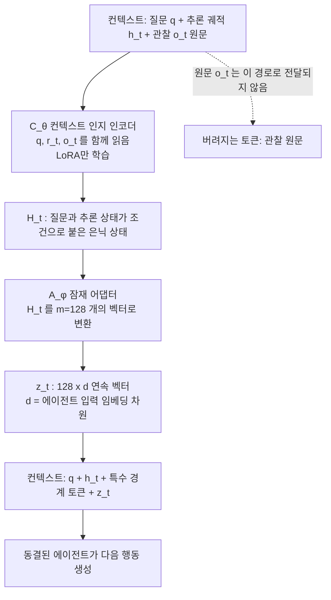

[논문 링크](https://arxiv.org/abs/2611.06500)
## 길어지는 도구 관찰이 에이전트를 느리고 판단을 흐린다

도구 관찰이 길어질수록 컨텍스트 계산 비용은 늘고, 판단은 흔들린다. 이 논문은 도구 결과를 텍스트가 아니라 연속된 벡터로 압축해, 에이전트가 다음 행동을 결정하는 데 필요한 정보만 남기는 방법을 제안한다. 코드는 <https://github.com/THU-Agent/Coca-cola>에 공개되어 있다.

---

### 1. 먼저 읽어야 할 용어

| 용어 | 뜻 | 왜 필요한가 |
|---|---|---|
| 컨텍스트(context) | 모델이 지금까지 입력으로 받아온 토큰을 모두 이어 붙인 것 | 에이전트는 컨텍스트만 보고 다음 행동을 고른다. 길수록 계산이 늘고, 관련 없는 내용이 끼어들어 판단이 흔들린다. |
| 도구 관찰(observation) | 도구 호출이 돌려준 결과(웹 검색 결과 등) | 관찰 원문의 길이가 컨텍스트 비용을 결정한다. |
| 잠재 토큰(latent token) | 텍스트가 아니라 임베딩 공간의 연속 벡터 한 개 | 같은 입력 자리를 더 적은 개수로 쓰면서 더 많은 정보를 담고 싶을 때의 후보. |
| 압축률(Comp_rate) | 압축 전후 총 토큰(입력+출력)의 감소 비율 | "얼마나 줄였는가"를 한 숫자로 비교하게 해 준다. |
| EM / F1 | 정확 일치율 / 토큰 단위 부분 일치율 | 답을 완전히 맞혔는지, 일부만 맞혔는지를 함께 본다. |
| KL 발산 / 교차 엔트로피 | 두 행동 분포의 차이 / 정답 행동 토큰에 대한 확률 손실 | 잠재 표현이 "원문을 봤을 때와 같은 행동"을 만들도록 압축기를 학습시키는 손실. |
| LoRA | 큰 모델을 고정한 채 일부 가중치만 덧붙여 학습하는 방법 | 에이전트 본체를 건드리지 않고 압축기만 학습시키기 위해 필요하다. |

이 논문에서 **Coca-Cola**(Context Compression via Continuous Latent Tokens)는 도구 관찰을 잠재 토큰으로 바꾸는 압축기이며, agent 백본은 건드리지 않는다.

---

### 2. 문제: 컨텍스트가 관찰에 잠식당한다

에이전트는 ReAct 방식으로 동작한다. 질문을 받으면 추론해서 도구를 호출하고, 돌아온 관찰을 컨텍스트에 붙인 다음 다시 추론한다. 한 단계를 지날 때마다 컨텍스트에는 추론 문장과 도구 호출과 관찰이 함께 쌓이므로, `t`번째 호출 이후의 컨텍스트 길이는 대략 다음과 같다.

$$K_t \approx |q| + \sum_{i=1}^{t}\bigl(|r_i| + |a_i| + |o_i|\bigr)$$

여기서 $|q|$는 질문 길이, $|r_i|$는 추론, $|a_i|$는 도구 호출, $|o_i|$는 관찰의 토큰 수다. 검색은 문서 조각 여러 개를 통째로 돌려주므로, 관찰이 자꾸 더해지는 쪽이 길어진다.

그 결과가 Fig. 1(왼쪽)이다. 4단계까지 진행한 웹 검색 에이전트에서는 도구가 돌려준 결과가 전체 토큰의 <strong>96.7%</strong>를 차지한다. 관찰 하나의 길이도 길다(중앙값 1,352토큰, p90 1,776, p95 1,861).

비용은 두 갈래로 갈린다. 하나는 계산 비용이고, 다른 하나는 정답률 하락이다. Fig. 1(오른쪽)의 질문은 "2016 Marrakesh ePrix 우승자의 출생 연도"다. 검색 결과에서 우승자가 Sébastien Buemi임을 확인하는 한 줄이면 다음 검색("Sébastien Buemi birth date")이 정해진다. 그런데 같은 결과에는 코스 길이, 랩 수, 폴 포지션, 빠른 랩 기록 같은 세부가 잔뜩 들어 있고, 이 무관한 내용까지 모델이 읽어야 한다.

---

### 3. 작은 예시: 무엇이 남고 무엇이 버려지는가

아래 표의 관찰 길이와 잠재 토큰 수치는 논문에서 온 것이고, 나머지 항목은 이해를 위해 정리한 것이다.

| 단계 | 입력 | 남는 상태 | 바뀌거나 빠지는 것 | 출력 |
|---|---|---|---|---|
| ① 검색 호출 | 질문 `q` = "2016 Marrakesh ePrix 우승자의 출생 연도는?" | `q` | — | 검색어 "winner of the 2016 Marrakesh ePrix" |
| ② 관찰 도착 | 관찰 `o_t` = 긴 검색 결과(중앙값 1,352토큰) | `q`, 추론 궤적 `r_t` = "우승자가 Buemi임이 확인됨" | Vanilla은 `o_t` 원문 전체를 컨텍스트에 붙임(레이싱 세부까지 포함) | Vanilla: `o_t`를 읽고 우승자 이름만 골라냄 |
| ③ Vanilla 진행 | `[q ; r_t ; o_t]` | `q`, `r_t`, `o_t` | 없음 | 다음 검색 "Sébastien Buemi birth date" — 근거는 1,352토큰 속에 묻혀 있음 |
| ④ Coca-Cola 진행 | `[q ; r_t ; o_t]` (동일) | `q`, `r_t`, 그리고 `z_t` = 잠재 토큰 128개 | **`o_t` 원문은 컨텍스트에 들어가지 않음** | 에이전트는 `z_t`만 읽고 다음 검색 또는 최종 답을 선택 |

핵심은 ③과 ④의 마지막 줄 차이다. 원문을 복원하지 않는다. 잠재 토큰은 사람이 읽을 필요가 없으므로, 텍스트 토큰 하나가 "어휘 목록에서 기호 하나를 고르는" 제약을 받지 않는다.

---

### 4. 기존 해법이 어디서 막히는가

관찰을 줄이는 방법은 두 갈래다. **토큰 프루닝**은 덜 유용한 토큰을 골라 지운다(LLMLingua, LLMLingua-2, LongLLMLingua). **텍스트 요약**은 보조 LLM으로 관찰이나 대화 기록을 짧은 요약문으로 바꾼다(RECOMP, Search-o1, ACON).

두 방식의 공통된 천장은 결과물이 여전히 "사람이 읽을 수 있는 이산 토큰 열"이라는 점이다. 문장이 되어야 하므로 줄일 수 있는 양에 구조적 한계가 생긴다. Coca-Cola가 다른 점은 이 제약을 아예 없앤 데 있다.

논문은 이 차이를 용량(capacity) 관점에서 정량화한다. 용량은 구별 가능한 코드워드 수의 로그로 정의한다. 어휘 크기가 $|\mathcal V|$일 때 텍스트 토큰 `n`개는 최대 $|\mathcal V|^n$가지이므로

$$\mathcal{C}_{\text{text}}(n) = n\log_2|\mathcal V|$$

반면, 차원 `d`인 잠재 토큰 `m`개는 각 토큰이 유효 좌표 $d_{\text{eff}} \le d$개를 가지며 좌표마다 유한 정밀도 `B`로 구별되는 값을 담는다고 가정하면

$$\mathcal{C}_{\text{latent}}(m) = m\,d_{\text{eff}}\log_2 B$$

비트까지 담을 수 있다. 즉 $d_{\text{eff}}\log_2 B > \log_2|\mathcal V|$이면 같은 입력 자리 수에서 잠재 표현이 더 큰 용량을 갖는다. 다만 논문도 스스로 단서를 단다. 이는 "모든 좌표 조합이 실현 가능하고 유한 정밀도로 구분된다"는 가정 위의 **최대 용량** 계산이며, 실제로 쓸 수 있는 정보량은 압축기의 인코딩 능력과 에이전트의 활용 능력에 달렸다고 밝힌다.

---

### 5. 방법: 관찰을 몇 개의 벡터로 바꾸는 방법

Coca-Cola는 도구 호출이 끝날 때마다 세 입력을 받아 **고정된 개수의 잠재 토큰**으로 바꾼다. 질문 `q`, 현재 단계의 추론 궤적 `r_t`, 도구 관찰 `o_t`가 그 세 입력이다. 두 가지 난제를 순서대로 푸는 구조다.

**첫째, 압축 결과를 에이전트가 실제로 읽을 수 있게 만든다.** 에이전트는 토큰을 입력 임베딩으로 바꿔서 받아들이는데, 압축기가 만든 벡터는 그 공간에 속하지 않는다. 그래서 아키텍처를 두 부품으로 나눈다.

- **컨텍스트 인지 인코더** $C_\theta$: 작은 언어 모델로, `q`, `r_t`, `o_t`를 **함께** 읽어 은닉 상태를 만든다. $H_t = C_\theta(q, r_t, o_t)$. 관찰 하나만 보지 않는 이유는, 관찰의 어느 부분이 필요한지가 질문과 현재 추론 상태에 달려 있기 때문이다.
- **잠재 어댑터** $A_\phi$: 은닉 상태를 에이전트 임베딩 차원에 맞춘 $m$개 벡터로 변환한다. $z_t = A_\phi(H_t) \in \mathbb{R}^{m \times d}$.

이 벡터들은 특수 경계 토큰으로 감싸 에이전트의 입력 임베딩 시퀀스에 삽입된다.

$$X_t = \bigl[E_\psi(q, h_t);\ E_\psi(\langle \text{latent\_obs}\rangle);\ z_t;\ E_\psi(\langle /\text{latent\_obs}\rangle)\bigr]$$

**둘째, 제한된 자리 수 안에서 의사결정에 필요한 정보만 남긴다.** 여기서 저자는 "원문을 재구성하는 것"이 목표가 아니라는 점을 학습에 이용한다. 에이전트를 고정해 두고, 같은 질문에 대해 원문을 넣었을 때와 잠재 토큰을 넣었을 때의 **다음 행동 분포**를 각각 뽑는다.

$$p_{\text{full}} = p_\psi(\cdot \mid q, h_t, o_t), \qquad p_{\text{latent}} = p_\psi(\cdot \mid q, h_t, z_t)$$

두 분포를 맞추는 것이 **Action-Preserving Training**이며, 손실은 두 항의 합이다.

$$\mathcal{L} = \lambda_{\mathrm{KL}}\,D_{\mathrm{KL}}(p_{\text{full}} \Vert p_{\text{latent}}) + \lambda_{\mathrm{CE}}\,\mathrm{CE}(y_{t+1},\,p_{\text{latent}})$$

KL 항은 "원문을 봤을 때 고를 행동"과 "잠재 토큰만 봤을 때 고를 행동"의 차이를 줄이고, 교차 엔트로피 항은 실제 기록된 다음 행동 토큰에 맞추는 보조 손실이다. 잠재 토큰이 연속 벡터라 미분이 가능해서, 얼어 있는 에이전트를 통과해 그래디언트가 압축기로 거꾸로 흐른다. $\nabla_{\theta,\phi}\mathcal{L} = \left(\partial z_t/\partial(\theta,\phi)\right)^{\top}\nabla_{z_t}\mathcal{L}$. 갱신 대상은 인코더의 LoRA 파라미터와 어댑터뿐이다.

Appendix A의 학습 설정은 이렇다. 4,188개 과제에서 4,363개의 (관찰, 행동) 쌍을 만들고 10%를 검증으로 떼어 3,927개 쌍으로 학습했다. LoRA rank 16, scaling factor 32, dropout 0.05, 8비트 AdamW(paged), 학습률 1.5×10⁻⁴에서 5×10⁻⁵로 선형 감쇠, $\lambda_{\mathrm{KL}}=0.3$, $\lambda_{\mathrm{CE}}=1.0$, KL 가중치는 학습 스텝의 앞 20% 동안 워밍업했다.

**추론 시**에는 매 도구 호출마다 원문 관찰을 잠재 토큰으로 치환하고 에이전트는 그 벡터만 본다. 관찰 하나를 128개의 연속 벡터로 압축해 넣고, 웹 검색은 호출당 최대 5개 결과, 과제당 최대 5회 호출로 제한했다.

전체 흐름에서 무엇이 어디로 가는지 정리하면 다음과 같다.

그림에서 각 값의 뜻은 이렇다. `h_t`는 지금까지의 추론·호출·관찰로 이루어진 궤적 접두부, `m=128`은 잠재 벡터의 개수, `d`는 대상 에이전트의 입력 임베딩 차원이다. 화살표가 전달하는 것은 `q`, `r_t`, `o_t`에서 `H_t`로 압축된 상태, 다시 `z_t`로 압축된 상태다. 대각선 점선은 **버려지는 경로**로, 관찰 원문은 에이전트 쪽으로 넘어가지 않는다. 다시 말해 줄어드는 계산은 에이전트가 매 단계 읽어야 하는 "관찰에 해당하는 토큰"이고, 압축기 자체는 새로 추가되는 계산이다.

---

### 6. 실험 설정

평가는 웹 검색 에이전트에서 이뤄졌다. 두 모델 조합은 Qwen3.5-35B-A3B + Qwen3.5-4B, GLM-4.7-Flash + GLM-Z1-9B이고, 벤치마크는 단일 홉 2개(NQ, TriviaQA)와 다중 홉 2개(2Wiki, HotpotQA)이다.

기준선은 네 개다. **Vanilla**(원문 그대로 사용), **LongLLMLingua**(토큰 프루닝), **LLMSummary**(텍스트 요약), **ICAE**(동일 아키텍처에서 학습 목표만 원문 복원으로 바꾼 버전)다. 저자는 Coca-Cola에 검색 특화 설계를 넣지 않았으므로 다른 도구에도 구조 변경 없이 적용 가능하다고 주장한다.

지표는 정답률(EM, F1)과 시스템 효율(평균 입력 토큰, 출력 토큰, 압축률, 종단 실행 시간)이며, 압축률은 정의상 다음과 같다.

$$\text{Comp\_rate} = 1 - \frac{I_{\text{latent}} + O_{\text{latent}}}{I_{\text{raw}} + O_{\text{raw}}}$$

입력·출력을 합산하므로 입력 토큰만 보인 감소율보다 압축률이 조금 작게 나온다. 예를 들어 NQ+Qwen은 입력 토큰이 87.7% 줄지만 압축률은 85.78%인 이유가 이것이다.

---

### 7. 결과

#### 7.1 토큰과 실행 시간

Qwen 조합(Table 1):

| 데이터셋 | Vanilla 입력/출력 토큰 | Coca-Cola 입력/출력 토큰 | 압축률 | Vanilla 시간(s) | Coca-Cola 시간(s) | 시간 감소 |
|---|---|---|---|---|---|---|
| NQ | 14,362 / 993 | 1,767 / 418 | 85.78% | 96.19 | 64.64 | 32.8% |
| TriviaQA | 10,023 / 779 | 1,413 / 349 | 83.68% | 73.30 | 55.38 | 24.4% |
| 2Wiki | 37,427 / 1,510 | 10,745 / 933 | 70.01% | 164.99 | 119.91 | 27.3% |
| HotpotQA | 42,724 / 1,560 | 9,429 / 831 | 76.83% | 161.39 | 120.88 | 25.1% |

GLM 조합(Table 2):

| 데이터셋 | Vanilla 입력/출력 토큰 | Coca-Cola 입력/출력 토큰 | 압축률 | Vanilla 시간(s) | Coca-Cola 시간(s) | 시간 감소 |
|---|---|---|---|---|---|---|
| NQ | 17,389 / 888 | 4,265 / 536 | 73.73% | 89.29 | 42.17 | 52.8% |
| TriviaQA | 11,177 / 739 | 2,595 / 413 | 74.75% | 91.36 | 41.97 | 54.1% |
| 2Wiki | 31,693 / 976 | 3,003 / 511 | 89.24% | 106.37 | 46.83 | 56.0% |
| HotpotQA | 28,782 / 834 | 4,041 / 610 | 84.30% | 84.55 | 49.37 | 41.6% |

여기서 두 수준을 구분해야 한다. **토큰 절감(70.01~89.24%)과 실행 시간 절감(24.45~55.97%)은 크기가 다르다.** 압축률만큼 시간이 줄지 않는 이유를 논문은 직접 설명하지 않는다(원문 미보고). 추론하면 압축기(인코더·어댑터)를 매 단계 추가로 돌리는 계산이 한 몫을 차지할 것으로 보인다. 압축기만의 실행 시간을 따로 보고한 수치도, GLM 조합의 절감폭이 더 큰 이유도 없다(원문 미보고).

다만 실행 시간은 모든 설정에서 Vanilla보다 짧았고, 그 폭은 Qwen 조합에서 24.45~32.80%, GLM 조합에서 41.61~55.97%였다.

#### 7.2 정답률은 떨어지지 않는다

Table 3을 Vanilla와 Coca-Cola끼리만 정리하면 이렇다.

| 모델 조합 | 데이터셋 | Vanilla EM / F1 | Coca-Cola EM / F1 |
|---|---|---|---|
| Qwen | NQ | 23.67 / 33.17 | 24.78 / 37.33 |
| Qwen | TriviaQA | 56.10 / 62.87 | 59.20 / 67.07 |
| Qwen | 2Wiki | 17.30 / 26.94 | 24.00 / 32.34 |
| Qwen | HotpotQA | 11.00 / 16.41 | 25.70 / 33.75 |
| GLM | NQ | 21.50 / 26.08 | 23.50 / 31.45 |
| GLM | TriviaQA | 41.50 / 44.57 | 51.50 / 59.41 |
| GLM | 2Wiki | 26.50 / 31.29 | 28.00 / 36.20 |
| GLM | HotpotQA | 20.50 / 25.89 | 23.50 / 30.76 |

Coca-Cola는 여덟 설정 전부에서 EM과 F1이 Vanilla보다 높다. 16개 데이터셋-지표 쌍 가운데 13개에서 최고 점수를 냈고, 여덟 모델-데이터셋 조합 중 여섯 곳에서 EM과 F1을 동시에 기록했으며 그 여섯 곳에는 GLM 조합 네 개가 모두 들어 있다. 압축이 최대 89.24%였는데도 답이 좋아졌다. 저자는 "긴 관찰 속의 무관한 내용을 걸러내면 주의가 분산되는 문제가 완화될 수 있다(attention dilution)"고 해석한다. 가장 크게 오른 곳은 Qwen HotpotQA로, EM이 11.00에서 25.70, F1이 16.41에서 33.75로 뛴다.

기준선과 비교하면 두 가지 패턴이 보인다.

- **ICAE**(같은 아키텍처, 학습 목표만 복원으로 변경)는 압축률에서 Coca-Cola에 진다. 여덟 설정 모두에서 Coca-Cola가 더 높다(2Wiki+GLM: 89.24% 대 74.12%). 정답률에서도 GLM 조합 네 설정은 모두 ICAE가 뒤졌다. 예외는 Qwen+TriviaQA로, ICAE가 EM 61.80 / F1 69.27로 Coca-Cola(59.20 / 67.07)보다 높았다. 다만 ICAE의 압축률은 66.92%로 Coca-Cola의 83.68%보다 훨씬 낮다.
- **LLMSummary**는 2Wiki+Qwen(71.30% 대 70.01%), HotpotQA+Qwen(78.90% 대 76.83%), NQ+GLM(74.62% 대 73.73%) 세 설정에서 압축률이 약간 더 높았다. 하지만 그 세 설정 모두에서 EM과 F1은 Coca-Cola보다 낮았다(NQ+GLM: EM 16.00% 대 23.50%). 또 Qwen+2Wiki에서는 LongLLMLingua의 F1 34.25가 Coca-Cola(32.34)를 앞섰는데, 압축률은 41.96% 대 70.01%였다.

"얼마나 줄이는가"보다 "무엇을 남길지"를 정하는 기준이 정답률을 지킨다는 것이 이 비교의 요지다.

#### 7.3 무엇이 성능을 좌우하는가

**잠재 토큰 개수 `m`**(Fig. 3, NQ+GLM). `m`을 8에서 128로 늘릴 때마다 F1은 26.34 → 27.79 → 28.81 → 29.96 → 31.45로 계속 오른다. 압축률은 `m ≤ 64`에서 78.83~82.56% 범위(81.27 / 82.56 / 78.83 / 80.99)로 오르내리다가 `m = 128`에서 73.73%로 떨어진다. 저자는 예비 실험에서 가장 좋은 효율-성능 절충점이라는 이유로 기본값을 128로 정했다. 시험한 범위 안에서 F1은 아직 올라가는 중이므로 다른 절충점이 가능한지는 추가 실험이 없다(원문 미보고).

**조건 입력**(Table 4, NQ+GLM, `m = 128`).

| 조건 | EM (%) | 압축률 (%) |
|---|---|---|
| Full: `q`, `r_t`, `o_t` | 23.50 | 73.73 |
| w/o Reasoning State: `q`, `o_t` | 21.45 | 80.43 |
| w/o Task Goal: `r_t`, `o_t` | 20.02 | 78.38 |
| Observation-only: `o_t` | 18.34 | 79.94 |

추론 상태를 빼면 EM이 2.05포인트, 질문(과제 목표)을 빼면 3.48포인트, 둘 다 빼면 5.16포인트 떨어진다. "관찰만으로는 의사결정에 필요한 정보를 정할 수 없다"는 뜻이다. 추론 상태를 뺐을 때 낙폭이 더 작은 이유는, 단일 홉 NQ에서는 현재 하위 목표가 원래 질문과 거의 겹치기 때문이라고 저자가 설명한다. 압축률은 버린 버전이 오히려 78.38~80.43%로 높은데, 그 대가로 EM을 잃었다. 흥미로운 건 맨 아래 행이다. 조건 입력을 모두 버린 관찰만 보는 버전도 NQ+GLM에서는 EM 18.34%로 압축 기준선 최대치(17.00%)를, 압축률 79.94%로 최대치(74.62%)를 각각 넘어선다. 같은 아키텍처의 ICAE도 포함한다. 조건이 없어도 행동 보존 학습 덕분에 기준선을 이겼다는 것이 논문의 해석이다.

#### 7.4 케이스 스터디: 잠재 토큰이 판단을 바꾸는 지점

HotpotQA #377의 질문은 "Jens Risom introduced what type of design, characterized by minimalism and functionality?"다. 두 방식 모두 같은 첫 검색을 날리고 URL 5개를 받아왔으며 3개를 공유했다.

- **Vanilla**: Rank 1이 ABT Modern("… played a pivotal role in shaping Mid-Century Modern furniture design"), Rank 3이 Chairish("Scandinavian design을 미국에 처음 도입한 디자이너 중 한 명")를 본다. 이 둘을 구분하지 못한 채 Mid-Century Modern을 답으로 삼았고, 확인용 검색을 한 번 더 해도 답이 바뀌지 않았다.
- **Coca-Cola**: Rank 1에 Chairish가, Rank 2에 ABT Modern이 올라와 있다. 질문에 직결되는 증거(Scandinavian design)를 앞줄에 남긴 결과, 검색을 덜 하면서 정답(Scandinavian design)에 도달했다.

즉 압축은 정보를 "더 많이" 담는 게 아니라 "다음 결정에 쓰일 것"을 남긴다.

---

### 8. 한계와 적용 판단

먼저 저자가 직접 밝히거나 실험 설계에서 드러나는 제약이다.

- **검증 범위가 웹 검색 QA로 한정된다.** 저자는 "검색에 특화된 설계가 없어 다른 도구에도 구조 변경 없이 쓸 수 있다"고 주장하지만, 실제 실험은 웹 검색 에이전트의 QA 네 개뿐이다. 코드 실행이나 API 호출 같은 다른 도구에서 같은 이득이 나오는지는 측정되지 않았다(원문 미보고).
- **정보 용량 분석은 상한일 뿐이다.** "실제로 쓸 수 있는 정보는 압축기의 인코딩 능력과 에이전트의 활용 능력에 달렸다"는 단서를 저자가 직접 단다.
- **에이전트를 고정해야 학습과 사용이 성립한다.** 학습 중 에이전트는 얼어 있고 LoRA와 어댑터만 갱신되며, 어댑터는 특정 에이전트의 입력 임베딩 차원 `d`에 맞춰 학습된다. 에이전트 모델을 바꾸면 압축기를 다시 설계·학습해야 할 것으로 보인다(원문 미보고).
- **`m = 128`은 F1 최적이 아니라 절충점이다.** 시험한 범위(8~128) 안에서 F1은 계속 올라갔고, 대신 `m = 128`에서 압축률이 떨어졌다. 저자는 예비 실험에서의 절충점이라고 밝힌다.
- **압축기 학습 데이터 규모는 4,363쌍이다.** 관찰이 길고 매우 다른 도구·도메인으로 확장될 때 이 규모가 충분한지는 검증되지 않았다(원문 미보고).

다음은 저자가 "한계"로 적지는 않았지만 설계에서 따라오는 제약이다.

- **관찰이 짧으면 이득이 줄거나 역전될 수 있다.** 관찰이 짧으면 압축기를 한 번 더 돌리는 비용이 절감분을 넘어설 수 있다. 논문은 관찰이 길고 중복이 심한 웹 검색을 전제로 이득을 보였고, 짧은 관찰만 있는 시나리오의 손익은 측정하지 않았다(원문 미보고).
- **다른 모델 규모·에이전트 구조로의 일반화는 열려 있다.** 실험은 두 모델 조합에 한정된다. 함수 호출 API를 쓰는 에이전트나 훨씬 큰 모델에서도 정답률이 유지되는지는 확인되지 않았다.
- **긴 지평선은 제한적으로만 보았다.** 검색은 호출당 최대 5개 결과, 과제당 최대 5회 호출로 제한했다. 이보다 훨씬 긴 다단계 상호작용에서 압축 오차가 누적되는지는 별도 검증이 필요하다.

---

### 9. 정리

이 기법의 핵심은 "더 많이 압축하는가"가 아니라 "무엇을 남길 것인가"다. 원문 복원을 목표로 한 ICAE가 같은 아키텍처에서 압축률은 더 낮고, 행동 보존을 목표로 한 Coca-Cola가 압축률과 정답률을 함께 얻었다는 비교가 그 근거다.

적용 판단은 이렇다. 도구 관찰이 길고 중복이 많은 다단계 에이전트에서, 에이전트 백본을 고정한 채 압축기를 추가로 학습·운영할 수 있는 환경에 적합하다. 추론 시 에이전트는 항상 GPU 한 장에서 돌렸고, 추가 GPU를 쓰는 설정에서는 그 GPU에 압축 모델만 올렸다(4×A100-80GB; 학습 시에는 에이전트를 3장, 인코더·어댑터를 1장에 배치). 반대로 관찰이 짧거나, 에이전트 모델을 자주 바꾸거나, 검색 외 도구가 주를 이루는 경우는 아직 검증되지 않았으니 시험 적용이 필요하다.

논문의 더 근본적인 메시지는 이거다. 도구와 에이전트 사이의 상호작용이 명시적 텍스트 토큰에 의존할 필요는 없다. 도구는 이후 결정에 충분한 정보만 압축된 잠재 표현으로 전달하면 된다.

<!-- verbatim-tables -->

논문 원문의 표

> arXiv e-print 의 LaTeX 원본에서 기계적으로 옮긴 표입니다. 숫자는 논문의 값이며 모델을 거치지 않았습니다.

**표 1. **Efficiency comparison** across four web-search QA datasets using Qwen3.5-35B-A3B and Qwen3.5-4B. Best results are in bold. Blue annotations under \name\ indicate reductions (%) relative to Vanilla in token usage and runtime.**

|  | \strut**NQ** Vanilla | \strut**NQ** LongLLM Lingua | \strut**NQ** LLM Summary | \strut**NQ** ICAE | \strut**NQ** \name | \strut**TriviaQA** Vanilla | \strut**TriviaQA** LongLLM Lingua | \strut**TriviaQA** LLM Summary | \strut**TriviaQA** ICAE | \strut**TriviaQA** \name |
|---|---|---|---|---|---|---|---|---|---|---|
| $I_{\mathrm{token}}\,\downarrow$ | 14362.12 | 8607.04 | 6099.83 | 5926.23 | 1766.5387.7 | 10022.93 | 5445.57 | 3791.53 | 3038.35 | 1413.1285.9 |
| $O_{\mathrm{token}}\,\downarrow$ | 992.69 | 1232.61 | 1080.51 | 665.57 | 417.6957.9 | 779.34 | 1048.02 | 679.36 | 535.42 | 349.3655.2 |
| $\mathrm{Comp_rate}\,\uparrow$ | -- | 35.92% | 53.24% | 57.07% | **85.78%** | -- | 39.89% | 58.61% | 66.92% | **83.68%** |
| *Time (s)* $\downarrow$ | 96.19 | 109.48 | 121.02 | 87.06 | 64.6432.8 | 73.30 | 86.91 | 91.67 | 64.89 | 55.3824.4 |
|  | \strut**2Wiki** |  |  |  |  | \strut**HotpotQA** |  |  |  |  |
|  | Vanilla | LongLLM Lingua | LLM Summary | ICAE | \name | Vanilla | LongLLM Lingua | LLM Summary | ICAE | \name |
| $I_{\mathrm{token}}\,\downarrow$ | 37427.21 | 21110.06 | **10011.31** | 12268.64 | 10744.5171.3 | 42723.75 | 21241.95 | **8088.21** | 15763.53 | 9429.0477.9 |
| $O_{\mathrm{token}}\,\downarrow$ | 1510.37 | 1488.63 | 1163.11 | 1080.53 | 932.5738.3 | 1560.28 | 1596.04 | 1253.70 | 1035.63 | 831.4346.7 |
| $\mathrm{Comp_rate}\,\uparrow$ | -- | 41.96% | **71.30%** | 65.72% | 70.01% | -- | 48.43% | **78.90%** | 62.06% | 76.83% |
| *Time (s)* $\downarrow$ | 164.99 | 137.22 | 175.97 | 142.18 | 119.9127.3 | 161.39 | 145.83 | 160.24 | 139.04 | 120.8825.1 |

**표 2. **Efficiency comparison** across four web-search QA datasets using GLM-4.7-Flash and GLM-Z1-9B. Best results are in bold. Blue annotations under \name\ indicate reductions (%) relative to Vanilla in token usage and runtime.**

|  | \strut**NQ** Vanilla | \strut**NQ** LongLLM Lingua | \strut**NQ** LLM Summary | \strut**NQ** ICAE | \strut**NQ** \name | \strut**TriviaQA** Vanilla | \strut**TriviaQA** LongLLM Lingua | \strut**TriviaQA** LLM Summary | \strut**TriviaQA** ICAE | \strut**TriviaQA** \name |
|---|---|---|---|---|---|---|---|---|---|---|
| $I_{\mathrm{token}}\,\downarrow$ | 17388.56 | 5779.61 | **3903.19** | 5068.65 | 4265.4275.5 | 11176.91 | 4689.20 | 2842.51 | 3510.28 | 2595.0076.8 |
| $O_{\mathrm{token}}\,\downarrow$ | 887.74 | 797.81 | 734.77 | 805.93 | 536.3739.6 | 738.96 | 688.27 | 634.84 | 617.94 | 413.2844.1 |
| $\mathrm{Comp_rate}\,\uparrow$ | -- | 64.01% | **74.62%** | 67.86% | 73.73% | -- | 54.87% | 70.82% | 65.36% | **74.75%** |
| *Time (s)* $\downarrow$ | 89.29 | 91.06 | 106.47 | 83.63 | 42.1752.8 | 91.36 | 89.93 | 128.36 | 72.33 | 41.9754.1 |
|  | \strut**2Wiki** |  |  |  |  | \strut**HotpotQA** |  |  |  |  |
|  | Vanilla | LongLLM Lingua | LLM Summary | ICAE | \name | Vanilla | LongLLM Lingua | LLM Summary | ICAE | \name |
| $I_{\mathrm{token}}\,\downarrow$ | 31693.47 | 11934.39 | 5113.19 | 7677.77 | 3003.3890.5 | 28781.88 | 6059.07 | 4690.11 | **4029.96** | 4041.0386.0 |
| $O_{\mathrm{token}}\,\downarrow$ | 976.35 | 672.11 | 895.04 | 777.21 | 511.0747.7 | 834.04 | 826.07 | 747.77 | 707.66 | 609.9526.9 |
| $\mathrm{Comp_rate}\,\uparrow$ | -- | 61.41% | 81.61% | 74.12% | **89.24%** | -- | 76.75% | 81.64% | 84.00% | **84.30%** |
| *Time (s)* $\downarrow$ | 106.37 | 109.93 | 153.25 | 89.21 | 46.8356.0 | 84.55 | 102.54 | 101.61 | 99.58 | 49.3741.6 |

**표 3. **Web search performance comparison.** Best results within each model setting are in bold. Arrows in the \name\ rows indicate relative changes (%) over the Vanilla Model for each metric.**

| **Method** | \strut**Single-hop QA** |  |  |  | \strut**Multi-hop QA** |  |  |  |
|---|---|---|---|---|---|---|---|---|
|  | **NQ** |  | **TriviaQA** |  | **2Wiki** |  | **HotpotQA** |  |
|  | EM | F1 | EM | F1 | EM | F1 | EM | F1 |
| 0pt2.65ex **Qwen3.5-35B-A3B & Qwen3.5-4B** |  |  |  |  |  |  |  |  |
| Vanilla Model | 23.67 | 33.17 | 56.10 | 62.87 | 17.30 | 26.94 | 11.00 | 16.41 |
| LongLLMLingua | 19.00 | 25.81 | 44.30 | 48.69 | 21.30 | **34.25** | 11.90 | 19.75 |
| LLMSummary | 24.65 | 32.35 | 54.70 | 61.38 | 21.06 | 31.77 | 23.10 | 29.60 |
| ICAE | 24.38 | 35.20 | **61.80** | **69.27** | 13.72 | 16.91 | 23.71 | 31.21 |
| **\name** | 24.784.69 | 37.3312.54 | 59.20 {6.87.8\selectfont $\uparrow$ 5.53%} | 67.07 {6.87.8\selectfont $\uparrow$ 6.68%} | 24.0038.73 | 32.34 {6.87.8\selectfont $\uparrow$ 20.04%} | 25.70133.64 | 33.75105.67 |
| 0pt2.65ex **GLM-4.7-Flash & GLM-Z1-9B** |  |  |  |  |  |  |  |  |
| Vanilla Model | 21.50 | 26.08 | 41.50 | 44.57 | 26.50 | 31.29 | 20.50 | 25.89 |
| LongLLMLingua | 17.00 | 21.16 | 39.50 | 42.41 | 20.50 | 24.91 | 19.50 | 23.00 |
| LLMSummary | 16.00 | 21.05 | 46.00 | 49.29 | 22.50 | 25.61 | 13.50 | 17.60 |
| ICAE | 17.00 | 20.82 | 38.00 | 40.94 | 18.50 | 20.75 | 16.50 | 20.13 |
| **\name** | 23.509.30 | 31.4520.59 | 51.5024.10 | 59.4133.30 | 28.005.66 | 36.2015.69 | 23.5014.63 | 30.7618.81 |

**표 4. **Context-component ablation** on NQ (GLM-4.7-Flash & GLM-Z1-9B, $m=128$).**

| **Method** | **EM (%)** | **Compression rate (%)** |
|---|---|---|
| 0pt2.65ex**NQ** |  |  |
| **Full** | **23.50** | 73.73 |
| w/o Reasoning State | 21.45 | **80.43** |
| w/o Task Goal | 20.02 | 78.38 |
| Observation-only | 18.34 | 79.94 |

