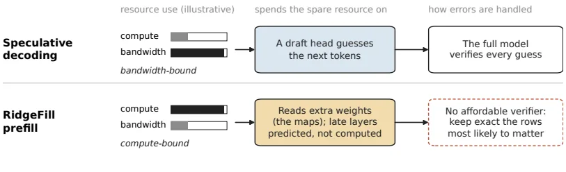
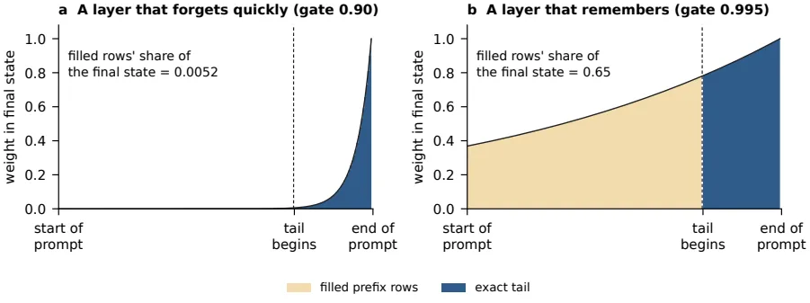
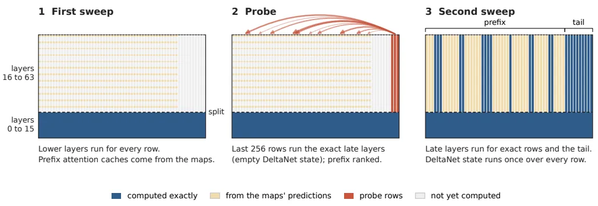
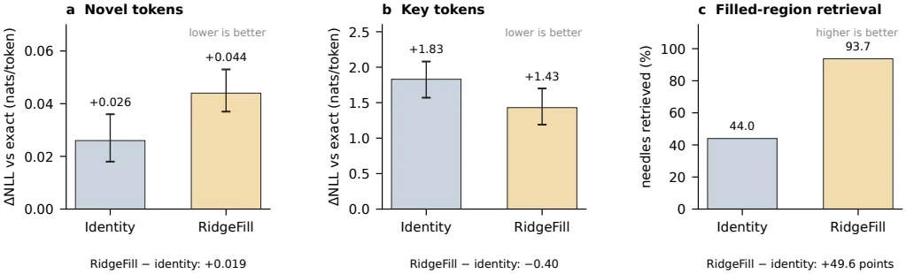

[Paper](https://arxiv.org/abs/2611.09709v1)
## Introduction: The wait before an answer appears

With a long prompt, the model must pass the entire document through before the first token emerges, and the user waits the whole time seeing nothing. To cut that wait, RidgeFill skips computation in some layers and prefills the cache those layers would have produced by approximating it. No training is needed, and the tail, some selected rows, and every decoding step are computed exactly.

## Background: Why prefill is slow, and where the slack is

**Prefill** is the phase that pushes the prompt through the model all at once up to the first response token. Text appears on screen only when this phase finishes, so the longer the document, the more the user sees nothing but waiting.

To see why it takes so long, you first have to know that decoding and prefill run under completely different conditions. Decoding emits one token at a time, so each step is bound by the memory bandwidth of reading weights, leaving compute slack. Speculative decoding therefore uses the spare compute to guess the next tokens in advance, and the full model verifies those guesses in one pass.

Prefill is the opposite. Weights are read once and hundreds of prompt rows share the value. Bandwidth is left over and the GPU is bound by arithmetic. RidgeFill uses that spare bandwidth to read one extra map per layer, and in exchange skips most of the arithmetic in the upper layers.

Original Fig. 1. Speculative decoding on the left and RidgeFill prefill on the right use their "spare resource" in opposite directions. Decoding is bandwidth-bound, so it guesses the next tokens with spare compute and the full model verifies them. Prefill is bound by arithmetic, so it reads maps with spare bandwidth and skips upper-layer arithmetic. The difference that the lower-right cell points to is verification. A filled cache has no cheap verifier, so the problem shifts to preserving the important rows exactly.

Speculative decoding verifies its guesses with the full model, but the cache RidgeFill fills has no way to be verified. Checking a filled cache would mean running the full model again — doing exact prefill at exact-prefill cost. The authors tried verifying every row with the full model, and it worked. But cheap checks only revealed where to look. Scoring every filled row at every decoding step increased decoding time by 8–18%, and checking every few steps missed rows that needed repair in 15–98% of steps (Appendix I.4). So the goal inverts. It is not to make the fill right as often as possible, but to find the rows that are wrong by the largest margin and compute only those exactly.

## Terms used in this post

| Term | Meaning | Why it is needed |
|---|---|---|
| KV cache | The keys and values an attention layer records for each token. Tokens generated later read these keys and values to retrieve information from the preceding context | You need to know what prefill produces to see what gets filled |
| Row | One token position in the prompt. In this post, a row is the bundle of entries one token leaves in the caches of several layers | A unit is needed to say "which token to compute exactly" |
| Split layer $S$, tail length $T$ | The two numbers that set the range to skip | The two values a deployment chooses |
| Prefix / tail | All prompt tokens except the tail / the last $T$ tokens of the prompt | The prefix is approximated; the tail is computed exactly |
| Filled row / exact row | A row computed approximately in the upper layers / a row computed normally through all layers | Filled rows are where time is saved; exact rows pay the cost |
| Map | A matrix $A_\ell$ and vector $b_\ell$, one per layer. They turn the split-layer hidden state into that layer's input | The only device that builds the approximation without training |

## A small example: how one row lands in the cache

The following is an illustrative construction that hand-applies the original definition (§2.1). It is not an experimental result.

Suppose a 12-token prompt arrives at a model with 8 layers (0–7). "The vault code is 4 8 2 7, repeat it again now." The first 9 tokens are the prefix and the last 3 are the tail. Of the two numbers that set the skip range, the split layer is $S=4$ and the tail length is $T=3$. The middle of the prefix contains the digits "4827", which must be copied exactly.

| Row | Lower layers (0–3) | Upper layers (4–7) | Computation skipped | What lands in the cache | When read later |
|---|---|---|---|---|---|
| Ordinary prefix token | 4 layers computed normally | Map predicts input $\hat{x}_\ell$ and computes only that layer's keys and values | Upper-layer attention output and MLP | Approximated keys and values | Tail and generated tokens read an approximate value |
| Prefix digit token "4827" | Same | Filling approximately blurs the value. The digit rows designated by the selector are computed exactly instead | None, once selected | Exact keys and values | The digits are copied verbatim |
| Tail (last 3 tokens) | Computed normally | Computed normally | None | Exact keys and values | Reads the prefix's approximate values, so tail output can differ from exact computation |
| Generated tokens (answer) | Computed normally | Computed normally | None | Exact keys and values | The answer is produced token by token |

What is discarded is the upper-layer attention output and MLP computation for the prefix; what is kept is the lower-layer state and the exact cache of the tail and exact rows. The last column reveals one important point. The tail itself is computed exactly, but because the tail reads the prefix's approximate values, even the tail's output can differ from exact computation.

There are four ways to handle the same prefix. The definitions of the methods are in the original Table 3; the numbers below correspond to Table 18 for the primary split and Appendix A.

| Method | Input the upper layers use for prefix rows | Prefix cache | Retrieval in the filled region of the reference model |
|---|---|---|---|
| Exact | The actual input $x_\ell$ | Exact keys and values | 98.7–99.9 |
| No fill | Nothing | Empty | 0.0 |
| Identity (POP's fill) | Copy the split-layer state $x_S$ as is | Same approximation for every layer | 9.7–78.1 |
| RidgeFill | $A_\ell x_S + b_\ell$ | A different approximation per layer | 49.4–93.7 |

### What the digit needles showed

During development, the authors looked for 7-digit needles hidden in the prefix. With the filled state they found 33 of 52, and 13 of the 17 missed digits differed only in the last digit. When they switched to computing only the rows containing digit tokens exactly, they found 36 of 36 — but appending at least the same number of rows to the tail (rounded up in blocks, 3–10x) only reached 28 of 36. Name and sentence needles still failed at that point, but exact computation of digit rows barely helped those.

| Model and needle type | Digit rows computed exactly | Top 5% rows by attention computed exactly |
|---|---|---|
| Llama-3.1-8B, digit multi-key | +25 points | +22 points |
| Llama-3.1-8B, text | +2 points | +15 points |
| Qwen3.5-9B, digit multi-key | +26 points | +21 points |
| Qwen3.5-9B, text | 0 points | +16 points |

So the shipped selector picks rows by attention and token class, not by digits (Appendix I.2).

## Method: predict the late layers' inputs and fill the cache

### Two numbers set the skip range

A deployment chooses two values. The split layer $S$ sets where skipping starts, and the tail length $T$ sets how many trailing tokens are never skipped. Layers $0$ through $S-1$ run normally for every row, and the last $T$ tokens and all generated tokens run through every layer normally. The remaining $N-T$ tokens are the prefix.

In the upper layers, a prefix row is either an exact row or a filled row. An exact row runs through all layers normally, like the tail; filled rows are where time is saved. In a normal forward pass, a layer's input is the previous layer's output, so reaching layer 40 in a 27B model at split 16 requires running layers 16–39 first. For filled rows only, RidgeFill breaks this chain and predicts each upper layer's input $\hat{x}_\ell$ directly from the single split-layer state $x_S$.

The three deployments' settings differ as follows.

| | Reference study | Qwen3.8-27B | Qwen3.8-Flash-Next |
|---|---|---|---|
| Model | Llama-3.1-8B, Qwen3.5-9B, Qwen3-8B | Qwen3.8-27B | Qwen3.8-Flash-Next |
| Split $S$ / layers $L$ | 12/32, 12/32, 13/36 | 16/64 | 24/48 |
| Tail $T$ | 4,096 | 4,096 | 2,048 |
| Exact prefix rows | None by default; attention-selected 10% in the '+rows' arm | Probe, special tokens, lexical net | None by default; protected tokens in quality mode |
| Penalty $\lambda$ | 0.03, 0.03, 0.01 | 0.03 | 0.03 |
| Value rescale | Off | On, $c=512$ | Off |
| Terminal-state correction | Off | Off | Quality mode only |

### Ridge map: predict the input, and the original projection runs unchanged

The prediction uses a matrix $A_\ell$ and vector $b_\ell$, one per layer.

$$\hat{x}_\ell = A_\ell\, x_S + b_\ell$$

Here $x_S$ and $x_\ell$ are vectors of length $d$ ($d=4096$ for the reference models and $5120$ for 27B), and $A_\ell$ is a $d\times d$ matrix. The map is fitted in one shot on calibration text, not trained. A single pass of the original model records the split-layer state $x_S$ and each upper layer's actual input $x_\ell$, and then the objective minimizes the squared prediction error plus a penalty that suppresses the matrix size.

$$\min_{A_\ell, b_\ell}\; \sum_t \lVert x_{\ell,t} - (A_\ell x_{S,t} + b_\ell)\rVert^2 + \alpha\lVert A_\ell\rVert_F^2$$

This problem has a closed-form solution that needs no iterative training. After subtracting the means ($\mu_S$, $\mu_\ell$) from each vector, $X$ stacks the split-layer states as rows, $Y_\ell$ stacks layer $\ell$'s inputs as rows, and $\alpha$ is the penalty strength.

$$A_\ell = Y_\ell^\top X\,(X^\top X + \alpha I)^{-1}, \qquad b_\ell = \mu_\ell - A_\ell\,\mu_S$$

The penalty is set to $\alpha = \lambda\,\mathrm{tr}(X^\top X)/d_{in}$, tying it to the input scale so the same $\lambda$ means the same thing across models. For the reference models and 27B, $\lambda$ was chosen by holding out 5 documents on a grid from $10^{-4}$ to 1: 0.03 for Llama-3.1-8B, Qwen3.5-9B, and 27B, and 0.01 for Qwen3-8B (0.003 at split 18). Flash-Next was chosen from six values between 0.001 and 0.3 using 10 held-out captures, giving 0.03. Calibration only needs to accumulate $X^\top X$, $X^\top Y_\ell$, and the two means during one pass of the original model, so a new $\lambda$ only requires re-solving, not re-reading. Using a new split requires one more pass. On 27B, calibrating and solving for splits 16, 24, and 32 together took 26 minutes on a single RTX 5090.

The predicted input passes through that layer's own normalization and projections just like a real input. This is the first difference from kishida's KVA projector. The KVA projector writes each upper layer's keys and values directly with a trained head, but RidgeFill predicts the input, so the layer's original key and value projections run unchanged, and in hybrid models the recurrent state update runs unchanged too.

Original Fig. 2. The fork in the two paths is "what gets predicted." (a) predicts each upper layer's keys and values directly from layer 18's state, bypassing that layer's projections. (b) predicts each upper layer's input so the layer runs its own projections, changing no weights at all. Seen as a flow of states, one split state passes through one map per layer to become a predicted input, and that input goes through the layer's normalization and projections to be stored as cache entries. No layer waits for another. Exact rows skip the map and run their layer with their own exact input.

Map size translates into cost. In the reference models (hidden 4096) it is 32 MiB per layer (bfloat16), and in 27B (hidden 5120) all 48 upper layers in int8 total 1.2 GiB. Flash-Next uses Gated Residual, where the residual stream is four parallel streams of width 2,560 and each layer reads them mixed through gates, so the map's input width is 10,240 and output width is 2,560. The 24 maps in int8 total 0.60 GiB. Maps can be kept resident in GPU memory or streamed from host memory one layer at a time.

### Hybrid layers and two corrections

Three of the five models (Qwen3.5-9B, Qwen3.8-27B, Qwen3.8-Flash-Next) are hybrids mixing attention layers with Gated DeltaNet layers. A Gated DeltaNet layer keeps one recurrent state instead of a key-value cache, and at each token multiplies that state by a gate between 0 and 1 before adding the new token's update. Because the gate is below 1, older tokens fade gradually.

This difference determines where fill error goes. In attention layers, a filled row's error stays inside that row's keys and values. In Gated DeltaNet layers, each filled row updates the shared state, so every row's error folds into the state the tail inherits. Two corrections therefore pull the filled cache back toward exact. Both target average error and neither is trained.

The first is value rescale. In each upper attention layer, the first $c$ rows of the tail pass through that layer's value projection twice: once with the exact input and once with the map's prediction. For each key-value head, the ratio of the exact value's magnitude to the predicted value's magnitude is averaged over those $c$ rows to produce a scale, and that scale multiplies the filled values. The scale is measured per request from that request's tokens. The correction targets values because Qwen models normalize keys, fixing each key's magnitude, so there is almost nothing to restore in key magnitude (values have no such normalization). Of the three deployments, only 27B uses this correction ($c=512$).

The second is terminal-state correction, used only in Flash-Next's quality mode. At the end of the prefix, $\rho_\ell\,\Delta M_\ell$ is added once to each filled Gated DeltaNet layer's state. $\Delta M_\ell$ is the average difference between the exact and filled states (per layer and value head), measured on 13 prompts separated from the map calibration and evaluation sets, every 2,048 tokens (62 states per layer). $\rho_\ell$ is the share of total row weight held by filled rows at the point the prefix ends, read per request from the gates the filling process computes.

Original Fig. 4. The horizontal axis is position in the prompt and the vertical axis is the weight a row at that position leaves in the final state. Brown is the filled prefix and blue is the exact tail. A row's weight is the product of the gates after it, so with a gate of 0.90 the prefix rows are already nearly faded by the time the tail ends and hold only about 0.005 of the final state; with a gate of 0.995 they hold about 0.65. This value is the share of the final state held by the filled prefix after the tail ends, which differs from $\rho_\ell$ at the point the prefix ends. Terminal-state correction therefore matters only in layers that remember, where the gate is close to 1. This figure uses illustrative numbers — 200 rows with the last 50 exact — and is not an experimental result.

### Which rows to compute exactly

A filled cache has no cheap way to be verified, so the goal inverts. It is not to make the fill right as often as possible, but to find where it is wrong by the largest margin and compute only those rows exactly. The paper uses three selectors, one per deployment.

- **Attention selection (reference study):** compute exactly the 10% of prompt tokens that receive the most attention from the last 64 tokens. Attention is summed over all heads of the sub-split attention layers (whichever of layers 3, 7, 11, 15 apply). When the question sits at the end of the prompt, these rows are the ones the question attends to.
- **Protected tokens (Flash-Next quality mode):** without reading the question, compute exactly the rarest 25% of four token classes — uppercase word starts, uppercase word pieces, lowercase word pieces, and mixed tokens — by add-one unigram frequency in the calibration documents. In Flash-Next runs this covered 3–10% of prefix positions.
- **27B probe:** run the exact upper layers once over the filled cache of the last 256 rows, rank prefix rows by the attention those 256 rows give them, and pick the top rows. Special tokens are added outside the budget, and lexical-net rows are reserved within the budget up to 5%. The lexical net nominates sentences that share 4 or more words with the last 64 content tokens of the prompt and contain a word appearing at most twice in the whole prefix (up to the first 80 rows per sentence).

The rationale for attention selection is a property of softmax attention. If a row's value is wrong by $\delta$, the output of a query reading that row changes by $\delta$ in exact proportion to the attention $a_{ij}$ that query gives the row. If the score (logit) changes by $\varepsilon$, the output changes by at most $2V a_{ij}(e^{|\varepsilon|}-1)$, where $V$ is the magnitude of the largest value vector among the rows that query sees. Both bounds are proportional to $a_{ij}$, so if error magnitude were the same across rows, computing the most-attended rows exactly would minimize the total error bound. Real errors differ in magnitude across rows, so the other two selectors also protect rows by token type.

### 27B: two sweeps

27B's prefill runs in two sweeps.

Original Fig. 5. (1) The first sweep runs layers 0–15 for all rows and writes the upper-layer attention cache of the prefix with the map's predictions. The tail and the upper-layer Gated DeltaNet states are not computed yet. (2) The probe passes the last 256 rows through the exact upper layers over the filled cache (DeltaNet states start empty), and ranks the entire prefix by the attention those 256 rows give it. (3) The second sweep runs the upper layers for the selected rows and the tail, passing the entire prefix through the Gated DeltaNet state in order once. Rows that remain filled keep their approximate cache.

The number of rows the probe keeps is set by count, not by ratio. It is the size of the union of the default rules (half of the protected-class matches, all digit tokens, the top 20% of lower-layer question attention) multiplied by a budget factor of 1.0, which was 28–31% of the prefix in the timing prompts. Digit tokens only set the budget size; they are not computed exactly unless the probe ranks them high. The probe's own cost is passing 256 rows through the upper layers plus the attention those rows pay to the prefix, about 1.6% of upper-layer rows at a 16K prompt.

## Measurements: average loss hides the error

The authors write that "most of the work was measurement" (abstract). One example makes the reason clear. On Qwen3-8B, RidgeFill and a simple identity fill differ by only 0.019 nat in new-token loss, which reads as nothing. Yet in the same run, retrieval of needles hidden in the filled region succeeds 44.0% of the time with identity fill and 93.7% with the map fill.

Original Fig. 8. The three panels are three metrics from the same run: (a) new-token loss over 90 documents (63 key tokens), (b) key-token loss, and (c) filled-region retrieval over 138 RULER samples. On new-token loss RidgeFill looks slightly worse than identity fill, but on prefix-dependent tokens and on retrieval it is far better. Average loss misleads because most scored tokens do not depend on the prefix, so fill error is diluted across unaffected tokens.

The paper therefore chooses metrics that do not hide error. Filled-region retrieval counts only samples whose needle sits in the prefix rather than the exact tail. Key-token loss counts only tokens whose exact loss rises by more than 2 nat when the context is truncated to the last 4,096 tokens — tokens to which the prefix actually contributes. New-token loss excludes tokens belonging to an 8-token contiguous span already present earlier in the prompt. The splice test swaps filled keys or values for exact ones and measures the remaining loss, pinpointing which component holds the error. Heavy-tailed averages are reported alongside medians, and the rise in 27B's mean KL at 32K, pulled up by five copy-heavy documents, is reported with a median of 0.004.

The line between fixing what a benchmark reveals and fitting to the benchmark is thin. The authors drew it in three places. The fixes had to be rules, not specific patterns (token class, attention received, rarity). The suites used for evaluation are official benchmarks the authors did not create, and every experiment selecting exact rows placed the same number of random rows alongside. After their own needle suite passed a setting that failed RULER's multi-key task, they made no decision with that suite (Appendix I.5).

## Results: speed

### The compute bound and measured values differ

First, separate the questions. "How much faster does prefill get" and "how fast can it get" are different questions. Assuming every layer costs the same per token and maps are free, the remaining compute fraction follows from the split and tail alone.

$$r = \frac{S(N-T) + LT}{LN} = \frac{S}{L} + \left(1 - \frac{S}{L}\right)\frac{T}{N}$$

Prefix tokens run through only $S$ layers and tail tokens through $L$ layers, so the speed bound is $1/r$. This calculation counts only layer passes, ignoring attention cost over the context. For 27B, the paper therefore compares against another bound. Counting multiplies and adds across attention, Gated DeltaNet state updates, maps, the probe, and value rescale, the skipped fraction is 30% at 16K and 42% at 120K, giving bounds of 1.43x and 1.72x respectively (§4.2, §4.4). This bound does not reflect per-layer cost differences.

### Qwen3.8-27B (llama.cpp fork, one A100)

Split 16/64, tail 4,096. TTFT is server-side warm-prompt time, the median of 3 requests (§4.4, Table 8). The stock baseline is a fork with filling disabled, confirmed byte-identical to the upstream build (§4.3).

| Prompt tokens | stock (s) | RidgeFill resident (s) | Speedup | Streaming (s) | Speedup | Extra VRAM vs stock (resident/streaming) |
|---|---|---|---|---|---|---|
| 16,384 | 12.97 | 10.38 | 1.25× | 10.88 | 1.19× | +1,592 / +268 MiB |
| 32,768 | 27.49 | 21.11 | 1.30× | 21.69 | 1.27× | +1,802 / +478 MiB |
| 65,536 | 60.50 | 46.28 | 1.31× | 46.55 | 1.30× | +2,270 / +944 MiB |
| 120,000 | 128.10 | 100.01 | 1.28× | 99.06 | 1.29× | +3,014 / +1,732 MiB |

Measured speedups fall short of the compute bound. At 16K the bound is 1.43x but the measurement is 1.25x; at 120K the bound is 1.72x but the measurement is 1.28x. The authors offer three possible causes without profiling how much each contributes. Exact rows and the tail still attend over the full context in the 12 upper attention layers, growing with the square of prompt length; scattered exact rows pay the full weight-reading cost while doing only part of the work; and the probe runs 256 rows in advance. Beyond 32K the speedup stays near 1.3x even as the skipped fraction keeps rising.

Extra memory is 1.6–2.9 GiB resident, or 0.3–1.7 GiB when streamed from host memory (§8). Streaming costs 0.5 s more at 16K and saves 1.3 GiB. Cache memory itself does not shrink, because every prefix row keeps its cache entries.

### Qwen3.8-Flash-Next (vLLM fork, two R9700s)

A 48-layer hybrid MoE with split 24/48 and tail 2,048. TTFT is the client-side median of 5 runs, alternated with exact within the same server start. The 64K column is the median of full requests (prefill plus a short answer) from a different server start. The baseline is the fork's own exact path, never cross-validated against upstream, so it is called "exact" rather than "stock". Speed numbers have no intervals (§5.3, Table 16).

| Configuration | TTFT 9K | TTFT 16K | TTFT 32K | 64K request (full) |
|---|---|---|---|---|
| Exact prefill | 1.00× | 1.00× | 1.00× | 1.00× (82.6 s) |
| RidgeFill | 1.50× | 1.54× | 1.60× | 1.74× (47.5 s) |
| Quality mode | 1.25× | 1.22× | 1.27× | 1.49× (55.6 s) |

The measurements are 85–92% of the compute bound (1.50× vs 1.64×, 1.54× vs 1.78×, 1.60× vs 1.88×). Flash-Next's bound is itself higher than 27B's 1.43–1.72x, its tail is shorter at 2,048 tokens, and it has no exact prefix rows. Because the two deployments' settings differ, the measured speedups are not compared side by side directly. This deployment also keeps about 2/3 of routed expert weights in host memory and reads them over PCIe, so the "compute" and "PCIe transfer" that filling reduces cannot be separated. A compute-bound prefill and a PCIe-bound prefill predict the same bound, so reaching 85–92% of the bound does not distinguish them. The evidence that prefill is compute-bound comes from 27B, where all weights are in GPU memory (§5.3, §8).

### Serving multiple users at once

On 27B, when a new request arrives while other users are decoding, RidgeFill cuts that request's time to first token by 12–16% and raises the other users' throughput by 3–10%, because a shorter prefill blocks them for less time (§4.8). However, other users' 99th-percentile latency shortens at 2 users but lengthens at 4 and 8, because the two-sweep prefill yields in smaller steps. The stock-side values at 4 users come from two repetitions and should be read with care.

## Results: quality

### 8–9B reference models: the effect of filling itself

The key comparison is "how much better is a map built without training than identity fill under the same split and tail." This comparison ran without exact prefix rows (§6.2, Table 18).

| Metric | Llama-3.1-8B | Qwen3.5-9B | Qwen3-8B |
|---|---|---|---|
| Filled-region retrieval, identity fill | 9.7 | 78.1 | 44.0 |
| Filled-region retrieval, RidgeFill | 49.4 | 81.4 | 93.7 |
| Difference (points, 95% interval) | +39.7 [+32.6, +46.5] | +3.3 [−1.3, +7.8] | +49.6 [+43.3, +56.2] |
| New-token loss difference (nat) | +0.501 [+0.307, +0.748] | +0.001 [−0.003, +0.005] | +0.019 [+0.012, +0.025] |
| Key-token loss difference (nat) | +1.047 [+0.521, +1.666] | −0.347 [−0.523, −0.196] | −0.400 [−0.634, −0.159] |
| Decoding agreement difference (points) | +6.3 [+4.6, +8.5] | +0.5 [+0.1, +1.0] | +1.2 [+0.6, +2.0] |

The retrieval gap is large in both dense models, and both Qwen models also beat identity fill on key-token loss. Llama, by contrast, loses at this split. Llama's filled-region retrieval is 49.4 over 8K–64K; restricted to the 8K–32K range that Qwen3-8B reaches, the gap versus identity fill is 49.1 points.

There is also a control experiment that spends the same cost elsewhere. Lengthening the tail without filling to match the fill's cost leaves retrieval at 13.2, 26.3, and 25.4 on the three models. On new-token loss, the RidgeFill − control difference is −0.413 nat [−0.690, −0.075] for Llama, +0.013 nat for Qwen3.5, and −0.086 nat for Qwen3-8B (negative favors RidgeFill). Llama's eight LongBench tasks point the same way: RidgeFill 46.4, identity fill 44.0, exact 49.7, no fill 21.3, POP 42.8, identity fill+rows 48.1, RidgeFill+rows 49.1.

### Split depth changes the outcome

Llama flips with depth (§6.1, Table 17).

| Model | Depth | RidgeFill | Identity fill | No fill |
|---|---|---|---|---|
| Llama-3.1-8B | 1/4 (S=8) | +0.804 | +0.409 | +1.983 |
| Llama-3.1-8B | 3/8 (S=12) | +1.006 | +0.505 | +1.591 |
| Llama-3.1-8B | 1/2 (S=16) | +0.085 | +0.563 | +1.471 |
| Llama-3.1-8B | 5/8 (S=20) | +0.030 | +0.406 | +1.225 |
| Llama-3.1-8B | POP setting (S=22) | +0.373 | — | — |
| Qwen3.5-9B | 1/4 to 5/8 | +0.033 → +0.008 | +0.032 → +0.006 | +0.056 → +0.026 |
| Qwen3-8B | 1/4 to 5/8 | +0.042 → +0.023 | −0.004 → +0.019 | +0.655 → +0.155 |

Values are new-token loss versus exact (nat/token); lower is better. Arrows show the change from 1/4 to 5/8. Both Qwen models stay within 0.05 nat of exact at every depth. Llama fails at shallow splits and flips at half depth. A replication on 30 new documents reproduced this ordering, with RidgeFill's loss below identity fill at −0.533 nat [−0.658, −0.431] at half depth and −0.382 nat [−0.484, −0.312] at 5/8 (§6.7).

### Where the error is: splice

The splice swaps filled keys, filled values, or both for exact ones across all filled attention layers and measures how much RidgeFill's new-token loss drops (§6.6, Table 23).

| Model | Splice | New-token loss | Share of loss removed | Retrieval gap closed |
|---|---|---|---|---|
| Llama-3.1-8B | RidgeFill only | +1.006 | — | — |
| | Exact keys | +0.031 | 97.0% | 98.6% |
| | Exact values | +0.120 | 88.1% | 48.6% |
| | Exact keys and values | 0.000 | 100.0% | — |
| | Key magnitude only, corrected from tail | +0.502 | 50.1% | — |
| Qwen3.5-9B | RidgeFill only | +0.024 | — | Not run |
| | Exact keys | +0.018 | 25.8% | Not run |
| | Exact values | +0.012 | 52.0% | Not run |
| | Exact keys and values | +0.002 | 91.5% | Not run |
| Qwen3-8B | RidgeFill only | +0.044 | — | — |
| | Exact keys | +0.143 | −222.4% | 10.7% |
| | Exact values | +0.046 | −4.7% | −221.4% |
| | Exact keys and values | +0.001 | 98.8% | — |

Qwen3.5's splice applies only to the top 5 attention layers, and the 15 Gated DeltaNet layers stay filled even in the "exact keys and values" row. Llama's error is in the keys, and half of it is in key magnitude. Correcting magnitude alone halves the loss, while correcting value magnitude increases it. In Qwen3.5, values account for 52%, keys for 26%, and the rest is Gated DeltaNet state. In Qwen3-8B, keys and values must match together. Replacing only keys with exact ones raises the loss 3x; replacing both removes 99%. The filled keys and values are each wrong, but their relationship is consistent. Key normalization explains the pattern. With QK normalization, normalization fixes each key's magnitude, so key-magnitude correction has only 0.4% to fix in Qwen3.5 and 11.9% in Qwen3-8B; without normalization, as in Llama, key magnitude enters attention scores directly and the error is larger.

### Comparison with a learned approach: SwiftKV

SwiftKV is a trained version of the same idea. The authors use the released Llama-3.1-8B checkpoint, whose distillation took about 680 million tokens (§6.3, Tables 19 and 20).

| Arm | New-token loss | Key-token loss |
|---|---|---|
| SwiftKV released setting (tail 1 token) | +0.095 | +0.568 |
| SwiftKV's projection + RidgeFill's tail 4,096 | +0.061 | +0.115 |
| RidgeFill (tail 4,096) | +0.085 | +0.339 |

Compared as released, SwiftKV's loss is 0.010 nat higher than RidgeFill's (the interval includes 0, a tie); with the same tail applied, SwiftKV's learned projection leads by 0.024 nat and by 0.224 nat on key tokens. That is all training buys on this model once our tail is applied.

Against POP, the paper compares at two splits (§6.4). At 5/8 depth, RidgeFill skips more layers than POP yet is non-inferior on filled-region retrieval with a 3-point margin. On Llama at 8K–32K, RidgeFill is 98.7, POP 94.1, exact 99.8, and identity fill 95.0; on Qwen3-8B, RidgeFill is 99.1, POP 98.7, and exact 98.7. At this depth, though, RidgeFill uses more multiplies and adds. With a 4,096 tail and map cost added, it only becomes cheaper than POP past about 46K on Llama and about 59K on Qwen3-8B. At the primary split the picture is mixed. Qwen3-8B's S=13 matches POP on new-token loss (difference +0.001 nat) and uses 24% fewer multiplies and adds at 32K, but retrieval is 93.7 versus 98.7. On Qwen3.5, POP leads new-token loss by 0.008 nat; on Llama, by 0.63 nat.

### Official benchmarks on the serving model

27B ran 13 RULER tasks at 16K and 32K, and all 503 LongBench v2 questions under the official CoT protocol (§4.5, §4.6).

| Benchmark | n | stock | RidgeFill | Difference (points) | 95% interval |
|---|---|---|---|---|---|
| RULER 16K | 260 | 85.69 | 84.51 | −1.19 | [−3.13, +0.79] |
| RULER 32K | 260 | 87.85 | 86.42 | −1.42 | [−3.21, +0.35] |
| LongBench v2 overall | 503 | 38.57 | 37.18 | −1.39 | [−4.97, +2.19] |
| LongBench v2 long group | 108 | 26.85 | 25.93 | −0.93 | [−7.41, +6.48] |

All intervals include 0, but they do not rule out a loss of a few points. The largest drop is common-word extraction, at −10.0 points [−32.0, +12.0] at 16K and −13.5 points [−36.0, +9.0] at 32K, with only 20 samples per task. RidgeFill's answers on this task more often hit the answer-length cap (16K: 12 vs 8; 32K: 7 vs 4). Variable tracking scores 0 for both arms, because RULER's protocol does not prefill the answer prefix, so the answer spends its official 30-token budget without reaching the value. This cell carries no information and is kept so the 13-task average covers the official task list. LongBench v2 was already at its limit on this model. Questions whose first pass hit the 1,024-token cap numbered 301 for stock and 302 for RidgeFill; questions with no extractable answer numbered 189 and 181. Both arms hit the same limit on the same questions, so the comparison is fair, but the headroom is not large.

Agreement with the exact model was measured separately on 27B (§4.7). Top-1 agreement is 94.64% at 16K and 93.60% at 32K, with median KL of 0.0040 and 0.0042, while mean KL was 0.0894 and 0.2656. The 32K mean KL was pulled up by five documents with a copy share above 0.5. On those five 32K documents with copy share above 0.5, RidgeFill's loss was 4.18 nat lower than stock. That does not mean RidgeFill is more correct; it means it departed from the model. Checking the 25 documents where the two arms diverged most at 32K (with a full-precision BF16 model), Q4 stock was closer to BF16 in 22 of 25. In one code-repository item that repeats a copy verbatim, stock's loss was 14.37 nat, BF16's 15.87 nat, and RidgeFill's 0.005 nat. Stock's and BF16's losses are worse than the 12.4 nat of a uniform guess over a 248,320-token vocabulary, meaning the model itself was confident there and failed to copy. Only RidgeFill copied.

Flash-Next's quality is as follows (§5.3, Table 15). On RULER needle tasks, exact is 100.0, RidgeFill 99.8, and quality mode 99.9; of 221 filled-region samples, RidgeFill fell short of exact on two (both 32K multivalue, returning three of four values). New-token perplexity is +2.65% [−0.02%, +4.93%], indistinguishable from 0 while allowing a rise of nearly 5%. Quality mode lowers this to +1.60% [−0.83%, +4.32%], but its paired comparison against normal mode, −1.02% [−2.87%, +0.80%], does not confirm an improvement. It gives up half the speed gain instead (1.22–1.27x vs 1.50–1.60x). Terminal-state correction adds one more computation per layer, so its cost is likely the protected rows, and the final run did not separate the two. Because protected rows are scattered throughout the prompt, nearly every 2,048-token span reads most of the upper-layer expert weights, two-thirds of them over PCIe. Quality mode therefore remains optional.

## Limitations and deployment judgment

### Limitations acknowledged by the authors

- **Shallow splits on models without QK normalization.** Llama-3.1-8B has higher loss than identity fill at the default split (3/8 depth). On 32 of 36 documents at 64K and above it is worse even than no fill, though it is not on 90 short documents. The worst case is 128K tokens of source code, where RidgeFill's loss is +8.19 nat versus exact while no fill is +0.74 nat. Half depth or deeper flips the ordering. The authors recommend half depth or deeper, or attention-selected rows, for models without QK normalization.
- **Key-token loss.** On tokens to which the prefix actually contributes, RidgeFill alone is 1.2–3.3 nat above exact, and adding attention-selected rows brings it down to 0.4–0.7 nat. Even with rows, Llama's and Qwen3.5's filled-region retrieval is 99.5 and 99.9, on par with exact, yet key-token loss remains 0.41 and 0.43 nat higher. Needle scores near 100 hide this cost.
- **Row selectors differ per deployment and depend on the question.** Attention-selected rows lose 16 and 14 points of filled-region retrieval on Llama and Qwen3.5 when the question is hidden. 27B's probe ranks by the attention the last 256 prompt rows give, and those 256 rows usually contain the question; it has never been run with the question hidden. On Qwen3-8B, selected rows drop retrieval from 93.7 to 89.9, while the same number of random rows reaches 93.8. The reason is not established.
- **Unverified when one cache is reused across questions.** Appendix D fills and selects a cache for a first question, then asks a second. The selected rows already cover the second needle's tokens at the median — 85–86% on Llama and Qwen3.5 and 54% on Qwen3-8B — so it is a weak check of sibling needles. The grounded choice is a deep split without rows (half depth on Llama gives 96.1 retrieval over 8K–32K).
- **Untested range.** Calibration documents are at most about 30K tokens, so maps have never been fitted at longer positions. Whether Llama's drop in filled-region retrieval (79.8 at 8K → 30.3 at 64K) could be narrowed with longer calibration was not tested. 27B's quality evidence stops at 32K; above that, the only evidence is the LongBench v2 long group (108 questions, −0.9 points, interval [−7.4, +6.5]). Flash-Next did not separate compute savings from PCIe savings, and the normal-mode server was not checked for byte-level agreement with exact when filling is disabled (the quality-mode server matched on 6 documents byte for byte).
- **Memory does not shrink.** Every prefix row keeps its cache entries, so cache memory is unchanged and maps add VRAM. Unlike token-dropping methods, there is no memory saving. Token-dropping methods report speed and memory together, but this paper does not compare against them at an equal budget.

### Reviewer's judgment

The method fits long-prompt serving where prefill is compute-bound and weights sit in GPU memory. The measured range is 16K–120K on 27B and 9K–32K on Flash-Next. On models with QK normalization, loss stays within 0.05 nat even at shallow splits, and the gain shows up in retrieval and key-token loss. Conversely, if a cache must be filled once and reused across unrelated questions, if prompts greatly exceed the calibration length, or if exact needle copying matters, measure key-token loss first. The order the authors recommend before shipping is this: confirm the fill-disabled engine is byte-identical to the exact model, then look at filled-region needle retrieval and key-token loss together. If adding exact rows, compare against the same number of random rows; if the cache will serve multiple questions, consider a selector that works without the question. This order connects directly to the paper's central finding: average loss hides the error.

<!-- verbatim-tables -->

Tables from the paper

> Tables converted mechanically from the arXiv e-print LaTeX source. The numbers are the paper's own and did not pass through a model.

**Table 1. Methods that skip late layers for prompt tokens, grouped by what they do with a skipped token's cache and whether they train. The reference study compares within the top-left cell (fitted fill against identity fill at the same split and tail) and down the left column (the ridge map against SwiftKV's trained projections).**

|  | Fill (every token keeps a cache entry) | Drop (pruned tokens leave the cache) |
|---|---|---|
| Training-free | **RidgeFill** (closed-form map); POP (identity) | FastKV, GemFilter, LazyLLM, Speculative Prefill |
| Trained | SwiftKV (distilled projections); KV Prediction (trained auxiliary model); KVA projector (trained heads); YOCO and DeepSeek-V4.1-Flash (pretrained in) | TokenGate (learned gate + LoRA); SPEED (fine-tuned) |

**Table 2. Notation.**

| Symbol | Meaning |
|---|---|
| $L$, $N$ | number of layers; number of prompt tokens |
| $S$, $T$ | split layer; tail length in tokens |
| $\ell$, $t$ | a layer; a token |
| $d$ | hidden size |
| $x_\ell$, $\hat{x}_\ell$ | true and predicted input to layer $\ell$ |
| $A_\ell$, $b_\ell$ | the map's matrix and offset for layer $\ell$ |
| $d_\text{in}$, $d_\text{out}$ | width of a map's input and output (both $d$ except on Flash-Next) |
| $\alpha$, $\lambda$ | ridge penalty; its scale-free setting |
| $c$ | tail rows used by the value rescale |
| $\Delta M_\ell$, $\rho_\ell$ | terminal-state offset; filled rows' share of the state at the end of the prefix |
| $a_{ij}$, $V$ | attention from query $i$ to row $j$; largest value norm among the rows query $i$ attends to |
| $r$ | share of exact prefill compute that remains |

**Table 3. The four arms. $A_\ell$ and $b_\ell$ are a matrix and a vector fitted for each late layer (\S).**

| Arm | Input to layer $\ell \ge S$ for prefix rows |
|---|---|
| Exact | the true $x_\ell$; nothing is skipped |
| No fill | none; the late layers write nothing for the prefix, so there the tail attends only to itself |
| Identity | $\hat{x}_\ell = x_S$ (POP's fill) |
| RidgeFill | $\hat{x}_\ell = A_\ell x_S + b_\ell$ |

**Table 4. The three deployments.**

|  | Reference study | Qwen3.8-27B | Qwen3.8-Flash-Next |
|---|---|---|---|
| Models | Llama-3.1-8B, Qwen3.5-9B, Qwen3-8B | Qwen3.8-27B | Qwen3.8-Flash-Next |
| Split $S$ / layers $L$ | 12/32, 12/32, 13/36 | 16/64 | 24/48 |
| Tail $T$ | 4,096 | 4,096 | 2,048 |
| Exact prefix rows | none; attention-selected 10 % in ``+ rows'' arms | probe, special tokens, lexical net | none; protected tokens in quality mode |
| $\lambda$ | 0.03, 0.03, 0.01 | 0.03 | 0.03 |
| Value rescale | off | on, $c = 512$ | off |
| Terminal-state correction | off | off | quality mode only |

**Table 5. Evaluation sets in the reference study.**

|  | Llama-3.1-8B | Qwen3.5-9B | Qwen3-8B |
|---|---|---|---|
| RULER lengths | 8K--64K | 8K--64K | 8K--32K |
| Filled-region samples, all lengths | 216 | 219 | 138 |
| Filled-region samples, 8K--32K | 136 | 139 | 138 |
| Long documents | 126 | 126 | 90 |
| Scored tokens per document | 431--539 | 512 | 454--523 |
| Key tokens (documents) | 467 (80) | 605 (76) | 344 (63) |

**Table 6. Baselines and controls in the reference study.**

| Arm | Definition |
|---|---|
| POP native | identity fill at POP's own split, $L - \lfloor L/3 \rfloor$, with a one-token tail |
| SwiftKV as released | the released Llama-3.1-8B-Instruct SwiftKV checkpoint (Snowflake, 2024) at its split 16, with its own one-token tail |
| SwiftKV maps + exact tail | SwiftKV's trained projections with our 4,096-token tail |
| + rows | attention-selected exact rows (\S) |
| + random rows | the same number of rows, chosen uniformly from the prefix with a per-sample seed; the identity and RidgeFill random arms use the same rows |
| + longer tail | the same number of rows added to the exact tail instead |
| No fill + longer tail | no fill, with the tail lengthened until it costs as much as the fill would |
| Question-blind rows | rows chosen by the attention they receive from the 64 tokens before the tail, which never include the question |

**Table 7. Interval methods.**

| Deployment | Measure | Interval |
|---|---|---|
| Reference study, Flash-Next | all | bias-corrected and accelerated bootstrap (Efron, 1987), 5,000 resamples within task or domain |
| Qwen3.8-27B | RULER | paired item bootstrap, 10,000 resamples within task |
| Qwen3.8-27B | LongBench v2 | paired percentile bootstrap over items, 10,000 resamples, computed by our report script (data repository); sign test on discordant items |
| Qwen3.8-27B | agreement (\S) | bootstrap over documents |

**Table 8. Qwen3.8-27B time to first token and peak VRAM over stock, one A100 PCIe 40 GB.**

| tabular[b]@l@Prompt |
|---|
| tokens |

> Figures in this post are taken from the original arXiv:2611.09709 (CC BY 4.0). Only size and format were changed.
